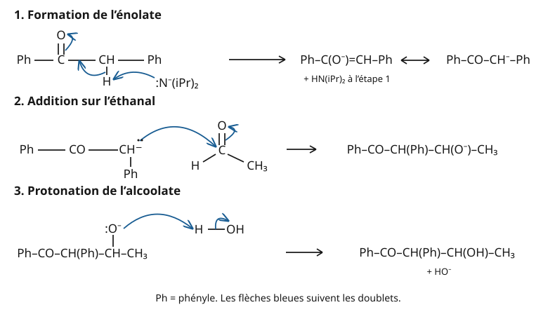
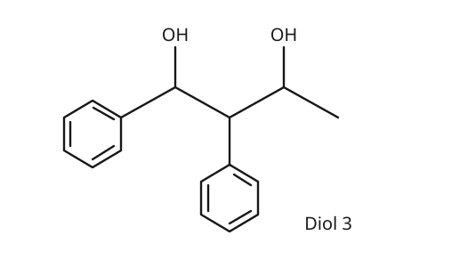
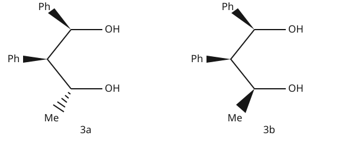
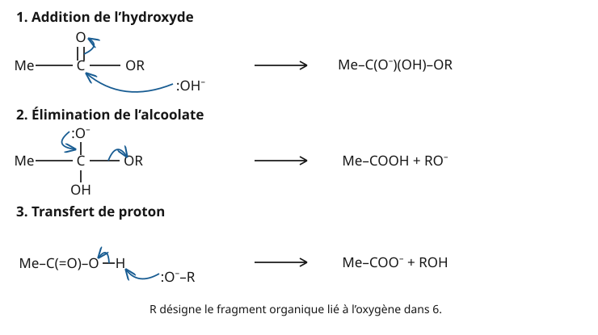
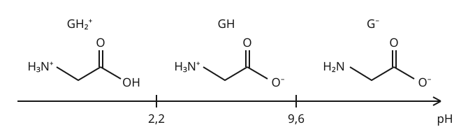

# Centrale-Supélec PC — Chimie 2025 · Corrigé guidé

*Corrigé rédigé par IA, non officiel. Signalez toute erreur.*

## Présentation du sujet

L’épreuve de quatre heures avec calculatrice étudie la synthèse, la formulation et l’action inhibitrice du Tamoxifène. Elle se termine par l’extraction de l’eugénol et le dosage de la glycine. Les données, le tableau périodique et le diagramme orbitalaire du ferrocène figurent à la fin du sujet.

Les bilans et les lectures de courbes offrent des points d’entrée. Réservez du temps aux projections stéréochimiques, à la justification du modèle d’absorbance et à l’exploitation du titrage.

## Partie A — Synthèse du Tamoxifène

### Question 1

> [!INDICATION]
> Comparez séparément les deux substituants portés par chacun des carbones de la double liaison.

#### Solution

L’alcène porte deux groupes différents sur chacun de ses carbones et la molécule ne possède aucun centre stéréogène configurativement stable. Il existe donc deux stéréoisomères. Sur le premier carbone, le phényle para-substitué est prioritaire sur le phényle simple, car le premier point de différence dans les sphères CIP fait intervenir l’oxygène. Sur l’autre, le phényle est prioritaire sur l’éthyle, avec les listes $[C,C,C]$ et $[C,H,H]$. Les deux groupes prioritaires sont du même côté sur la structure cible, de configuration **Z**.

### Question 2

> [!INDICATION]
> Formez l’énolate du partenaire qui doit fournir le carbone nucléophile.

#### Solution

Traiter $\mathrm{PhCOCH_2Ph}$ par le diisopropylamidure de lithium (LDA) en milieu anhydre pour former son énolate, ajouter l’éthanal, puis effectuer un traitement aqueux. La formation préalable de l’énolate de la cétone favorise l’aldolisation croisée.

### Question 3

> [!INDICATION]
> Suivez la liaison C–H en alpha, puis la liaison pi de l’électrophile.

#### Solution

Le doublet de l’azote de la base capte un proton en alpha du carbonyle. Les électrons de C–H forment la liaison pi de l’énolate en même temps que ceux de C=O se déplacent vers O. La forme mésomère carbanionique porte le doublet nucléophile sur le carbone alpha. Ce doublet attaque le carbone carbonylé de l’éthanal pendant que le doublet pi de C=O rejoint son oxygène. L’alcoolate ainsi obtenu est protoné lors du traitement aqueux et donne $\mathrm{PhCOCH(Ph)CH(OH)CH_3}$. L’aldolisation s’arrête à la bêta-hydroxycétone.



### Question 4

> [!INDICATION]
> Repérez le motif atteint par un donneur d’hydrure.

#### Solution

Le borohydrure réduit la cétone en alcool secondaire. Le diol 3 possède le squelette $\mathrm{Ph{-}CH(OH){-}CH(Ph){-}CH(OH){-}CH_3}$. Les deux liaisons C–O simples correspondent à deux fonctions alcool.



### Question 5

> [!INDICATION]
> Quels réactifs forment un acétal cyclique avec un 1,3-diol ?

#### Solution

On fait réagir séparément 3a et 3b avec la propanone, en excès, sous catalyse acide. L’élimination de l’eau au cours de l’acétalisation déplace l’équilibre vers le cycle à six chaînons. Les trois centres carbonés du diol conservent leur arrangement spatial.

### Question 6

> [!INDICATION]
> Ouvrez uniquement le pont acétal, en conservant les liaisons des centres carbonés.

#### Solution

En ouvrant l’acétal, chaque oxygène lié à la chaîne carbonée devient un OH. Dans la projection ci-dessous, les deux phényles pointent vers l’observateur pour les deux composés. Le méthyle pointe vers l’arrière pour 3a et vers l’observateur pour 3b. À chaque centre, H est opposé au substituant dessiné en perspective. Les éventuels énantiomères correspondants s’obtiennent en inversant toutes les liaisons en perspective.



### Question 7

> [!INDICATION]
> Identifiez le traitement à la saumure puis le principe de la séparation.

#### Solution

La saumure réalise un relargage et un préséchage. Elle favorise le maintien du produit organique dans la phase organique et réduit l’eau dissoute dans cette phase. Le sulfate de sodium anhydre achève ensuite le séchage. Les espèces 3a et 3b, diastéréoisomères, peuvent avoir des affinités différentes pour la silice et l’éluant, ce qui permet leur séparation.

### Question 8

> [!INDICATION]
> Utilisez la même quantité maximale de diol pour calculer chacun des deux rendements.

#### Solution

La cétone 2 est limitante. Les 8,74 mmol de borohydrure dépassent les 8,32 mmol de 2, même en ne comptant qu’un hydrure utile par ion. Une mole de 2 peut donner une mole de diol.

Avec $M_3=242\ \mathrm{g\,mol^{-1}}$ et $n_2=8{,}32\ \mathrm{mmol}$, les rendements isolés sont
$$
\begin{aligned}
\eta_a&=\frac{1{,}32/242}{8{,}32\times10^{-3}}=65{,}6\,\%,\\
\eta_b&=\frac{0{,}451/242}{8{,}32\times10^{-3}}=22{,}4\,\%.
\end{aligned}
$$

### Question 9

> [!INDICATION]
> Comptez les groupes OH et lisez la quantité d’anhydride.

#### Solution

L’excès d’anhydride éthanoïque acétyle les deux OH. Avec $\mathrm{Ac=C(O)CH_3}$, le diacétate 5 s’écrit $\mathrm{Ph{-}CH(OAc){-}CH(Ph){-}CH(OAc){-}CH_3}$.

### Question 10

> [!INDICATION]
> Distinguez le rôle des doublets des deux azotes.

#### Solution

Le site nucléophile est l’azote pyridinique. Son doublet, dans le plan du cycle, est disponible pour attaquer l’anhydride. Le doublet du groupe diméthylamino est conjugué avec le cycle. Une forme mésomère quinoïde présente une liaison exocyclique $\mathrm{C=N^+(Me)_2}$ en position para et une charge négative sur l’azote pyridinique. Cette donation accroît la nucléophilie de ce dernier.

### Question 11

> [!INDICATION]
> Suivez l’addition sur l’acyle et identifiez le transfert de proton qui ferme le bilan.

#### Solution

Avec $\mathrm{Ar}=4\text{-méthoxyphényle}$, 7 s’écrit $\mathrm{Ar{-}CH(Ph){-}CH(Ph){-}CH(OH){-}CH_3}$. L’hydroxyde attaque le carbone acyle de l’acétate de 6 et la liaison pi migre vers O. L’oxyanion rétablit C=O, ce qui expulse l’alcoolate de 7. L’alcoolate déprotone l’acide éthanoïque formé, donnant l’alcool 7 et l’éthanoate. La formation du carboxylate rend la saponification pratiquement quantitative.



### Question 12

> [!INDICATION]
> Identifiez la fonction que le chlorure de mésyle transforme et le sous-produit que piège la base.

#### Solution

Le composé 8 s’écrit $\mathrm{Ar{-}CH(Ph){-}CH(Ph){-}CH(OMs){-}CH_3}$. Le remplacement de OH par OMs transforme l’alcool en un dérivé portant un bon groupe partant, l’ion mésylate, et prépare l’élimination. La triéthylamine neutralise l’acidité libérée, sous forme de chlorure de triéthylammonium.

### Question 13

> [!INDICATION]
> Placez H et OMs en anti et observez de quel côté restent Ph et Me.

#### Solution

Notons C2 le carbone portant Ph et C3 celui portant OAc dans 6. La substitution au niveau de l’oxygène ne change pas la géométrie de C3 avant l’élimination. Dans une projection de Newman regardant de C2 vers C3, plaçons H de C2 à midi et OAc de C3 à six heures. Plaçons Ph de C2 à huit heures et le groupe $\mathrm{ArCH(Ph)}$ à quatre heures. Ces positions sont celles du centre C2 représenté sur le sujet.

Pour **9a**, plaçons Me de C3 à deux heures et H à dix heures. Pour **9b**, plaçons Me à dix heures et H à deux heures. Dans les deux cas, H de C2 et le futur groupe OMs sont antipériplanaires. Après élimination E2, Ph et Me se trouvent de part et d’autre de la double liaison en 9a, et du même côté en 9b. Ces projections spécifient les deux configurations de 6, avec le centre benzhydrylique conservé tel que figuré dans le sujet.

### Question 14

> [!INDICATION]
> Cherchez l’autre carbone bêta porteur d’hydrogènes.

#### Solution

L’élimination de H sur le méthyle terminal forme $\mathrm{Ar{-}CH(Ph){-}CH(Ph){-}CH{=}CH_2}$, soit 9c. La règle de Zaïtsev favorise les alcènes internes trisubstitués 9a et 9b par rapport à l’alcène terminal monosubstitué. Cette seule règle ne permet pas de prévoir le rapport 9a/9b.

### Question 15

> [!INDICATION]
> Représentez les deux formes mésomères d’un anion allylique.

#### Solution

Le tert-butanolate arrache H au carbone benzhydrylique voisin de la double liaison. Le doublet de la liaison C–H reste sur ce carbone. Dans l’autre forme mésomère il crée la liaison pi C1=C2, tandis que l’ancienne liaison pi donne un doublet sur C3. La protonation de C3 par le tert-butanol donne alors la chaîne éthyle du composé 10. Le rendement isolé de 48 % peut notamment refléter une isomérisation incomplète, la formation d’un autre stéréoisomère et les pertes de purification. Le seul rendement ne quantifie pas ces contributions.

### Question 16

> [!INDICATION]
> Associez les signaux par constante de couplage commune.

#### Solution

Pour $\mathrm{ArO{-}CH_2{-}CH_2{-}N(CH_3)_2}$, le groupe OCH2 donne le triplet de 2 H à 3,87 ppm et NCH2 le triplet de 2 H à 2,60 ppm. Les deux méthylènes se couplent avec $J=5{,}7\ \mathrm{Hz}$. Les deux N-méthyles équivalents donnent le singulet de 6 H à 2,23 ppm.

Pour l’éthyle lié à l’alcène, le méthylène donne le quadruplet de 2 H à 2,38 ppm et le méthyle le triplet de 3 H à 0,85 ppm, avec $J=7{,}5\ \mathrm{Hz}$ dans les deux cas. Les intégrations et les multiplicités correspondent aux cinq groupes attendus.

## A.II — Couplage de Suzuki

### Question 17

> [!INDICATION]
> Reliez l’apparition du butanal à l’état d’oxydation du palladium.

#### Solution

Le butan-1-ol est oxydé en butanal et fournit les deux électrons nécessaires à la réduction de Pd(II) en Pd(0). Il active donc le précatalyseur pour former l’espèce qui entre dans le cycle. Les traces de butanal concordent avec cette fonction réductrice.

### Question 18

> [!INDICATION]
> Suivez les liaisons au palladium et son état d’oxydation.

#### Solution

L’étape 1 est une **addition oxydante** du tosylate vinylique sur Pd(0). L’étape 2 est un **échange de ligand** tosylate contre hydroxyde. L’étape 4 est une **élimination réductrice** formant la liaison C–C du produit et régénérant Pd(0).

### Question 19

> [!INDICATION]
> Recensez les espèces qui traversent le cycle, y compris l’activation du boronique.

#### Solution

Le bilan moléculaire est
$$
\begin{aligned}
\mathrm{R^1OTs+R^2B(OH)_2+2\,NaOH}
&\longrightarrow\mathrm{R^1R^2+NaOTs+NaB(OH)_4}.
\end{aligned}
$$
Un équivalent de soude intervient dans l’échange de ligand et l’autre dans la formation du boronate. Le palladium est régénéré.

## Partie B — Formulation et réactivité

### Question 20

> [!INDICATION]
> Expliquez d’abord le choix des conditions, puis comparez la cavité et l’extérieur de la cyclodextrine.

#### Solution

Les 37 °C reproduisent approximativement la température corporelle. Le pH 6 fixe un milieu aqueux légèrement acide, pertinent pour l’étude en conditions biologiques. Le Tamoxifène porte plusieurs groupes aromatiques et est très peu soluble seul dans les conditions de la figure. La cavité relativement hydrophobe peut héberger une partie apolaire de la molécule grâce aux interactions de dispersion et à l’effet hydrophobe. L’extérieur riche en OH s’hydrate par liaisons hydrogène. Le complexe peut ainsi rester en solution.

### Question 21

> [!INDICATION]
> Lisez les plateaux, puis rapportez la masse dissoute au volume d’eau.

#### Solution

La concentration massique qui correspondrait à la dissolution intégrale vaut $0{,}422/0{,}014=30{,}1\ \mathrm{g\,L^{-1}}$. La figure donne les estimations suivantes.

- Pour le rapport 1:2,4, environ 40 %, soit $12\ \mathrm{g\,L^{-1}}$.
- Pour le rapport 1:3,5, environ 56 %, soit $17\ \mathrm{g\,L^{-1}}$.
- Pour le rapport 1:7,1, environ 66 %, soit $20\ \mathrm{g\,L^{-1}}$.

Ce sont des solubilités apparentes du Tamoxifène total dissous. Le jury signale une erreur dans la masse molaire fournie. La figure 8 identifie le composé comme « Tamoxifen Base (TB) ». La formule de la forme neutre représentée, $\mathrm{C_{26}H_{29}NO}$, donne $371{,}5\,\mathrm{g\,mol^{-1}}$. Sur cette base, les concentrations estimées sont $0{,}0324$, $0{,}0454$ et $0{,}0536\,\mathrm{mol\,L^{-1}}$.

En appliquant la valeur imprimée $564\,\mathrm{g\,mol^{-1}}$, on obtiendrait environ $0{,}021$, $0{,}030$ et $0{,}035\,\mathrm{mol\,L^{-1}}$. Les concentrations massiques ci-dessus se lisent directement à partir des données.

Davantage de cyclodextrine favorise l’encapsulation. La diminution de la concentration de Tamoxifène libre dissous déplace l’équilibre vers la dissolution.

## B.I.2 — Encapsulation par le captisol

### Question 22

> [!INDICATION]
> Repérez là où les formes libre et encapsulée ont la même concentration.

#### Solution

La loi d’action de masse donne $[\mathrm{T{-}C}]/[\mathrm T]=K_1^\circ[\mathrm C]/c^\circ$. Au croisement, ce rapport vaut 1. Comme on lit $pC\simeq3$, on obtient $[\mathrm C]/c^\circ\simeq10^{-3}$ et **$K_1^\circ\simeq10^3$**, sans unité.

### Question 23

> [!INDICATION]
> Additionnez le captisol libre calculé par l’équilibre et le captisol lié.

#### Solution

Pour 99 % de Tamoxifène encapsulé, le rapport des deux formes vaut 99. Il faut donc $[\mathrm C]=99c^\circ/K_1^\circ$, soit environ $0{,}099\ \mathrm{mol\,L^{-1}}$ de captisol **libre**. La concentration initiale de captisol doit aussi couvrir le captisol lié, soit $0{,}99C_T$. À volume commun,
$$
r=\frac{99c^\circ/K_1^\circ+0{,}99C_T}{C_T}\simeq100.
$$

### Question 24

> [!INDICATION]
> Divisez le bilan du Tamoxifène par la concentration de la forme libre.

#### Solution

Le bilan $C_T=[\mathrm T]+[\mathrm{T{-}C}]$ et l’équilibre donnent
$$
\begin{aligned}
f&=\frac{100}{1+10^{-pK-pC}},\\
g&=100-f.
\end{aligned}
$$

```python
def f(pC: float, pK: float) -> float:
    return 100 / (1 + 10**(-pK - pC))

def g(pC: float, pK: float) -> float:
    return 100 - f(pC, pK)
```

## B.I.3 — Complexation d’un colorant

### Question 25

> [!INDICATION]
> Écrivez Beer-Lambert avant et après association en comptant les trois espèces.

#### Solution

Notons $X=[\mathrm{S{-}ACD}]$. Les concentrations libres diminuent chacune de $X$. Quand l’absorbance de référence est retranchée, les trois contributions restantes sont
$$
\Delta A=lX(\varepsilon_{\mathrm{S{-}ACD}}-\varepsilon_S-\varepsilon_{\mathrm{ACD}})
=\Delta\varepsilon\, lX.
$$

### Question 26

> [!INDICATION]
> Gardez le bilan exact du colorant et simplifiez seulement celui de la cyclodextrine.

#### Solution

La cyclodextrine est en grand excès, donc $[\mathrm{ACD}]\simeq[\mathrm{ACD}]_0$. Le bilan du colorant donne $[S]=[S]_0-X$. En remplaçant dans $K_2^\circ=Xc^\circ/([S][\mathrm{ACD}])$ puis en isolant $X$,
$$
X=\frac{K_2^\circ[S]_0[\mathrm{ACD}]_0}{c^\circ+K_2^\circ[\mathrm{ACD}]_0}.
$$

### Question 27

> [!INDICATION]
> Isolez l’ordonnée demandée, puis comparez pente et intercept.

#### Solution

Pour $x=[\mathrm{ACD}]_0$ et $y=[\mathrm{ACD}]_0/\Delta A$, les deux résultats précédents donnent
$$
\begin{aligned}
y&=ax+b,\\
a&=\frac{1}{\Delta\varepsilon l[S]_0},\\
b&=\frac{ac^\circ}{K_2^\circ}.
\end{aligned}
$$
Par conséquent **$K_2^\circ=ac^\circ/b$**.

### Question 28

> [!INDICATION]
> Examinez les écarts normalisés avant d’utiliser les coefficients de la droite.

#### Solution

Sur la figure 11, les écarts normalisés sont de part et d’autre de zéro et restent largement inférieurs à 2 en module. À la précision indiquée, ces mesures sont compatibles avec le modèle affine. La pente vaut environ $-22{,}93$ et l’intercept $-8{,}38\times10^{-3}\ \mathrm{mol\,L^{-1}}$. Leur rapport multiplié par $c^\circ$ donne **$K_2^\circ\simeq2{,}74\times10^3$**.

### Question 29

> [!INDICATION]
> Écrivez la relation de Van ’t Hoff à deux températures absolues.

#### Solution

Sous l’hypothèse de grandeurs standard constantes,
$$
\ln K^\circ=-\frac{\Delta_r H^\circ}{RT}+\frac{\Delta_r S^\circ}{R}.
$$
Avec $(T_1,K_1)=(298{,}15\,\mathrm K,2{,}3\times10^{17})$ et $(T_2,K_2)=(318{,}15\,\mathrm K,1{,}2\times10^{16})$, on trouve
$$
\Delta_r H^\circ=-R\frac{\ln(K_2/K_1)}{1/T_2-1/T_1}\simeq-116\ \mathrm{kJ\,mol^{-1}}.
$$
Puis $\Delta_r S^\circ=R\ln K_1+\Delta_r H^\circ/T_1$ vaut environ $-58\ \mathrm{J\,mol^{-1}\,K^{-1}}$. L’encapsulation est exothermique et réduit le nombre de degrés de liberté accessibles aux partenaires. L’augmentation de température rend l’association moins favorable.

## B.II — Ferrocène

### Question 30

> [!INDICATION]
> Comparez le nombre d’environnements des protons et la symétrie des deux structures.

#### Solution

Dans le modèle localisé historique, les H n’ont pas tous le même environnement. On attend plusieurs signaux et la géométrie asymétrique ne rend pas compte naturellement du moment dipolaire nul. Dans le sandwich, les dix hydrogènes sont équivalents à l’échelle de la RMN et les contributions au dipôle se compensent par symétrie. Le singulet unique à 4,2 ppm est cohérent avec ce dernier modèle.

### Question 31

> [!INDICATION]
> Écrivez la configuration de Fe puis retirez les deux électrons de valence arrachés en premier.

#### Solution

Fe a pour configuration $[\mathrm{Ar}]\,3d^6 4s^2$. L’ionisation retire d’abord les deux électrons de 4s. Fe(II) est donc **$[\mathrm{Ar}]\,3d^6$**. Pour l’ion libre, la règle de Hund conduit à quatre électrons non appariés.

### Question 32

> [!INDICATION]
> Cherchez une orbitale occupée de ligand dont le recouvrement est axial.

#### Solution

Prenons comme axe $z$ l’axe qui passe par Fe et les centres des cycles. Dans l’OM HO−1 occupée du cyclopentadiènyle, les cinq contributions p sont en phase sur chaque face. Une combinaison des deux HO−1 de symétrie $a_{1g}$ recouvre axialement l’orbitale 4s du fer, de même symétrie. L’occupation initiale de l’OM du ligand donne un exemple d’interaction sigma-donneuse.

### Question 33

> [!INDICATION]
> Comparez les changements de signe des orbitales de même symétrie.

#### Solution

Les combinaisons des HO des deux ligands de symétrie $e_{1g}$ peuvent interagir avec $d_{xz}$ et $d_{yz}$ respectivement. Les lobes métalliques de part et d’autre du plan médian ont des phases opposées adaptées à la combinaison correspondant à chaque orientation. L’autre combinaison des mêmes HO, de symétrie $e_{1u}$, interagit avec $p_x$ et $p_y$.

### Question 34

> [!INDICATION]
> Comptez les électrons de valence puis repérez sur la HO les groupes qui portent ses lobes.

#### Solution

Les deux ligands fournissent chacun six électrons et Fe(II) en fournit six. En suivant l’ordre du diagramme de l’annexe, le remplissage des 18 électrons est
$$
(a_{1g})^2(a_{2u})^2(e_{1g})^4(e_{1u})^4(e_{2g})^4(a_{1g})^2.
$$
La HO $a_{1g}$ du modèle est essentiellement métallique, de caractère $d_{z^2}$. Une lecture fondée sur la seule HO rend donc mal compte de l’attaque du chlorure d’acyle par un carbone de cycle. Il faut également considérer les orbitales occupées à contribution des cycles et les effets du partenaire de réaction. Le diagramme qualitatif de l’espèce isolée ne suffit pas pour expliquer la réaction sans acide de Lewis.

## Partie C — Cinétique de l’inhibition

### Question 35

> [!INDICATION]
> Écrivez pour chaque intermédiaire sa vitesse de formation moins ses deux vitesses de disparition.

#### Solution

L’approximation des états quasi stationnaires donne
$$
\begin{aligned}
0&\simeq k_1[E][S]-(k_{-1}+k_2)[ES],\\
0&\simeq k_3[E][T]-(k_{-3}+k_4)[ET].
\end{aligned}
$$
On obtient ainsi $[ES]/[E]=k_1[S]/(k_{-1}+k_2)$ et $[ET]/[E]=k_3[T]/(k_{-3}+k_4)$.

### Question 36

> [!INDICATION]
> Recensez toutes les formes qui contiennent une unité de récepteur.

#### Solution

Le récepteur est libre ou lié à une molécule de substrat ou de Tamoxifène. Il est régénéré aux deux étapes de formation des produits, d’où $[E]_0=[E]+[ES]+[ET]$.

### Question 37

> [!INDICATION]
> Introduisez les deux rapports de la question 35 dans le bilan de matière.

#### Solution

Posons $a=k_1[S]/(k_{-1}+k_2)$ et $b=k_3[T]/(k_{-3}+k_4)$. On a $[E]=[E]_0/(1+a+b)$, donc $[ES]=a[E]_0/(1+a+b)$. Puisque seule la dissociation productive de ES donne $P$,
$$
v=\frac{\mathrm d[P]}{\mathrm dt}=\frac{k_2a[E]_0}{1+a+b}.
$$
La voie passant par ET produit $P'$.

### Question 38

> [!INDICATION]
> Comparez les vitesses à concentration en substrat fixée.

#### Solution

À $[S]$ fixée, le terme $b$ croît avec $[T]$. Ajouter du Tamoxifène diminue donc la vitesse de formation du produit actif. Pour $a>0$ et $b>0$, $v([T])/v(0)=(1+a)/(1+a+b)<1$. Le modèle représente bien la compétition pour le récepteur.

### Question 39

> [!INDICATION]
> L’incrément d’Euler utilise la concentration de ES au début du pas.

#### Solution

Avec $t$ et $P$ initialisées avec leurs valeurs à l’instant initial, on peut écrire la boucle suivante. La ligne supposée calculer ES ajoute, si nécessaire, sa valeur au temps courant avant sa lecture.

```python
while t[-1] < duree:
    i = len(t) - 1
    # La mise à jour fournie rend ES[i] disponible au temps t[i].
    temps_suivant = min(t[i] + h, duree)
    dt = temps_suivant - t[i]
    P.append(P[i] + dt * k2 * ES[i])
    t.append(temps_suivant)
```

Le pas $h$ est positif. Le dernier pas peut être raccourci pour atteindre exactement la durée demandée.

## Partie D — Autres principes actifs

### Question 40

> [!INDICATION]
> Lisez les frontières en partant du palier horizontal.

#### Solution

Dans le domaine I, deux phases liquides coexistent, l’eau et l’eugénol liquides. Dans II, on trouve l’eau liquide et une phase vapeur contenant les deux constituants. Dans III, l’eugénol liquide coexiste avec la vapeur des deux constituants. Dans IV, le mélange des deux vapeurs constitue une seule phase. Sur le palier hétéroazéotropique, les deux phases liquides coexistent avec la vapeur de composition $x_H$.

### Question 41

> [!INDICATION]
> Suivez la vapeur hétéroazéotropique dans le condenseur.

#### Solution

La vapeur contient de l’eau et de l’eugénol, avec une fraction molaire d’eugénol $x_H=0{,}002$. Le distillat condensé contient les mêmes espèces. Comme leurs phases liquides ne sont pas miscibles dans le modèle du diagramme, la dispersion de gouttelettes dans l’autre liquide diffuse la lumière et donne l’aspect laiteux.

### Question 42

> [!INDICATION]
> Convertissez la masse d’eugénol en moles avant d’utiliser la composition de la vapeur.

#### Solution

Les clous contiennent $12\times0{,}15=1{,}8\ \mathrm g$ d’eugénol, soit $n_E=1{,}8/162=1{,}11\times10^{-2}\ \mathrm{mol}$. La vapeur hétéroazéotropique emporte
$$
n_{\mathrm{eau}}=n_E\frac{1-x_H}{x_H}\simeq5{,}54\ \mathrm{mol}.
$$
Cela représente environ 100 g d’eau, soit environ 100 mL, avec une masse volumique de $1{,}0\ \mathrm{g\,mL^{-1}}$. Comme on souhaite ne distiller que la moitié de l’eau introduite, il faut initialement **environ 200 mL d’eau**.

### Question 43

> [!INDICATION]
> Divisez les deux aires pour éliminer le volume réellement injecté.

#### Solution

Le rapport $A_E/A_B$ vaut $(k_E/k_B)(C_{m,E}/C_{m,B})$. Les solutions sont préparées au même volume et à la même concentration massique de biphényle. Le rapport est donc proportionnel à la masse $m$ d’eugénol. Un ajustement passant par l’origine aux cinq étalons donne $A_E/A_B\simeq 9{,}35\times10^{-3}m$, avec $m$ en mg. Pour l’huile, le rapport 3,99 correspond à environ 427 mg d’eugénol, soit **environ 84 % en masse** dans les 506 mg d’huile.

## D.II — Titrage de la glycine

### Question 44

> [!INDICATION]
> Affectez chaque pKa au groupe qui perd effectivement un proton.

#### Solution

L’espèce $\mathrm{GH_2^+}$ domine sous 2,2, puis le zwitterion $\mathrm{GH}$ entre 2,2 et 9,6, puis l’anion $\mathrm{G^-}$ au-dessus de 9,6. Au premier seuil le groupe COOH est déprotoné, au second le groupe ammonium. À chaque seuil, les deux formes adjacentes sont en quantités égales dans le modèle des solutions idéales diluées.



### Question 45

> [!INDICATION]
> Utilisez le caractère ampholyte du zwitterion, puis examinez la force de sa réaction avec HO−.

#### Solution

Le zwitterion prédomine dans $S_0$. Pour une concentration de glycine voisine de $0{,}065\ \mathrm{mol\,L^{-1}}$, le bilan de charge donne, à bonne approximation, $[\mathrm{GH_2^+}]\simeq[\mathrm{G^-}]$. Le produit des deux relations d’acidité conduit à $[\mathrm{H_3O^+}]^2/(c^\circ)^2\simeq K_{a1}K_{a2}$, soit **$\mathrm{pH}\simeq5{,}9$**.

Le titrage direct mettrait en jeu $\mathrm{GH+HO^-\rightleftharpoons G^-+H_2O}$, de constante $10^{14-9{,}6}\simeq2{,}5\times10^4$. La basicité de la solution à l’équivalence, due à l’hydrolyse de $\mathrm{G^-}$, limite la rupture de pente. Pour environ $0{,}04\ \mathrm{mol\,L^{-1}}$ de glycinate, cette hydrolyse donne déjà un pH voisin de 11,1, et la soude en léger excès augmente peu ce pH. L’équivalence est donc difficile à repérer directement.

### Question 46

> [!INDICATION]
> Chaque ligand se fixe après perte d’un proton.

#### Solution

La formation du complexe libère deux ions oxonium pour deux molécules de glycine.
$$
\mathrm{Cu^{2+}+2\,GH+2\,H_2O\rightleftharpoons Cu(G)_2+2\,H_3O^+}.
$$

### Question 47

> [!INDICATION]
> Identifiez l’espèce dosée avant que le cuivre restant ne précipite.

#### Solution

La complexation quantitative libère un oxonium par molécule de glycine. La réaction support est
$$
\mathrm{H_3O^+ + HO^-\longrightarrow 2\,H_2O}.
$$
L’équivalence est voisine du début de précipitation de l’excès de cuivre(II) en $\mathrm{Cu(OH)_2(s)}$. Au pH de 5,49, le seuil $[\mathrm{Cu^{2+}}]/c^\circ=10^{-19}/(10^{-8{,}51})^2$ vaut environ $10^{-2}$. Cette valeur est du même ordre que la concentration du cuivre en excès. La consommation ultérieure de soude par précipitation explique la rupture observée.

### Question 48

> [!INDICATION]
> Comparez les indices expérimentaux à l’équivalence des deux méthodes.

#### Solution

La complexation transforme la quantité à doser en une quantité égale d’ions oxonium. Après leur neutralisation, le cuivre(II) excédentaire commence à précipiter et consomme les ions hydroxyde ajoutés. Ce changement de réaction entraîne un point anguleux identifiable, ce qui améliore le repérage de l’équivalence par rapport au titrage direct de la forme zwitterionique.

### Question 49

> [!INDICATION]
> Passez du prélèvement au comprimé et propagez les deux incertitudes indépendantes.

#### Solution

L’équivalence vérifie $n_{\mathrm{GH,prélèvement}}=CV_e$. Le comprimé correspond à cinq prélèvements. Avec $V_e$ en litres,
$$
m=5M_{\mathrm{GH}}CV_e=488{,}5\ \mathrm{mg}.
$$
En négligeant les incertitudes de verrerie et en prenant les deux grandeurs indépendantes,
$$
u(m)=m\sqrt{\left(\frac{u(C)}{C}\right)^2+\left(\frac{u(V_e)}{V_e}\right)^2}
\simeq2{,}1\ \mathrm{mg}.
$$
Le résultat peut s’écrire **$m=(488{,}5\pm2{,}1)\ \mathrm{mg}$**, l’incertitude indiquée étant une incertitude-type.

### Question 50

> [!INDICATION]
> Rapportez la différence de masses à l’incertitude-type combinée.

#### Solution

La notice donne $0{,}98\times500=490\ \mathrm{mg}$ et $u_{\mathrm{notice}}=3\ \mathrm{mg}$. En combinant les incertitudes indépendantes, on obtient
$$
z=\frac{|488{,}5-490|}{\sqrt{2{,}1^2+3^2}}\simeq0{,}41.
$$
Cet écart normalisé est inférieur à 2. La mesure est compatible avec la valeur de la notice.

## Bilan

La projection antipériplanaire explique la stéréochimie de l’élimination. Les bilans de matière distinguent les formes libres et complexées dans l’encapsulation et l’inhibition. Pour le dosage final, le point anguleux identifie un changement de réaction, et la comparaison à la notice combine les deux incertitudes.
