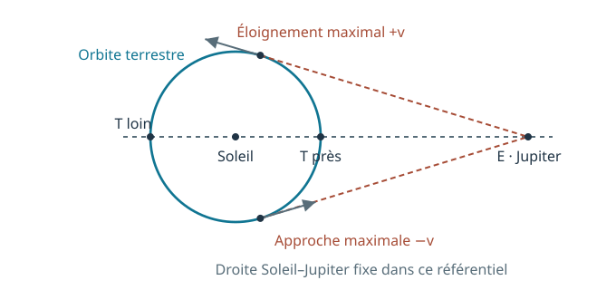
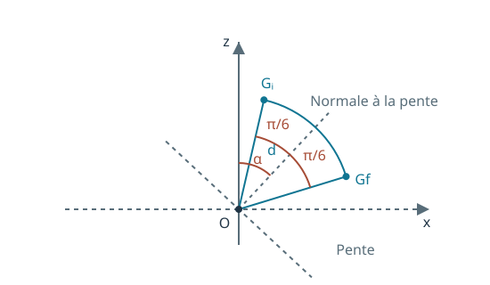

# Centrale-Supélec PC — Physique 1 2025 · Corrigé guidé

*Corrigé rédigé par IA, non officiel. Signalez toute erreur.*

## Présentation du sujet

L’épreuve « Vitesses mécaniques et célérités des ondes » dure quatre heures, calculatrice autorisée. La partie A étudie la mesure de Rømer, la précession de Mercure et l’expérience de Fizeau. La partie B étudie le chant des dunes et l’acoustique en présence de viscosité ou de courant. Les deux parties sont indépendantes.

Q1–Q4, Q8–Q10, Q15–Q21, Q22 et Q28–Q30 offrent des points d’entrée. Réservez du temps à la géométrie de Rømer en Q5–Q6, à la moyenne vectorielle en Q13 et aux modèles à confronter aux mesures en Q26 et Q32.

## Partie A — Mécanique et célérité de la lumière

Les retards optiques mesurent des mouvements relatifs ou des temps de vol. Pour Mercure, une petite correction dynamique devient visible après de nombreuses révolutions.

### I — La mesure de la célérité de la lumière par Rømer

### Question 1

> [!INDICATION]
> Écrire le temps de vol de chacun des deux signaux, puis exprimer aussi l’évolution de la distance par la cinématique du récepteur.

> [!JURY]
> Le rapport attend d’abord la relation exacte entre distances et instants, puis la justification que l’intervalle obtenu est indépendant de l’indice.

#### Solution

Pour chaque émission, $d_k=c_0(t'_k-t_k)$. Comme $t_{k+1}-t_k=T$, on obtient
$$
d_{k+1}=d_k+c_0(t'_{k+1}-t'_k-T).
$$
D’autre part, si $v$ est la vitesse d’éloignement constante, $d_{k+1}-d_k=v(t'_{k+1}-t'_k)$. En identifiant, on trouve
$$
\boxed{T'=t'_{k+1}-t'_k=\frac{T}{1-v/c_0}.}
$$
L’intervalle est indépendant de $k$. La réception est périodique, avec une période augmentée par l’éloignement. Il s’agit de **l’effet Doppler**.

### Question 2

> [!INDICATION]
> Écrire d’abord une relation de Chasles vectorielle, puis seulement calculer la norme.

#### Solution

Avec $\overrightarrow{ER_k}=d_k\vec u_x$, la relation de Chasles donne
$$
\overrightarrow{ER_{k+1}}\simeq
(d_k+v_xT')\vec u_x+v_yT'\vec u_y.
$$
D’où **$d_{k+1}\simeq\sqrt{(d_k+v_xT')^2+(v_yT')^2}$** dans l’approximation du mouvement uniforme entre les deux réceptions.

### Question 3

> [!INDICATION]
> Développer la norme de Q2 au premier ordre en la petite variation de distance.

#### Solution

Sur l’intervalle de réception, supposons le déplacement petit devant $d_k$. En mettant $d_k$ en facteur et en développant la racine, on trouve $d_{k+1}-d_k\simeq v_xT'$. La composante transverse intervient au deuxième ordre.

La différence des temps de vol donne encore $d_{k+1}-d_k=c_0(T'-T)$. Ainsi **$T'\simeq T/(1-v_x/c_0)$**, équivalent à $T(1+v_x/c_0)$ au premier ordre. La condition de ce développement est $vT'/d_k\ll1$, satisfaite à l’échelle de la géométrie Terre–Jupiter.

### Question 4

> [!INDICATION]
> Appliquer la relation de Kepler à l’orbite circulaire, en prenant la distance entre les centres.

#### Solution

L’équilibre entre accélération centripète et gravitation donne $4\pi^2d_{JS}/T_J^2=GM_\odot/d_{JS}^2$. En assimilant le Soleil au centre fixe,
$$
\boxed{T_J=2\pi\sqrt{\frac{d_{JS}^3}{GM_\odot}}\simeq3{,}74\times10^8\ \mathrm s\simeq11{,}9\ \mathrm{ans}.}
$$

### Question 5

> [!INDICATION]
> Soustraire les vitesses angulaires. Examiner dans quelle configuration la ligne de visée est parallèle à la vitesse de la Terre.

#### Solution

Le repère accompagnant Jupiter tourne à $2\pi/T_J$ dans le référentiel héliocentrique. Comme la Terre parcourt son orbite dans le même sens, sa vitesse angulaire dans ce repère est $2\pi(1/T_0-1/T_J)$. Elle y décrit un cercle de rayon $a_0$ à vitesse uniforme
$$
\boxed{v=2\pi a_0\left(\frac1{T_0}-\frac1{T_J}\right)\simeq27{,}2\ \mathrm{km\,s^{-1}}.}
$$
La vitesse d’éloignement est $\mathrm d(ET)/\mathrm dt$, projection de la vitesse terrestre sur la direction de $E$ vers la Terre. Son module est au plus $v$.

Comme $E$ est extérieur au cercle, les deux tangentes issues de $E$ réalisent les projections extrêmes $-v$ et $+v$.

La projection est nulle aux deux alignements Soleil–Terre–Jupiter. Sur un cycle relatif complet, sa moyenne est nulle puisque la distance reprend sa valeur initiale.

### Question 6

> [!INDICATION]
> Comparer les deux trajets lumineux extrêmes. Relier le diamètre de l’orbite à la vitesse dans le référentiel de Jupiter.

> [!METHODE]
> Distinguez le retard cumulé sur des dates d’observation et l’écart entre deux périodes élémentaires.

#### Solution

Entre les deux alignements de la figure 1, les distances extrêmes sont $d_{JS}-a_0$ et $d_{JS}+a_0$. Le décalage accumulé des dates d’apparition entre ces configurations est donc $2a_0/c_0$. Si $T_{\mathrm{rel}}=(T_0^{-1}-T_J^{-1})^{-1}$ est la période relative, $2a_0=T_{\mathrm{rel}}v/\pi$.

L’approximation demandée remplace $T_{\mathrm{rel}}$ par $T_0$, puisque $T_J$ dépasse largement un an. En identifiant les 22 minutes au décalage cumulé de temps de vol,
$$
\boxed{\Delta\tau\simeq\frac{T_0v}{\pi c_0},
\qquad c_0\simeq2{,}1\times10^8\ \mathrm{m\,s^{-1}}.}
$$
La valeur est de 30 % inférieure à la valeur de référence. Garder la période relative donnerait environ $2{,}3\times10^8\ \mathrm{m\,s^{-1}}$. Les 22 minutes utilisées ici représentent un retard sur les dates d’apparition entre les configurations extrêmes. La différence entre deux périodes élémentaires d’Io à des positions extrêmes serait de l’ordre de $2\tau_m v/c_0$, soit quelques dizaines de secondes.

### Question 7

> [!INDICATION]
> Appliquer Kepler au système Jupiter–Io, puis placer le barycentre sur la droite des deux masses.

#### Solution

En négligeant la masse d’Io devant celle de Jupiter, $GM_J=4\pi^2d_{JI}^3/\tau_m^2$. Pour $\tau_m=42{,}46\ \mathrm h$, on trouve $M_J\simeq1{,}90\times10^{27}$ kg. En particulier,
$$
\boxed{\frac{M_\odot}{M_J}\simeq1{,}05\times10^3.}
$$
Dans le système Soleil–Jupiter, le barycentre est à $d=d_{JS}M_J/(M_\odot+M_J)$ du centre du Soleil. Numériquement, **$d\simeq7{,}4\times10^8\ \mathrm m$**, soit $1{,}07$ rayon solaire. Le barycentre est légèrement à l’extérieur du Soleil dans ce modèle, bien que son déplacement soit inférieur au millième de la distance Soleil–Jupiter.

### II — Les perturbations séculaires de l’orbite de Mercure

#### II.1 — La trajectoire de Mercure selon les lois de Kepler

### Question 8

> [!INDICATION]
> Identifier les extrêmes du dénominateur, puis résoudre les deux relations.

#### Solution

Comme $e>0$, le périhélie correspond à $\theta=0$ et l’aphélie à $\theta=\pi$. Ainsi $r_{\min}=p/(1+e)$ et $r_{\max}=p/(1-e)$. D’où
$$
\begin{aligned}
e&=\frac{r_{\max}-r_{\min}}{r_{\max}+r_{\min}}\simeq0{,}206,\\
p&=\frac{2r_{\min}r_{\max}}{r_{\min}+r_{\max}}\simeq5{,}55\times10^{10}\ \mathrm m.
\end{aligned}
$$

### Question 9

> [!INDICATION]
> Utiliser la force gravitationnelle et projeter le moment cinétique suivant l’axe normal à l’orbite.

#### Solution

La force centrale de gravitation donne $\vec a=-K\vec u_r/r^2$, avec **$K=GM_\odot$**. Son moment en $O$ est nul. Dans le référentiel galiléen d’étude, le moment cinétique $m\overrightarrow{OM}\wedge\vec v=mr^2\dot\theta\vec u_z$ est constant. Ainsi **$C_a=r^2\dot\theta>0$** est la constante des aires, égale au double de la vitesse aréolaire. Le signe positif vient du mouvement direct choisi dans la figure 3.

### Question 10

> [!INDICATION]
> Diviser l’accélération par la vitesse angulaire, puis identifier une dérivée dans la base polaire.

#### Solution

Comme $\dot\theta=C_a/r^2$, on a
$$
\begin{aligned}\frac{\mathrm d\vec v}{\mathrm d\theta}
&=-\frac{K}{C_a}\vec u_r
=\frac1H\frac{\mathrm d\vec u_\theta}{\mathrm d\theta},\\
H&=\frac{C_a}{K}>0.\end{aligned}
$$

### Question 11

> [!INDICATION]
> Intégrer la relation précédente. Au périhélie, utiliser la nullité de la composante radiale pour orienter la constante vectorielle.

> [!JURY]
> Projetez l’égalité vectorielle au périhélie avant de fixer l’orientation de la constante.

#### Solution

L’intégration donne $H\vec v=\vec u_\theta+\vec e$ avec $\vec e$ constante dans la base fixe. Au périhélie, $\vec v\cdot\vec u_r=0$ et $\vec u_r=\vec u_x$. Donc $\vec e=e_y\vec u_y$, où $e_y$ est algébrique.

La projection orthoradiale donne $C_a^2/(Kr)=1+e_y\cos\theta$. Au périhélie et à l’aphélie, la comparaison des inverses des deux rayons montre que $e_y>0$. En identifiant avec l’équation de Q8, on obtient **$e_y=e$ et $p=C_a^2/K$**. Cela donne à la fois la direction et la norme du vecteur demandé.

#### II.2 — Correction relativiste pour la trajectoire de Mercure

### Question 12

> [!INDICATION]
> Estimer la période par Kepler avec le demi-grand axe. Transformer une perturbation relative par tour en cumul sur un siècle.

#### Solution

Le demi-grand axe vaut $a=(r_{\min}+r_{\max})/2\simeq5{,}79\times10^{10}\ \mathrm m$. La loi de Kepler donne une période proche de 88 jours. Une vitesse orbitale typique vaut $2\pi a/T\simeq4{,}8\times10^4\ \mathrm{m\,s^{-1}}$, donc **$v_\theta/c_0\sim1{,}6\times10^{-4}$**. L’accélération supplémentaire représente une fraction d’ordre $2{,}5\times10^{-8}$ de l’accélération classique si $\gamma$ est d’ordre un.

Une estimation dimensionnelle de la rotation par révolution est cette fraction multipliée par un angle d’ordre $2\pi$. Sur environ $4{,}1\times10^2$ tours par siècle, cela correspond à $6\times10^{-5}\ \mathrm{rad}$, soit une dizaine de secondes d’arc par siècle. C’est le même ordre de grandeur que l’avance résiduelle observée. Le coefficient précis exige la moyenne vectorielle de Q13.

### Question 13

> [!INDICATION]
> Remplacer l’intégration temporelle par une intégration en angle grâce à la constante des aires.

#### Solution

Le mouvement de référence vérifie $\mathrm dt=r^2\,\mathrm d\theta/C_a$ et $v_\theta=(K/C_a)(1+e\cos\theta)$. Par conséquent
$$
\langle\vec a_{\rm rel}\rangle
=-\frac{\gamma K^3}{Tc_0^2 C_a^3}
\int_0^{2\pi}(1+e\cos\theta)^2\vec u_r\,\mathrm d\theta.
$$
En prenant $\vec u_r=\cos\theta\,\vec u_x+\sin\theta\,\vec u_y$, les termes constants et ceux d’ordre $e^2$ donnent zéro sur un tour. Il reste $2e\int_0^{2\pi}\cos^2\theta\,\mathrm d\theta\,\vec u_x=2\pi e\vec u_x$. Comme $\vec u_z\wedge\vec e=-e\vec u_x$,
$$
\begin{aligned}\langle\vec a_{\rm rel}\rangle
&=A\gamma\frac{K}{C_a}\,\vec u_z\wedge\vec e,\\
A&=\frac{2\pi K}{Tp c_0^2}\simeq2{,}2\times10^{-14}\ \mathrm{s^{-1}}.\end{aligned}
$$

### Question 14

> [!INDICATION]
> Dériver l’expression proposée pour la vitesse. Soustraire le terme newtonien, puis convertir les secondes d’arc.

#### Solution

La dérivée de $\vec u_\theta$ donne $-\dot\theta\vec u_r$. Comme $C_a$ reste constant, la contribution correspondante à l’accélération est $-K\vec u_r/r^2$. L’accélération moyenne supplémentaire vaut donc $(K/C_a)\mathrm d\vec e/\mathrm dt$. D’après Q13,
$$
\begin{aligned}\frac{\mathrm d\vec e}{\mathrm dt}&=\vec\Omega\wedge\vec e,\\
\vec\Omega&=A\gamma\vec u_z.\end{aligned}
$$
Le produit vectoriel préserve la norme de $\vec e$ et tourne sa direction, donc l’axe des absides. Une avance directe de $42''$ par siècle correspond à $\Omega=42\times4{,}85\times10^{-6}/(100T_0)\simeq6{,}5\times10^{-14}\ \mathrm{rad\,s^{-1}}$. Ainsi **$\gamma\simeq2{,}9$**, compatible avec la valeur entière **$\gamma=3$**.

### III — Propagation de la lumière dans un fluide en mouvement

#### III.1 — L’entraînement des ondes lumineuses dans l’eau

### Question 15

> [!INDICATION]
> Prendre la différence des inverses des célérités et utiliser la fréquence fixée par la source.

#### Solution

Les temps de traversée sont $L/c_1$ et $L/c_2$. Leur différence vaut $\Delta t=L\Delta c/c_m^2$. En définissant $\phi_i$ comme le retard de phase positif de propagation, $\phi_i=2\pi c_0t_i/\lambda_0$. Ainsi
$$
\boxed{\Delta\phi=\frac{2\pi c_0L\,\Delta c}{\lambda_0c_m^2}.}
$$
Avec le champ écrit sous la forme $\cos(\omega t+\varphi_i)$ à la sortie, l’écart des phases $\varphi_2-\varphi_1$ porte le signe opposé. Le déplacement en nombre de franges dépend de $|\Delta\phi|/(2\pi)$.

### Question 16

> [!INDICATION]
> Examiner le changement de déphasage lorsque les deux célérités restent les mêmes.

> [!PIEGE]
> Le déplacement nul signifie que les franges restent en place.

#### Solution

Dans le modèle sans entraînement, $\Delta c=0$, donc le mouvement de l’eau induit **$\Delta N=0$**. Les franges d’interférence peuvent subsister à leurs positions initiales.

### Question 17

> [!INDICATION]
> Un déplacement d’une frange correspond à une variation de phase d’un tour. Comparer ensuite les trois prédictions par paires.

#### Solution

Dans le modèle partiel, $\Delta N=|\Delta\phi|/(2\pi)=2vL(n^2-1)/(\lambda_0c_0)$. La condition expérimentale $\Delta N>\Delta N_{\min}$ donne
$$
\boxed{L>L_{\min}=\frac{\Delta N_{\min}\lambda_0c_0}{2v(n^2-1)}
\simeq11{,}5\ \mathrm m.}
$$
Une longueur de l’ordre de 12 m est donc nécessaire avec les paramètres proposés. Le modèle total donne $\Delta N_{\mathrm{tot}}=2vLn^2/(\lambda_0c_0)$. Au seuil $L_{\min}$, son écart avec le modèle partiel est $\Delta N_{\min}/(n^2-1)\simeq0{,}98$ frange, supérieur au seuil de 0,75. Une longueur légèrement supérieure à $L_{\min}$ permet donc aussi de distinguer les modèles partiel et total.

#### III.2 — Le modèle classique des vitesses d’entraînement

### Question 18

> [!INDICATION]
> Ajouter vectoriellement la vitesse relative et la vitesse d’entraînement. Garder le signe du courant avant de calculer la moyenne.

#### Solution

En mécanique classique, $\vec v_{M/R}=\vec v_{M/R'}+\vec v_e$ pour les référentiels ici en translation. Avec le courant dans le sens de propagation dans le tube 1, on trouve
$$
\begin{aligned}
c_1&=c_0/n+v,\qquad c_2=c_0/n-v,\\
\Delta c&=2v,\\
c_m&=\sqrt{(c_0/n)^2-v^2}\simeq c_0/n .
\end{aligned}
$$
Au premier ordre en $v/c_0$, c’est **l’entraînement total**.

#### III.3 — Le modèle relativiste pour les ondes lumineuses dans l’eau

### Question 19

> [!INDICATION]
> Résoudre l’égalité donnée pour la vitesse dans le référentiel de l’eau, puis tester les deux signes de la célérité du vide.

#### Solution

L’inversion donne
$$
\boxed{v_{M/R'}=\frac{v_{M/R}-v_e}{1-v_{M/R}v_e/c_0^2}.}
$$
Cette relation échange les rôles des référentiels en remplaçant $v_e$ par $-v_e$. Elle se réduit à la soustraction classique dans la limite des petites vitesses. Si $v_{M/R}=\pm c_0$, le numérateur vaut $\pm c_0$ fois le dénominateur, et $v_{M/R'}=\pm c_0$. La célérité de la lumière dans le vide est donc invariante dans le changement de référentiel.

### Question 20

> [!INDICATION]
> Substituer les deux vitesses de l’eau dans la formule directe. Développer le dénominateur au premier ordre.

#### Solution

La composition donne $c_1=(c_0/n+v)/(1+v/(nc_0))$ et $c_2=(c_0/n-v)/(1-v/(nc_0))$. Au premier ordre,
$$
\begin{aligned}
c_1&\simeq c_0/n+v(1-1/n^2),\\
c_2&\simeq c_0/n-v(1-1/n^2).
\end{aligned}
$$

### Question 21

> [!INDICATION]
> Former différence et moyenne. Identifier l’ordre des termes qui pourraient différencier les deux modèles.

#### Solution

En posant $\beta=v/c_0$, les résultats exacts donnent
$$
\begin{aligned}
\Delta c&=\frac{2v(1-1/n^2)}{1-\beta^2/n^2},\\
c_m&=\frac{c_0}{n}\sqrt{\frac{1-n^2\beta^2}{1-\beta^2/n^2}}.
\end{aligned}
$$
Au premier ordre, on retrouve les expressions de Fresnel $\Delta c\simeq2v(1-1/n^2)$ et $c_m\simeq c_0/n$. À $v=7\ \mathrm{m\,s^{-1}}$, les corrections relatives sont de l’ordre de $\beta^2\sim5\times10^{-16}$. Elles sont inaccessibles à la résolution en nombre de franges de l’expérience de Fizeau.

## Partie B — Mécanique et célérité des ondes acoustiques

La fréquence du chant des dunes se déduit du temps entre deux chocs. Dans l’eau, on distingue la vitesse de la matière, la célérité au repos et la vitesse de phase mesurée dans le laboratoire.

### I — Le chant des dunes

### Question 22

> [!INDICATION]
> Relier la longueur de la cavité à la demi-longueur d’onde du fondamental, puis comparer les ordres de grandeur.

#### Solution

Le mode fondamental d’une corde fixée aux deux extrémités vérifie $\lambda_1=2d$, donc **$f_1=c_a/(2d)$**. Pour $d$ de l’ordre de $2\times10^{-4}\ \mathrm m$, même la célérité dans l’air donne déjà environ $9\times10^5\ \mathrm{Hz}$. Dans le solide, la fréquence proposée serait encore plus élevée. Cette résonance à l’échelle d’un grain ne peut expliquer les fréquences observées, proches de $10^2\ \mathrm{Hz}$ dans les dunes.

### Question 23

> [!INDICATION]
> Repérer la hauteur du centre mobile par sa projection verticale. Déterminer les angles aux contacts de deux grains fixes voisins.

#### Solution

Dans le plan du mouvement, $OG=d$. Avec $\theta$ orienté depuis la verticale vers le bas de la pente, la hauteur de $G$ est $d\cos\theta$ par rapport à $O$. Ainsi
$$
\boxed{E_p(\theta)=mgd\cos\theta}
$$
à une constante près. Aux deux extrémités, le centre mobile et les deux centres fixes en contact forment un triangle équilatéral. Les rayons $OG_i$ et $OG_f$ font donc un angle de $\pi/6$ de part et d’autre de la normale à la pente. On a $\theta_i=\alpha-\pi/6$ et $\theta_f=\alpha+\pi/6$.

Vers l’aval, $\theta$ augmente. Pour $\alpha<\pi/6$, $\theta_i<0$ et l’énergie croît d’abord, ce qui retient le grain dans le creux initial. Pour $\alpha>\pi/6$, l’énergie diminue dès le départ. Au seuil, le centre est à l’aplomb de $O$ et la moindre perturbation vers l’aval diminue l’énergie. La position initiale cesse donc d’être stable pour **$\alpha\ge\alpha_{\min}=\pi/6=30^\circ$**.

### Question 24

> [!INDICATION]
> La réaction normale ne travaille pas. Écrire la conservation de l’énergie entre les deux contacts.

> [!JURY]
> Justifiez la conservation de l’énergie mécanique par l’absence de frottements et le travail nul de la réaction normale.

#### Solution

En l’absence de frottement, la seule force qui travaille est le poids. Entre le départ et l’arrivée,
$$
v_f^2=v_i^2+2gd\bigl[\cos(\alpha-\pi/6)-\cos(\alpha+\pi/6)\bigr].
$$
Le crochet vaut $2\sin\alpha\sin(\pi/6)=\sin\alpha$. Ainsi
$$
\boxed{v_f=\sqrt{v_i^2+2gd\sin\alpha}.}
$$
Ce calcul suppose que le grain atteint $G_f$ en restant au contact, comme dans le modèle du sujet. Si $\alpha<\pi/6$, il doit d’abord franchir le sommet de l’arc. Il faut alors $v_i^2>2gd(1-\cos\theta_i)$ pour franchir la barrière depuis l’amont.

### Question 25

> [!INDICATION]
> Appliquer la perte au carré de la vitesse et identifier la relation de récurrence donnée dans le formulaire.

#### Solution

Après un choc,
$$
v_i'^2=(1-\epsilon)v_i^2+2(1-\epsilon)gd\sin\alpha.
$$
Pour $0<\epsilon<1$, cette récurrence arithmético-géométrique converge. Sa limite vérifie
$$
\begin{aligned}v_{\lim}^2&=\kappa gd, \\
\kappa&=\frac{2(1-\epsilon)\sin\alpha}{\epsilon}.\end{aligned}
$$
La valeur est strictement positive pour une pente positive. La vitesse juste avant le choc serait plus grande. La vitesse $v_i$ est celle du début d’un arc.

### Question 26

> [!INDICATION]
> Estimer le temps entre deux chocs par la longueur d’un arc. Construire une grandeur qui devrait être constante pour les cinq dunes.

#### Solution

Deux chocs successifs sont séparés par un arc de rayon $d$ et d’angle $\pi/3$. À vitesse pratiquement constante,
$$
\boxed{f=\frac{3v}{\pi d}=\frac3\pi\sqrt{\frac{\kappa g}{d}}.}
$$
Le modèle prévoit donc une valeur commune $\kappa=(\pi f/3)^2d/g$. Dans l’ordre du tableau 2, les valeurs centrales sont environ $0{,}143$, $0{,}134$, $0{,}150$, $0{,}177$ et $0{,}173$.

Compte tenu des marges annoncées sur $f$ et surtout sur $d$, elles sont compatibles avec **$\kappa\simeq0{,}15$**.

À $\kappa$ identique, porter la fréquence de 100 Hz à 1 kHz demanderait de diviser le diamètre par 100, jusqu’à environ $1{,}5\ \mathrm{\mu m}$, bien en dessous des diamètres de sable du tableau. Le modèle calibré sur les dunes ne rend donc pas compte du chant des plages avec les mêmes paramètres. Il faudrait établir que la dynamique des grains y change avant d’étendre le modèle.

### II — Propagation des ondes acoustiques et entraînement par l’eau

### Question 27

> [!INDICATION]
> Écrire Navier–Stokes en l’absence d’onde. Retrancher ensuite l’équilibre hydrostatique de l’équation complète.

#### Solution

Le courant d’ensemble est uniforme et constant. En l’absence d’onde, ses dérivées s’annulent. Avec $z$ orienté vers le haut et $\vec g=-g\vec u_z$, on trouve
$$
\boxed{\frac{\mathrm dp_{\rm st}}{\mathrm dz}=-\rho_0g.}
$$
Dans l’approximation où $\rho_0$ est uniforme, $p_{\rm st}(z)=p_0-\rho_0gz$. Écrivons la masse volumique totale $\rho_0+\rho$ et la vitesse totale $\vec v_{\rm tot}=v_0\vec u_x+\vec v$, où $\rho$ et $\vec v$ sont les perturbations. La soustraction de l’équilibre donne
$$
(\rho_0+\rho)\left[\partial_t\vec v+(\vec v_{\rm tot}\cdot\operatorname{grad})\vec v\right]
=-\operatorname{grad}p+\rho\vec g+\eta\Delta\vec v .
$$
Le terme $\rho\vec g$ sera négligeable devant le gradient de pression acoustique aux fréquences considérées.

#### II.1 — Propagation et atténuation des ondes acoustiques

### Question 28

> [!INDICATION]
> Exprimer la compressibilité isentropique par une dérivée partielle et effectuer une linéarisation autour de l’état de repos.

#### Solution

Pour une transformation à entropie massique constante, la compressibilité est
$$
\chi=-\frac1V\left(\frac{\partial V}{\partial P}\right)_s
=\frac1{\rho_{\rm tot}}\left(\frac{\partial\rho_{\rm tot}}{\partial P}\right)_s .
$$
En développant la masse volumique au voisinage de $p_{\rm st}$ sous une fluctuation $p$, on obtient **$\rho=\rho_0\chi p$** au premier ordre.

### Question 29

> [!INDICATION]
> Linéariser Navier–Stokes et la conservation de la masse. Remplacer les dérivées par les facteurs associés à l’onde plane.

#### Solution

Dans l’eau au repos sans viscosité, on néglige l’accélération convective, du second ordre. La force volumique $\rho\vec g$ est négligeable à l’échelle acoustique. D’après Q28, son rapport au gradient de pression est de l’ordre de $\rho_0\chi g/k$, très petit aux fréquences audio et ultrasonores. Navier–Stokes et la continuité deviennent
$$
\begin{aligned}
\rho_0\partial_t\vec v&=-\operatorname{grad}p,\\
\partial_t\rho+\rho_0\operatorname{div}\vec v&=0.
\end{aligned}
$$
Avec la convention $e^{i(\omega t-\vec k\cdot\vec r)}$, on obtient
$$
\begin{aligned}
\rho_0\omega\vec v&=p\vec k,\\
\vec k\cdot\vec v&=\chi\omega p.
\end{aligned}
$$
En projetant la première relation sur $\vec k$ et en utilisant la seconde, $k^2=\rho_0\chi\omega^2$. Ainsi
$$
\boxed{c_a=\frac1{\sqrt{\rho_0\chi}}\simeq1{,}56\times10^3\ \mathrm{m\,s^{-1}}.}
$$

### Question 30

> [!INDICATION]
> Inverser le niveau de pression en décibels. Utiliser ensuite la compressibilité et la relation pression–vitesse.

#### Solution

À 180 dB dans l’eau,
$$
|p|=p_{\rm ref}10^{180/20}=10^3\ \mathrm{Pa}.
$$
Cela donne
$$
\begin{aligned}
|\rho|&=\rho_0\chi|p|\simeq4{,}1\times10^{-4}\ \mathrm{kg\,m^{-3}},\\
\|\vec v\|&=\frac{|p|}{\rho_0c_a}\simeq6{,}4\times10^{-4}\ \mathrm{m\,s^{-1}}.
\end{aligned}
$$
Près de la surface, $|p|/p_0=10^{-2}$. La fluctuation relative de masse volumique vaut $4{,}1\times10^{-7}$ et la vitesse particulaire est très faible devant $c_a$. Ces ordres de grandeur sont cohérents avec l’approximation acoustique.

### Question 31

> [!INDICATION]
> Conserver le laplacien de vitesse dans l’équation linéarisée. Éliminer la vitesse par projection.

> [!JURY]
> Comparer ω à ωc identifie le régime du facteur passe-bas. Une correction locale faible peut s’accumuler sur plusieurs kilomètres.

#### Solution

Avec la viscosité, Navier–Stokes linéarisée donne $(\rho_0\omega-i\eta k^2)\vec v=p\vec k$. La relation de continuité de Q29 subsiste. En prenant le produit scalaire avec $\vec k$ et en éliminant $\vec k\cdot\vec v$, on obtient
$$
\begin{aligned}k^2&=\frac{\omega^2/c_a^2}{1+i\omega/\omega_c},\\
\omega_c&=\frac1{\eta\chi}\simeq2{,}0\times10^{12}\ \mathrm{rad\,s^{-1}}.\end{aligned}
$$
La grandeur $\omega_c$ est la pulsation de coupure du facteur passe-bas qui multiplie $k^2$ par rapport au cas inviscide. Elle fixe l’échelle où le terme visqueux devient comparable au terme dominant dans la dispersion. Pour les sons et les ultrasons usuels, $\omega/\omega_c\ll1$. La célérité est donc très proche de celle du fluide parfait. Une petite atténuation locale peut toutefois s’accumuler sur une longue distance.

### Question 32

> [!INDICATION]
> Choisir la racine qui correspond à une propagation amortie. Développer son imaginaire puis convertir une décroissance exponentielle en décibels.

#### Solution

Pour l’onde qui progresse suivant $+x$, on choisit
$$
k=\frac{\omega}{c_a}(1+i\omega/\omega_c)^{-1/2}.
$$
Dans le domaine $\omega\ll\omega_c$, son développement donne $k\simeq(\omega/c_a)(1-i\omega/(2\omega_c))$. La convention $e^{i(\omega t-kx)}$ conduit donc à une amplitude qui décroît comme $e^{-\alpha x}$, avec $\alpha=\eta\chi\omega^2/(2c_a)$.

La perte en décibels sur une distance $x$ vaut $20\alpha x\log_{10}e$. Par kilomètre, cela donne
$$
\boxed{\beta=\frac{20\log_{10}e\;10^3\,\eta\chi(2\pi f)^2}{2c_a}.}
$$
À 1 kHz, dans l’audio, on obtient $5{,}4\times10^{-5}\ \mathrm{dB/km}$. À 100 kHz, dans le domaine ultrasonore, on obtient $0{,}54\ \mathrm{dB/km}$. Dans les deux cas, la pulsation est très inférieure à $\omega_c$, et la croissance en $f^2$ explique l’écart. Même à 20 kHz, le modèle ne donne qu’environ $0{,}022\ \mathrm{dB/km}$, inférieur à $0{,}12\ \mathrm{dB/km}$. La seule viscosité de cisaillement du modèle sous-estime donc les pertes mesurées. Des mécanismes supplémentaires, notamment l’absorption par relaxation dans l’eau de mer, peuvent intervenir.

#### II.2 — Entraînement de l’onde acoustique par un courant d’ensemble

### Question 33

> [!INDICATION]
> Développer le flux de masse et l’opérateur d’advection avant de supprimer les produits de deux perturbations.

#### Solution

Un courant océanique d’environ $1\ \mathrm{m\,s^{-1}}$ correspond à **quelques $\mathrm{km\,h^{-1}}$**, par exemple $3{,}6\ \mathrm{km\,h^{-1}}$. Dans $\rho_{\rm tot}\vec v_{\rm tot}$, les termes d’ordre un sont $\rho_0\vec v+\rho v_0\vec u_x$. Comme le courant de fond est uniforme,
$$
\begin{aligned}
\operatorname{div}(\rho_{\rm tot}\vec v_{\rm tot})
&\simeq\rho_0\operatorname{div}\vec v+v_0\partial_x\rho,\\
(\vec v_{\rm tot}\cdot\operatorname{grad})\vec v_{\rm tot}
&\simeq v_0\partial_x\vec v.
\end{aligned}
$$
Le terme $\rho\vec v$ et l’auto-advection de la perturbation sont d’ordre deux.

### Question 34

> [!INDICATION]
> Regrouper les dérivées temporelle et advective. Lire le facteur fréquentiel de l’onde plane.

#### Solution

À partir de Q33 et de la conservation de la masse,
$$
\begin{aligned}
\rho_0(\partial_t+v_0\partial_x)\vec v&=-\operatorname{grad}p,\\
(\partial_t+v_0\partial_x)\rho+\rho_0\operatorname{div}\vec v&=0.
\end{aligned}
$$
On utilise la même approximation sur le poids de la fluctuation qu’en Q29. L’opérateur $\partial_t+v_0\partial_x$ multiplie par $i(\omega-v_0k_x)$ pour l’onde plane. Avec $\rho=\rho_0\chi p$,
$$
\begin{aligned}
\rho_0(\omega-\Omega)\vec v&=p\vec k,\\
\vec k\cdot\vec v&=\chi(\omega-\Omega)p .
\end{aligned}
$$
Ici **$\Omega=\vec k\cdot v_0\vec u_x=kv_0\cos\theta$**.

### Question 35

> [!INDICATION]
> Éliminer la vitesse particulaire et choisir la branche qui propage l’onde dans la direction de son vecteur d’onde dans l’eau.

#### Solution

La projection de la première équation de Q34 et la seconde donnent $(\omega-\Omega)^2=c_a^2k^2$. Pour la branche de fréquence intrinsèque positive, $\omega-\Omega=c_ak$. La célérité de phase dans le laboratoire vaut donc
$$
\boxed{c'_a=\frac{\omega}{k}=c_a+v_0\cos\theta.}
$$
C’est une composition galiléenne projetée sur la normale aux fronts d’onde. Si le courant est longitudinal, on ajoute ou retranche sa vitesse entière. S’il est oblique, seule sa projection sur la direction de $\vec k$ entre dans cette célérité normale.

## Bilan

- Dans un problème de temps de vol, séparer date d’émission, date de réception et distance parcourue.
- Dans une moyenne le long d’une orbite, prendre la mesure temporelle avant d’intégrer en angle.
- Pour comparer des modèles, exprimer l’observable commune et vérifier que leur écart dépasse la résolution.
- En acoustique, fixer la convention de phase avant de choisir le signe de la partie imaginaire du nombre d’onde.
