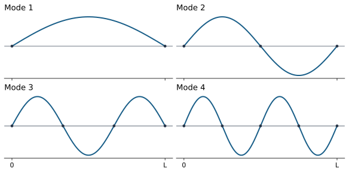
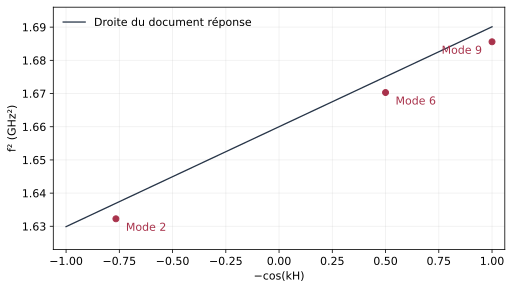
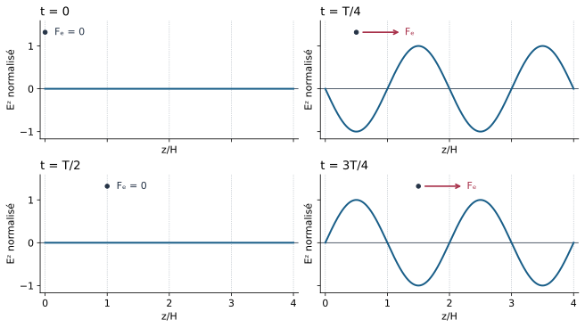

# CentraleSupélec PC — Physique 2 2025 · Corrigé brut

*Corrigé rédigé par IA, non officiel. Signalez toute erreur.*

## A — L’accélérateur linéaire

### Question 1

En régime permanent, le débit massique sortant est égal au débit entrant. Pour l’hélium, le premier principe en écoulement permanent donne $P+\dot m h_{\rm liq}=\dot m h_{\rm vap}$, en négligeant les variations d’énergie cinétique et potentielle et sans travail de machine. Donc
$$
P=\dot m\,\Delta_{\rm vap}h=2\times10^{-4}\times23{,}4\times10^3\simeq4{,}7\,\mathrm W.
$$

### Question 2

On choisit une tranche entre $x$ et $x+\mathrm dx$, d’aire $S$ normale à $Ox$. Les parois latérales ne sont traversées par aucun flux dans le modèle unidimensionnel.
Sans source interne et sans stockage en régime stationnaire, le premier principe donne $S j_x(x)-S j_x(x+\mathrm dx)=0$. Avec $j_x=-\kappa T'$ par la loi de Fourier et $\kappa$ constante, on obtient $T''=0$.

### Question 3

La loi de Fourier impose $T'=-j_0/\kappa$. Avec $T(e)=T_s$,
$$
T(x)=T_s+\frac{j_0}{\kappa}(e-x).
$$

### Question 4

Puisque $T_s=T_f+j_0/h$,
$$
T(0)=T_f+j_0\left(\frac e\kappa+\frac1h\right).
$$
Pour $T_f=2{,}0\,\mathrm K$, le premier cas donne une élévation de $0{,}342\,\mathrm K$ et $T(0)\simeq2{,}34\,\mathrm K$. Dans le second, l’élévation est de $0{,}0155\,\mathrm K$ et $T(0)\simeq2{,}02\,\mathrm K$.

### Question 5

Dans le vide sans charges ni courants, $\nabla\cdot\vec E=0$, $\nabla\times\vec E=-\partial_t\vec B$ et $\nabla\times\vec B=c^{-2}\partial_t\vec E$.
Le rotationnel de l’équation de Maxwell-Faraday donne $-\Delta\vec E=-c^{-2}\partial_t^2\vec E$. Le vecteur $\vec e_z$ est fixe, donc la projection sur $Oz$ commute avec le Laplacien et donne $\Delta E-c^{-2}\partial_t^2 E=0$.

### Question 6

En substituant $E_0\xi\psi$ et en divisant là où le produit ne s’annule pas, on obtient $\xi''/\xi=c^2(\psi''+\psi'/r)/\psi=A$. Les équations, prolongées aux zéros par continuité, sont
$$
\begin{aligned}\xi''-A\xi&=0,\\ \psi''+\frac{\psi'}r-\frac{A}{c^2}\psi&=0.\end{aligned}
$$
Pour un mode oscillant non trivial, l’évolution temporelle est périodique. Si $A>0$ les solutions sont exponentielles. Si $A=0$ elles sont affines et seules les constantes restent bornées à tout temps. Dans ce dernier cas la solution radiale régulière est constante et le nœud à la paroi l’annule. Il faut donc $A<0$.

### Question 7

Le nœud $E(R,t)=0$ impose $kR=x_{0n}$. Avec $\omega=ck$, les trois pulsations sont $\omega_1=c x_{01}/R$, $\omega_2=c x_{02}/R$ et $\omega_3=c x_{03}/R$.

### Question 8

$$
R=\frac{2{,}405c}{2\pi(1{,}3\times10^9\,\mathrm{s^{-1}})}
 \simeq8{,}8\times10^{-2}\,\mathrm m.
$$

### Question 9

Avec $\vec E=E\vec e_z$, le rotationnel vaut $-\partial_r E\,\vec e_\theta$. Maxwell-Faraday donne donc $\partial_t B=\partial_r E=-E_0(\omega_1/c)\sin(\omega_1t)J_1(\omega_1r/c)$. Après intégration, la moyenne nulle élimine la constante :
$$
\vec B=\frac{E_0}{c}J_1(\omega_1r/c)\cos(\omega_1t)\,\vec e_\theta.
$$
On utilise ici la convention $J_1=J_0'$ de l’énoncé.

### Question 10

Au premier zéro $x_{01}\simeq2{,}405$, on lit $J_1(x_{01})\simeq-0{,}52$. L’amplitude est donc $E_0|J_1(x_{01})|/c\simeq8{,}7\times10^{-2}\,\mathrm T$, soit $87\,\mathrm{mT}$.

### Question 11

Les températures maximales estimées sont inférieures aux trois températures critiques. Le champ de $87\,\mathrm{mT}$ excède les seuils du plomb ($80\,\mathrm{mT}$) et de l’YBaCuO ($10\,\mathrm{mT}$). Le niobium satisfait les deux conditions avec $T_c=9{,}2\,\mathrm K$ et $B_c=200\,\mathrm{mT}$.

### Question 12

$$
\frac{\|\vec P\|}{\|\vec F_e\|}=\frac{m_e g}{eE}
 \simeq \frac{8{,}9\times10^{-30}}{1{,}6\times10^{-12}}
 \simeq5{,}6\times10^{-18}.
$$
Le poids est négligeable à cette échelle de champ.

### Question 13

On factorise $\gamma^{-2}=(1-v/c)(1+v/c)$. Lorsque $v\simeq c$, $1+v/c\simeq 2$, donc $1-v/c\simeq1/(2\gamma^2)$.

### Question 14

Pour $v\ll c$, le développement de $(1-v^2/c^2)^{-1/2}$ donne $\gamma=1+v^2/(2c^2)+O(v^4/c^4)$. Alors $E_c\simeq m_e v^2/2$.

### Question 15

Avec $m_ec^2=5{,}12\times10^5\,\mathrm{eV}$ et $\gamma=1+E_c/(m_ec^2)$, à $2\times10^{10}\,\mathrm{eV}$ on trouve $\gamma\simeq4\times10^4$ au même niveau de précision que les autres facteurs. En conservant les chiffres intermédiaires, $1-v/c\simeq3{,}3\times10^{-10}$.

### Question 16

Le temps de transit est $T_1/2$ à vitesse $c$. On a donc $H=cT_1/2=c/(2f_1)\simeq0{,}115\,\mathrm m$, avec $f_1=1{,}3\,\mathrm{GHz}$.

### Question 17

La charge est $-e$. Comme les vecteurs vitesse et force sont suivant $+Oz$ pendant la demi-période, $\dot E_c=eE_0c\sin(\omega_1 t)$. Ainsi
$$
\Delta E_c=\int_0^{\pi/\omega_1}eE_0c\sin(\omega_1t)\,\mathrm dt
=\frac{2eE_0c}{\omega_1}
\simeq5{,}9\times10^{-13}\,\mathrm J\simeq3{,}7\,\mathrm{MeV}.
$$

### Question 18

Un gain de $9\,\mathrm{GeV}$ nécessite environ $9000/3{,}67\simeq2{,}45\times10^3$ cavités, soit autour de 270 cellules de neuf cavités. La longueur active estimée vaut $NH\simeq2{,}8\times10^2\,\mathrm m$. Cette estimation néglige les intervalles et équipements intercalés.

### Question 19

Notons $U_n$ la tension du nœud à droite de la cavité $n$ par rapport au rail inférieur, et $u_n$ celle de son condensateur dans le sens récepteur.
Sur la figure 6, $i_n$ est orienté de droite à gauche.
La loi des mailles donne $U_n-U_{n-1}=L\dot i_n+u_n$, avec $\dot u_n=i_n/C$.
Au nœud $n$, le courant descendant dans $C_c$ vaut $i_{n+1}-i_n$, donc $\dot U_n=(i_{n+1}-i_n)/C_c$. En dérivant l’équation de maille, on trouve
$$
L\ddot i_n+\frac{i_n}{C}+\frac{2i_n-i_{n-1}-i_{n+1}}{C_c}=0 .
$$

### Question 20

On pose $i_n=\Re(Ie^{\mathrm i(nkH-\Omega t)})$. Les voisins apportent le facteur $e^{\mathrm ikH}+e^{-\mathrm ikH}=2\cos(kH)$. Ainsi
$$
\Omega^2=\frac1L\left(\frac1C+\frac2{C_c}-\frac{2\cos(kH)}{C_c}\right)
=\Omega_a^2[1-\beta\cos(kH)] ,
$$
avec $\Gamma^{-1}=C^{-1}+2/C_c$, $\Omega_a^2=1/(\Gamma L)$ et $\beta=2\Gamma/C_c$. Le calcul conserve le caractère discret de la chaîne.

### Question 21

Les quatre profils sont proportionnels à $\sin(n\pi z/L)$, pour $n=1,2,3,4$. Il y a respectivement un, deux, trois et quatre ventres. Les $f_n$ augmentent avec $n$.

### Question 22

La lecture des seuls traits pleins de la figure 7 donne, de haut en bas, deux, six et neuf lobes de signe alterné. Les deux nœuds d’extrémité sont distants d’environ $9H$. Le mode $n$ contient $n$ demi-longueurs d’onde sur cette distance, donc $kH=n\pi/9$.

Comme la dispersion fait croître $f$ avec $kH$ sur $[0,\pi]$, les courbes sont celles des modes 2, 6 et 9, aux fréquences $1{,}2776$, $1{,}2924$ et $1{,}2983\,\mathrm{GHz}$.

### Question 23

Pour les modes 2, 6 et 9, les coordonnées $(-\cos(kH),f^2)$ sont respectivement $(-0{,}7660;\,1{,}6323)$, $(0{,}5000;\,1{,}6703)$ et $(1{,}0000;\,1{,}6856)$, avec $f^2$ en $\mathrm{GHz}^2$.
Leur placement est compatible avec la droite du document réponse. Comme pente et ordonnée à l’origine valent respectivement $f_a^2\beta$ et $f_a^2$,
$$
\beta=\frac{3{,}01\times10^{-2}}{1{,}66}=1{,}81\times10^{-2}.
$$

### Question 24

Aux instants $t=0$ et $t=T/2$, $E_z=0$ partout, donc $\vec F_e=\vec 0$.
À $T/4$, on choisit un premier ventre négatif puis des ventres alternés. L’électron est au centre de la première cavité et $\vec F_e=-eE_z\vec e_z$ pointe vers $+z$.
À $3T/4$, le profil entier a changé de signe et l’électron se trouve au centre de la deuxième cavité, où $E_z<0$ à cet instant. La force pointe encore vers $+z$.

## B — L’ondulateur

### Question 25

La puissance de la force magnétique est $-e(\vec v\times\vec B)\cdot\vec v=0$. Donc $E_c$ est constante, ainsi que $\gamma=1+E_c/(m_ec^2)$ et la norme $v$.

### Question 26

Avec $\vec B=B_0\cos(k_uz)\vec e_y$ et $\gamma$ constant,
$$
\begin{aligned}
\gamma m_e\ddot x&=eB_0\dot z\cos(k_uz),\\
\ddot y&=0,\\
\gamma m_e\ddot z&=-eB_0\dot x\cos(k_uz).
\end{aligned}
$$
L’électron part de $O$ avec $\dot x=\dot y=0$ et $\dot z=v_0$.

### Question 27

On remplace $z$ par $v_m t$ et $\dot z$ par $v_m$ au second membre de l’équation transverse.
Une première intégration donne $\dot x=eB_0\sin(v_mk_ut)/(\gamma m_e k_u)$. Avec $x(0)=0$, la seconde donne
$$
\begin{aligned}x(t)&=\frac{K}{\gamma k_u}[1-\cos(v_m k_ut)],\\ K&=\frac{eB_0}{m_e v_m k_u}.\end{aligned}
$$

### Question 28

Puisque $v=v_0$ et $\dot y=0$, $\dot z=v_0\sqrt{1-\dot x^2/v_0^2}$ sur la branche de propagation vers $+z$.
Au premier ordre en $K^2/\gamma^2$, on peut substituer $v_m/v_0\simeq1$ dans $\dot x^2/v_0^2=(K/\gamma)^2(v_m/v_0)^2\sin^2(v_m k_ut)$, car leur différence est déjà de cet ordre. On obtient
$$
\dot z=v_0\left[1-\frac{K^2}{4\gamma^2}+\frac{K^2}{4\gamma^2}\cos(2v_m k_ut)\right]
$$
à l’ordre retenu.

### Question 29

Le cosinus est de moyenne temporelle nulle. Avec $v_0/c\simeq1-1/(2\gamma^2)$ et en omettant le terme d’ordre $\gamma^{-4}$,
$$
v_m\simeq c\left[1-\frac{1+K^2/2}{2\gamma^2}\right].
$$

### Question 30

On trouve $B_0=2\pi K m_e v_m/(e\lambda_u)\simeq0{,}54\,\mathrm T$. C’est un champ intense, de l’ordre du tesla, accessible à un système d’aimants.

### Question 31

Chaque source émet une onde plane progressive harmonique vers $+z$. La source $p$ commence à la position $p\lambda_u$ après le temps de parcours $p\lambda_u/v_m$. La phase à la réception s’écrit donc $\alpha(t-p\lambda_u/v_m)-k(z-p\lambda_u)$, avec $k=\alpha/c$.

### Question 32

Posons $\delta=\alpha\lambda_u(1/v_m-1/c)$. Le signal est la partie réelle de $S_0 e^{\mathrm i(\alpha t-kz)}\sum_{p=0}^{N-1}e^{-\mathrm ip\delta}$.
La somme géométrique vaut $e^{-\mathrm i(N-1)\delta/2}\sin(N\delta/2)/\sin(\delta/2)$ hors des singularités apparentes. L’amplitude positive vaut donc
$$
S_{0,N}=S_0\left|\frac{\sin(N\delta/2)}{\sin(\delta/2)}\right|.
$$
Le quotient sans module s’interprète comme un coefficient signé, avec la phase correspondante. Au point $\delta=2\pi q$ la somme originale donne directement $NS_0$ en amplitude.

### Question 33

La somme de $N$ phaseurs unitaires est de module au plus $N$. Elle atteint $N$ quand les phases coïncident, soit $\delta=2\pi q$. Pour les fréquences positives, avec $q=1,2,\ldots$,
$$
F_q=\frac{q}{\lambda_u(1/v_m-1/c)}
\simeq q\frac c{\lambda_u}\frac{2\gamma^2}{1+K^2/2}.
$$

### Question 34

$$
\lambda_1=\frac{c}{F_1}\simeq\frac{(4{,}0\times10^{-2})(1+2^2/2)}{2(3{,}4\times10^4)^2}
=5{,}2\times10^{-11}\,\mathrm m .
$$
Cette longueur d’onde relève des rayons X durs.

### Question 35

Le modèle donne $N=F_1/\Delta F\simeq6{,}7\times10^2$. Cela représente $N\lambda_u\simeq27\,\mathrm m$, contre $175\,\mathrm m$ et environ $4{,}4\times10^3$ périodes géométriques pour l’ensemble. Le $N$ estimé par la largeur caractérise le nombre effectif de périodes contribuant de façon cohérente dans le modèle. On ne peut pas l’identifier à un comptage sur toute la longueur réelle.

### Question 36

On évalue les deux seconds membres au même instant $t_i=i\delta t$.
$$
\begin{aligned}
\phi_{i+1}&=\phi_i+2k_uc\,\delta t\,\eta_i,\\
\eta_{i+1}&=\eta_i-\frac{C^2\delta t}{2k_uc}\sin\phi_i.
\end{aligned}
$$
Les suites démarrent de $(\phi_0,\eta_0)$. Pour $t_f$ multiple du pas, il y a $t_f/\delta t$ pas et un point supplémentaire pour l’instant initial.

### Question 37

À l’entrée, la distribution est presque uniforme suivant $z$. Au milieu apparaissent des zones périodiquement enrichies et appauvries. À la sortie, les électrons sont concentrés dans des paquets minces, espacés d’environ une unité en $z/\lambda_1$, donc de $\lambda_1$. C’est une modulation de densité longitudinale produite par l’interaction avec l’onde.

### Question 38

Le rayonnement à $\lambda_1$ des électrons appartenant au même paquet est presque en phase. Deux paquets distants de $\lambda_1$ apportent une différence de phase de $2\pi$ à cette longueur d’onde. Le microgroupement impose ainsi une cohérence spatiale et synchronise les trains d’onde élémentaires. Les champs peuvent s’additionner de façon constructive au sein de l’impulsion du paquet d’électrons au lieu de former une superposition de trains indépendants.
