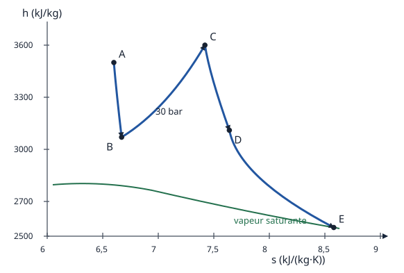
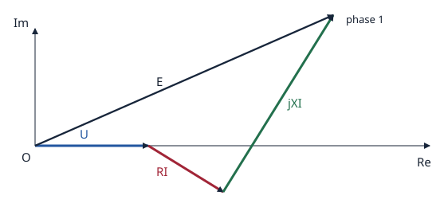
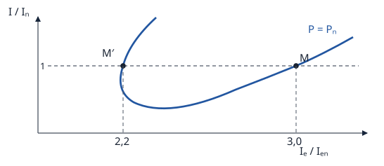
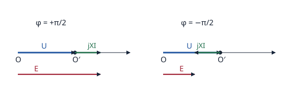

# Centrale-Supélec PSI — Physique-chimie 1 2025 · Corrigé guidé

*Corrigé rédigé par IA, non officiel. Signalez toute erreur.*

## Présentation du sujet

L’épreuve de quatre heures, calculatrice autorisée, étudie la centrale DK6 à Dunkerque. Les trois parties sont indépendantes. Le document réponse, dans les deux dernières pages du PDF, est nécessaire pour lire les états thermodynamiques et les courbes de fonctionnement électrique.

- **Q1–Q10** — Équilibrer la combustion du méthane, relier le débit d’air à la température, puis estimer un rendement avec un périmètre énergétique explicite.
- **Q11–Q24** — Lire le diagramme de Mollier, calculer les puissances et étudier le transfert de moment cinétique dans un étage de turbine.
- **Q25–Q34** — Modéliser l’alternateur, exploiter ses essais et interpréter ses échanges de puissance active et réactive avec le réseau.

L’essentiel des notions mobilisées relève des programmes de PCSI et PSI. La compensation synchrone abordée en Q34 et la notion de puissance réactive dépassent les capacités spécifiques exigibles du programme PSI. Les bilans de puissance active et le diagramme de Fresnel permettent ici de traiter la question à partir du cadre donné. Les bilans stationnaires, les conventions de signe et les lectures graphiques structurent l’épreuve. Les calculs de Q1–Q2, Q8, Q13, Q18 et Q25–Q29 donnent des points d’entrée. Pour les questions ouvertes Q10 et Q21, prenez le temps de définir les apports retenus et de préciser le modèle employé. Le rapport du jury présente par endroits un décalage de numérotation par rapport au sujet. Les encadrés ci-dessous rattachent les remarques à la question par leur contenu.

[Sujet et document réponse](https://www.concours-centrale-supelec.fr/sites/default/files/documents/P079_1.pdf) · [Rapport PSI 2025](https://www.concours-centrale-supelec.fr/sites/default/files/documents/Rapports_Jury_2025_PSI.pdf) · [BO PCSI](https://www.education.gouv.fr/bo/21/Special1/ESRS2035780A.htm) · [BO PSI](https://www.education.gouv.fr/bo/21/Hebdo31/ESRS2111748A.htm)

## Partie A — La chambre de combustion de la turbine à gaz

Pour relier l’énergie chimique à l’échauffement, choisissez une température de référence et suivez séparément le débit d’avancement et les débits de sortie.

### Question 1

> [!INDICATION]
> Équilibrez d’abord les atomes. Quelle grandeur standard contrôle la constante de la réaction à température fixée ?

> [!INDICATION]
> Passez de l’enthalpie et de l’entropie de réaction à l’enthalpie libre, puis utilisez la relation logarithmique avec la constante.

#### Solution

La réaction de combustion est

$$
\mathrm{CH_4(g)+2\,O_2(g)\longrightarrow CO_2(g)+2\,H_2O(g)}.
$$

Par la loi de Hess, à $298\,\mathrm K$, $\Delta_r H^\circ=-802{,}2\,\mathrm{kJ\,mol^{-1}}$. La somme stœchiométrique des entropies molaires donne $\Delta_r S^\circ=-5{,}0\,\mathrm{J\,K^{-1}\,mol^{-1}}$. On en déduit

$$
\Delta_r G^\circ=\Delta_r H^\circ-T_0\Delta_r S^\circ
=-800{,}7\,\mathrm{kJ\,mol^{-1}}.
$$

La relation $\ln K^\circ=-\Delta_rG^\circ/(RT_0)$ donne $\log_{10}K^\circ\simeq140{,}4$, soit $K^\circ\simeq2{,}7\times10^{140}$. **L’équilibre est très fortement déplacé vers les produits**, ce qui justifie le modèle de combustion quantitative. L’eau est gazeuse, comme dans la définition du pouvoir calorifique inférieur retenu ici.

$$
\boxed{q_{\mathrm{gn}}=\frac{-\Delta_rH^\circ}{M_{\mathrm{CH_4}}}
\simeq50{,}1\,\mathrm{MJ\,kg^{-1}}.}
$$

> [!JURY]
> Le jury attend l’état physique de chaque espèce, la loi de Hess et le calcul de la constante. L’exothermicité seule ne prouve pas la quasi-totalité.

### Question 2

> [!INDICATION]
> Convertissez d’abord le débit de méthane en débit molaire. Remontez ensuite de la fraction molaire de dioxygène à celle de l’air.

#### Solution

Notons $F=D_{m,\mathrm{gn}}/M_{\mathrm{CH_4}}$ le débit molaire de méthane. Pour alimenter la réaction à la stœchiométrie, il faut un débit molaire de dioxygène $2F$, donc un débit molaire d’air $10F$. La masse molaire moyenne de l’air est $M_{\mathrm{air}}=\tfrac45 M_{\mathrm{N_2}}+\tfrac15 M_{\mathrm{O_2}}=28{,}8\,\mathrm{g\,mol^{-1}}$. On trouve

$$
\boxed{D_{m0}=10FM_{\mathrm{air}}\simeq174\,\mathrm{kg\,s^{-1}}.}
$$

À la stœchiométrie, tout le méthane brûle dans le modèle. La puissance chimique libérée évaluée à $T_0$ est **$P_{\mathrm{th0}}=D_{m,\mathrm{gn}}q_{\mathrm{gn}}\simeq484\,\mathrm{MW}$** par chambre.

> [!JURY]
> Le jury relève des confusions entre rapports molaires et massiques. Convertissez en masse seulement après le bilan stœchiométrique.

### Question 3

> [!INDICATION]
> Définissez le volume de contrôle stationnaire et choisissez un chemin d’enthalpie passant par les produits à la température d’entrée.

> [!INDICATION]
> Les enthalpies de formation à la température de référence rendent compte de la réaction. Les capacités molaires donnent ensuite l’écart d’enthalpie des produits.

#### Solution

Le système ouvert est la chambre de combustion en régime stationnaire. Elle est calorifugée et ne reçoit aucun travail d’arbre. On néglige les variations d’énergie cinétique et de pesanteur. On prend des enthalpies de gaz dépendant de la température seule. Le flux d’enthalpie total des produits à $T_s$ est alors égal à celui des réactifs à $T_0$. En faisant d’abord réagir les espèces à $T_0$ dans le calcul d’enthalpie, puis en échauffant les produits de référence jusqu’à $T_s$, on obtient

$$
0=F\Delta_r H^\circ
+F\bigl(C_{p,m,\mathrm{CO_2}}+2C_{p,m,\mathrm{H_2O}}+8C_{p,m,\mathrm{N_2}}\bigr)(T_s-T_0).
$$

L’azote accompagne le dioxygène avec un rapport molaire de quatre. Notons $B_0$ la somme de capacités molaires entre parenthèses. On trouve

$$
\boxed{T_s=T_0+\frac{D_{m,\mathrm{gn}}q_{\mathrm{gn}}}{FB_0}
\simeq2{,}68\times10^3\,\mathrm K.}
$$

Cela représente environ $2405\,^\circ\mathrm C$, bien au-delà de la tenue annoncée des aubes et du seuil de formation des oxydes d’azote. Le calcul suppose notamment des capacités thermiques constantes malgré un fort échauffement.

> [!JURY]
> Le rapport attend le sens des échanges et leur justification. Même s’il n’entre pas dans la réaction, le diazote sort échauffé.

### Question 4

> [!INDICATION]
> À débit de méthane fixé, comparez l’énergie libérée et la quantité de gaz à chauffer au-dessus de la stœchiométrie.

#### Solution

Au-dessus du débit stœchiométrique, la quantité de méthane brûlée par seconde reste la même. L’énergie libérée échauffe davantage de gaz, notamment du dioxygène excédentaire et du diazote supplémentaire. La capacité thermique totale par unité de temps augmente, donc l’élévation de température baisse. Réduire le débit sous la stœchiométrie diminue aussi la quantité d’énergie libérée, mais rend le dioxygène limitant et laisse du méthane non brûlé dans ce modèle. **On choisit l’excès d’air pour refroidir les produits tout en brûlant le méthane.**

> [!JURY]
> Le rapport distingue l’avancement final de la proportion initiale des réactifs. Une réaction quantitative peut consommer intégralement le réactif limitant en présence d’un excès de l’autre.

### Question 5

> [!INDICATION]
> Exprimez les entrées en débits molaires, puis retranchez la consommation associée à un débit d’avancement.

#### Solution

Posons $A=D_{m,\mathrm{air}}/M_{\mathrm{air}}$ et $A_0=D_{m0}/M_{\mathrm{air}}=10F$. Le débit d’avancement est $F$, le méthane étant limitant. Les débits sont en $\mathrm{mol\,s^{-1}}$.

$$
\begin{array}{c|ccc}
\text{Espèce} & \text{Entrée} & \text{Variation par réaction} & \text{Sortie} \\ \hline
\mathrm{CH_4} & F & -F & 0 \\
\mathrm{O_2} & A/5 & -2F & (A-A_0)/5 \\
\mathrm{N_2} & 4A/5 & 0 & 4A/5 \\
\mathrm{CO_2} & 0 & F & A_0/10 \\
\mathrm{H_2O} & 0 & 2F & A_0/5
\end{array}
$$

> [!JURY]
> Un tableau de débit garde les mêmes coefficients stœchiométriques qu’un tableau d’avancement en moles. Le jury le recommande pour contrôler chaque espèce.

### Question 6

> [!INDICATION]
> Identifiez la contrainte de température la plus basse, puis décomposez les produits en mélange stœchiométrique et air excédentaire.

> [!INDICATION]
> Dans le bilan, l’apport chimique reste fixé et le terme proportionnel au débit excédentaire correspond à la chaleur sensible de l’air.

#### Solution

La contrainte la plus sévère est $1300\,^\circ\mathrm C$, soit $T_\ast\simeq1573\,\mathrm K$. En pratique, on vise cette limite par valeurs inférieures. Posons $C_{p,m,\mathrm{air}}=(C_{p,m,\mathrm{O_2}}+4C_{p,m,\mathrm{N_2}})/5$. Le premier principe appliqué à la même chambre que dans Q3 donne

$$
P_{\mathrm{th0}}=(T_\ast-T_0)
\left(FB_0+\frac{D_{m1}-D_{m0}}{M_{\mathrm{air}}}C_{p,m,\mathrm{air}}\right).
$$

Donc

$$
\boxed{D_{m1}=D_{m0}+\frac{M_{\mathrm{air}}}{C_{p,m,\mathrm{air}}}
\left(\frac{P_{\mathrm{th0}}}{T_\ast-T_0}-FB_0\right)
\simeq3{,}48\times10^2\,\mathrm{kg\,s^{-1}}.}
$$

> [!METHODE]
> La capacité thermique totale d’une sortie s’écrit comme un débit de capacité en watts par kelvin. La conversion Celsius–kelvin s’applique à la température de consigne.

### Question 7

> [!INDICATION]
> Reprenez le bilan précédent en remplaçant chaque produit capacité–écart de température par un écart d’enthalpie molaire.

#### Solution

Pour chaque espèce $i$, notons $J_i(T_s)=\int_{T_0}^{T_s} C_{p,m,i}(T)\,\mathrm dT$. Définissons $B(T_s)=J_{\mathrm{CO_2}}+2J_{\mathrm{H_2O}}+8J_{\mathrm{N_2}}$ et $J_{\mathrm{air}}=(J_{\mathrm{O_2}}+4J_{\mathrm{N_2}})/5$. Le bilan donne $P_{\mathrm{th0}}=FB+(D_{m,\mathrm{air}}-D_{m0})J_{\mathrm{air}}/M_{\mathrm{air}}$. Ainsi

$$
\boxed{D_{m,\mathrm{air}}=D_{m0}
+\frac{M_{\mathrm{air}}}{J_{\mathrm{air}}(T_s)}
\bigl(P_{\mathrm{th0}}-FB(T_s)\bigr).}
$$

> [!METHODE]
> Regroupez les intégrales provenant de l’air excédentaire afin de faire apparaître linéairement le débit inconnu.

### Question 8

> [!INDICATION]
> Donnez la même dimension à chaque terme de la relation. Pour l’intégrale, séparez la largeur d’un rectangle et sa hauteur.

#### Solution

À chaque terme de l’expression de Shomate correspond l’unité $\mathrm{J\,mol^{-1}\,K^{-1}}$. On en déduit les unités des coefficients.

$$
\begin{array}{c|c}
\text{Coefficient} & \text{Unité} \\ \hline
A & \mathrm{J\,mol^{-1}\,K^{-1}} \\
B & \mathrm{J\,mol^{-1}\,K^{-2}} \\
C & \mathrm{J\,mol^{-1}\,K^{-3}} \\
D & \mathrm{J\,mol^{-1}\,K^{-4}} \\
E & \mathrm{J\,mol^{-1}\,K}
\end{array}
$$

Un calcul par rectangles à gauche, sur $1000$ intervalles de même largeur, donne l’intégrale en $\mathrm{J\,mol^{-1}}$.

```python
def int_Cpm(gaz, T1, T2):
    N = 1000
    pas = (T2 - T1) / N
    somme = 0.0
    for i in range(0, N):
        somme = somme + Cpm(T1 + i * pas, gaz)
    return pas * somme
```

> [!JURY]
> Le rapport demande de réutiliser la fonction de capacité fournie. Vérifiez que la somme comporte exactement le nombre voulu d’évaluations.

### Question 9

> [!INDICATION]
> Identifiez le débit qui sépare les deux branches, puis coupez la courbe par l’horizontale de la température limite.

> [!INDICATION]
> À niveau de température donné, retenez l’intersection qui correspond à une combustion complète du méthane.

#### Solution

La figure 3 présente un maximum d’environ $2250\,\mathrm K$ à $D_{m,\mathrm{air}}\simeq175\,\mathrm{kg\,s^{-1}}$, en accord avec le débit stœchiométrique. En dessous, augmenter le débit d’air permet de brûler davantage de méthane. Au-dessus, le méthane fixe l’énergie libérée et l’air excédentaire abaisse la température.

À l’ordonnée $1573\,\mathrm K$, on lit sur la branche à excès d’air **$D_{m,\mathrm{air}}\simeq300$ à $310\,\mathrm{kg\,s^{-1}}$**, environ $305\,\mathrm{kg\,s^{-1}}$. L’intersection de gauche correspond à un manque de dioxygène. Le débit utile est inférieur d’environ $12\,\%$ à celui de Q6. Cette baisse est cohérente avec l’augmentation des capacités molaires des gaz sur l’intervalle de chauffage, visible en figure 2. Pour atteindre la même température, un débit d’air plus faible suffit alors. Le bilan de masse, sans perte de matière, donne **$D_{m,\mathrm{gaz}}=D_{m,\mathrm{air}}+D_{m,\mathrm{gn}}\simeq315\,\mathrm{kg\,s^{-1}}$**.

> [!JURY]
> Le jury attend une interprétation des deux branches à partir du réactif limitant et de la capacité des produits à emporter l’énergie.

### Question 10

> [!INDICATION]
> Définissez la puissance utile et précisez quelles entrées énergétiques sont prises en compte dans le dénominateur.

#### Solution

Pour les deux tranches, la puissance utile est $790\,\mathrm{MW}$. Si l’on rapporte cette production à la seule puissance du combustible acheté, le méthane, l’estimation vaut

$$
\boxed{\eta_{\mathrm{gaz\ naturel}}
=\frac{790\,\mathrm{MW}}{2P_{\mathrm{th0}}}\simeq0{,}82.}
$$

Le numérateur inclut l’électricité issue de la combustion des fumées sidérurgiques. Le débit et le pouvoir calorifique de ces fumées ne sont pas fournis, donc le rendement rapporté à l’ensemble des apports énergétiques est inférieur et ne peut être chiffré à partir des données.

> [!JURY]
> Le rapport demande d’identifier ce qui est utile et ce qui est dépensé. Le résultat dépend du périmètre choisi pour la récupération des fumées.

## Partie B — La turbine à vapeur

La lecture des états d’entrée et de sortie donne des écarts d’enthalpie. Un modèle d’étage permet ensuite de discuter comment la vapeur transmet son travail au rotor.

## I — Étude globale de la turbine

Définissez le système ouvert à chaque bilan. Les détentes, le surchauffeur et le condenseur n’échangent pas les mêmes formes d’énergie.

### Question 11

> [!INDICATION]
> Placez d’abord les points dont la pression et la température sont connues. Pour le dernier point, exploitez l’état de la vapeur.

> [!INDICATION]
> L’abscisse du diagramme est l’entropie massique et l’ordonnée l’enthalpie massique. Pour la détente presque isentropique, repérez surtout l’alignement des deux abscisses.

#### Solution

On place $A$, $B$, $C$ et $D$ aux intersections de leurs isobares et isothermes, par interpolation entre les courbes voisines. Pour $E$, on coupe l’isobare $0{,}030\,\mathrm{bar}$ par la limite de vapeur saturante sèche. Les lectures suivantes sont approchées et les écarts d’enthalpie qui en résultent n’ont au mieux que deux chiffres significatifs.

$$
\begin{array}{c|cc}
\text{Point} & s\text{ en }\mathrm{kJ\,kg^{-1}\,K^{-1}} & h\text{ en }\mathrm{kJ\,kg^{-1}} \\ \hline
A & 6{,}60 & 3500 \\
B & 6{,}67 & 3070 \\
C & 7{,}42 & 3600 \\
D & 7{,}64 & 3110 \\
E & 8{,}58 & 2550
\end{array}
$$

Dans le sens $A\to B\to C\to D\to E$, $AB$ est une détente presque verticale, $BC$ suit l’isobare $30\,\mathrm{bar}$ et $CD$, puis $DE$, évoluent vers une entropie plus élevée en perdant de l’enthalpie. Les points imposent les extrémités des détentes, tandis que leurs trajets intermédiaires restent qualitatifs.



> [!JURY]
> Le rapport attend le point de sortie sur la saturation sèche et des trajets orientés. Conservez une précision réaliste pour les lectures.

### Question 12

> [!INDICATION]
> Comparez les abscisses des deux points. Pour la température du modèle parfait, mettez toutes les données dans les unités de la loi de Laplace.

#### Solution

La différence $s_B-s_A\simeq0{,}07\,\mathrm{kJ\,kg^{-1}\,K^{-1}}$ est petite devant celles des détentes suivantes, en particulier le passage de $D$ à $E$. La détente haute pression peut être assimilée à une isentropique. Pour un gaz parfait à $\gamma$ constant, la loi de Laplace donne

$$
\boxed{T_{B,\mathrm{GP}}=T_A(p_B/p_A)^{(\gamma-1)/\gamma}
\simeq584\,\mathrm K\simeq311\,^\circ\mathrm C.}
$$

L’écart à $603\,\mathrm K$ est d’environ $19\,\mathrm K$, soit $3\,\%$ sur la température absolue. Le gaz parfait fournit une approximation raisonnable de la température dans ce calcul, sans reproduire exactement l’état réel.

> [!JURY]
> Le rapport demande de quantifier l’écart de température et d’utiliser des températures absolues.

### Question 13

> [!INDICATION]
> Convertissez le débit en kilogrammes par seconde et calculez la section effectivement ouverte au fluide.

#### Solution

Avec $S_A=\pi[(R_0+a)^2-R_0^2]$, la conservation du débit massique donne $v_A=D_m/(\rho_A S_A)$. Le débit vaut $D_m=148\,\mathrm{kg\,s^{-1}}$, d’où **$v_A\simeq55\,\mathrm{m\,s^{-1}}$**. À section inchangée, **$v_B=(\rho_A/\rho_B)v_A\simeq165\,\mathrm{m\,s^{-1}}$**.

Une vitesse de sortie élevée emporte davantage de puissance cinétique et réduit le travail disponible à l’arbre pour une chute d’enthalpie donnée. Pour garder une vitesse débitante proche de celle d’entrée, on augmente la section de passage à mesure que la masse volumique diminue. Ici il faut $S_B\simeq3S_A$. La hauteur d’aube requise est $\sqrt{R_0^2+3[(R_0+a)^2-R_0^2]}-R_0\simeq111\,\mathrm{mm}$, compatible avec $113\,\mathrm{mm}$ sur le document 1.

> [!JURY]
> Le rapport relève la confusion entre débit massique et débit volumique. La masse volumique change pendant la détente.

### Question 14

> [!INDICATION]
> Appliquez le premier principe au fluide traversant seulement la turbine haute pression. Quel signe correspond à un travail cédé à l’arbre ?

#### Solution

Pour le fluide traversant la THP en régime stationnaire, on note $P_u$ et $P_{\mathrm{th}}$ les puissances algébriques reçues. Le premier principe industriel s’écrit

$$
D_m[h+v^2/2+gz]_A^B=P_u+P_{\mathrm{th}}.
$$

La turbine est calorifugée et horizontale. Les vitesses de débit sont sensiblement égales en entrée et en sortie. La puissance transmise à l’arbre est donc

$$
\boxed{\mathcal P_{\mathrm{HP}}=-P_u=D_m(h_A-h_B)
\simeq 64\,\mathrm{MW}.}
$$

> [!JURY]
> Le rapport demande d’écrire le bilan complet avant de supprimer chaque terme. Les vitesses et les altitudes d’entrée et de sortie interviennent dans cette simplification.

### Question 15

> [!INDICATION]
> Suivez la verticale issue de l’entrée et repérez le dernier état compatible avec l’absence de liquide.

#### Solution

Sur l’isentropique issue de $A$, la détente sans liquide peut aller jusqu’à son intersection $E_s$ avec la courbe de saturation sèche. On lit $h_{E_s}\simeq2{,}77\times10^3\,\mathrm{kJ\,kg^{-1}}$. Pour le fluide dans cette turbine unique stationnaire, horizontale et calorifugée, en négligeant la variation d’énergie cinétique, le premier principe donne

$$
\boxed{\mathcal P_{\max,\mathrm{sec}}=D_m(h_A-h_{E_s})\simeq1{,}1\times10^2\,\mathrm{MW}.}
$$

Si l’on imposait plutôt la pression de sortie réelle de $30\,\mathrm{mbar}$ en autorisant du liquide, l’intersection à $s=s_A$ donnerait $h\simeq1{,}96\times10^3\,\mathrm{kJ\,kg^{-1}}$, soit environ $2{,}3\times10^2\,\mathrm{MW}$. Cet état humide est exclu dans une turbine du sujet.

> [!JURY]
> Le rapport distingue cet état hypothétique de l’état final de la chaîne réelle. Une pression imposée sous la saturation sèche mènerait à un état humide.

### Question 16

> [!INDICATION]
> Faites un bilan sur le surchauffeur, puis un bilan englobant les trois turbines et ce surchauffeur.

#### Solution

Pour le fluide traversant le surchauffeur en régime stationnaire, sans travail d’arbre et avec des variations d’énergies cinétique et potentielle négligées, **$\mathcal P_{\mathrm{SC}}=D_m(h_C-h_B)\simeq79\,\mathrm{MW}$**.

Sur l’ensemble stationnaire allant de $A$ à $E$, la seule puissance thermique reçue est celle du surchauffeur. Après les mêmes simplifications cinétique et potentielle, la puissance totale transmise aux arbres vaut

$$
\boxed{\mathcal P_{\mathrm{tot}}=D_m(h_A-h_E)+\mathcal P_{\mathrm{SC}}
\simeq 2{,}2\times10^2\,\mathrm{MW}.}
$$

La valeur est du même ordre que les $230\,\mathrm{MW}$ électriques de la figure 1 et les $240\,\mathrm{MW}$ nominaux du modèle d’alternateur. Ces données et le bilan simplifié ne permettent pas d’en déduire un rendement de conversion mécanique-électrique précis.

> [!METHODE]
> Un flux de chaleur entre deux points de la chaîne n’est pas une puissance mécanique. Dans le bilan global, conservez le terme apporté par le surchauffeur.

### Question 17

> [!INDICATION]
> Sur le plan de Mollier, localisez la sortie réversible par sa pression et son entropie. Comparez ensuite les enthalpies de sortie.

> [!INDICATION]
> L’état fictif a l’entropie du point d’entrée et la pression du point de sortie réel.

#### Solution

À la sortie réversible $D_s$, on coupe sur le diagramme l’isobare $4\,\mathrm{bar}$ et l’isentropique $s=s_C$. On lit $h_{D_s}\simeq2{,}98\times10^3\,\mathrm{kJ\,kg^{-1}}$.

Le premier principe pour le fluide traversant la TMP stationnaire, horizontale et calorifugée, avec variations d’énergie cinétique négligées, donne **$\mathcal P_{\mathrm{rev}}=D_m(h_C-h_{D_s})\simeq92\,\mathrm{MW}$**. Avec l’état réel $D$, la puissance est environ $73\,\mathrm{MW}$.

La perte de puissance utile due aux irréversibilités vaut

$$
\boxed{\mathcal P_{\mathrm{perdue}}=D_m(h_D-h_{D_s})\simeq19\,\mathrm{MW}.}
$$

> [!METHODE]
> Les entrées étant identiques, la différence entre les puissances idéale et réelle ne dépend que de la différence des enthalpies de sortie.

### Question 18

> [!INDICATION]
> Écrivez séparément la variation d’enthalpie de la vapeur et celle de l’eau de mer. Quels échanges le calorifugeage exclut-il ?

#### Solution

Le condenseur est stationnaire, sans travail mécanique ni variation notable des énergies cinétique et potentielle pour les deux écoulements. La vapeur cède la puissance $D_m\ell_{\mathrm{vap}}$ lors de la liquéfaction totale isobare. L’eau de mer, assimilée à une phase condensée de capacité massique constante, reçoit $\rho_{\mathrm{eau}}Q c_{\mathrm{eau}}(\theta_s-\theta_e)$. L’échangeur est calorifugé vers l’extérieur, donc

$$
\boxed{\theta_s=\theta_e+\frac{D_m\ell_{\mathrm{vap}}}
{\rho_{\mathrm{eau}}Q c_{\mathrm{eau}}}\simeq24\,^\circ\mathrm C.}
$$

Avec $Q\simeq9{,}17\,\mathrm{m^3\,s^{-1}}$, l’échauffement vaut environ $8{,}9\,\mathrm K$. La température reste sous le seuil de $30\,^\circ\mathrm C$.

> [!JURY]
> Le jury demande de rattacher la chaleur latente à la liquéfaction totale et la relation capacité–température au caractère condensé de l’eau de mer.

## II — Étude d’un étage de détente de la turbine haute pression

Le stator accélère le fluide. Le rotor prélève du travail et modifie la composante tangentielle du mouvement. Les vitesses absolues et relatives jouent des rôles différents.

### Question 19

> [!INDICATION]
> Comparez le temps passé par le fluide au contact des parois au temps nécessaire à un échange appréciable.

#### Solution

Pour une particule de fluide, le temps de séjour vaut, en ordre de grandeur, $\tau_{\mathrm{conv}}\sim L/v$, où $L$ est la longueur traversée et $v$ une vitesse de passage. Il doit être petit devant le temps $\tau_{\mathrm{th}}$ nécessaire pour que les échanges avec les parois changent sensiblement sa température.

Si la diffusion thermique fixe ce temps, $\tau_{\mathrm{th}}\sim d^2/\chi$, avec $d$ la distance de diffusion et $\chi$ la diffusivité thermique. **Le critère adiabatique est $\tau_{\mathrm{conv}}\ll\tau_{\mathrm{th}}$.**

> [!JURY]
> Le jury demande ce que chaque durée représente. Un rapport de temps est utile seulement si le mécanisme de transfert correspondant est explicité.

### Question 20

> [!INDICATION]
> Développez la loi de Laplace au voisinage de l’état d’entrée. Appliquez ensuite un bilan où l’enthalpie et la vitesse changent.

#### Solution

Pour le gaz parfait en évolution isentropique, $T_1/T_A=(1+\Delta p_1/p_A)^{(\gamma-1)/\gamma}$. Au premier ordre en $\Delta p_1/p_A$,

$$
\boxed{\Delta T_1\simeq T_A\,\frac{\gamma-1}{\gamma}
\frac{\Delta p_1}{p_A}\simeq -9{,}8\,\mathrm K.}
$$

Dans le stator, le fluide stationnaire ne reçoit ni chaleur ni travail d’arbre. On néglige la variation d’altitude. Le premier principe donne $c_p\Delta T_1+(v_1^2-v_A^2)/2=0$, de sorte que

$$
\boxed{v_1=\sqrt{v_A^2-2c_p\Delta T_1}
\simeq2{,}06\times10^2\,\mathrm{m\,s^{-1}}.}
$$

La détente convertit ici une partie de l’enthalpie en énergie cinétique.

> [!METHODE]
> Dans une tuyère fixe, le fluide ne fournit pas de travail d’arbre. Son accélération n’implique pas un apport d’énergie extérieur.

### Question 21

> [!INDICATION]
> Lisez les coefficients à l’incidence et au nombre de Reynolds imposés. Quelle vitesse mesure l’écoulement vu par une aube ?

> [!INDICATION]
> Dans le modèle d’aile, décomposez les forces parallèlement et perpendiculairement à la vitesse relative. Une seule composante travaille dans la direction du mouvement des aubes.

#### Solution

Sur les courbes du document 2 repérées par $\mathrm{Re}>10^6$, l’incidence $15^\circ$ est voisine du maximum de portance, avant la baisse de celle-ci. On lit $C_L\simeq1{,}7$ et $C_D\simeq0{,}06$. La traînée est donc nettement plus faible que la portance, bien que le rapport $C_L/C_D$ ne soit pas maximal à cette incidence.

La vitesse de l’aube vaut $U=R_0\Omega\simeq93\,\mathrm{m\,s^{-1}}$. Le triangle des vitesses donne $w_1=\sqrt{v_1^2-U^2}\simeq183\,\mathrm{m\,s^{-1}}$. Sa direction est axiale. La surface portante est estimée par $S=ab\simeq1{,}31\times10^{-3}\,\mathrm{m^2}$. Avec le gaz parfait à la sortie du stator, $\rho_1=p_1M/(RT_1)\simeq36\,\mathrm{kg\,m^{-3}}$, du même ordre que $\rho_A$.

Dans le modèle d’aile, la portance est tangentielle et fournit le couple, tandis que la traînée agit axialement et ne fournit pas de travail à l’aube. Pour les $N$ aubes, en assimilant les étages à des étages de même puissance, on obtient

$$
\boxed{\mathcal P_1\simeq \tfrac12 N\rho_1 C_L S w_1^2 U
\simeq10\,\mathrm{MW}.}
$$

$$
\boxed{n\simeq\frac{\mathcal P_{\mathrm{HP}}}{\mathcal P_1}
\simeq6\text{ à }7.}
$$

$$
\boxed{F_z\simeq\tfrac12 N\rho_1 C_D S w_1^2
\simeq4\,\mathrm{kN}.}
$$

Ces estimations dépendent de l’assimilation à une aile isolée, du profil choisi et de la modélisation des étages suivants.

> [!JURY]
> Le rapport relève les confusions entre vitesse de l’écoulement dans les forces et vitesse de déplacement du point d’application dans la puissance.

### Question 22

> [!INDICATION]
> Écrivez le moment cinétique axial transporté par la masse qui entre et celle qui sort pendant un intervalle court.

> [!INDICATION]
> La vitesse relative est axiale à l’entrée, alors que c’est la vitesse absolue qui est axiale à la sortie.

#### Solution

Étudions dans le référentiel du stator le système matériel qui occupe à $t$ le canal entre deux aubes. En régime stationnaire dans le canal, le moment cinétique du contenu du canal, calculé avec les vitesses absolues, reste constant par symétrie de révolution. Le changement de moment cinétique axial s’obtient donc en retranchant le flux entrant et en ajoutant celui qui sort.

Par symétrie, la masse traversant le canal en $\mathrm dt$ est $(D_m/N)\mathrm dt$. L’écoulement mince autorise $r\simeq R_0$.

À l’entrée, $\vec v_1=\vec w_1+\vec U$ a une composante tangentielle $U$. À la sortie, $\vec v_2$ est axiale. Les moments cinétiques massiques axiaux valent ainsi $R_0U$ et zéro. Le bilan donne, par canal,

$$
\frac{\mathrm dL_z}{\mathrm dt}=-\frac{D_m}{N}R_0U.
$$

Sur les sections axiales, les forces de pression ne contribuent pas au moment selon l’axe. L’action de l’arbre sur la mince couche, hors aubes, est négligée. Le moment extérieur sur le fluide est celui du rotor. Par action et réaction, le couple total exercé par le fluide sur le rotor vaut $D_mR_0U$ dans le sens de la rotation. Donc

$$
\boxed{\mathcal P=D_mR_0U\Omega=D_mU^2\simeq1{,}28\,\mathrm{MW}.}
$$

> [!METHODE]
> Le couple fourni au rotor est l’opposé du couple des aubes sur le fluide. Utilisez la composante tangentielle de la vitesse absolue.

### Question 23

> [!INDICATION]
> Reliez la chute totale d’enthalpie au travail massique du modèle à action parfaite.

#### Solution

Dans le modèle à action parfaite, le travail utile massique reçu par le fluide dans chaque étage est $-2U^2$. Sur la turbine horizontale et calorifugée en régime stationnaire, à vitesses de débit sensiblement égales, le premier principe donne $h_B-h_A=-2nU^2$. D’où

$$
\boxed{n=\frac{h_A-h_B}{2U^2}\simeq25\ \text{étages}.}
$$

> [!METHODE]
> La chute d’enthalpie est exprimée en joules par kilogramme pour être comparée à un carré de vitesse.

### Question 24

> [!INDICATION]
> Multipliez le travail massique d’un étage par le débit et le nombre d’étages dans le modèle retenu à la fin.

#### Solution

Dans le modèle à action parfaite, la puissance par étage fournie à l’arbre vaut $2D_m U^2$. Pour $n$ étages,

$$
\boxed{\mathcal P_{\mathrm{HP,action}}=2nD_mU^2\simeq64\,\mathrm{MW}.}
$$

On retrouve le bilan global de Q14, puisque le nombre d’étages a été ajusté à la chute d’enthalpie lue sur le diagramme. L’estimation d’environ $6$ à $7$ étages obtenue par le modèle d’aile isolée n’est pas cohérente avec cette description, qui tient compte du travail fourni par étage à partir de la déviation effective de l’écoulement.

> [!METHODE]
> La comparaison avec le bilan global vérifie la cohérence d’un modèle réglé sur la même chute d’enthalpie.

## Partie C — Le générateur électrique

La machine est étudiée par phase. On distingue l’essai à vide, le fonctionnement en charge et le raccordement à un réseau de tension et de fréquence fixes.

## I — Paramètres de l’alternateur

Les essais à vide et en court-circuit isolent deux effets distincts. La réactance se lit dans un module d’impédance.

### Question 25

> [!INDICATION]
> Séparez le bobinage qui crée le champ entraîné en rotation de ceux qui voient ce champ tourner.

#### Solution

Le circuit d’excitation du rotor porte un **courant continu**. Son enroulement établit un dipôle magnétique entraîné en rotation avec l’arbre. Le stator porte deux bobinages fixes dont les axes magnétiques sont décalés de $90^\circ$ électriques. Ils délivrent des **courants sinusoïdaux en quadrature** pour le fonctionnement équilibré étudié.

> [!METHODE]
> Dans le modèle diphasé, le décalage spatial des axes détermine le décalage électrique des deux phases équilibrées.

### Question 26

> [!INDICATION]
> Écrivez la puissance active d’une phase en valeurs efficaces, puis additionnez les contributions.

#### Solution

Les grandeurs données sont efficaces. Pour deux phases identiques, la puissance active totale est **$P=2UI\cos\varphi$**. Donc

$$
\boxed{U_n=\frac{P_n}{2I_n\cos\varphi_n}\simeq12{,}7\,\mathrm{kV}.}
$$

> [!JURY]
> Le rapport relève l’oubli du nombre de phases. La valeur de la tension demandée est celle d’un seul bobinage.

### Question 27

> [!INDICATION]
> Utilisez la condition sur l’excitation tangentielle à l’interface fer-air, puis comptez les périodes électriques par tour mécanique.

#### Solution

Dans le modèle ferromagnétique idéal, la perméabilité relative est considérée comme infinie, sans saturation ni hystérésis. À induction finie, l’excitation $\vec H$ dans le fer est négligeable. Appliquons le théorème d’Ampère pour $\vec H$ à un rectangle mince à cheval sur l’interface. En l’absence de courant libre de surface, les contributions des petits côtés et le courant libre traversant la surface tendent vers zéro quand la hauteur du rectangle décroît. Les deux composantes tangentielles sont donc égales. Celle du fer est négligeable, d’où un champ normal aux surfaces cylindriques. **Dans l’entrefer, le champ est donc radial** à l’approximation d’entrefer mince.

Avec une paire de pôles, une révolution mécanique donne une période électrique, donc $\omega=\Omega$. Ainsi

$$
\boxed{\Omega_n=2\pi f\simeq314\,\mathrm{rad\,s^{-1}}
=3000\,\mathrm{tr\,min^{-1}}.}
$$

> [!JURY]
> Le rapport distingue phases et paires de pôles. Vérifiez la conversion de vitesse grâce à la valeur déjà donnée pour l’arbre des turbines.

### Question 28

> [!INDICATION]
> Orientez le courant de la source interne vers les bornes de sortie et appliquez la loi des mailles.

#### Solution

La source interne débite vers le réseau à travers la résistance et l’inductance en série, de réactance $X=L\omega$. Avec le courant sortant de l’alternateur, la loi des mailles donne

$$
\boxed{\underline E=\underline U+(R+\mathrm j X)\underline I.}
$$

> [!JURY]
> Le jury relève des signes inversés dans la maille. Une chute résistive est en phase avec le courant et une chute inductive est en quadrature.

### Question 29

> [!INDICATION]
> Dans un essai, le courant statorique est nul. Dans l’autre, la tension de sortie est nulle. Isolez ainsi deux relations différentes.

> [!INDICATION]
> Sur chaque graphe réduit, choisissez un point simple à lire et rétablissez les grandeurs physiques avec les valeurs nominales.

#### Solution

À vide, $I=0$, donc $E=U$. La droite du graphe de gauche passe par l’origine et par le point réduit $(1,1)$ à la précision de lecture. Ainsi **$E=kI_e$ avec $k=U_n/I_{en}\simeq25{,}5\,\Omega$**, en accord avec la valeur $25{,}6\,\Omega$ retenue dans l’énoncé.

En court-circuit, $U=0$. Le graphe de droite donne $I_{\mathrm{cc}}=I_n$ quand $I_e\simeq2I_{en}$. Alors $E=2U_n$ et

$$
\boxed{X=\sqrt{(2U_n/I_n)^2-R^2}\simeq2{,}1\,\Omega.}
$$

La réactance domine la résistance, mais $R/X\simeq0{,}43$. Négliger $R$ donne $X\simeq2{,}3\,\Omega$, approximation utile pour des ordres de grandeur plutôt qu’une égalité précise.

> [!JURY]
> Le rapport attend l’exploitation des pentes réduites dans les unités de l’énoncé. La pente du court-circuit renseigne sur le module de l’impédance.

### Question 30

> [!INDICATION]
> Placez la tension de sortie sur l’axe réel, puis orientez le courant avant de construire les deux chutes.

#### Solution

On prend $\underline U=U_n$ réelle et $\underline I=I_n(\cos\varphi_n-\mathrm j\sin\varphi_n)$, avec $\varphi_n>0$. Le vecteur $R\underline I$ a l’orientation du courant et $\mathrm jX\underline I$ est en avance de $\pi/2$ sur lui. On additionne les trois vecteurs bout à bout.



Dans cette convention, les composantes de $\underline E$ sont

$$
\begin{aligned}
\Re\underline E&=U_n+I_n(R\cos\varphi_n+X\sin\varphi_n),\\
\Im\underline E&=I_n(X\cos\varphi_n-R\sin\varphi_n).
\end{aligned}
$$

Le module est la racine de la somme des carrés de ces composantes, soit **$E\simeq36{,}6\,\mathrm{kV}$**. Avec $k=25{,}6\,\Omega$, le courant d’excitation requis vaut **$I_e=E/k\simeq1{,}43\,\mathrm{kA}$**, en extrapolant la pente mesurée. À excitation inchangée, la tension à vide est $E$, plus grande que $U_n$ en charge. Cette différence provient des chutes internes dans l’impédance statorique, avec le déphasage imposé.

> [!JURY]
> Le rapport rappelle que la chute résistive suit le courant, tandis que la chute inductive est en avance d’un quart de tour. Calculez la force électromotrice comme un module.

## II — Raccordement au réseau - compensateur synchrone

Le réseau et le couple mécanique fixent la puissance active. L’excitation modifie le point de fonctionnement électrique à puissance active constante.

### Question 31

> [!INDICATION]
> Traduisez la puissance mécanique imposée par le couple à vitesse fixe. Identifiez ensuite la projection verticale de la chute inductive.

#### Solution

Le réseau fixe $\Omega$ et les turbines imposent un couple mécanique constant $\Gamma$. En négligeant les pertes, **$P=\Gamma\Omega$ est fixé**. Le segment $O'A$ est la composante verticale de $\mathrm j X\underline I$. Comme $P=2U_nI\cos\varphi$,

$$
\boxed{O'A=XI\cos\varphi=\frac{X}{2U_n}P.}
$$

Le point $M$ décrit une droite horizontale dans le plan de Fresnel, à l’ordonnée $XP/(2U_n)$. On le déplace en variant le courant d’excitation $I_e$, qui change le module $E=kI_e$, avec le couple et la tension du réseau maintenus constants. Sur une branche de fonctionnement donnée, le signe de la composante horizontale fixe la position correspondante.

> [!JURY]
> Le rapport relève des confusions entre les vecteurs, leurs projections et leurs modules. C’est une projection qui reste imposée par la puissance active.

### Question 32

> [!INDICATION]
> Gardez la hauteur du point et la distance à l’origine de la chute inductive. Recherchez le second point par symétrie.

> [!INDICATION]
> L’équation du modèle sans résistance fournit deux abscisses pour une même ordonnée. Calculez la norme du point correspondant à l’autre signe de l’angle.

#### Solution

Dans cette partie, « même courant » signifie même valeur efficace $I$. À $P$, $U_n$ et $I$ fixés, le cosinus de l’angle est le même. Pour le second point, **$\varphi'=-\varphi$**.

Géométriquement, $M$ et $M'$ sont symétriques par rapport à la verticale passant par $O'$. Le point $M'$ correspond à

$$
\boxed{E'=\sqrt{(U_n-XI\sin\varphi)^2+(XI\cos\varphi)^2}.}
$$

Pour la comparaison nominale, on prend $I=I_n$ et $\cos\varphi=0{,}85$. Avec $X$ de Q29, **$E'\simeq19{,}9\,\mathrm{kV}$** et **$I_e'=E'/k\simeq0{,}78\,\mathrm{kA}$**.

Le point inductif $M$ du même modèle sans $R$ donnerait $E\simeq32{,}0\,\mathrm{kV}$.

> [!METHODE]
> À puissance et courant efficace fixés, le cosinus est fixé. Les deux points se distinguent par le signe de la partie réactive.

### Question 33

> [!INDICATION]
> Sur la courbe étiquetée puissance nominale, tracez l’horizontale correspondant au courant nominal.

#### Solution

Sur la courbe $P=P_n$ de la figure 2 du document réponse, l’horizontale $I/I_n=1$ coupe la branche gauche vers $I_e/I_{en}=2{,}2$ et la branche droite vers $3{,}0$. On place $M'$ à gauche et $M$ à droite.



Comme $kI_{en}\simeq U_n$, les lectures donnent **$E'\simeq28\,\mathrm{kV}$** et **$E\simeq38\,\mathrm{kV}$**. Elles dépassent les valeurs du modèle sans résistance en Q32.

L’écart est compatible avec l’omission des chutes résistives et une réactance différente. À titre de vérification, avec $R=0{,}9\,\Omega$ et $X=2{,}3\,\Omega$, l’équation complète de Q28 donne environ $28$ et $38\,\mathrm{kV}$ pour les deux phases opposées.

Les phases vérifient toujours $\cos\varphi'= \cos\varphi=P_n/(2U_nI_n)$ et sont de signes opposés, soit **$\varphi\simeq+32^\circ$ et $\varphi'\simeq-32^\circ$**.

> [!METHODE]
> Les deux lectures sont des courants d’excitation réduits. Convertissez-les avec le courant d’excitation nominal à vide avant de calculer la force électromotrice.

### Question 34

> [!INDICATION]
> Le bilan de puissance active est nul. Repérez ce que cela impose à la direction de la chute inductive.

> [!INDICATION]
> Le signe de l’angle est donné pour le courant sortant. L’interprétation capacitive demande le sens du courant qui entre dans la machine.

#### Solution

Sans puissance mécanique et sans pertes, $P=0$. Si $I\ne0$, alors $\cos\varphi=0$, donc **$\varphi=\pm \pi/2$**. Dans le diagramme de Fresnel, $\mathrm jX\underline I$ est horizontal et $\underline E$ est sur l’axe réel.



Pour $I=I_n/10$ et $X=2{,}3\,\Omega$, on trouve

$$
\begin{aligned}
\varphi=+\pi/2:\qquad E_+&=U_n+XI\simeq15{,}3\,\mathrm{kV},\\
\varphi=-\pi/2:\qquad E_-&=U_n-XI\simeq10{,}2\,\mathrm{kV}.
\end{aligned}
$$

Pour $\varphi=+\pi/2$, le courant sortant est en retard sur la tension. Le courant entrant dans la machine, opposé à celui-ci, est donc en avance de $\pi/2$. **La machine se comporte comme un condensateur pour $E=E_+$.**

> [!METHODE]
> Pour savoir si la machine se comporte comme une capacité, placez-vous en convention récepteur et inversez le courant délivré.

## Bilan

- Un bilan de combustion associe un débit d’avancement et des flux d’enthalpie. Identifiez le réactif limitant et distinguez énergie libérée et chaleur effectivement transférée à travers les parois.
- Sur un diagramme de propriétés, choisissez d’abord les courbes qui imposent chaque état. Comparez les écarts entre états plutôt que de donner une précision supérieure à celle du document.
- Dans un bilan de turbine, définissez le volume de contrôle et le signe des puissances. Dans un bilan de moment cinétique, précisez le référentiel et la composante de vitesse qui transporte le moment axial.
- Pour une machine synchrone, tracez d’abord la somme complexe avec les conventions du circuit. La puissance active, la puissance réactive et les modules ne correspondent pas aux mêmes projections.
