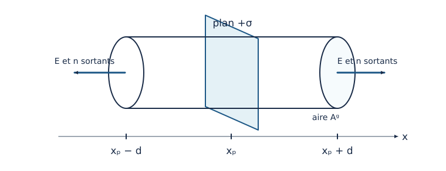
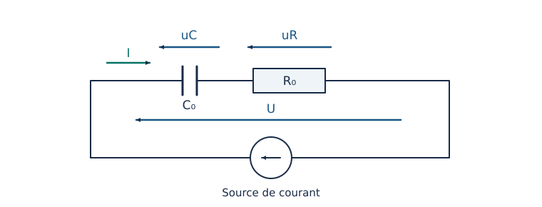
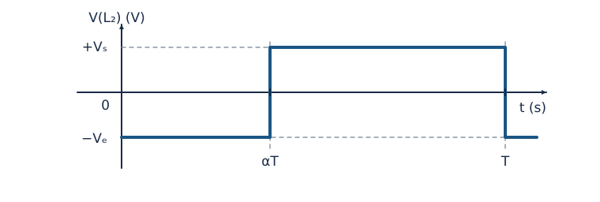
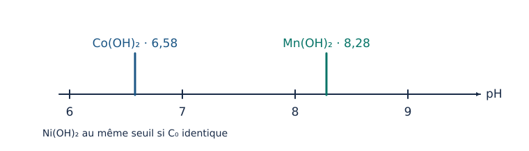
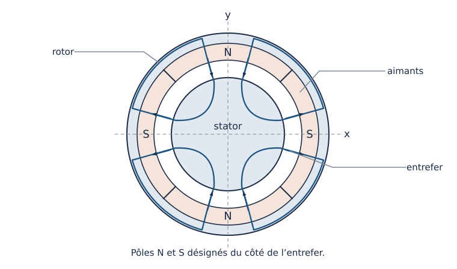
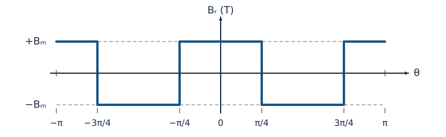

# Centrale-Supélec PSI — Physique-chimie 2 2025 · Corrigé guidé

*Corrigé rédigé par IA, non officiel. Signalez toute erreur.*

## Présentation du sujet

Le sujet dure quatre heures, calculatrice autorisée, et compte 39 questions en trois parties indépendantes. Il suit l’énergie du vélo hybride depuis les supercondensateurs jusqu’à la roue, puis étudie le recyclage de la batterie lithium-ion qui complète ce stockage.

La partie I part d’un champ créé par quatre plans chargés, mesure les paramètres d’une cellule et dimensionne le pack. La Q7 est une question ouverte. Indique les hypothèses, estime l’énergie utile, puis contrôle aussi la tension et le courant. La partie II mobilise la stœchiométrie, l’interprétation de courbes de lixiviation, la cinétique et les équilibres de précipitation. La partie III demande de lire les symétries du moteur et de relier l’énergie de l’entrefer au couple, avant de commander l’onduleur.

Les figures 5, 8, 10 à 12 et 14 à 19 contiennent les données structurantes. Vérifie les flèches de tension et les signes avant les calculs. Utilise le formulaire en dernière page pour les masses, la masse molaire, les constantes en solution et les dimensions du moteur.

## I — Le pack de supercondensateurs

Le premier modèle relie densités de charge et tension. Le second permet d’estimer le temps nécessaire à la redistribution des ions. Les mesures déterminent ensuite les paramètres qui entrent dans le bilan d’énergie.

### I.1 — Étude d’un supercondensateur

Commence par un plan seul. La superposition permet de conserver explicitement les signes des quatre charges de la figure 3.

### Question 1

> [!INDICATION]
> Pour un seul plan, utilise d’abord les invariances et les symétries, puis choisis une surface fermée à deux bases parallèles au plan.

> [!INDICATION]
> Superpose les champs des quatre plans et change le signe de chaque contribution au franchissement du plan qui la crée.

#### Solution

On note $\epsilon=\epsilon_0\epsilon_r$ dans l’électrolyte. Plaçons d’abord le plan uniformément chargé en $x=0$. Les translations parallèles au plan imposent que le champ ne dépende que de $x$. Deux plans de symétrie de la distribution, perpendiculaires au plan chargé et passant par le point d’étude, imposent une direction normale au plan. Enfin, la réflexion par rapport au plan chargé donne $E_x(-x)=-E_x(x)$.

Sur un cylindre de bases d’aire $A_G$ situées en $\pm x$ avec $x>0$, le flux latéral est nul. Le flux à travers les deux bases vaut $2A_GE_x(x)$ et la charge intérieure est $\sigma A_G$. Le théorème de Gauss donne, pour un plan situé en $x=x_p$,

$$
\boxed{\vec E_p(x)=\frac{\sigma}{2\epsilon}\,\operatorname{sgn}(x-x_p)\vec u_x\quad(x\ne x_p).}
$$

On additionne les champs des plans de charges surfaciques $+\sigma,-\sigma',+\sigma',-\sigma$ dans l’ordre des abscisses. Les deux électrodes ajoutent $\sigma\vec u_x/\epsilon$ entre elles. Les couches ioniques ne contribuent qu’entre leurs deux plans, où elles ajoutent $-\sigma'\vec u_x/\epsilon$.

$$
\boxed{\vec E(x)=
\begin{cases}
\dfrac{\sigma}{\epsilon}\vec u_x & \text{sur }]-a,-a+\delta[\cup]a-\delta,a[,\\[3pt]
\dfrac{\sigma-\sigma'}{\epsilon}\vec u_x & \text{sur }]-a+\delta,a-\delta[.
\end{cases}}
$$

Dans ce modèle plan, le champ total est nul à l’extérieur des quatre plans. Les valeurs de part et d’autre d’un plan chargé sont distinctes.

> [!JURY]
> Le rapport 2025 demande un schéma utilisable de la surface de Gauss, la justification des symétries et la distinction des zones du champ.

### Question 2

> [!INDICATION]
> Écris la relation locale entre le champ et la dérivée du potentiel. Intègre ensuite en séparant les couches de la zone centrale.

#### Solution

En une dimension, la relation $\vec E=-\operatorname{grad}V$ donne $E_x=-\mathrm dV/\mathrm dx$. Avec les potentiels de la figure 3,

$$
\begin{aligned}
U&=V(-a)-V(a)\\
&=\int_{-a}^{a}E_x(x)\,\mathrm dx\\
&=\frac{2\delta\sigma+2(a-\delta)(\sigma-\sigma')}{\epsilon}.
\end{aligned}
$$

On obtient **$U=2a\sigma/\epsilon-2(a-\delta)\sigma'/\epsilon$.**

### Question 3

> [!INDICATION]
> Que devient le courant d’ions quand les charges des couches ne varient plus ?

> [!INDICATION]
> Compare les distances sur lesquelles le champ subsiste dans l’électrolyte et dans le condensateur rempli d’air.

#### Solution

En régime indépendant du temps, aucune charge ne s’accumule sur une couche. Les ions ne traversent pas les doubles couches isolantes, donc le courant d’ions dans la solution entre les deux couches est nul. Dans le modèle ohmique de l’électrolyte, $\vec j=\gamma\vec E$, ce qui impose $E_x=0$ dans cette région. D’après Q1, **$\sigma'=\sigma$**.

La charge de l’électrode positive vaut $q=\sigma S$ et Q2 donne $U=2\delta\sigma/\epsilon$. Pour l’air, les deux plans se trouvent toujours à la distance $2a$ mais le champ ne s’annule plus au centre. Ainsi

$$
\begin{aligned}
C_0&=\frac{\epsilon_0\epsilon_rS}{2\delta},\\
C_{\mathrm{air}}&=\frac{\epsilon_0 S}{2a},\\
\frac{C_0}{C_{\mathrm{air}}}&=\boxed{\epsilon_r\frac a\delta}\gg1.
\end{aligned}
$$

### I.2 — Modèle électrocinétique du supercondensateur

L’électrolyte central conduit le courant. La couche isolante bloque les ions après leur arrivée au front, ce qui transforme leur courant en variation de charge.

### Question 4

> [!INDICATION]
> Entoure le plan positif d’un volume fixe dont une base est dans l’électrolyte et l’autre dans une couche isolante.

> [!INDICATION]
> Écris la conservation de la charge avec les normales sortantes. Il ne reste qu’une face traversée par le courant.

#### Solution

On prend pour système un volume fixe en forme de tranche contenant le plan $x=a-\delta$. La base gauche est dans l’électrolyte conducteur et sa normale sortante vaut $-\vec u_x$. La base droite est dans la double couche isolante. Les faces latérales ne sont traversées par aucun courant, car $\vec j$ est dirigé suivant $Ox$.

La charge de la tranche est $q'=\sigma'S$. Le taux de variation de cette charge est l’opposé du flux sortant de $\vec j$. Sur la base gauche, $\vec j=\gamma(\sigma-\sigma')\vec u_x/\epsilon$ d’après Q1 et la loi d’Ohm locale. Le bilan donne

$$
\boxed{\frac{\mathrm dq'}{\mathrm dt}=-\iint_{\partial\mathcal V}\vec j\cdot\mathrm d\vec S
=\gamma \frac{\sigma-\sigma'(t)}{\epsilon}S.}
$$

> [!JURY]
> Le rapport relève des bilans écrits sans système ni normale. La dérivée de la charge est l’opposé du flux sortant de la densité de courant.

### Question 5

> [!INDICATION]
> Élimine la densité de charge des électrodes grâce à Q2. Compare l’équation obtenue à celle d’un condensateur chargé à travers une résistance.

#### Solution

De Q2, on tire $\sigma-\sigma'=\epsilon U/(2a)-(\delta/a)\sigma'$. On divise le bilan de Q4 par $S$, puis on substitue l’expression précédente.

$$
\boxed{\frac{\mathrm d\sigma'}{\mathrm dt}+\frac{\delta\gamma}{a\epsilon}\sigma'
=\frac{\gamma U}{2a}.}
$$

Avec $\sigma'(0)=0$, la charge de la double couche croît vers sa valeur finale comme $1-e^{-t/\tau}$, avec $\tau=a\epsilon/(\delta\gamma)$. Dans le modèle série, la tension du condensateur idéal a une constante de temps $R_0C_0$. En utilisant Q3, on obtient **$R_0=2a/(\gamma S)$**.

### I.3 — Dimensionnement du pack de supercondensateurs du vélo hybride

Un saut de tension et une pente n’informent pas sur le même élément du modèle. Une fois les deux paramètres trouvés, distingue la quantité d’énergie utilisable et la plage de tensions à fournir au hacheur.

### Question 6

> [!INDICATION]
> Écris la loi des mailles avec des tensions orientées. Quelle tension de dipôle doit rester continue quand le courant saute ?

> [!INDICATION]
> Lis séparément un écart vertical à une commutation et la chute de tension pendant le créneau.

#### Solution

On reprend le sens de $I$ de la figure 4 et on adopte la convention récepteur pour $u_C$ et $u_R$. On note $U$ la tension aux bornes de l’ensemble.

La loi des mailles donne $U=u_C+R_0 I$. Pour le condensateur, $I=C_0\,\mathrm du_C/\mathrm dt$ et sa tension $u_C$ est continue aux commutations.

Sur la figure 5, la baisse de $3{,}00$ à $2{,}95\ \mathrm V$ au début du créneau de décharge est due à la résistance. La remontée de $1{,}50$ à $1{,}55\ \mathrm V$ à sa fin a la même amplitude. En posant $I_d=|I|$ pendant le créneau, on trouve

$$
\begin{aligned}
R_0&=\frac{V_1-V_2}{I_d}\\
&=\boxed{1{,}5\ \mathrm{m\Omega}}.
\end{aligned}
$$

Sur le créneau, $I=-I_d$ et la chute de $U$ est celle de $u_C$, puisque $R_0 I$ est constant. La figure donne $I_d=33\ \mathrm A$ et $T=14{,}5\ \mathrm s$.

$$
\begin{aligned}
C_0&=\frac{I_d T}{V_2-V_3}\\
&=\boxed{3{,}30\times10^2\ \mathrm F}.
\end{aligned}
$$

> [!JURY]
> Le rapport demande de définir les tensions de la résistance et du condensateur sur un schéma avant d’écrire la loi des mailles.

### Question 7

> [!INDICATION]
> Évalue l’énergie mécanique nécessaire pour prendre de l’altitude et relis attentivement la définition du niveau d’assistance.

> [!INDICATION]
> L’énergie utile d’une cellule est la différence de ses énergies aux deux tensions extrêmes. Confronte le résultat au bilan mécanique.

> [!INDICATION]
> Choisis le nombre de cellules en série à partir de la plage d’entrée du hacheur. Vérifie séparément le courant et l’encombrement.

#### Solution

On suppose la montée à vitesse constante et on néglige le roulement, la traînée et les pertes de conversion. Avec les masses et $g$ du formulaire, le gain d’énergie potentielle est

$$
\Delta E_p=(M_{\mathrm{vélo}}+M_{\mathrm{cycliste}})g\Delta z
=58{,}9\ \mathrm{kJ}.
$$

Le ratio d’assistance défini dans le sujet est $E_{\mathrm{pack}}/E_{\mathrm{cycliste}}=0{,}50$. Comme leurs contributions s’additionnent, le pack doit fournir le tiers du gain d’énergie, soit **$19{,}6\ \mathrm{kJ}$**.

Une cellule de tension nominale $V_N=3{,}00\ \mathrm V$ dont la tension minimale est $V_N/2$ fournit

$$
\begin{aligned}
E_{\mathrm{cell}}&=\frac12 C_0\bigl[V_N^2-(V_N/2)^2\bigr]\\
&\simeq 1{,}11\ \mathrm{kJ}.
\end{aligned}
$$

Il faut au moins $\lceil E_{\mathrm{pack}}/E_{\mathrm{cell}}\rceil=18$ cellules. Le hacheur alimente le bus moteur à $36\ \mathrm V$. Sa plage d’entrée prévue est de $27$ à $54\ \mathrm V$. **Une seule chaîne de 18 cellules en série** fournit précisément cette plage entre demi-tension et pleine tension, avec environ $20{,}0\ \mathrm{kJ}$ utilisables. Il n’est pas nécessaire de mettre des chaînes en parallèle dans ce bilan idéal.

À $250\ \mathrm W$, le courant d’une chaîne est au plus $250/27\simeq9{,}3\ \mathrm A$ en moyenne dans le modèle idéal, en deçà de la limite de $33\ \mathrm A$. La masse des cellules vaut $1{,}26\ \mathrm{kg}$. Leur volume total vaut environ $1{,}1\ \mathrm L$, sans boîtier, à partir des dimensions de la figure 7. La marge énergétique est faible. Ce dimensionnement constitue donc un minimum sous les hypothèses énoncées. La plage de tension doit également être réalisable par le hacheur, ce qui est examiné en Q12.

> [!JURY]
> Le rapport valorise le bilan d’énergie, la prise en compte de la demi-tension et une discussion de l’assemblage et de l’encombrement.

### I.4 — Interface entre les supercondensateurs et l’ensemble onduleur-moteur synchrone

Analyse séparément les deux états de commutation. Le retour aux conditions initiales en fin de période fixe les moyennes, puis les pentes permettent de calculer les ondulations.

### Question 8

> [!INDICATION]
> Regarde ce que deviennent les énergies stockées dans les bobines et condensateurs entre deux instants séparés d’une période.

#### Solution

En régime périodique établi, les bobines et les condensateurs reviennent après une période au même état énergétique. Leur puissance moyenne reçue est donc nulle. Les interrupteurs idéaux ne dissipent pas de puissance. Le bilan moyen du hacheur donne $V_e\langle I_e\rangle=V_sI_s$. À puissance de sortie fixée, la valeur moyenne d’entrée est maximale à $V_{e,\min}$.

$$
\begin{aligned}
I_{e,\max}&=\frac{V_sI_s}{V_{e,\min}}\\
&=\boxed{13{,}3\ \mathrm A}.
\end{aligned}
$$

> [!JURY]
> Le rapport relève que la puissance moyenne reçue par un élément de stockage est rarement justifiée. Elle s’obtient par la variation d’énergie sur une période.

### Question 9

> [!INDICATION]
> Intègre la loi d’une bobine sur une période de courant.

> [!INDICATION]
> Nomme les deux nœuds reliés à C1 et écris la somme des trois tensions fléchées à gauche de l’interrupteur K2.

#### Solution

Notons $A$ le nœud situé entre $L_1$ et $C_1$, et $B$ celui situé entre le condensateur et $K_2$. On prend le rail inférieur pour référence. Les flèches de la figure 8 donnent

$$
\begin{aligned}
V_{L_1}&=V_e-V_A,\\
V_{C_1}&=V_A-V_B,\\
V_{L_2}&=V_B.
\end{aligned}
$$

En choisissant chaque courant de bobine en convention récepteur, on a $V_{L_i}=L_i\,\mathrm di_i/\mathrm dt$. En régime périodique établi, l’intégrale de cette tension sur une période est donc $L_i[i_i(T)-i_i(0)]=0$. On obtient **$\langle V_{L_1}\rangle=\langle V_{L_2}\rangle=0$**.

La somme des trois différences de potentiel écrites précédemment vaut $V_e$. En prenant les moyennes, **$\langle V_{C_1}\rangle=V_e$**.

### Question 10

> [!INDICATION]
> Le premier état fixe le potentiel à gauche du condensateur C1, le deuxième fixe le potentiel à sa droite.

> [!INDICATION]
> Reporte tes deux tensions sur les intervalles de commutation, avec le niveau zéro et les trois instants de référence.

#### Solution

Pendant $0\le t<\alpha T$, $K_1$ relie $A$ au rail inférieur et $K_2$ isole la sortie. Comme $V_{C_1}\simeq V_e$, on a $V_B\simeq -V_e$.

Pendant $\alpha T\le t<T$, $K_1$ est ouvert et $K_2$ relie $B$ à la sortie. On a alors $V_B=V_s$. Puisque $V_{L_2}=V_B$, le chronogramme est le suivant, prolongé par périodicité.

### Question 11

> [!INDICATION]
> Calcule la moyenne du chronogramme de Q10 en pondérant chaque niveau par sa durée relative.

#### Solution

D’après le chronogramme et Q9, la moyenne de la tension de $L_2$ vaut $-\alpha V_e+(1-\alpha)V_s=0$. On en déduit

$$
\boxed{\frac{V_s}{V_e}=\frac{\alpha}{1-\alpha}.}
$$

Le SEPIC peut abaisser ou élever la tension en gardant la même polarité. Il régule ainsi le bus à $36\ \mathrm V$ avec une tension de pack qui passe de part et d’autre de cette valeur.

### Question 12

> [!INDICATION]
> Calcule les réglages idéaux, puis impose le gain demandé dans la formule avec pertes. Une substitution par le complément du rapport cyclique rend l’équation quadratique.

> [!INDICATION]
> Compare la formule numérique à un point lisible de la courbe tiretée avant de conclure que le gain demandé est atteignable.

#### Solution

Dans le modèle idéal de Q11, $\alpha=V_s/(V_s+V_e)$. Les extrêmes correspondant à $V_e=54\ \mathrm V$ et $27\ \mathrm V$ sont **$0{,}400$ et $0{,}571$**. Ces valeurs s’arrondissent au dixième comme celles employées ensuite dans l’énoncé.

Dans le modèle avec pertes, posons $r=R_L/R_C$, $g=V_s/V_e$ et $y=1-\alpha\in]0,1[$. Le gain imprimé vaut $G(y)=y(1-y)/(y^2+r)$. Imposer $G(y)=g$ donne

$$
(1+g)y^2-y+gr=0.
$$

Avec $r=0{,}1$, à $V_e=54\ \mathrm V$ le gain demandé est $2/3$. Sur la branche de gain croissant avec $\alpha$, on trouve **$\alpha\simeq0{,}476$**. L’autre solution vaut $0{,}924$ sur la branche décroissante.

À $V_e=27\ \mathrm V$, il faudrait $g=4/3$, mais le discriminant $1-4gr(1+g)$ est négatif. **Le modèle imprimé ne permet donc pas de maintenir $36\ \mathrm V$ à $27\ \mathrm V$ d’entrée.**

Le numérateur de $G'(y)$ est $r-2ry-y^2$. Il change de signe en $y=\sqrt{r(1+r)}-r$.

En ce point, $G_{\max}=(\sqrt{1+1/r}-1)/2$, soit $1{,}158$ avec $r=0{,}1$. Il faut au moins $V_s/G_{\max}\simeq31{,}1\ \mathrm V$ d’entrée.

La figure 9 n’est pas cohérente avec cette valeur de $r$. Par exemple, à $\alpha=0{,}9$, le tracé tireté vaut environ $4{,}5$. La formule avec $r=0{,}1$ donne $0{,}82$ en ce point.

Avec $r=0{,}01$, la formule donne $4{,}5$ au point lu. Les deux réglages sur la branche croissante deviennent alors environ $0{,}407$ et $0{,}585$, compatibles avec les arrondis annoncés.

Si la décharge se poursuit, un gain de plus en plus grand serait nécessaire. Le modèle avec pertes impose un gain fini et le régulateur finit par perdre la possibilité de maintenir la tension de sortie. Même le modèle idéal demanderait un courant d’entrée de plus en plus grand à puissance constante.

> [!PIEGE]
> La formule imprimée avec le ratio de résistance annoncé et la courbe tiretée ne concordent pas. Le modèle idéal et la figure expliquent les approximations ensuite proposées, tandis que la formule littérale fixe une plage d’entrée plus étroite.

### Question 13

> [!INDICATION]
> Pendant la première phase, la loi de la bobine L1 donne directement la pente du courant d’entrée.

> [!INDICATION]
> Remplace la limite absolue d’ondulation par une fraction du courant moyen de Q8. Étudie ensuite comment la contrainte change en fonction de la tension d’entrée.

#### Solution

On utilise les approximations données pour le dimensionnement et on lit $V_e=27\ \mathrm V$ pour $\alpha\simeq0{,}6$. On définit l’ondulation comme l’écart crête à crête. Pendant $\alpha T$, $A$ est à zéro, donc $V_{L_1}=V_e$ et le courant d’entrée augmente de $V_e\alpha T/L_1$. Sur l’autre phase il diminue, avec retour à la valeur initiale.

Avec $\langle I_e\rangle=V_sI_s/V_e$ dans le bilan idéal de Q8, la condition est

$$
L_1\ \ge\ \frac{V_e^2\alpha}{0{,}10\,f V_s I_s}.
$$

Sur l’intervalle des tensions, le modèle idéal donne $\alpha=V_s/(V_s+V_e)$. La fonction $V_e^2/(V_s+V_e)$ est strictement croissante pour $V_e>0$, donc le cas le plus contraignant est $V_e=54\ \mathrm V$.

Avec $\alpha=0{,}4$, $f=300\ \mathrm{kHz}$ et $I_s=10\ \mathrm A$,

$$\boxed{L_{1,\min}\simeq1{,}08\times10^{-4}\ \mathrm H=108\ \mathrm{\mu H}.}$$

Pour garantir une ondulation strictement inférieure au seuil dans ce modèle, on choisit $L_1$ au-dessus de cette valeur.

### Question 14

> [!INDICATION]
> Quel dipôle alimente la charge quand K2 est ouvert ? Relie la durée de cette phase à la variation de charge admise.

#### Solution

Quand $K_2$ est ouvert pendant $\alpha T$, $C_2$ alimente seul la charge. En convention récepteur, $C_2\,\mathrm dV_s/\mathrm dt=-I_s$. La chute sur cet intervalle vaut $I_s\alpha/(fC_2)$. En régime établi avec une recharge sur l’autre intervalle, c’est l’ondulation crête à crête de la sortie dans ce modèle.

À $V_e=V_s=36\ \mathrm V$, on utilise l’approximation idéale $\alpha=1/2$ de Q11. La chute admise est $0{,}01V_s=0{,}36\ \mathrm V$.

$$
\begin{aligned}
C_{2,\min}&=\frac{I_s\alpha}{0{,}01\,fV_s}\\
&=\boxed{4{,}63\times10^{-5}\ \mathrm F=46{,}3\ \mathrm{\mu F}}.
\end{aligned}
$$

Si l’on utilise la formule avec pertes imprimée à cette tension, la branche croissante donne $\alpha\simeq0{,}638$ et le même calcul fournit $59{,}1\ \mathrm{\mu F}$.

## II — Le recyclage de la batterie lithium-ion

Les concentrations mesurées traduisent des avancements. Une fois les métaux dissous, le produit de solubilité permet d’agir sur la fraction encore dissoute à un pH fixé.

### II.1 — La lixiviation

Les trois expériences distinguent l’étape rapide de l’évolution lente. Le modèle de grain rétrécissant met ensuite en série deux phénomènes qui contrôlent le même débit de réactif.

### Question 15

> [!INDICATION]
> Examine le rapport des deux rendements dès les premières mesures, puis ce que deviennent les deux courbes à des temps plus longs.

#### Solution

Sur les figures 10 et 11, les premières mesures donnent déjà des rendements d’environ $0{,}7$ pour le lithium et $0{,}35$ pour les métaux. Le rapport proche de deux correspond au rapport des coefficients de production de $\mathrm{LiCl}$ et de $\mathrm{MCl_2}$ dans la délithiation. Les deux rendements augmentent ensuite pendant plusieurs dizaines de minutes. La figure 12 montre un plateau dès le début, avec un rapport des rendements voisin de deux.

**La délithiation est achevée ou arrêtée avant les premières mesures**, donc instantanée à l’échelle de leurs intervalles. **La dissolution du solide intermédiaire est lente**, comme l’indique la croissance progressive des rendements pour les expériences A et B.

### Question 16

> [!INDICATION]
> À volume fixé, compare les variations de concentration lors de la seconde étape. Que mesure la pente de concentration du métal en fonction de celle du lithium ?

#### Solution

Après la première étape, un avancement $\mathrm d\xi$ de la seconde produit $\mathrm d\xi$ de $\mathrm{MCl_2}$ et $\mathrm d\xi/m$ de $\mathrm{LiCl}$.

Le volume étant supposé constant, la pente de la droite donnant la concentration de $\mathrm{MCl_2}$ en fonction de celle de $\mathrm{LiCl}$ vaut $m$. Les figures 10 et 11 donnent $2{,}12$ et $2{,}14$, d’où **$m\simeq2{,}1$**.

### Question 17

> [!INDICATION]
> Exprime les deux quantités initiales avec la masse et le volume plutôt qu’avec le rapport solide sur liquide. Observe ensuite quel facteur s’élimine.

#### Solution

Avec le volume de solution $l$ et la masse de solide $s$, les quantités initiales sont $[\mathrm{HCl}]_0\,l$ et $s/M_{\mathrm{NMC111}}$.

$$\boxed{x_0=\frac{[\mathrm{HCl}]_0\,M_{\mathrm{NMC111}}}{s/l}.}$$

Avec $M_{\mathrm{NMC111}}=97{,}0\ \mathrm{g\,mol^{-1}}$, on obtient les valeurs sans dimension suivantes. La concentration est donnée en $\mathrm{mol\,L^{-1}}$ et $s/l$ en $\mathrm{g\,L^{-1}}$.

$$
\begin{array}{c|r|r|r}
\text{Expérience} & [\mathrm{HCl}]_0 & s/l & x_0\\ \hline
\mathrm{A} & 4 & 20 & 19{,}4\\
\mathrm{B} & 4 & 120 & 3{,}23\\
\mathrm{C} & 1 & 80 & 1{,}21
\end{array}
$$

### Question 18

> [!INDICATION]
> Calcule d’abord combien d’acide la totalité du solide initial consommerait dans la seule réaction rapide.

> [!INDICATION]
> Pour l’expérience avec trop peu d’acide, choisis une mole de solide comme référence et exprime l’avancement avec le réactif limitant.

#### Solution

La délithiation utilise $x_1=(4m-4)/(2m-1)$ moles de $\mathrm{HCl}$ par mole de produit initial. Si $x_0<x_1$, tout l’acide est consommé par cette étape rapide. Avec $m\simeq2{,}1$, **$x_1\simeq1{,}38$**, donc seule l’expérience C vérifie la condition.

Si l’on prend une mole de produit initial, le premier avancement vaut $x_0/x_1$ lorsque l’acide est limitant. La quantité de lithium dissous est le produit de cet avancement par $(2m-2)/(2m-1)$, et celle de métal par $(m-1)/(2m-1)$.

$$
\begin{aligned}
\eta_{\mathrm{Li}}&=\frac{x_0}{2}\simeq\boxed{60{,}6\ \%},\\
\eta_{\mathrm{M}}&=\frac{x_0}{4}\simeq\boxed{30{,}3\ \%}.
\end{aligned}
$$

Ces deux rendements sont proches des plateaux de la figure 12.

> [!JURY]
> Le rapport insiste sur l’exploitation des coefficients stœchiométriques et sur les tableaux d’avancement pour distinguer la réaction rapide et la dissolution qui peut la suivre.

### Question 19

> [!INDICATION]
> Identifie ce qui fait circuler le réactif vers le front. Précise comment la surface disponible et la capacité de transfert influencent le débit total.

#### Solution

Le solide $B$ est l’intermédiaire $\mathrm{Li}_{1/m}\mathrm{MO_2}$ de la première étape, qui apparaît avec l’indice $1/n$ en page 7. D’après la figure 13, le réactif est transporté vers le front dès que $C_A>C_{Af}$.

Le débit molaire croît avec cet écart, qui constitue la force motrice du transfert, avec la surface $S$ traversée et avec la conductance $k_D$. Si les deux concentrations coïncident, ce modèle donne un débit net nul. Ainsi $F_A=k_DS(C_A-C_{Af})$ est cohérent. En unités SI, $(\mathrm{m\,s^{-1}})\mathrm{m^2}(\mathrm{mol\,m^{-3}})=\mathrm{mol\,s^{-1}}$.

### Question 20

> [!INDICATION]
> Traduis l’absence d’accumulation de A au front. Relie ensuite la consommation de B à l’avancement de la réaction.

#### Solution

L’égalité $F_A=F_{AC}$ signifie que le réactif qui atteint le front est consommé au même débit. Il n’y a pas d’accumulation au voisinage de ce front. Si $\xi$ est l’avancement de la réaction écrite $A+\nu B\longrightarrow\text{produits}$, alors $F_{AC}=\mathrm d\xi/\mathrm dt$ et $\mathrm dN_B/\mathrm dt=-\nu\,\mathrm d\xi/\mathrm dt$. D’où **$F_A=-\nu^{-1}\mathrm dN_B/\mathrm dt$**.

### Question 21

> [!INDICATION]
> Exprime séparément la chute de concentration dans le film et la concentration requise au front pour un débit donné. Additionne les deux expressions.

#### Solution

La loi de transfert donne $C_A-C_{Af}=F_A/(k_D S)$, et la loi de consommation donne $C_{Af}=F_A/(k_C S)$. En additionnant les deux chutes de concentration,

$$
\boxed{\begin{aligned}
F_A&=\frac{C_A}{R_{\mathrm{éq}}},\\
R_{\mathrm{éq}}&=\frac{1}{4\pi R^2}\left(\frac RD+\frac1{k_C}\right).
\end{aligned}}
$$

Les deux contributions de résistance s’additionnent. La résistance totale s’exprime en $\mathrm{s\,m^{-3}}$ quand $C_A$ est en $\mathrm{mol\,m^{-3}}$.

### Question 22

> [!INDICATION]
> Passe du volume résiduel du grain à sa masse, puis à une quantité de matière.

#### Solution

La masse solide restante est $\rho_B(4\pi R^3/3)$. On divise par la masse molaire du solide, dans des unités compatibles.

$$\boxed{N_B(R)=\frac{4\pi\rho_B}{3M_B}R^3.}$$

### Question 23

> [!INDICATION]
> Dérive la quantité de solide par rapport au rayon. La surface de la sphère apparaît également dans la résistance de transfert.

> [!INDICATION]
> Une fois les facteurs de surface simplifiés, intègre entre le rayon initial et le rayon restant. Sépare les contributions proportionnelle et indépendante du rayon.

#### Solution

On dérive le résultat de Q22 en gardant $\rho_B$ et $M_B$ constants, puis on substitue le flux de Q21 dans le bilan Q20. Après simplification du facteur $4\pi R^2$ pour $R>0$, il vient

$$
\left(\frac RD+\frac1{k_C}\right)\frac{\mathrm dR}{\mathrm dt}
=-\frac{\nu M_B C_A}{\rho_B}.
$$

On intègre du rayon initial $R_0$ au rayon $R(t)$, en prenant $t=0$ au début de la dissolution.

$$
t=\frac{\rho_B}{\nu M_B C_A}
\left(\frac{R_0^2-R^2}{2D}+\frac{R_0-R}{k_C}\right).
$$

On retrouve la décomposition demandée.

$$
\begin{aligned}
t&=\tau_{\mathrm{film}}\left[1-\left(\frac R{R_0}\right)^2\right]
+\tau_{\mathrm{cin}}\left(1-\frac R{R_0}\right),\\
\tau_{\mathrm{film}}&=\boxed{\frac{\rho_B R_0^2}{2\nu M_B C_A D}},\\
\tau_{\mathrm{cin}}&=\boxed{\frac{\rho_B R_0}{\nu M_B C_A k_C}}.
\end{aligned}
$$

Les deux dernières grandeurs sont des temps, car $\rho_B/(M_B C_A)$ est sans dimension.

### Question 24

> [!INDICATION]
> Dans le rapport demandé, élimine les facteurs communs. Compare les deux temps en exprimant le rayon en mètres.

#### Solution

On divise les deux expressions de Q23 et on convertit $R_0=15{,}0\ \mathrm{\mu m}$ en mètres.

$$
\begin{aligned}
\frac{\tau_{\mathrm{cin}}}{\tau_{\mathrm{film}}}
&=\frac{2D}{R_0k_C}\\
&=\boxed{1{,}67\times10^3}.
\end{aligned}
$$

La réaction est beaucoup plus lente que le transport. **Le régime est sous contrôle cinétique.**

### II.2 — La précipitation sélective

Le seuil d’apparition d’un solide se détermine en prenant la concentration initiale. Pour quantifier une séparation, il faut ensuite utiliser la concentration résiduelle désirée.

### Question 25

> [!INDICATION]
> Écris le produit de solubilité à saturation. Le pH détermine les concentrations en oxonium et en hydroxyde.

> [!INDICATION]
> Pour obtenir la concentration en métal, écris l’électroneutralité et compare les deux concentrations d’ions issues de l’eau.

#### Solution

À saturation, $\mathrm{Mn(OH)_2(s)}$ libère un ion $\mathrm{Mn^{2+}}$ et deux ions $\mathrm{OH^-}$ par unité dissoute. On prend $c^\circ=1\ \mathrm{mol\,L^{-1}}$ et on assimile les activités des solutés aux concentrations réduites. L’électroneutralité donne

$$
[\mathrm{OH^-}]=2[\mathrm{Mn^{2+}}]+[\mathrm{H_3O^+}].
$$

À $\mathrm{pH}=9{,}9$, le produit ionique de l’eau donne $[\mathrm{OH^-}]=7{,}94\times10^{-5}\ \mathrm{mol\,L^{-1}}$. La concentration en ions oxonium, $1{,}26\times10^{-10}\ \mathrm{mol\,L^{-1}}$, est négligeable devant celle des ions hydroxyde. Ainsi $[\mathrm{Mn^{2+}}]\simeq[\mathrm{OH^-}]/2$. Pour le solide présent à l’équilibre,

$$
K_s=\frac{[\mathrm{Mn^{2+}}]}{c^\circ}
\left(\frac{[\mathrm{OH^-}]}{c^\circ}\right)^2
\simeq 2{,}51\times10^{-13}.
$$

Donc **$pK_s=-\log K_s=12{,}6$**.

### Question 26

> [!INDICATION]
> Au seuil, égale le quotient réactionnel au produit de solubilité avec la concentration en métal avant précipitation. Écris ensuite la concentration en hydroxyde en fonction du pH.

#### Solution

Pour chaque solide $\mathrm{M(OH)_2}$, posons $Q_s=([\mathrm{M^{2+}}]/c^\circ)([\mathrm{OH^-}]/c^\circ)^2$. La précipitation commence lorsque la solution atteint $Q_s=K_s$. Pour $Q_s>K_s$, la précipitation diminue le quotient jusqu’à l’équilibre. Avant apparition du solide, $[\mathrm{M^{2+}}]=C_0$ en négligeant la dilution.

Comme $[\mathrm{OH^-}]/c^\circ=10^{\mathrm{pH}-pK_e}$, le seuil vaut

$$
\boxed{\mathrm{pH}_{\mathrm d}
=pK_e-\frac12\bigl[pK_s+\log(C_0/c^\circ)\bigr].}
$$

### Question 27

> [!INDICATION]
> Calcule les deux seuils pour la même concentration initiale et place-les sur un axe unique en respectant l’échelle.

#### Solution

Avec $C_0=0{,}069\ \mathrm{mol\,L^{-1}}$ et $pK_e=14$, on obtient **$\mathrm{pH}_{\mathrm d}(\mathrm{Co(OH)_2})=6{,}58$** pour $pK_s=16$ et **$\mathrm{pH}_{\mathrm d}(\mathrm{Mn(OH)_2})=8{,}28$** pour $pK_s=12{,}6$. Si le nickel est initialement à la même concentration, son seuil est identique à celui du cobalt.

### Question 28

> [!INDICATION]
> À 99 % de précipitation, quelle fraction de la concentration initiale est restée dans la solution ?

> [!INDICATION]
> Compare le pH qui donne cette concentration pour le cobalt au pH d’apparition de l’hydroxyde de manganèse.

#### Solution

Pour précipiter $99\ \%$ du cobalt, il faut ramener sa concentration dissoute à $0{,}01C_0$. À l’équilibre avec le solide, cette division par $100$ exige de multiplier la concentration en hydroxyde par $10$. Le pH correspondant dépasse de $1$ le pH d’apparition du cobalt.

L’intervalle de pH recherché est **$[\mathrm{pH}_{\mathrm d,Co}+1,\mathrm{pH}_{\mathrm d,Mn}[$**, soit environ $[7{,}58,8{,}28[$. Pour dépasser strictement $99\ \%$, on choisit un pH strictement au-dessus du premier seuil. Un choix tel que $\mathrm{pH}\simeq8{,}0$ permet de filtrer l’hydroxyde de cobalt, puis d’augmenter le pH du filtrat pour précipiter le manganèse.

Le nickel et le cobalt ont le même produit de solubilité. À concentrations initiales comparables, il n’existe pas de séparation sélective de ces deux ions par ce seul réglage. Une fois leurs solides présents, leurs concentrations dissoutes à l’équilibre sont égales pour un même pH. Si le nickel est présent à la même concentration initiale, il précipite donc avec le cobalt.

> [!METHODE]
> Il faut comparer un taux de récupération pour le premier ion à un seuil d’apparition pour l’autre. Leur seule différence de seuil ne mesure pas l’efficacité de la séparation.

## III — Le moteur roue synchrone et son pilotage

Le moteur est étudié d’abord du point de vue du champ et du couple, puis du point de vue de la tension appliquée à une phase.

### III.1 — Dimensionnement du moteur roue synchrone à aimants permanents

L’orientation des pôles fixe le profil angulaire. Dans l’énergie, l’intégration sur l’entrefer complet élimine les termes qui oscillent avec l’angle.

### Question 29

> [!INDICATION]
> Remplace les aimants par des spires équivalentes et repère les plans de symétrie et d’antisymétrie des courants.

> [!INDICATION]
> Près d’une face Nord, oriente les lignes vers l’extérieur de l’aimant. Repère leur passage dans les autres zones et ferme les lignes.

#### Solution

On assimile chaque aimant à une spire dont le moment est dirigé comme $\vec M_i$. Les faces tournées vers l’entrefer sont des pôles Sud sur l’axe horizontal et des pôles Nord sur l’axe vertical. Dans l’entrefer, les lignes sortent des pôles Nord et pénètrent dans les pôles Sud. Elles y traversent donc radialement l’espace **vers le stator au voisinage de l’axe vertical** et **vers le rotor au voisinage de l’axe horizontal**. Elles se referment dans le stator et le rotor.

Les plans verticaux contenant les deux axes de la figure sont des plans d’antisymétrie des courants équivalents. Le champ y est tangent. Les plans verticaux bissecteurs sont des plans de symétrie de ces courants. Le champ leur est normal et sa composante radiale est nulle sur la bissectrice. Dans un ferromagnétique de perméabilité très grande, $\vec H$ tend vers zéro. La continuité de sa composante tangentielle au contact de l’entrefer avec le stator, en l’absence de courant libre surfacique, justifie la direction presque normale dans cet entrefer mince.

> [!JURY]
> Le rapport indique que peu de copies ont utilisé les spires équivalentes et les symétries pour justifier le tracé du champ.

### Question 30

> [!INDICATION]
> Compare les valeurs aux angles opposés, puis après un quart de tour et un demi-tour. Représente les zones de signe opposé avec des paliers.

#### Solution

La réflexion autour de l’axe horizontal conserve $B_r$, donc $B_r(-\theta)=B_r(\theta)$. Un demi-tour échange des aimants de même orientation relative et laisse $B_r$ inchangé. Un quart de tour change son signe. **La composante est paire, de période fondamentale $\pi$.**

Dans le modèle à module constant, $B_r$ vaut $+B_M$ près des axes horizontaux et $-B_M$ près des axes verticaux. Les changements de signe se produisent aux bissectrices.

La trace en créneaux sur $[-\pi,\pi]$ est la suivante. Aux transitions, le modèle à paliers remplace la variation continue du champ réel.

### Question 31

> [!INDICATION]
> Identifie le premier cosinus compatible avec la parité et la période. Exprime ensuite l’angle du point fixe dans le repère tournant avec le rotor.

#### Solution

Au repos, la parité impose un fondamental en cosinus. Pour une période angulaire $\pi$, il s’agit de $\cos(2\theta)$ et son coefficient est $B_1=4B_M/\pi$, donné par l’énoncé. Lorsque le rotor tourne d’un angle $\theta_r(t)$, l’angle d’un point fixe par rapport au rotor est $\theta-\theta_r(t)$. D’où

$$
\boxed{\vec B_r(\theta,t)=B_1\cos\!\bigl[2(\theta-\theta_r(t))\bigr]\vec e_r.}
$$

### Question 32

> [!INDICATION]
> Intègre la densité d’énergie du champ total sur l’épaisseur, la hauteur et le tour complet de l’entrefer.

> [!INDICATION]
> Développe le carré. Pour le terme croisé, utilise le formulaire et cherche quand un cosinus cesse de dépendre de l’angle d’intégration.

#### Solution

Dans l’entrefer de perméabilité $\mu_0$, la densité d’énergie du champ total est $\|\vec B_r+\vec B_s\|^2/(2\mu_0)$. Comme $R_s\gg l_e$ et que le modèle est invariant selon $z$, on intègre sur toute la couronne avec $\mathrm dV=R_s h l_e\,\mathrm d\theta$ pour $0\le\theta\le2\pi$.

Les moyennes des deux carrés de cosinus valent $1/2$. Pour le produit croisé, la formule du sujet donne des cosinus dont les fréquences angulaires sont $p-2$ et $p+2$. Leurs moyennes s’annulent, sauf celle de fréquence nulle lorsque $p=2$. Pour $p\ge1$, on obtient

$$
\boxed{\mathcal E_{\mathrm{em}}=\frac{V_e}{4\mu_0}(B_0^2+B_1^2)
+\mathbf 1_{\{p=2\}}\,\frac{V_eB_0B_1}{2\mu_0}
\cos(\omega t-2\theta_r).}
$$

**L’énergie dépend de $\theta_r$ pour $p=2$**, c’est-à-dire quand rotor et stator ont le même nombre de paires de pôles.

> [!JURY]
> Le rapport souligne l’importance du volume d’intégration. La primitive angulaire doit être évaluée sur un tour complet en gardant l’épaisseur et la hauteur de l’entrefer.

### Question 33

> [!INDICATION]
> Dérive l’énergie par rapport à l’angle du rotor à temps fixé. Surveille le signe en dérivant la phase.

#### Solution

La dérivation à temps fixé prescrite dans l’énoncé donne

$$
\boxed{\Gamma=\frac{V_eB_0B_1}{\mu_0}\sin(\omega t-2\theta_r).}
$$

Le facteur $2$ provient de la dérivée de la phase rotorique.

### Question 34

> [!INDICATION]
> Remplace l’angle par sa loi temporelle. Sous quelle condition un sinus peut-il garder une moyenne non nulle pour une rotation uniforme ?

#### Solution

On remplace $\theta_r$ par $\Omega t-\alpha$. Le couple est proportionnel à $\sin[(\omega-2\Omega)t+2\alpha]$. Si $\omega-2\Omega\ne0$, la moyenne temporelle est nulle.

**Seule la vitesse synchrone $\Omega=\omega/2$** permet un couple moyen non nul. À cette vitesse, il vaut $(V_eB_0B_1/\mu_0)\sin(2\alpha)$ et il est non nul si $\sin(2\alpha)\ne0$.

### Question 35

> [!INDICATION]
> Évalue le couple quand le sinus vaut un. Pour étudier un autre nombre de paires, reprends le facteur issu de la dérivation angulaire.

> [!INDICATION]
> Si le nombre maximal de pôles ne suffit pas, cherche sur la vue éclatée l’organe qui transforme une vitesse de rotation en couple utile.

#### Solution

Le couple maximal est atteint pour $\sin(2\alpha)=1$, par exemple pour $\alpha=\pi/4$. Avec les dimensions du formulaire,

$$
\begin{aligned}
V_e&=2\pi R_s h l_e=3{,}96\times10^{-6}\ \mathrm{m^3},\\
\Gamma_{2,\max}&=\frac{V_e B_0(4B_M/\pi)}{\mu_0}
\simeq\boxed{4{,}0\ \mathrm{N\,m}}.
\end{aligned}
$$

Si rotor et stator comportent tous deux $p$ paires de pôles, à amplitudes et volume inchangés, la dérivation de $\cos(\omega t-p\theta_r)$ donne un facteur $p$. Le maximum est donc multiplié par $p/2$ par rapport au calcul précédent. À huit paires, on obtient environ $16\ \mathrm{N\,m}$, encore en dessous des $50\ \mathrm{N\,m}$ demandés à la roue.

Le train planétaire repéré sur la figure 15 permet de gagner en couple en réduisant la vitesse. En notant $r_g=\Omega_{\mathrm{moteur}}/\Omega_{\mathrm{roue}}$ et $\eta_g$ le rendement mécanique, $\Gamma_{\mathrm{roue}}\simeq\eta_g r_g\Gamma_{\mathrm{moteur}}$. Avec huit paires il faut **$r_g\ge 50/(16\eta_g)$**, soit au moins environ $3{,}1$ dans le cas idéal. Le rendement réel doit être pris en compte dans le choix final.

Si les $50\ \mathrm{N\,m}$ sont exigés directement sur le rotor avant réduction, il faut augmenter d’un facteur d’environ $3{,}1$ le produit $V_eB_0B_1$ obtenu à huit paires.

### III.2 — L’onduleur MLI

À chaque instant, identifie le rail auquel est raccordée chacune des bornes de la charge. Les angles de commutation règlent en même temps les amplitudes harmoniques et le temps où la tension est non nulle.

### Question 36

> [!INDICATION]
> Pour les paliers non nuls, raccorde les deux bornes de la charge à des rails opposés. Pour un palier nul, raccorde-les au même rail.

> [!INDICATION]
> Répartis les configurations de tension nulle de manière à respecter les durées de fermeture. Garde un seul interrupteur fermé dans chaque bras.

#### Solution

La flèche de la figure 16 donne $v_{\mathrm{ch}}=V_{\mathrm{gauche}}-V_{\mathrm{droite}}$. Dans chaque bras, un seul interrupteur doit être fermé. Fermer les deux court-circuiterait la source, et les ouvrir tous deux laisserait la charge en circuit ouvert.

Posons $\varphi=\omega t$. Pour $+E$, on ferme $K_1$ et $K_2'$. Pour la tension opposée, on ferme $K_1'$ et $K_2$.

Un palier nul s’obtient en raccordant les deux bornes de la charge au même rail. Voici une séquence sur une période.

$$
\begin{array}{c|c|cccc}
\text{Intervalle en }\varphi & v_{\mathrm{ch}} & K_1 & K_2 & K_1' & K_2'\\ \hline
\lbrack 0,\gamma_0[ & 0 & 0 & 0 & 1 & 1\\
\lbrack \gamma_0,\pi-\gamma_0[ & E & 1 & 0 & 0 & 1\\
\lbrack \pi-\gamma_0,\pi+\gamma_0[ & 0 & 1 & 1 & 0 & 0\\
\lbrack \pi+\gamma_0,2\pi-\gamma_0[ & -E & 0 & 1 & 1 & 0\\
\lbrack 2\pi-\gamma_0,2\pi[ & 0 & 0 & 0 & 1 & 1
\end{array}
$$

Les deux configurations nulles durent chacune $2\gamma_0$ en phase, et chaque palier non nul dure $\pi-2\gamma_0$. Chaque interrupteur est donc fermé pendant une phase totale $\pi$, soit **$T/2$**. On peut également échanger les deux configurations à tension nulle.

> [!JURY]
> Le rapport demande les intervalles temporels, le nombre de séquences et les deux contraintes. Il faut éviter tout court-circuit de la source et tout circuit ouvert de la charge.

### Question 37

> [!INDICATION]
> Repère les zéros du coefficient de rang trois. Écarte l’angle pour lequel le fondamental s’annulerait aussi.

> [!INDICATION]
> Pour la valeur efficace du signal, identifie la fraction de période où sa valeur absolue est constante et non nulle.

#### Solution

Le coefficient de rang trois est proportionnel à $\cos(3\gamma_0)$. Pour $0\le\gamma_0<\pi/2$, le choix qui l’annule est $\gamma_0=\pi/6$. Le choix $\gamma_0=\pi/2$ annulerait tout le signal et son fondamental. Comme $\gamma_0=2\pi t_0/T$, **$t_0=T/12$**.

Le signal est non nul pendant la fraction $1-2\gamma_0/\pi$ de la période, où son carré vaut $E^2$. Le fondamental d’après la série donnée a pour amplitude $4E\cos\gamma_0/\pi$. Ainsi

$$
\begin{aligned}
V&=E\sqrt{1-\frac{2\gamma_0}{\pi}},\\
V_f&=\frac{4E}{\pi\sqrt2}\cos\gamma_0.
\end{aligned}
$$

Pour $\gamma_0=\pi/6$, on a $V=E\sqrt{2/3}$ et $V_f=E\sqrt6/\pi$. D’où **$\tau_H=\sqrt{\pi^2/9-1}\simeq31{,}1\ \%$**.

### Question 38

> [!INDICATION]
> Sur le premier quart de période, utilise le front montant d’un signal de base pour ouvrir une impulsion et un autre front montant pour la couper.

#### Solution

Sur le premier quart de période, chaque signal de la figure 19 passe de $0$ à $E$ à son angle $\gamma_i$. Une différence de deux signaux successifs crée donc une impulsion limitée aux deux angles correspondants. Le modèle présente trois impulsions dans ce quart de période. Les autres quarts suivent par symétrie et changement de signe après un demi-tour.

$$
\boxed{v_{\mathrm{ch}}(t)=\sum_{i=1}^6(-1)^{i+1}v_{\mathrm{ch},\gamma_i}(t).}
$$

### Question 39

> [!INDICATION]
> Écris les coefficients impairs du signal combiné, puis compte ceux à annuler avant le rang visé.

> [!INDICATION]
> La valeur efficace ne dépend que de la durée totale des impulsions. Relie cette durée aux différences d’angles du premier quart.

#### Solution

Les symétries annulent les harmoniques de rang pair. La superposition de Q38 donne, pour un rang impair $q$, une amplitude algébrique proportionnelle à

$$
\frac1q\sum_{i=1}^6(-1)^{i+1}\cos(q\gamma_i).
$$

Il faut annuler les cinq rangs $3,5,7,9,11$. Pour la valeur efficace, le signal est non nul durant une longueur angulaire égale à quatre fois la somme des trois largeurs d’impulsion du premier quart. Son carré y vaut $E^2$. Les six conditions sur les six angles sont donc

$$
\boxed{\begin{cases}
\displaystyle\sum_{i=1}^6(-1)^{i+1}\cos(q\gamma_i)=0
&\text{pour }q\in\{3,5,7,9,11\},\\[4pt]
(\gamma_2-\gamma_1)+(\gamma_4-\gamma_3)+(\gamma_6-\gamma_5)=\pi/4.
\end{cases}}
$$

On recherche les angles ordonnés $0<\gamma_1<\cdots<\gamma_6<\pi/2$. Pour des impulsions non nulles, le fondamental est positif, puisque $\cos$ décroît sur ce quart de période. Pour conserver le rang $13$, le réglage retenu doit aussi vérifier

$$\sum_{i=1}^6(-1)^{i+1}\cos(13\gamma_i)\ne0.$$

Les cinq annulations et la contrainte sur la valeur efficace utilisent qualitativement les six degrés de réglage. Le comptage des conditions motive cette commande, sans établir à lui seul l’existence d’une solution ordonnée.

## Bilan

Pour dimensionner un stockage, compare l’énergie effectivement utilisable avant de choisir la tension et le courant de l’assemblage. Dans un convertisseur, distingue le régime moyen, qui impose le bilan par période, et les phases de commutation, qui imposent les ondulations.

En chimie, vérifie les proportions des espèces mises en solution avant d’interpréter un rendement. Pour une précipitation sélective, calcule à la fois un seuil d’apparition et la concentration résiduelle à l’équilibre.

Dans un moteur synchrone, l’intégration du terme croisé sur un tour établit la condition d’accord des pôles. Pour la MLI, le passage du chronogramme au spectre donne les équations sur les angles, complétées par une condition de valeur efficace.
