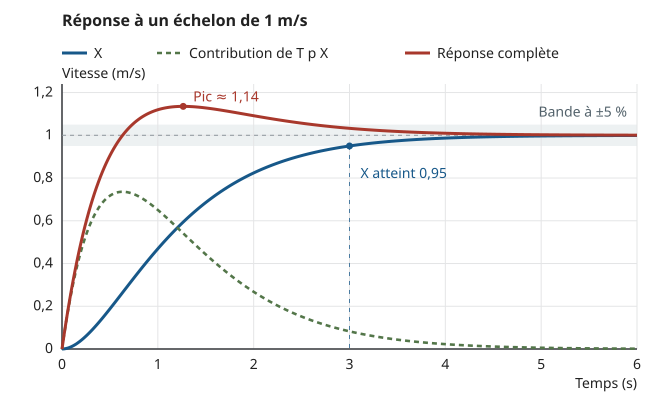

# Corrigé brut — Centrale-Supélec PSI S2I 2025

*Corrigé rédigé par IA, non officiel. Signalez toute erreur.*

## Partie A — Comportement dynamique de l’avion

### I — Vol de croisière

### Question 1

On isole l’avion. En régime horizontal stationnaire, $\vec z_A=\vec z_0$, $\beta=0$ et la force perturbatrice est nulle.

Le poids est dirigé suivant $\vec z_A$. La propulsion $F_M\vec x_B$ a pour composantes $F_M\cos\alpha$ suivant $\vec x_A$ et $-F_M\sin\alpha$ suivant $\vec z_A$. La résultante des actions mécaniques extérieures est nulle, d’où
$$
\begin{aligned}
F_M\cos\alpha&=\tfrac12\rho S V^2(C_{x0}+C_x\alpha),\\
mg&=F_M\sin\alpha+\tfrac12\rho S V^2[C_{z0}+C_{p0}+(C_z+C_p)\alpha].
\end{aligned}
$$
Dans le domaine de vol considéré, $\cos\alpha>0$. En remplaçant $F_M$ issu de la première relation dans la seconde,
$$
\boxed{\begin{aligned}F_M&=\frac{\rho S V^2(C_{x0}+C_x\alpha)}{2\cos\alpha},\\V^2&=\frac{2mg}{\rho S[C_{z0}+C_{p0}+(C_z+C_p)\alpha+(C_{x0}+C_x\alpha)\tan\alpha]}.\end{aligned}}
$$

### Question 2

On applique le théorème du moment statique en $G$ à l’avion. Le poids passe par $G$ et la ligne d’action de la propulsion passe par $G$.

Pour les forces en $A$ et $B$, on utilise $\vec x_B=\cos\alpha\,\vec x_A-\sin\alpha\,\vec z_A$ et $\vec z_B=\sin\alpha\,\vec x_A+\cos\alpha\,\vec z_A$. Les moments projetés sur $\vec y_0$ valent
$$
\begin{aligned}
\left[\overrightarrow{GA}\wedge(\vec F_P+\vec F_T)\right]\cdot\vec y_0
&=-\tfrac12\rho S V^2 x_A[(C_{z0}+C_z\alpha)\cos\alpha+(C_{x0}+C_x\alpha)\sin\alpha],\\
(\overrightarrow{GB}\wedge\vec F_B)\cdot\vec y_0
&=-\tfrac12\rho S V^2(C_{p0}+C_p\alpha)(x_B\cos\alpha+h_B\sin\alpha).
\end{aligned}
$$
Le facteur commun $\tfrac12\rho S V^2\cos\alpha$ se simplifie. En divisant par le terme constant $d_0=x_A C_{z0}+x_B C_{p0}$, supposé non nul dans la forme demandée, on obtient $1+l_1\tan\alpha+(l_2+l_3\tan\alpha)\alpha=0$, avec
$$
\boxed{\begin{aligned}l_1&=\frac{x_A C_{x0}+h_B C_{p0}}{d_0},\\

l_2&=\frac{x_A C_z+x_B C_p}{d_0},\\

l_3&=\frac{x_A C_x+h_B C_p}{d_0}.\end{aligned}}
$$

### Question 3

Avec $\alpha_0=0{,}84^\circ=1{,}466\times10^{-2}\ \mathrm{rad}$, les relations de Q1 donnent
$$
\boxed{V_0\simeq59{,}7\ \mathrm{m\,s^{-1}}=215\ \mathrm{km\,h^{-1}},\qquad F_{M0}\simeq796\ \mathrm N.}
$$
La vitesse appartient à l’intervalle de $164$ à $290\ \mathrm{km\,h^{-1}}$ et l’altitude de calcul, $4000\ \mathrm m$, est sous le plafond de $4877\ \mathrm m$.

La puissance utile de la force propulsive vaut $F_{M0}V_0\cos\alpha_0\simeq47{,}5\ \mathrm{kW}$, inférieure aux $72\ \mathrm{kW}$ de puissance maximale continue. Le point est donc compatible avec les capacités dans le modèle de l’énoncé. Si les $72\ \mathrm{kW}$ sont mesurés à l’arbre, cette comparaison suppose que le rendement de la chaîne propulsive atteint au moins $47{,}5/72\simeq66\,\%$.

### II — Modèles dynamiques

### Question 4

Dans la base terrestre fixe, $\vec\Gamma_G=\dot V_x\vec x_0-\dot V_z\vec z_0$. Comme $\vec x_0=\cos\gamma\,\vec x_A+\sin\gamma\,\vec z_A$ et $\vec z_0=-\sin\gamma\,\vec x_A+\cos\gamma\,\vec z_A$,
$$
\boxed{\vec\Gamma_G=(\dot V_x\cos\gamma+\dot V_z\sin\gamma)\vec x_A+
(\dot V_x\sin\gamma-\dot V_z\cos\gamma)\vec z_A.}
$$
Les dérivées sont du premier ordre en perturbation, de même que $\sin\gamma$. Au premier ordre, **$\vec\Gamma_G\simeq\Delta\dot V_x\vec x_A-\Delta\dot V_z\vec z_A$**.

### Question 5

Les actions extérieures sur l’avion isolé sont le poids, la propulsion, la portance et la traînée en $A$, la force aérodynamique de la gouverne en $B$ et la perturbation $\vec F_V=F_V\vec z_A$. Le théorème de la résultante dynamique projeté dans $R_A$ donne
$$
\begin{aligned}
m(\dot V_x\cos\gamma+\dot V_z\sin\gamma)
&=F_M\cos\alpha-mg\sin\gamma-\tfrac12\rho S V^2(C_{x0}+C_x\alpha),\\
m(\dot V_x\sin\gamma-\dot V_z\cos\gamma)
&=-F_M\sin\alpha+mg\cos\gamma
-\tfrac12\rho S V^2[C_{z0}+C_z\alpha+C_{p0}+C_p(\alpha+\beta)]+F_V .
\end{aligned}
$$
La projection sur $\vec y_0$ est nulle par symétrie du vol.

### Question 6

Au premier ordre, $V^2=V_0^2+2V_0\Delta V_x$, $\sin\gamma=\Delta\gamma$ et
$F_M\cos\alpha=F_{M0}\cos\alpha_0+\cos\alpha_0\,\Delta F_M-F_{M0}\sin\alpha_0\,\Delta\alpha$.
Dans la composante suivant $\vec x_A$, les termes constants s’annulent grâce à l’équilibre Q1. Après division par $m$, on retrouve l’équation (1) avec
$$
\boxed{\begin{aligned}a&=\frac{\rho S V_0(C_{x0}+C_x\alpha_0)}{m},\\
b&=\frac{\cos\alpha_0}{m},\\
c&=\frac{F_{M0}\sin\alpha_0+\tfrac12\rho SV_0^2C_x}{m}.\end{aligned}}
$$

### Question 7

La décomposition de $V\vec x_A$ dans le repère terrestre donne $V_z=V\sin\gamma$. Or $V=V_0+\Delta V_x$ et $\sin\gamma=\Delta\gamma$ au premier ordre. Ainsi **$\Delta V_z=V_0\Delta\gamma$** au premier ordre.

### Question 8

L’assiette vérifie $\theta=\alpha+\gamma$. Le mouvement de rotation de l’avion s’effectue suivant l’axe de direction fixe $\vec y_0$. Le moment cinétique en $G$ vaut $I_2\dot\theta\,\vec y_0$ d’après la matrice d’inertie donnée.

Le moment dynamique en $G$ est donc $I_2\ddot\theta\,\vec y_0$. Le transport en $A$ s’écrit
$$
\begin{aligned}\vec\delta_A&=\vec\delta_G+\overrightarrow{AG}\wedge m\vec\Gamma_G,\\
\overrightarrow{AG}&=x_A\vec x_B.\end{aligned}
$$
En utilisant $\vec x_B=\cos\theta\,\vec x_0-\sin\theta\,\vec z_0$ et $\vec\Gamma_G=\dot V_x\vec x_0-\dot V_z\vec z_0$,
$$
\boxed{\vec\delta_A=[I_2\ddot\theta+m x_A(\dot V_z\cos\theta-\dot V_x\sin\theta)]\vec y_0.}
$$
Comme $\theta_0=\alpha_0$ et que les dérivées des vitesses sont déjà du premier ordre, il reste
$$
\vec\delta_A\simeq[I_2(\Delta\ddot\alpha+\Delta\ddot\gamma)+m x_A(\Delta\dot V_z\cos\alpha_0-\Delta\dot V_x\sin\alpha_0)]\vec y_0.
$$

### Question 9

Portance des ailes, traînée et perturbation sont appliquées en $A$. La ligne d’action de la propulsion est portée par $(AG)$. Leurs moments en $A$ sont donc nuls. Le poids contribue pour $-mgx_A\cos\theta$ suivant $\vec y_0$.

En posant $F_{B,z}^{-}=\tfrac12\rho S V^2[C_{p0}+C_p(\alpha+\beta)]$, la force de la gouverne vaut $-F_{B,z}^{-}\vec z_A$. Avec $\overrightarrow{AB}=(x_A-x_B)\vec x_B-h_B\vec z_B$, sa contribution est $F_{B,z}^{-}[(x_A-x_B)\cos\alpha-h_B\sin\alpha]$. Le théorème du moment dynamique en $A$ donne donc, sans linéarisation,
$$
\boxed{\begin{aligned}
I_2(\ddot\alpha+\ddot\gamma)+m x_A(\dot V_z\cos(\alpha+\gamma)-\dot V_x\sin(\alpha+\gamma))
={}&-mgx_A\cos(\alpha+\gamma)\\
&+\tfrac12\rho SV^2[C_{p0}+C_p(\alpha+\beta)]
[(x_A-x_B)\cos\alpha-h_B\sin\alpha].
\end{aligned}}
$$

### III — Validation du modèle dynamique

### Question 10

La figure 15 permet une comparaison séparée des deux sollicitations.

- **Trapèze de gouverne jusqu’à environ 2,4°**

  Les ondulations ont des échelles temporelles et des amortissements proches. Des écarts de phase et d’amplitude sont visibles, surtout sur $V_z$ pendant les transitions.

  Pendant le plateau, les deux modèles donnent $V_x$ autour de $81\ \mathrm{m\,s^{-1}}$ et $V_z$ autour de $-5\ \mathrm{m\,s^{-1}}$. Après retour de la gouverne, ils reviennent vers 59 m/s horizontalement et 0 m/s verticalement.
- **Échelon de propulsion de $100\ \mathrm N$**

  Les fréquences d’oscillation, de période de l’ordre de la demi-seconde, et la décroissance des oscillations sont proches. Les premiers extrema présentent de faibles écarts.

  Les limites sont pratiquement confondues, autour de $59{,}4\ \mathrm{m\,s^{-1}}$ pour $V_x$ et de $1\ \mathrm{m\,s^{-1}}$ pour $V_z$.

Le **modèle linéarisé** représente donc assez bien le fonctionnement voisin du point de croisière pour synthétiser les correcteurs. Le modèle non linéaire permettra ensuite de valider les performances, notamment pour des variations plus marquées.

## Partie B — Étude de la chaîne cinématique de la gouverne

### Question 11

On repère les points fixes $O,A,D,F,H,L$ dans le bâti. Le graphe des liaisons fait apparaître quatre fermetures planes utiles, que l’on peut parcourir dans l’ordre suivant.

1. Dans $O\to A\to B\to C\to D\to O$, fixer $\theta_3$ et résoudre les deux projections pour les orientations $\theta_1$ et $\theta_2$. On peut éliminer $\theta_2$ en utilisant la longueur de $BC$.
2. Écrire les fermetures $O\to A\to B\to E\to F\to O$ et $O\to F\to G\to H\to O$. Le coulissement en $F$ impose que $E,F,G$ soient sur la même ligne portée par $\vec x_5$.
   Les quatre projections déterminent conjointement $\theta_4,\theta_5,\lambda_5$ et $\theta_6$.
3. Dans $O\to H\to J\to K\to L\to O$, utiliser $\theta_6$ pour déterminer $\theta_7$ et $\beta$, ou éliminer $\theta_7$ au moyen de la longueur de $JK$.

Dans chaque résolution, on conserve la branche compatible avec la configuration assemblée et son prolongement continu dans le domaine de fonctionnement.

### Question 12

L’annexe C donne $\overrightarrow{HJ}=L_6\vec x_{6'}$ avec $(\vec x_B,\vec x_{6'})=\theta_6+\pi/6$, et $\overrightarrow{LK}=L_8\vec x_8$ avec $(\vec x_B,\vec x_8)=\beta$. Donc
$$
\overrightarrow{JK}=\overrightarrow{OL}-\overrightarrow{OH}+L_8\vec x_8-L_6\vec x_{6'}.
$$
En prenant le carré de la norme dans la base orthonormée liée au bâti,
$$
\boxed{\begin{aligned}
L_7^2={}&[X_L-X_H+L_8\cos\beta-L_6\cos(\theta_6+\pi/6)]^2\\
&+[Y_L-Y_H+L_8\sin\beta-L_6\sin(\theta_6+\pi/6)]^2.
\end{aligned}}
$$

### Question 13

On part d’un intervalle sur lequel la fonction continue $x\mapsto f(x,y)$ change de signe. Les valeurs nulles aux bornes sont traitées directement. À chaque étape, on garde le demi-intervalle dont les bornes encadrent une racine. Lorsque sa longueur est au plus $2\epsilon$, son milieu est à distance au plus $\epsilon$ d’une racine.

```python
def dichotomie(f, y, xmin, xmax, epsilon):
    fa = f(xmin, y)
    fb = f(xmax, y)
    if fa == 0:
        return xmin
    if fb == 0:
        return xmax
    if fa * fb > 0:
        raise ValueError("Les bornes doivent encadrer une racine par changement de signe.")

    while xmax - xmin > 2 * epsilon:
        milieu = (xmin + xmax) / 2
        fm = f(milieu, y)
        if fm == 0:
            return milieu
        if fa * fm < 0:
            xmax = milieu
        else:
            xmin = milieu
            fa = fm

    return (xmin + xmax) / 2
```

Pour obtenir $\theta_3$ à $\theta_1$ fixé, appeler cette procédure avec $f=\texttt{loi31}$ et $y=\theta_1$, sur un intervalle isolant la solution de la branche physique.

### Question 14

Le zoom de la figure 5 passe par le voisinage de l’origine et sa pente est proche de l’unité autour de celle-ci. Pour les configurations où la gouverne reste dans la plage exigée $|\beta|\le17^\circ$, une approximation simple est **$\beta_{\mathrm{app}}=\theta_3$**, avec les deux angles exprimés dans la même unité. L’erreur peut être évaluée par le maximum de $|\beta_{\mathrm{exact}}(\theta_3)-\theta_3|$ sur les configurations qui vérifient $|\beta_{\mathrm{exact}}(\theta_3)|\le17^\circ$. Cette grandeur s’exprime en degrés si la lecture est faite en degrés.


## Partie C — Réglage du pilote automatique

### I et II — Modèles et boucle de vitesse verticale

### Question 15

Entre $0{,}5$ et $5\ \mathrm{rad\,s^{-1}}$, la figure 8 présente une baisse de gain voisine de $20\ \mathrm{dB}$ par décade et une phase voisine de $+90^\circ$. L’allure est celle d’un intégrateur de gain négatif, puisque $-K_{4a}/(j\omega)=jK_{4a}/\omega$.

À $1\ \mathrm{rad\,s^{-1}}$, le gain vaut environ $43\ \mathrm{dB}$. Ainsi **$K_{4a}\simeq10^{43/20}\simeq1{,}4\times10^2$** et $\widetilde H_4(p)=-K_{4a}/p$ dans la plage considérée.

### Question 16

La chaîne de motorisation de la gouverne est de fonction unitaire. Avec l’approximation de Q15,
$$
\boxed{H_{\mathrm{BO},z}(p)=C_{Hz}(p)\widetilde H_4(p)=
-\frac{K_zK_{4a}(1+\tau_zp)}{\tau_zp^2}.}
$$
Pour une erreur positive, un angle de gouverne négatif produit la correction verticale positive attendue, car la réponse de la plante est inversante dans le modèle retenu. On choisit donc $K_z<0$, ce qui rend $-K_zK_{4a}$ positif dans la boucle à retour négatif.

### Question 17

Pour $K_z<0$ et $\omega>0$, le numérateur apporte la phase $\arctan(\tau_z\omega)$ et $p^2$ apporte $180^\circ$ au dénominateur. Ainsi
$$
\begin{aligned}\arg H_{\mathrm{BO},z}(j\omega)&=-180^\circ+\arctan(\tau_z\omega),\\
M_\varphi&=\arctan(\tau_z\omega_c).\end{aligned}
$$
Le critère $M_\varphi\ge45^\circ$ demande $\tau_z\omega_c\ge\tan45^\circ=1$. Avec $\omega_c\simeq3/t_r\simeq0{,}60\ \mathrm{rad\,s^{-1}}$, **$\tau_z\ge1/\omega_c\simeq1{,}7\ \mathrm s$**. On retient la valeur limite $\tau_z=1/\omega_c$ pour le réglage demandé.

### Question 18

On impose la coupure à $0\ \mathrm{dB}$ à la pulsation de Q17,
$$
1=\frac{|K_z|K_{4a}\sqrt{1+(\tau_z\omega_c)^2}}{\tau_z\omega_c^2}.
$$
Avec le signe fixé en Q16,
$$
\boxed{\begin{aligned}K_z&=-\frac{\tau_z\omega_c^2}{K_{4a}\sqrt{1+(\tau_z\omega_c)^2}}\\
&=-\frac{\omega_c}{K_{4a}\sqrt{2}}\simeq-3{,}0\times10^{-3}.\end{aligned}}
$$
Cette détermination fixe le gain à pulsation de coupure imposée tout en conservant la marge de phase visée.

### Question 19

Sur la figure 9, le passage à $0\ \mathrm{dB}$ se fait vers $0{,}66\ \mathrm{rad\,s^{-1}}$. La phase y est d’environ $-133^\circ$, soit une marge de phase d’environ $47^\circ$.

À la pulsation de phase $-180^\circ$, proche de $11\ \mathrm{rad\,s^{-1}}$, le gain est d’environ $-16\ \mathrm{dB}$. La marge de gain vaut donc environ $16\ \mathrm{dB}$.
Les deux marges dépassent les minima de la figure 3, $45^\circ$ et $8\ \mathrm{dB}$. Le réglage est pertinent pour la **boucle verticale découplée**. La relation approchée $3/\omega_c$ suggère un temps de l’ordre de $4{,}5\ \mathrm s$. La rapidité de l’avion avec les deux boucles devra être vérifiée séparément.

### III — Boucle de vitesse horizontale

### Question 20

Pour la fonction de transfert de consigne à sortie, on prend $\Delta V_{\mathrm{pert}}=0$. Alors $\Delta V_z=C_{Hz}H_4(\Delta V_z^*-\Delta V_z)$ et
$$
\boxed{H_{\mathrm{BF},vz}(p)=\frac{C_{Hz}(p)H_4(p)}{1+C_{Hz}(p)H_4(p)}.}
$$

### Question 21

Dans le schéma couplé, $\Delta V_z=H_4\Delta\beta+H_2\Delta F_M$ et $\Delta\beta=C_{Hz}(\Delta V_z^*-\Delta V_z)$. On en déduit
$$
\Delta\beta=\frac{C_{Hz}}{1+C_{Hz}H_4}(\Delta V_z^*-H_2\Delta F_M).
$$
Le bloc $A$ transforme l’entrée entre parenthèses en $\Delta\beta$, donc **$A=C_{Hz}/(1+C_{Hz}H_4)=H_{\mathrm{BF},vz}/H_4$**.

### Question 22

Dans la voie horizontale, on reporte l’expression de $\Delta\beta$ dans $\Delta V_x=H_1\Delta F_M+H_3\Delta\beta$. On trouve
$$
\begin{aligned}\Delta V_x&=(H_1-AH_2H_3)\Delta F_M+AH_3\Delta V_z^*,\\
B&=\frac{H_2H_3H_{\mathrm{BF},vz}}{H_4}.\end{aligned}
$$
En remplaçant $\Delta F_M$ par $C_{Hx}H_m\varepsilon_x$, on retrouve les deux contributions de la figure 11. Le retour est négatif et $\varepsilon_x=\Delta V_x^*-\Delta V_x$.

### Question 23

Sur le diagramme de la figure 16, entre $0{,}8$ et $8\ \mathrm{rad\,s^{-1}}$, la pente est voisine de $-20\ \mathrm{dB}$ par décade et la phase de $-90^\circ$. Cela correspond à un intégrateur de gain positif. À $1\ \mathrm{rad\,s^{-1}}$, le gain est proche de $-56\ \mathrm{dB}$. Ainsi
$$
\boxed{\widetilde H_1(p)=\frac{K_{1a}}p,\qquad K_{1a}\simeq10^{-56/20}\simeq1{,}6\times10^{-3}.}
$$

### Question 24

La pulsation de cassure de $H_m$ est $100\ \mathrm{rad\,s^{-1}}$. Elle est au-dessus de toute la plage $[0{,}8;8]\ \mathrm{rad\,s^{-1}}$.

Même à $8\ \mathrm{rad\,s^{-1}}$, le paramètre $0{,}01\omega$ est au plus $0{,}08$, d’où un module voisin de $0{,}997$ et un retard de phase inférieur à $5^\circ$.

Dans cette plage, $H_m\simeq1$. Avec Q23, **$H_{\mathrm{BO},vx}\simeq C_{Hx}\widetilde H_1$**.

### Question 25

On met $\Delta V_z^*=0$. Pour la boucle à retour unitaire négatif de la figure 11, la boucle ouverte approchée vaut $K_xK_{1a}(1+\tau_xp)/(\tau_xp^2)$. La formule de la boucle fermée donne
$$
\boxed{H_{\mathrm{BF},vx}(p)=\frac{1+\tau_xp}{1+\tau_xp+\dfrac{\tau_x}{K_xK_{1a}}p^2}.}
$$
Pour $\tau_x>0$ et $K_x>0$, tous les coefficients du dénominateur du second ordre sont strictement positifs. Les deux pôles ont alors une partie réelle strictement négative et la boucle est stable dans ce modèle. Pour $K_x<0$, le produit des racines est négatif et l’une est positive.

### Question 26

En prenant $X(p)$ égal à l’inverse du dénominateur précédent, on obtient **$H_{\mathrm{BF},vx}=X+Tp\,X$ avec $T=\tau_x$**.

### Question 27

Par identification avec $X(p)=1/[1+(2\xi/\omega_0)p+(p/\omega_0)^2]$,
$$
\boxed{\begin{aligned}\omega_0&=\sqrt{\frac{K_{1a}K_x}{\tau_x}},\\
\xi&=\frac12\sqrt{\tau_xK_{1a}K_x}.\end{aligned}}
$$
Le réglage le plus rapide sans dépassement pour $X$ est le régime critique $\xi=1$. Pour $\xi<1$ il existe un dépassement.

Pour $\xi>1$ à $\tau_x$ fixé, le pôle le plus lent a pour module $2\xi/[\tau_x(\xi+\sqrt{\xi^2-1})]$, inférieur au module $2/\tau_x$ du pôle double critique.

Sur la branche sans dépassement, l’abaque de la figure 12 confirme ce choix en comparant $t_r/\tau_x=(\omega_0t_r)/(2\xi)$. On retient **$K_x=4/(K_{1a}\tau_x)$**.

### Question 28

À $\xi=1$, l’abaque de la figure 12 donne $\omega_0t_r\simeq4{,}7$. Comme $\omega_0=2/\tau_x$, pour $t_r=3\ \mathrm s$,
$$
\boxed{\tau_x\simeq\frac{2\times3}{4{,}7}\simeq1{,}27\ \mathrm s,\qquad
K_x\simeq2{,}0\times10^3.}
$$
On peut vérifier la lecture avec la réponse critique. Le seuil à $95\,\%$ est atteint pour $(1+\omega_0t_r)e^{-\omega_0t_r}=0{,}05$, soit $\omega_0t_r\simeq4{,}74$.

### Question 29

Avec $\xi=1$, $X(p)=(1+p/\omega_0)^{-2}$. Pour un échelon unité, la réponse part de zéro avec tangente horizontale et croît jusqu’à $1$, sans dépassement. Elle atteint $0{,}95$ vers $3\ \mathrm s$. L’inversion de $X(p)/p$ donne
$$
s_X(t)=1-(1+\omega_0t)e^{-\omega_0t}.
$$
On ajoute à chaque instant l’ordonnée de la figure 17. Cette contribution vaut $T s_X'(t)=2\omega_0t e^{-\omega_0t}$ puisque $T=\tau_x=2/\omega_0$. Le maximum de cette contribution, $2/e\simeq0{,}74$, est atteint vers $0{,}63\ \mathrm s$, conformément à la figure 17. La réponse complète vaut
$$
\boxed{s_{\mathrm{BF}}(t)=1+(\omega_0t-1)e^{-\omega_0t}.}
$$



Le zéro $p=-1/\tau_x$ augmente la pente initiale, qui devient $2\omega_0$, sans changer le gain statique ni les pôles. Le pic apparaît à $2/\omega_0\simeq1{,}3\ \mathrm s$ et le dépassement est $e^{-2}\simeq13{,}5\,\%$. L’entrée définitive dans la bande à $5\,\%$ a lieu vers $2{,}6\ \mathrm s$ dans le modèle approché.

## Partie D — Synthèse

### Question 30

On mesure le temps de réponse depuis chaque échelon et on prend une bande à $5\,\%$ de son amplitude autour de la valeur finale.

- **Horizontale**

  Après l’échelon à 10 s, la vitesse se stabilise à 70 m/s, conformément à la consigne.

  La vitesse reste dans la bande $[69{,}5;70{,}5]\ \mathrm{m\,s^{-1}}$ à partir de $t\simeq12{,}4\ \mathrm s$. Le temps de réponse, environ $2{,}4\ \mathrm s$, respecte l’exigence de $3\ \mathrm s$.
- **Verticale**

  Après l’échelon à 30 s, la vitesse se stabilise vers −3 m/s, conformément à la consigne.

  Après un minimum proche de $-3{,}8\ \mathrm{m\,s^{-1}}$, la vitesse reste dans la bande $[-3{,}15;-2{,}85]\ \mathrm{m\,s^{-1}}$ à partir de $t\simeq37{,}7\ \mathrm s$. Le temps de réponse, environ $7{,}7\ \mathrm s$, dépasse les $5\ \mathrm s$ exigées.

Les écarts permanents sont nuls à la précision des courbes et les transitoires restent amortis dans cet essai. Les boucles sont **couplées en transitoire**. L’échelon horizontal entraîne une excursion verticale d’environ $+4\ \mathrm{m\,s^{-1}}$ à consigne verticale nulle. L’échelon vertical crée une variation horizontale beaucoup plus faible, de l’ordre de $0{,}1\ \mathrm{m\,s^{-1}}$. La figure 13 renseigne la précision et le temps de réponse, tandis que les marges du modèle découplé ont été lues en Q19.

### Question 31

Toutes les croix de la figure 14 ont une partie réelle négative. Le modèle linéarisé du système bouclé reste donc stable pour toutes les masses volumiques testées. Quand l’altitude augmente et $\rho$ diminue, le couple de pôles mis en évidence sur le zoom se rapproche de l’axe imaginaire et traverse les lignes d’iso-amortissement dans le sens des $\xi$ décroissants. Les oscillations s’amortissent moins vite et leur dépassement peut croître. Pour un couple $p=-a\pm jb$, l’amortissement associé est $\xi=a/\sqrt{a^2+b^2}$.

Au point de réglage $\rho=0{,}8\ \mathrm{kg\,m^{-3}}$, la lecture de ce couple donne environ $\xi=0{,}62$.

En comptant les croix depuis $\rho=0{,}4\ \mathrm{kg\,m^{-3}}$ avec le pas donné de $0{,}02\ \mathrm{kg\,m^{-3}}$, on trouve le franchissement de $\xi=0{,}5$ entre $0{,}50$ et $0{,}52\ \mathrm{kg\,m^{-3}}$. La borne basse du graphique, où $\xi\simeq0{,}44$, correspond à une altitude supérieure au plafond de l’avion.

On peut **adapter les gains et les constantes des correcteurs à la masse volumique estimée**, par interpolation entre plusieurs réglages obtenus sur des modèles linéarisés. On peut aussi choisir un réglage commun robuste sur la plage de vol et, si les excursions croisées restent excessives, introduire un découplage entre les deux commandes. Les réglages se vérifieraient sur le modèle couplé en contrôlant marges, temps de réponse, excursions et limitations des actionneurs pour plusieurs altitudes.

FIN
