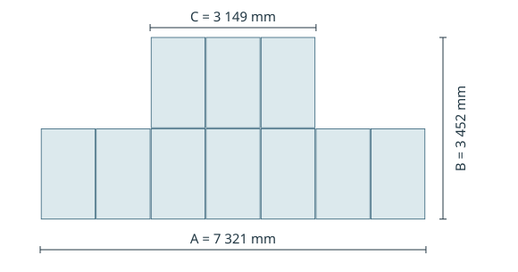

# CS Technicien en énergies renouvelables — Préparation d’une intervention 2025 · Corrigé brut

*Corrigé rédigé par IA, non officiel. Signalez toute erreur.*

## Partie 1 — Isolation des murs extérieurs

### Question 1.1

Le mur existant a une résistance $R=1/0{,}45=2{,}22\ \mathrm{m^2\,K/W}$. L’objectif du dossier est $4\ \mathrm{m^2\,K/W}$. L’isolant doit donc apporter au moins $4-2{,}22=1{,}78\ \mathrm{m^2\,K/W}$. Je choisis la plaque de **70 mm**, dont la résistance annoncée est $1{,}85\ \mathrm{m^2\,K/W}$.

### Question 1.2

Après travaux, $R_{\mathrm{mur}}=1/0{,}45+1{,}85\simeq4{,}07\ \mathrm{m^2\,K/W}$. Son inverse est **$U\simeq0{,}246\ \mathrm{W/(m^2\,K)}$**, arrondi à $0{,}25$ pour la suite du sujet.

### Question 1.3

Le mur extérieur perd $0{,}25\times138{,}8\times32=1\,110{,}4\ \mathrm W$. Les six autres lignes de déperdition surfacique du dossier représentent $2\,400+502+194+86+1\,246+554=4\,982\ \mathrm W$. Le nouveau total surfacique vaut donc **$6\,092{,}4\ \mathrm W$**.

La liaison mur/dalle perd $812\times0{,}30=243{,}6\ \mathrm W$ et la liaison mur/toiture $792\times0{,}30=237{,}6\ \mathrm W$. La liaison mur/terrasse et étage conserve $699\ \mathrm W$. Le total linéique s’élève à **$1\,180{,}2\ \mathrm W$**. Le renouvellement d’air contribue encore pour $1\,795\ \mathrm W$. La nouvelle déperdition totale vaut **$6\,092{,}4+1\,180{,}2+1\,795=9\,067{,}6\ \mathrm W$**.

### Question 1.4

La réduction est de $11\,100-9\,067{,}6=2\,032{,}4\ \mathrm W$. Rapportée au bilan initial, elle vaut **$100\times2\,032{,}4/11\,100=18{,}31\,\%$**. Cette valeur caractérise les déperditions pour les conditions du bilan thermique.

## Partie 2 — Pompe à chaleur du rez-de-chaussée

### Question 2.1

Je retiens la **Viessmann Vitocal 300, type AW 106, version 230 V monophasée**. Sa puissance de chauffage est de $6{,}4$ kW et la puissance électrique absorbée de $1{,}9$ kW. Le COP au point d’essai vaut $6{,}4/1{,}9\simeq3{,}37$. La charge de R32 est de **3,4 kg**. La longueur est de 760 mm et la largeur de 1 200 mm. Les $6{,}4$ kW couvrent les $5{,}3$ kW requis pour le chauffage. Le préparateur d’eau chaude sanitaire est desservi par le circuit de la PAC.

### Question 2.2

Sur le plan au **1/50**, je place dans le garage un rectangle de **15,2 mm sur 24 mm** pour représenter l’emprise de la PAC. Je l’inscris dans l’angle supérieur droit du garage sur la feuille, à droite de la petite porte de service, en dehors de son débattement. Le petit côté du rectangle est parallèle au mur du haut. La prise d’air traverse ce mur à droite de la porte : flèche de l’extérieur vers la PAC. Le rejet traverse le mur de droite : flèche de la PAC vers l’extérieur.

Je marque la sonde sur la face extérieure de ce mur droit, plus bas sur le dessin, hors du jet de rejet et à l’abri d’un ensoleillement direct. Les deux bouches sont séparées et restent accessibles depuis la propriété. Le stationnement et la porte restent utilisables.

[Plan du garage à compléter, page 4 du document réponse](https://sti.eduscol.education.fr/sites/eduscol.education.fr.sti/files/concours-examens/18599/18599-1-sujet-renovation-villa-bella-v1.pdf#page=4)

### Question 2.3

- **1 — Pompe à chaleur air/eau.** Elle prélève de la chaleur dans l’air extérieur et la cède à l’eau du circuit au condenseur.
- **3 — Ballon tampon.** Il augmente le volume d’eau du chauffage et espace les démarrages du compresseur.
- **4 — Circulateur.** Il assure le débit d’eau entre la PAC et la branche alimentée.
- **5 — Vanne trois voies de dérivation.** Elle oriente l’eau de la PAC vers l’échangeur du préparateur sanitaire ou vers le ballon tampon.
- **6 — Préparateur d’ECS.** L’échangeur chauffe l’eau sanitaire, que la cuve conserve jusqu’au puisage.
- **12 — Soupape de sécurité.** Elle évacue de l’eau lorsque la pression dépasse son seuil.
- **15 — Vanne trois voies de mélange.** Elle règle la température de départ du plancher chauffant en mélangeant eau de départ et eau de retour.
- **18 — Vase d’expansion.** Il absorbe les variations de volume de l’eau à l’échauffement et limite les variations de pression.

### Question 2.4

**F10 est le relais thermique du compresseur.** Il déclenche en cas de surcharge prolongée. Je règle sa protection sur le courant nominal donné pour l’AW 106 alimentée en 230 V, soit **14,8 A**.

## Partie 3 — Chauffage et climatisation des chambres

### Question 3.1

Sur le plan de la page 5, je trace une unité intérieure dans chacune des chambres 2, 3 et 4. Dans la chambre 2, je dessine le rectangle le long du mur supérieur. Dans les chambres 3 et 4, je l’inscris le long du mur de gauche, à proximité de l’angle supérieur de chaque chambre. Le groupe extérieur se place au sol, à gauche de la porte d’entrée de la maison, sur le flanc droit du plan, à hauteur de la salle de bains.

Je pars du groupe extérieur avec **trois paires de conduites frigorifiques**. Chacune passe par les combles et rejoint sa propre unité intérieure. Les pompes de relevage servent au réseau séparé d’évacuation des condensats. La salle de bains conserve son sèche-serviettes électrique.

[Plan de l’étage à compléter, page 5 du document réponse](https://sti.eduscol.education.fr/sites/eduscol.education.fr.sti/files/concours-examens/18599/18599-1-sujet-renovation-villa-bella-v1.pdf#page=5)

### Question 3.2

Pour les cheminements proposés, je retiens par exemple **17 m** vers la chambre 2, **12 m** vers la chambre 4 et **15 m** vers la chambre 3. Ces estimations sont dans les plages de lecture du plan, respectivement 15–19 m, 10–14 m et 13–17 m. Leur somme est **44 m**. Même avec les extrémités hautes des trois plages, la somme atteint 50 m.

La limite est de **25 m par branche et 50 m au total**. La fiche technique p. 11 distingue un dénivelé maximal de **15 m entre une unité intérieure et le groupe extérieur**, et de **7,5 m entre unités intérieures**. Le groupe est au sol, les trois chambres au même étage. Les deux contraintes sont respectées. **Le raccordement est réalisable.**

### Question 3.3

La précharge couvre 30 m. Pour 50 m, les 20 m supplémentaires demandent **$20\times0{,}020=0{,}400$ kg de R32**. Pour la première mise en service, le frigoriste habilité contrôle d’abord l’étanchéité sous azote sec, puis évacue l’azote et tire au vide. Après contrôle du maintien du vide, il pèse le complément de 400 g selon la procédure du constructeur, ouvre les vannes de service et renseigne la charge réelle de l’installation.

### Question 3.4

J’inscris **R32**, de potentiel de réchauffement global **675**. Charge d’usine : **2,2 kg**. Complément sur chantier : **0,4 kg**. Charge définitive : **2,6 kg**. L’équivalent CO₂ est $2{,}6\times675=1\,755$ kg, soit **1,755 t équivalent CO₂**.

### Question 3.5

Chaque chambre demande $3{,}6/3=1{,}2$ kW. Je retiens le groupe extérieur **3MXM40** et la combinaison de trois unités identiques de classe 1,5. En chauffage, le tableau donne **1,53 kW par unité**, **4,6 kW** de puissance nominale totale et **4,79 A** dans la colonne de courant total maximal de cette combinaison. Les puissances disponibles couvrent le besoin de l’étage.

### Question 3.6

L’élément **k** est la **vanne quatre voies d’inversion de cycle**. Elle inverse le cheminement du fluide entre les échangeurs. En chauffage, l’échangeur intérieur est condenseur et cède de la chaleur à la chambre. En climatisation, il devient évaporateur et prélève de la chaleur dans la chambre.

## Partie 4 — Installation photovoltaïque

### Question 4.1

Les dix panneaux posés en surimposition représentent $10\times330=3\,300$ Wc. Les micro-onduleurs convertissent leur courant continu en courant alternatif. La maison utilise d’abord l’électricité produite au moment où ses appareils en ont besoin. Une partie de l’excédent peut charger les quatre batteries. Le surplus restant est injecté sur le réseau et vendu. Quand la production baisse, les batteries peuvent alimenter la maison, puis le réseau fournit le complément.

Ce fonctionnement réduit les achats au fournisseur, valorise l’énergie qui dépasse les besoins immédiats et permet, grâce au stockage, de décaler une partie de l’autoconsommation vers le soir.

### Question 4.2

Les panneaux en portrait mesurent $1\,023$ mm de large et $1\,716$ mm de haut. La rangée basse comporte sept panneaux. Six intervalles et deux extrémités ajoutent huit largeurs de 20 mm : **$A=7\times1\,023+8\times20=7\,321$ mm**.

La hauteur des deux rangées comprend un intervalle : **$B=2\times1\,716+20=3\,452$ mm**. Pour la rangée haute de trois panneaux, deux intervalles et deux extrémités donnent **$C=3\times1\,023+4\times20=3\,149$ mm**.

### Question 4.3

Pour la **rangée 1 de trois panneaux**, je prévois :

- 8 crochets CrossHook 4S (2001821) et 16 vis à bois HECO-TOPIX (3002022).
- 2 rails SingleRail de 3,30 m et 4 embouts EndCap 36 (1004767).
- 4 étriers intermédiaires OneMid (2002515) et 4 étriers de bout OneEnd (2002514).

Pour la **rangée 2 de sept panneaux**, il faut :

- 16 crochets CrossHook 4S (2001821) et 32 vis à bois (3002022).
- 2 rails de 4,40 m et 2 rails de 3,30 m. Chaque ligne assemblée offre 7,70 m, à recouper à la cote prévue. Il faut 2 connecteurs SingleRail (3002034), un pour chaque ligne, et 4 embouts (1004767).
- 12 étriers OneMid (2002515) et 4 OneEnd (2002514).

Une autre taille de stock convient à la deuxième rangée : quatre longueurs de 4,40 m, assemblées par paires et recoupées.

### Question 4.4

Sur la vue de charpente, **1** désigne le **chevron**, **2** le **liteau**, **3** la **panne faîtière**, **4** la **panne intermédiaire** et **5** la **panne sablière**. Je fixe les crochets CrossHook sur le **chevron, repère 1**, la pièce prévue pour transmettre l’effort à la charpente.

### Question 4.5

Les modules aleo de 330 Wc sont des modèles à 60 cellules. L’IQ7X concerne les modules à 96 cellules. Les modèles compatibles dont les caractéristiques sont données sont l’IQ7, de puissance de sortie nominale 240 VA, et l’**IQ7+**, de puissance nominale **290 VA**. La fiche distingue aussi leurs pointes respectives de 250 VA et 295 VA. Je choisis **dix IQ7+**, un par panneau. Leur puissance de sortie supérieure réduit l’écrêtage lors des périodes de forte production.

### Question 4.6.1

La fiche IQ7+ indique un courant maximal de sortie de **1,26 A** par appareil. Pour dix appareils, le courant maximal de la branche est **$10\times1{,}26=12{,}6$ A**.

### Question 4.6.2

La chute de tension recommandée est **1 %** de la tension nominale, soit $0{,}01\times230=2{,}30$ V. L’extrait donne également une limite autorisée de 3 %, mais c’est l’objectif de 1 % qui intervient dans le dimensionnement demandé.

### Question 4.6.3

Avec du cuivre de résistivité $\rho=0{,}0225\ \Omega\,\mathrm{mm^2/m}$, un facteur de puissance égal à 1 et une tension nominale de 230 V, la section minimale imposée par la chute de tension vaut

$$
S_{\min}=\frac{2\rho L I}{\Delta U}=\frac{2\times0{,}0225\times14\times12{,}6}{2{,}30}\simeq3{,}45\ \mathrm{mm^2}.
$$

### Question 4.6.4

La première section de la série convenant à $3{,}45\ \mathrm{mm^2}$ est **$4\ \mathrm{mm^2}$**. Elle donne une chute d’environ $1{,}98$ V, soit $0{,}86\,\%$ de 230 V.

### Question 4.7.1

En juxtaposant les platines, on gagne $50-23=27$ mm par jonction. Pour **une rangée de quatre**, la largeur est donc $4\times487-3\times27=\mathbf{1\,867}$ mm et la hauteur **311 mm**.

Pour **deux rangées de deux**, la largeur est $2\times487-27=\mathbf{947}$ mm et la hauteur $311+300+311=\mathbf{922}$ mm. Il s’agit de l’encombrement des platines avec l’intervalle entre rangées. La notice prévoit aussi les dégagements au sol et au plafond.

### Question 4.7.2

La largeur exploitable est $3\,100-800-550=1\,750$ mm. La rangée de quatre dépasse cet espace de $1\,867-1\,750=117$ mm. Je retiens **deux rangées de deux batteries**. Les 947 mm de largeur y tiennent et, avec les dégagements de 300 mm en haut et en bas, la hauteur requise est $922+600=1\,522$ mm pour un mur de 2 400 mm.

### Question 4.8

- Découpe d’une tuile : meuleuse à disque diamant adapté au matériau.
- Pose des crochets : visseuse avec l’embout correspondant aux vis.
- Mise à longueur d’un rail : scie à métaux ou meuleuse avec disque adapté au métal.
- Assemblage des rails et pose des modules : clé dynamométrique et embouts compatibles pour respecter les couples du fabricant.
- Pose des platines de batterie sur parpaings : perforateur, foret de maçonnerie et visseuse ou clé correspondant aux fixations.
- Raccordements : coupe-câble ou pince coupante, dégainoir, pince à dénuder et tournevis isolés adaptés au bornier.

### Question 4.9.1

Le montage relève d’un **monteur formé et compétent pour les échafaudages de pied**, au sens de la recommandation **R408**, intervenant sous la direction d’une personne compétente.

### Question 4.9.2

Sous le pied, je place une **cale ou semelle de répartition en bois**, stable et adaptée à l’appui. Le vérin de pied prend appui sur cette semelle.

### Question 4.9.3

Je retiens **le montage 1**. La porte qui communique avec l’extérieur reste libre. Les personnes peuvent continuer à l’emprunter sans rencontrer un montant d’accès devant l’ouverture.

### Question 4.9.4

Les quatre repères sont **1**, la sous-lisse intermédiaire du garde-corps ; **2**, la plinthe ; **3**, le plancher de travail ; **4**, la diagonale de contreventement ou jambe de force.

### Question 4.10.1

La procédure est la **consignation électrique** de la partie d’installation concernée, avant toute intervention hors tension.

### Question 4.10.2

Pour l’alimentation par le réseau représentée sur le document, l’appareil à ouvrir et à condamner est le **disjoncteur de branchement**. Si les branches photovoltaïque et batterie sont déjà en service, leurs sources doivent également être prises en compte et isolées pour assurer la mise hors tension de la zone de travail.

### Question 4.10.3

Je prévois des **gants isolants adaptés** et une **visière de protection**, un dispositif de condamnation avec identification, et un **vérificateur d’absence de tension (VAT)** approprié. L’opérateur habilité contrôle le bon fonctionnement du VAT avant et après la vérification au point de travail.

### Question 4.11.1

Sur le document réponse p. 13, je complète les connexions en suivant la chaîne des appareils :

- **Production.** Chaque panneau alimente l’entrée continue de son micro-onduleur. Les dix sorties AC des micro-onduleurs sont en parallèle sur la dérivation de production. J’amène phase et neutre à la branche photovoltaïque du coffret AC, côté protection et relais réseau. Les liaisons de protection des châssis rejoignent la terre.
- **Stockage.** Les quatre batteries AC sont en parallèle sur leur dérivation dédiée. J’amène phase, neutre et conducteur de protection de cette dérivation au groupe de bornes « batteries » du coffret. Les batteries ne se branchent pas sur les entrées continues des micro-onduleurs.
- **Tableau.** Je relie le départ commun du coffret aux répartiteurs phase et neutre du tableau en aval du disjoncteur de branchement et le bornier PE à la barrette de terre. Sur le dessin, je distingue phase, neutre et terre sur chaque parcours. La passerelle est alimentée en phase et neutre par sa branche protégée.
- **Mesures Envoy-S.** Pour mesurer la seule production photovoltaïque, un TC entoure la phase du départ photovoltaïque, flèche vers le tableau et les charges. Le TC de consommation, en configuration avec mesure de l’échange réseau, entoure la phase générale en aval du disjoncteur de branchement et en amont des dérivations, flèche du réseau vers les charges. Je raccorde les fils des TC à la paire **Production A** et à la paire **Consommation A** correspondantes de l’Envoy-S, en respectant les marquages de polarité indiqués p. 15 du dossier technique. Je ne fais passer aucun neutre dans ces TC.

[Schéma de raccordement à compléter, page 13 du document réponse](https://sti.eduscol.education.fr/sites/eduscol.education.fr.sti/files/concours-examens/18599/18599-1-sujet-renovation-villa-bella-v1.pdf#page=13)

### Question 4.11.2

Je place les flèches entre les organes actifs et une croix sur chaque liaison qui n’échange pas d’énergie. Les sens sont ceux du graphique journalier du dossier :

- **6 h.** Panneaux → maison et réseau → maison. La batterie est inactive.
- **12 h.** Panneaux → maison et panneaux → batteries. L’échange avec le réseau est nul.
- **16 h.** Panneaux → maison et surplus des panneaux → réseau. La batterie chargée est inactive.
- **22 h.** Batteries → maison. Les panneaux ne produisent plus et le réseau n’alimente pas la maison sur ce créneau.

### Question 4.11.3

À **6 h**, la batterie est au repos. Il y a **achat** et **autoconsommation** de la petite production disponible. À **12 h**, elle est **réceptrice** et il y a **autoconsommation**, une part de la production étant aussi stockée. À **16 h**, elle est au repos : la maison **autoconsomme** et **revend le surplus**. À **22 h**, elle est **génératrice** et permet l’**autoconsommation de l’énergie précédemment stockée**.
