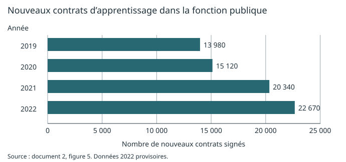
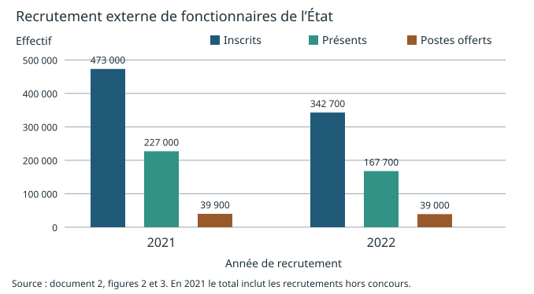

# Douanes 2025 — Cas pratique - Concours commun de catégorie C — Corrigé guidé

*Corrigé rédigé par IA, non officiel. Signalez toute erreur.*

## Présentation du sujet

Ce cas pratique commun de catégorie C dure trois heures. La première partie demande quatre réponses courtes. La deuxième impose deux graphiques et des calculs à partir du dossier. La troisième demande un développement en deux parties, en deux pages maximum. Le principal piège réside dans les champs et les dénominateurs : contrats signés ou effectif total, recrutements externes ou seuls concours, et présents par admis ou par poste offert.

## I — Questions sur le fonds documentaire

### 1. Définir et illustrer l’attractivité

> [!INDICATION]
> En cinq lignes au plus, donnez une définition qui englobe recrutement et fidélisation. Choisissez un exemple d’engagement ou de carrière.

#### Solution

L’attractivité de la fonction publique est sa capacité à donner envie d’y entrer et d’y rester. Un jeune qui choisit de préparer un concours pour rendre service aux usagers illustre le premier aspect. Un agent qui y trouve des perspectives d’évolution illustre le second.

### 2. Expliquer le manque d’attractivité

> [!INDICATION]
> En dix lignes au plus, partez du regard du candidat puis passez à la réalité du travail quotidien. Le document 6 fournit ces deux perspectives.

#### Solution

Les candidats connaissent mal les métiers et jugent parfois les concours éloignés du travail réel. L’incertitude sur le lieu d’affectation peut décourager une famille. Le salaire progresse moins vite que dans le privé et la garantie de l’emploi compense moins cet écart. Enfin, le manque de moyens, les horaires de certains métiers et des perspectives de progression peu lisibles pèsent sur les choix.

### 3. Décrire les conséquences

> [!INDICATION]
> Distinguez les postes restés libres, les départs et leurs répercussions sur le travail du service. Conservez les années qui accompagnent les chiffres du document 6.

#### Solution

Quand le nombre de candidats baisse, l’administration choisit dans un vivier plus étroit. En 2022, 15 % des postes offerts dans la fonction publique d’État restent vacants, contre 5 % en 2018. Des lauréats renoncent ou quittent leur formation. Les départs de personnels expérimentés accroissent la charge des équipes et mettent en difficulté la continuité du service. Le recours aux contractuels ne comble pas tous les besoins.

### 4. Définir la marque employeur

> [!INDICATION]
> Le document 1 explique l’image construite auprès des agents actuels et futurs ; le document 4 décrit son application. Donnez la définition et un mécanisme concret en dix lignes au plus.

#### Solution

La marque employeur est l’image qu’une organisation donne du travail en son sein aux agents comme aux futurs candidats. Les missions, les parcours et les conditions d’exercice la construisent. Sur « Choisir le service public », des agents peuvent expliquer leur métier et répondre aux jeunes. Ces témoignages rendent les postes concrets. Pour fidéliser ensuite, les promesses doivent correspondre au travail vécu.

## II — Applications

### 1 a. Graphique horizontal des nouveaux contrats

> [!INDICATION]
> Dans la figure 5, relevez les quatre effectifs de la ligne « Ensemble FP ». Les années vont sur l’axe vertical, les effectifs sur l’axe horizontal. Partez de zéro.

#### Solution

Les trois versants totalisent **13 980** nouveaux contrats en 2019, **15 120** en 2020, **20 340** en 2021 et **22 670** en 2022.

### 1 b. Pourcentage d’évolution

> [!INDICATION]
> Le tableau donne des effectifs annuels de nouveaux contrats. Il permet de mesurer leur évolution. Pour calculer une part dans l’emploi public, il manquerait l’effectif total de référence pour chaque année.

#### Solution

Les nouveaux contrats progressent de 22 670 − 13 980 = 8 690. Rapportée aux 13 980 contrats de 2019, l’augmentation vaut $8\,690/13\,980 \times 100 = 62{,}16\ldots\,\%$, soit **62 %** à l’unité. Il s’agit de l’évolution de l’effectif de nouveaux contrats dans l’ensemble de la fonction publique.

### 1 c. Commenter la série

> [!INDICATION]
> Repérez la période de croissance la plus marquée. Comparez des données annuelles de même nature.

#### Solution

Les signatures augmentent chaque année. L’accélération est surtout visible entre 2020 et 2021, avec 5 220 nouveaux contrats de plus. La progression se poursuit entre 2021 et 2022 (+2 330). En 2022, la territoriale concentre 14 090 contrats, soit environ 62 % du total national de l’année.

### 2 a. Graphique vertical des recrutements

> [!INDICATION]
> Prenez la ligne de total des deux figures. Groupez les trois barres de chaque année et gardez une même échelle. Lisez les notes de champ sous les tableaux.

#### Solution

En 2021, on lit **473 000 inscrits, 227 000 présents et 39 900 postes offerts**. En 2022, on lit **342 700 inscrits, 167 700 présents et 39 000 postes offerts**. La figure 2 inclut une ligne « hors concours » en 2021. La figure 3 porte uniquement sur les concours externes en 2022.

### 2 b. Expliquer l’évolution

> [!INDICATION]
> Retranchez d’abord les trois effectifs « hors concours » du total 2021 pour rapprocher les champs. Un recul observé ne suffit pas, à lui seul, à prouver sa cause.

#### Solution

Les six barres montrent surtout la baisse des inscriptions et des présences. Une partie de l’écart tient au champ statistique. En retirant les recrutements hors concours de 2021, il reste environ 431 500 inscrits, 204 700 présents et 38 500 postes. Avec les effectifs arrondis publiés, les inscriptions reculent encore d’environ 21 % et les présences de 18 %, alors que les postes offerts augmentent légèrement, à 39 000. Le volume des postes explique donc mal, à lui seul, le recul. La concurrence d’autres employeurs, les rémunérations et l’incertitude sur la carrière ou l’affectation constituent des explications plausibles.

### 2 c. Écart relatif entre les extrêmes par catégorie

> [!INDICATION]
> Sur la période 2007–2016 de la figure 4, cherchez les deux extrêmes pour chaque couleur. Pour exprimer l’écart en pourcentage, nommez la valeur de référence. Une différence de ratios donne d’abord un nombre de candidats par admis.

#### Solution

Je prends comme référence le ratio le plus faible de chaque série. L’écart relatif au minimum vaut $(\text{maximum}-\text{minimum})/\text{minimum} \times 100$.

- **Catégorie A** : de 5,8 en 2014 à un maximum de 9,6 en 2009. L’écart est de 3,8, soit **65,52 %** du minimum.
- **Catégorie B** : minimum de 10,7 en 2016 et maximum de 21,3 en 2010. L’écart est de 10,6, soit **99,07 %** du minimum.
- **Catégorie C** : minimum de 13,5 en 2016 et maximum de 23,2 en 2013. L’écart est de 9,7, soit **71,85 %** du minimum.

Si l’on décrit la baisse du maximum au minimum, le maximum devient la base. Les baisses sont alors respectivement de **39,58 %**, **49,77 %** et **41,81 %**.

### 2 d. Interpréter les différences de sélectivité

> [!INDICATION]
> Demandez-vous qui peut concourir et combien de postes sont ouverts. Il s’agit d’un rapport entre deux effectifs.

#### Solution

Sur la période représentée, un recrutement de catégorie C attire généralement davantage de présents par admis. Il est ouvert avec un niveau de diplôme moins élevé et peut intéresser aussi des personnes plus diplômées. En catégorie A, les conditions de diplôme et la spécialisation de certains postes limitent davantage le vivier. Dans chaque catégorie, le nombre de places, les salaires accessibles ailleurs et le métier lui-même peuvent aussi modifier le rapport. Le graphique ne mesure pas séparément l’effet de ces facteurs.

### 3 a. Baisse de la fréquentation des concours

> [!INDICATION]
> Rapprochez les deux séries du document 3 avec les dates précises du document 10. La comparaison salariale de 2011 à 2021 explique une partie de la période étudiée.

#### Solution

Entre 1995 et 2022, les postes offerts reculent de 43 815 à 35 723, tandis que les présents passent de 618 817 à 151 038. La baisse des postes réduit les occasions de tenter certains concours, mais le recul de la fréquentation est beaucoup plus marqué. La concurrence salariale du privé peut détourner des candidats : entre 2011 et 2021, le salaire net moyen en équivalent temps plein a augmenté en euros constants de 4,9 % dans le privé, contre 2,1 % dans l’ensemble du public. Ce constat éclaire une partie de la période et s’ajoute aux contraintes de mobilité et au manque de visibilité des parcours.

### 3 b. Calculer la sélectivité pour quatre millésimes

> [!INDICATION]
> Appliquez la définition située sous le tableau du document 3 : présents divisés par postes offerts. Les indices base 100 servent aux évolutions et non à ce calcul.

#### Solution

Les résultats s’expriment en candidats **présents par poste offert** :

- **1995** : 618 817 ÷ 43 815 ≈ **14,12**.
- **2005** : 538 395 ÷ 40 986 ≈ **13,14**.
- **2015** : 259 534 ÷ 34 566 ≈ **7,51**.
- **2022** : 151 038 ÷ 35 723 ≈ **4,23**.

Il y a donc nettement moins de présents pour un poste offert en fin de période.

## III — Rédaction

### Mesures engagées et pistes à développer

> [!INDICATION]
> Commencez par un fait qui montre le problème. Dans la première partie, expliquez une action de l’État et un exemple précis du ministère. Dans la seconde, défendez des propositions faisables. Le jury attend une introduction annonçant le plan, deux parties équilibrées et une conclusion ouvrant sur une perspective. La rédaction doit tenir en deux pages.

#### Solution

Dans la fonction publique d’État, 15 postes offerts sur 100 n’ont pas été pourvus en 2022. Dans un service des finances publiques, une vacance peut se traduire très concrètement par une attente accrue au guichet. Comment attirer de nouveaux candidats et donner aux agents des raisons de rester ? L’État a déjà agi sur l’accès aux emplois et sur les conditions de travail. Il faut désormais rapprocher davantage ses engagements de l’expérience des équipes.

**I. Rendre les métiers visibles et accessibles**

Avec « Choisir le service public », les offres, les calendriers et les témoignages d’agents des trois versants sont plus faciles à trouver. Les concours nationaux à affectation locale lèvent un autre obstacle : avant de s’inscrire, un candidat sait dans quel secteur il pourra travailler. Les préparations Talents et leur tutorat permettent à des jeunes de milieu modeste de se préparer aux concours de catégories A et B.

Le ministère de l’Économie et des Finances a aussi équipé ses agents pour rendre le télétravail possible. À la DGFiP, plus de 57 millions d’euros de dépenses d’équipement sont estimés pour 2020 et 2021. Pour un agent qui traite des dossiers à distance, le temps de trajet économisé compte dans la décision de rester. Cette possibilité dépend toutefois des missions : un poste d’accueil exige une présence que la seule fourniture d’un ordinateur ne peut remplacer.

**II. Donner aux agents des raisons durables de rester**

Je proposerais d’indiquer dans chaque avis de recrutement la rémunération de début, les lieux possibles d’affectation, les contraintes horaires et un exemple de progression. Un candidat à un emploi douanier pourrait ainsi choisir en connaissance de cause. Dans les territoires où les postes restent vacants, des rencontres avec les équipes et des stages courts feraient découvrir les missions avant l’inscription. Un accompagnement du nouvel agent prolongerait ce premier contact après sa prise de poste.

Il faut également agir sur les métiers qui perdent leurs agents. Avec les équipes et leurs représentants, un service pourrait examiner les départs, ajuster les plannings, offrir des formations qualifiantes et mieux reconnaître les responsabilités exercées. Pour les fonctions d’accueil, une rotation prévisible et un remplacement organisé en cas d’absence peuvent compter autant que le télétravail dans une autre équipe.

En somme, la visibilité facilite l’entrée et la qualité du travail permet de fidéliser. Pour juger du résultat, je suivrais par métier les postes pourvus puis la proportion de nouveaux agents encore en poste deux ans plus tard.

## Bilan

Avant de rendre, vérifiez successivement l’orientation des deux graphiques, leurs titres, axes, légendes et unités. Relisez chaque pourcentage en nommant son dénominateur, puis assurez-vous que la rédaction distingue les mesures déjà prises de vos propositions. Le rapport de jury 2025, pages 7 et 8, insiste sur la reformulation des réponses, l’annotation des graphiques et l’équilibre du développement.
