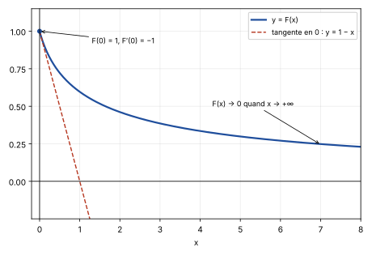

# ECRICOME ECG — Mathématiques appliquées 2025 · Corrigé brut

*Corrigé rédigé par IA, non officiel. Signalez toute erreur.*

## Exercice 1 — Matrices anticommutant avec A

### 1

Pour $C=0_3$ : $0_3M+M0_3=0_3$ pour toute matrice $M$, donc $\boxed{E_{0_3}=\mathcal M_3(\mathbb R)}$.

Pour $C=I_3$ : $I_3M+MI_3=2M$, et $2M=0_3$ si et seulement si $M=0_3$. Donc $\boxed{E_{I_3}=\{0_3\}}$.

### 2

Soit $C\in\mathcal M_3(\mathbb R)$.
- Par définition, $E_C\subset\mathcal M_3(\mathbb R)$.
- $C0_3+0_3C=0_3$, donc $0_3\in E_C$.
- Soient $M,M'\in E_C$ et $\lambda\in\mathbb R$. Par distributivité du produit matriciel :
$$\begin{aligned}
C(\lambda M+M')+(\lambda M+M')C&=\lambda(CM+MC)+(CM'+M'C)\\
&=\lambda0_3+0_3\\
&=0_3.
\end{aligned}$$
Donc $\lambda M+M'\in E_C$.

**$E_C$ est un sous-espace vectoriel de $\mathcal M_3(\mathbb R)$.**

### 3

$A$ est symétrique : ${}^tA=A$. Soit $M\in E_A$. En transposant $AM+MA=0_3$ et en utilisant ${}^t(XY)={}^tY\,{}^tX$ :
$$\begin{aligned}
{}^tM\,{}^tA+{}^tA\,{}^tM&=0_3,\\
\text{soit}\quad A\,{}^tM+{}^tM\,A&=0_3.
\end{aligned}$$
Donc **${}^tM\in E_A$.**

### 4.(a)

$A$ est une matrice symétrique réelle (${}^tA=A$), donc **$A$ est diagonalisable.**

### 4.(b)

Calculons :
$$A^2=\begin{pmatrix}5&-2&-4\\-2&8&-2\\-4&-2&5\end{pmatrix},\qquad A^3=A\,A^2=\begin{pmatrix}9&-18&0\\-18&0&18\\0&18&-9\end{pmatrix}=9A.$$
Donc $Q(X)=X^3-9X$ est un polynôme annulateur de $A$.

Soit $\lambda$ une valeur propre de $A$ et $X\neq0$ tel que $AX=\lambda X$.

Alors $A^kX=\lambda^kX$ pour tout $k$, d'où
$$0=(A^3-9A)X=(\lambda^3-9\lambda)X.$$
Comme $X\neq0$, $\boxed{\lambda^3-9\lambda=0}$.

### 4.(c)

$\lambda^3-9\lambda=\lambda(\lambda-3)(\lambda+3)$, donc $\operatorname{Sp}(A)\subset\{-3,0,3\}$. Résolvons $AX=\lambda X$ avec $X=\begin{pmatrix}x\\y\\z\end{pmatrix}$.
- $\lambda=-3$ : $4x-2y=0$, $-2x+3y+2z=0$, $2y+2z=0$, soit $y=2x$, $z=-2x$. $\ker(A+3I_3)=\operatorname{Vect}\begin{pmatrix}1\\2\\-2\end{pmatrix}\neq\{0\}$.
- $\lambda=0$ : $x-2y=0$, $-2x+2z=0$, $2y-z=0$, soit $x=2y$, $z=2y$. $\ker A=\operatorname{Vect}\begin{pmatrix}2\\1\\2\end{pmatrix}$.
- $\lambda=3$ : $-2x-2y=0$, $-2x-3y+2z=0$, $2y-4z=0$, soit $x=-2z$, $y=2z$. $\ker(A-3I_3)=\operatorname{Vect}\begin{pmatrix}-2\\2\\1\end{pmatrix}$.

Les trois réels $-3$, $0$, $3$ sont donc bien valeurs propres.

$A$ est d'ordre $3$ et a trois valeurs propres distinctes ; des vecteurs propres associés forment une base de $\mathcal M_{3,1}(\mathbb R)$.

Avec les vecteurs ci-dessus, dans l'ordre des valeurs propres croissantes (coefficients diagonaux $1$, $1$, $1$) :
$$\boxed{D=\begin{pmatrix}-3&0&0\\0&0&0\\0&0&3\end{pmatrix},\qquad P=\begin{pmatrix}1&2&-2\\2&1&2\\-2&2&1\end{pmatrix}},\qquad D=P^{-1}AP.$$

### 5

$$P^2=\begin{pmatrix}1&2&-2\\2&1&2\\-2&2&1\end{pmatrix}^2=\begin{pmatrix}9&0&0\\0&9&0\\0&0&9\end{pmatrix}=9I_3.$$
Donc $P\left(\frac19P\right)=I_3$ : $\boxed{P^{-1}=\tfrac19P}$.

### 6.(a)

Notons $d_1=-3$, $d_2=0$, $d_3=3$ les coefficients diagonaux de $D$.

Le coefficient $(i,j)$ de $DN$ est $d_in_{ij}$, celui de $ND$ est $n_{ij}d_j$, donc
$$DN+ND=\begin{pmatrix}-6a&-3b&0\\-3d&0&3f\\0&3h&6i\end{pmatrix}.$$
Ainsi $N\in E_D\iff a=b=d=f=h=i=0$, les coefficients $c$, $e$, $g$ étant quelconques :
$$N\in E_D\iff N=\begin{pmatrix}0&0&c\\0&e&0\\g&0&0\end{pmatrix}.$$

### 6.(b)

Notons $E_{i,j}$ la matrice dont le seul coefficient non nul est un $1$ en position $(i,j)$. D'après 6.(a),
$$E_D=\{cE_{1,3}+eE_{2,2}+gE_{3,1}\mid(c,e,g)\in\mathbb R^3\}=\operatorname{Vect}(E_{1,3},E_{2,2},E_{3,1}).$$
La famille $(E_{1,3},E_{2,2},E_{3,1})$ est génératrice de $E_D$ ; elle est libre, car $cE_{1,3}+eE_{2,2}+gE_{3,1}=0_3$ impose $c=e=g=0$ (comparaison des coefficients).

**$\mathcal B=(E_{1,3},E_{2,2},E_{3,1})$ est une base de $E_D$ et $\dim E_D=3$.**

### 7.(a)

D'après 4.(c), $A=PDP^{-1}$ ; et $M=PNP^{-1}$. Alors
$$\begin{aligned}
AM+MA&=PDP^{-1}PNP^{-1}+PNP^{-1}PDP^{-1}\\
&=P(DN+ND)P^{-1}.
\end{aligned}$$
Comme $P$ est inversible, $P(DN+ND)P^{-1}=0_3\iff DN+ND=0_3$ (multiplier à gauche par $P^{-1}$ et à droite par $P$, ou l'inverse). Donc **$M\in E_A\iff N\in E_D$.**

### 7.(b)

Posons $B_1=PE_{1,3}P^{-1}$, $B_2=PE_{2,2}P^{-1}$, $B_3=PE_{3,1}P^{-1}$.

*Génératrice.* Soit $M\in E_A$ et $N=P^{-1}MP$. D'après 7.(a), $N\in E_D$, donc $N=cE_{1,3}+eE_{2,2}+gE_{3,1}$, et
$$M=PNP^{-1}=cB_1+eB_2+gB_3.$$
Réciproquement, chaque $B_k$ est dans $E_A$ (7.(a) avec $N=E_{1,3}$, etc.). Donc $E_A=\operatorname{Vect}(B_1,B_2,B_3)$.

*Libre.* Si $cB_1+eB_2+gB_3=0_3$, alors $P(cE_{1,3}+eE_{2,2}+gE_{3,1})P^{-1}=0_3$, donc $cE_{1,3}+eE_{2,2}+gE_{3,1}=0_3$ et $c=e=g=0$.

**$(PE_{1,3}P^{-1},\,PE_{2,2}P^{-1},\,PE_{3,1}P^{-1})$ est une base de $E_A$**, avec $P^{-1}=\frac19P$ ; $\dim E_A=3$. Explicitement :
$$B_1=\frac19\begin{pmatrix}-2&2&1\\-4&4&2\\4&-4&-2\end{pmatrix},\qquad B_2=\frac19\begin{pmatrix}4&2&4\\2&1&2\\4&2&4\end{pmatrix},\qquad B_3=\frac19\begin{pmatrix}-2&-4&4\\2&4&-4\\1&2&-2\end{pmatrix}.$$

### 8

$(A+M)^2=A^2+AM+MA+M^2$. Donc
$$\begin{aligned}
(A+M)^2=A^2+M^2&\iff AM+MA=0_3\\
&\iff M\in E_A.
\end{aligned}$$
**L'ensemble cherché est $E_A$**, sous-espace vectoriel de dimension $3$ décrit en 7.(b).

### 9

$\varphi$ est un endomorphisme de $\mathcal M_3(\mathbb R)$, qui est de dimension $9$. Par définition, $\ker\varphi=\{M\mid AM+MA=0_3\}=E_A$, de dimension $3$ (question 7.(b)). Par le théorème du rang :
$$\begin{aligned}
\operatorname{rg}\varphi&=\dim\mathcal M_3(\mathbb R)-\dim\ker\varphi\\
&=9-3\\
&=\boxed{6}.
\end{aligned}$$

## Exercice 2 — Une intégrale à paramètre

### 1.(a)

Soit $n\in\mathbb N$. La fonction $t\mapsto t^ne^{-t}$ est continue et positive sur $[0,+\infty[$.
- Sur le segment $[0,1]$, elle est continue : $\int_0^1t^ne^{-t}\,dt$ existe.
- Sur $[1,+\infty[$ : $t^2\cdot t^ne^{-t}=t^{n+2}e^{-t}\to0$ par croissances comparées, donc $t^ne^{-t}=o\!\left(\frac1{t^2}\right)$ en $+\infty$. L'intégrale de Riemann $\int_1^{+\infty}\frac{dt}{t^2}$ converge, donc, par comparaison de fonctions positives, $\int_1^{+\infty}t^ne^{-t}\,dt$ converge.

Par la relation de Chasles, **$\int_0^{+\infty}t^ne^{-t}\,dt$ converge.**

### 1.(b)

$t\mapsto e^{-t}\mathbf 1_{[0,+\infty[}(t)$ est une densité de la loi exponentielle $\mathcal E(1)$, donc $I_0=\int_0^{+\infty}e^{-t}\,dt=\boxed{1}$.

Si $X\hookrightarrow\mathcal E(1)$, $X$ admet une espérance égale à $1$ : $I_1=\int_0^{+\infty}te^{-t}\,dt=\mathbb E(X)=\boxed{1}$.

### 2

Soit $x\ge0$. Pour $t\ge0$, $1+xt\ge1>0$ : $t\mapsto\frac{e^{-t}}{1+xt}$ est continue sur $[0,+\infty[$ et
$$0\le\frac{e^{-t}}{1+xt}\le e^{-t}.$$
$\int_0^{+\infty}e^{-t}\,dt$ converge (question 1), donc, par comparaison de fonctions positives, **$\int_0^{+\infty}\frac{e^{-t}}{1+xt}\,dt$ converge.**

### 3

$F(0)=\int_0^{+\infty}e^{-t}\,dt=I_0=\boxed{1}$.

### 4

Soient $0\le x\le y$. Pour $t\ge0$, $xt\le yt$, donc $0<1+xt\le1+yt$, puis $\frac1{1+yt}\le\frac1{1+xt}$ et, en multipliant par $e^{-t}>0$,
$$\frac{e^{-t}}{1+yt}\le\frac{e^{-t}}{1+xt}.$$
Les deux intégrales convergent (question 2) ; par croissance de l'intégrale, $F(y)\le F(x)$. **$F$ est décroissante sur $[0,+\infty[$.**

### 5.(a)

Si $x=0$ : $\int_0^1dt=\boxed{1}$.

Si $x>0$ : $1+xt>0$ sur $[0,1]$ et
$$\int_0^1\frac{dt}{1+xt}=\left[\frac{\ln(1+xt)}{x}\right]_0^1=\boxed{\frac{\ln(1+x)}{x}}.$$

### 5.(b)

Pour $t\in[0,1]$, $0<e^{-t}\le1$ et $1+xt>0$, donc $0\le\frac{e^{-t}}{1+xt}\le\frac1{1+xt}$. Les fonctions étant continues sur $[0,1]$ et les bornes dans l'ordre croissant, la croissance de l'intégrale donne
$$0\le\int_0^1\frac{e^{-t}}{1+xt}\,dt\le\int_0^1\frac{dt}{1+xt}.$$

### 5.(c)

Soit $x>0$. Pour $t\ge1$, $1+xt\ge xt\ge x>0$, donc $\frac1{1+xt}\le\frac1x$ et
$$0\le\frac{e^{-t}}{1+xt}\le\frac1xe^{-t}.$$
Les intégrales sur $[1,+\infty[$ convergent ($\int_1^{+\infty}e^{-t}\,dt=e^{-1}$, et la première par la question 2 et Chasles). Par croissance de l'intégrale :
$$0\le\int_1^{+\infty}\frac{e^{-t}}{1+xt}\,dt\le\frac1x\int_1^{+\infty}e^{-t}\,dt.$$

### 5.(d)

Soit $x>0$. Par la relation de Chasles et 5.(a)–(c) :
$$0\le F(x)\le\frac{\ln(1+x)}{x}+\frac{e^{-1}}x.$$
Or $\frac{\ln(1+x)}x=\frac{\ln(1+x)}{1+x}\cdot\frac{1+x}x$ ; quand $x\to+\infty$, $u=1+x\to+\infty$ et $\frac{\ln u}u\to0$ (croissances comparées), et $\frac{1+x}x\to1$.

Donc le majorant tend vers $0$.

Par le théorème d'encadrement, $\boxed{\lim_{x\to+\infty}F(x)=0}$.

### 6.(a)

Soit $x\ge0$. Les intégrales $F(x)$ et $\int_0^{+\infty}e^{-t}(1-xt)\,dt=I_0-xI_1$ convergent ; par linéarité,
$$F(x)-\int_0^{+\infty}e^{-t}(1-xt)\,dt=\int_0^{+\infty}e^{-t}\left(\frac1{1+xt}-(1-xt)\right)dt.$$
Or
$$\frac1{1+xt}-(1-xt)=\frac{1-(1-xt)(1+xt)}{1+xt}=\frac{x^2t^2}{1+xt}.$$
Donc
$$F(x)-\int_0^{+\infty}e^{-t}(1-xt)\,dt=x^2\int_0^{+\infty}\frac{t^2e^{-t}}{1+xt}\,dt.$$

### 6.(b)

D'abord $\int_0^{+\infty}e^{-t}(1-xt)\,dt=I_0-xI_1$. Ensuite, pour $t\ge0$, $1+xt\ge1$, donc $0\le\frac{t^2e^{-t}}{1+xt}\le t^2e^{-t}$ ; ces intégrales convergent (énoncé et 1.(a)), donc $0\le\int_0^{+\infty}\frac{t^2e^{-t}}{1+xt}\,dt\le I_2$. En multipliant par $x^2\ge0$ et avec 6.(a) :
$$0\le F(x)-I_0+xI_1\le x^2I_2.$$

### 7.(a)

$I_2=\mathbb E(X^2)$ avec $X\hookrightarrow\mathcal E(1)$ ; par la formule de König-Huygens, $I_2=\mathbb V(X)+\mathbb E(X)^2=1+1=2$. Avec $I_0=I_1=1$, 6.(b) donne pour $x>0$ :
$$0\le\frac{F(x)-1+x}{x}\le2x.$$
Par encadrement, $\frac{F(x)-(1-x)}x\to0$ quand $x\to0^+$, c'est-à-dire $F(x)-(1-x)=o(x)$ :
$$\boxed{F(x)\underset{x\to0}{=}1-x+o(x)}.$$

### 7.(b)

Pour $x>0$, d'après 7.(a) et $F(0)=1$ :
$$\frac{F(x)-F(0)}{x}=\frac{-x+o(x)}x=-1+\frac{o(x)}x\xrightarrow[x\to0^+]{}-1.$$
Le taux d'accroissement a une limite finie : **$F$ est dérivable en $0$ (à droite, $F$ étant définie sur $[0,+\infty[$) et $F'(0)=-1$.**

### 8

Éléments du tracé : $F$ est continue, décroissante sur $[0,+\infty[$, positive, $F(0)=1$, tangente en $0$ d'équation $y=1-x$ (pente $F'(0)=-1$), et $F(x)\to0$ en $+\infty$ (asymptote $y=0$).

D'après 6.(b), $F(x)\ge1-x$ : la courbe est au-dessus de sa tangente en $0$.

Valeurs indicatives : $F(1)\approx0{,}60$, $F(5)\approx0{,}30$.



## Exercice 3 — Partie I : lois de Pareto

### 1

Soit $i\in[\![1,n]\!]$.
- $f_i\ge0$ sur $\mathbb R$.
- $f_i$ est continue sur $]-\infty,1[$ (nulle) et sur $[1,+\infty[$ ; elle est donc continue sur $\mathbb R$ sauf peut-être en $1$.
- $\int_{-\infty}^1f_i=0$ et, pour $A\ge1$ :
$$\int_1^A\frac{i}{x^{i+1}}\,dx=\left[-\frac1{x^i}\right]_1^A=1-\frac1{A^i}\xrightarrow[A\to+\infty]{}1.$$

**$f_i$ est une densité de probabilité.**

### 2.(a)

$X_i$ admet une espérance si et seulement si $\int_{-\infty}^{+\infty}|x|f_i(x)\,dx=\int_1^{+\infty}\frac{i}{x^{i}}\,dx$ converge. C'est une intégrale de Riemann, convergente si et seulement si $i>1$.

**$X_i$ admet une espérance si et seulement si $2\le i\le n$**, et alors, pour $A\ge1$ :
$$\int_1^A\frac{i}{x^i}\,dx=\frac{i}{i-1}\left(1-\frac1{A^{i-1}}\right)\xrightarrow[A\to+\infty]{}\frac{i}{i-1}.$$
$$\boxed{\mathbb E(X_i)=\frac{i}{i-1}\quad(2\le i\le n)}$$

### 2.(b)

Pour $i\ge2$, $\mathbb E(X_i)=1+\frac1{i-1}$, qui décroît strictement quand $i$ augmente. Le revenu moyen est donc d'autant plus faible que le numéro est grand. **Du revenu moyen le moins élevé au plus élevé : $n,\,n-1,\,\dots,\,3,\,2$** (la catégorie $1$ n'a pas de revenu moyen défini).

### 3

Si $x<1$, $F_i(x)=\int_{-\infty}^x0\,dt=0$. Si $x\ge1$ :
$$\begin{aligned}
F_i(x)&=\int_1^x\frac{i}{t^{i+1}}\,dt\\
&=\left[-\frac1{t^i}\right]_1^x\\
&=1-\frac1{x^i}.
\end{aligned}$$
C'est l'égalité (1).

### 4.(a)

$U(\Omega)=]0,1[$, donc $V_i=U^{-1/i}$ est bien défini et $V_i>1$.

Si $x<1$ : $[V_i\le x]=\varnothing$, donc $\mathbb P(V_i\le x)=0$.

Si $x\ge1$ : comme $U>0$ et $x>0$, et que $u\mapsto u^{1/i}$ et $u\mapsto u^{i}$ sont strictement croissantes sur $]0,+\infty[$,
$$\begin{aligned}
V_i\le x&\iff U^{1/i}\ge\frac1x\\
&\iff U\ge\frac1{x^i}.
\end{aligned}$$
Avec $\frac1{x^i}\in]0,1]$ et $\mathbb P(U=\frac1{x^i})=0$ :
$$\begin{aligned}
\mathbb P(V_i\le x)&=1-\mathbb P\left(U<\tfrac1{x^i}\right)\\
&=1-\frac1{x^i}.
\end{aligned}$$
$V_i$ et $X_i$ ont la même fonction de répartition : **$V_i$ suit la même loi que $X_i$.**

### 4.(b)

```python
import numpy.random as rd

def simulX(i):
    U = 1 - rd.random()     # loi uniforme sur ]0,1] : évite 0
    return U**(-1/i)
```
$1-$`rd.random()` suit une loi uniforme sur $]0,1]$, de même loi (à densité) que $U$ ; on évite ainsi la division par $0$.

Essai : la moyenne de $10^5$ simulations de $X_3$ vaut $\approx1{,}50=\frac32$.

## Exercice 3 — Partie II : simulation de Y et base de données

### 5

```python
def simulY(n, p):
    Y = 1
    for k in range(n-1):
        if rd.random() < p:
            Y = Y + 1
    return Y
```
Chaque test `rd.random() < p` est un succès avec probabilité $p$, les tirages sont indépendants : le nombre de succès suit $\mathcal B(n-1,p)$, donc la valeur renvoyée simule $Y$.

### 6

```python
def loiY(n, p):
    N = 10000
    loi = [0] * n
    for k in range(N):
        y = simulY(n, p)
        loi[y-1] += 1/N
    return loi
```
La valeur $y\in[\![1,n]\!]$ est rangée à l'indice $y-1$ ; chaque simulation ajoute $\frac1N$, donc `loi[i-1]` est la fréquence de $[Y=i]$, qui approche $\mathbb P(Y=i)$ (loi faible des grands nombres).

Essai ($n=4$, $p=0{,}3$) : `[0.342, 0.439, 0.191, 0.028]` pour $[0{,}343;\ 0{,}441;\ 0{,}189;\ 0{,}027]$.

### 7

```python
import matplotlib.pyplot as plt

def diagrammeY(n, p):
    x = [i for i in range(1, n+1)]
    plt.bar(x, loiY(n, p))
    plt.show()
```

### 8.(a)

La clé primaire d'une table doit **identifier chaque enregistrement de façon unique** : deux enregistrements distincts ne peuvent pas avoir la même valeur de clé (et la clé est toujours renseignée).

### 8.(b)

- `individu` : `i_insee` ;
- `departement` : `d_numero` ;
- `profession` : `p_pcs`.

### 8.(c)

Schéma relationnel (clé primaire soulignée par `_…_`, clé étrangère suivie de `#`) :
```text
individu   (i_nom, i_prenom, i_departement#, _i_insee_, i_code_profession#)
departement(_d_numero_, d_nom, d_population)
profession (_p_pcs_, p_categorie, p_intitule)

individu.i_departement      ──►  departement.d_numero
individu.i_code_profession  ──►  profession.p_pcs
```
La table `individu` est reliée à `departement` par `i_departement` (qui référence `d_numero`) et à `profession` par `i_code_profession` (qui référence `p_pcs`).

### 8.(d)

```sql
SELECT DISTINCT i_code_profession
FROM individu
WHERE i_departement = 28;
```
`DISTINCT` évite qu'un même code PCS apparaisse plusieurs fois.

### 8.(e)

```sql
SELECT i_insee, p_categorie
FROM individu
JOIN profession ON individu.i_code_profession = profession.p_pcs;
```

## Exercice 3 — Partie III : le revenu de l'individu sondé

### 9

Soit $x<1$. Pour tout $i$, sachant $[Y=i]$, le revenu de l'individu suit la loi de $X_i$, donc $\mathbb P_{[Y=i]}(Z_n\le x)=F_i(x)=0$. La formule des probabilités totales sur le système complet $([Y=i])_{1\le i\le n}$ donne
$$\begin{aligned}
G_n(x)&=\sum_{i=1}^n\mathbb P(Y=i)\,F_i(x)\\
&=\boxed{0}.
\end{aligned}$$

### 10.(a)

Pour tout $i\in[\![1,n]\!]$, $\mathbb P(Y=i)=\binom{n-1}{i-1}p^{i-1}(1-p)^{n-i}>0$. Sachant $[Y=i]$, l'individu est choisi avec équiprobabilité dans la catégorie $i$ : son revenu a la loi de $X_i$ (modèle de l'énoncé). Donc $\mathbb P_{[Y=i]}(Z_n\le x)=\mathbb P(X_i\le x)=F_i(x)$.

### 10.(b)

Les événements $[Y=1],\dots,[Y=n]$ forment un système complet d'événements de probabilités non nulles ($Y(\Omega)=[\![1,n]\!]$). Par la formule des probabilités totales et 10.(a) :
$$\begin{aligned}
G_n(x)&=\sum_{i=1}^n\mathbb P(Y=i)\,\mathbb P_{[Y=i]}(Z_n\le x)\\
&=\sum_{i=1}^n\binom{n-1}{i-1}p^{i-1}(1-p)^{n-i}F_i(x)\\
&=\sum_{k=0}^{n-1}\binom{n-1}{k}F_{k+1}(x)\,p^k(1-p)^{n-1-k}.
\end{aligned}$$

### 10.(c)

Pour $x\ge1$, $F_{k+1}(x)=1-\frac1{x^{k+1}}$. Par la formule du binôme :
$$\begin{aligned}
\sum_{k=0}^{n-1}\binom{n-1}kp^k(1-p)^{n-1-k}&=(p+1-p)^{n-1}\\
&=1
\end{aligned}$$
$$\begin{aligned}
\sum_{k=0}^{n-1}\binom{n-1}k\frac{p^k(1-p)^{n-1-k}}{x^{k+1}}&=\frac1x\left(\frac px+1-p\right)^{n-1}\\
&=\frac{(p+(1-p)x)^{n-1}}{x^n}.
\end{aligned}$$
Donc
$$\boxed{G_n(x)=1-\frac{\big(p+(1-p)x\big)^{n-1}}{x^n}}.$$
(Contrôle par simulation, $n=5$, $p=0{,}4$, $x=2$ : fréquence $0{,}797$ pour $0{,}795$.)

### 11

- Sur $]-\infty,1[$, $G_n=0$ : continue et de classe $\mathcal C^1$.
- Sur $]1,+\infty[$, $G_n(x)=1-\frac{(p+(1-p)x)^{n-1}}{x^n}$ est de classe $\mathcal C^1$ (quotient de polynômes, dénominateur non nul).
- En $1$ : $G_n(1)=1-\frac{1^{n-1}}1=0=\lim_{x\to1^-}G_n(x)$, et l'expression est continue à droite en $1$.

$G_n$ est continue sur $\mathbb R$ et de classe $\mathcal C^1$ sauf peut-être en $1$ : **$Z_n$ est une variable à densité.**

### 12

```python
def sondage(n, p):
    i = simulY(n, p)
    return simulX(i)
```
On simule $Y$, puis un revenu de la loi de $X_i$ pour la catégorie $i$ obtenue, conformément au protocole.

### 13.(a)

Pour $x<1$, $G_n(x)=0$ (question 9). Pour $x\ge1$ et $p=\frac1n$ :
$$p+(1-p)x=x-\frac{x-1}n=x\left(1-\frac{x-1}{nx}\right),$$
donc
$$G_n(x)=1-\frac{x^{n-1}\left(1-\frac{x-1}{nx}\right)^{n-1}}{x^n}=1-\frac1x\left(1-\frac{x-1}{nx}\right)^{n-1}.$$

### 13.(b)

Soit $x\ge1$ et $a=\frac{x-1}x\in[0,1[$.

Si $a=0$ ($x=1$), $G_n(1)=0$ pour tout $n$.

Si $a>0$, pour $n\ge1$, $0<1-\frac an<1$ et
$$\left(1-\frac an\right)^{n-1}=\exp\left((n-1)\ln\left(1-\frac an\right)\right).$$
Comme $\ln(1+u)\underset{u\to0}{\sim}u$, $(n-1)\ln\left(1-\frac an\right)\sim(n-1)\left(-\frac an\right)\to-a$. Par continuité de l'exponentielle, $\left(1-\frac an\right)^{n-1}\to e^{-a}$, donc
$$\lim_{n\to+\infty}G_n(x)=1-\frac1xe^{-\frac{x-1}x}=1-\frac1xe^{\frac1x-1}.$$
Pour $x<1$, $G_n(x)=0\to0$. Posons
$$G(x)=\begin{cases}0&\text{si }x<1\\[2pt]1-\dfrac1xe^{\frac1x-1}&\text{si }x\ge1.\end{cases}$$
$G$ est une fonction de répartition : elle est continue sur $\mathbb R$ ($G(1)=0$), croissante (pour $x>1$, $G'(x)=\frac{1}{x^2}e^{\frac1x-1}\left(1+\frac1x\right)>0$), de limite $0$ en $-\infty$ et $1$ en $+\infty$.

Elle est donc la fonction de répartition d'une variable aléatoire $Z$, et $G_n(x)\to G(x)$ en tout réel $x$ (tous points de continuité de $G$).

**$(Z_n)$ converge en loi vers une variable $Z$ de fonction de répartition $G$.**
