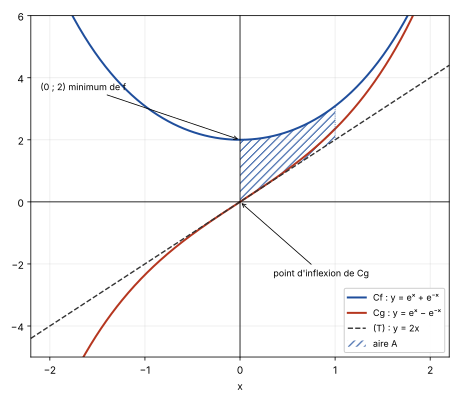

# ECRICOME ECT — Mathématiques technologiques 2025 · Corrigé brut

*Corrigé rédigé par IA, non officiel. Signalez toute erreur.*

## Exercice 1 — Partie 1 : réduction de la matrice M

### 1.(a)

$$J=M-2I=\begin{pmatrix}1&1&1\\1&1&1\\1&1&1\end{pmatrix}.$$
Tous les coefficients de $J$ valent $1$.

### 1.(b)

Le coefficient $(i,j)$ de $J^2$ vaut $\sum_{k=1}^{3}1\times1=3$. Donc
$$J^2=\begin{pmatrix}3&3&3\\3&3&3\\3&3&3\end{pmatrix},\qquad \boxed{J^2=3J}.$$

### 1.(c)

Comme $M=2I+J$ et que $I$ commute avec toute matrice, on peut développer :
$$\begin{aligned}
M^2&=(2I+J)^2\\
&=4I+4J+J^2\\
&=4I+4J+3J.
\end{aligned}$$
$$\boxed{M^2=4I+7J}.$$

### 1.(d)

$$\begin{aligned}
7M-10I&=7(2I+J)-10I\\
&=4I+7J\\
&=M^2.
\end{aligned}$$
Donc $\boxed{M^2=7M-10I}$.

### 2.(a)

$$R(M)=M^2-7M+10I=0$$
d'après la question 1.(d). **$R$ est un polynôme annulateur de $M$.**

### 2.(b)

$R(2)=4-14+10=0$, donc $2$ est racine de $R$.

Le produit des racines de $X^2-7X+10$ vaut $10$, donc l'autre racine est $10/2=5$ (vérification : $R(5)=25-35+10=0$).

Ainsi
$$R(X)=(X-2)(X-5).$$
**Les racines de $R$ sont $2$ et $5$.**

### 2.(c)

Les valeurs propres de $M$ sont parmi les racines de tout polynôme annulateur. **Les seules valeurs propres possibles de $M$ sont $2$ et $5$.** À ce stade rien ne garantit que ces deux nombres soient effectivement valeurs propres.

### 3

$$MU=\begin{pmatrix}3+1+1\\1+3+1\\1+1+3\end{pmatrix}=\begin{pmatrix}5\\5\\5\end{pmatrix}=5U.$$
Comme $U\neq0$, **$5$ est valeur propre de $M$ et $U$ est un vecteur propre associé.**

### 4

$$MV=\begin{pmatrix}3-1\\1-1\\1-3\end{pmatrix}=\begin{pmatrix}2\\0\\-2\end{pmatrix}=2V,
\qquad
MW=\begin{pmatrix}1-1\\3-1\\1-3\end{pmatrix}=\begin{pmatrix}0\\2\\-2\end{pmatrix}=2W.$$
$V$ et $W$ sont non nuls, donc **$V$ et $W$ sont des vecteurs propres de $M$ associés à la valeur propre $2$.**

### 5.(a)

$$QP=\begin{pmatrix}1&1&1\\2&-1&-1\\-1&2&-1\end{pmatrix}\begin{pmatrix}1&1&0\\1&0&1\\1&-1&-1\end{pmatrix}=\begin{pmatrix}3&0&0\\0&3&0\\0&0&3\end{pmatrix}=3I.$$

### 5.(b)

D'après 5.(a), $\left(\tfrac13Q\right)P=I$. Une matrice carrée qui admet un inverse à gauche est inversible et cet inverse est son inverse. Donc **$P$ est inversible et $P^{-1}=\tfrac13Q$.**

### 5.(c)

Les colonnes de $P$ sont $U$, $V$, $W$.

Les colonnes de $MP$ sont donc $MU=5U$, $MV=2V$, $MW=2W$.

Les colonnes de $PD$ sont $5U$, $2V$, $2W$ (multiplier à droite par une matrice diagonale multiplie chaque colonne par le coefficient correspondant).

D'où
$$PD=MP=\begin{pmatrix}5&2&0\\5&0&2\\5&-2&-2\end{pmatrix}.$$

### 5.(d)

En multipliant $PD=MP$ à droite par $P^{-1}=\tfrac13Q$, on obtient $M=\tfrac13PDQ$.

Montrons par récurrence sur $n$ la propriété $\mathcal P(n)$ : $M^n=\tfrac13PD^nQ$.

*Initialisation.* $D^0=I$ et $\tfrac13PD^0Q=\tfrac13PQ=PP^{-1}=I=M^0$ : $\mathcal P(0)$ est vraie.

*Hérédité.* Soit $n\in\mathbb N$ tel que $\mathcal P(n)$ soit vraie. Alors
$$\begin{aligned}
M^{n+1}&=M^nM\\
&=\tfrac13PD^nQ\times\tfrac13PDQ\\
&=\tfrac19PD^n(QP)DQ\\
&=\tfrac19PD^n(3I)DQ\\
&=\tfrac13PD^{n+1}Q.
\end{aligned}$$
$\mathcal P(n+1)$ est vraie.

*Conclusion.* Par récurrence, $\boxed{\forall n\in\mathbb N,\ M^n=\tfrac13PD^nQ}$.

## Exercice 1 — Partie 2 : puissances de M par suites récurrentes

### 6.(a)

Soit $n\in\mathbb N$.
$$\begin{aligned}
u_{n+1}&=5a_{n+1}+b_{n+1}\\
&=5(7a_n+b_n)-10a_n\\
&=25a_n+5b_n\\
&=5u_n.
\end{aligned}$$
La suite $(u_n)$ est géométrique de raison $5$, de premier terme $u_0=5a_0+b_0=1$. Donc $\boxed{u_n=5^n}$.

### 6.(b)

Soit $n\in\mathbb N$.
$$\begin{aligned}
v_{n+1}&=-2a_{n+1}-b_{n+1}\\
&=-2(7a_n+b_n)+10a_n\\
&=-4a_n-2b_n\\
&=2v_n.
\end{aligned}$$
$(v_n)$ est géométrique de raison $2$, de premier terme $v_0=-2a_0-b_0=-1$. Donc $\boxed{v_n=-2^n}$.

### 6.(c)

Soit $n\in\mathbb N$. En additionnant $u_n=5a_n+b_n$ et $v_n=-2a_n-b_n$ : $u_n+v_n=3a_n$, donc
$$a_n=\frac13(u_n+v_n)=\frac13\left(5^n-2^n\right).$$
Puis
$$\begin{aligned}
b_n&=u_n-5a_n\\
&=5^n-\tfrac53\left(5^n-2^n\right)\\
&=\tfrac13\left(5\times2^n-2\times5^n\right).
\end{aligned}$$
$$\boxed{\begin{aligned}a_n&=\tfrac13(5^n-2^n)\\ b_n&=\tfrac13(5\times2^n-2\times5^n)\end{aligned}}$$

### 7

Montrons par récurrence $\mathcal P(n)$ : $M^n=a_nM+b_nI$.

*Initialisation.* $a_0M+b_0I=0\cdot M+1\cdot I=I=M^0$.

*Hérédité.* Soit $n\in\mathbb N$ tel que $\mathcal P(n)$ soit vraie. Alors
$$\begin{aligned}
M^{n+1}&=M\,M^n=a_nM^2+b_nM\\
&=a_n(7M-10I)+b_nM\\
&=(7a_n+b_n)M-10a_nI\\
&=a_{n+1}M+b_{n+1}I.
\end{aligned}$$
*Conclusion.* $\boxed{\forall n\in\mathbb N,\ M^n=a_nM+b_nI}$.

## Exercice 1 — Partie 3 : le chat et les trois maisons

### 8.(a)

Le jour 1, le chat est dans la maison 1. Le jour 2, il reste dans la maison 1 avec probabilité $\tfrac35$, donc $\mathbb P(X_2=1)=\tfrac35$. Sinon (probabilité $\tfrac25$), il va dans l'une des maisons 2 ou 3 de façon équiprobable, donc
$$\begin{aligned}
\mathbb P(X_2=2)&=\mathbb P(X_2=3)\\
&=\frac12\times\frac25\\
&=\frac15.
\end{aligned}$$

### 8.(b)

$$\begin{aligned}
\mathbb E(X_2)&=1\times\frac35+2\times\frac15+3\times\frac15\\
&=\frac{3+2+3}{5}\\
&=\boxed{\frac85}.
\end{aligned}$$

### 8.(c)

$$\mathbb E(X_2^2)=1\times\frac35+4\times\frac15+9\times\frac15=\frac{16}5.$$
Par la formule de König-Huygens,
$$\begin{aligned}
\mathbb V(X_2)&=\mathbb E(X_2^2)-\mathbb E(X_2)^2\\
&=\frac{16}5-\frac{64}{25}\\
&=\frac{80-64}{25}\\
&=\frac{16}{25}.
\end{aligned}$$
L'écart type vaut $\sigma(X_2)=\sqrt{16/25}=\boxed{\tfrac45}$.

### 9.(a)

$X_3(\Omega)=\{1,2,3\}$. La famille $([X_2=1],[X_2=2],[X_2=3])$ est un système complet d'événements de probabilités non nulles. Par la formule des probabilités totales, pour $j\in\{1,2,3\}$ :
$$\mathbb P(X_3=j)=\sum_{i=1}^{3}\mathbb P(X_2=i)\,\mathbb P_{[X_2=i]}(X_3=j).$$
- $\mathbb P(X_3=1)=\frac35\cdot\frac35+\frac15\cdot\frac15+\frac15\cdot\frac15=\frac{11}{25}$ ;
- $\mathbb P(X_3=2)=\frac35\cdot\frac15+\frac15\cdot\frac35+\frac15\cdot\frac15=\frac{7}{25}$ ;
- $\mathbb P(X_3=3)=\frac35\cdot\frac15+\frac15\cdot\frac15+\frac15\cdot\frac35=\frac{7}{25}$.

**Loi de $X_3$ : $\mathbb P(X_3=1)=\tfrac{11}{25}$, $\mathbb P(X_3=2)=\mathbb P(X_3=3)=\tfrac7{25}$** (la somme vaut bien $1$).

### 9.(b)

On cherche $\mathbb P_{[X_3=3]}(X_2=2)$. Comme $\mathbb P(X_3=3)\neq0$, la formule de Bayes donne
$$\begin{aligned}
\mathbb P_{[X_3=3]}(X_2=2)&=\frac{\mathbb P(X_2=2)\,\mathbb P_{[X_2=2]}(X_3=3)}{\mathbb P(X_3=3)}\\
&=\frac{\frac15\times\frac15}{\frac7{25}}\\
&=\boxed{\frac17}.
\end{aligned}$$

### 10.(a)

Soit $n\in\mathbb N^*$.

Les événements $[X_n=1]$, $[X_n=2]$, $[X_n=3]$ forment un système complet d'événements.

Sachant $[X_n=i]$, le chat reste en $i$ avec probabilité $\tfrac35$ et va dans chacune des deux autres maisons avec probabilité $\tfrac15$.

La formule des probabilités totales donne (en convenant qu'un terme $\mathbb P(X_n=i)\,\mathbb P_{[X_n=i]}(\cdot)$ est nul si $\mathbb P(X_n=i)=0$) :
$$\begin{aligned}
\mathbb P(X_{n+1}=1)&=\tfrac35\mathbb P(X_n=1)+\tfrac15\mathbb P(X_n=2)+\tfrac15\mathbb P(X_n=3),\\
\mathbb P(X_{n+1}=2)&=\tfrac15\mathbb P(X_n=1)+\tfrac35\mathbb P(X_n=2)+\tfrac15\mathbb P(X_n=3),\\
\mathbb P(X_{n+1}=3)&=\tfrac15\mathbb P(X_n=1)+\tfrac15\mathbb P(X_n=2)+\tfrac35\mathbb P(X_n=3).
\end{aligned}$$
Matriciellement, avec $\tfrac15M=\tfrac15\begin{pmatrix}3&1&1\\1&3&1\\1&1&3\end{pmatrix}$ : $\boxed{C_{n+1}=\tfrac15MC_n}$.

### 10.(b)

*Initialisation* ($n=1$) : $\frac1{5^0}M^0C_1=C_1$.

*Hérédité.* Si $C_n=\frac1{5^{n-1}}M^{n-1}C_1$ pour un $n\in\mathbb N^*$, alors
$$\begin{aligned}
C_{n+1}&=\tfrac15MC_n\\
&=\tfrac15M\cdot\tfrac1{5^{n-1}}M^{n-1}C_1\\
&=\tfrac1{5^n}M^nC_1.
\end{aligned}$$
*Conclusion.* $\boxed{\forall n\in\mathbb N^*,\ C_n=\tfrac1{5^{n-1}}M^{n-1}C_1}$.

### 10.(c)

$C_1=\begin{pmatrix}1\\0\\0\end{pmatrix}$, donc $M^{n-1}C_1$ est la première colonne de $M^{n-1}$, soit d'après l'expression admise
$$M^{n-1}C_1=\frac13\begin{pmatrix}5^{n-1}+2^{n}\\5^{n-1}-2^{n-1}\\5^{n-1}-2^{n-1}\end{pmatrix}.$$
En divisant par $5^{n-1}$ : pour tout $n\in\mathbb N^*$, $X_n(\Omega)=\{1,2,3\}$ et
$$\boxed{\begin{aligned}\mathbb P(X_n=1)&=\frac13+\frac23\left(\frac25\right)^{n-1}\\ \mathbb P(X_n=2)=\mathbb P(X_n=3)&=\frac13-\frac13\left(\frac25\right)^{n-1}\end{aligned}}$$
Contrôles : $n=1$ donne $(1,0,0)$, $n=2$ donne $(\tfrac35,\tfrac15,\tfrac15)$ et $n=3$ donne $(\tfrac{11}{25},\tfrac7{25},\tfrac7{25})$.

### 11.(a)

Posons $q_n=(2/5)^{n-1}$.
$$\begin{aligned}
\mathbb E(X_n)&=\left(\tfrac13+\tfrac23q_n\right)+5\left(\tfrac13-\tfrac13q_n\right)\\
&=2-q_n.
\end{aligned}$$
$$\boxed{\mathbb E(X_n)=2-\left(\tfrac25\right)^{n-1}}$$
(contrôle : $n=2$ donne $\tfrac85$, comme en 8.(b)).

### 11.(b)

Comme $-1<\tfrac25<1$, $(2/5)^{n-1}\to0$, donc $\boxed{\lim_{n\to+\infty}\mathbb E(X_n)=2}$. Les trois probabilités tendent vers $\tfrac13$ : à long terme, le chat fréquente les trois maisons de façon équilibrée.

## Exercice 1 — Partie 4 : base de données SQL

### 12

La requête renvoie, **pour chaque chat de couleur grise et de sexe femelle de la table `chats`, son nom et son numéro de puce.**

### 13

```sql
UPDATE propriétaires
SET nomchat = 'Niels', pucechat = 987654321
WHERE idprop = 1234;
```

### 14

Dans l'ordre des attributs `(idchat, nomchat, race, sexe, couleur, age, poids, puce)` :
```sql
INSERT INTO chats
VALUES (457, 'Niels', 'birmane', 'M', 'blanche', 1, 2, 987654321);
```
Le sexe est codé `'M'`, sur le modèle du `'F'` de la question 12.

### 15

```sql
SELECT chats.nomchat, race, puce, nomprop, adresse
FROM chats INNER JOIN propriétaires
ON chats.puce = propriétaires.pucechat;
```
L'énoncé écrit `chat.puce` dans la condition `ON` : il s'agit d'une coquille pour `chats.puce`, le nom de la table. Le préfixe `chats.` est nécessaire devant `nomchat`, attribut présent dans les deux tables.

## Exercice 2 — Partie 1 : étude de f et g

### 1

Pour tout $x\in\mathbb R$ :
$$\begin{aligned}
f'(x)&=e^x-e^{-x}\\
&=g(x)\\
g'(x)&=e^x+e^{-x}\\
&=f(x).
\end{aligned}$$

### 2.(a)

En $+\infty$ : $e^x\to+\infty$ et $e^{-x}\to0$, donc $\lim_{x\to+\infty}g(x)=+\infty$.

En $-\infty$ : $e^x\to0$ et $e^{-x}\to+\infty$, donc $\lim_{x\to-\infty}g(x)=-\infty$.

### 2.(b)

Pour tout $x$, $g'(x)=f(x)=e^x+e^{-x}>0$ (somme de deux exponentielles strictement positives). **$g$ est strictement croissante sur $\mathbb R$.**

| $x$ | $-\infty$ | | $+\infty$ |
|---|---|---|---|
| $g'(x)$ | | $+$ | |
| $g$ | $-\infty$ | $\nearrow$ | $+\infty$ |

### 3.(a)

$$\begin{aligned}
g(x)=0&\iff e^x=e^{-x}\\
&\iff x=-x\\
&\iff x=0
\end{aligned}$$
la deuxième équivalence par injectivité de l'exponentielle. **L'unique solution est $x=0$.**

### 3.(b)

$g$ est strictement croissante et $g(0)=0$ : $g(x)<0$ si $x<0$, $g(0)=0$, $g(x)>0$ si $x>0$.

| $x$ | $-\infty$ | | $0$ | | $+\infty$ |
|---|---|---|---|---|---|
| $g(x)$ | | $-$ | $0$ | $+$ | |

### 3.(c)

Comme $f'=g$, $f$ est strictement décroissante sur $]-\infty,0]$ et strictement croissante sur $[0,+\infty[$, avec $f(0)=2$.

En $\pm\infty$, l'une des exponentielles tend vers $+\infty$ et l'autre vers $0$ : $\lim_{\pm\infty}f=+\infty$.

| $x$ | $-\infty$ | | $0$ | | $+\infty$ |
|---|---|---|---|---|---|
| $f'(x)=g(x)$ | | $-$ | $0$ | $+$ | |
| $f$ | $+\infty$ | $\searrow$ | $2$ | $\nearrow$ | $+\infty$ |

### 3.(d)

$f''=g'=f>0$ sur $\mathbb R$, donc **$f$ est convexe sur $\mathbb R$.**

### 4

$g''=f'=g$.

D'après 3.(b), $g''<0$ sur $]-\infty,0[$ et $g''>0$ sur $]0,+\infty[$.

**$g$ est concave sur $]-\infty,0]$ et convexe sur $[0,+\infty[$** ; la courbe $\mathcal C_g$ admet un point d'inflexion en $(0,0)$.

### 5.(a)

$g(0)=0$ et $g'(0)=f(0)=2$, donc $\boxed{(T):\ y=2x}$.

### 5.(b)

Sur $[0,+\infty[$, $g$ est convexe, donc $\mathcal C_g$ est au-dessus de ses tangentes, en particulier de $(T)$.

Sur $]-\infty,0]$, $g$ est concave, donc $\mathcal C_g$ est en dessous de $(T)$.

**$\mathcal C_g$ est sous $(T)$ pour $x\le0$, au-dessus pour $x\ge0$, et la traverse en l'origine (point d'inflexion).**

### 5.(c)

« $\mathcal C_g$ en dessous de $(T)$ sur $]-\infty,0]$ » s'écrit $g(x)\le 2x$ pour $x\le0$ ; « au-dessus sur $[0,+\infty[$ » s'écrit $g(x)\ge 2x$ pour $x\ge0$.

### 6.(a)

$f(x)-g(x)=2e^{-x}>0$, donc **$f(x)>g(x)$, en particulier $f(x)\ge g(x)$ pour tout réel $x$.**

### 6.(b)

**$\mathcal C_f$ est strictement au-dessus de $\mathcal C_g$ sur $\mathbb R$.** De plus $f(x)-g(x)=2e^{-x}\to0$ en $+\infty$ : les deux courbes se rapprochent en $+\infty$.

### 7

Allure (axes gradués) : $\mathcal C_f$ en « U », minimum $(0,2)$, symétrique par rapport à l'axe des ordonnées ($f$ est paire) ;

$\mathcal C_g$ croissante, symétrique par rapport à l'origine ($g$ est impaire), sous $\mathcal C_f$, traversant $(T)$ en l'origine.



### 8.(a)

C'est la zone hachurée de la figure 1 : comprise entre la droite $y=2x$ en dessous, $\mathcal C_f$ au-dessus, et les droites $x=0$ et $x=1$.

### 8.(b)

$f$ est continue et positive sur $[0,1]$, donc l'aire cherchée vaut
$$\begin{aligned}
\int_0^1f(x)\,dx&=\big[g(x)\big]_0^1\\
&=g(1)-g(0)\\
&=\boxed{e-e^{-1}}\ \text{u.a.}
\end{aligned}$$

### 8.(c)

Pour $x\in[0,1]$, $f(x)\ge g(x)\ge 2x$ (questions 6.(a) et 5.(c)). L'aire entre $(T)$ et $\mathcal C_f$ vaut donc
$$\begin{aligned}
A&=\int_0^1\big(f(x)-2x\big)\,dx\\
&=\int_0^1f(x)\,dx-\big[x^2\big]_0^1\\
&=e-e^{-1}-1.
\end{aligned}$$
$$\boxed{A=e-\tfrac1e-1\ \text{u.a.}}\quad(\approx1{,}35)$$

### 9.(a)

$h'(x)=f'(x)-2x=\boxed{g(x)-2x}$.

### 9.(b)

D'après 5.(c), $h'(x)=g(x)-2x\le0$ pour $x\le0$ et $h'(x)\ge0$ pour $x\ge0$.

Donc $h$ est décroissante sur $]-\infty,0]$ et croissante sur $[0,+\infty[$ : elle admet en $0$ un minimum global, $h(0)=f(0)-2=0$.

Ainsi $h(x)\ge0$ pour tout $x$, c'est-à-dire $\boxed{f(x)\ge 2+x^2}$.

### 9.(c)

$$\begin{aligned}
k'(x)&=g'(x)-2-\tfrac13\times3x^2\\
&=\boxed{f(x)-2-x^2=h(x)}.
\end{aligned}$$

### 9.(d)

D'après 9.(b), $k'=h\ge0$ : $k$ est croissante sur $\mathbb R$, et $k(0)=g(0)=0$.

Donc $k(x)\le0$ pour $x\le0$ et $k(x)\ge0$ pour $x\ge0$, soit
$$\begin{aligned}
\forall x\le0,\ g(x)&\le 2x+\tfrac13x^3\\
\forall x\ge0,\ g(x)&\ge 2x+\tfrac13x^3.
\end{aligned}$$

## Exercice 2 — Partie 2 : la suite définie par g(uₙ) = 1/n

### 10

$g$ est continue et strictement croissante sur l'intervalle $\mathbb R$, avec $\lim_{-\infty}g=-\infty$ et $\lim_{+\infty}g=+\infty$.

Par le théorème de la bijection, $g$ réalise une bijection de $\mathbb R$ sur $]-\infty,+\infty[=\mathbb R$.

Comme $\frac1n\in\mathbb R$, **l'équation $g(x)=\frac1n$ admet une unique solution réelle.**

### 11

$g(0)=0$, $g(u_1)=1$ et $g(1)=e-e^{-1}\simeq2{,}7-0{,}4=2{,}3$. Ainsi $g(0)<g(u_1)<g(1)$. Comme $g$ est strictement croissante, sa bijection réciproque l'est aussi, d'où $\boxed{0<u_1<1}$.

### 12

Soit $n\in\mathbb N^*$. $g(u_n)=\frac1n>0=g(0)$, et $g$ est strictement croissante, donc $u_n>0$.

### 13.(a)

Soit $n\in\mathbb N^*$. $g(u_{n+1})=\frac1{n+1}<\frac1n=g(u_n)$. Comme $g$ est strictement croissante, $u_{n+1}<u_n$. **La suite $(u_n)$ est (strictement) décroissante.**

### 13.(b)

$(u_n)$ est décroissante et minorée par $0$ (question 12). Par le théorème de la limite monotone, **$(u_n)$ converge** (vers une limite $\ell\ge0$).

### 14.(a)

```python
def d(x, n):
    return np.exp(x) - np.exp(-x) - 1/n
```

### 14.(b)

```python
def SuiteU(n):
    U = np.zeros(n)
    for k in range(n):
        a = 0 ; b = 1
        while b - a > 10**(-3):
            c = (a + b)/2
            if d(a, k+1)*d(c, k+1) < 0:
                b = c
            else:
                a = c
        U[k] = (a + b)/2
    return U
```
Justification : pour $k+1\ge1$, $u_{k+1}\in]0,1[$ (questions 11, 12 et 13.(a)), et $x\mapsto d(x,k+1)$ est strictement croissante, négative en $0$, positive en $1$.

L'invariant « $u_{k+1}\in[a,b]$ » est conservé ; à la sortie $b-a\le10^{-3}$, donc $\frac{a+b}2$ approche $u_{k+1}$ à $10^{-3}$ près (et même $5\times10^{-4}$).

Essai pour $n=5$ : `[0.481, 0.248, 0.166, 0.125, 0.100]`, conforme aux valeurs exactes $u_n=\ln\!\big(\tfrac1{2n}+\sqrt{1+\tfrac1{4n^2}}\big)$ à $10^{-3}$ près.

La fonction renvoie un tableau `numpy`, ce que l'énoncé appelle une liste.

### 14.(c)

Les points se rapprochent de l'axe des abscisses : **on conjecture que $\lim_{n\to+\infty}u_n=0$.** (C'est bien le cas : si $u_n\to\ell$, la continuité de $g$ donne $g(\ell)=\lim\frac1n=0$, donc $\ell=0$ par 3.(a).)

## Exercice 3 — Partie 1 : loi exponentielle et simulation

### 1.(a)

Une densité de $T$ est
$$f_T(x)=\begin{cases}e^{-x}&\text{si }x\ge0\\0&\text{si }x<0\end{cases}$$
et $\mathbb E(T)=1$, $\mathbb V(T)=1$ (pour $\mathcal E(\lambda)$ : $\frac1\lambda$ et $\frac1{\lambda^2}$).

### 1.(b)

$$F_T(x)=\begin{cases}0&\text{si }x<0\\1-e^{-x}&\text{si }x\ge0\end{cases}$$

### 1.(c)

$$\mathbb P(T\le3)=F_T(3)=\boxed{1-e^{-3}}.$$

### 1.(d)

On cherche $\mathbb P_{[T\ge1]}(T\ge2)$. Comme $[T\ge2]\subset[T\ge1]$ et $\mathbb P(T\ge1)=e^{-1}\neq0$ :
$$\begin{aligned}
\mathbb P_{[T\ge1]}(T\ge2)&=\frac{\mathbb P(T\ge2)}{\mathbb P(T\ge1)}\\
&=\frac{e^{-2}}{e^{-1}}\\
&=\boxed{e^{-1}}.
\end{aligned}$$
C'est aussi $\mathbb P(T\ge1)$ : la loi exponentielle est « sans mémoire ».

### 2.(a)

$$f_U(x)=\begin{cases}1&\text{si }x\in]0,1[\\0&\text{sinon}\end{cases},\qquad F_U(x)=\begin{cases}0&\text{si }x<0\\x&\text{si }0\le x\le1\\1&\text{si }x>1\end{cases}$$

### 2.(b)

Soit $x\in\mathbb R$. Comme $U>0$ :
$$\begin{aligned}
X\le x&\iff-\ln U\le x\\
&\iff\ln U\ge-x\\
&\iff U\ge e^{-x}
\end{aligned}$$
la dernière équivalence parce que $\exp$ et $\ln$ sont strictement croissantes. Les événements sont égaux, d'où $\mathbb P(X\le x)=\mathbb P(U\ge e^{-x})$.

### 2.(c)

Si $x<0$, $e^{-x}>1$. Comme $U<1$, l'événement $[U\ge e^{-x}]$ est impossible : $\mathbb P(X\le x)=0$.

### 2.(d)

Soit $x\ge0$. Alors $e^{-x}\in]0,1]$ et, $U$ étant à densité, $\mathbb P(U=e^{-x})=0$ :
$$\begin{aligned}
\mathbb P(X\le x)&=1-\mathbb P(U<e^{-x})\\
&=1-F_U(e^{-x})\\
&=1-e^{-x}.
\end{aligned}$$
Donc $F_X(x)=0$ si $x<0$ et $F_X(x)=1-e^{-x}$ si $x\ge0$ : **$X$ suit la loi exponentielle de paramètre $1$**, de densité $x\mapsto e^{-x}$ sur $[0,+\infty[$ et $0$ ailleurs (dérivée de $F_X$ sauf en $0$).

### 2.(e)

```python
def SimulT():
    U = rd.random()
    return -np.log(1 - U)
```
`rd.random()` renvoie un réel de $[0,1[$ ;

$1-U$ suit aussi une loi uniforme et ne vaut jamais $0$, ce qui évite $\ln 0$.

D'après 2.(d), le résultat suit la loi $\mathcal E(1)$, comme $T$. (Essai : la moyenne de $10^5$ simulations vaut environ $1{,}00$.) On peut aussi écrire `return rd.exponential(1)`.

## Exercice 3 — Partie 2 : les intégrales Iₙ

### 3.(a)

$$\begin{aligned}
I_1(A)&=\int_0^Ae^{-x}\,dx\\
&=\big[-e^{-x}\big]_0^A\\
&=\boxed{1-e^{-A}}.
\end{aligned}$$

### 3.(b)

$e^{-A}\to0$ quand $A\to+\infty$, donc $I_1(A)\to1$ : **l'intégrale $I_1$ converge et vaut $1$.**

### 4

Soit $A>0$ et $n\in\mathbb N^*$.

On pose $u(x)=x^n$, $v(x)=-e^{-x}$, de classe $\mathcal C^1$ sur $[0,A]$, avec $u'(x)=nx^{n-1}$ et $v'(x)=e^{-x}$.

Par intégration par parties :
$$\begin{aligned}
I_{n+1}(A)&=\big[-x^ne^{-x}\big]_0^A+n\int_0^Ax^{n-1}e^{-x}\,dx\\
&=-A^ne^{-A}+0+nI_n(A),
\end{aligned}$$
car $0^n=0$ pour $n\ge1$. Donc $\boxed{I_{n+1}(A)=-\dfrac{A^n}{e^A}+nI_n(A)}$.

### 5

Supposons que $I_n(A)\to L\in\mathbb R$ quand $A\to+\infty$. Par croissances comparées, $\frac{A^n}{e^A}\to0$. D'après la question 4, $I_{n+1}(A)\to 0+nL=nL$ : **$I_{n+1}(A)$ admet une limite finie.**

### 6

*Initialisation.* $I_1$ converge (3.(b)).

*Hérédité.* Si $I_n$ converge pour un $n\in\mathbb N^*$, alors $I_n(A)$ a une limite finie quand $A\to+\infty$, donc $I_{n+1}(A)$ aussi (question 5) : $I_{n+1}$ converge.

*Conclusion.* Pour tout $n\in\mathbb N^*$, $I_n$ converge. En passant à la limite $A\to+\infty$ dans la relation de la question 4 (les trois termes ont une limite finie) :
$$\boxed{\forall n\in\mathbb N^*,\ I_{n+1}=nI_n}.$$

### 7

Récurrence. $I_1=1=0!$. Si $I_n=(n-1)!$, alors $I_{n+1}=nI_n=n\,(n-1)!=n!$. Donc $\boxed{\forall n\in\mathbb N^*,\ I_n=(n-1)!}$.

## Exercice 3 — Partie 3 : lois gamma et estimation

### 8

Soit $n\in\mathbb N^*$.
- $f_n\ge0$ sur $\mathbb R$ ($x^{n-1}\ge0$ et $e^{-x}>0$ pour $x\ge0$).
- $f_n$ est continue sur $]-\infty,0[$ (nulle) et sur $]0,+\infty[$ (produit de fonctions continues) : elle est continue sur $\mathbb R$ sauf peut-être en $0$.
- $\int_{-\infty}^0f_n=0$ et, d'après 6 et 7, $\int_0^{+\infty}f_n(x)\,dx=\frac{I_n}{(n-1)!}=1$ : l'intégrale $\int_{-\infty}^{+\infty}f_n$ converge et vaut $1$.

**$f_n$ est une densité de probabilité.**

### 9.(a)

$xf_n(x)=0$ pour $x<0$ et, pour $x\ge0$, $xf_n(x)=\frac{1}{(n-1)!}x^ne^{-x}\ge0$.

D'après 6, $I_{n+1}$ converge, donc $\int_{-\infty}^{+\infty}xf_n(x)\,dx$ converge (absolument, l'intégrande étant positif) : $Y$ admet une espérance, et
$$\begin{aligned}
\mathbb E(Y)&=\frac{I_{n+1}}{(n-1)!}\\
&=\frac{n!}{(n-1)!}\\
&=\boxed{n}.
\end{aligned}$$

### 9.(b)

Par linéarité de l'espérance :
$$\begin{aligned}
\mathbb E(F_N)&=\frac1N\sum_{k=1}^N\mathbb E(Y_k)\\
&=\frac1N\times Nn\\
&=\boxed{n}.
\end{aligned}$$
Les $Y_k$ étant indépendantes, la variance de leur somme est la somme des variances :
$$\begin{aligned}
\mathbb V(F_N)&=\frac1{N^2}\sum_{k=1}^N\mathbb V(Y_k)\\
&=\frac{Nn}{N^2}\\
&=\boxed{\frac nN}.
\end{aligned}$$

### 9.(c)

$F_N$ admet une espérance $n$ et une variance $\frac nN$. Par l'inégalité de Bienaymé-Tchebychev, pour tout $\varepsilon>0$ :
$$\boxed{\mathbb P\big(|F_N-n|\ge\varepsilon\big)\le\frac{n}{N\varepsilon^2}}.$$

### 9.(d)

D'après 9.(c), $\mathbb P(|F_N-n|\ge\varepsilon)\to0$ quand $N\to+\infty$ : pour $N$ grand, $F_N$ est proche de $n$ avec une forte probabilité.

Sur le graphique, $F_N$ se stabilise autour de $3$.

On estime donc $\boxed{n=3}$ (c'est un entier, ce qui conforte la lecture).

### 9.(e)

Chaque intervalle est $[F_N-\varepsilon,F_N+\varepsilon]$, calculé à partir d'une réalisation de $F_N$ : c'est un intervalle **aléatoire**. Il contient $n$ si et seulement si $|F_N-n|\le\varepsilon$. D'après 9.(c), la probabilité qu'il ne contienne pas $n$ vérifie
$$\mathbb P\big(|F_N-n|>\varepsilon\big)\le\frac{3}{600\times\frac1{100}}=\frac12.$$
Le niveau de confiance garanti n'est que de $50\,\%$ : il est normal que certains intervalles ne contiennent pas $n=3$. Sur le graphique, trois intervalles sur dix (le 5ᵉ, le 6ᵉ et le 9ᵉ) sont entièrement au-dessus de $3$, ce qui est compatible avec cette majoration. Pour diminuer ce risque, il faut augmenter $N$ ou élargir l'intervalle.
