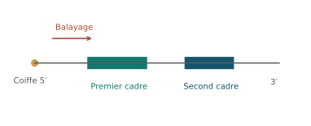
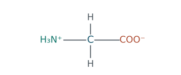
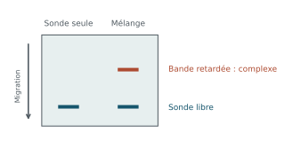
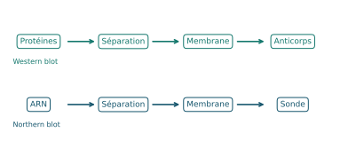
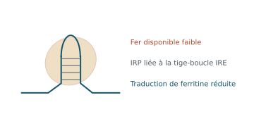

# ENS de Lyon — Second concours · Biologie-biochimie 2025 · Corrigé partiel guidé

*Corrigé rédigé par IA, non officiel.*

**Rédaction** · Modèle : OpenAI Codex (famille GPT-6) · Effort de raisonnement : non renseigné · Mode de vitesse : non renseigné.

**Couverture de l’épreuve (32 questions).** Huit réponses intégrales correspondent aux questions 1, 7, 9, 18, 21, 23, 31 et 32. Les questions 3, 8, 26 et 30 reçoivent une réponse partielle, limitée aux principes des témoins, aux propriétés chimiques des résidus, à la mobilité des ARN ou à la comparaison des ribosomes. Les questions 2, 4–6, 10–17, 19–20, 22, 24–25 et 27–29 (20 questions) concernent l’analyse expérimentale de la virulence de Listeria monocytogenes et restent hors de cette sélection.

## Présentation du sujet

Le sujet officiel porte sur le contrôle de l’expression de facteurs de virulence chez Listeria monocytogenes. Cette sélection développe les questions autonomes sur les molécules et la lecture des méthodes de biochimie, ainsi que des exemples de régulation chez les eucaryotes.

## I — Messages, acides aminés et détection de complexes

Le premier cadre de lecture d’un message, la charge d’une chaîne latérale et la mobilité d’un complexe sont trois propriétés différentes.

### Question 1

> [!INDICATION]
> Compter les cadres de lecture distincts sur la figure 1 et se demander comment le ribosome cytosolique eucaryote choisit son codon de départ.

> [!INDICATION]
> Le qualificatif bicistronique s’applique à l’ARNm portant deux cadres distincts.

#### Solution

L’ARNm long porte deux cadres de lecture successifs qui codent deux protéines distinctes. Il est **bicistronique**. Chez les eucaryotes, dans le mécanisme canonique, la petite sous-unité du ribosome et les facteurs d’initiation sont recrutés près de la coiffe $5'$. Le complexe parcourt l’ARNm vers $3'$ et initie la traduction à un AUG dans un contexte favorable. Après traduction du premier cadre et terminaison, le ribosome se dissocie généralement. Le second cadre du message du sujet n’est donc pas efficacement traduit par ce mécanisme. Des exceptions comme des sites d’entrée interne ou une réinitiation existent pour certains messages eucaryotes.

### Question 3 — éléments de réponse

> [!INDICATION]
> Comparer la question posée par un contrôle négatif à celle posée par un contrôle de restauration.

#### Solution

Prenons un exemple indépendant : un système cellulaire a perdu une fluorescence témoin. Le témoin de support seul vérifie si le support ou sa présence suffit à expliquer un changement de fluorescence. Une comparaison qui restaure la fonction normalement associée à la fluorescence teste si sa perte explique le phénotype. Les cellules témoins doivent être évaluées avec la même méthode de mesure. Une restauration compatible avec l’attendu appuie une attribution causale ; une absence de restauration est moins informative, car plusieurs étapes de la mesure peuvent échouer.

### Question 7

> [!INDICATION]
> Vérifier la valence du carbone α et la protonation usuelle de l’amine et du carboxyle vers pH 7.

> [!INDICATION]
> Un carboxylate peut être écrit sous deux formes mésomères équivalentes.

#### Solution

La **glycine** fournit l’exemple le plus simple. Sa formule moléculaire est $\mathrm{C_2H_5NO_2}$ et sa formule usuelle en solution aqueuse proche de la neutralité est $\mathrm{{}^+H_3N{-}CH_2{-}COO^-}$. L’ammonium porte $+1$ et le carboxylate $-1$, d’où une charge nette nulle. Le carbone α porte le groupe ammonium, le carboxylate et deux H. Il forme quatre liaisons et n’est pas chiral. La chaîne latérale de la glycine est un hydrogène.

### Question 8 — éléments de réponse

> [!INDICATION]
> Distinguer charge nette, polarité et capacité à former des liaisons hydrogène.

#### Solution

À pH voisin de 7, la chaîne latérale de la **lysine** se termine généralement par un ammonium positif. L’amide de la **glutamine** et l’alcool de la **sérine** sont polaires et globalement neutres. La **glycine**, dont la chaîne latérale est H, est peu encombrée et permet une grande liberté de conformation locale. La charge intervient dans les interactions électrostatiques, tandis qu’un groupe polaire neutre peut encore former des liaisons hydrogène. Ces propriétés seules ne prédisent pas l’effet mesuré d’une substitution sur une protéine. Cette réponse se limite à la comparaison chimique des quatre résidus.

### Question 9

> [!INDICATION]
> Repérer la position du fragment marqué lorsqu’il migre seul et la comparer à la bande retardée sur le gel natif.

#### Solution

La **bande 2**, la plus basse, correspond à l’ADN marqué libre. Le témoin « FP » fixe sa position. La **bande 1**, plus haute, correspond à l’ADN marqué retenu dans un complexe avec une protéine. En conditions natives, le complexe moins mobile n’a pas parcouru la même distance que la sonde libre. La révélation suit l’ADN marqué. La protéine libre n’apparaît donc pas comme une troisième bande par ce procédé.

## II — Mesurer un ARN ou une protéine

Le choix de la molécule détectée détermine la méthode et le type de témoin pertinent.

### Question 18

> [!INDICATION]
> Distinguer la séparation préalable des protéines et la reconnaissance spécifique qui rend l’une d’elles visible.

> [!INDICATION]
> La présence d’une bande ne donne pas directement une activité enzymatique.

#### Solution

Le **Western blot** ou immunotransfert détecte une protéine dans un mélange. Une électrophorèse, usuellement en présence de SDS, sépare les protéines principalement selon leur masse apparente. Elles sont ensuite transférées sur une membrane. Après blocage des fixations non spécifiques, un anticorps primaire reconnaît la protéine recherchée et un système de révélation, souvent un anticorps secondaire marqué, visualise la bande. Le marqueur de masse renseigne sur la taille apparente. Un témoin de charge ou une coloration des protéines totales permet de normaliser les comparaisons entre pistes. L’intensité n’est proportionnelle à la quantité que dans la gamme de réponse non saturée.

### Question 21

> [!INDICATION]
> Le nom du transfert indique quelle famille de molécules est détectée. Penser également à la distinction entre taille et abondance.

> [!INDICATION]
> Deux messages de longueurs différentes peuvent être reconnus par une même sonde si la région est commune.

#### Solution

Dans un **Northern blot**, les ARN sont séparés par électrophorèse dénaturante selon leur longueur, transférés sur une membrane puis détectés par hybridation avec une sonde nucléique complémentaire marquée. La position des bandes distingue les longueurs et leur intensité normalisée permet de comparer les abondances. Un contrôle de charge et d’intégrité de l’ARN est nécessaire.

Une autre approche est la **RT-qPCR**, qui combine transcription inverse et PCR quantitative. Elle distingue des transcrits lorsque la mesure est spécifique d’une région propre à chacun. Si deux messages sont emboîtés, une mesure dans la région commune les additionne. Il faut alors une mesure discriminante ou une combinaison de mesures quantitatives étalonnées ; une seule valeur obtenue dans la séquence commune ne fournit pas les deux abondances.

### Question 23

> [!INDICATION]
> L’imidazole des histidines coordonne des ions métalliques. Il peut aussi être reconnu dans une étiquette par un anticorps.

#### Solution

Une étiquette polyhistidine sert à la **purification par affinité sur métal immobilisé**. Ses groupes imidazole coordonnent, par exemple, des ions nickel ou cobalt fixés à une matrice. La protéine étiquetée peut être séparée de nombreuses autres protéines par cette affinité. Un anticorps anti-His peut aussi détecter une protéine étiquetée indépendamment de sa fonction. L’étiquette est un outil analytique ; sa présence ne démontre pas qu’une protéine a conservé son activité.

### Question 26 — éléments de réponse

> [!INDICATION]
> Comparer la grandeur lue sur un gel natif à celle que fournit un gel dénaturant.

#### Solution

Deux ARN de même longueur peuvent avoir des mobilités différentes sur un **gel natif**, parce que leur conformation et leur compacité influencent leur passage dans les mailles du gel. Un déplacement par rapport à une échelle étalonnée en longueur donne alors une **taille apparente**. En conditions dénaturantes, les structures secondaires se défont et la migration devient surtout sensible à la longueur. Si la différence disparaît en conditions dénaturantes, un changement de conformation est une explication compatible. Cet argument général ne permet pas de déduire seul la structure tridimensionnelle.

## III — Expression des gènes chez les eucaryotes

La coiffe, la chromatine et la maturation nucléaire des messagers fournissent des niveaux de régulation complémentaires.

### Question 30 — éléments de réponse

> [!INDICATION]
> Comparer le recrutement du ribosome dans le cytosol humain et sur un messager bactérien canonique.

#### Solution

Chez l’humain, la reconnaissance canonique d’un ARNm cytosolique passe par la coiffe et les facteurs d’initiation, puis par le balayage jusqu’à un AUG en contexte favorable. Le dispositif bactérien d’appariement entre une séquence Shine–Dalgarno et l’ARNr de la petite sous-unité n’est pas celui des ribosomes cytosoliques humains. Cette différence empêche de transposer à l’identique une régulation qui dépend de cet appariement. Des structures secondaires peuvent néanmoins moduler la traduction humaine, par exemple en influençant le balayage ou en recrutant une protéine régulatrice.

### Question 31

> [!INDICATION]
> Choisir un exemple où la structure repliée de l’ARN est directement reconnue par un partenaire régulateur.

#### Solution

Dans les cellules animales, l’ARNm de la **ferritine** porte en $5'$ une tige-boucle appelée IRE, reconnue par des protéines régulatrices du fer, les IRP. Lorsque le fer disponible est faible, la liaison d’une IRP à l’IRE gêne l’initiation de traduction et limite la synthèse de cette protéine de stockage. Quand le fer est abondant, la fixation des IRP diminue et la synthèse de ferritine augmente. Les IRE situés en $3'$ de certains autres messages peuvent modifier leur stabilité. La position d’un motif replié influe donc sur la nature de la réponse.

### Question 32

> [!INDICATION]
> Chercher des mécanismes associés à la chromatine nucléaire, à l’épissage et à la séparation du noyau et du cytoplasme.

> [!INDICATION]
> Donner au moins un effet concret de chaque mécanisme sur la quantité ou la nature du produit.

#### Solution

Chez les eucaryotes, plusieurs mécanismes découlent de l’organisation nucléaire du génome et de la maturation des pré-ARNm.

| Mécanisme | Effet possible sur l’expression |
|---|---|
| Remodelage des nucléosomes et modifications des histones | Changent l’accessibilité d’un promoteur ou d’un amplificateur dans la chromatine nucléaire |
| Épissage alternatif des pré-ARNm par le spliceosome | Produit des isoformes différentes à partir d’un même gène |
| Rétention, contrôle qualité et export des ARNm par les pores nucléaires | Conditionnent l’accès des messagers aux ribosomes cytosoliques |
| Inactivation du chromosome X chez les mammifères placentaires | Réduit à l’échelle d’un chromosome l’expression de nombreux gènes |

La méthylation de l’ADN, prise isolément, serait un exemple moins discriminant, car les bactéries possèdent aussi des systèmes de méthylation.

## Bilan

Ces questions mobilisent plusieurs niveaux de preuve. Une mobilité sur gel natif dépend de la conformation, une sonde d’hybridation détecte une séquence et un anticorps reconnaît un antigène. Le repliement des ARN intervient aussi dans la régulation physiologique des cellules animales, comme l’illustre la ferritine.
