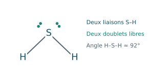
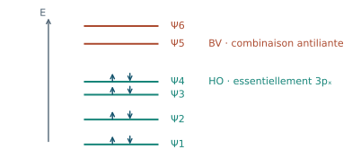
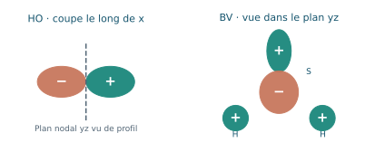
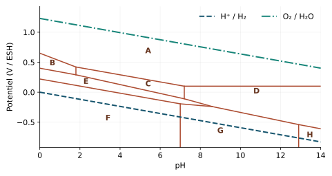
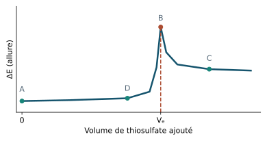
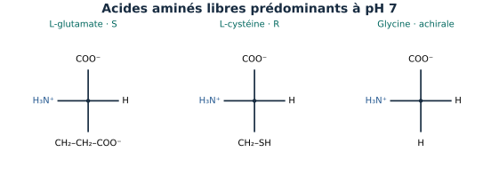
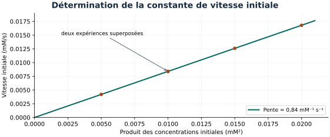
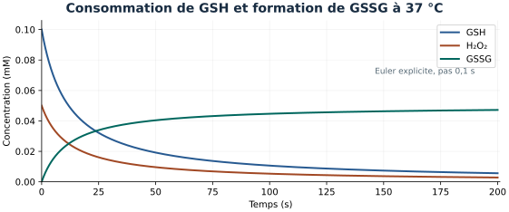
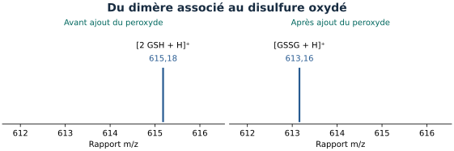
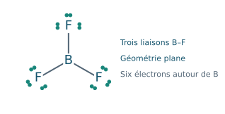

# ENS de Lyon — Second concours · Chimie 2025 · Corrigé partiel brut

*Corrigé rédigé par IA, non officiel.*

**Rédaction** · modèle exact non renseigné (famille GPT-6) · effort non renseigné · vitesse non renseignée

**Couverture de l’épreuve (64 questions).** Les questions 1 à 45, 51, 56 et 60 reçoivent une réponse intégrale (48 questions). Les questions 46, 49, 52 et 53 reçoivent une réponse partielle, limitée aux propriétés des réactifs ou à la lecture du spectre. La voie de synthèse de la zéaralénone, qui concerne les questions 47–48, 50, 54–55, 57–59 et 61–64, reste hors du corrigé (12 questions).

## I.1 — Structure de H₂S et combustion

### Question 1

L’état fondamental de S est $1s^2\,2s^2\,2p^6\,3s^2\,3p^4=[\mathrm{Ne}]\,3s^2\,3p^4$. Les six électrons de la couche $n=3$ sont les électrons de valence. Selon la règle de Hund, deux des trois orbitales $3p$ sont simplement occupées.

### Question 2

Les huit électrons de valence de $\mathrm{H_2S}$ forment deux liaisons simples H–S et deux doublets libres sur S. Les charges formelles sont nulles. Le modèle VSEPR est $AX_2E_2$ et donne une molécule coudée. L’angle expérimental H–S–H est proche de $92^\circ$.



### Question 3

À gauche se trouve S, avec un niveau $3s$ et trois orbitales $3p$ dégénérées. À droite, les deux orbitales $1s$ des hydrogènes donnent deux combinaisons. $\Phi_1\propto 1s_1+1s_2$ est liante entre les H et $\Phi_2\propto 1s_1-1s_2$ est antiliante. Le faible recouvrement des hydrogènes séparés explique le faible écart représenté. Les qualificatifs portent ici sur le fragment à deux hydrogènes.

### Question 4

Dans la figure 1, la molécule appartient au plan $yz$. Les deux hydrogènes s’échangent par $C_z$ et par $\sigma_{xz}$. Une orbitale $p$ se transforme comme la coordonnée qui lui donne son indice.

| Opération | $3s$ | $3p_x$ | $3p_y$ | $3p_z$ | $\Phi_1$ | $\Phi_2$ |
|---|---|---|---|---|---|---|
| $C_z$ | S | A | A | S | S | A |
| $\sigma_{yz}$ | S | A | S | S | S | S |
| $\sigma_{xz}$ | S | S | A | S | S | A |

S signifie symétrique et A antisymétrique. Chaque orbitale proposée a une parité définie pour chacune de ces trois opérations.

### Question 5

$3s$, $3p_z$ et $\Phi_1$ ont les mêmes symétries et donnent les trois orbitales $\Psi_1,\Psi_3,\Psi_5$. Le couple $3p_y,\Phi_2$ donne $\Psi_2,\Psi_6$. Enfin $3p_x$ est seule de sa symétrie ; $\Psi_4=3p_x$ reste non liante. Le tableau 2 confirme l’origine des trois derniers niveaux. Une même symétrie autorise le mélange ; son amplitude dépend aussi du recouvrement et de l’écart énergétique.

### Question 6

Les huit électrons occupent quatre niveaux par paires de spins opposés. La configuration de valence est $(\Psi_1)^2(\Psi_2)^2(\Psi_3)^2(\Psi_4)^2$. L’ordre des niveaux est celui de la figure 2, avec $\Psi_5$ et $\Psi_6$ vacantes. Les deux liaisons et les deux doublets de la formule de Lewis se retrouvent dans l’ensemble des quatre orbitales occupées.



### Question 7

La haute occupée (HO) est $\Psi_4=3p_x(\mathrm S)$, avec un lobe de chaque côté du plan moléculaire et un nœud dans ce plan. La basse vacante (BV) est $\Psi_5=-0{,}24\,(3s)+0{,}66\,(3p_z)+0{,}50\,(1s_1)+0{,}50\,(1s_2)$. Les hydrogènes ont la même phase. Du côté des deux H, le lobe de $3p_z$ orienté vers $-z$ et la contribution $3s$ sont tous deux en opposition de phase avec eux. La BV est antiliante vis-à-vis de S–H. Un renversement simultané de toutes les phases décrit la même orbitale.



### Question 8

Les deux molécules coudées ont les mêmes familles de symétries et huit électrons de valence. Dans l’eau, O emploie ses orbitales $2s,2p$, plus basses en énergie que $3s,3p$ de S. Les liaisons O–H sont plus courtes et le recouvrement efficace de $2p(\mathrm O)$ avec $1s(\mathrm H)$ est plus fort que pour S–H. Les déplacements des combinaisons liantes et antiliantes par rapport aux fragments sont donc différents. L’angle proche de $90^\circ$ de $\mathrm{H_2S}$ s’accorde avec une participation importante des orbitales $3p$ aux liaisons.

### Question 9

Les orbitales essentiellement localisées sur O, notamment la HO non liante, sont plus basses en énergie que leurs homologues sur S. O attire plus fortement les électrons et la liaison $\mathrm{O}^{\delta-}$–$\mathrm{H}^{\delta+}$ est plus polaire que S–H. Les liaisons O–H sont aussi plus fortes. Pour la comparaison de stabilité par rapport aux éléments, le tableau 3 donne $\Delta_fH^\circ=-241{,}9$ contre $-20{,}6\ \mathrm{kJ\,mol^{-1}}$ pour les deux molécules gazeuses, respectivement.

### Question 10

Les deux molécules coudées ont un moment dipolaire le long de la bissectrice, plus grand pour l’eau car les liaisons O–H sont plus polaires. L’eau liquide forme un réseau de liaisons hydrogène. Les interactions entre molécules de $\mathrm{H_2S}$ sont bien plus faibles. À pression atmosphérique, l’eau bout vers $100\ ^\circ\mathrm C$, le sulfure d’hydrogène vers $-60\ ^\circ\mathrm C$.

### Question 11

La combustion complète à 298 K s’écrit $\mathrm{H_2S(g)+\tfrac32 O_2(g)\longrightarrow SO_2(g)+H_2O(l)}$. Les deux membres contiennent un soufre, deux hydrogènes et trois oxygènes.

### Question 12

$\Delta_fH^\circ(\mathrm{O_2(g)},298\ \mathrm K)=0$ par convention. Le dioxygène gazeux est l’état standard de référence de l’élément à cette température. Son entropie molaire standard à 298 K vaut, elle, $205{,}0\ \mathrm{J\,mol^{-1}\,K^{-1}}$.

### Question 13

Par la loi de Hess, $-562=\Delta_fH^\circ(\mathrm{SO_2})-285{,}9-(-20{,}6)$. Ainsi $\boxed{\Delta_fH^\circ(\mathrm{SO_2(g)})=-296{,}7\ \mathrm{kJ\,mol^{-1}}}$.

### Question 14

On obtient $\Delta_rS^\circ=248{,}2+69{,}9-205{,}7-1{,}5\times205{,}0=-195{,}1\ \mathrm{J\,mol^{-1}\,K^{-1}}$. À 298 K, $\Delta_rG^\circ=-562-298(-0{,}1951)=-503{,}9\ \mathrm{kJ\,mol^{-1}}$. Puis $\log_{10}K^\circ=-\Delta_rG^\circ/(RT\ln 10)\simeq88{,}3$, soit $K^\circ\simeq2\times10^{88}$. Les produits sont très favorisés à l’équilibre.

## I.2 — Diagramme potentiel–pH

### Question 15

Avec $n_{\rm O}=-II$ et $n_{\rm H}=+I$, on trouve $-II$ pour $\mathrm{H_2S,HS^-,S^{2-}}$, zéro pour $\mathrm{S(s)}$, $+IV$ pour $\mathrm{H_2SO_3,HSO_3^-,SO_3^{2-}}$ et $+V$ sur chacun des deux S équivalents de $\mathrm{S_2O_6^{2-}}$. Par exemple, pour le dithionate, $2x-12=-2$. À un même degré d’oxydation, la forme la plus déprotonée se trouve à droite.

| Domaine | A | B | C | D | E | F | G | H |
|---|---|---|---|---|---|---|---|---|
| Espèce | $\mathrm{S_2O_6^{2-}}$ | $\mathrm{H_2SO_3}$ | $\mathrm{HSO_3^-}$ | $\mathrm{SO_3^{2-}}$ | $\mathrm{S(s)}$ | $\mathrm{H_2S}$ | $\mathrm{HS^-}$ | $\mathrm{S^{2-}}$ |

### Question 16

À la frontière de deux formes acido-basiques dissoutes en concentrations égales, $\mathrm{pH}=\mathrm pK_a$. La figure donne $\mathrm pK_{a1}(\mathrm{H_2S/HS^-})\simeq7{,}0$ et $\mathrm pK_{a2}(\mathrm{HS^-/S^{2-}})\simeq12{,}9$, soit environ 13.

### Question 17

$\mathrm{S(s)+2H^++2e^-\rightleftharpoons H_2S(aq)}$. À 25 °C, avec $a(\mathrm S)=1$, la relation de Nernst donne $E=E^\circ-0{,}0296\log_{10}a(\mathrm{H_2S})-0{,}0592\,\mathrm{pH}$. Sur la frontière F/E, $a(\mathrm{H_2S})\simeq10^{-3}$, d’où $E=E^\circ+0{,}0888-0{,}0592\,\mathrm{pH}$ en volts. La lecture à pH nul donne environ 0,22 à 0,23 V. On en déduit $\boxed{E^\circ\simeq0{,}13\text{ à }0{,}14\ \mathrm V\text{ / ESH}}$.

### Question 18

À 25 °C, les droites de l’eau sont $E_{\rm H^+/H_2}=-0{,}0592\,\mathrm{pH}$ et $E_{\rm O_2/H_2O}=1{,}23-0{,}0592\,\mathrm{pH}$ en V/ESH. L’eau possède un domaine commun avec $\mathrm{H_2S}$ en milieu suffisamment réducteur et acide. Le sulfure d’hydrogène peut donc y subsister. En revanche, la droite du dioxygène est largement au-dessus du domaine F. Le dioxygène dissous peut alors l’oxyder. Le diagramme établit la possibilité thermodynamique de l’oxydation, sa vitesse requiert une étude cinétique.



### Question 19

Le diagramme représente la forme acide du soufre(IV) par $\mathrm{SO_2(aq)+H_2O\rightleftharpoons H_2SO_3(aq)}$, appelée acide sulfureux. Sa formule de Lewis conventionnelle est $\mathrm{HO{-}S(=O){-}OH}$, avec un doublet libre sur S et deux sur chaque O. La première déprotonation donne $\mathrm{HSO_3^-}$. Dans l’eau réelle, la notation $\mathrm{H_2SO_3}$ regroupe usuellement le dioxyde de soufre dissous et son hydrate minoritaire.

### Question 20

Le trouble correspond au soufre solide dispersé. Deux atomes S($-II$) cèdent chacun deux électrons et un atome S($+IV$) accepte quatre électrons. Le bilan est $\mathrm{SO_2(aq)+2H_2S(aq)\longrightarrow 3S(s)+2H_2O(l)}$. Il s’agit d’une **médiamutation** (comproportionation).

## I.3 — Vitamine C du kiwi

### Question 21

L’acide ascorbique s’oxyde selon $\mathrm{C_6H_8O_6\to C_6H_6O_6+2H^++2e^-}$. Le triiodure se réduit selon $\mathrm{I_3^-+2e^-\to3I^-}$. D’où $\mathrm{C_6H_8O_6+I_3^-\to C_6H_6O_6+2H^++3I^-}$ ; une mole de vitamine C consomme une mole de triiodure.

### Question 22

$\mathrm{2S_2O_3^{2-}\to S_4O_6^{2-}+2e^-}$ conduit au bilan $\mathrm{I_3^-+2S_2O_3^{2-}\to 3I^-+S_4O_6^{2-}}$. Le triiodure restant après Q21 est l’espèce titrée, le thiosulfate est le titrant.

### Question 23

Soient $a$ la quantité résiduelle de triiodure, $b$ celle d’iodure initialement présent ou déjà formé, $u=C_SV$ la quantité de thiosulfate versée et $\xi=\min(a,u/2)$. Les quantités sont les suivantes.

| Stade | $n(\mathrm{I_3^-})$ | $n(\mathrm{I^-})$ | $n(\mathrm{S_2O_3^{2-}})$ | $n(\mathrm{S_4O_6^{2-}})$ | Figure 5 |
|---|---|---|---|---|---|
| Départ | $a$ | $b$ | 0 | 0 | A |
| Avant l’équivalence | $a-\xi$ | $b+3\xi$ | 0 | $\xi$ | D |
| À l’équivalence | 0 | $b+3a$ | 0 | $a$ | B |
| Après l’équivalence | 0 | $b+3a$ | $u-2a$ | $a$ | C |

D comporte encore la réduction de $\mathrm{I_3^-}$ et, désormais, celle du tétrathionate. B présente la réduction du tétrathionate et l’oxydation de l’iodure. C présente en plus la vague anodique du thiosulfate libre.

### Question 24

La mesure vaut $\Delta E=E(+i)-E(-i)$. Au début puis avant l’équivalence (A, D), le couple rapide $\mathrm{I_3^-/I^-}$ porte les deux courants et l’écart est faible. Quand le triiodure disparaît (B), le courant cathodique doit être assuré par le tétrathionate et le courant anodique par l’iodure. L’écart devient maximal au voisinage de l’équivalence. Après celle-ci (C), le thiosulfate en excès assure l’oxydation à un potentiel plus faible. L’écart redescend, mais les branches lentes du couple soufré laissent une valeur supérieure à celle du début dans le schéma fourni.

### Question 25

Le tracé commence avec une petite différence de potentiel, présente un pic au voisinage de $V_E$, puis redescend vers une différence intermédiaire. On lit l’abscisse du maximum. Pour des points expérimentaux espacés, on resserre les ajouts près du sommet afin d’en préciser l’abscisse. La figure ci-dessous n’impose pas de valeur de tension aux graduations absentes de l’énoncé.



### Question 26

$n_0(\mathrm{I_3^-})=0{,}100\times0{,}0100=1{,}00\ \mathrm{mmol}$. Le titrage donne $n_{\rm reste}(\mathrm{I_3^-})=C_SV_E/2=0{,}360\ \mathrm{mmol}$. Le kiwi contenait donc $0{,}640\ \mathrm{mmol}$ de vitamine C, soit une concentration dans les 100 mL d’extrait de $\boxed{6{,}4\times10^{-3}\ \mathrm{mol\,L^{-1}}}$. Avec $M=176{,}1\ \mathrm{g\,mol^{-1}}$, cela représente environ 113 mg pour 100 g, du même ordre que 90 mg et environ 25 % au-dessus. La référence est une moyenne. D’autres réducteurs du fruit peuvent aussi majorer le dosage iodométrique.

### Question 27

On peut titrer directement l’acide ascorbique par une solution étalonnée de 2,6-dichlorophénolindophénol (DCPIP). En milieu acide le colorant oxydé est rose, le colorant réduit est décoloré. Une molécule de vitamine C réduit une molécule de DCPIP ; la première coloration rose persistante signale l’équivalence. Un blanc du milieu et une lecture rapide limitent l’effet de la couleur du fruit et de l’oxydation de l’ascorbate à l’air.

## II.1 — Structure et oxydation du glutathion

### Question 28

Le glutathion est un **peptide**, plus précisément un tripeptide, le γ-glutamyl-cystéinyl-glycine. Ses résidus sont reliés par des liaisons amide. La première utilise le carboxyle de la chaîne latérale du glutamate. Parmi les autres grandes familles de biomolécules figurent les glucides, les lipides et les acides nucléiques.

### Question 29

Les trois résidus proviennent de l’acide glutamique, de la cystéine et de la glycine. Une fois ces acides aminés **séparés**, voici leurs formes prédominantes vers $\mathrm{pH}=7$.

| Acide aminé | Structure condensée | Charge totale |
|---|---|---:|
| Glutamate | $\mathrm{^-OOC-CH(NH_3^+)-CH_2-CH_2-COO^-}$ | $-1$ |
| Cystéine | $\mathrm{^-OOC-CH(NH_3^+)-CH_2-SH}$ | $0$ |
| Glycine | $\mathrm{^+H_3N-CH_2-COO^-}$ | $0$ |

Les groupes α-carboxyle sont déprotonés et les α-amines protonées. Le carboxyle latéral du glutamate est également déprotoné. Le thiol de la cystéine est majoritairement sous forme SH à ce pH.



### Question 30

Le carbone α de la glycine porte deux H et est **achiral**. Le carbone α du glutamate naturel est **$S$**. Ses priorités CIP sont N, carbone du carboxyle, carbone de la chaîne latérale et H. Le carbone α de la L-cystéine est **$R$**. La branche $\mathrm{CH_2SH}$ présente $(\mathrm S,\mathrm H,\mathrm H)$, prioritaire sur les oxygènes du carboxyle. L’ordre est donc N, $\mathrm{CH_2SH}$, carboxyle, H. Les deux acides aminés chiraux appartiennent à la série L, mais le changement d’ordre entre les branches carbonées inverse leur descripteur CIP.

### Question 31

En convention de réduction et en milieu acide,
$$\mathrm{GSSG+2H^++2e^-\rightleftharpoons2GSH},\qquad
\mathrm{H_2O_2+2H^++2e^-\rightleftharpoons2H_2O}.$$
Le peroxyde est réduit. Deux molécules de glutathion thiol s’oxydent en un disulfure et cèdent ensemble deux électrons. L’addition de la seconde demi-équation et de l’inverse de la première donne le bilan indiqué.

### Question 32

La différence standard de potentiel est $\Delta E^\circ=1{,}78-0{,}19=1{,}59\ \mathrm V$. Deux électrons sont échangés par avancement du bilan. Avec les potentiels fournis et $T=310{,}15\ \mathrm K$,
$$\ln K^\circ=\frac{2F\Delta E^\circ}{RT}\simeq119,\qquad \log_{10}K^\circ\simeq51{,}7.$$
On obtient **$K^\circ\simeq5\times10^{51}$**, sans dimension. L’équilibre favorise très fortement les produits. Ce résultat thermodynamique ne fixe pas le temps nécessaire pour les former.

## II.2 — Vitesse et formation du disulfure

### Question 33

Entre les lignes 1 et 2, doubler $[\mathrm{GSH}]$ à peroxyde constant double la vitesse. L’ordre partiel en GSH est 1. Entre les lignes 1 et 3, doubler $[\mathrm{H_2O_2}]$ à GSH constant double aussi la vitesse. L’ordre partiel en peroxyde est 1. Ainsi **$v=k[\mathrm{GSH}][\mathrm{H_2O_2}]$** et l’ordre global est 2 pour ces conditions expérimentales.

### Question 34

Notons $x_i=[\mathrm{GSH}]_i[\mathrm{H_2O_2}]_i$ et $y_i=v_{0,i}$. Les cinq valeurs de $x_i$ sont $0{,}005$, $0{,}010$, $0{,}010$, $0{,}015$ et $0{,}020$ en $\mathrm{mM^2}$. Les $y_i$ correspondants sont $0{,}0042$, $0{,}0084$, $0{,}0084$, $0{,}0126$ et $0{,}0168$ en $\mathrm{mM\,s^{-1}}$. Chaque rapport $y_i/x_i$ vaut $0{,}84$. La pente par moindres carrés passant par l’origine, $\sum_ix_iy_i/\sum_ix_i^2$, donne donc **$k=0{,}84\ \mathrm{L\,mmol^{-1}\,s^{-1}}=840\ \mathrm{L\,mol^{-1}\,s^{-1}}$**.



### Question 35

En posant $v=k[\mathrm{GSH}][\mathrm{H_2O_2}]$, la stœchiométrie impose
$$\frac{d[\mathrm{GSH}]}{dt}=-2v,\qquad \frac{d[\mathrm{H_2O_2}]}{dt}=-v,\qquad
\frac{d[\mathrm{GSSG}]}{dt}=v.$$
La dérivée de $[\mathrm{GSH}]+2[\mathrm{GSSG}]$ est nulle, comme celle de $[\mathrm{H_2O_2}]+[\mathrm{GSSG}]$.

### Question 36

Les lignes suivantes se placent dans la boucle existante. Les concentrations sont en mM et le temps en secondes.

```python
    v = k * GSH * H2O2
    dGSH_dt = -2 * v
    dH2O2_dt = -v
    dGSSG_dt = v

    GSH_next = GSH + dt * dGSH_dt
    H2O2_next = H2O2 + dt * dH2O2_dt
    GSSG_next = GSSG + dt * dGSSG_dt
```

Cette méthode d’Euler explicite conserve algébriquement les deux combinaisons linéaires de la question 35 à chaque pas.

### Question 37

Les conditions initiales sont stœchiométriques, donc $[\mathrm{GSH}]=2[\mathrm{H_2O_2}]$ à tout instant. Si $P=[\mathrm{H_2O_2}]$, alors $\dot P=-2kP^2$ et $P(t)=P_0/(1+2kP_0t)$. À $t=200\ \mathrm s$, le dénominateur vaut $1+2(0{,}84)(0{,}05)(200)=17{,}8$. Il reste environ $0{,}0028\ \mathrm{mM}$ de peroxyde et $0{,}0056\ \mathrm{mM}$ de GSH. Le GSSG atteint $0{,}0472\ \mathrm{mM}$ sur un maximum de $0{,}050\ \mathrm{mM}$. Le calcul d’Euler et la figure donnent ainsi **environ 94 % de conversion**. La réaction se poursuit à une vitesse devenue faible.



### Question 38

Avec $T_1=310{,}15\ \mathrm K$, $T_2=320{,}15\ \mathrm K$ et $E_a=50\,000\ \mathrm{J\,mol^{-1}}$, la loi d’Arrhenius donne
$$\frac{k_2}{k_1}=\exp\!\left[\frac{E_a}{R}\left(\frac1{T_1}-\frac1{T_2}\right)\right]\simeq e^{0{,}606}\simeq1{,}83.$$
Ainsi **$k(47\,^\circ\mathrm C)\simeq1{,}54\ \mathrm{L\,mmol^{-1}\,s^{-1}}$**.

## II.3 — Espèces radicalaires et dimérisation

### Question 39

Sur la figure 8b, le colorant est pratiquement stable avec GSH seul et avec $\mathrm{H_2O_2}$ seul, alors que sa concentration décroît fortement dans le mélange des deux. La perte d’absorbance du suivi 8a accompagne cette consommation. Les témoins écartent une réaction directe appréciable avec l’un ou l’autre réactif seul dans ces conditions. Le tableau 5 attribue la consommation de A à l’étape 14, $\mathrm{GS^\bullet+A\rightarrow B^\bullet}$. L’association des deux réactifs fournit le radical nécessaire. Les témoins seuls établissent la nécessité du mélange, le mécanisme complète l’identification de l’espèce consommatrice.

### Question 40

Les constantes étoilées $k_2,k_5,k_8$ correspondent à une décomposition unimoléculaire de K ou C. Leurs unités sont **$\mathrm{s^{-1}}$**. Les autres étapes écrites sont bimoléculaires et leurs constantes sont en **$\mathrm{L\,mol^{-1}\,s^{-1}}$** si les concentrations sont exprimées en $\mathrm{mol\,L^{-1}}$. Une valeur en $\mathrm{s^{-1}}$ et une valeur en $\mathrm{L\,mol^{-1}\,s^{-1}}$ ne se comparent qu’après multiplication de la seconde par la concentration de son partenaire, ou en calculant les vitesses aux concentrations de l’expérience.

### Question 41

L’étape 9 produit $\mathrm{HO^\bullet}$ avec $v_9=k_9[\mathrm{H_2O_2}][\mathrm{GSH}]$. L’étape 10 le consomme à $v_{10}=k_{10}[\mathrm{HO^\bullet}][\mathrm{GSH}]$. $k_{10}$ est très grand : en présence de GSH à $5\ \mathrm{mM}$, le temps de relaxation $1/(k_{10}[\mathrm{GSH}])$ est d’environ $2\ \mathrm{\mu s}$ pour $k_{10}=10^8\ \mathrm{M^{-1}\,s^{-1}}$. Après ce bref transitoire, l’approximation des états quasi stationnaires donne $v_9\simeq v_{10}$. Tant que $[\mathrm{GSH}]>0$,
$$[\mathrm{HO^\bullet}]\simeq\frac{k_9}{k_{10}}[\mathrm{H_2O_2}]=4\times10^{-12}[\mathrm{H_2O_2}].$$
La concentration en GSH s’élimine du résultat dans ce modèle.

### Question 42

Le pic du monomère est à $m/z=308{,}09$ pour $z=1$, compatible avec $[\mathrm{GSH}+\mathrm H]^+$. Avant ajout du peroxyde, le pic à $615{,}18$ correspond à $[2\mathrm{GSH}+\mathrm H]^+$, soit nominalement $2(307)+1=615$. Il est compatible avec un dimère non covalent. Après l’oxydation, le pic vers $613{,}16$ est compatible avec $[\mathrm{GSSG}+\mathrm H]^+$, puisque la formation d’une liaison disulfure enlève deux H au couple de thiols. Le déplacement $615{,}18-613{,}16\simeq2{,}02$ confirme cette interprétation. Les valeurs effectivement affichées sont celles d’adduits **protonés positifs**.



### Question 43

Avec $v_7=k_7[\mathrm{GSH}]^2\simeq k_8[C]=v_8$, on obtient $[C]/[\mathrm{GSH}]^2\simeq k_7/k_8$. Pour $2\mathrm{GSH}\rightleftharpoons C$, la constante thermodynamique en milieu dilué est
$$K^\circ=\frac{a_C}{a_{\mathrm{GSH}}^2}\simeq c^\circ\frac{[C]}{[\mathrm{GSH}]^2}
= c^\circ\frac{k_7}{k_8}\simeq\frac{1{,}3}{9\times10^{-4}}\simeq1{,}4\times10^3,$$
en utilisant $c^\circ=1\ \mathrm{mol\,L^{-1}}$ et les constantes en unités molaires. Pour estimer la validité du prééquilibre en présence de peroxyde, comparons les deux pertes de C. Vers $5{,}3\ \mathrm{mM}$ de peroxyde, $k_{12}[\mathrm{H_2O_2}]\simeq5{,}3\times10^{-6}\ \mathrm{s^{-1}}$, beaucoup plus petit que $k_8=9\times10^{-4}\ \mathrm{s^{-1}}$. La dissociation domine la consommation irréversible du dimère. L’égalité des vitesses est alors une approximation plausible après le transitoire, et suppose que les concentrations libres varient lentement sur le temps de relaxation de C.

### Question 44

Deux thiols du GSH cèdent ensemble deux électrons pour former le disulfure GSSG. Dans le bilan, ces électrons permettent au peroxyde de devenir de l’eau. Le pool de GSH contribue ainsi à limiter le peroxyde disponible pour des réactions capables d’endommager les constituants cellulaires. La glutathion réductase peut ensuite régénérer GSH à partir de GSSG en utilisant le NADPH, ce qui entretient le cycle antioxydant.

## III — Questions indépendantes de chimie générale et de spectroscopie

### Question 45

La neige carbonique, $\mathrm{CO_2(s)}$, se sublime vers $-78{,}5\ ^\circ\mathrm C$ à la pression atmosphérique. Cette transition absorbe de la chaleur. C’est le principe du bain réfrigérant de laboratoire à cette température.

### Question 46 — éléments de réponse

L’hexaméthyldisilazoture de lithium est formé de $\mathrm{Li^+}$ et de $\mathrm{[(Me_3Si)_2N]^-}$. L’anion est une base de Brønsted, capable de fixer un proton. Son acide conjugué est $\mathrm{(Me_3Si)_2NH}$, dont le $\mathrm pK_a$ est de l’ordre de 26 dans le THF. L’encombrement des deux groupes triméthylsilyle limite sa nucléophilie. Ces propriétés générales répondent à la partie acido-basique de la question.

### Question 49 — éléments de réponse

L’acide méta-chloroperbenzoïque est un peracide carboxylique. Son motif $\mathrm{Ar{-}C(=O){-}O{-}OH}$ contient une liaison peroxyde et agit comme oxydant par transfert d’un atome d’oxygène. Cela identifie la famille et le rôle général du réactif.

### Question 51

Le composé 6 est une **lactone**. On reconnaît le motif ester $\mathrm{{-}C(=O){-}O{-}}$ inclus dans un cycle.

### Question 52 — éléments de réponse

La figure 12 montre un ensemble A vers $7{,}3\ \mathrm{ppm}$ intégrant quatre protons aromatiques, compatible avec un benzène disubstitué. Le signal E vers $2{,}3\ \mathrm{ppm}$ intègre trois protons et correspond au méthyle porté par un noyau aromatique. B, vers $4{,}8\ \mathrm{ppm}$, intègre deux protons d’un méthylène fortement déblindé, tandis que F, vers $1{,}8\ \mathrm{ppm}$, est compatible avec un méthylène aliphatique. Les intégrations du spectre ne suffisent pas, à elles seules, à distinguer tous les méthylènes. Cette lecture s’en tient aux familles de protons.

### Question 53 — éléments de réponse

Deux formules de Lewis du diazométhane sont $\mathrm{H_2C{=}N^+{=}N^-\leftrightarrow {}^-CH_2{-}N^+{\equiv}N}$. Dans la première, le N terminal porte deux doublets libres ; dans la seconde, le carbone et le N terminal portent chacun un doublet libre. La seconde forme rend compte de la protonation sur le carbone. L’ion méthyldiazonium ainsi formé peut transférer un méthyle à un nucléophile, avec départ de $\mathrm{N_2}$. Cette propriété générale explique le pouvoir alkylant du diazométhane.

### Question 56

Dans une synthèse convergente, deux fragments sont préparés indépendamment, puis réunis. Si chaque branche comprend trois étapes de rendement $r$, la quantité disponible de chaque fragment à partir d’une mole de son précurseur vaut $r^3$ mole. Pour un couplage 1:1 de rendement $r_c$, on peut former $r^3r_c$ mole de produit. Les préparations peuvent aussi être menées en parallèle. L’intérêt porte sur la longueur de la séquence linéaire la plus longue ; il faut tenir compte séparément des matières consommées et du rendement du couplage.

### Question 60

Dans $\mathrm{BF_3}$, B forme trois liaisons simples B–F et chaque fluor porte trois doublets libres. Il reste seulement six électrons autour du bore, sans charge formelle. La géométrie est trigonale plane avec des angles proches de $120^\circ$. L’orbitale $p$ vacante, perpendiculaire au plan, peut recevoir le doublet d’un donneur. Le trifluorure de bore est donc un acide de Lewis. Les trois moments dipolaires B–F se compensent dans la molécule libre.


