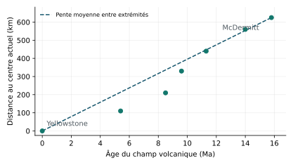
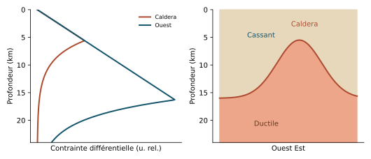
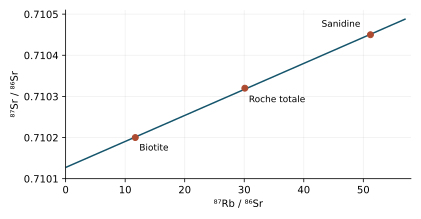
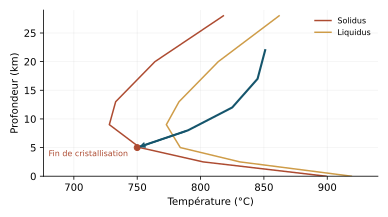
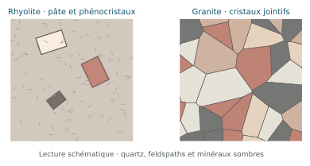
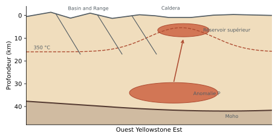

# ENS de Lyon — Second concours · Géosciences 2025 · Corrigé guidé

*Corrigé rédigé par IA, non officiel.*

**Rédaction** · modèle exact non renseigné (famille GPT-6) · effort non renseigné · vitesse non renseignée

**Révision (tour 1)** · GPT-6.2 Astra Ultra · vitesse non renseignée

**Révision (tour 2)** · GPT-6.2 Astra Ultra · vitesse non renseignée

Formation et évolution d’un super-volcan, le cas de Yellowstone. Épreuve écrite de trois heures. [Sujet et annexes](https://banques-ecoles.fr/cms/wp-content/uploads/2025/07/25_2cc_sujet_ST.pdf) · [Rapport du jury](https://banques-ecoles.fr/cms/wp-content/uploads/2025/09/25_2cc_rap_eST.pdf)

## Présentation du sujet

La trace volcanique de la Snake River relie des centres actifs depuis le Miocène à la caldera actuelle de Yellowstone. Les cartes, coupes sismiques et mesures isotopiques du sujet permettent de séparer observations, estimations et interprétations.

## A — Structure et évolution du centre éruptif dans son contexte géodynamique régional

Orienter la trace dans les deux référentiels puis utiliser les foyers des séismes pour contraindre la profondeur des ruptures.

### Question 1

> [!INDICATION]
> Placer l’âge moyen des champs volcaniques en abscisse et mesurer leur distance au Yellowstone actuel avec la barre d’échelle de la figure 1.

> [!INDICATION]
> Un millimètre par an correspond à un kilomètre par million d’années.

#### Solution

La plaine de la Snake River aligne des centres de plus en plus anciens vers le sud-ouest. Les ellipses recouvrent des zones étendues : on peut utiliser le milieu de chaque intervalle d’âges et la distance de son centre à l’édifice actuel. Une lecture arrondie de la figure 1 donne les ordres de grandeur suivants.

| Champ volcanique | Âge (Ma) | Distance au Yellowstone actuel (km) |
|---|---:|---:|
| Yellowstone actuel | 0 | 0 |
| Heise | 5,4 | environ 110 |
| Picabo | 8,5 | environ 210 |
| Twin Falls | 9,6 | environ 330 |
| Bruneau–Jarbidge | 11,3 | environ 440 |
| Owyhee–Humboldt | 14 | environ 560 |
| McDermitt | 15,8 | environ 600–650 |

Entre les extrémités, $v\simeq(600\text{ à }650)/15{,}8=38\text{ à }41\ \mathrm{km/Ma}$. Puisque $1\ \mathrm{km/Ma}=0{,}1\ \mathrm{cm/an}$, **la vitesse moyenne est d’environ 4 cm/an**. L’étendue des ellipses, le choix de leur centre et les intervalles d’âges dominent l’incertitude.

### Question 2

> [!INDICATION]
> Préciser si la flèche suit le mouvement de la plaque ou la succession des jeunes centres sur une carte solidaire de la plaque.

> [!INDICATION]
> L’azimut doit toujours être associé à une flèche orientée et à un référentiel.

#### Solution

Le modèle d’un **point chaud** suppose une source mantellique durable et peu mobile par rapport au manteau profond. La plaque nord-américaine se déplace alors au-dessus d’elle vers le **sud-ouest**, azimut d’environ $230$ à $240^\circ$. C’est le sens de la trace du centre actuel vers les anciens, et celui retenu par le rapport du jury. Dans le repère de la plaque, en suivant la chronologie de l’ancien vers le récent, le lieu du volcanisme migre en sens inverse, vers le nord-est, environ $50$ à $60^\circ$. La pente précédente mesure une vitesse relative ; une dérive de la source modifierait son interprétation en vitesse absolue de plaque.

L’alignement Hawaii–Empereur fournit un exemple océanique, et la trace Réunion–Chagos–Laccadives prolonge un épisode ancien associé aux trapps du Deccan. Un manteau chaud remontant peut franchir son solidus par décompression et fournir des liquides basaltiques. Sous un continent, ces apports chauffent la croûte et peuvent alimenter des magmas plus siliceux par différenciation et fusion crustale. L’alignement daté soutient le modèle ; il ne mesure pas directement la profondeur d’origine du panache.

Un contrôle cartographique part du centre de McDermitt vers Yellowstone. La longitude devient moins occidentale et la latitude augmente. Les composantes est et nord sont donc toutes deux positives dans le sens ancien–récent, et le vecteur inverse diffère exactement de 180°.

### Question 3

> [!INDICATION]
> Lire la base du nuage d’hypocentres, puis utiliser la profondeur de l’isotherme 350 °C comme estimation de la transition rhéologique.

> [!INDICATION]
> La limite de la couche cassante n’est pas le Moho.

#### Solution

Sur la coupe de la figure 2, les séismes restent pour l’essentiel dans la croûte superficielle. À l’ouest, la base de la concentration d’hypocentres atteint environ 15 à 18 km. Elle remonte sous la caldera : le maximum de résistance de l’enveloppe fournie se place vers 5 km et l’histogramme situe environ 80 % des foyers dans les six premiers kilomètres. Quelques foyers plus profonds existent. À l’est de la caldera, la distribution s’élargit de nouveau localement.

Dans le domaine cassant, la contrainte différentielle critique augmente avec la pression de confinement et donc avec la profondeur. À plus haute température, le fluage devient efficace et la résistance ductile décroît. L’intersection des deux branches marque le maximum de résistance. À l’ouest, moins chaud, cette intersection se place plus bas et à une contrainte plus forte. Les secousses cessent généralement quand le fluage relaxe les contraintes avant une rupture brutale.

En adoptant l’isotherme $350\ ^\circ\mathrm C$ du modèle quartzifère et $T_{\rm surface}\simeq0$ à $10\ ^\circ\mathrm C$, on obtient $G\simeq\Delta T/z$. À l’ouest, $G\simeq340/(15\text{ à }18)\simeq19$ à $23\ ^\circ\mathrm C/km$. Au centre, $G\simeq340/(5\text{ à }6)\simeq57$ à $68\ ^\circ\mathrm C/km$. Ces gradients **moyens superficiels** traduisent une forte anomalie thermique centrale ; la transition varie aussi avec la composition, la vitesse de déformation et les fluides.

### Question 4

> [!INDICATION]
> Relier le déplacement vertical sur une faille normale à l’extension horizontale.

#### Solution

Le Basin and Range correspond à une extension continentale répartie. Des failles normales abaissent leur compartiment supérieur et individualisent des blocs soulevés, des grabens et des demi-grabens. Le front raide de la chaîne du Grand Teton et le bassin abaissé à l’est, visibles en annexe A.2, en donnent un exemple. L’accumulation puis la libération de contraintes extensives dans la croûte cassante expliquent une part de la sismicité régionale. Près de la caldera, la circulation de fluides et les variations de pression magmatique peuvent en outre favoriser des essaims.

### Question 5

> [!INDICATION]
> Estimer la longueur susceptible de rompre et limiter sa largeur à la couche cassante ; convertir ensuite toutes les dimensions en mètres.

> [!INDICATION]
> Une longueur lue sur une carte ne donne pas directement la largeur de la surface rompue.

#### Solution

La faille normale de Lost River (étoile) et la faille bordant le Grand Teton sont deux exemples de structures actives identifiables. L’annexe A.2 donne un rejet observable de 1 à 3 m à Lost River. Pour une grande rupture d’un segment de l’ordre de 50 km, une couche cassante de 15 km et un pendage de $60^\circ$, la largeur sur le plan est $W\simeq15/\sin60^\circ\simeq17\ \mathrm{km}$. Un glissement moyen illustratif de 2 m donne
$$M_0=\mu LWD\simeq(3\times10^{10})(5\times10^4)(1{,}7\times10^4)(2)\simeq5{,}1\times10^{19}\ \mathrm{N\,m},$$
$$M_w=\tfrac23\log_{10}M_0-6{,}06\simeq7{,}1.$$
La magnitude d’une rupture majeure plausible est donc **de l’ordre de 7**. Avec 30–60 km de rupture, 15–20 km de largeur et 1–3 m de glissement, on obtient environ 6,7–7,3. Un rejet local en surface et un glissement moyen sur le plan sont deux mesures différentes. La segmentation et la longueur de rupture simultanée empêchent d’en déduire une borne maximale stricte.

L’annexe A.2 montre la rupture de 1983 à Lost River. Pour estimer la magnitude maximale plausible, on prend la largeur sismogène sur le flanc ouest de la figure 2, où se situe la faille. À longueur et glissement égaux, choisir 5 km de profondeur cassante, valeur propre au centre chaud, diviserait le moment par trois et réduirait la magnitude d’environ 0,32.

### Question 6

> [!INDICATION]
> Lire séparément la profondeur du Moho sur la carte de gauche et le signe de la perturbation de vitesse sur la tranche de droite.

#### Solution

Dans l’annexe A.4, le Moho avoisine **40 km**, avec des variations régionales de plusieurs kilomètres. À 35 km, on échantillonne par conséquent la croûte inférieure ou le voisinage de sa base. Une anomalie **négative** de vitesse P apparaît sous le contour de la caldera, surtout dans sa partie centrale et méridionale. Les couleurs chaudes correspondent ici à des ondes plus lentes que dans le modèle de référence. Une croûte inférieure chaude, alimentée par du magma et contenant localement du liquide, explique cette anomalie et l’apport de chaleur au système superficiel. Une tomographie de vitesse seule ne détermine pas une fraction de liquide unique.

Les deux légendes de l’annexe A.4 se lisent séparément. Sur la carte régionale, la couleur code la profondeur du Moho en kilomètres (échelle de 20 à 50 km). Sur la coupe horizontale à 35 km, elle code une variation relative de vitesse en pourcentage. Le noyau rouge, dans le contour noir de Yellowstone, est de l’ordre de −10 %, avec une échelle qui descend jusqu’à −20 %. Une telle mesure localise une région lente à cette profondeur.

### Question 7

> [!INDICATION]
> Pour une onde S, la vitesse dépend surtout de la rigidité au cisaillement. Repérer aussi la position de la sismicité par rapport à la zone la plus lente.

#### Solution

À 5 km, l’annexe A.5 montre un noyau allongé dans la caldera où $V_S$ descend vers $2{,}2$–$2{,}8\ \mathrm{km/s}$. Les terrains environnants présentent souvent $3{,}2$–$3{,}8\ \mathrm{km/s}$. Comme $V_S=\sqrt{\mu/\rho}$, un matériau porté à haute température, fracturé ou partiellement fondu devient moins rigide et ralentit les ondes S. La coïncidence avec l’anomalie profonde et la remontée de la transition cassant–ductile soutient un **réservoir magmatique superficiel partiellement cristallisé**. Les séismes se concentrent préférentiellement dans les parties solides et sur les bordures. Des vitesses S finies sont compatibles avec une charpente solide traversée de liquide.

## B — Processus magmatiques et conséquences volcaniques

### Question 8

> [!INDICATION]
> Le coefficient directeur de l’isochrone vaut $e^{\lambda t}-1$. Relever séparément la pente et l’ordonnée à l’origine.

> [!INDICATION]
> Le logarithme de 1 plus la pente est presque égal à la pente, car celle-ci est très petite.

#### Solution

$^{87}\mathrm{Rb}$ se désintègre en $^{87}\mathrm{Sr}$, tandis que $^{86}\mathrm{Sr}$ est stable. Les phases cogénétiques doivent avoir partagé le même rapport initial $b=(^{87}\mathrm{Sr}/^{86}\mathrm{Sr})_0$ et être restées fermées aux échanges de Rb et Sr. Avec $x={}^{87}\mathrm{Rb}/{}^{86}\mathrm{Sr}$ et $y={}^{87}\mathrm{Sr}/{}^{86}\mathrm{Sr}$ mesurés aujourd’hui, $y=b+mx$ et $m=e^{\lambda t}-1$.

La pente entre sanidine et biotite vaut $(0{,}71045-0{,}71020)/(51{,}2-11{,}7)=6{,}33\times10^{-6}$. La droite ajustée aux trois mesures donne $m=6{,}325\times10^{-6}$ et $b=0{,}710127$. Avec $\lambda=\ln2/(4{,}88\times10^{10})=1{,}42\times10^{-11}\ \mathrm{an^{-1}}$,
$$t=\frac{\ln(1+m)}{\lambda}\simeq4{,}45\times10^5\ \mathrm{ans}\simeq\boxed{0{,}45\ \mathrm{Ma}}.$$
C’est l’âge fourni par **les trois valeurs du tableau**, arrondies à cinq décimales en $y$. La figure 1 indique pour l’éruption de Lava Creek un âge d’environ 630 000 ans. La discordance doit être signalée ; les données de l’exercice ne permettent pas de la résoudre. Le tuf qui scelle la faille impose que son dernier mouvement scellé soit antérieur au dépôt.

Peut-on expliquer la discordance par l’arrondi du tableau ? Si chacun des deux rapports de strontium extrêmes est arrondi à $5\times10^{-6}$ près, leur différence est comprise entre $0{,}000240$ et $0{,}000260$. Diviser par l’écart $51{,}2-11{,}7=39{,}5$ des rapports de rubidium puis appliquer $t=\ln(1+m)/\lambda$ donne $0{,}428$ à $0{,}463\ \mathrm{Ma}$. Même en tenant compte du dernier chiffre de rubidium, la valeur cartographique de $0{,}630\ \mathrm{Ma}$ est extérieure à cette plage. Il faudrait des incertitudes analytiques, des données ou des hypothèses géologiques supplémentaires pour rapprocher les deux estimations.

Le maintien de la même signature initiale est testable avec la roche totale. Avec la droite ainsi obtenue, son rapport attendu à $x=30{,}1$ est proche de 0,710317, à quelques millionièmes du 0,71032 imprimé. L’alignement interne des trois analyses explique pourquoi la discordance avec le repère cartographique mérite d’être indiquée séparément.

### Question 9

> [!INDICATION]
> Lire successivement l’entrée dans le domaine liquide + cristaux et la sortie de ce domaine à plus faible pression.

#### Solution

Le trajet de la figure 3 représente un magma granitique hydraté (5 % d’eau dans le modèle) d’abord entièrement liquide. Pendant la remontée, la pression diminue et le magma échange de la chaleur avec l’encaissant plus froid. Il franchit le **liquidus**, cristallise progressivement dans l’intervalle liquide + cristaux, puis franchit le **solidus** vers 1,5 kbar, soit environ **5 km** sur l’axe de profondeur. La température de fin de cristallisation lue est de l’ordre de $750$–$770\ ^\circ\mathrm C$. Le niveau est cohérent avec l’anomalie S superficielle ; dans un réservoir naturel, des zones déjà cristallisées peuvent voisiner avec du magma encore mobile.

### Question 10

> [!INDICATION]
> Distinguer l’indice isotopique d’une contribution crustale et la modification de composition liée au retrait des cristaux.

#### Solution

Les apports basaltiques profonds fournissent chaleur et matière. La cristallisation de minéraux précoces riches en Fe, Mg et Ca, puis leur séparation, laisse un liquide résiduel enrichi en silice, en éléments incompatibles et en volatils. La fusion partielle de croûte continentale et/ou son assimilation peuvent y ajouter une composante felsique. Le rapport initial $^{87}\mathrm{Sr}/^{86}\mathrm{Sr}\simeq0{,}71013$ dépasse nettement le repère mafique 0,702 du sujet. Une simple cristallisation fractionnée en système fermé changerait fortement Rb/Sr mais très peu le rapport isotopique initial de Sr. Cette observation appuie donc une contribution de matériau crustal radiogénique.

Lors de la décompression, les volatils exsolvent et le magma rhyolitique visqueux se fragmente. Les colonnes éruptives peuvent s’effondrer en courants pyroclastiques de densité. Leurs dépôts de cendres, ponces et fragments, parfois soudés à chaud, forment les ignimbrites. Les cendres fines peuvent aussi être transportées loin par le vent.

### Question 11

> [!INDICATION]
> Les deux roches sont felsiques. La taille des cristaux et la présence éventuelle de verre enregistrent leur vitesse de refroidissement.

#### Solution

La **rhyolite** volcanique peut montrer des phénocristaux de quartz et feldspath dans une pâte microlitique ou vitreuse. Un tuf rhyolitique peut en outre contenir des éclats de verre et des fragments de ponce. Le **granite**, équivalent plutonique, est entièrement cristallisé et présente une texture grenue avec quartz, feldspath potassique, plagioclase et souvent biotite. Le refroidissement lent en profondeur laisse croître des cristaux jointifs. En surface la trempe fige une partie du liquide en verre.

### Question 12

> [!INDICATION]
> Utiliser quatre profondeurs distinctes : la base de la croûte, l’anomalie P, l’anomalie S et la limite des séismes.

> [!INDICATION]
> La tomographie donne des anomalies de vitesse, et non le contour précis de poches de liquide pur.

#### Solution

La coupe d’ouest en est doit associer les failles normales et blocs basculés du Basin and Range, une caldera surmontant le réservoir supérieur vers 5 km, une anomalie magmatique profonde vers 35 km et un Moho régional de l’ordre de 40–45 km, variable latéralement. L’isotherme $350\ ^\circ\mathrm C$ remonte de 15–18 km à l’ouest à 5–6 km sous le centre et borne grossièrement la zone sismogène. La caldera est un affaissement du toit associé aux grandes vidanges magmatiques. Le réservoir inférieur peut réalimenter et réchauffer le système supérieur ; la forme détaillée des connexions entre ces deux zones reste interprétative.

### Question 13

> [!INDICATION]
> Distinguer retombées distales et dépôts épais proches du volcan. Le produit d’une aire par une épaisseur moyenne est un volume.

> [!INDICATION]
> Les centimètres d’épaisseur doivent être convertis en kilomètres si l’aire est exprimée en kilomètres carrés.

#### Solution

Le niveau de cendres Lava Creek s’étend de la région de Yellowstone jusqu’au Texas et sur plusieurs millions de kilomètres carrés selon l’échelle de l’annexe A.6. Cette dispersion et les dépôts épais proximaux témoignent d’une éruption explosive majeure avec colonne de cendres, retombées et courants pyroclastiques. Une enveloppe approximativement elliptique de $2100\times1700\ \mathrm{km}$ donne $A\simeq\pi(1050)(850)\simeq2{,}8\times10^6\ \mathrm{km^2}$. Avec une épaisseur moyenne illustrative de 5 cm, soit $5\times10^{-5}\ \mathrm{km}$, on trouve $V\simeq140\ \mathrm{km^3}$ pour cette composante de retombées.

Une moyenne de 3 à 10 cm donne environ 80 à 280 km³. Les épais dépôts proximaux, l’érosion et les dépôts non cartographiés compliquent le passage au total, qui peut atteindre plusieurs centaines de km³, voire l’ordre de $10^3\ \mathrm{km^3}$. Sans isopaques ni densités, on ne peut en déduire un volume précis de magma en équivalent roche dense.

Pour passer des retombées au magma émis, il faudrait une épaisseur $e(x,y)$ et une masse volumique du dépôt. Le volume de dépôts se calcule par $\int e\,dA$. L’équivalent en roche dense se calcule par $\int(\rho_{\rm dépôt}/\rho_{\rm dense})\, e\,dA$, auquel il faut ajouter les dépôts proximaux omis. Le simple produit aire–épaisseur de cette question renseigne donc sur l’ordre de grandeur des retombées recouvrant la carte.

### Question 14

> [!INDICATION]
> Séparer les effets directs des dépôts de l’effet climatique des aérosols soufrés.

#### Solution

À proximité, les courants pyroclastiques et les fortes retombées détruisent habitats, réseaux et infrastructures. Plus loin, les cendres dégradent la qualité de l’air et de l’eau, endommagent les cultures et perturbent l’aviation. Les plus grosses particules retombent vite. Le $\mathrm{SO_2}$ injecté dans la stratosphère peut, lui, former des aérosols sulfatés qui réfléchissent le rayonnement solaire. Un refroidissement de surface de plusieurs saisons à quelques années, parfois appelé hiver volcanique, ainsi que des perturbations des précipitations et des rendements agricoles sont possibles. L’ampleur dépend notamment du soufre injecté, de l’altitude du panache et de la circulation atmosphérique.

## Bilan

La trace volcanique correspond à un mouvement relatif d’environ 4 cm/an. Le toit de la croûte ductile remonte sous la caldera et deux niveaux magmatiques sont compatibles avec les anomalies de vitesse. L’âge de 0,45 Ma calculé avec le tableau diffère de celui de 0,63 Ma indiqué sur la carte. La dispersion des cendres témoigne enfin de la portée continentale de l’éruption, sans fixer à elle seule le volume des dépôts proximaux.
