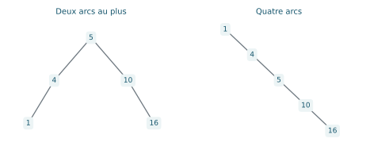
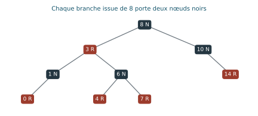
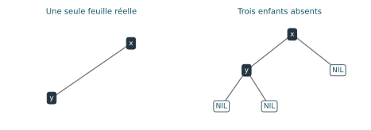
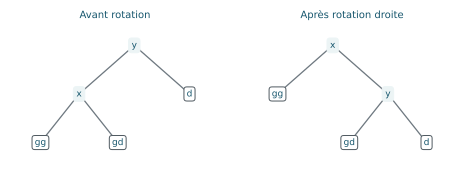
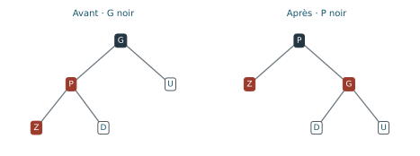
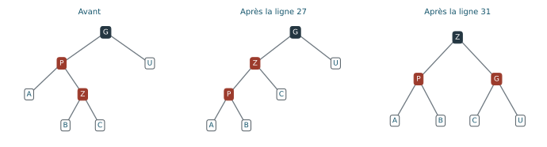
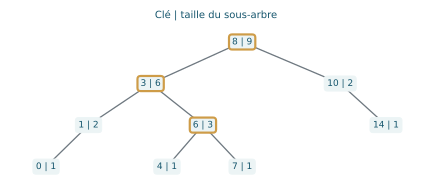
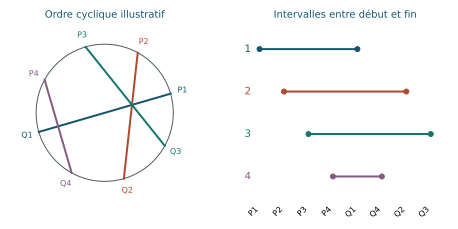

# ENS de Lyon — Second concours · Informatique 2025 · Corrigé guidé

*Corrigé rédigé par IA, non officiel.*

**Rédaction** · modèle exact non renseigné (famille GPT-6) · effort non renseigné · vitesse non renseignée

**Révision** · GPT-6.2 Astra Ultra · vitesse non renseignée · 26 novembre 2026

## Présentation du sujet

Une recherche dans un arbre de hauteur h peut demander h + 1 comparaisons. Les arbres rouge-noir contrôlent cette hauteur, puis un entier ajouté à chaque nœud permet de sélectionner une clé par son rang et de compter les intersections de cordes sur un cercle.

## I — Arbres binaires de recherche

La hauteur compte les arcs. Les trois liens d’un nœud indiquent son fils gauche, son fils droit et son parent.

### Question 1

> [!INDICATION]
> La hauteur compte les arcs. Pour obtenir la hauteur maximale, placer toutes les clés sur une même branche.

#### Solution

Pour la hauteur 2, choisir 5 comme racine, avec 4 à gauche et 10 à droite. Placer 1 sous 4 à gauche et 16 sous 10 à droite. Toute feuille est à deux arcs de la racine. Pour la hauteur 4, prendre la chaîne de fils droits $1,4,5,10,16$. Les parcours infixes donnent dans les deux cas $1,4,5,10,16$, ce qui vérifie l'ordre des clés.



### Question 2

> [!INDICATION]
> Suivre les appels pendant la descente récursive, avant le premier retour.

#### Solution

Pour tout entier $n>0$, les arguments successifs $n,n-1,\dots,1$ déclenchent chacun un appel à `creerNoeud`. L'appel d'argument 0 s'arrête auparavant. Le total vaut donc $\max(n,0)$, y compris pour les arguments négatifs. Le code imprimé effectue bien tous ces appels, puis échoue à la ligne 8 quand $n=1$ et que `A.g` vaut `None`. Pour obtenir le peigne annoncé, on écrit à cette ligne `if A.g is not None: A.g.p = A`.

### Question 3

> [!INDICATION]
> Comparer la clé cherchée à la clé courante et éliminer le sous-arbre où elle ne peut se trouver.

#### Solution

L'ordre strict de l'ABR impose d'aller à gauche quand $k<x.k$. Cette inégalité rectifie le sens indiqué dans la phrase précédant la question.

```python
def appartient(A, k):
    x = A
    while x is not None:
        if k == x.k:
            return True
        if k < x.k:
            x = x.g
        else:
            x = x.d
    return False
```

À chaque tour, toute occurrence possible reste dans le sous-arbre de racine $x$. Une égalité certifie la présence, un sous-arbre vide certifie l'absence.

### Question 4

> [!INDICATION]
> Compter le nombre de nœuds visités le long d'une recherche qui atteint la profondeur maximale.

#### Solution

Chaque comparaison coûte un temps constant et détermine un unique fils. On visite au plus $h+1$ nœuds réels. Chercher une clé à profondeur $h$ atteint cette borne. Le pire cas vaut $\Theta(h+1)$, soit $\Theta(h)$ lorsque $h$ croît. Le test sur l'arbre vide coûte un temps constant.

### Question 5

> [!INDICATION]
> Un ABR ordinaire peut prendre la forme d'une chaîne.

#### Solution

Pour $n\geq 1$, la hauteur est au plus $n-1$. Dans un peigne à $n$ nœuds, chercher la clé de la dernière feuille nécessite $n$ visites. La complexité pire cas est donc $\Theta(n)$.

### Question 6

> [!INDICATION]
> Conserver le dernier nœud visité afin de pouvoir renseigner les deux sens du lien.

#### Solution

On traite le doublon comme une absence de modification, conformément à l'ordre strict. Le constructeur initialise les trois pointeurs à `None`.

```python
def ajouter(A, k):
    parent, x = None, A
    while x is not None:
        if k == x.k:
            return A
        parent = x
        if k < x.k:
            x = x.g
        else:
            x = x.d
    z = creerNoeud(k)
    z.p = parent
    if parent is None:
        return z
    if k < parent.k:
        parent.g = z
    else:
        parent.d = z
    return A
```

Les comparaisons successives fixent les bornes de la nouvelle clé. Le premier fils absent est donc un emplacement admissible. L'algorithme appelle le constructeur exactement une fois pour une clé nouvelle et zéro fois pour une clé présente.

## II — Couleurs et hauteur logarithmique

L’exemple de la figure 3 satisfait les contraintes usuelles. Les questions 8 et 9 demandent de préciser le traitement des liens absents pour obtenir les bornes annoncées.

### Question 7

> [!INDICATION]
> Lire d'abord le parcours infixe, puis compter les nœuds noirs sur les chemins terminaux.

#### Solution

Le parcours infixe donne $0,1,3,4,6,7,8,10,14$, strictement croissant. La racine 8 est noire. Les nœuds rouges sont 3, 0, 4, 7 et 14. Les enfants de 3, soit 1 et 6, sont noirs et les quatre autres nœuds rouges sont des feuilles. Chaque chemin de la racine à une feuille réelle contient deux nœuds noirs, 8 puis l'un de 1, 6 et 10. Cela vaut aussi jusqu'à chaque enfant absent. En retirant un même préfixe de chemin, on obtient l'égalité du nombre de nœuds noirs depuis chaque nœud.



### Question 8

> [!INDICATION]
> Tester d'abord la définition sur une chaîne noire. Pour établir la borne attendue, ajouter une feuille externe à chaque pointeur absent.

> [!INDICATION]
> Que se passe-t-il dans un arbre où la racine noire n’a qu’un enfant noir ?

#### Solution

Au sens littéral de la définition imprimée, une feuille est un nœud réel sans enfant. Une chaîne de deux nœuds noirs satisfait alors les trois contraintes, car il n'y a qu'une branche par nœud. À sa racine $b=bh(x)=2$, mais elle n'a que 2 nœuds, contre $2^2-1=3$ demandés.

Pour le résultat usuel, on impose l'égalité des nombres de nœuds noirs jusqu'à **tous les enfants absents** (feuilles externes NIL). On compte les nœuds noirs réels, $x$ compris s'il est noir, et on pose $bh(\mathrm{NIL})=0$. Un arbre réduit à une racine noire a ainsi la hauteur noire 1 indiquée par l'énoncé.

Procédons par récurrence forte sur la hauteur. L'arbre vide a zéro nœud et vérifie la borne. Pour un nœud réel $x$, notons $c=1$ s'il est noir, $c=0$ s'il est rouge. Les deux enfants, réels ou externes, ont même hauteur noire $b-c$. L'hypothèse donne pour chaque sous-arbre au moins $2^{b-c}-1$ nœuds. Ainsi
$$ n(x)\geq 1+2(2^{b-c}-1)=2^{b-c+1}-1\geq 2^b-1. $$
Cette récurrence inclut les nœuds à zéro ou un enfant réel.



### Question 9

> [!INDICATION]
> Combiner la borne de taille avec l'absence de deux nœuds rouges consécutifs.

#### Solution

Avec les feuilles externes de la question 8, $b=bh(\text{racine})\leq\log_2(n+1)$. Sur une branche partant d'une racine noire, chaque nœud rouge a un prédécesseur noir distinct. Les $h+1$ nœuds réels d'une plus longue branche contiennent donc au plus $b$ rouges et exactement $b$ noirs. Pour $n\geq1$,
$$ h+1\leq2b\leq2\log_2(n+1), $$
ce qui entraîne la borne demandée. Avec les seules feuilles réelles de la définition imprimée, une chaîne de 8 nœuds noirs, de hauteur 7, contredit $h\leq2\log_2(9)\simeq6{,}34$.

### Question 10

> [!INDICATION]
> Distinguer la couleur du premier nœud afin de compter aussi le premier rouge éventuel.

#### Solution

Toutes les branches issues de $x$ ont le même nombre $b$ de noirs. Si $x$ est noir, une branche contient au moins $b$ nœuds et au plus $2b$, car deux rouges ne se suivent pas. Si $x$ est rouge, une branche contient au moins $b+1$ nœuds et au plus $2b+1$. Dans les deux cas, la longueur maximale en **nombre de nœuds** est au plus le double de la longueur minimale. Cette question vaut également avec les seules feuilles réelles.

## III — Rotations et insertion

Une rotation conserve l’ordre des clés en transférant le sous-arbre du milieu. Les mêmes rotations permettent de réparer localement deux nœuds rouges adjacents.

### Question 11

> [!INDICATION]
> Raccorder successivement le sous-arbre médian, le parent extérieur et le nouveau fils droit.

#### Solution

Le fils gauche $x$ de $y$ existe. Le sous-arbre initialement placé à droite de $x$ contient exactement les clés situées entre $x.k$ et $y.k$ dans cet arbre local.

```python
def rotationDroite(y):
    x = y.g
    parent = y.p
    y.g = x.d
    if y.g is not None:
        y.g.p = y
    x.p = parent
    if parent is not None:
        if parent.g is y:
            parent.g = x
        else:
            parent.d = x
    x.d = y
    y.p = x
    return x
```

Les objets et leur ordre infixe sont conservés. Si $y$ était la racine globale, l'appelant récupère la nouvelle racine en affectant la valeur renvoyée.



### Question 12

> [!INDICATION]
> La rotation a-t-elle besoin de parcourir le sous-arbre transféré ?

#### Solution

Une rotation lit ou modifie un nombre borné de pointeurs, quelles que soient la taille et la hauteur des sous-arbres. Son coût temporel est $\Theta(1)$ et elle emploie $O(1)$ d'espace auxiliaire.

### Question 13

> [!INDICATION]
> Chercher une même forme canonique accessible depuis n'importe quel ABR portant ces clés.

> [!INDICATION]
> Une rotation droite en un nœud de l’épine droite allonge cette épine.

#### Solution

Considérons l'épine droite, formée de la racine et des fils droits successifs. S'il reste un nœud hors de cette épine, un nœud $y$ de l'épine a un fils gauche $x$. Effectuons une rotation droite en $y$. L'épine passe maintenant par $x$ puis $y$ et conserve tous ses anciens nœuds. Elle gagne donc exactement un nœud. Après au plus $n-1$ rotations, l'arbre est une chaîne de fils droits, nécessairement étiquetée par les clés croissantes.

Appliquer la construction à $A$ et à $A'$ donne la même chaîne. On suit la première suite, puis on inverse la seconde en remplaçant chaque rotation droite par la rotation gauche inverse. On obtient $A'$ à partir de $A$. Le cas vide est immédiat.

### Question 14

> [!INDICATION]
> Pour atteindre la ligne 14, deux retours anticipés doivent déjà avoir été écartés.

#### Solution

On a $z\ne A$, donc $p=z.p$ existe. Le test de la ligne 11 a échoué, donc $p$ est rouge. La racine était noire avant l'insertion. Durant la correction, la seule possibilité de racine rouge est la recoloration d'un grand-parent qui devient aussitôt le nouveau $z$, traité dès la ligne 7. À la ligne 14, $p$ ne peut donc pas être la racine. Son parent $gp$ existe.

### Question 15

> [!INDICATION]
> Une fois le parent recoloré, faire monter ce parent par la rotation.

#### Solution

Notons $G=gp$, $P=p$, $Z=z$, $D=gd$ et $U=y$ l'oncle noir ou absent. Initialement $G$ est noir, son fils gauche $P$ et le fils gauche $Z$ de $P$ sont rouges. Les lignes 29 et 30 peignent $P$ en noir et $G$ en rouge. La rotation droite en $G$ place $P$ en tête, avec $Z$ rouge à gauche et $G$ rouge à droite. Les enfants de $G$ sont $D$ à gauche et $U$ à droite. Le sous-arbre garde sa place auprès du parent extérieur.



### Question 16

> [!INDICATION]
> Conserver des noms fixes pour les objets, car la ligne 26 déplace la variable z.

> [!INDICATION]
> Le nœud désigné par z après la ligne 26 était le parent lors de l’entrée dans ce cas.

#### Solution

Écrivons $G=gp$, $P=p$ et $Z$ pour l'objet désigné initialement par $z$. Les trois sous-arbres $A,B,C$ désignent respectivement `gg`, `gd`, `d` du dessin, et $U$ l'oncle noir ou absent. Initialement $P$ a pour fils $A,Z$ et $Z$ pour fils $B,C$.

Après la ligne 27, $G$ noir a pour fils $Z$ rouge et $U$. Les fils de $Z$ sont $P$ rouge et $C$, ceux de $P$ sont $A,B$. La variable $z$ désigne maintenant **l'ancien parent $P$**. Les lignes 29 et 30 peignent alors $Z$ en noir et $G$ en rouge. Après la rotation droite en $G$, $Z$ est en tête, avec les deux enfants rouges $P$ et $G$. On trouve $A,B$ sous $P$, puis $C,U$ sous $G$.



### Question 17

> [!INDICATION]
> Lire « fils gauche » pour l'objet actuellement désigné par la variable.

#### Solution

Si $z$ était fils gauche à la ligne 25, aucune instruction n'a modifié cette relation. Sinon, les lignes 26 et 27 donnent à $z$ la valeur de l'ancien parent et transforment ce dernier en fils gauche de son ancien fils droit, comme en question 16. La ligne 29 travaille donc toujours avec un fils gauche dans la moitié écrite du code. Dans la moitié symétrique, il s'agit d'un fils droit.

### Question 18

> [!INDICATION]
> Isoler la seule branche qui peut relancer la fonction.

#### Solution

Le cas de l'oncle rouge effectue uniquement des recolorations, puis remonte. Le cas de l'oncle noir ou absent effectue une rotation pour une configuration alignée, deux pour une configuration en coude, puis retourne immédiatement. Les retours par la racine ou un parent noir n'en effectuent aucune. Le maximum sur toute une insertion est donc **deux rotations**.

### Question 19

> [!INDICATION]
> Prendre la profondeur du nœud courant comme entier variant.

#### Solution

Le seul appel récursif vient de la ligne 23, qu'il faut lire `return correction(A, gp)` pour respecter la signature à deux arguments. Dans cette branche, aucune rotation n'a eu lieu. Le grand-parent a une profondeur strictement moindre, diminuée de 2. Cette profondeur entière était positive ou nulle et ne peut décroître indéfiniment. Les autres branches terminent après un nombre borné d'instructions.

### Question 20

> [!INDICATION]
> Suivre séparément l'ordre, l'égalité des hauteurs noires et le seul défaut rouge autorisé.

> [!INDICATION]
> Pour vérifier la recoloration, compter les nœuds noirs sur tout chemin vers les sous-arbres qui entourent la rotation.

#### Solution

Adoptons la convention NIL de la question 8. À l'entrée de chaque appel, l'ordre de l'ABR, les liens parentaux et l'égalité des hauteurs noires sont satisfaits. Le nœud $z$ est rouge. La seule violation possible est une racine rouge si $z=A$, ou une arête rouge-rouge reliant $z$ à son parent. L'insertion ordinaire d'une feuille rouge établit cette propriété, car elle ne change le nombre de noirs sur aucun chemin.

Si $z=A$, le peindre en noir donne une racine noire et ajoute un noir sur tous les chemins issus de la racine. Si le parent de $z$ est noir, toutes les propriétés sont déjà vérifiées.

Si le parent $P$ et l'oncle $U$ sont rouges, leur parent $G$ est noir. Repeindre $P,U$ en noir et $G$ en rouge conserve sur chaque chemin traversant $G$ l'unité de noir qui y était apportée par $G$. Les enfants de $G$ sont désormais noirs. L'unique défaut possible remonte à $G$, pris comme nouveau $z$. L'invariant est conservé.

Si l'oncle est noir ou absent, les rotations des questions 15 et 16 préservent le parcours infixe et les pointeurs. Dans le cas aligné, le noir initial de $G$ se retrouve sur $P$, nouvelle racine locale. Dans le cas en coude, il se retrouve sur $Z$, nouvelle racine locale. Chaque chemin vers un sous-arbre périphérique conserve ainsi exactement un noir parmi les trois nœuds centraux. Les racines de ces sous-arbres sont noires ou absentes, car elles étaient les enfants d'un nœud rouge ou formaient l'oncle noir. Pour vérifier l’égalité des hauteurs noires aussi **à l’intérieur** du sous-arbre transformé, observons qu’avant l’opération chaque chemin de $G$ vers une racine périphérique traverse exactement un noir parmi $G,P,Z$. Les quatre sous-arbres périphériques ont donc la même hauteur noire, en comptant zéro pour un NIL. Ils sont redistribués sous les deux fils rouges de la nouvelle racine locale. Chaque fils a ainsi deux sous-arbres de même hauteur noire et la nouvelle racine conserve la hauteur noire de $G$. Les deux nouveaux nœuds rouges ont donc des enfants admissibles, et une racine locale noire se rattache à l'extérieur sans conflit. Le cas miroir échange la gauche et la droite. Avec la terminaison de la question 19, ces cas prouvent la correction.

### Question 21

> [!INDICATION]
> Distinguer la descente d'insertion et la remontée éventuelle de recoloration.

#### Solution

Pour un arbre rouge-noir usuel, la recherche de la place coûte $O(\log(n+1))$ par la question 9. La correction remonte d'au moins deux niveaux par appel récursif, travaille en temps constant par niveau et effectue au plus deux rotations. Le pire cas est $\Theta(\log n)$ pour $n$ grand, car dans un arbre parfait une nouvelle clé plus grande que toutes les autres descend jusqu'à la profondeur $\Theta(\log n)$.

### Question 22

> [!INDICATION]
> Le tableau peut contenir plusieurs éléments égaux, alors que les clés de l'ABR doivent rester distinctes.

#### Solution

On emploie comme clé le couple (valeur, indice initial), ordonné lexicographiquement. L'indice départage les égalités. Dans le pseudo-code, `insererRN` est l'insertion rouge-noir de la partie 2.3. Le parcours infixe remplit une seule liste de sortie.

```python
def trier(T):
    A = None
    for i, valeur in enumerate(T):
        A = insererRN(A, (valeur, i))
    sortie = []
    def infixe(x):
        if x is not None:
            infixe(x.g)
            sortie.append(x.k[0])
            infixe(x.d)
    infixe(A)
    return sortie
```

Chaque indice apparaît une seule fois, donc toutes les occurrences du tableau se retrouvent dans la sortie. Le parcours les énumère par valeur croissante, avec conservation de l'ordre des ex æquo. Les insertions coûtent $O(n\log n)$ au total, le parcours $\Theta(n)$ et l'espace total $O(n)$.

## IV — Rangs et intersections de cordes

Chaque taille de sous-arbre se lit en temps constant. Lors du balayage d’un cercle, une seule requête de rang peut alors compter plusieurs croisements.

### Question 23

> [!INDICATION]
> À chaque nœud, comparer le rang demandé au nombre de clés qui le précèdent dans son propre sous-arbre.

#### Solution

Dans le sous-arbre de racine $x$, le rang local de $x.k$ vaut $\mathrm{taille}(x.g)+1$. À droite de $x$, on soustrait cette quantité au rang recherché. Les rangs commencent à 1.

```python
def taille(x):
    return 0 if x is None else x.taille

def donnerieme(A, i):
    if not 1 <= i <= taille(A):
        raise IndexError(i)
    x = A
    while x is not None:
        pivot = taille(x.g) + 1
        if i == pivot:
            return x.k
        if i < pivot:
            x = x.g
        else:
            i -= pivot
            x = x.d
```

La précondition testée assure qu'à chaque tour le rang recherché appartient au sous-arbre courant. Pour $i=5$ dans la figure 6, la recherche passe par 8, 3 et 6, et retourne 6.



### Question 24

> [!INDICATION]
> Garder le nombre de clés plus petites déjà écartées.

#### Solution

Le compteur vaut au début le nombre de clés strictement plus petites que $k$ écartées dans les sous-arbres précédents. Lors d'une descente à droite, on écarte le nœud courant et tout son sous-arbre gauche.

```python
def rang(A, k):
    avant, x = 0, A
    while x is not None:
        if k < x.k:
            x = x.g
        elif k > x.k:
            avant += taille(x.g) + 1
            x = x.d
        else:
            return avant + taille(x.g) + 1
    raise KeyError(k)
```

La dernière ligne traite le cas hors de l'hypothèse de la question. Sur l'exemple, on compte trois clés en quittant 3 vers la droite, puis deux unités à 6 (la clé 4 et 6 lui-même). Le rang de 6 vaut 5.

### Question 25

> [!INDICATION]
> Les tailles sont enregistrées dans les nœuds et donc disponibles en temps constant.

#### Solution

Chacun des deux algorithmes visite au plus un nœud à chaque profondeur et effectue $O(1)$ opérations à chaque visite. La hauteur d'un arbre rouge-noir usuel étant $O(\log(n+1))$, leur temps pire cas est $O(\log(n+1))$, atteint à l'ordre près sur un arbre parfait. Les deux versions itératives utilisent $O(1)$ d'espace de travail.

### Question 26

> [!INDICATION]
> Lorsqu'une corde se ferme, compter les cordes encore ouvertes dont le début est postérieur au sien.

> [!INDICATION]
> Soustraire un rang à la taille totale donne le nombre de clés strictement supérieures.

#### Solution

Balayons les $2n$ extrémités par angle croissant. L'arbre de rang $A$ contient les angles de début des cordes déjà ouvertes et encore sans extrémité de fin rencontrée. La routine de tri ci-dessous effectue le tri angulaire de la figure 8.

```python
def nbcroisements(P, Q):
    extremites = sorted(P + Q, key=lambda point: point.angle)
    A = None
    total = 0
    for point in extremites:
        if point.type == "debut":
            A = inserer(A, point.angle)
        else:
            debut = point.angleDebut
            total += taille(A) - rang(A, debut)
            A = supprimer(A, debut)
    return total
```

Deux cordes d'un cercle se coupent à l'intérieur exactement lorsque leurs extrémités alternent en parcourant le cercle. En effet, une corde partage le disque en deux parties, et l'autre la traverse si ses extrémités appartiennent aux deux arcs ouverts opposés. À la fin $q_i$ de la première corde à fermer, les croisements avec les cordes actives correspondent exactement aux cas $p_i<p_j<q_i<q_j$. Les clés strictement supérieures à $p_i$ sont au nombre de $\mathrm{taille}(A)-\mathrm{rang}(A,p_i)$, calculé **avant** la suppression. Chaque paire qui se croise est comptée une fois à la première des deux fermetures. Les hypothèses excluent les égalités d'angles.

Avec les extrémités dans l’ordre $P_1,P_2,Q_1,Q_2$, la fermeture en $Q_1$ trouve un début actif postérieur à $P_1$ et ajoute un croisement. Dans l’ordre emboîté $P_1,P_2,Q_2,Q_1$, la première fermeture ne trouve aucun début postérieur à $P_2$, puis il ne reste que $P_1$. Le comptage ajoute zéro dans ce cas.

Dans l’ordre cyclique du schéma ci-dessous, les quatre débuts sont déjà passés au moment de fermer la corde 1. Le rang dépend de l’ensemble encore actif à chaque fermeture.

| Fin | Débuts actifs dans l’ordre | Rang du début retiré | Croisements ajoutés |
| --- | --- | ---: | ---: |
| $Q_1$ | $P_1,P_2,P_3,P_4$ | 1 | $4-1=3$ |
| $Q_4$ | $P_2,P_3,P_4$ | 3 | $3-3=0$ |
| $Q_2$ | $P_2,P_3$ | 1 | $2-1=1$ |
| $Q_3$ | $P_3$ | 1 | $1-1=0$ |

Les quatre contributions totalisent les quatre croisements du dessin.



### Question 27

> [!INDICATION]
> Compter le coût du tri initial et le nombre d'opérations sur l'arbre lors de chaque événement.

#### Solution

Trier les $2n$ extrémités coûte $O(n\log n)$. Il y a $n$ insertions, $n$ recherches de rang et $n$ suppressions, chacune en $O(\log(n+1))$, avec une lecture de taille constante à chaque fermeture. La somme vaut donc $O(n\log n)$ pour $n\geq2$. L'espace utilisé par la liste et l'arbre est $O(n)$. Même si de l'ordre de $n^2$ paires se croisent, un calcul de rang cumule en un seul passage tous les croisements découverts à cette fermeture.

## Bilan

Un ABR peut dégénérer en chaîne. Avec l’égalité des hauteurs noires jusqu’aux enfants absents, la recherche et l’insertion deviennent logarithmiques. La sélection et le rang héritent de cette borne lorsque les tailles sont mémorisées. Le balayage des 2n extrémités fournit alors le nombre de paires de cordes sécantes en temps O(n log n).
