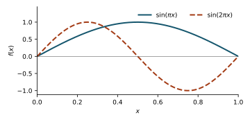
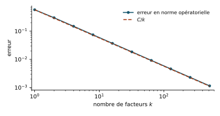
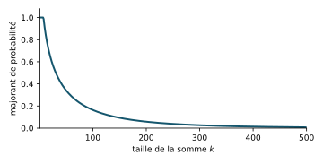

# ENS de Lyon, second concours — Mathématiques 2025 · Corrigé brut

*Corrigé rédigé par IA, non officiel. Signalez toute erreur.*

**Rédaction** · GPT-6.2 Astra Ultra · vitesse non renseignée · 24 novembre 2026

**Révision** · GPT-6.2 Astra Ultra · vitesse non renseignée · 26 novembre 2026

## Exercice — Une inégalité de Poincaré

### Question 1

Lorsque $u\to0^+$, $\sin u\sim u$ et $\cos u\to1$, donc $\cot u\sim1/u$. Lorsque $u\to\pi^-$, en posant $v=\pi-u$, on a $\cot u=-\cot v\sim-1/(\pi-u)$. Le signe à l’extrémité droite est négatif.

### Question 2a

La dérivabilité et les valeurs au bord donnent $f(x)=xf'(0)+o(x)$ en zéro et $f(x)=(x-1)f'(1)+o(1-x)$ en un. Avec la question 1, $f(x)\cot(\pi x)$ tend donc vers $f'(0)/\pi$ et $f'(1)/\pi$ aux deux bords. Comme $f'$ est continue sur $[0,1]$, l’intégrande $f f'\cot(\pi x)$ se prolonge continûment aux extrémités. L’intégrale $I$ converge absolument.

### Question 2b

Pour $0<a<b<1$, intégrons $(f^2)'\cot(\pi x)$ par parties. On obtient
$$\int_a^b 2ff'\cot(\pi x)\,dx
=\big[f^2\cot(\pi x)\big]_a^b
 +\pi\int_a^b f^2\big(1+\cot^2(\pi x)\big)\,dx.$$
Les termes de bord tendent vers zéro, car $f\to0$ et $f\cot(\pi x)$ a une limite finie en chaque extrémité. L’intégrande de droite est la somme de $f^2$ et de $(f\cot(\pi x))^2$, tous deux prolongeables. On peut donc faire tendre $a$ vers zéro et $b$ vers un. On retrouve l’égalité demandée pour $2I$.

### Question 2c

En zéro, $f'(x)-\pi f(x)\cot(\pi x)\to f'(0)-f'(0)=0$. En un, la même différence tend vers $f'(1)-f'(1)=0$. Elle se prolonge donc continûment par zéro aux deux bords. Son carré est intégrable et $J$ est bien défini.

### Question 2d

En développant puis en remplaçant $2I$, il vient
$$J=\int_0^1(f')^2-2\pi I+\pi^2\int_0^1 f^2\cot^2(\pi x)
=\int_0^1(f')^2-\pi^2\int_0^1f^2.$$
Les intégrales sans différentiel écrit sont prises par rapport à $x$. Puisque $J\ge0$, on a $\int_0^1 f^2\,dx\le\pi^{-2}\int_0^1(f')^2\,dx$.

### Question 3

Sur $]0,1[$,
$$\left(\frac{y}{\sin(\pi x)}\right)'=\frac{y'-\pi y\cot(\pi x)}{\sin(\pi x)}.$$
Cette dérivée s’annule exactement pour les solutions cherchées. L’intervalle est connexe, donc $y(x)=C\sin(\pi x)$ avec $C\in\mathbb R$. La constante nulle redonne bien la solution nulle.

### Question 4

L’égalité équivaut à $J=0$. L’intégrande est continu et positif ou nul sur l’intervalle, donc il s’annule en chaque point. La question 3 donne $f(x)=C\sin(\pi x)$ sur $]0,1[$, et la continuité prolonge cette formule aux deux extrémités. Réciproquement chacune de ces fonctions appartient à $E$ et donne $J=0$. Pour $C\ne0$, l’intégrale de $(f')^2$ est strictement positive. Ces cas d’égalité montrent aussi que la constante $1/\pi^2$ est optimale.

Pour $f(x)=\sin(2\pi x)$, les deux énergies sont $\int_0^1 f^2=1/2$ et $\int_0^1(f^{\prime})^2=2\pi^2$. La différence $J$ vaut donc $3\pi^2/2$, ce qui quantifie l’écart illustré sur la figure.

## Problème, partie I — Formule de Lie

### Question 1

Chaque terme se décompose en $M^{i+1}N^{k-1-i}-M^iN^{k-i}$. Dans la somme pour $0\le i<k$, le terme positif d’indice $i$ annule le terme négatif d’indice $i+1$. Il reste $M^k-N^k$. L’ordre des facteurs est le même dans chaque annulation, donc aucune hypothèse de commutation n’est nécessaire.

### Question 2

La seule hypothèse imprimée est la sous-multiplicativité. Elle ne suffit pas à établir l’inégalité demandée. Par exemple $\|M\|=2\|M\|_{\rm op}$ est une norme sous-multiplicative et, pour $M=0$, on aurait $2=\|I_n\|\le e^0=1$.

Pour toute norme sous-multiplicative, la somme de la série donne en fait
$$\|e^M\|\le\|I_n\|+\sum_{j\ge1}\frac{\|M\|^j}{j!}=\|I_n\|+e^{\|M\|}-1.$$
Si l’on prend une norme normalisée par $\|I_n\|=1$, par exemple une norme d’opérateur subordonnée, cela prouve bien $\|e^M\|\le e^{\|M\|}$. Pour la suite, on dispose sous la seule hypothèse du sujet des deux estimations
$$\|e^M Z\|\le e^{\|M\|}\|Z\|,\qquad \|Ze^M\|\le e^{\|M\|}\|Z\|.$$
En effet, le terme constant appliqué à $Z$ est exactement $Z$, et les termes suivants sont majorés par $\|M\|^j\|Z\|/j!$.

### Question 3

Posons $M=e^{(A+B)/k}$, $N=e^{A/k}e^{B/k}$ et $L=\|A\|+\|B\|$. Grâce à I.2, multiplier à gauche par $M$ majore la norme d’un facteur par $e^{L/k}$. Multiplier à droite par $N$ donne le même facteur maximal, en appliquant les bornes successivement à $e^{A/k}$ puis $e^{B/k}$. On a donc
$$\|M^i(M-N)N^{k-1-i}\|\le e^{(k-1)L/k}\|M-N\|.$$
En sommant les $k$ termes de I.1 et en utilisant $M^k=e^{A+B}$, le résultat est même $k e^{(k-1)L/k}\|M-N\|\le k e^L\|M-N\|$. Cette preuve reste valable pour les normes non normalisées.

### Question 4

Pour une matrice fixée $C$, $e^{hC}=I+hC+h^2C^2/2+O(h^3)$ en norme, par majoration de la queue de série. La multiplication des développements au voisinage de $h=0$ donne
$$e^{h(A+B)}-e^{hA}e^{hB}=\frac{h^2}{2}(BA-AB)+O(h^3).$$
En prenant $h=1/k$, la norme de cette différence est donc $O(1/k^2)$. Les constantes peuvent dépendre de $A,B$ et de la norme fixée.

### Question 5

La question 3 majore l’erreur sur $k$ facteurs par $k e^L$ fois l’erreur locale $O(k^{-2})$. L’erreur totale est $O(k^{-1})$, donc
$$\lim_{k\to\infty}(e^{A/k}e^{B/k})^k=e^{A+B}.$$
Pour la figure, $A=\left(\begin{smallmatrix}0&1\\0&0\end{smallmatrix}\right)$ et $B=A^T$, qui ne commutent pas. Comme $A^2=B^2=0$, les deux petites exponentielles sont exactement $I+A/k$ et $I+B/k$.

## Problème, partie II — Inégalité de Golden–Thompson

### Question 1

La trace vaut $\sum_{i,j} A_{ij}B_{ji}$. L’inégalité de Cauchy–Schwarz dans $\mathbb R^{n^2}$ donne
$$|\operatorname{tr}(AB)|\le\left(\sum_{i,j}A_{ij}^2\right)^{1/2}\left(\sum_{i,j}B_{ji}^2\right)^{1/2}
=\sqrt{\operatorname{tr}(AA^T)}\sqrt{\operatorname{tr}(BB^T)}.$$

### Question 2

Pour $p=2$, c’est II.1. Supposons la formule vraie pour $q=2^k\ge2$ et posons $p=2q$. Introduisons d’abord deux matrices $U,V$ et $C=UV$. Par cyclicité de la trace,
$$\operatorname{tr}((CC^T)^{q/2})=\operatorname{tr}\big((U^TU\,VV^T)^{q/2}\big).$$
Le produit de droite comporte $q$ facteurs alternant entre les deux matrices symétriques positives $U^TU$ et $VV^T$. En lui appliquant l’hypothèse d’ordre $q$, on trouve
$$\operatorname{tr}((CC^T)^{q/2})\le
\big[\operatorname{tr}((U^TU)^q)\operatorname{tr}((VV^T)^q)\big]^{1/2}.$$
En effet chacune des matrices apparaît $q/2$ fois et, pour une matrice symétrique $H$, $(HH^T)^{q/2}=H^q$. La première trace de droite vaut aussi $\operatorname{tr}((UU^T)^q)$, par cyclicité.

Posons maintenant $C_j=A_{2j-1}A_{2j}$ pour $1\le j\le q$. Appliquons l’hypothèse d’ordre $q$ à $\operatorname{tr}(C_1\cdots C_q)$ et la borne précédente à chaque $C_j$. Le facteur de la matrice $A_i$ devient $\operatorname{tr}((A_iA_i^T)^q)^{1/(2q)}$. Ainsi
$$|\operatorname{tr}(A_1\cdots A_p)|\le\prod_{i=1}^p\operatorname{tr}((A_iA_i^T)^{p/2})^{1/p},$$
ce qui achève la récurrence.

### Question 3a

Par II.2 appliquée à $A_i=AB$, où $A$ et $B$ sont symétriques,
$$|\operatorname{tr}((AB)^p)|\le\operatorname{tr}((AB^2A)^{p/2}).$$
En développant le produit de droite et en déplaçant la dernière matrice $A$ en tête sous la trace, on obtient exactement $\operatorname{tr}((A^2B^2)^{p/2})$. Le premier membre du majorant était la trace d’une puissance d’une matrice positive, donc ce nombre est positif ou nul.

### Question 3b

Appliquons II.3a d’abord à $A,B$ à l’exposant $p=2^k$, puis à $A^2,B^2$ à l’exposant $p/2$ si celui-ci est au moins deux, et ainsi de suite. Les matrices successives restent symétriques. À chaque passage la trace est au plus sa valeur absolue. À la dernière étape l’exposant vaut un. On obtient
$$\operatorname{tr}((AB)^p)\le\operatorname{tr}(A^pB^p).$$

### Question 4

Pour $p=2^k$, les matrices $U=e^{A/p}$ et $V=e^{B/p}$ sont symétriques. Par II.3b,
$$\operatorname{tr}\big((e^{A/p}e^{B/p})^p\big)\le\operatorname{tr}(e^Ae^B).$$
Le membre de gauche tend vers $\operatorname{tr}(e^{A+B})$ par I.5 et continuité de la trace. On obtient l’inégalité de Golden–Thompson pour toutes matrices symétriques réelles $A,B$.

## Problème, partie III — Concentration de la plus grande valeur propre

### Question 1

Dans une base orthonormée propre de $Y$, les valeurs propres de $e^{\theta Y}$ sont $e^{\theta\lambda_i(Y)}>0$. Pour $\theta>0$, $\lambda_{\max}(e^{\theta Y})=e^{\theta\lambda_{\max}(Y)}$, ce qui donne l’égalité exacte des événements. La plus grande de ces valeurs positives est au plus leur somme. Par Markov et linéarité,
$$\mathbb P(\lambda_{\max}(Y)\ge t)\le\mathbb P(\operatorname{tr}(e^{\theta Y})\ge e^{\theta t})
\le e^{-\theta t}\operatorname{tr}(\mathbb E[e^{\theta Y}]).$$
Le majorant vaut pour chaque $\theta>0$, donc aussi son infimum.

L’hypothèse imprimée au début de la partie III est que toutes les espérances utilisées sont finies. Elle autorise, en particulier, la somme des espérances des $n$ termes diagonaux dans $\operatorname{tr}(\mathbb E[e^{\theta Y}])$. Le raisonnement vaut aussi pour $t<0$, puisque le seuil $e^{\theta t}$ de l’inégalité de Markov reste strictement positif.

### Question 2

Pour tout $\theta\in\mathbb R$, II.4 donne
$$\operatorname{tr}(e^{\theta(X_1+X_2)})\le\operatorname{tr}(e^{\theta X_1}e^{\theta X_2}).$$
Les deux exponentielles sont indépendantes. En écrivant chaque coefficient du produit comme somme finie, on obtient $\mathbb E[e^{\theta X_1}e^{\theta X_2}]=M_{X_1}(\theta)M_{X_2}(\theta)$. L’espérance commute avec la trace, ce qui donne l’inégalité cherchée.

### Question 3a

Chaque $M_Z(\theta)$ est symétrique positive car $v^TM_Z(\theta)v=\mathbb E[v^Te^{\theta Z}v]\ge0$. Posons $C=M_{Y_{k-1}}(\theta)$ et $D=M_{X_k}(\theta)$, avec $Y_0=0$. Le passé $Y_{k-1}$ est indépendant de $X_k$, donc III.2 donne $\operatorname{tr}M_{Y_k}(\theta)\le\operatorname{tr}(CD)$.

Si $C,H$ sont positives, $\operatorname{tr}(CH)=\operatorname{tr}(C^{1/2}HC^{1/2})\ge0$, car la matrice sous cette dernière trace est positive. Prenons $H=\lambda_{\max}(D)I-D$. Il vient $\operatorname{tr}(CD)\le\lambda_{\max}(D)\operatorname{tr}(C)$, d’où la seconde inégalité.

### Question 3b

Posons $b=\lambda_{\max}(M_{X_1}(\theta))$. Toutes les $M_{X_k}(\theta)$ sont égales. En itérant III.3a et en utilisant $M_{Y_0}(\theta)=I_n$, on obtient $\operatorname{tr}(M_{Y_k}(\theta))\le n b^k$ pour tout $k\ge1$.

### Question 3c

Pour tout $t\in\mathbb R$ et tout $\theta>0$, III.1 et III.3b donnent
$$\mathbb P(\lambda_{\max}(Y_k)\ge t)\le n e^{-\theta t}\lambda_{\max}(M_{X_1}(\theta))^k.$$
Le membre de gauche ne dépend pas de $\theta$. On peut donc prendre l’infimum sur $\theta>0$.

### Question 4a

Dans la base orthonormée obtenue en normalisant $(1,1)$ et $(1,-1)$, les valeurs propres de $X_1$ sont $\varepsilon_1+\varepsilon_2$ et $\varepsilon_1-\varepsilon_2$. L’indépendance des deux signes donne dans les deux cas $\mathbb E[e^{\theta(\varepsilon_1\pm\varepsilon_2)}]=\cosh^2\theta$. Ainsi $M_{X_1}(\theta)=\cosh^2(\theta)I_2$.

Pour $\theta\ge0$, $\tanh\theta\le\theta$, car $(\tanh\theta)'\le1$ et $\tanh0=0$. En intégrant, $2\log\cosh\theta\le\theta^2$. La borne III.3c devient
$$\mathbb P(\lambda_{\max}(Y_k)\ge t)\le2\exp(-\theta t+k\theta^2).$$
Pour $t=k^{1/2+\varepsilon}$, choisissons $\theta=t/(2k)>0$. Il vient $\mathbb P(\lambda_{\max}(Y_k)\ge k^{1/2+\varepsilon})\le2e^{-k^{2\varepsilon}/4}$, ce qui prouve la majoration asymptotique demandée, avec un terme de reste nul.

### Question 4b

Pour $0<\varepsilon<1/2$, $k^{2\varepsilon}/\log k\to+\infty$. Ainsi, à partir d’un certain rang, $k^{2\varepsilon}/4\ge2\log k$ et la probabilité est au plus $2/k^2$. La série des probabilités converge par comparaison.

### Question 4c

Soit $E_k=\{\lambda_{\max}(Y_k)\ge k^{1/2+\varepsilon}\}$. Par III.4b, $\sum_k\mathbb P(E_k)<\infty$, donc $\mathbb P(\limsup_kE_k)=0$ par le premier lemme de Borel–Cantelli. Avec probabilité un, seuls un nombre fini de ces événements ont lieu. C’est exactement l’événement demandé.
