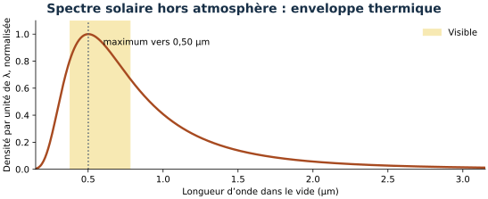
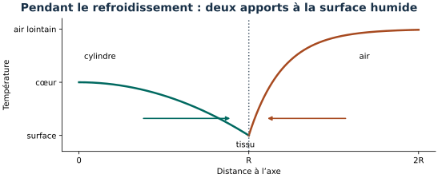
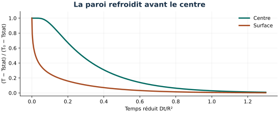
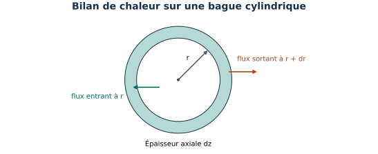
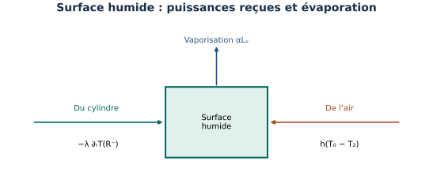
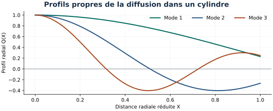

# ENS de Lyon, second concours universitaire — Physique 2025 · Corrigé brut

*Corrigé rédigé par IA, non officiel. Signalez toute erreur.*

**Rédaction** · modèle exact non renseigné (famille GPT-6) · effort non renseigné · vitesse non renseignée

**Révision** · modèle exact non renseigné (famille GPT-6) · effort non renseigné · vitesse non renseignée

**Révision (tour 2)** · GPT-6.2 Astra Ultra · vitesse non renseignée

**Révision (tour 3)** · GPT-6.2 Astra Ultra · vitesse non renseignée · 26 novembre 2026

[Sujet et figures officiels](https://banques-ecoles.fr/cms/wp-content/uploads/2025/07/25_2cc_sujet_phys.pdf) · [Rapport du jury de l’écrit](https://banques-ecoles.fr/cms/wp-content/uploads/2025/07/25_2cc_rap_ePhy.pdf)

## Partie A — Questionnaire de physique

### Question A1

Un corps plongé dans un fluide au repos reçoit de ce fluide une poussée opposée au poids du fluide déplacé, appliquée au centre de gravité du fluide déplacé. Dans un fluide homogène en pesanteur uniforme, celui-ci coïncide avec le centre géométrique du volume immergé.

### Question A2

Par unité de longueur d’onde, le spectre solaire hors atmosphère a pour enveloppe celle d’un corps noir proche de $5\,800\,\mathrm K$. Il culmine vers $0{,}50\,\mu\mathrm m$ dans le visible puis décroît vers l’infrarouge. Des raies d’absorption se superposent au spectre continu.

### Question A3

C’est la vitesse minimale initiale permettant à un corps, lancé depuis un point donné et soumis uniquement à la gravitation terrestre, d’atteindre l’infini avec une vitesse finale nulle. À la surface, $v_{\rm lib}=\sqrt{2GM_T/R_T}\simeq11{,}2\,\mathrm{km\,s^{-1}}$.

### Question A4

Les rayons restent proches de l’axe optique et font avec lui de petits angles. Les relations de l’optique paraxiale sont alors écrites au premier ordre.

### Question A5

$C=\varepsilon_0\varepsilon_r S/d$ pour deux armatures parallèles d’aire commune $S$, séparées d’une distance $d$ par un diélectrique homogène, en négligeant les effets de bord.

### Question A6

Pour un cisaillement simple $v_x(y)$ d’un fluide newtonien, $\tau_{xy}=\eta\,\partial v_x/\partial y$, où $\eta$ est la viscosité dynamique en $\mathrm{Pa\,s}$.

### Question A7

La cohérence spatiale mesure la corrélation de phase entre les champs reçus en deux points distincts à un même instant. Une phase relative stable permet de former des franges contrastées lorsque ces champs sont recombinés avec des intensités comparables.

### Question A8

Pour un système fermé, $\Delta S=S_{\rm éch}+S_{\rm créée}$ avec $S_{\rm créée}\ge0$, nulle pour une transformation réversible. Pour un système isolé, $\Delta S\ge0$.

### Question A9

L’accélération de Coriolis dans la composition des accélérations est $\mathbf a_C=2\boldsymbol\Omega\times\mathbf v_{\rm rel}$. La force d’inertie correspondante dans le repère tournant est $-m\mathbf a_C$.

### Question A10

Dans un conducteur parcouru par un courant et soumis à un champ magnétique transverse, la déviation des porteurs de charge engendre une tension transverse, appelée tension de Hall.

## Partie B — Principe de fonctionnement d’un réfrigérateur du désert

### Considérations préliminaires

#### Question B1

La vaporisation prélève l’enthalpie massique de vaporisation $L_V=h_{\rm vapeur}-h_{\rm liquide}>0$ par kilogramme d’eau évaporé. C’est ce prélèvement d’énergie au voisinage de la surface humide qui refroidit le cylindre.

#### Question B2

L’air échange de la chaleur sensible avec la surface humide par convection naturelle ou forcée. Lorsque la surface est plus froide, cet apport est dirigé de l’air vers le tissu. En même temps, de la vapeur d’eau est transférée du tissu à l’air et emporte l’enthalpie de vaporisation.

#### Question B3

Pendant le refroidissement, la température décroît du centre jusqu’au tissu et croît ensuite du tissu jusqu’à $T_0$ dans l’air. La température admet un minimum au tissu, avec une tangente horizontale sur l’axe par symétrie. Dans le cylindre, le flux diffusif va vers les $r$ croissants. Dans l’air, la chaleur sensible va en sens inverse vers le tissu. Les deux flux alimentent la vaporisation.

#### Question B4

Le centre part de $T_0$. Le refroidissement se fait d’abord sentir près de la paroi, de sorte que la température centrale varie très lentement au début. Elle décroît ensuite et tend vers un palier $T_{\rm stat}<T_0$, avec une pente qui tend vers zéro.

#### Question B5

Au voisinage d’une surface humide, l’air s’enrichit en vapeur. La ventilation renouvelle cette couche d’air et réduit l’épaisseur de la couche limite. L’air plus sec garde un écart de concentration avec la surface et le flux de vapeur augmente.

### Champ de température dans le cylindre

#### Question B6

Au sein du cylindre solide, le transfert thermique se fait par conduction. Le flux est radial par axisymétrie et invariance selon $z$.

#### Question B7

Le flux thermique spontané passe d’une région chaude vers une région froide, en sens opposé à $\nabla T$. La loi $\boldsymbol\varphi=-\lambda\nabla T$ exige donc $\lambda>0$ pour un conducteur thermique. Le taux local de création d’entropie vaut $\boldsymbol\varphi\cdot\nabla(1/T)=\lambda|\nabla T|^2/T^2\ge0$.

#### Question B8

En orientant $\varphi$ vers les $r$ croissants, la puissance qui entre à $r$ est $2\pi r\,dz\,\varphi(r,t)$. Celle qui sort à $r+dr$ est $2\pi(r+dr)\,dz\,\varphi(r+dr,t)$. Sans source volumique ni travail, l’accroissement d’énergie interne de la bague est la différence de ces puissances multipliée par $dt$ :
$$\rho c\,2\pi r\,dr\,dz\,\partial_tT\,dt=-2\pi dz\,\partial_r(r\varphi)\,dr\,dt,$$
soit $\rho c\,\partial_tT=-(1/r)\partial_r(r\varphi)$.

#### Question B9

Comme $\varphi=-\lambda\partial_rT$ et que $\lambda$ est uniforme et constante, le bilan donne
$$\partial_tT=D\,\frac1r\partial_r(r\partial_rT),\qquad D=\frac{\lambda}{\rho c}>0.$$
La diffusivité thermique $D$ s’exprime en $\mathrm{m^2\,s^{-1}}$.

#### Question B10

Il faut **une condition initiale** $T(r,0)=T_0$ et **deux conditions spatiales**. La régularité sur l’axe impose $\partial_rT(0,t)=0$. À $r=R$, un bilan entre le flux issu du cylindre, la chaleur reçue de l’air et la chaleur de vaporisation fixe la condition de surface.

#### Question B11

Suivons durant $dt$ une portion de tissu et la quantité d’eau qui s’en évapore. À pression fixée, le passage d’une masse $dm_V$ du liquide à la vapeur exige l’accroissement d’enthalpie $L_Vdm_V$. On néglige le stockage sensible dans le tissu mince. Les deux puissances algébriques reçues par la portion donnent
$$(\Phi_{0/2}+\Phi_{1/2})dt=L_Vdm_V.$$
Une écriture en système ouvert donne le même résultat, la différence d’enthalpie entre vapeur sortante et eau liquide étant $L_V$.

### Régime stationnaire

#### Question B12

En régime stationnaire, pour $0<r<R$, $\dfrac{d}{dr}\left(r\dfrac{dT}{dr}\right)=0$.

#### Question B13

Une première intégration donne $rT'(r)=A$. Une seconde donne $T(r)=A\ln(r/R)+B$, le rayon $R$ rendant l’argument du logarithme sans dimension.

#### Question B14

$\ln(r/R)$ diverge quand $r\to0$. La température au centre devant rester finie, **$A=0$**. Un terme logarithmique correspondrait à un flux permanent vers ou depuis une source linéique sur l’axe.

#### Question B15

À $r=R$, $T(R)=T_{2,\rm stat}$ en l’absence de résistance de contact. **$B=T_{2,\rm stat}$** et tout le cylindre est isotherme à $T_{\rm stat}=T_{2,\rm stat}$.

#### Question B16

Pour la portion de hauteur $a$, la surface d’échange est $S_a=2\pi Ra$. Le tissu reçoit de l’air $\Phi_{0/2}=hS_a(T_0-T_{\rm stat})>0$. Il reçoit du cylindre $\Phi_{1/2}=-\lambda S_a\partial_rT(R^-)=0$, car le cylindre est devenu isotherme.

#### Question B17

On a $dm_V=\alpha S_a\,dt$. Le bilan de la question 11 devient $hS_a(T_0-T_{\rm stat})=L_V\alpha S_a$, d’où
$$T_{\rm stat}=T_0-\frac{\alpha L_V}{h}.$$
La différence $\alpha L_V/h$ est en kelvins. L’aire et la hauteur $a$ disparaissent, puisque le débit évaporé et la puissance thermique reçue de l’air sont tous deux proportionnels à la même aire mouillée.

#### Question B18

$L_V=2{,}4\times10^6\,\mathrm{J\,kg^{-1}}$ donne $\alpha L_V=360\,\mathrm{W\,m^{-2}}$. L’écart stationnaire est **$\Delta T_{\rm stat}=360/30=12\,\mathrm K$**, soit une différence de $12\,{}^\circ\mathrm C$.

#### Question B19

La ventilation augmente généralement le taux d’évaporation $\alpha$ et le coefficient de convection thermique $h$. L’écart stationnaire est proportionnel à leur **rapport** $\alpha/h$. Les seules données ne permettent donc pas d’affirmer dans quel sens varie le palier. Si les transferts de chaleur et de masse augmentent dans des proportions comparables, le palier peut peu varier alors que le refroidissement s’accélère.

#### Question B20

L’écart dépend du produit $\alpha L_V$ rapporté à $h$. L’éther, plus volatil, peut avoir un débit d’évaporation beaucoup plus élevé que celui de l’eau. À $h$ identique, une augmentation de $\alpha$ d’un facteur supérieur à $6{,}7$ suffit à compenser sa plus faible chaleur latente et à donner un écart supérieur.

### Régime transitoire

#### Question B21

Avec $T-T_{\rm stat}=T^\star fg$, les dérivées en temps et en espace donnent $T^\star f g'=D T^\star g(r f')'/r$. Comme $f$ et $g$ sont non nulles, on en déduit $g'/g=D(rf')'/(rf)$.

#### Question B22

Pour tout $r,t$ intérieur, le terme de gauche dépend seulement de $t$ et celui de droite seulement de $r$. Leur valeur commune est une constante $-K$. Ainsi $g'+Kg=0$, $g(0)=1$ donnent $g(t)=e^{-Kt}$. Puisque ce mode doit s’effacer quand $t\to\infty$, $K>0$, de dimension $\mathrm{s^{-1}}$.

#### Question B23

L’échelle diffusive donne $K\sim D/R^2=\lambda/(\rho cR^2)$. Un calcul des modes du problème avec la condition en surface affine cette loi en $K=(D/R^2)\,\mu^2$, où $\mu$ est sans dimension et dépend notamment du nombre de Biot $hR/\lambda$. Le taux d’évaporation constant fixe le palier de température. En effet, après soustraction de $T_{\rm stat}$, le bilan de surface devient $-\lambda\partial_r(T-T_{\rm stat})=h(T-T_{\rm stat})$ en $R$.

#### Question B24

$D=0{,}6/(1000\times4200)=1{,}43\times10^{-7}\,\mathrm{m^2\,s^{-1}}$. En négligeant le facteur adimensionné, $1/K\sim R^2/D=7{,}0\times10^4\,\mathrm s\simeq19{,}4\,\mathrm h$. Le cœur d’un assemblage de dix centimètres de rayon se refroidit donc sur une échelle de plusieurs heures. Cette estimation donne une échelle diffusive, et non une durée exacte de mise au palier.

#### Question B25

La dépendance radiale vérifie $(rf')'+(K/D)rf=0$. Avec $X=r/R$ et $Q(X)=f(r)$, on obtient
$$Q''+\frac1XQ'+\frac{KR^2}{D}Q=0\quad(0<X\le1),\qquad Q(0)=1,\quad Q'(0)=0.$$
C’est l’équation de Bessel d’ordre zéro à argument $\sqrt{KR^2/D}\,X$. La condition de surface sélectionne les valeurs admissibles de $K$.

Le temps du mode le plus lent peut être calculé dans le cas du tissu sans stockage thermique. La solution régulière de l’équation de Bessel est $Q(X)=J_0(\mu X)$ avec $\mu^2=KR^2/D$. En $X=1$, la condition d’échange conduit à $\mu J_1(\mu)=\mathrm{Bi}\,J_0(\mu)$ où $\mathrm{Bi}=hR/\lambda$. Les données du sujet donnent $\mathrm{Bi}=5$. La plus petite racine positive est $\mu_1\simeq1{,}990$, d’où $1/K_1\simeq19{,}4/1{,}990^2\simeq4{,}9\ \mathrm h$. Les 19 h demandées à la question 24 représentent l’échelle diffusive brute. Le mode de 4,9 h décrit la pente de fin de refroidissement du modèle, quand les autres modes se sont amortis.

#### Question B26

À $t=0$, le champ initial est uniforme. L’identité $T_0-T_{\rm stat}=T^\star f(r)g(0)$ et les normalisations donnent $T^\star=T_0-T_{\rm stat}$ puis $f(r)=1$ partout. Or le membre radial de l’équation séparée est alors nul, donc $K=0$, incompatible avec une décroissance. Une **superposition de plusieurs modes** permet de reproduire le champ initial uniforme. En posant $X=r/R$, $\mathrm{Fo}=Dt/R^2$ et $\Theta=(T-T_{\rm stat})/(T_0-T_{\rm stat})$, on peut écrire la série $\Theta=\sum_n b_nJ_0(\mu_n X)e^{-\mu_n^2\mathrm{Fo}}$. Les poids se déduisent de la projection du profil initial $1$ sur chaque mode, avec le poids d’aire $X\,dX$ dans la section du cylindre. Les trois premiers valent environ $1{,}503$, $-0{,}797$ et $0{,}484$. Au temps initial, les modes suivants sont encore nécessaires. À temps long, seul le mode le plus lent contribue sensiblement.

