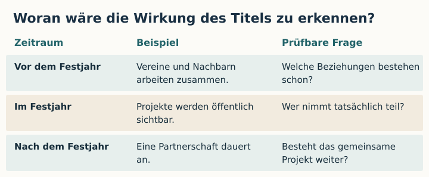
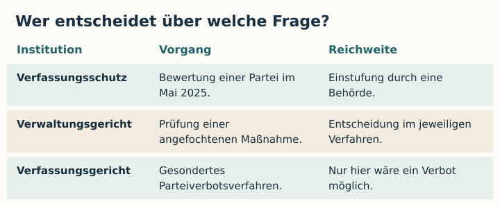

# ENS de Lyon · série SES (B/L) · Allemand (oral) 2025 — Corrigé guidé partiel

*Corrigé rédigé par IA, non officiel. Signalez toute erreur.*

**Rédaction** · GPT-6.2 Astra Ultra · vitesse non renseignée

Le fascicule de Lyon identifie 6 références de presse. Il donne les titres et les dates. Les feuillets remis aux candidats et leurs coupes ne sont pas reproduits. Les prises de parole s’appuient sur les témoins indiqués pour chaque entrée.

[Répertoire officiel](https://www.ens-lyon.fr/sites/default/files/2025-10/Fascicule%20SES%202025%20OK.pdf#page=9) · [Rapport du jury](https://www.ens-lyon.fr/sites/default/files/2025-11/Fascicule%20SES%202025%20relu%20EB%2B%20SLG.pdf#page=16)

Le jury souligne l’importance de la ligne éditoriale, du genre et du lexique. Six personnes se sont présentées. Le rapport évoque aussi des médias et des thèmes au-delà des six références imprimées dans le fascicule. Travaillez d’abord les six références identifiables. Présentez la source et dites à quel niveau vous vous situez. « Der Autor berichtet, dass… » attribue une information, « der Autor gibt zu bedenken, dass… » introduit une objection, « daraus würde ich schließen, dass… » ouvre votre propre interprétation.

## Deutschlandfunk Kultur · „Chemnitz strebt Imagewechsel an.“, Michael Köhler (19/01/2025)

Présentation et citation de la page de l’émission. La transcription continue et la coupe restent inconnues.

### Wer bestimmt das Bild einer Kulturhauptstadt?

Chemnitz ist 2025 Kulturhauptstadt Europas. Interessant an der Ankündigung von Deutschlandfunk Kultur ist das Verb *anstreben*. Die Stadt hat den Titel bereits erhalten. Ob sich dadurch ihr öffentliches Bild ändert, ist jedoch eine offene Frage. Das Motto *C the Unseen* macht aus dem Namen der Stadt eine Einladung zum Sehen. Es richtet sich an Außenstehende und wirft zugleich die Frage auf, welche Arbeit selbst für die Menschen vor Ort bisher wenig sichtbar war.

Auf der Seite kommt Stefan Schmidtke von der Kulturhauptstadtgesellschaft zu Wort. Er nennt die Zusammenarbeit mit den Nachbarländern Polen und Tschechien, Chöre und die freiwillige Feuerwehr. Was verbindet diese so verschiedenen Beispiele? In jedem Fall gibt es bereits Menschen, die etwas gemeinsam tun. Der Kulturtitel gibt ihren Beziehungen Öffentlichkeit. Damit verändert sich auch der Maßstab für den Erfolg des Jahres. Die Zahl der Besucher eines einzelnen Konzerts könnte man sofort ermitteln. Ob ein Verein aus Chemnitz nach dem Ende des Festjahres weiter mit einer Gruppe jenseits der Grenze zusammenarbeitet, lässt sich erst später beurteilen.

Das Zitat stammt allerdings von einem Verantwortlichen für das Programm. Seine Auswahl erklärt die Absicht der Veranstalter. Für die tatsächliche Wirkung müsste man auch Mitglieder der beteiligten Vereine oder Menschen fragen, die sich vom Programm kaum angesprochen fühlen. Die online zugängliche Sendungsseite gibt das Motto, die Themen und eine längere Äußerung wieder. Für die genaue Abfolge des Prüfungsausschnitts reicht das Material nicht aus.

**Nachfrage.** Warum passt die freiwillige Feuerwehr in eine Kultursendung? **Antwort.** Sie zeigt, wie weit hier der Kulturbegriff reicht. Ehrenamt schafft Orte der Begegnung und gemeinsame Erfahrungen, die zum Bild einer Stadt beitragen.

**Nachfrage.** Wie würden Sie den erhofften Imagewandel untersuchen? **Antwort.** Ich würde vor und nach dem Jahr Bewohner und Besucher nach ihren Vorstellungen von Chemnitz fragen. Auch langfristige Kooperationen wären ein Anhaltspunkt. Dafür braucht man einen Vergleichszeitpunkt.

**Pour préparer l’entretien.** Présentez l’opposition temporelle en disant « Der Titel steht fest. Das erhoffte Ergebnis wird sich erst später zeigen. » Remplacez ensuite *Ergebnis* par deux effets qu’une enquête auprès d’habitants pourrait effectivement observer.

[Présentation de la radio et propos de Schmidtke](https://www.deutschlandfunkkultur.de/kulturhauptstadt-europas-chemnitz-c-the-unseen-100.html)

## Die Tageszeitung · „Schuldenbremse und Sondervermögeninvestitionen für die langfristige Verteidigung“, Sebastian Dullien (16/03/2025)

Publication de presse identifiée et lue. La coupe de concours reste inconnue.

### Wie kann eine Demokratie Sicherheit finanzieren?

Sebastian Dullien veröffentlicht seinen Essay im März 2025, wenige Wochen nach der Bundestagswahl. Er beobachtet einen raschen Themenwechsel. Während im Wahlkampf die Zuwanderung dominierte, steht nun zur Debatte, wofür Deutschland Kredite aufnehmen darf. Der Zeitpunkt ist Teil des Arguments. Ausgabenvorschläge, die kurz zuvor mit Verweis auf die Schuldenbremse verworfen wurden, erscheinen plötzlich dringlich. Dullien fordert seine Leser auf, den Widerspruch an den Zielen der Ausgaben zu prüfen.

Sein Gedankengang hat eine erkennbare Wendung. Er beschreibt zunächst den Wohlstandsgewinn, den eine Welt mit geringeren Rüstungsausgaben erzielen könnte. Dann zieht er aus Russlands Krieg gegen die Ukraine und aus der Unsicherheit über die amerikanische Unterstützung einen Schluss für die konkrete Lage Europas. Deutschland müsse mehr zur Verteidigung beitragen. Wer die anfängliche Überlegung für seine endgültige Position hält, übersieht die Funktion des Zugeständnisses. Gerade weil der Autor die Kosten anerkennt, kann er genauer fragen, wer sie schultern soll.

Investitionen in Schulen, Verkehrswege und Energieversorgung tragen für ihn auf einem anderen Weg zur langfristigen Sicherheit bei. Eine leistungsfähige Wirtschaft braucht zuverlässige Infrastruktur. Politisch ist entscheidend, dass eine Bevölkerung den Schutz einer demokratischen Ordnung als gemeinsames Anliegen empfindet. Wenn zusätzliche Lasten vor allem Menschen mit geringen Einkommen treffen, kann die Zustimmung zu diesem Anliegen schwinden. Der Untertitel des Essays gewinnt dadurch eine doppelte Bedeutung. Das langfristige Ziel hängt sowohl von der finanziellen Handlungsfähigkeit als auch von der sozialen Grundlage des Staates ab.

**Nachfrage.** Was bedeutet *Sondervermögen* in diesem Zusammenhang? **Antwort.** Gemeint ist ein gesondertes staatliches Finanzierungsinstrument. Die Bezeichnung allein verrät noch nicht, ob die Mittel aus laufenden Einnahmen oder aus neuen Krediten stammen.

**Nachfrage.** Warum spricht ein Ökonom über Schulen, wenn der Ausgangspunkt Verteidigung ist? **Antwort.** Dullien betrachtet den längeren Zeitraum. Bildung beeinflusst das wirtschaftliche Potenzial. Die Verteilung der Investitionen wirkt außerdem darauf, ob Bürger das politische Gemeinwesen als schützenswert erleben.

**Pour préparer l’entretien.** Distinguez *die Schuldenbremse*, *der Kredit* et *das Sondervermögen*. Répondez en une phrase à la question de savoir quel instrument limite l’endettement et quel mot désigne un mode de financement. Puis revenez à l’enjeu social à l’aide de *wenn die Lasten…*.

[Essai de Dullien](https://taz.de/Schuldenbremse-und-Sondervermoegen/%216072532/)

## Die Zeit · „Merz und sein gefährlicher Irrweg in der Migrationspolitik“, Marcel Fratzscher (06/06/2025)

Publication de presse identifiée et lue. La coupe de concours reste inconnue.

### Von der Grenze bis zum Arbeitsplatz

Marcel Fratzscher stellt die deutsche Migrationspolitik im Juni 2025 auf drei Ebenen infrage. Ausgangspunkt ist der Umgang der Bundesregierung mit einem Beschluss des Berliner Verwaltungsgerichts zur Zurückweisung von Schutzsuchenden. Der Ökonom räumt ein, dass der Wunsch nach einer besseren Steuerung der Zuwanderung verständlich ist. Er fragt anschließend, welchen Preis die von Friedrich Merz und Alexander Dobrindt vertretene Antwort haben könnte.

Sein erster Einwand betrifft die staatliche Glaubwürdigkeit. Die Entscheidung des Gerichts erging in einem konkreten Fall. Wer trotzdem grundsätzlich am beanstandeten Vorgehen festhalten will, sendet nach Fratzschers Ansicht ein politisches Signal über den Umgang mit rechtlichen Grenzen. Der zweite Einwand führt ins Nachbarland Polen. Eine deutsche Maßnahme kann dort zum Gegenstand innenpolitischer Auseinandersetzungen werden. Das Bild einer Grenze als Linie, an der ein Problem einfach endet, übersieht diese Rückwirkung auf die europäische Zusammenarbeit.

Der dritte Einwand betrifft das Bild Deutschlands bei Menschen, deren Arbeit hier gebraucht wird. Eine Pflegekraft im Ausland ist von einer konkreten Zurückweisung an der Grenze möglicherweise gar nicht betroffen. Sie kann die öffentliche Debatte aber als Hinweis darauf lesen, wie willkommen sie und ihre Familie wären. Am Ende lenkt der Autor den Blick auf Menschen, die bereits in Deutschland leben und an Arbeit oder Ausbildung teilnehmen könnten. Sein Argument verbindet so Rechte, politische Kommunikation und wirtschaftliche Folgen. Bei der Wiedergabe ist der Modus entscheidend. Was er für die kommenden Jahre befürchtet, ist seine Prognose.

**Nachfrage.** Warum wäre die Aussage ungenau, ein Gericht habe im erwähnten Verfahren jede Zurückweisung verboten? **Antwort.** Der Autor weist selbst auf den Einzelfall hin. Er leitet daraus eine allgemeinere politische Warnung ab. Der Umfang der Gerichtsentscheidung und der Umfang seiner Kritik unterscheiden sich.

**Nachfrage.** Welche Verbindung sieht er zwischen Rhetorik und Arbeitsmarkt? **Antwort.** Menschen wählen ihren Arbeitsort auch nach den erwarteten Lebensbedingungen. Eine abweisende öffentliche Debatte kann diese Entscheidung beeinflussen, selbst wenn die betreffende Person auf legalem Wege einreisen könnte.

**Pour préparer l’entretien.** Reconstituez de mémoire les trois échelles de la critique. Formulez au Konjunktiv I une anticipation de Fratzscher. Dites ensuite à l’indicatif ce que la chronique attribue effectivement au tribunal. Ce changement de mode vous oblige à distinguer les niveaux de certitude.

[Publication de Die Zeit](https://www.zeit.de/wirtschaft/2025-06/zurueckweisungen-grenze-migrationspolitik-friedrich-merz-alexander-dobrindt) · [Reprise de la chronique par le DIW](https://www.diw.de/de/diw_01.c.956171.de/nachrichten/merz_und_sein_gefaehrlicher_irrweg_in_der_migrationspolitik.html)

## Frankfurter Allgemeine Zeitung · „F.A.Z.-Konferenz: Söder: „Wir nehmen jeden aus Harvard – und legen noch was drauf““, Nicolas Kurzawa, Johannes Pennekamp (04/06/2025)

Titre de la FAZ dans le répertoire. Deux publications contemporaines éclairent l’invitation de Söder sans reproduire le reportage de Kurzawa et Pennekamp.

### Was verspricht das Wort „jeden“?

Die im Lyoner Verzeichnis zitierte Überschrift stellt Markus Söder als Sprecher vor. Der bayerische Ministerpräsident lädt Menschen aus Harvard ein und kündigt umgangssprachlich an, noch etwas dazuzulegen. Das Wort *jeden* verwandelt ein allgemeines Interesse an internationaler Forschung in ein scheinbar grenzenloses Angebot. Die Formulierung nennt weder eine Zahl von Stellen noch einen Geldbetrag. Gerade deshalb eignet sie sich für eine Schlagzeile. Wir sollen uns an eine Geste erinnern.

Die zeitgenössische Berichterstattung gibt dem Zitat einen Hintergrund. In den USA waren Universitäten mit politischem Druck konfrontiert. In Deutschland wurde diskutiert, wie Hochschulen Forschende und Studierende aufnehmen könnten. In einem anderen Interview sprach Söder von einem möglichen Exilcampus in Bayern. Gleichzeitig ging es auf Bundesebene um Forschungsförderung und um die Lebensbedingungen von Familien, die einen Umzug erwägen. Das sind unterschiedliche Äußerungen verschiedener Akteure. Aus ihnen lässt sich die Diskussion erklären. Man kann daraus jedoch keine Gliederung des nicht vorliegenden Konferenzberichts ableiten.

Als Gegenfrage zum Versprechen bietet sich die Perspektive einer Wissenschaftlerin an, die mit ihrer Familie umziehen müsste. Sie bräuchte unter anderem verlässliche Finanzierung und institutionelle Freiheit. Die Hochschule bräuchte Räume, Personal und längerfristige Zusagen. Das macht den Unterschied zwischen einer Einladung und einer tragfähigen Aufnahme sichtbar. Zugleich spricht der Politiker aus einem Bundesland, dessen Hochschulen von einem solchen Zuzug profitieren könnten. Das Wort *wir* zu erklären ist daher ebenso wichtig wie das Wort *jeden* zu übersetzen.

**Nachfrage.** Welche Funktion hat die umgangssprachliche Wendung *noch etwas drauflegen*? **Antwort.** Sie klingt wie das großzügige Überbieten eines Angebots und steigert die Wirkung des ersten Satzteils. Über das tatsächliche Budget sagt sie allein nichts aus.

**Nachfrage.** Gehört das Wort *Exilcampus* sicher zum Prüfungsartikel? **Antwort.** Es ist in einer anderen zeitgenössischen Berichterstattung belegt. Ich würde es als Kontext nennen und offenlassen, ob es auch im ausgeteilten Artikel vorkam.

**Pour préparer l’entretien.** Faites varier le référent de *wir* en remplaçant le pronom par *die bayerische Staatsregierung*, *die Hochschulen* ou *der Bund*. Pour chacune des trois phrases, indiquez l’hypothèse supplémentaire qui permettrait de faire de l’invitation un engagement concret.

[Propos comparables, reportage de la Frankfurter Rundschau](https://www.fr.de/politik/nach-harvard-trump-streit-soeder-wirbt-fuer-exil-campus-zr-93771229.html) · [Citation de Söder dans le Tagesspiegel](https://www.tagesspiegel.de/wissen/deutschland-soll-wissenschafts-weltspitze-werden-das-geht--aber-man-muss-es-sich-auch-leisten-wollen-13813837.html)

## Süddeutsche Zeitung · „Neues Verfassungsschutz-Gutachten. Warum die gesamte AfD als “gesichert rechtsextremistisch” gilt“, Markus Balser, Roland Preuß (02/02/2025)

Le répertoire imprime le 2 février. L’article du même titre et des mêmes auteurs est publié le 2 mai 2025.

### Wer trifft welche Entscheidung über eine Partei?

Markus Balser und Roland Preuß erläutern in der *Süddeutschen Zeitung* eine Erklärung des Bundesamts für Verfassungsschutz zur AfD als Gesamtpartei. Die Datierung ist für das Verständnis wesentlich. Im Lyoner Verzeichnis steht der 2. Februar 2025. Die Zeitung datiert den Artikel auf den 2. Mai 2025, nach der Bundestagswahl. Im Oral sollte man diese Abweichung offen ansprechen. Die Wortwahl des Berichts betrifft eine behördliche Einstufung zu diesem Zeitpunkt.

Die Autoren fragen nach der Begründung und nach den möglichen Folgen. Die Behörde bezieht sich auf ein Verständnis des deutschen Volkes, das Zugehörigkeit an Abstammung knüpft. Damit geht es um den politischen Status von Menschen, die dieselbe Staatsangehörigkeit haben. Die Zeitung gibt die Begründung der Behörde wieder und zeichnet die Erwiderung von Parteivertretern nach. Durch die Zuordnung der Aussagen lässt sich vermeiden, die Einschätzung einer Behörde, die Kritik der Betroffenen und das eigene Urteil ineinanderzuschieben.

Besonders wichtig ist die Trennung der Institutionen. Der Verfassungsschutz beobachtet und bewertet. Gerichte überprüfen angefochtene Maßnahmen. Über das Verbot einer Partei könnte nach einem gesonderten Verfahren nur das Bundesverfassungsgericht entscheiden. Die Nachricht über eine veränderte Einstufung besagt also für sich genommen weder, dass ein Verbotsverfahren eröffnet wurde, noch dass die gewählten Abgeordneten ihr Mandat verloren hätten. Die Stärke des Artikels liegt darin, dass er die Tragweite der Erklärung sichtbar macht und zugleich die Fragen benennt, die damals offen waren.

**Nachfrage.** Was ist der Unterschied zwischen *Verdachtsfall* und *gesichert rechtsextremistisch*? **Antwort.** Die Wörter bezeichnen in der Darstellung unterschiedliche Stufen der behördlichen Einschätzung. Welche Maßnahme rechtlich zulässig ist, kann gesondert vor Gericht geprüft werden.

**Nachfrage.** Wie würden Sie die Position der Partei wiedergeben? **Antwort.** Ich würde sagen, Vertreter der AfD hätten der Behörde politische Motive vorgeworfen. Der Konjunktiv und die Nennung des Sprechers machen deutlich, wessen Behauptung ich wiedergebe.

**Pour préparer l’entretien.** Attribuez trois verbes, *einstufen*, *überprüfen* et *verbieten*, à l’institution qui pourrait accomplir l’action. Reformulez ensuite au passé en datant précisément le seul événement annoncé par le titre. Gardez la date du répertoire comme variante documentée.

[Reportage de Balser et Preuß](https://www.sueddeutsche.de/politik/afd-verfassungsschutz-gutachten-gesichert-rechtsextrem-gruende-li.3245705)

## Taz.de · „Debatte um Verteidigungsbudget. Hurra, wir rüsten wieder!“, Ilija Trojanow (12/03/2025)

Publication de presse identifiée et lue. La coupe de concours reste inconnue.

### Wem gilt der Beifall im Titel?

Das Wort *Hurra* klingt zunächst wie Zustimmung. In Ilija Trojanows Gastbeitrag vom März 2025 ist es ein Zitat ohne benannten Einzelsprecher, die verdichtete Stimme einer von ihm kritisierten öffentlichen Stimmung. Gleich zu Beginn wechseln kurze Sätze, Assoziationen und mögliche Einwände. Den Leser erreicht zuerst der Rhythmus der Dringlichkeit. Erst dann fragt der Autor, wer diese Dringlichkeit definiert. Der Titel lässt sich also erst im Licht dieses Verfahrens richtig betonen.

Trojanow setzt sich mit einer Debatte auseinander, in der eine Gefahr nach seiner Ansicht sehr viel Raum erhält und andere Gefahren kaum noch gehört werden. Er vergleicht wirtschaftliche Ressourcen, verweist auf europäische Kooperation und erinnert an die Folgen der Klimakrise. Die Zahlen dienen im Text einem bestimmten Zweck. Sie sollen den Eindruck prüfen, Europa stehe ohne die USA vollkommen hilflos da. Aus einer Summe von Ausgaben folgt allerdings noch keine Aussage darüber, ob Institutionen ihre Ressourcen gemeinsam einsetzen können. Gerade diese Unterscheidung eröffnet im Gespräch eine faire Rückfrage an den Autor.

Die Sprache des Beitrags ist selbst ausgesprochen kämpferisch. Geräuschbilder, Übertreibungen und die ironische Nachahmung von Durchhalteparolen machen den Druck hörbar, den er beklagt. Man kann darin eine Stärke sehen, weil die Parodie das Gehör des Publikums schärft. Man kann auch fragen, ob der polemische Ton Menschen erreicht, die sich angesichts des Krieges in der Ukraine tatsächlich fürchten. Diese Frage nimmt die Kritik an falschen Prioritäten ernst und verlangt zugleich einen Maßstab für die Wirkung der gewählten Sprache.

**Nachfrage.** Wie unterscheidet sich Trojanows Ausgangspunkt von Dulliens? **Antwort.** Dullien fragt, wie zusätzliche Ausgaben sozial und langfristig getragen werden können. Trojanow bestreitet schon, dass die öffentliche Festlegung auf eine solche Priorität hinreichend geprüft wurde.

**Nachfrage.** Warum eignet sich die Klimakrise für seinen Vergleich? **Antwort.** Ihre Folgen lassen sich durch nationale Grenzziehung kaum begrenzen. Sie zwingt dazu, über gemeinsame Lebensgrundlagen zu sprechen und damit den Sicherheitsbegriff des Beitrags zu erweitern.

**Pour préparer l’entretien.** Prononcez le titre deux fois, avec une intonation d’acclamation puis une intonation ironique. Expliquez à partir d’un procédé du premier paragraphe pourquoi la seconde convient mieux. Enchaînez avec une objection que l’auteur pourrait prendre au sérieux.

[Tribune de Trojanow](https://taz.de/Debatte-um-Verteidigungsbudget/%216071623/)
