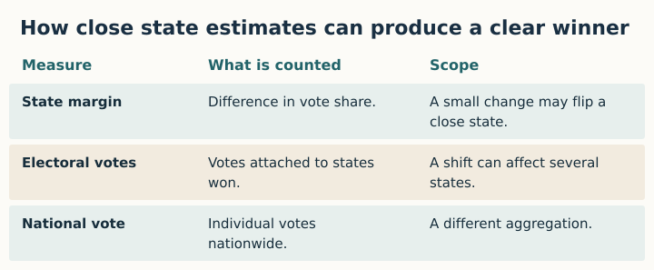
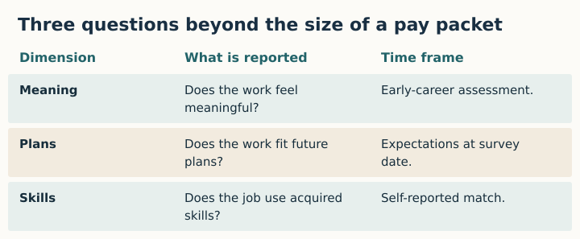
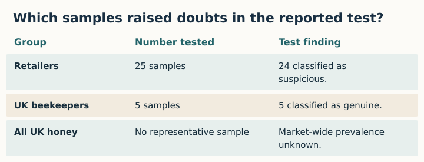
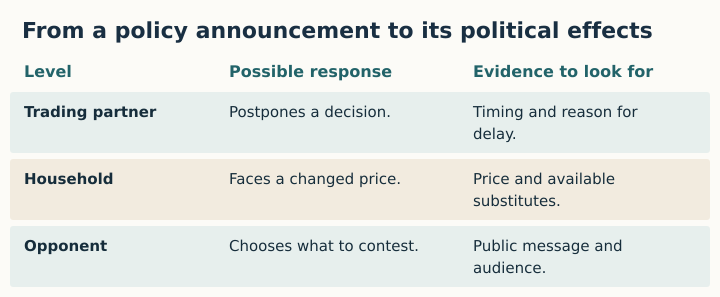
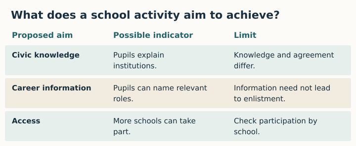
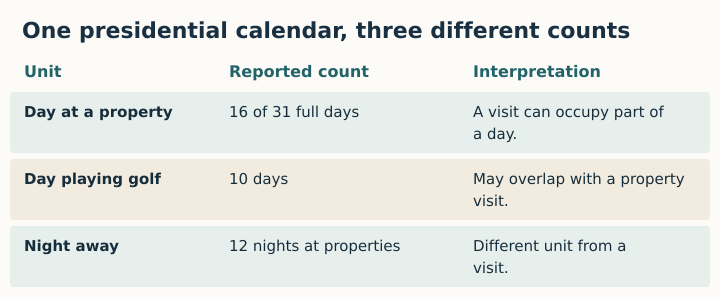

# ENS de Lyon · série SES (B/L) · Anglais (oral) 2025 — Corrigé brut partiel

*Corrigé rédigé par IA, non officiel. Signalez toute erreur.*

**Rédaction** · GPT-6.2 Astra Ultra · vitesse non renseignée

Le fascicule de Lyon identifie 46 références de presse. Il donne les titres et les dates. Les feuillets remis aux candidats et leurs coupes ne sont pas reproduits. Les prises de parole s’appuient sur les témoins indiqués pour chaque entrée.

[Répertoire officiel](https://www.ens-lyon.fr/sites/default/files/2025-10/Fascicule%20SES%202025%20OK.pdf#page=10) · [Rapport du jury](https://www.ens-lyon.fr/sites/default/files/2025-11/Fascicule%20SES%202025%20relu%20EB%2B%20SLG.pdf#page=20)

## BBC News · “Did the US election polls fail?”, Natalie Sherman (07/11/2024)

Publication de presse correspondante consultée. Les coupes et les numéros de lignes du concours restent inconnus.

### When a close poll produces a clear winner

Sherman writes while the 2024 result is still coming in. A sizeable Electoral College victory can coexist with small errors in several closely matched states. Imagine five states all showing a one-point lead within the range of uncertainty. A modest error in the same direction can change the winner in all five. The national average and the tally of electoral votes answer different questions. The BBC article also asks why Trump's support may have been underestimated again. Assumptions about who will turn out can matter even when people answer a survey honestly. The question mark in the headline invites the reader to specify what counts as failure before passing judgment.

**Question.** Would five wrong state calls establish five independent failures? **Answer.** No. The same turnout assumption could affect estimates in several states.

**Question.** Why preserve the date of publication? **Answer.** On 7 November some counts were still provisional. The reporter's qualified statements belong to that moment.

[Article, BBC News](https://www.bbc.com/news/articles/cj4ve004llxo)

## BBC News · “Numbers are down – but Starmer will still struggle to win on immigration”, Alan Little (22/05/2025)

Publication de presse correspondante consultée. Les coupes et les numéros de lignes du concours restent inconnus.

### Why a fall in net migration may have little electoral effect

Alan Little begins with a substantial fall in UK net migration. He then asks why favourable news on the government's chosen measure might fail to change how people vote. His historical hinge is 1968. Stronger legal protection against discrimination and Enoch Powell's inflammatory intervention exposed rival views of national belonging. Little uses them to investigate how attitudes to race and migration cut across older class loyalties. A statistic released on one Thursday cannot tell us which of these views voters hold. Nor does it say whether they believe a government can control future flows.

**Question.** Does a fall in net migration imply that fewer people arrived? **Answer.** Net migration is arrivals minus departures. Either side of that subtraction can change.

**Question.** What does 1968 do for the argument? **Answer.** It gives the reader a way to understand the political persistence of the issue across very different governments and migration levels.

[Article, BBC News](https://www.bbc.com/news/articles/cyvmmldmvq4o)

## Bloomberg Opinion · “Dry January is the least of big booze’s problems”, Andrea Felsted (20/02/2025)

Des passages de la publication correspondante sont attestés. Le corps intégral et la coupe du concours ne sont pas établis.

### One month of abstinence and a lasting change in demand

Andrea Felsted uses Dry January as a familiar explanation that investors may find too comforting. A seasonal dip usually ends when the calendar changes. Health information, changing consumer habits and uncertainty about trade could affect alcohol producers over a much longer period. The phrase *big booze* recasts the story as a question about a powerful industry. For an economic reading, separate volume from revenue. A company can charge more per bottle and still face a shrinking market in the long run. Different companies also depend on different products and countries. A shared industry label may hide unequal exposure.

**Question.** How would one test the seasonal explanation? **Answer.** Compare like months across several years and see whether demand recovers after January.

**Question.** Why does the comparison with tobacco matter? **Answer.** It raises the prospect that public perceptions of health could change the industry's prospects gradually and durably.

[Chronique de Felsted en syndication](https://lasvegassun.com//news/2025/feb/22/dry-january-is-the-least-of-big-boozes-problems/)

## Christian Science Monitor · “After ‘Severance,’ will we ever see work-life balance the same way?”, Stephen Humphries (20/02/2025)

Des passages de la publication correspondante sont attestés. Le corps intégral et la coupe du concours ne sont pas établis. Le jury propose un exemple de problématique sur la série et le travail.

### Who owns the interval between work and home?

A switch that allowed people to leave every memory of work at the office might initially sound liberating. *Severance* makes that offer unsettling. In the drama, the person at work cannot remember a life outside it. A boundary meant to protect freedom also deprives each version of the employee of knowledge needed to make a choice. Stephen Humphries uses the series to investigate how viewers think about their own working lives. A reader should keep the show's fictional premise apart from the experiences reported by real people. The jury mentions this subject when suggesting how to develop a question about work-life balance.

I would begin the commentary with the meaning of *balance*. A pair of scales requires someone who can see both sides. The fictional worker cannot do that. A real employee answering late-night messages can see both sides but may have little power to set the dividing line. New technology can increase control over one's schedule and employers' access to one's attention at the same time. To show this in the passage available on the day, I would select the transition from an individual's experience to an observation about work. I would identify who speaks before reading those lines.

The concluding question concerns what a job can reasonably contribute to a person's sense of self. Treating work as a mere interruption misses the relationships and competence people can find there. Treating it as the whole person leaves other commitments permanently on call. The show's impossible switch makes a very practical question visible. Who gets to negotiate the boundary?

**Question.** Is physical distance from the office enough to protect personal time? **Answer.** A person working remotely may still be expected to answer immediately. Availability and location are separate conditions.

**Question.** What would count as returning to the article after discussing the show? **Answer.** I would identify what one interviewee does or says and explain which feature of the fictional premise helps us interpret that response.

[Article de Stephen Humphries](https://www.csmonitor.com/Arts-Culture/TV/2025/0220/severance-workplace-adam-scott) · [Discussion du journaliste avec sa rédaction](https://www.csmonitor.com/Podcasts/Why-We-Wrote-This/wwwt_2506) · [Exemple du jury](https://www.ens-lyon.fr/sites/default/files/2025-11/Fascicule%20SES%202025%20relu%20EB%2B%20SLG.pdf#page=23)

## CNBC · “Here’s how much a ‘Made in the USA’ iPhone would cost”, Kif Leswing (11/04/2025)

Des passages de la publication correspondante sont attestés. Le corps intégral et la coupe du concours ne sont pas établis.

### What would it mean to make an iPhone in America?

The price question contains a prior question about the unit of production. Final assembly in one country can rely on components made in several others. Moving an assembly line is a different proposition from recreating suppliers, specialised equipment, logistics and trained teams in the same place. Leswing's title therefore invites a conditional answer. Before quoting an estimate, identify what the estimate assumes would move and how quickly. A higher manufacturing cost need not translate one-for-one into a higher shelf price. The seller could absorb some of the difference, change specifications or delay investment.

**Question.** Why might two estimates differ without either being dishonest? **Answer.** They may refer to different stages of production or assume different output levels.

**Question.** What does the quotation around *Made in the USA* invite the reader to examine? **Answer.** It turns a simple origin label into a question about the international chain behind the finished device.

[Article de Kif Leswing, CNBC](https://www.cnbc.com/2025/04/11/heres-how-much-a-made-in-the-usa-iphone-would-cost.html) · [Référence de l’étude et du reportage](https://counterpointresearch.com/en/insights/post-insight-in-the-press-heres-how-much-a-made-in-the-usa-iphone-would-cost)

## Des Moines Register · “By selfishly pardoning his son Hunter, Joe Biden flat-out destroyed his legacy”, Rex Huppke (03/12/2024)

Publication de presse correspondante consultée. Les coupes et les numéros de lignes du concours restent inconnus.

### A disappointed supporter sets a harder test

Rex Huppke condemns Biden's pardon of his son Hunter. The source of his anger matters. He recalls defending the president and valuing his record. That establishes the standard against which he judges the decision. A parent can feel loyalty to a child, and a president can hold a power of clemency. The issue for the columnist is how using that power after publicly promising otherwise affects trust at a particular political moment. His judgment on the presidency as a whole is much broader than his evidence about this one act. That gap is a productive point for the commentary.

**Question.** Is Huppke claiming the president lacked the power to issue a pardon? **Answer.** His criticism addresses a public promise, a personal connection and the use made of a lawful power.

**Question.** Why discuss his earlier support for Biden? **Answer.** It gives the charge the force of disappointed loyalty and explains why he expected a different example.

[Chronique de Huppke en syndication](https://www.yahoo.com/news/selfishly-pardoning-son-hunter-joe-154520649.html)

## Manchester Evening News · “Cabbies fear ‘hundreds’ of taxis will be ‘forced off’ Manchester’s roads at stroke of New Year’s Eve midnight”, Ethan Davies (31/03/2025)

Le journaliste revient sur son information de fin mars dans un reportage de mai. Le texte original du 31 mars et sa coupe manquent.

### A licensing deadline seen from the driver's seat

Davies's headline gives the prediction to the cabbies. The passive *forced off* presents the deadline from the standpoint of drivers with vehicles they may be unable to replace. The striking image of midnight converts an administrative rule into a moment when livelihoods could change. Later reporting by the same journalist recalls the March warning about older black cabs and emissions requirements for 2026. It helps identify the dispute. The word *hundreds* remains a prediction by concerned drivers. One needs a count of vehicles affected, exemptions and affordable replacements before translating it into an actual loss of taxis.

**Question.** Why would a passenger have a stake in this argument? **Answer.** Reduced availability may affect journeys, while cleaner vehicles can benefit people using the same streets.

**Question.** How would you report the warning after the deadline? **Answer.** I would check how many licences were renewed, retired or replaced before using a past-tense result.

[Reportage ultérieur du même journaliste, contexte](https://stockport.nub.news/news/local-news/taxis-are-broken-this-is-andy-burnhams-plan-to-fix-it-259070)

## Newsweek · “America Gets The President We Deserve”, Ryan Bernsten (30/12/2024)

Publication de presse correspondante consultée. Les coupes et les numéros de lignes du concours restent inconnus.

### When outrage becomes a form of political participation

Ryan Bernsten's *we* deliberately implicates the audience. He compares the attention a political figure attracts with the attention ordinary users seek by curating a social-media persona. The mechanism is uncomfortable. Public indignation can increase the visibility of the person it condemns. Bernsten then contrasts performative engagement with the sustained work that helps institutions function. A useful objection concerns who belongs to *we*. Citizens have unequal access to platforms and to political decisions. Sharing responsibility for an attention economy need not mean allocating political responsibility equally.

**Question.** Why use a first-person plural in the headline? **Answer.** It discourages readers from treating the election as the work of a wholly separate group.

**Question.** Does attention imply approval? **Answer.** It can increase circulation even when it expresses strong disagreement. That distinction helps explain the author's concern.

[Tribune de Bernsten, Newsweek](https://www.newsweek.com/america-gets-president-we-deserve-opinion-2006287)

## The Atlantic · “The Secret That Colleges Should Stop Keeping”, Rose Horowitch (20/02/2025)

La page de la publication correspond à la chronique de Rose Horowitch sur les prix annoncés et les aides. Son titre en ligne diffère du titre imprimé par le concours. Coupe inconnue.

### The price on the brochure and the price a family pays

Rose Horowitch reports a paradox. Highly visible sticker prices can rise while the average amount students actually pay after grants falls. The public framing of a college as unaffordable may influence a teenager before an individual offer of aid is ever calculated. In that case a discount exists financially but reaches nobody who has already decided not to apply. The distribution also matters. Falling average net tuition at one group of colleges tells us little by itself about the full cost faced by one family, including housing. Reading the title as a demand for clearer information gives the price distinction a social consequence.

**Question.** Is a loan the same as a grant when discussing net price? **Answer.** A grant reduces what the student has to fund. A loan changes how and when the student pays it.

**Question.** Why would a college keep a high advertised price? **Answer.** Prices may signal prestige or allow different discounts. These are possible incentives to examine, not motives established for every college.

[Chronique de Rose Horowitch](https://www.theatlantic.com/ideas/archive/2025/02/college-cheaper-sticker-price/681742/)

## The Atlantic · “Trump Brings Britain’s ‘Moron premium’ to the U.S. Economy”, Paul Mason (12/04/2025)

Des passages de la publication correspondante sont attestés. Le corps intégral et la coupe du concours ne sont pas établis.

### How political uncertainty can acquire a price

Paul Mason borrows a British expression associated with the market response to the Truss government's fiscal plans. A *premium* in this setting is the extra return an investor demands to bear perceived risk. The insult attached to it registers a verdict on decision-making. The question is whether an American tariff reversal or threat could cause investors to demand extra compensation for uncertainty in a much larger economy. An analogy explains a possible feedback mechanism. It does not make sterling and the dollar interchangeable or prove that rates will move in the same way. A careful conclusion distinguishes the immediate market response from the conditions under which a household would feel the cost.

**Question.** Why do bond prices and borrowing costs appear together? **Answer.** All else equal, when the price of a fixed-payment bond falls, its yield rises. New borrowing may then carry a higher cost.

**Question.** How would you read Mason's conditional language? **Answer.** As a warning about persistence and transmission. He is examining what could follow if the initial circumstances last.

[Chronique de Mason, The Atlantic](https://www.theatlantic.com/economy/archive/2025/04/trump-truss-moron-premium/682421/)

## The Chicago Tribune · “I am a Mexican American who voted for Trump. Here’s why.”, J. Marcos Peterson (15/11/2024)

Des passages de la publication correspondante sont attestés. Le corps intégral et la coupe du concours ne sont pas établis.

### What one voter can explain about his own choice

J. Marcos Peterson places several elements of his experience together. A Mexican American with family affected by immigration enforcement, he also identifies as gay and Christian and explains his vote for Trump. The first person challenges the assumption that a demographic category uniquely predicts how an individual thinks. The article is evidence of how one writer understands and presents his choice. It cannot establish how often each stated consideration mattered across the electorate. That distinction lets a commentator take a testimony seriously and still ask how political parties construct coalitions out of people with different priorities.

**Question.** What does *Here’s why* promise the reader? **Answer.** An account from the voter about his own reasoning. A representative survey would answer a different question.

**Question.** What would be lost by translating *Mexican American* simply as *Mexican*? **Answer.** The phrase situates the speaker within American political life and indicates a family or cultural connection to Mexico.

[Chronique du Chicago Tribune reprise par le Houston Chronicle](https://www.houstonchronicle.com/opinion/outlook/article/mexican-american-vote-trump-19916623.php)

## The Chicago Tribune · “Should Trump be giving stock tips to his followers?”, The Editorial Board (09/04/2025)

Le titre figure au répertoire. Un reportage distinct éclaire les circonstances. Les exemples appartiennent à la préparation proposée et la coupe originale manque.

### A president's message to a market audience

The editorial headline asks whether a president should give stock tips to followers. In April 2025 Trump's public encouragement to buy was followed by a change in tariff policy and a rise in share prices. This sequence gives the ethical question urgency. It also explains why sequence alone cannot settle it. A president can affect the value of an investment through policy and can attract an audience through a personal account. Someone reading such an account may have no way to tell what information stands behind an apparently casual remark. Institutional trust can therefore be at issue without proof that any named investor traded on undisclosed information.

**Question.** Is a gain after a public post evidence of a specific illegal trade? **Answer.** No. Such a claim would require evidence about the trader, information, timing and applicable law.

**Question.** Why does *followers* matter? **Answer.** It describes an audience defined by a platform, whereas public office creates responsibilities towards people beyond that audience.

[Chronologie distincte, Associated Press](https://apnews.com/article/fccfa6b06c8f1ec0cd7844641ca52669)

## The Conversation · “’News influencers’ are racking up billions of views – and not checking their facts”, Kelly Fincham (10/12/2024)

Publication de presse correspondante consultée. Les coupes et les numéros de lignes du concours restent inconnus.

### When verification disappears behind a view count

Kelly Fincham asks how news circulates when a creator can reach a vast audience without a newsroom's checking routines. A large number beside a post records attention or interaction. It tells us neither how many independent sources underlie the story nor whether a correction will reach the same viewers. To develop the commentary, follow one claim backwards. Who first made it? Is a second account independently corroborating it or simply reposting it? The same technology that enables eyewitnesses to speak also rewards speed. This helps explain why a public discussion of verification should attend to incentives as well as individual care.

**Question.** Does a billion likes mean a billion distinct readers? **Answer.** No. The unit counted is interaction, which can accumulate across posts and accounts.

**Question.** What would be a fair comparison with a newsroom? **Answer.** Compare the actual checks and corrections available in each case. An institutional label alone cannot guarantee accuracy.

[Chronique de Fincham, reprise de The Conversation](https://phys.org/news/2024-12-news-racking-billions-views-facts.html)

## The Conversation · “Why a ‘rip-off’ degree might be worth the money after all – research study”, Sean Prophy (22/05/2025)

Reprise de l’article signée Sean Brophy. Le répertoire de Lyon imprime Sean Prophy. La coupe du concours manque.

### What makes a degree worth its cost?

The Lyon list gives the byline as Sean Prophy. The published article is by Sean Brophy. Using a survey of UK graduates roughly fifteen months after graduation, his research asks whether work feels meaningful, uses acquired skills and fits future plans. These are outcomes that an early salary figure cannot capture. The survey adds to the information a prospective student might want. It does not make earnings irrelevant or tell us what every respondent would have earned without a degree. The insult *rip-off* suggests somebody has dishonestly sold a worthless product. Before accepting that description, the reader needs to know what value was promised and whose definition of success is being used.

**Question.** What limits a survey conducted fifteen months after graduation? **Answer.** It captures early careers. Some training has effects that appear much later.

**Question.** Why retain respondents' own assessments? **Answer.** Meaningful work is partly an experience. Self-reports can measure it, provided the claim remains about what graduates reported.

[Article de Sean Brophy, repris de The Conversation](https://phys.org/news/2025-05-rip-degree-worth-money.html)

## The Conversation · “Reform’s threat to the mainstream parties is unique in UK political history”, Martin Farr (30/05/2025)

Publication de presse correspondante consultée. Les coupes et les numéros de lignes du concours restent inconnus.

### A challenger that competes on more than one flank

Martin Farr opens with a Labour dispute and then reveals how a proposal from Nigel Farage helped frame it. Reform UK's appeal here cuts across the familiar economic vocabulary of left and right. Promising support for pensioners or the removal of a benefit limit can put pressure on Labour while other positions attract former Conservative voters. Farr also asks how far political change depends on one person's persistence. A useful counterfactual would distinguish Farage's choices from electoral rules, existing discontent and party organisation. None of these explanations has to do all the work alone.

**Question.** Why begin an article about Reform with an argument inside Labour? **Answer.** It shows influence before it is measured in seats. A challenger can change the terms on which another party argues.

**Question.** How is a threat to two parties different from equal support among their former voters? **Answer.** Strategic pressure can be strong on both even if the composition of the challenger's support is uneven.

[Article de Farr, The Conversation](https://theconversation.com/reforms-threat-to-the-mainstream-parties-is-unique-in-uk-political-history-257839)

## The Daily Telegraph · “Small boat arrivals jump 25 per cent amid drop in EU migration”, Sophia Yan (07/03/2025)

Le titre figure au répertoire. Un reportage distinct éclaire les circonstances. Les exemples appartiennent à la préparation proposée et la coupe originale manque.

### A percentage needs a denominator

The Telegraph title draws attention to a rise in small-boat arrivals and a fall in EU migration. It compares indicators that readers could easily mistake for two halves of the same series. One singles out a route used to reach the UK. The other refers to a much broader category connected with the EU. A proportionate increase can start from a small base. It can coincide with a decrease in another series without offsetting that decrease. I would ask what dates, geographical boundary and definition accompany each figure on the printed sheet. Until those are available, the 25 per cent belongs to the headline and cannot safely be turned into a count of people.

**Question.** Could a country see higher small-boat arrivals and lower overall net migration? **Answer.** Yes. Net migration includes many other arrivals and all relevant departures.

**Question.** Does *amid* explain why either number changed? **Answer.** It places developments alongside one another. A causal claim would require further evidence.

[Arrivées sur la Manche, reportage de contexte](https://www.standard.co.uk/news/politics/migrant-crossings-small-boats-dover-kent-border-force-english-channel-b1215116.html) · [Définition des statistiques officielles](https://www.gov.uk/government/statistics/small-boat-arrivals-and-the-impact-of-crossing-conditions/small-boat-arrivals-and-the-impact-of-crossing-conditions)

## The Economist · “Nigel’s world” (26/04/2025)

Titre et question sur la concurrence de Reform UK identifiés dans l’édition du 26 avril. La coupe distribuée manque.

### What would it take to replace the established right?

The April reference names Nigel Farage in a deliberately familiar possessive, *Nigel’s world*. The associated question concerns Reform UK's capacity to take over Britain's political right. One can understand that ambition at three levels. A figure can dominate a news cycle, lead a rival in voting-intention polls or build an organisation capable of winning constituencies. The three milestones need not coincide. A local election gives a challenger the opportunity to demonstrate organisation in particular places. It also exposes the party to the demands of administration where it wins. That is why an April discussion before the May local elections should retain its open question.

**Question.** Does a national vote share show who will win a particular seat? **Answer.** Constituencies choose individual representatives. Concentration and local competition shape the translation from votes to seats.

**Question.** How does the familiar first name affect the frame? **Answer.** It makes one man the point of entry into a story that also concerns activists, candidates and institutions.

[Numéro de The Economist du 26 avril 2025](https://www.economist.com/weeklyedition/2025-04-26) · [Référence lyonnaise](https://www.ens-lyon.fr/sites/default/files/2025-10/Fascicule%20SES%202025%20OK.pdf#page=11)

## The Economist · “The public realm. Britain’s “broken windows”” (03/05/2025)

Des passages de la publication correspondante sont attestés. Le corps intégral et la coupe du concours ne sont pas établis.

### When disrepair becomes evidence about government

Visible damage to a shared place sends at least two signals. A pothole or broken window is something people have to navigate today. Leaving it unattended can also change their expectations about whether anyone will take responsibility tomorrow. The Economist's May article associates deterioration in Britain's public realm with the broken-windows metaphor. An explanation should keep the metaphor's causal ambition open to scrutiny. Disorder and mistrust may reinforce each other, or both may reflect a lack of resources. To tell these accounts apart one would need to compare similar places over time. The power of the everyday example is that even a reader who has never opened a council budget can describe the experience the budget ought to explain.

**Question.** Would repainting a wall establish that trust had returned? **Answer.** It would establish a visible repair. Trust would need its own measure.

**Question.** Which institutions might be involved in maintaining one street? **Answer.** That depends on ownership and local responsibilities. Distinguishing the responsible body is part of testing a claim about government.

[Article sur l’espace public, The Economist](https://www.economist.com/britain/2025/05/01/broken-windows-and-pockmarked-roads)

## The Economist · “Free speech in Britain” (17/05/2025)

Titre de rubrique et passages sur les règles britanniques relatives aux propos en ligne repérés dans le numéro du 17 mai. Le même numéro comporte aussi un éditorial distinct sur l’Europe. Coupe de concours inconnue.

### Whose freedom to say what, under which rule?

A debate about free speech in Britain is hard to assess until we know which action is being challenged. Parliament can create offences, a court can rule on a particular case, an employer can regulate conduct and fellow citizens can criticise a speaker. Calling each outcome censorship erases differences in power and remedy. The May print feature sets Britain's approach within a wider debate over expression and harm. An illuminating oral example would identify a precise rule, ask what interest it protects and then ask whether its scope is sufficiently clear. To reproduce the article's own example or its sequence of cases one would need the passage supplied at the examination.

**Question.** Does protecting expression require agreement with the speaker? **Answer.** No. The central issue is the ground on which speech may be restricted, including speech one finds objectionable.

**Question.** Why does uncertainty about a rule matter before it is enforced? **Answer.** People may avoid lawful speech if they cannot reasonably predict where a restriction begins.

[Numéro de The Economist du 17 mai 2025](https://www.economist.com/weeklyedition/2025-05-17) · [Éditorial européen distinct, pour le contexte](https://www.economist.com/leaders/2025/05/15/europes-free-speech-problem)

## The Economist · “Bring back Boris”, Bagehot (24/05/2025)

Titre et passages de la chronique de Bagehot, complétés par l’exemple consacré à Johnson dans le rapport. Coupe inconnue.

### Who would benefit from remembering Boris Johnson?

*Bring back Boris* sounds like a demand from the crowd. As the title of a Bagehot column it also invites scrutiny of the wish itself. Johnson can be remembered as a campaigner able to speak to voters who rarely trusted the Conservatives. Remembering that ability is different from assessing the record of his government or asking whether the conditions of an earlier victory could be repeated. The jury offers this text as an example for a problem about political image. Its suggested progression moves from the construction of the image to structural issues and the question of representation.

To develop that progression, begin with the verb *bring back*. It treats the desired figure as a familiar resource that can be taken off the shelf. But a leader returns to a changed field. A divided electorate, rival parties and the capacity to govern cannot be summoned by repeating a campaign's phrases. It is then worth asking who speaks through the imperative. A former supporter recalling a victory, a party member choosing a leader and a citizen wanting reliable services have different reasons for assessing the same figure. Distinguishing their voices lets the commentator consider the appeal of the slogan without assuming that the columnist endorses it.

The most telling question for my conclusion is what a party gains by talking about a person. It may acquire a recognisable face while postponing harder arguments about policy and organisation. That is how a demand that looks to the past can expose a present weakness.

**Question.** Which claim would one election victory actually support? **Answer.** That a particular coalition of voters supported a party at that election. It does not promise the same result in a different contest.

**Question.** What would you look for in selecting a passage to read? **Answer.** A change between an admirer's words and the columnist's assessment, so that tone and attribution can both be demonstrated.

[Reprise de la chronique de Bagehot](https://www.biznews.com/global-citizen/economist-return-big-dog-boris-looms-fractured-tory) · [Exemple du jury](https://www.ens-lyon.fr/sites/default/files/2025-11/Fascicule%20SES%202025%20relu%20EB%2B%20SLG.pdf#page=23)

## The Economist · “From envy of the world to national embarrassment, Labour and NHS” (31/05/2025)

La publication en ligne porte un titre différent. Le rapprochement avec le titre imprimé et le sujet de l’article est attesté par une reprise contemporaine. Coupe inconnue.

### Why waiting for treatment can become a political measure

A service identified with British collective achievement can become a source of embarrassment precisely because expectations remain high. The May Economist article plays on this reversal. For Labour, which treats the creation of the NHS as part of its own history, the gap between attachment to the institution and dissatisfaction with patients' experience is especially consequential. Spending and outcomes must still be distinguished. A hospital may receive more money and face greater demand at the same time. A useful commentary would pair a measure of resources with one of access, such as the time until treatment. That makes the headline's emotional vocabulary answerable to a concrete experience.

**Question.** Can people support a tax-funded system while criticising its operation? **Answer.** Yes. Strong attachment to the principle can even increase dissatisfaction with failures of access.

**Question.** What changes when a journalist moves from national averages to a patient's wait? **Answer.** The human cost becomes easier to grasp, but one case cannot establish the national trend.

[Article du 29 mai, The Economist](https://www.economist.com/britain/2025/05/29/where-next-for-britains-broken-national-health-service) · [Référence contemporaine aux titres](https://nhsreality.wordpress.com/2025/06/11/decision-making-despair-hard-truths-are-not-being-said-by-politicians-the-economist-however-opines-from-envy-of-the-world-to-national-embarrassment/)

## The Financial Times · “Would immigration curbs hit the UK’s grocers?”, Bearbull (16/05/2025)

Le répertoire donne le 16 mai et le Financial Times. La chronique signée Bearbull est publiée le 15 mai par Investors’ Chronicle. Titre et ouverture consultables, coupe inconnue.

### How can a migration policy reach a supermarket?

Bearbull poses a question about UK grocers in an investment publication. Restrictions on immigration could affect the supply of labour at farms, food processors, warehouses or shops. They might also change the growth and location of demand. A supermarket's turnover and its profit margin could therefore move differently. Passing higher costs on to shoppers might protect a margin while costing sales to competitors. These are channels to examine, not findings that can be extracted from the title alone. Before making a claim about any named company I would need the relevant passage, the company's exposure and the period being discussed.

**Question.** Why does the audience of an investment column matter? **Answer.** An investor may focus on margins, risk and comparison between companies. A worker or customer can reasonably ask a different question.

**Question.** What evidence would distinguish a labour-supply effect from a demand effect? **Answer.** Changes in vacancies and wages would speak to supply. Changes in customer numbers or volumes sold would speak to demand.

[Chronique de Bearbull, Investors’ Chronicle](https://www.investorschronicle.co.uk/content/3c8eb9be-84dd-48ff-b968-f741fb53c1da)

## The Fresno Bee · “This post-election Thanksgiving, we all have the power to soften our hardened hearts”, Andrew Fiala (23/11/2024)

Le répertoire indique le 23 novembre. L’auteur republie la chronique avec le titre du Fresno Bee et un renvoi daté du 24. Coupe d’examen inconnue.

### A moral appeal written between an election and a family holiday

Andrew Fiala begins with Biden and Trump shaking hands in the White House after the 2024 election. A minute of public courtesy can acknowledge an opponent while leaving a bitter history unresolved. From that scene he turns to what each reader can do. The movement from *our* to the power available to each of us gives a public division an interpersonal setting. A citizen may have little influence on the immediate outcome of an election and considerable influence on whether another person is listened to at the table. The claim is most persuasive at this limited scale. Learning to hear someone's reasons does not require overlooking the consequences of a policy or treating every assertion as true. A useful commentary asks what changes in a conversation when understanding another person's grievance ceases to mean endorsing it.

**Question.** What does the calendar contribute? **Answer.** The holiday brings people together soon after the election, before the emotions surrounding the result have necessarily subsided.

**Question.** What would be the limitation of turning the column into a national policy prescription? **Answer.** A personal virtue can sustain public life, but institutional harms may also call for institutional remedies.

[Chronique dans le Fresno Bee](https://www.fresnobee.com/opinion/readers-opinion/article295924914.html) · [Republication par Andrew Fiala](https://andrewfiala.com/gratitude-grace-and-the-biden-trump-handshake/)

## The Guardian · “Anglican group launches £7m project in Barbados to atone for slavery atrocities”, Natricia Duncan (06/09/2024)

Publication de presse correspondante consultée. Les coupes et les numéros de lignes du concours restent inconnus.

### Who decides what repair should look like?

Natricia Duncan reports on a £7 million project involving an Anglican missionary organisation and communities in Barbados. The Codrington estate links the institution to the history of plantation slavery. The proposed uses of the money include education, enterprise, research and support for land ownership. These uses matter because they connect an acknowledgment about the past with control over resources in the present. A commentary should ask who decides how the fund is used and who evaluates the results. Treating the figure as a final price for a historical injustice would give it a meaning the project cannot establish.

**Question.** Why is land ownership a distinct part of the story? **Answer.** It concerns lasting control of an asset, which can shape family and community opportunities beyond a single payment.

**Question.** Why identify the specific organisation involved? **Answer.** An action by one Anglican body cannot automatically be attributed to every church or government.

[Reportage, The Guardian](https://www.theguardian.com/world/article/2024/sep/06/anglican-church-mission-project-barbados-atone-slavery)

## The Guardian · “Nine in ten honey samples from UK retailers fail authenticity test”, Jon Ungoed- Thomas (09/11/2024)

Publication de presse correspondante consultée. Les coupes et les numéros de lignes du concours restent inconnus.

### What did the honey test establish?

The Guardian reports on thirty samples submitted for an authenticity test. Five came from UK beekeepers and twenty-five from major retailers. Twenty-four of the latter group raised suspicions under the test, while all five beekeeper samples were judged genuine. Those numbers are the beginning of an argument about supply-chain checks. They cannot by themselves establish that the same proportion of all honey sold in Britain is adulterated. How the samples were chosen and how a novel test classifies genuine products affect the strength of the inference. The article also reports challenges to the method. Attribution matters as much for a scientific claim reported in a newspaper as it does for a political allegation.

**Question.** What was the denominator for the twenty-four suspicious results? **Answer.** Twenty-five retail samples, within a total of thirty samples tested.

**Question.** What would strengthen a population-wide estimate? **Answer.** Representative sampling and independent validation of the test across the kinds of honey being compared.

[Enquête, The Guardian](https://www.theguardian.com/food/2024/nov/09/nine-in-ten-honey-samples-from-uk-retailers-fail-authenticity-test)

## The Guardian · “Is Keir Starmer’s plan to help workers the start of a new era – or no big deal?”, Andy Beckett (13/09/2024)

Publication de presse correspondante consultée. Les coupes et les numéros de lignes du concours restent inconnus.

### A promise heard in a particular room

Andy Beckett listens to Labour's promise on workers' rights at the Trades Union Congress. A prime minister personally addressing that audience after a long absence changes the symbolic terms of the encounter. The delegates' response therefore matters, even while the details of the proposed changes remain unsettled. Beckett situates the event against the long decline of trade-union power. To judge whether the meeting really marks a turning point one would need to follow enactment, enforcement and employees' ability to use the new rights. Applause in a conference hall is evidence of an expectation at one time, not yet of a changed relationship at work.

**Question.** Why can an event be politically significant before a law changes? **Answer.** It can alter expectations about who will be heard in a negotiation.

**Question.** Whose voice might the setting emphasise? **Answer.** Organised workers and delegates are particularly visible there. Other workers may have different expectations.

[Chronique de Beckett](https://www.theguardian.com/commentisfree/2024/sep/13/keir-starmer-workers-labour-tuc-conference)

## The Guardian · “Anti-racism campaigner’s London book events cancelled amid threat of far-right violence”, Ben Quinn (23/11/2024)

Publication de presse correspondante consultée. Les coupes et les numéros de lignes du concours restent inconnus.

### A cancelled reading and the power of an anticipated threat

Ben Quinn reports that venues called off events promoting Joe Mulhall's book on music and anti-racism amid concerns about far-right violence. The book remained available and an event went ahead at a location kept private. That difference is precisely what gives the report its interest. Formally, the author retains the freedom to publish. Practically, public readers and listeners may be unable to gather in an advertised place without imposing risks on staff or guests. The immediate decision belongs to venue organisers, but the pressure shaping it comes from elsewhere. Reporting the venues' concern requires care about which threats were documented and which risks were anticipated.

**Question.** Why does relocating an event change who can attend? **Answer.** Publicity helps people discover an event. Keeping its location private protects attendees but narrows access.

**Question.** How does this differ from a government ban? **Answer.** The constraint is exercised through intimidation and risk management, with different actors and possible responses.

[Reportage de Quinn](https://www.theguardian.com/politics/2024/nov/23/anti-racism-talks-cancelled-amid-threat-of-far-right)

## The Guardian · “Trump in the Circle: Wrestling and the battle for American masculinity”, Daniel Kennedy (16/04/2025)

Publication de presse correspondante consultée. Les coupes et les numéros de lignes du concours restent inconnus.

### The view from a college wrestling mat

Daniel Kennedy opens with his own experience of competitive wrestling and of watching the college championships each spring. The competition he describes is actual collegiate wrestling. Reading it as a scripted professional show would miss the work, discipline and status of the athletes. Trump's appearance at the championship gives Kennedy an opportunity to ask why athletes in a sport that often feels overlooked might welcome a president's attention. The author can recognise the force of that recognition and still ask what ideal of American masculinity it constructs. His participation gives him knowledge of a community. It does not make him a spokesman for everyone who trains in it.

**Question.** Why does the story begin with a personal ritual? **Answer.** It establishes how the author knows the setting before he interprets its political use.

**Question.** Does applause for a guest measure every athlete's voting intention? **Answer.** It records a response in a public setting. Without further evidence individual motives remain open.

[Chronique de Kennedy](https://www.theguardian.com/sport/2025/apr/16/donald-trump-wrestling-masculinity)

## The Hill · “Kamala, but not Harris: Why people use female politicians’ first names”, Addy Bink (21/09/2024)

Des passages de la publication correspondante sont attestés. Le corps intégral et la coupe du concours ne sont pas établis.

### What can a first name communicate?

Addy Bink asks why people who habitually say *Biden* and *Trump* may say *Kamala* when naming Harris. A first name can express familiarity, help distinguish a candidate or reflect campaign branding. Within a repeated pattern it can also signal that a woman receives less of the professional distance routinely granted to a man. The decisive comparison is who is named how in similar settings. A single use of a first name reveals little about the speaker's intention. Systematic differences across many comparable uses can reveal a norm. The article's question is stronger when those two levels are kept apart.

**Question.** Which comparison would avoid a misleading conclusion? **Answer.** Compare candidates in the same office and genre of reporting while allowing for the names their own campaigns use.

**Question.** Why compare surnames as well as formal titles? **Answer.** Even where both titles are dropped, the remaining choice between given name and surname can carry different degrees of familiarity.

[Article d’Addy Bink](http://thehill.com/homenews/nexstar_media_wire/4882539-kamala-but-not-harris-why-people-use-female-politicians-first-names) · [Ouverture reproduite](https://www.allsides.com/news/2024-09-21-0815/politics-kamala-not-harris-why-people-use-female-politicians-first-names)

## The Hill · “From the GI Bill to reparations: The next Congress must right a history of injustice”, Brian Williams (11/11/2024)

L’auteur répertorie sa tribune et renvoie à The Hill. L’historique des droits des vétérans éclaire la proposition. Feuillet et corps intégral non vérifiés.

### An entitlement on paper and unequal access in practice

Brian Williams asks Congress to consider reparations through the history of the GI Bill. A national benefit for veterans can look universal in its wording and still produce very different outcomes when banks, colleges and local institutions decide who can use it. Access to education and housing can also change the resources passed from parents to children. Those two time scales explain why a measure addressed to past service can enter a debate about justice in the present. A careful commentary distinguishes an argument for redress from the question of which particular beneficiaries a bill would legally cover. The author's media index confirms his intervention. The supporting veterans' organisation supplies historical context.

**Question.** Why is comparing benefit eligibility with benefit use important? **Answer.** Eligibility describes an entitlement. Use depends on the institutions through which a veteran could exercise it.

**Question.** What does the reference to the next Congress add? **Answer.** It identifies legislators as potential decision-makers and marks the piece as a call for action.

[Tribune de Brian Williams](https://thehill.com/opinion/4982581-gi-bill-black-veterans/) · [Index de l’auteur](https://brianwilliamsmd.com/media) · [Historique et proposition législative, IAVA](https://act.iava.org/gibillbenefits)

## The Hill · “Sorry, but manufacturing isn’t what it used to be. Bringing it back will never be enough.”, Matt Stewart (14/04/2025)

Des passages de la publication correspondante sont attestés. Le corps intégral et la coupe du concours ne sont pas établis.

### More output does not necessarily bring back the same jobs

Matt Stewart questions a promise contained in the phrase *bring manufacturing back*. A factory can return production to the United States using fewer workers, different skills and more automation than the plant people remember. It can also buy inputs from companies that face higher costs under a tariff. An argument about the number of goods made domestically is thus different from a promise of secure, well-paid employment. Stewart asks how far manufacturing can meet the broader needs invoked in its name. A community may reasonably welcome a new factory while needing training and other employers too.

**Question.** Which two figures might move in opposite directions? **Answer.** Industrial output could rise while hours of manufacturing labour fall if productivity increases.

**Question.** Why distinguish a local success from a national strategy? **Answer.** One major employer can transform a town without providing enough opportunities across a large and diverse national labour market.

[Chronique de Matt Stewart en syndication](https://www.aol.com/opinion-sorry-manufacturing-isn-t-123000028.html)

## The Independent · “UK is not ready for coming climate ‘disaster,’ government advisers warn”, Emily Beament (30/04/2025)

Publication de presse correspondante consultée. Les coupes et les numéros de lignes du concours restent inconnus.

### When an adviser gives the government a warning

Emily Beament reports the Climate Change Committee's assessment of UK adaptation. Its question is how well homes, infrastructure and public services can withstand hazards such as heat or flooding. Reducing emissions changes future risk. Adaptation also has to address exposure that already exists. The committee examines forty-six areas and gives separate judgments on planning and delivery. A government may have adopted a plan for a transport network without having completed the work that makes the network resilient. The reporter's attribution of the warning matters. A committee can assess progress and urge action; it cannot itself allocate all the money or deliver every project.

**Question.** Would a newly adopted target prove that a community had become safer? **Answer.** It would show a planning decision. Delivery and the resulting change in exposure require separate evidence.

**Question.** Why use a concrete service in presenting the report? **Answer.** Asking whether a hospital can function during a heatwave gives the general term *resilience* a testable meaning.

[Reportage, The Independent](https://www.independent.co.uk/climate-change/uk-climate-change-disaster-environment-floods-b2741564.html)

## The Los Angeles Times · “The American dream of bringing the mall home”, Emily Mester (23/11/2024)

Publication de presse correspondante consultée. Les coupes et les numéros de lignes du concours restent inconnus.

### Why install a shop in one's own home?

Emily Mester explores a fantasy of domestic abundance through private spaces furnished like stores. Someone who can afford an item but once struggled to find it may associate stacks of goods with freedom from uncertainty. The essay then asks what the owner gives up when every pleasure is available at home. A neighbourhood shop or café is also a place to encounter other people. Bringing its objects into the house does not bring the public with them. Mester's progression from a tempting convenience to a question about community is what makes this more than a criticism of lavish décor.

**Question.** What does the idea of a *third place* add? **Answer.** It names a setting outside home and work where people can meet without arranging every encounter in advance.

**Question.** Why might the fantasy appeal even to people with little interest in luxury? **Answer.** It promises relief from the painful experience of needing something and being unable to obtain it.

[Chronique de Mester, Los Angeles Times](https://www.latimes.com/opinion/story/2024-11-23/shopping-purchases-prosperity)

## The Los Angeles Times · “California’s cycle of fiery destruction and reconstruction is older than you might think”, Robin Abcarian (15/01/2025)

Des passages de la publication correspondante sont attestés. Le corps intégral et la coupe du concours ne sont pas établis.

### Why do the same places burn and get rebuilt?

Writing in January 2025, Robin Abcarian locates the latest California fires in a longer pattern of destruction and reconstruction. The headline challenges the assumption that a disaster is unprecedented simply because its immediate consequences are overwhelming. A long history of fire and a changing climate can both be relevant. So can decisions about where people build, what protection they expect and how much risk insurers or public authorities will accept. The decision to return also looks different to a household whose memories are tied to the place. The historical comparison is valuable precisely because it raises questions at several scales without claiming that every fire has one cause.

**Question.** Why does reconstruction belong in the title? **Answer.** It directs attention to choices made after the flames are gone and before the next emergency.

**Question.** Does saying fires have happened before rule out a climate contribution? **Answer.** No. A longstanding hazard may change in frequency, intensity or consequences.

[Chronique de Robin Abcarian](https://www.latimes.com/opinion/story/2025-01-15/californias-long-cycle-of-fiery-destruction-and-reconstruction)

## The Los Angeles Times · “Why Hollywood is not alarmed enough about Gen Z”, Ryan Faughnder (08/04/2025)

Des passages de la publication correspondante sont attestés. Le corps intégral et la coupe du concours ne sont pas établis.

### More screen time and less time for Hollywood

Ryan Faughnder points to an apparent contradiction. Younger people can spend longer consuming entertainment overall and less time watching the films and programmes on which established studios depend. The denominator changes. Time spent on a phone may go to a short video, a creator or a game instead of a film. A studio measuring only its share of traditional viewing could miss the competition that matters most. The newsletter's warning is about the allocation of attention, not a claim that one generation has stopped liking stories. It also raises a business question. What counts as an audience when people move between formats faster than the categories used by the industry?

**Question.** Which comparison would test the argument? **Answer.** Compare both total entertainment time and the share spent on professionally produced films and series across age groups.

**Question.** What limitation affects an age-group comparison taken at one date? **Answer.** It cannot fully distinguish a permanent generational change from habits that alter as people grow older.

[Chronique de Ryan Faughnder](https://www.latimes.com/entertainment-arts/business/newsletter/2025-04-08/why-hollywood-is-not-alarmed-enough-about-gen-z-the-wide-shot)

## The Michigan Daily · “Big tech CEOs are too busy protecting their interests to protect their users”, Tom Muha (10/02/2025)

Publication de presse correspondante consultée. Les coupes et les numéros de lignes du concours restent inconnus.

### Reading the seating arrangements at an inauguration

Tom Muha begins with a striking public image of technology-company leaders at Trump's inauguration. From their presence and decisions around the election he develops a hypothesis about the incentives linking corporate interests and government policy. The distinction between an image and evidence of motive is essential. The image confirms proximity. It cannot disclose the agreements, expectations or private intentions of any individual. Muha explicitly recognises an element of speculation. His stronger institutional question survives that qualification. When a small number of executives control services that people rely on, what enables the public to check whether changes serve users' needs?

**Question.** How would you mark the point at which reporting becomes inference? **Answer.** I would say *Muha observes* before the visible facts and *he suggests* before the interpretation of corporate motives.

**Question.** Why does the article mention possible disagreements within the new administration? **Answer.** They complicate the idea that proximity automatically guarantees a single policy outcome.

[Tribune de Tom Muha](https://www.michigandaily.com/opinion/big-tech-ceos-are-too-busy-protecting-their-interests-to-protect-their-users/)

## The New York Times · “How to Turn Trump’s Economic Chaos Against Him”, James Carville (14/04/2025)

Des passages de la publication correspondante sont attestés. Le corps intégral et la coupe du concours ne sont pas établis. Le rapport présente un exemple de plan sur le chaos économique.

### Can uncertainty itself become a political tactic?

James Carville writes as a political strategist addressing Trump's opponents in April 2025. The kind of claim matters. A strategist may recommend a response to turmoil without claiming to know every reason a president changes policy. The jury includes an economic-chaos text among its examples and proposes exploring uncertainty at international and domestic levels, then examining its effects on opponents.

Internationally, uncertainty can make businesses delay decisions while they wait for a trading rule to settle. Domestically, a rapid sequence of announcements can make it hard for voters to identify either a stable policy or the person responsible for a price change. Opposition parties face a further difficulty. Responding separately to every statement lets the speaker set the agenda. A different strategy might follow one household or business from an announcement to its eventual consequences. That would turn attention from the spectacle to an outcome that can be checked.

The title's promise of turning chaos against its producer contains a risk. If opponents simply amplify each change, they may strengthen the mechanism they hoped to disrupt. The point for an oral commentary is to separate a demonstrable consequence of uncertainty from a speculative assertion that every reversal was planned. On the printed passage I would select a shift from description to a recommendation and identify the audience to whom the recommendation is addressed.

**Question.** What does *against him* identify? **Answer.** The object of a political strategy. The phrase signals advice about the opposition's conduct.

**Question.** Does a harmful effect prove that someone intended that effect? **Answer.** No. One needs separate evidence of intention. Political analysis can still examine who benefits or loses.

[Tribune de Carville](https://www.nytimes.com/2025/04/14/opinion/trump-tariffs-economy-carville.html) · [Ouverture reproduite](https://www.allsides.com/news/2025-04-14-0524/politics-james-carville-how-turn-trump-s-economic-chaos-against-him) · [Exemple du jury](https://www.ens-lyon.fr/sites/default/files/2025-11/Fascicule%20SES%202025%20relu%20EB%2B%20SLG.pdf#page=23)

## The Telegraph · “How your pint of milk found itself at the centre of a new conspiracy war”, Boudicca Fox-Leonard (08/12/2024)

Publication de presse correspondante consultée. Les coupes et les numéros de lignes du concours restent inconnus.

### How did a livestock-feed trial reach the kitchen table?

Boudicca Fox-Leonard follows public reactions to a trial involving Bovaer, an additive intended to reduce methane emissions from cattle. A bottle of milk in the refrigerator becomes the focus of claims circulating online. The basic distinction is between what farmers feed cattle and what is deliberately added to a retail drink. Losing that distinction allows a story about regulation and agricultural practice to change into a claim about what a consumer is drinking. A good reading asks which authority assessed a particular use and what proof an allegation offers. For a newspaper, investigating the uncertainty of readers and treating an unsupported claim as established would be two very different editorial acts.

**Question.** Why is an ordinary pint an effective starting point? **Answer.** It makes an unfamiliar agricultural debate immediate for a reader who encounters milk every day.

**Question.** How would you describe an alarming online allegation in the examination? **Answer.** Attribute it, explain the evidence the reporter checks, and distinguish the allegation from the verified details of the trial.

[Reprise de la chronique de Fox-Leonard](https://www.yahoo.com/news/milk-fridge-found-itself-centre-090000775.html)

## The Telegraph · “Pupils should not be taught ‘greatness’ of British Empire, Bridget Phillipson told”, Poppy Wood, Rian Kennedy (08/02/2025)

Publication de presse correspondante consultée. Les coupes et les numéros de lignes du concours restent inconnus.

### Who is asking for a change in the teaching of empire?

The Telegraph reports on submissions to a government curriculum review. The Bell Foundation and other organisations make proposals about the representation of empire and migration in schools. The headline's *Bridget Phillipson told* is crucial grammar. It identifies someone receiving advice. It does not announce a decision by the education secretary. A debate over whether *greatness* should set the terms of a lesson is also different from a demand to remove the British Empire from the curriculum. The former concerns which historical questions and perspectives pupils encounter, including what counts as evidence when weighing imperial power and its consequences.

**Question.** Why is the source of each proposal important? **Answer.** The journalist is reporting a range of submissions. Their positions do not all belong to the minister or to the newspaper.

**Question.** How could a teacher examine the word *greatness* historically? **Answer.** Ask who used it, what achievement they meant, and whose experience the description includes or leaves out.

[Reprise de l’article de Wood et Kennedy](https://www.yahoo.com/news/pupils-not-taught-greatness-british-070000922.html)

## The Telegraph · “Tories sink to lowest ever poll rating”, Dominic Penna (20/05/2025)

Publication de presse correspondante consultée. Les coupes et les numéros de lignes du concours restent inconnus.

### Lowest according to which series?

Dominic Penna reports that a YouGov voting-intention poll put the Conservatives in fourth place at 16 per cent. The article calls this a record low in that pollster's series. The qualification matters. It is an observation at a particular time, using a particular method and question. It is neither the party's share at an election nor a prediction that the same ranking will persist. The article's timing after local election losses helps explain why the finding drew attention. It also tempts readers to turn a short-term setback into an irreversible political story.

**Question.** Is fourth place inconsistent with the party still holding many parliamentary seats? **Answer.** No. A poll asks about current intentions. Existing seats were won in earlier constituency contests.

**Question.** Why mention YouGov when using a superlative? **Answer.** *Lowest ever* needs a defined comparison set. Different pollsters have different series and methods.

[Article de Penna, The Telegraph](https://www.telegraph.co.uk/politics/2025/05/20/tories-fourth-place-yougov-poll-six-years-reform-labour/)

## The Telegraph · “Children to be taught value of military at school”, Danielle Sheridan (29/05/2025)

Le titre figure au répertoire. Un reportage distinct éclaire les circonstances. Les exemples appartiennent à la préparation proposée et la coupe originale manque. Le jury indique un exemple d’argumentation sur l’introduction des valeurs militaires à l’école.

### What is a school being asked to teach?

The late-May reporting concerns proposals to increase pupils' knowledge of the armed forces and of careers in defence. A related report mentions visits by reservists and wider access to cadet activities. The Lyon jury includes this subject in its examples and asks what defence spending can do about crises. To answer well, one must start with the school. The proposed means is educational contact. The stated outcomes may include understanding a public institution, considering occupations and narrowing a perceived distance between civilian and military life. These are distinct aims and require different evidence.

I would organise the commentary around the word *value*. It could mean knowledge of what an institution does, approval of its decisions or a belief that it offers worthwhile employment. A classroom designed for informed citizenship needs room for questions about public spending, civilian oversight and alternative ways of serving society. A careers event can give pupils information about roles without measuring its success by the number who eventually enlist. A proposal aimed at broader participation should also ask which schools already have access and who decides how much teaching time to devote to it.

The jury's second suggested direction concerns competing crises. Answering that does not require ranking all public needs in the abstract. One can ask what resources a school would need for this proposal and how its intended gains would be evaluated. At the date of publication this was a policy proposal. The distributed Telegraph passage would be needed to identify exactly which examples it contained.

**Question.** Does reporting on proposed school visits establish compulsory military service? **Answer.** No. Educational contact, voluntary activities and compulsory service are distinct arrangements.

**Question.** What would you choose for the reading aloud? **Answer.** Lines where the speaker moves from a proposed activity to the outcome it is supposed to produce. That would make the argument's causal link available for discussion.

[Reportage distinct sur le projet, ITV](https://www.itv.com/news/2025-05-30/school-children-to-be-taught-value-of-armed-forces-under-new-government-plans) · [Exemple du jury](https://www.ens-lyon.fr/sites/default/files/2025-11/Fascicule%20SES%202025%20relu%20EB%2B%20SLG.pdf#page=23)

## The Times · “Is Britain heading for a summer of discontent?”, Aubrey Allegretti, Georgia Lambert, Nicola Woolcock, Poppy Koronka (17/04/2025)

Des passages de la publication correspondante sont attestés. Le corps intégral et la coupe du concours ne sont pas établis.

### A forecast built on the memory of a winter

The Times' question about a summer of discontent borrows a phrase associated with Britain's industrial unrest in the winter of 1978–79. A reader who recognises the allusion may infer a national political crisis from a set of separate disputes. The story refers to the Birmingham refuse strike and to the possibility of action in other sectors. A walkout under way, a union considering a ballot and a prediction by the opposition are not the same event. Naming the stage reached in each dispute allows the candidate to examine how a forecast gathers force before its most dramatic version has occurred.

**Question.** Why might the historical analogy be politically attractive? **Answer.** It gives disparate disputes a familiar common narrative with implications for the government.

**Question.** Which facts would you need before claiming a national wave? **Answer.** The sectors and workers involved, timing, duration and whether action actually took place.

[Reportage du Times](https://www.thetimes.co.uk/article/is-britain-heading-for-a-summer-of-discontent-xvjx2ts6z)

## The Washington Post · “Half of Trump’s first month in office saw him visiting Trump properties”, Philip Bump (20/02/2025)

Publication de presse correspondante consultée. Les coupes et les numéros de lignes du concours restent inconnus.

### What counts as a day at a presidential property?

Philip Bump counts all or part of sixteen days at Trump Organization properties during the first thirty-one full days of Trump's second term. He separately counts days spent playing golf and nights at different locations. These units cannot be added as though they were separate absences. A single day can meet more than one description. The point extends beyond leisure. Access by journalists and access by customers of an operating business raise different questions from a president's visit to a private home. The jury specifically warns against replacing this article's analysis of the schedule with a broad account of presidential power. A good conclusion stays with what the count reveals and what it cannot tell us about activity on a given day.

**Question.** Does visiting a property for part of a day mean a whole day without presidential work? **Answer.** No. The measure records presence at a location.

**Question.** Why compare with the beginning of his first term? **Answer.** It supplies a similarly timed reference point and helps identify what has changed in a recurring practice.

[Chronique et décompte de Philip Bump](https://www.washingtonpost.com/opinions/2025/02/20/trump-second-term-golfing-resorts/)

## Time Magazine · “How the Thanksgiving Holiday Can Help Heal America’s Political Rifts”, Michael Morris (27/11/2024)

Publication de presse correspondante consultée. Les coupes et les numéros de lignes du concours restent inconnus.

### How much can a shared ritual repair?

Michael Morris connects a holiday dinner with the political distance between people around the table. He cites research using mobile-phone location data to estimate shorter cross-party Thanksgiving gatherings following the 2016 election. The method captures time together more directly than it captures what anyone felt or discussed. Morris then asks whether a ritual can sustain cooperation when explicit argument fails. Shared preparation, repeated actions and a familiar place may give people a reason to remain in contact. They are unlikely, on their own, to settle a dispute about rights or representation. That limit makes the modest claim about continuing a relationship more credible.

**Question.** What uncertainty remains in the location evidence? **Answer.** It does not record a conversation or explain why any single guest left.

**Question.** How does Morris differ from Fiala in the Fresno column? **Answer.** Both address the holiday after an election. Morris draws on research about collective ritual, while Fiala explicitly addresses the reader's capacity to change a personal disposition.

[Tribune de Morris, Time](https://time.com/7178463/thanksgiving-tribalism-essay/)

## USA Today · “Sen. McConnell: Trump tariffs are bad policy. At $1,200, Kentuckians will pay the price.”, Janessa Hilliard (15/02/2025)

Le répertoire associe le nom de Janessa Hilliard à l’article. La chronique publiée est identifiée comme une tribune du sénateur Mitch McConnell et rattachée au Louisville Courier Journal. Coupe inconnue.

### A Republican senator's argument against a Republican president's tariffs

The list associates the piece with Janessa Hilliard. The published column gives the argument in Mitch McConnell's voice and identifies him as the Kentucky senator. It opens with the historical example of Smoot–Hawley and then asks what tariffs and retaliation could cost working households in Kentucky. The $1,200 in the headline belongs to an estimate and its assumptions. It is not an identical bill delivered to every resident. McConnell also distinguishes trade disputes with competitors from measures against allies. That distinction explains why the column's opposition to broad tariffs can coexist with a stated concern about unfair practices.

**Question.** Who initially pays a tariff at the border, and who may bear its economic cost? **Answer.** The importer pays the duty. Subsequent price changes can distribute the burden among businesses, consumers and suppliers.

**Question.** What role does the historical example play? **Answer.** It warns about escalation and retaliation. It does not establish that today's economy will reproduce the exact historical outcome.

[Tribune signée et notice du sénateur](https://www.yahoo.com/news/sen-mcconnell-trump-tariffs-bad-100913093.html)

## USA Today · “Sticker shock: Are American consumers learning to live with inflation?”, Daniel de Visé (31/05/2025)

Publication de presse correspondante consultée. Les coupes et les numéros de lignes du concours restent inconnus.

### When inflation slips down a list of worries

Daniel de Visé considers survey evidence that fewer Americans named inflation as their most pressing financial concern. The Gallup result in the article falls from 41 per cent a year earlier to 29 per cent. A change in the ranking of concerns is not a direct measure of prices. People might have adjusted to a higher price level, seen their incomes change or become more worried about a different problem. A separate question about whether household expenses have risen measures something else again. The headline's *learning to live with* invites an interpretation of behaviour and perception. It does not say groceries have returned to their old prices.

**Question.** If inflation slows, do prices usually return to an earlier level? **Answer.** A lower positive inflation rate means prices are rising more slowly. Falling prices would require a different movement.

**Question.** What comparison could strengthen the article's interpretation? **Answer.** Compare survey responses over the same period with wage, price and spending data, while allowing for differences between households.

[Enquête de Daniel de Visé en syndication](https://finance.yahoo.com/news/sticker-shock-american-consumers-learning-090347718.html)
