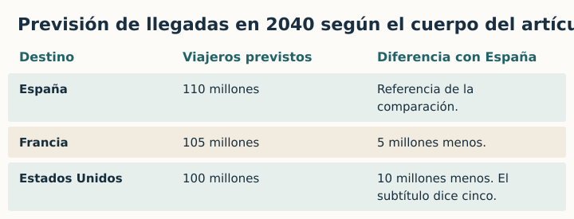
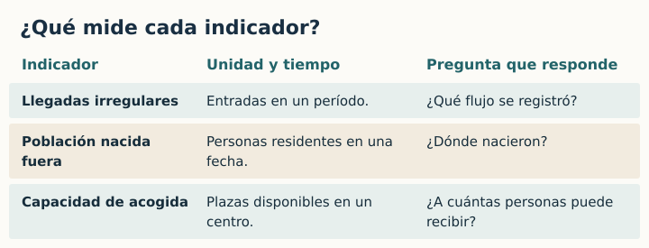

# ENS de Lyon · série SES (B/L) · Espagnol (oral) 2025 — Corrigé brut partiel

*Corrigé rédigé par IA, non officiel. Signalez toute erreur.*

**Rédaction** · GPT-6.2 Astra Ultra · vitesse non renseignée

Le fascicule de Lyon identifie 4 références de presse. Il donne les titres et les dates. Les feuillets remis aux candidats et leurs coupes ne sont pas reproduits. Les prises de parole s’appuient sur les témoins indiqués pour chaque entrée.

[Répertoire officiel](https://www.ens-lyon.fr/sites/default/files/2025-10/Fascicule%20SES%202025%20OK.pdf#page=13) · [Rapport du jury](https://www.ens-lyon.fr/sites/default/files/2025-11/Fascicule%20SES%202025%20relu%20EB%2B%20SLG.pdf#page=25)

## CNN en Español · “‘Ciudades convertidas en parques temáticos”: Airbnb enfrenta cada vez más problemas en España” (30/05/2025)

Le reportage en espagnol et des témoignages sont attestés dans la reprise CNN. La coupe distribuée reste inconnue.

### ¿Qué se pierde cuando un barrio se convierte en destino?

Pau Mosquera abre su reportaje para CNN en Español con una tensión que afecta a dos personas que miran el mismo portal. Para quien visita Madrid unos días, dormir en una vivienda puede resultar atractivo. Para quien trabaja allí todo el año, ese mismo piso forma parte de una oferta cada vez más difícil de alcanzar. La imagen del parque temático incorpora algo que las medias de precios dejan escapar. Las calles pueden mantener su fachada y sus visitantes mientras pierden a los vecinos que hacen posible una vida de barrio.

La decisión administrativa da al reportaje su actualidad. En mayo de 2025, el ministerio exigió retirar casi 66.000 anuncios por posibles incumplimientos de la normativa. Airbnb recurrió la medida. Conviene conservar el sustantivo *anuncios*. Una orden sobre lo que publica una plataforma y la incorporación efectiva de una vivienda al alquiler de larga duración son acontecimientos diferentes. El recorrido entre ambos depende de decisiones de los propietarios y de cómo se aplique la regulación. Por eso la iniciativa permite debatir una respuesta concreta sin suponer que por sí sola resuelve la escasez de vivienda asequible.

La elección de testimonios cambia el sentido de las cifras. Un médico describe la experiencia de compartir piso a los cuarenta años en Madrid. En Barcelona, otra profesional se plantea la alternativa entre seguir compartiendo y marcharse a una localidad vecina. Desde la perspectiva de una visitante de Buenos Aires se puede desear que bajen los alquileres y seguir eligiendo un alojamiento turístico. Ese desacuerdo dentro de una misma persona es revelador. Las preferencias individuales que parecen razonables por separado pueden acabar produciendo un resultado que muchos lamentan. La cuestión pública pasa entonces por las reglas que median entre esas decisiones.

**Pregunta.** ¿Son representativos los dos testimonios vecinales? **Respuesta.** Ilustran consecuencias concretas en dos ciudades. Para medir su frecuencia harían falta datos sobre hogares, ingresos y alquileres. Su valor periodístico está en mostrar lo que significa una dificultad que los promedios solo sitúan.

**Pregunta.** ¿Por qué importa el recurso de Airbnb? **Respuesta.** Sitúa la noticia en el tiempo. A finales de mayo había una decisión impugnada y una disputa sobre su aplicación. Presentar como definitivo el destino de todos los pisos borraría ese aspecto del reportaje.

[Reportage de CNN en Español repris par KION](https://kioncentralcoast.com/t23/noticias-cnn/cnn-spanish/2025/05/30/ciudades-convertidas-en-parques-tematicos-airbnb-enfrenta-cada-vez-mas-problemas-en-espana/)

## El País · “España será el país con más turistas en 2040 por delante de Francia y Estados Unidos”, Carlos Molina (13/06/2024)

Le sous-titre annonce cinq millions d’écart avec les États-Unis. Le corps donne 110 millions contre 100. Les deux formulations sont signalées.

### ¿Qué cuenta realmente un récord turístico?

En junio de 2024 Carlos Molina recoge en la sección de economía de *El País* una proyección de Google y Deloitte. El futuro del titular hace visible un resultado llamativo. En el cuerpo del artículo aparecen sus condiciones de enunciación. Los 85,1 millones de turistas extranjeros que recibió España el año anterior constituyen un dato observado. Los 110 millones previstos para 2040 describen un escenario. El periódico atribuye a los autores del informe tanto la cifra como el cambio de posición de España frente a Francia y Estados Unidos. Un comentario fiel debe saber pasar del futuro de la noticia al condicional de una hipótesis de trabajo.

El interés económico del texto va más allá de una clasificación nacional. Si aumenta el número de hogares con recursos para viajar, también cambia la geografía de las salidas. Una economía puede ser un mercado emisor considerable y convertirse a su vez en un gran destino. Por otro lado, el flujo mundial puede repartirse entre más países y concentrarse todavía más en unos pocos lugares dentro de cada país. Basta pensar en la diferencia entre el número de entradas a España durante un año y la afluencia que aguanta una calle en una tarde de agosto.

Las protestas que el periodista evoca en Canarias y Baleares modifican el valor de la palabra récord. Quien cuenta llegadas puede registrar un éxito mientras quien busca vivienda o servicios asequibles vive una pérdida. Para evaluar un modelo turístico habría que preguntar cuánto ingreso queda en la zona, a cuántos hogares beneficia y durante qué temporadas. El artículo proporciona una previsión de volumen. La convierte en materia de debate al ponerla junto a señales de rechazo que ya eran observables en el momento de publicación.

**Pregunta.** ¿Qué harías si el subtítulo y el cuerpo discrepan en la comparación con Estados Unidos? **Respuesta.** Advertiría la discrepancia. El cuerpo da 110 millones para España, 105 para Francia y 100 para Estados Unidos. Su propia resta da diez millones entre España y Estados Unidos, aunque el subtítulo habla de cinco.

**Pregunta.** ¿Es lo mismo contar entradas que medir el bienestar del destino? **Respuesta.** Para valorar el bienestar también habría que mirar el acceso a la vivienda, los salarios, los servicios y el reparto territorial de los ingresos. Una llegada adicional no indica por sí sola cómo cambian esas condiciones.

[Article de Carlos Molina](https://elpais.com/economia/2024-06-13/espana-sera-el-pais-con-mas-turistas-del-mundo-en-2040-por-delante-de-francia-y-estados-unidos.html)

## El País · “Inmigración, un reto de país” (18/08/2024)

Publication de presse identifiée et lue. La coupe de concours reste inconnue.

### Del desembarco que se ve al país que se habita

El editorial de agosto de 2024 empieza en una frontera y termina planteando quién forma parte de la sociedad española. Las imágenes de los desembarcos en Canarias dominan el debate porque concentran en un lugar y un momento un viaje peligroso. El texto incorpora la situación del Sahel y el papel de Mauritania, país de tránsito. La colaboración policial puede reducir determinadas salidas a corto plazo. El coste que señala el periódico es el riesgo de desentenderse del trato que reciben quienes quedan al otro lado. Esa observación obliga a pensar en qué consiste realmente el resultado de una política.

La acogida de menores introduce una segunda escala. Cuando los centros de Canarias o de Ceuta superan su capacidad, aparece la cuestión de cómo distribuye España los recursos y las responsabilidades entre sus territorios. Hablar de menores exige nombrar la obligación de protegerlos. El editorial toma partido por un mecanismo estable de reparto y dirige críticas concretas a fuerzas políticas que se oponen a modificar la ley. Aquí habla la voz institucional del diario. Es importante poder atribuirle un juicio sin hacer pasar ese juicio por un dato estadístico.

El argumento demográfico invierte finalmente la perspectiva. En una población de 48,8 millones, 8,7 millones habían nacido en otro país. Esta observación describe un conjunto de residentes, con situaciones jurídicas y trayectorias muy distintas. La cifra de llegadas irregulares durante parte de 2024, en cambio, describe un movimiento durante un período. Con ambos datos el diario pretende corregir una reducción frecuente del debate al episodio fronterizo. Queda una pregunta democrática de fondo. ¿Qué decisiones puede tomar un país sobre acogida y convivencia si buena parte de su población aparece en los discursos únicamente bajo la figura de quien acaba de llegar?

**Pregunta.** ¿Se puede llamar extranjeros a todos los nacidos fuera de España? **Respuesta.** El lugar de nacimiento y la nacionalidad son dos variables distintas. Una persona nacida en otro país puede tener la nacionalidad española. Utilizaría el término que corresponde al indicador citado.

**Pregunta.** ¿Cómo se reconoce el género editorial? **Respuesta.** El periódico selecciona hechos y, además, exige actuaciones y juzga discursos políticos. Los verbos de obligación orientan al lector hacia una posición que asume el propio diario.

[Éditorial d’El País](https://elpais.com/opinion/2024-08-18/inmigracion-un-reto-de-pais.html)

## El País · “Censura en Argentina, indignación en la FIL: la caza de brujas a cuatro libros, a debate en la gran feria”, Georgina Zerega (03/12/2024)

Publication de presse identifiée et lue. La coupe de concours reste inconnue.

### Cuatro libros pasan de las escuelas de Buenos Aires a una feria mexicana

Georgina Zerega presenta una controversia argentina desde Guadalajara, donde se celebra la Feria Internacional del Libro. El cambio de lugar altera quién tiene la palabra. Una fundación, respaldada por el Gobierno de Javier Milei, busca retirar cuatro obras de escuelas de la provincia de Buenos Aires. En la feria, los escritores consultados pueden responder. Una de las autoras cuestionadas, Gabriela Cabezón Cámara, recibe allí un importante reconocimiento literario. Así, dos instituciones atribuyen públicamente valores diferentes a la misma escritora. La noticia adquiere una dimensión continental sin dejar de precisar dónde se pide la retirada de los libros.

La metáfora de la caza del título invita a examinar el procedimiento de la acusación. Aislar un pasaje y hacerlo circular como prueba sobre todo un libro impide preguntar qué función cumple en el relato. El reportaje da espacio al efecto de esa lectura sobre las escritoras. Las cuatro obras tienen autoría femenina, circunstancia en la que se detienen varias de las personas entrevistadas. La periodista construye su información mediante voces identificables. No es necesario atribuirle literalmente cada una de las interpretaciones que recoge.

La conclusión más interesante surge del desacuerdo entre quienes defienden la libertad literaria. Para Jennifer Clement, la presión puede llevar a que una autora se calle antes incluso de que exista una prohibición formal. Aroa Moreno Durán confía más en la capacidad de los libros y de sus defensores para resistir. Que una campaña dé publicidad a una obra tampoco borra el coste de las amenazas ni asegura su presencia en la escuela. El comentario puede terminar distinguiendo tres cosas que suelen confundirse en la discusión. La elección pedagógica, la intimidación de una persona y el acto jurídico de prohibir un libro requieren pruebas y responsabilidades diferentes.

**Pregunta.** ¿Puede afirmarse que Argentina prohibió los cuatro libros en todo el país? **Respuesta.** El artículo describe una campaña para retirar obras de escuelas de una provincia. Conviene conservar ese ámbito y el verbo que indica una iniciativa.

**Pregunta.** ¿Qué gana Zerega al dejar oír la discrepancia entre dos escritoras? **Respuesta.** Las dos defienden la libertad de escribir, pero valoran de forma distinta las consecuencias de la presión. La discrepancia permite pensar por separado en la autocensura y en la resistencia colectiva.

[Reportage de Georgina Zerega](https://elpais.com/mexico/2024-12-03/la-persecucion-a-cuatro-libros-en-argentina-abre-el-debate-sobre-la-censura-en-la-fil.html)
