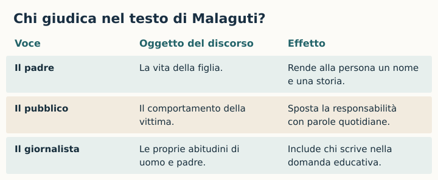
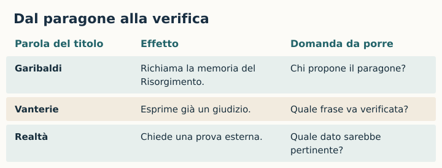

# ENS de Lyon · série SES (B/L) · Italien (oral) 2025 — Corrigé guidé partiel

*Corrigé rédigé par IA, non officiel. Signalez toute erreur.*

**Rédaction** · GPT-6.2 Astra Ultra · vitesse non renseignée

Le fascicule de Lyon identifie 2 références de presse. Il donne les titres et les dates. Les feuillets remis aux candidats et leurs coupes ne sont pas reproduits. Les prises de parole s’appuient sur les témoins indiqués pour chaque entrée.

[Répertoire officiel](https://www.ens-lyon.fr/sites/default/files/2025-10/Fascicule%20SES%202025%20OK.pdf#page=14) · [Rapport du jury](https://www.ens-lyon.fr/sites/default/files/2025-11/Fascicule%20SES%202025%20relu%20EB%2B%20SLG.pdf#page=26)

Le rapport relève deux difficultés différentes chez les deux personnes entendues. L’une s’exprimait avec fluidité et s’éloignait rapidement de l’article. L’autre suivait l’article mais manquait de précision en italien. Pour vous entraîner, prenez une seule phrase du titre, nommez son procédé en italien, puis formulez ce qu’elle fait comprendre au lecteur. Préparez ensuite une relance qui vous oblige à revenir à un mot du texte.

## La Stampa · “Il femminicidio di Martina e l’arroganza dei giudici”, Andrea Malaguti (01/06/2025)

Le fascicule et le jury écrivent « giudici ». L’original de La Stampa et la reprise de l’association titrent « giudizi ». Les deux formes sont distinguées.

### Chi ha il diritto di giudicare?

Il nome Martina collega due vicende distinte. Il racconto parte da Bruno Rossi, che il giornalista ha incontrato di persona a Imperia. Il padre ricorda la figlia e le parole usate per metterne in dubbio il comportamento. La morte di un’altra ragazza, Martina Carbonaro, riapre quella ferita. Il pericolo sarebbe raccontare la seconda storia come se fosse la ripetizione della prima. Il punto di contatto scelto da Malaguti è più preciso. Dopo la violenza, il discorso pubblico torna a esaminare la condotta delle ragazze e delle loro famiglie. Così si sposta l’attenzione dalla responsabilità di chi ha agito al comportamento di chi ha subito.

La forma dell’editoriale consente di seguire questo spostamento. All’inizio l’autore insiste su quello che sapeva prima di incontrare Bruno. Quando lo vede sul palco, ne osserva la voce e i gesti e gli lascia la parola. Il lettore incontra una figlia che scriveva e disegnava, un padre che oggi assiste i migranti a Ventimiglia. La testimonianza restituisce a queste persone una storia più ampia della cronaca giudiziaria. A questo punto il passaggio alla prima persona plurale acquista forza. Il direttore interpella anche sé stesso in quanto uomo e padre. Le domande rivolte ai lettori impediscono loro di assistere al processo dall’esterno.

Una sola consonante cambia il bersaglio dell’articolo. Il fascicolo lionese e il rapporto scrivono *giudici*. La testata pubblica *giudizi*. La differenza conta perché l’articolo esamina proprio la facilità con cui sui social, nei bar e nelle case chiunque si improvvisa giudice. La conclusione sulla prevenzione si capisce allora meglio. Un intervento sul codice penale, per quanto visibile, raggiunge un momento diverso da quello in cui un ragazzo impara che cosa significa rispettare la libertà altrui. Il compito dell’educazione comincia nelle relazioni quotidiane.

**Domanda.** Perché Malaguti racconta il lavoro di Bruno con i migranti? **Risposta.** È un esempio concreto di come quel padre abbia scelto di trasformare il dolore in attenzione per altre persone. La sua voce acquista così uno spessore che la sola qualifica di familiare della vittima non darebbe.

**Domanda.** Come renderesti in francese *l’arroganza dei giudizi*? **Risposta.** Direi « l’arrogance des jugements que l’on porte ». Così si sente l’atto compiuto da molte persone, mentre « des juges » restringerebbe il discorso alla magistratura.

**Pour préparer l’entretien.** Faites entendre la différence entre *giudizio* (pluriel *giudizi*) et *giudice* (pluriel *giudici*). Dans le premier développement, retrouvez sans notes le père qui témoigne, la jeune femme dont il parle, puis l’actualité qui rend ce témoignage à nouveau brûlant. Enchaînez par *a questo punto l’autore passa dal ricordo alla responsabilità collettiva*.

[Titre publié par La Stampa](https://www.lastampa.it/editoriali/l-editoriale-andrea-malaguti/2025/06/01/news/il_femminicidio_di_martina_e_l_arroganza_dei_giudizi-15172553/) · [Éditorial reproduit par l’association Martina Rossi](https://www.associazionemartinarossi.it/2025/06/01/il-femminicidio-di-martina-e-larroganza-dei-giudizi/)

## Repubblica · “Meloni meglio di Garibaldi: quelle vanterie da comizio della premier che fanno a botte con la realtà”, Serenella Mattera (26/10/2024)

Le titre, la rubrique et sa présentation sont lisibles. Le corps de l’article et ses vérifications particulières restent inconnus.

### Un eroe del Risorgimento in un titolo politico

Il titolo presenta un paragone volutamente sproporzionato. Accosta una presidente del Consiglio in carica a Garibaldi, una figura intorno alla quale si è costruito il racconto dell’unificazione italiana. La brevità di *meglio di* dà al titolo il ritmo di uno slogan. Sul piano grammaticale manca il criterio del confronto. Meglio in quale azione, rispetto a quale obiettivo, misurato da chi? Proprio questa domanda permette di uscire dalla gara immaginaria tra personaggi e di entrare nel tema di una rubrica dedicata alla verifica delle affermazioni pubbliche.

La seconda parte fornisce alcuni indizi di lettura. *Vanterie* contiene già un giudizio sulle rivendicazioni della premier. *Da comizio* colloca quelle rivendicazioni in una situazione precisa, nella quale contano il pubblico, l’applauso e l’efficacia immediata. Infine *fanno a botte* fa entrare nel titolo un modo di dire familiare. Idee e fatti assumono il comportamento di persone che litigano. Ne nasce una tensione tra il richiamo solenne a un eroe nazionale e la chiusa colloquiale. Per attribuire un’affermazione precisa alla presidente del Consiglio servirebbero le sue parole e la circostanza in cui sono state pronunciate. Il paragone con Garibaldi rimane qui una scelta riconoscibile del titolo giornalistico.

La presentazione della rubrica *La verità, vi prego* distingue la falsità dall’omissione. Come verifica concreta, se si rivendicasse un primato, bisognerebbe chiedere quale periodo venga considerato, chi rientri nel confronto e se l’indicatore sia rimasto identico. È un esempio di metodo per proseguire la lettura. La pagina pubblica consente di leggere il titolo, la presentazione e la firma. I dati eventualmente controllati da Mattera e l’ordine in cui l’articolo li discute restano da stabilire sul testo.

**Domanda.** Perché il nome Garibaldi funziona anche senza una data? **Risposta.** Il titolo conta sulla memoria condivisa del lettore. Bastano il nome e il comparativo per evocare un giudizio sulla grandezza storica che sembra eccessivo.

**Domanda.** Perché sarebbe rischioso usare le virgolette intorno al paragone e attribuirlo a Meloni? **Risposta.** Il titolo è firmato dalla giornalista e non riporta un discorso diretto della premier. Cambiare il parlante trasformerebbe l’ironia del giornale in una dichiarazione politica priva di prova.

**Pour préparer l’entretien.** Dites qui s’exprime à chaque étape. Dans « il titolo suggerisce che… », le sujet est le titre de l’article. Dans « la premier avrebbe sostenuto che… », le conditionnel signifie que la déclaration reste à vérifier. Inventez un indicateur pour l’exercice, précisez son unité et sa période puis annoncez explicitement qu’il s’agit de votre exemple.

[Titre et présentation de la rubrique de Serenella Mattera](https://www.repubblica.it/dossier/politica/la-verit-vi-prego/2024/10/26/news/meloni_comizio_governo_premier_garibaldi_la_verita_vi_prego-423579345/)
