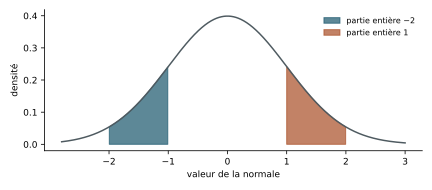
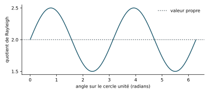
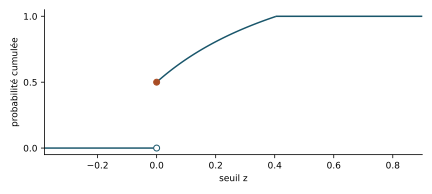

# ENS de Lyon B/L — Oral de mathématiques 2025 · Corrigé guidé

*Corrigé rédigé par IA, non officiel. Signalez toute erreur.*

**Rédaction** · GPT-6.2 Astra Ultra · vitesse non renseignée

**Révision (tour 1)** · GPT-6.2 Astra Ultra · vitesse non renseignée · 26 novembre 2026

Le jury a interrogé 38 candidats et candidates. La préparation dure une heure pour les deux exercices de chaque planche. Le candidat présente les deux exercices dans l’ordre de son choix. Sur les trente minutes de l’oral, il dispose d’au plus quinze minutes pour exposer son travail avant les questions du jury. L’annexe officielle reproduit treize planches, numérotées 2, 3 et 5 à 15. Le fascicule des épreuves orales renvoie à cette annexe en page 19. Les deux exercices et les 197 questions publiées sont traités. Les planches 1 et 4 restent indisponibles dans les pièces officielles consultées.

[Annexe des planches](https://www.ens-lyon.fr/sites/default/files/2025-10/Annexe%20Sujets%20Math%C3%A9matiques%20SES%20session%202025.pdf) · [Rubrique de mathématiques du jury](https://www.ens-lyon.fr/sites/default/files/2025-11/Fascicule%20SES%202025%20relu%20EB%2B%20SLG.pdf#page=14) · [Fascicule des oraux, p. 19](https://www.ens-lyon.fr/sites/default/files/2025-10/Fascicule%20SES%202025%20OK.pdf#page=19)

Lors de la présentation, le jury demande de préciser les hypothèses des théorèmes. Pour la planche 2, on justifie ainsi l’intégrabilité avant d’utiliser la symétrie de la loi normale. Pour la planche 6, on vérifie que le dénominateur du quotient de Rayleigh ne s’annule pas sur le chemin choisi.

## Planche 2 · Exercice 1 — Partie entière d’une variable normale

[Annexe 2025, p. 2](https://www.ens-lyon.fr/sites/default/files/2025-10/Annexe%20Sujets%20Math%C3%A9matiques%20SES%20session%202025.pdf#page=2)

### Question 1a

> [!INDICATION]
> Donner la densité sur la droite entière.

#### Solution

Une densité de $T\sim\mathcal N(0,1)$ est $\varphi(t)=(2\pi)^{-1/2}e^{-t^2/2}$ pour tout $t\in\mathbb R$.

### Question 1b

> [!INDICATION]
> Utiliser la symétrie de la densité.

#### Solution

La densité de $-T$ est $t\mapsto\varphi(-t)=\varphi(t)$. Donc $Y=-T$ suit aussi la loi normale centrée réduite.

### Question 2

> [!INDICATION]
> Chaque intervalle situé entre deux entiers a une masse positive.

#### Solution

$X=\lfloor T\rfloor$ est entier, et $\varphi>0$ sur chaque intervalle $[k,k+1)$. Chaque entier est pris avec une probabilité positive, donc le support est $\mathbb Z$.

### Question 3a

> [!INDICATION]
> Traduire la partie entière en intervalle.

#### Solution

Pour tout $k\in\mathbb Z$, $p_k=\mathbb P(X=k)=\mathbb P(k\le T<k+1)=\Phi(k+1)-\Phi(k)$ car la loi normale n’a pas d’atome.

### Question 3b

> [!INDICATION]
> Réfléchir l’intervalle autour de zéro.

#### Solution

L’identité $\Phi(-t)=1-\Phi(t)$ donne $p_{-k}=\Phi(1-k)-\Phi(-k)=\Phi(k)-\Phi(k-1)=p_{k-1}$.

### Question 4

> [!INDICATION]
> Décaler d’un rang la deuxième somme.

#### Solution

Par 3b, $\sum_{k=1}^nk(p_k-p_{-k})=np_n-\sum_{j=0}^{n-1}p_j$. En remplaçant $p_n$ et en télescopant la dernière somme, on trouve $n\Phi(n+1)-(n+1)\Phi(n)+\Phi(0)$.

### Question 5a

> [!INDICATION]
> Majorer la densité par sa valeur au point de gauche.

#### Solution

Lorsque $0\le x\le y$, $\varphi$ est décroissante et positive sur $[x,y]$. Ainsi $0\le\Phi(y)-\Phi(x)=\int_x^y\varphi(t)dt\le(y-x)e^{-x^2/2}/\sqrt{2\pi}$.

### Question 5b

> [!INDICATION]
> Comparer les termes à une suite à décroissance gaussienne.

#### Solution

$0\le n[\Phi(n+1)-\Phi(n)]\le n\varphi(n)$. La série de droite converge, par exemple parce que le rapport de deux termes successifs tend vers zéro. La comparaison donne la convergence.

### Question 6

> [!INDICATION]
> Vérifier séparément les deux parties de l’espérance puis passer à la limite.

#### Solution

La série positive converge par 5b. La série négative en valeur absolue est $\sum_{n\ge1}np_{n-1}=\sum_{j\ge0}(j+1)p_j<\infty$. La formule de 4 s’écrit $np_n-\Phi(n)+\Phi(0)$. Comme $np_n\to0$, $\Phi(n)\to1$ et $\Phi(0)=1/2$, on conclut $\mathbb EX=-1/2$.

On peut vérifier le signe du résultat directement. Presque sûrement $T$ n’est pas entier et $\lfloor T\rfloor+\lfloor-T\rfloor=-1$. Les deux variables ont la même loi et sont intégrables puisque $|\lfloor T\rfloor|\le |T|+1$. L’espérance de cette identité redonne $2\mathbb EX=-1$.

## Planche 2 · Exercice 2 — Orthogonaux

[Annexe 2025, p. 3](https://www.ens-lyon.fr/sites/default/files/2025-10/Annexe%20Sujets%20Math%C3%A9matiques%20SES%20session%202025.pdf#page=3)

### Question 1a

> [!INDICATION]
> Vérifier l’orthogonalité sur la plus petite partie.

#### Solution

Si $x\in B^\perp$, son produit scalaire avec tout élément de $B$ est nul, donc en particulier avec tout élément de $A\subset B$. Ainsi $B^\perp\subset A^\perp$.

### Question 1b

> [!INDICATION]
> Étendre une relation à toutes les combinaisons linéaires.

#### Solution

$A\subset\operatorname{Vect}A$ donne une inclusion par 1a. Inversement tout vecteur orthogonal à $A$ est orthogonal à toute combinaison linéaire de ses éléments par bilinéarité. Les deux orthogonaux coïncident.

### Question 2a

> [!INDICATION]
> Utiliser la décomposition orthogonale en dimension finie.

#### Solution

$F\subset(F^\perp)^\perp$ par symétrie du produit scalaire. Comme $\dim F^\perp=n-\dim F$, les deux espaces de l’inclusion ont la même dimension, donc sont égaux.

### Question 2b

> [!INDICATION]
> Tester séparément les deux composantes d’une somme.

#### Solution

$x\perp(F+G)$ implique $x\perp F$ et $x\perp G$ car chaque espace est inclus dans la somme. Inversement ces deux conditions donnent $\langle x,f+g\rangle=0$ par linéarité. Donc $(F+G)^\perp=F^\perp\cap G^\perp$.

### Question 2c

> [!INDICATION]
> Appliquer l’identité précédente aux deux orthogonaux.

#### Solution

Par 2a et 2b, $(F^\perp+G^\perp)^\perp=F\cap G$. En reprenant l’orthogonal et en utilisant 2a, $(F\cap G)^\perp=F^\perp+G^\perp$.

### Question 3

> [!INDICATION]
> Identifier les deux normales aux plans définissant H.

#### Solution

$H=\operatorname{Vect}((1,1,1),(1,-2,-1))^\perp$. Ces deux normales ne sont pas proportionnelles, donc elles forment une base de $H^\perp$ par 2a.

### Question 4

> [!INDICATION]
> Développer le carré en fonction du paramètre réel.

#### Solution

$\|x+ty\|^2-\|x\|^2=2t\langle x,y\rangle+t^2\|y\|^2$. Si le produit scalaire est nul l’expression est positive ou nulle. Réciproquement, sa positivité pour tout $t$ impose que sa dérivée en son minimum $t=0$ soit nulle, donc $\langle x,y\rangle=0$. Cela couvre $y=0$.

## Planche 3 · Exercice 1 — Rangs de deux endomorphismes

[Annexe 2025, p. 4](https://www.ens-lyon.fr/sites/default/files/2025-10/Annexe%20Sujets%20Math%C3%A9matiques%20SES%20session%202025.pdf#page=4)

### Question 1a

> [!INDICATION]
> Contenir l’image dans la somme des images.

#### Solution

$\operatorname{Im}(u+v)\subset\operatorname{Im}u+\operatorname{Im}v$. En prenant les dimensions puis en utilisant la formule de Grassmann, $\operatorname{rg}(u+v)\le\operatorname{rg}u+\operatorname{rg}v$.

### Question 1b

> [!INDICATION]
> Décomposer successivement chacune des deux applications.

#### Solution

En appliquant 1a à $u=(u+v)-v$ puis à $v=(u+v)-u$, on majore chaque différence de rang par $\operatorname{rg}(u+v)$. D’où la majoration de la valeur absolue.

### Question 2a

> [!INDICATION]
> Traduire l’annulation de la somme.

#### Solution

Si $(u+v)x=0$, alors $u(x)=-v(x)$ appartient à l’intersection des images, supposée nulle. Ainsi $u(x)=v(x)=0$. La réciproque est immédiate, donc $\ker(u+v)=\ker u\cap\ker v$.

### Question 2b

> [!INDICATION]
> Étudier les égalités dans la majoration du rang puis appliquer Grassmann aux noyaux.

#### Solution

Sous (i), la chaîne de 1a impose que les images soient en somme directe. Par 2a et le rang, $\dim(\ker u\cap\ker v)=n-\operatorname{rg}u-\operatorname{rg}v$. Grassmann donne alors $\dim(\ker u+\ker v)=n$, soit (ii). Réciproquement, sous (ii), Grassmann donne la même dimension d’intersection et 2a identifie celle-ci au noyau de la somme. Le théorème du rang redonne (i).

## Planche 3 · Exercice 2 — Gains du casino et convexité

[Annexe 2025, p. 4,5](https://www.ens-lyon.fr/sites/default/files/2025-10/Annexe%20Sujets%20Math%C3%A9matiques%20SES%20session%202025.pdf#page=4)

### Question A.1

> [!INDICATION]
> Sous les choix équiprobables, répartir la masse gagnée totale par symétrie.

#### Solution

La lecture probabiliste attendue suppose les choix des joueurs indépendants et équiprobables, indépendamment de la pièce. Le sujet précise l’indépendance et l’équilibre de la pièce, sans préciser la loi des choix individuels. Dans ce modèle, tous perdent avec probabilité $2^{-n}$. Sinon le casino distribue $n$ euros. Les joueurs sont échangeables, donc $\mathbb EX_k=1-2^{-n}$. L’hypothèse sur les choix intervient réellement : si tous choisissent pile avec certitude, l’espérance de chacun est $1/2$.

### Question A.2a

> [!INDICATION]
> Examiner la variation du gain moyen individuel avec le nombre de joueurs.

#### Solution

Ajouter un joueur porte la moyenne à $1-2^{-(n+1)}>1-2^{-n}$. Le joueur accepte donc le nouvel arrivant selon ce critère.

### Question A.2b

> [!INDICATION]
> Le casino conserve la cagnotte seulement si personne ne gagne.

#### Solution

Sa recette moyenne est $n2^{-n}$. Le rapport des recettes après et avant l’arrivée vaut $(n+1)/(2n)<1$ pour $n\ge2$. L’employé refuse donc l’arrivée.

### Question A.3a

> [!INDICATION]
> Conditionner sur la victoire du joueur étudié.

#### Solution

Le joueur gagne avec probabilité $1/2$. Le nombre $j$ d’autres gagnants conditionnellement à cette victoire est binomial de paramètres $n-1,1/2$. Son gain vaut alors $n/(j+1)$. Donc $\mathbb E X_k^2=2^{-n}\sum_{j=0}^{n-1}\binom{n-1}j[n/(j+1)]^2$.

### Question A.3b

> [!INDICATION]
> Appliquer l’inégalité donnée aux gains conditionnels.

#### Solution

Prenons $t_j=2^{1-n}\binom{n-1}{j}$ et $x_j=n/(j+1)$. Ce sont les poids et les gains conditionnels calculés en A.3a. Alors $\sum t_j x_j=2\mathbb EX_k$ et $\sum t_jx_j^2=2\mathbb EX_k^2$. L’inégalité donne $\mathbb EX_k^2\ge2(\mathbb EX_k)^2=2(1-2^{-n})^2$.

### Question A.3c

> [!INDICATION]
> Soustraire le carré de la moyenne.

#### Solution

$\operatorname{Var}X_k=\mathbb EX_k^2-(\mathbb EX_k)^2\ge(\mathbb EX_k)^2$ par A.3b.

### Question B.1

> [!INDICATION]
> Regrouper les premiers poids et isoler le dernier.

#### Solution

Pour deux points c’est la définition. Supposons le résultat pour $n$ points et posons $s=1-t_{n+1}$. Si $s=0$ l’inégalité est une égalité. Sinon écrivons la moyenne comme $s\sum_{i\le n}(t_i/s)x_i+t_{n+1}x_{n+1}$. Les poids normalisés somment à un. La convexité à deux points puis l’hypothèse de récurrence donnent $f(\sum t_ix_i)\le\sum t_if(x_i)$.

### Question B.2a

> [!INDICATION]
> Prendre les probabilités des valeurs de la variable comme poids.

#### Solution

Avec $t_i=\mathbb P(X=x_i)$ dans B.1, on obtient $f(\mathbb EX)\le\mathbb E f(X)$.

### Question B.2b

> [!INDICATION]
> Appliquer la formule à la fonction carré.

#### Solution

Puisque $x\mapsto x^2$ est convexe, $(\mathbb EX)^2\le\mathbb E X^2$. On retrouve la positivité de la variance et l’inégalité admise en partie A.

## Planche 5 · Exercice 1 — Sommes de carrés et nombres harmoniques

[Annexe 2025, p. 6](https://www.ens-lyon.fr/sites/default/files/2025-10/Annexe%20Sujets%20Math%C3%A9matiques%20SES%20session%202025.pdf#page=6)

### Question 1

> [!INDICATION]
> Vérifier directement l’incrément de la formule fermée.

#### Solution

Posons $A_n=n(n+1)(2n+1)/6$. On a $A_1=1$ et $A_{n+1}-A_n=(n+1)[(n+2)(2n+3)-n(2n+1)]/6=(n+1)^2$. La récurrence donne $\sum_{k=1}^nk^2=A_n$.

### Question 2

> [!INDICATION]
> Utiliser un équivalent positif.

#### Solution

$u_n=6/[n(n+1)(2n+1)]\sim3/n^3$. Les termes sont positifs et la série de Riemann de référence converge, donc $\sum u_n$ converge.

### Question 3a

> [!INDICATION]
> Intégrer la fonction inverse sur une bande unitaire.

#### Solution

Sur $[k,k+1]$, $1/(k+1)\le1/t\le1/k$. L’intégration donne l’encadrement de $\ln(k+1)-\ln k$.

### Question 3b

> [!INDICATION]
> Sommer les comparaisons avec l’intégrale du logarithme.

#### Solution

On obtient $\ln(n+1)\le H_n\le1+\ln n$. Après division par $\ln n$ pour $n>1$, les deux bornes tendent vers un, donc $H_n\sim\ln n$.

### Question 4a

> [!INDICATION]
> Encadrer la somme entre deux intégrales sur des intervalles proches.

#### Solution

Par décroissance, $\ln[(2n+2)/(n+1)]\le\sum_{k=n+1}^{2n+1}1/k\le\ln[(2n+1)/n]$. Les bornes tendent vers $\ln2$, d’où $H_{2n+1}-H_n\to\ln2$.

### Question 4b

> [!INDICATION]
> Identifier les coefficients après multiplication par le dénominateur.

#### Solution

Pour $n\ge1$, $u_n=6/n+6/(n+1)-24/(2n+1)$, comme le vérifie la mise au même dénominateur. Les constantes demandées sont $6,6,-24$. Au rang zéro l’expression et la définition de $u_n$ comporteraient une division par zéro.

### Question 4c

> [!INDICATION]
> Séparer les indices pairs et impairs dans la somme harmonique.

#### Solution

$\sum_{k=1}^n(2k+1)^{-1}=H_{2n+1}-H_n/2-1$. La décomposition de 4b donne $\sum_{k=1}^nu_k=18+6/(n+1)-24(H_{2n+1}-H_n)$. La somme infinie vaut donc $18-24\ln2$.

## Planche 5 · Exercice 2 — Différence de deux projections orthogonales

[Annexe 2025, p. 7](https://www.ens-lyon.fr/sites/default/files/2025-10/Annexe%20Sujets%20Math%C3%A9matiques%20SES%20session%202025.pdf#page=7)

### Question 1

> [!INDICATION]
> Utiliser le théorème de décomposition orthogonale.

#### Solution

En dimension finie, $E=F\oplus F^\perp$. On peut construire la décomposition avec $x_1=p(x)$, $x_2=x-p(x)$. L’intersection nulle donne l’unicité.

### Question 2a

> [!INDICATION]
> Éliminer la composante orthogonale.

#### Solution

$\sigma(x)=p(x)-(x-p(x))=2p(x)-x$, donc $\sigma=2p-I$.

### Question 2b

> [!INDICATION]
> Utiliser l’idempotence du projecteur.

#### Solution

$\sigma^2=4p^2-4p+I=I$. L’application linéaire est bijective, d’inverse elle-même.

### Question 2c

> [!INDICATION]
> Calculer les deux normes dans la décomposition orthogonale.

#### Solution

Si $x=x_1+x_2$, les deux termes sont orthogonaux. Donc $\|\sigma x\|^2=\|x_1-x_2\|^2=\|x_1\|^2+\|x_2\|^2=\|x\|^2$.

### Question 3

> [!INDICATION]
> Représenter chaque projection comme demi-somme avec sa symétrie.

#### Solution

On a $2(p-q)u=\sigma(u)-\sigma'(u)$. Par l’inégalité triangulaire et 2c pour chaque symétrie, le membre de droite a norme au plus $2\|u\|$. D’où la majoration demandée.

### Question 4a

> [!INDICATION]
> Comparer les développements des deux carrés.

#### Solution

L’égalité des normes donne $\|a\|^2+\|b\|^2-2\langle a,b\rangle=\|a\|^2+\|b\|^2+2\|a\|\|b\|$. Ainsi $\langle a,b\rangle=-\|a\|\|b\|$.

### Question 4b

> [!INDICATION]
> Calculer la norme du vecteur qui devrait s’annuler.

#### Solution

Pour $\lambda=\|b\|/\|a\|>0$, on a $\|\lambda a+b\|^2=\lambda^2\|a\|^2+2\lambda\langle a,b\rangle+\|b\|^2=0$ par 4a. Donc $b=-\lambda a$.

### Question 5a

> [!INDICATION]
> Retracer l’égalité dans la majoration de la question 3.

#### Solution

Sous l’hypothèse, $\|\sigma(u)-\sigma'(u)\|=2\|u\|=\|\sigma(u)\|+\|\sigma'(u)\|$.

### Question 5b

> [!INDICATION]
> Appliquer le cas d’égalité à deux vecteurs de même norme.

#### Solution

Par 4b, $\sigma'(u)=-\lambda\sigma(u)$ avec $\lambda>0$. Les deux normes valent $\|u\|>0$, donc $\lambda=1$ et $\sigma(u)=-\sigma'(u)$.

### Question 5c

> [!INDICATION]
> Réécrire l’égalité en revenant aux projecteurs.

#### Solution

Par 5b, $p(u)+q(u)=u$. En appliquant $p$ puis $q$, on trouve $p(q(u))=0$ et $q(p(u))=0$. Donc $p(u)\in F\cap G^\perp$ et $q(u)\in F^\perp\cap G$. Leur somme étant non nulle, l’un de ces deux espaces est non nul.

### Question 6

> [!INDICATION]
> Restreindre chaque projection à l’autre sous-espace.

#### Solution

Un vecteur non nul dans $F\cap G^\perp$ réaliserait l’égalité de 3, ce qui est exclu. De même $F^\perp\cap G=\{0\}$. Ainsi $q|_F$ est injective de $F$ dans $G$, et $p|_G$ est injective de $G$ dans $F$. Les deux inégalités de dimension donnent l’égalité.

## Planche 6 · Exercice 1 — Attente et service à deux guichets

[Annexe 2025, p. 8](https://www.ens-lyon.fr/sites/default/files/2025-10/Annexe%20Sujets%20Math%C3%A9matiques%20SES%20session%202025.pdf#page=8)

### Question 1

> [!INDICATION]
> Partir de la somme géométrique finie ou de sa dérivée.

#### Solution

Pour $|x|<1$, la série $\sum_{n\ge1}nx^{n-1}$ converge absolument par le critère du rapport (pour $x=0$, un seul terme non nul). En dérivant la somme géométrique finie on obtient $[1-(N+1)x^N+Nx^{N+1}]/(1-x)^2$ pour les $N$ premiers termes, d’où la somme $1/(1-x)^2$.

### Question 2a

> [!INDICATION]
> Le troisième client attend la première des deux fins de service.

#### Solution

$Y=\min(X_1,X_2)$. Notons $q=1-p$. Pour $k\ge1$, $\mathbb P(Y>k)=\mathbb P(X_1>k)\mathbb P(X_2>k)=q^{2k}$, donc $\mathbb P(Y\le k)=1-q^{2k}$.

### Question 2b

> [!INDICATION]
> Prendre la différence de deux probabilités de queue.

#### Solution

$\mathbb P(Y=k)=(1-q^2)q^{2(k-1)}$ pour $k\ge1$. C’est la loi géométrique de paramètre $1-q^2$.

### Question 3

> [!INDICATION]
> Convoluer le temps d’attente et le temps de service indépendant.

#### Solution

$Z=Y+X_3$, où $Y$ est indépendant de $X_3$. Pour $m\ge2$, $\mathbb P(Z=m)=\sum_{j=1}^{m-1}(1-q^2)q^{2(j-1)}p q^{m-j-1}=(1-q^2)q^{m-2}(1-q^{m-1})$. La probabilité est nulle pour $m<2$.

### Question 4

> [!INDICATION]
> Additionner les deux moyennes géométriques.

#### Solution

$\mathbb EZ=1/(1-q^2)+1/p$, en minutes, soit $(3-p)/[p(2-p)]$.

## Planche 6 · Exercice 2 — Quotient de Rayleigh

[Annexe 2025, p. 8,9](https://www.ens-lyon.fr/sites/default/files/2025-10/Annexe%20Sujets%20Math%C3%A9matiques%20SES%20session%202025.pdf#page=8)

### Question 1

> [!INDICATION]
> Tester un vecteur propre non nul.

#### Solution

Si $f(x)=\lambda x$ pour $x\ne0$, $r(x)=\lambda\langle x,x\rangle/\|x\|^2=\lambda$. Donc toute valeur propre réelle appartient à $R$.

### Question 2a

> [!INDICATION]
> Développer le carré du segment affine.

#### Solution

$\|h(t)\|^2=t^2\|u\|^2+2t(1-t)\langle u,v\rangle+(1-t)^2\|v\|^2$ est un polynôme de degré au plus deux.

### Question 2b

> [!INDICATION]
> Exclure le vecteur nul sur toute la droite affine.

#### Solution

Pour $u,v$ indépendants, $tu+(1-t)v=0$ imposerait $t=1-t=0$, impossible. Le numérateur et le dénominateur sont polynomiaux et ce dernier est strictement positif pour tout réel. Leur quotient est continu sur la droite si l’on y prolonge la formule de $h$, donc aussi sur le segment prescrit.

### Question 2c

> [!INDICATION]
> Relier deux valeurs différentes par un segment de vecteurs indépendants.

#### Solution

Pour $s\ne0$, $r(sx)=r(x)$. Si $r(u)\ne r(v)$, les vecteurs sont donc indépendants. Par 2b et le théorème des valeurs intermédiaires, toute valeur entre ces deux extrémités est atteinte sur le segment. Ainsi $R$ est un intervalle.

### Question 3a

> [!INDICATION]
> Utiliser la décomposition orthogonale associée au projecteur.

#### Solution

Pour $x=x_1+x_2$, $x_1\in E$, $x_2\in E^\perp$, le quotient vaut $\|x_1\|^2/(\|x_1\|^2+\|x_2\|^2)\in[0,1]$.

### Question 3b

> [!INDICATION]
> Atteindre les deux bornes de l’intervalle.

#### Solution

Puisque $E$ est non nul et propre, $E$ et $E^\perp$ possèdent des vecteurs non nuls qui réalisent respectivement $1$ et $0$. Par 2c et 3a, $R=[0,1]$.

### Question 4a

> [!INDICATION]
> Lire le spectre de la matrice triangulaire.

#### Solution

Dans la base canonique la matrice est $\left(\begin{smallmatrix}2&1\\0&2\end{smallmatrix}\right)$, d’unique valeur propre $2$.

### Question 4b

> [!INDICATION]
> Utiliser un carré positif.

#### Solution

$(|x_1|-|x_2|)^2\ge0$ donne $2|x_1x_2|\le x_1^2+x_2^2$.

### Question 4c

> [!INDICATION]
> Tester les deux diagonales du plan.

#### Solution

$r(x)=2+x_1x_2/(x_1^2+x_2^2)$ est compris entre $3/2$ et $5/2$ par 4b. Les vecteurs $(1,-1)$ et $(1,1)$ réalisent les bornes. Par 2c, $R=[3/2,5/2]$.

Pour vérifier le parcours sur la figure, prenons $x=(\cos t,\sin t)$. Alors $r(x)=2+\tfrac12\sin(2t)$. Aux angles $t=\pi/4$ et $t=3\pi/4$, le quotient prend respectivement $5/2$ et $3/2$, alors que la matrice a pour seule valeur propre $2$.

### Question 5a

> [!INDICATION]
> Exprimer les produits dans la base orthonormale propre.

#### Solution

Avec $x=\sum_i x_i\varepsilon_i$, on a $f(x)=\sum_i\lambda_ix_i\varepsilon_i$. Donc $r(x)=\sum_i\lambda_i x_i^2/\sum_i x_i^2$ par orthonormalité.

### Question 5b

> [!INDICATION]
> Interpréter la formule comme une moyenne pondérée.

#### Solution

Tous les poids sont positifs ou nuls et de somme un. $R\subset[\lambda_1,\lambda_n]$ et les deux bornes sont atteintes sur leurs vecteurs propres. Par 2c, il y a égalité.

### Question 5c

> [!INDICATION]
> Examiner l’annulation d’une somme positive.

#### Solution

Si $r(x)=\lambda_1$, $\sum_i(\lambda_i-\lambda_1)x_i^2=0$. Pour tout indice où $\lambda_i>\lambda_1$, il faut $x_i=0$. Ainsi $x\ne0$ est dans l’espace propre de $\lambda_1$.

## Planche 7 · Exercice 1 — Polynômes à valeurs entières

[Annexe 2025, p. 10](https://www.ens-lyon.fr/sites/default/files/2025-10/Annexe%20Sujets%20Math%C3%A9matiques%20SES%20session%202025.pdf#page=10)

### Question 1

> [!INDICATION]
> Reconnaître un coefficient binomial et traiter les entiers négatifs.

#### Solution

Si $k\ge0$, $H_n(k)=\binom{k}{n}$ avec valeur zéro pour $0\le k<n$. Si $k=-m<0$, $H_n(-m)=(-1)^n\binom{m+n-1}{n}$. Ces nombres sont entiers, et $H_0=1$ convient aussi.

### Question 2

> [!INDICATION]
> Utiliser les degrés successifs.

#### Solution

$H_j$ a degré $j$ et coefficient dominant $1/j!\ne0$. Une relation non triviale serait impossible en son degré maximal. Les $n+1$ polynômes indépendants forment donc une base de $\mathbb R_n[X]$.

### Question 3

> [!INDICATION]
> Évaluer successivement le développement en chacun des entiers de zéro à n.

#### Solution

(i) implique (ii). Écrivons $P=\sum_{j=0}^n\lambda_jH_j$ dans la base de 2. Comme $H_j(k)=0$ pour $j>k$ et $H_k(k)=1$, $\lambda_k=P(k)-\sum_{j<k}\lambda_jH_j(k)$. Sous (ii), la récurrence de $k=0$ à $n$ donne tous les coefficients entiers, soit (iii). Enfin (iii) implique (i) par 1.

## Planche 7 · Exercice 2 — Partie fractionnaire d’une variable de Pareto

[Annexe 2025, p. 10,11](https://www.ens-lyon.fr/sites/default/files/2025-10/Annexe%20Sujets%20Math%C3%A9matiques%20SES%20session%202025.pdf#page=10)

### Question 1

> [!INDICATION]
> Mettre les termes au même dénominateur.

#### Solution

Pour $x\ge0$, $0\le1/k-1/(k+x)=x/[k(k+x)]\le x/k^2$. À $x$ fixé la comparaison à une série de Riemann donne la convergence.

### Question 2

> [!INDICATION]
> Examiner la série nulle et la série télescopique.

#### Solution

$S(0)=0$. Pour $x=1$ la somme partielle vaut $1-1/(N+1)$, donc $S(1)=1$.

### Question 3a

> [!INDICATION]
> Développer exactement la différence d’inverses.

#### Solution

$\sum_{k\ge1}(k+x)^{-2}$ converge par comparaison à $\sum k^{-2}$. Avec $a=k+x$, on a $1/a-1/(a+h)-h/a^2=-h^2/[a^2(a+h)]$. Comme $x\ge0$ et $x+h\ge0$, les trois facteurs du dénominateur sont au moins $k$. Après sommation, la valeur absolue de la différence annoncée est au plus $h^2\sum_{k\ge1}k^{-3}$.

### Question 3b

> [!INDICATION]
> Diviser l’erreur par h et passer à la limite.

#### Solution

La borne précédente donne $S'(x)=\sum_{k\ge1}(k+x)^{-2}>0$, avec dérivée à droite en zéro. Ainsi $S$ est strictement croissante.

### Question 4a

> [!INDICATION]
> Répartir les valeurs de X par bandes entières.

#### Solution

Pour $0\le x<1$, l’événement $Y\le x$ est l’union disjointe des bandes $k\le X\le k+x$ pour $k\ge1$ à un événement nul près. Chaque masse est $\int_k^{k+x}t^{-2}dt=1/k-1/(k+x)$. Leur somme vaut $S(x)$.

### Question 4b

> [!INDICATION]
> Compléter la répartition à l’extérieur du support.

#### Solution

Puisque $0\le Y<1$, sa fonction de répartition vaut $0$ pour $x<0$, $S(x)$ pour $0\le x<1$ et $1$ pour $x\ge1$.

### Question 4c

> [!INDICATION]
> Vérifier les raccordements et dériver sur l’intervalle actif.

#### Solution

Par 2, $S(0)=0$, $S(1)=1$. La répartition est continue sur $\mathbb R$ et $C^1$ par morceaux, avec $S'$ continue comme admis. Une densité vaut $S'(x)$ pour $0<x<1$ et zéro ailleurs.

### Question 5

> [!INDICATION]
> Intégrer des sommes partielles positives et les majorer par 1.

#### Solution

Chaque terme ajouté à l’intégrande est positif au sens large. Sur $[0,1]$ la somme partielle est majorée par $S(x)\le S(1)=1$. Ainsi $u_n$ croît et demeure dans $[0,1]$, donc converge vers un réel $\gamma\in[0,1]$.

### Question 6

> [!INDICATION]
> Majorer la queue uniformément à un facteur x près.

#### Solution

Pour $x\in[0,1]$, le reste est positif et au plus $x\sum_{k>n}k^{-2}$. En intégrant, $0\le\int_0^1S(x)dx-u_n\le\tfrac12\sum_{k>n}k^{-2}\to0$. Donc $\int_0^1 S=\gamma$.

### Question 7

> [!INDICATION]
> Intégrer par parties avec la fonction de répartition.

#### Solution

$Y$ est bornée, donc intégrable. Avec sa densité, $\mathbb EY=\int_0^1xS'(x)dx=[xS(x)]_0^1-\int_0^1S(x)dx=1-\gamma$.

## Planche 8 · Exercice 1 — Une intégrale et deux polynômes tronqués

[Annexe 2025, p. 12](https://www.ens-lyon.fr/sites/default/files/2025-10/Annexe%20Sujets%20Math%C3%A9matiques%20SES%20session%202025.pdf#page=12)

### Question 1

> [!INDICATION]
> Examiner l’unique singularité apparente.

#### Solution

$\ln(1+t)/t\to1$ en zéro et la fonction est continue sur $(0,1]$. Le prolongement en zéro est continu sur le segment, donc l’intégrale converge.

### Question 2

> [!INDICATION]
> Intégrer une somme géométrique finie.

#### Solution

Pour $0\le t\le1$, $1/(1+t)=\sum_{j=0}^{n-1}(-t)^j+(-t)^n/(1+t)$. En intégrant de zéro à $x$, on obtient $P_n(x)=\ln(1+x)-R_n(x)$ avec le reste défini dans l’énoncé.

### Question 3

> [!INDICATION]
> Éliminer le dénominateur pour majorer la valeur absolue.

#### Solution

$|R_n(x)|\le\int_0^x t^n dt=x^{n+1}/(n+1)$ car $1+t\ge1$.

### Question 4

> [!INDICATION]
> Dériver terme à terme la somme finie.

#### Solution

$Q_n'(x)=\sum_{k=1}^n(-1)^{k-1}x^{k-1}/k=P_n(x)/x$ pour $x>0$.

### Question 5

> [!INDICATION]
> Vérifier le prolongement annoncé en zéro.

#### Solution

Pour $x>0$, $g_n(x)=-R_n(x)/x$, donc $|g_n(x)|\le x^n/(n+1)\to0$ lorsque $x\downarrow0$. Ainsi $|g_n|$ est continue sur $[0,1]$ et son intégrale existe.

### Question 6a

> [!INDICATION]
> Intégrer la dérivée et la majoration de l’erreur.

#### Solution

Puisque $Q_n(0)=0$, $Q_n(1)-L=\int_0^1g_n(x)dx$. Sa valeur absolue est au plus $\int_0^1|g_n|\le\int_0^1 x^n/(n+1)dx=(n+1)^{-2}$.

### Question 6b

> [!INDICATION]
> Faire tendre le majorant vers zéro.

#### Solution

Par 6a, $Q_n(1)\to L=\int_0^1\ln(1+t)/t\,dt$.

## Planche 8 · Exercice 2 — Une matrice dépendant d’un paramètre

[Annexe 2025, p. 13](https://www.ens-lyon.fr/sites/default/files/2025-10/Annexe%20Sujets%20Math%C3%A9matiques%20SES%20session%202025.pdf#page=13)

### Question 1a

> [!INDICATION]
> Calculer le déterminant puis tester un mineur constant.

#### Solution

Pour la matrice imprimée, $\det A(t)=t(t+1)$. Le mineur formé des lignes 2,3 et colonnes 2,3 vaut $-1$. Donc le rang est $2$ si $t=0$ ou $-1$, et $3$ sinon.

### Question 1b

> [!INDICATION]
> Développer le polynôme caractéristique.

#### Solution

$\det(zI-A)=z^3-(t^2+t+1)z-t(t+1)=(z+t)(z+1)(z-t-1)$. Les valeurs propres sont $-t,-1,t+1$, avec les coïncidences possibles.

### Question 1c

> [!INDICATION]
> Identifier les trois valeurs du paramètre donnant une racine multiple.

#### Solution

Les racines sont distinctes hors de $\{1,-2,-1/2\}$, ce qui assure la diagonalisabilité. Pour $t=1$, la matrice est symétrique et diagonalisable. Pour $t=-2$, $A+I$ a deux lignes indépendantes (ses deux premières), donc l’espace propre de $-1$ double est de dimension un. Pour $t=-1/2$, les lignes 1 et 3 de $A-I/2$ sont indépendantes, et la valeur propre $1/2$ est double avec un seul vecteur propre indépendant. La diagonalisabilité échoue exactement pour $-2$ et $-1/2$.

### Question 2a

> [!INDICATION]
> Traduire les deux valeurs exceptionnelles du rang en probabilités.

#### Solution

La symétrie donne $\mathbb P(T=0)=e^{-\lambda}$ et $\mathbb P(T=\pm k)=e^{-\lambda}\lambda^k/(2k!)$ pour chacun des signes si $k\ge1$. Donc $\mathbb P(R=2)=e^{-\lambda}(1+\lambda/2)$, $\mathbb P(R=3)=1-e^{-\lambda}(1+\lambda/2)$.

### Question 2b

> [!INDICATION]
> Écarter le paramètre non entier.

#### Solution

La seule valeur entière empêchant la diagonalisabilité est $T=-2$. Sa probabilité est $e^{-\lambda}\lambda^2/4$. La probabilité demandée vaut $1-e^{-\lambda}\lambda^2/4$.

## Planche 9 · Exercice 1 — Racines positives d’une famille de polynômes

[Annexe 2025, p. 14](https://www.ens-lyon.fr/sites/default/files/2025-10/Annexe%20Sujets%20Math%C3%A9matiques%20SES%20session%202025.pdf#page=14)

### Question 1a

> [!INDICATION]
> Étudier la monotonie sur les réels positifs.

#### Solution

$P_n(x)=\sum_{j=1}^n x^j-1$ est strictement croissant sur $[0,\infty)$, continu, vaut $-1$ en zéro et tend vers l’infini. Il a une unique racine $u_n>0$.

### Question 1b

> [!INDICATION]
> Résoudre les deux premières équations.

#### Solution

On trouve $u_1=1$, puis $u_2=(\sqrt5-1)/2$, racine positive de $x^2+x-1$.

### Question 2a

> [!INDICATION]
> Ajouter le dernier monôme.

#### Solution

$P_{n+1}(u_n)=P_n(u_n)+u_n^{n+1}=u_n^{n+1}>0$.

### Question 2b

> [!INDICATION]
> Comparer la racine suivante à ce point de valeur positive.

#### Solution

Par croissance de $P_{n+1}$, $0<u_{n+1}<u_n$. La suite décroissante minorée converge vers $\ell\ge0$.

### Question 2c

> [!INDICATION]
> Multiplier l’égalité de la somme par un moins la racine.

#### Solution

De $\sum_{j=1}^n u_n^j=1$, la multiplication par $1-u_n$ donne $u_n-u_n^{n+1}=1-u_n$, donc $2u_n-1=u_n^{n+1}$. Cette multiplication vaut également pour $u_1=1$.

### Question 2d

> [!INDICATION]
> Utiliser une base strictement inférieure à un à partir de n égal à deux.

#### Solution

Pour $n\ge2$, $0<u_n^{n+1}\le u_2^{n+1}\to0$. La relation de 2c donne $\ell=1/2$, avec $u_n>1/2$ à tout rang.

### Question 3a

> [!INDICATION]
> Dériver la forme donnée par la somme géométrique.

#### Solution

Pour $x\ne1$, $P_n(x)=(x^{n+1}-x)/(x-1)-1$. La dérivation donne $P_n'(x)=[nx^{n+1}-(n+1)x^n+1]/(x-1)^2$.

### Question 3b

> [!INDICATION]
> Appliquer le théorème des accroissements finis.

#### Solution

Sur $[1/2,u_n]$, $P_n$ est continu et dérivable, et $u_n>1/2$. Il existe $c_n\in(1/2,u_n)$ tel que $P_n(u_n)-P_n(1/2)=(u_n-1/2)P_n'(c_n)$.

### Question 3c

> [!INDICATION]
> Factoriser la différence et majorer la puissance.

#### Solution

$c_n\to1/2$ par encadrement. L’expression vaut $nc_n^n(c_n-1-1/n)\sim-\tfrac12 nc_n^n$. De plus $0\le nc_n^n\le n u_2^n\to0$ car $u_2<1$.

### Question 3d

> [!INDICATION]
> Substituer ces limites dans la dérivée.

#### Solution

En 3a, le numérateur en $c_n$ tend vers $1$ par 3c et le dénominateur vers $1/4$. Ainsi $P_n'(c_n)\to4$, soit $P_n'(c_n)\sim4$.

### Question 3e

> [!INDICATION]
> Calculer exactement le polynôme au point un demi.

#### Solution

$P_n(1/2)=-2^{-n}$ et $P_n(u_n)=0$. Par 3b, $u_n-1/2=2^{-n}/P_n'(c_n)\sim2^{-n-2}$.

### Question 3f

> [!INDICATION]
> Utiliser la convergence des moyennes ou sommer l’écart géométrique.

#### Solution

La suite $u_k$ tend vers $1/2$. Sa moyenne de Cesàro tend donc aussi vers $1/2$, et $\sum_{k=1}^n u_k\sim n/2$. On peut également sommer les écarts, dont la série converge par 3e.

## Planche 9 · Exercice 2 — Tirage simultané sans remise

[Annexe 2025, p. 15](https://www.ens-lyon.fr/sites/default/files/2025-10/Annexe%20Sujets%20Math%C3%A9matiques%20SES%20session%202025.pdf#page=15)

### Question 1

> [!INDICATION]
> Développer le carré des variables centrées.

#### Solution

Notons $X_c=X-\mathbb EX$, $Y_c=Y-\mathbb EY$. Alors $\operatorname{Var}(X+Y)=\mathbb E(X_c+Y_c)^2=\operatorname{Var}X+2\operatorname{Cov}(X,Y)+\operatorname{Var}Y$. Les produits sont intégrables par Cauchy–Schwarz.

### Question 2

> [!INDICATION]
> Utiliser la symétrie des boules.

#### Solution

Chaque boule a probabilité $\binom{2n-1}{n-1}/\binom{2n}{n}=1/2$ d’appartenir au tirage. Donc $X_i$ suit une Bernoulli de paramètre $1/2$.

### Question 3

> [!INDICATION]
> Compter les tirages contenant deux boules données.

#### Solution

$\mathbb E(X_iX_j)=(n/(2n))((n-1)/(2n-1))$. En retranchant $1/4$, $\operatorname{Cov}(X_i,X_j)=-1/[4(2n-1)]$.

### Question 4a

> [!INDICATION]
> Compter chaque numéro extrait une fois.

#### Solution

Par définition, $S=\sum_{i=1}^n X_i$.

### Question 4b

> [!INDICATION]
> Utiliser toutes les covariances, chacune comptée deux fois.

#### Solution

$\mathbb ES=n/2$. La variance vaut $n/4-n(n-1)/[4(2n-1)]=n^2/[4(2n-1)]$.

### Question 4c

> [!INDICATION]
> Comparer le support, la moyenne puis la variance.

#### Solution

Toutes les valeurs de $0$ à $n$ sont possibles. Une loi binomiale non dégénérée de ce support et de moyenne $n/2$ serait $\mathcal B(n,1/2)$, de variance $n/4$. Pour $n\ge2$ cette valeur diffère de celle de 4b. La loi de $S$ n’est pas binomiale.

### Question 5

> [!INDICATION]
> Compter les boules de chaque catégorie.

#### Solution

Pour $0\le k\le n$, $\mathbb P(Z=k)=\binom nk\binom n{n-k}/\binom{2n}n$, nulle ailleurs. Comme $Z=n-S$, $\mathbb EZ=n/2$ et $\operatorname{Var}Z=n^2/[4(2n-1)]$.

## Planche 10 · Exercice 1 — Différences finies et polynômes de Bernoulli

[Annexe 2025, p. 16](https://www.ens-lyon.fr/sites/default/files/2025-10/Annexe%20Sujets%20Math%C3%A9matiques%20SES%20session%202025.pdf#page=16)

### Question 1a

> [!INDICATION]
> Distribuer la translation et la soustraction.

#### Solution

Pour tous scalaires et polynômes, la substitution $X\mapsto X+1$ est linéaire, tout comme l’identité. Leur différence $\phi$ est linéaire.

### Question 1b

> [!INDICATION]
> Examiner le terme dominant du binôme.

#### Solution

Si $P$ est de degré $d\ge1$, de coefficient dominant $a$, les termes en $X^d$ s’annulent et $\phi(P)$ a pour terme dominant $daX^{d-1}$. Son degré est $d-1$. Les constantes, y compris le polynôme nul, ont une différence nulle.

### Question 1c

> [!INDICATION]
> Utiliser le degré obtenu pour les polynômes non constants.

#### Solution

Aucune différence d’un polynôme de degré positif n’est nulle. Donc $\ker\phi$ est l’espace des constantes.

### Question 1d

> [!INDICATION]
> Appliquer le théorème du rang à la restriction en degré.

#### Solution

Le noyau des constantes a dimension un. L’espace de départ $\mathbb R_{n+1}[X]$ a dimension $n+2$, donc l’image a dimension $n+1$ et est contenue dans $\mathbb R_n[X]$. Elle lui est égale.

### Question 1e

> [!INDICATION]
> Ajuster la constante d’un antécédent.

#### Solution

Pour tout $Q$, par 1d on trouve $P$ tel que $\phi(P)=Q$. Le polynôme $P-P(0)$ appartient à $E$ et a la même différence. Dans $E$ la seule constante est zéro, donc la restriction $\psi$ est aussi injective, et c’est un isomorphisme.

### Question 2a

> [!INDICATION]
> Inverser la différence avec la condition initiale en zéro.

#### Solution

À partir de $P_0=1$, définissons $P_n=\psi^{-1}(P_{n-1})$ pour $n\ge1$. L’isomorphisme de 1e assure à chaque étape existence et unicité du polynôme de valeur zéro à l’origine.

Les deux conditions numérotées i et ii du sujet se vérifient simultanément sur $P_n(X)=X(X-1)\cdots(X-n+1)/n!$ pour $n\ge1$, avec $P_0=1$. En soustrayant les deux produits translatés, on trouve $\phi(P_n)=P_{n-1}$ et chaque $P_n$ d’indice positif s’annule en zéro. L’unicité démontrée plus haut identifie cette famille.

### Question 2b

> [!INDICATION]
> Déterminer les degrés par récurrence.

#### Solution

Comme la différence abaisse le degré d’une unité et $\deg P_0=0$, $\deg P_j=j$. Les polynômes de degrés échelonnés de zéro à $N$ sont indépendants et au nombre de $N+1$, donc forment une base.

### Question 3

> [!INDICATION]
> Appliquer les différences successives puis évaluer en zéro.

#### Solution

Si $Q=\sum_j c_jP_j$, on a $\phi^nP_j=P_{j-n}$ pour $j\ge n$, et zéro pour $j<n$. En évaluant en zéro, seul le terme $j=n$ demeure puisque $P_0(0)=1$ et $P_k(0)=0$ pour $k>0$. Ainsi $c_n=(\phi^nQ)(0)$, d’où la formule.

### Question 4a

> [!INDICATION]
> Déterminer une primitive à une constante près puis fixer sa moyenne.

#### Solution

À partir de $B_0=1$, prenons une primitive polynomiale $C$ de $nB_{n-1}$. Posons $B_n=C-\int_0^1 C(t)dt$. La dérivée est prescrite et l’intégrale nulle. Deux solutions diffèrent d’une constante d’intégrale nulle, donc sont égales.

Pour contrôler la normalisation i–ii, la première primitive donne $B_1=X-1/2$. Une primitive de $2B_1$ est $X^2-X$ et sa moyenne entre 0 et 1 vaut $-1/6$, donc $B_2=X^2-X+1/6$. On vérifie par exemple $B_2(0)=B_2(1)$ et $\phi(B_2)=2X$.

### Question 4b

> [!INDICATION]
> Intégrer la dérivée entre les deux extrémités.

#### Solution

Pour $n\ge2$, $B_n(1)-B_n(0)=n\int_0^1B_{n-1}(t)dt=0$ car $n-1\ge1$.

### Question 4c

> [!INDICATION]
> Dériver la différence, puis déterminer la constante en zéro.

#### Solution

$B_1=X-1/2$, donc $\phi B_1=1$. Par récurrence pour $n\ge2$, $(\phi B_n)'=n\phi B_{n-1}=n(n-1)X^{n-2}$. La différence entre $\phi B_n$ et $nX^{n-1}$ est constante, et vaut zéro à l’origine par 4b. D’où la formule pour tout $n\ge1$.

## Planche 10 · Exercice 2 — Arrondi supérieur d’une exponentielle

[Annexe 2025, p. 17](https://www.ens-lyon.fr/sites/default/files/2025-10/Annexe%20Sujets%20Math%C3%A9matiques%20SES%20session%202025.pdf#page=17)

### Question 1

> [!INDICATION]
> Intégrer la densité entre deux entiers consécutifs.

#### Solution

Pour $k\ge1$, $\mathbb P(Y=k)=e^{-(k-1)}-e^{-k}=(1-e^{-1})e^{-(k-1)}$. C’est la géométrique de paramètre $1-e^{-1}$, soit $\mathbb EY=e/(e-1)$ et $\operatorname{Var}Y=e/(e-1)^2$.

### Question 2

> [!INDICATION]
> Localiser X dans la bande qui impose les deux événements.

#### Solution

Pour $0\le t\le1$, sur $Y=k$, $Z\le t$ impose $X\ge k-t$. Par absence d’atomes, la probabilité cherchée est $\int_{k-t}^ke^{-x}dx=e^{-k}(e^t-1)$, y compris aux bornes.

### Question 3

> [!INDICATION]
> Sommer sur les bandes puis dériver.

#### Solution

Sur $0\le t\le1$, $\mathbb P(Z\le t)=(e^t-1)\sum_{k\ge1}e^{-k}=(e^t-1)/(e-1)$. La répartition vaut zéro à gauche et un à droite. Elle est continue et $C^1$ par morceaux, d’où la densité $e^t/(e-1)$ sur $(0,1)$ et zéro ailleurs.

### Question 4

> [!INDICATION]
> Utiliser le support borné et une primitive.

#### Solution

$0\le Z\le1$ assure l’intégrabilité. Par $\int_0^1te^t dt=[(t-1)e^t]_0^1=1$, $\mathbb EZ=1/(e-1)$.

### Question 5

> [!INDICATION]
> Calculer le second moment de la même façon.

#### Solution

La bornitude assure un second moment. Avec la primitive $(t^2-2t+2)e^t$, $\mathbb EZ^2=(e-2)/(e-1)$. Donc $\operatorname{Var}Z=(e-2)/(e-1)-1/(e-1)^2$.

## Planche 11 · Exercice 1 — Une identité entre deux matrices de même rang

[Annexe 2025, p. 18](https://www.ens-lyon.fr/sites/default/files/2025-10/Annexe%20Sujets%20Math%C3%A9matiques%20SES%20session%202025.pdf#page=18)

### Question 1

> [!INDICATION]
> Appliquer la relation à un vecteur annulé par B.

#### Solution

$Bx=0$ implique $Ax=A^2Bx=0$. Ainsi $\ker B\subset\ker A$. Les matrices ont le même rang et donc la même nullité, d’où l’égalité des noyaux.

### Question 2

> [!INDICATION]
> Utiliser les deux inclusions d’images.

#### Solution

$A=A^2B$ donne $\operatorname{Im}A\subset\operatorname{Im}A^2$. L’inclusion opposée suit de $A^2=A\circ A$, donc les deux images sont égales.

### Question 3

> [!INDICATION]
> Étudier la restriction de A à sa propre image.

#### Solution

Sur $\operatorname{Im}A$, l’application $A$ a pour image $\operatorname{Im}A^2=\operatorname{Im}A$, donc sa restriction est bijective en dimension finie. Ainsi $\ker A\cap\operatorname{Im}A=\{0\}$. Les dimensions somment à $n$ par le rang, d’où la somme directe.

### Question 4

> [!INDICATION]
> Choisir des bases dans chacun des deux facteurs.

#### Solution

La réunion d’une base du noyau puis d’une base de l’image donne $P$ inversible et $P^{-1}AP=\operatorname{diag}(0,V)$. Le bloc $V$ représente la restriction bijective de 3 et est inversible. Si l’un des espaces est nul, on omet le bloc correspondant.

### Question 5

> [!INDICATION]
> Utiliser le noyau commun pour les premières colonnes.

#### Solution

Dans la même base, $B$ annule $\ker A=\ker B$. Le premier bloc de colonnes est donc nul et le second s’écrit $\binom{B_1}{B_2}$, le bloc inférieur carré étant de la même taille que $V$.

### Question 6

> [!INDICATION]
> Lire l’identité dans le bloc inférieur droit.

#### Solution

La relation $A^2B=A$ donne $V^2 B_2=V$, donc $B_2=V^{-1}$. Dans la base choisie, les deux blocs de la dernière colonne de $B^2A$ valent $B_1B_2V=B_1$ et $B_2^2V=B_2$ ; les premiers blocs sont nuls. Ainsi $B^2A=B$. Si $A=0$, le rang commun force $B=0$ et le résultat est immédiat.

### Question 7

> [!INDICATION]
> Prendre un projecteur et l’identité.

#### Solution

En dimension deux, $A=\operatorname{diag}(1,0)$ et $B=I_2$ donnent $A^2B=A$ mais $B^2A=A\ne B$. Leurs rangs valent un et deux.

## Planche 11 · Exercice 2 — Représentation intégrale d’une série

[Annexe 2025, p. 19](https://www.ens-lyon.fr/sites/default/files/2025-10/Annexe%20Sujets%20Math%C3%A9matiques%20SES%20session%202025.pdf#page=19)

### Question 1a

> [!INDICATION]
> Comparer à la tangente à l’origine.

#### Solution

Par convexité de l’exponentielle, $e^t\ge e^0+t e^0=1+t$, pour tout réel $t$.

### Question 1b

> [!INDICATION]
> Donner un équivalent positif à l’infini.

#### Solution

Si $x>-1$, les dénominateurs sont non nuls pour $n\ge1$ et $(x+n)^{-2}\sim n^{-2}$. Les termes sont positifs et la série de Riemann converge.

### Question 2

> [!INDICATION]
> Étudier les extrémités séparément.

#### Solution

En zéro, l’intégrande $t e^{-tx}/(e^t-1)$ tend vers un, donc il est intégrable. À l’infini il est équivalent à $t e^{-(1+x)t}$. Son intégrale converge si $x>-1$. Si $x=-1$ le terme est équivalent à $t$, et si $x<-1$ il croît exponentiellement. La fonction étant positive, il y a divergence dans ces deux cas.

### Question 3

> [!INDICATION]
> Faire intervenir l’inégalité préliminaire pour majorer l’intégrale.

#### Solution

Pour $x>0$ et $t>0$, $0\le t e^{-tx}/(e^t-1)\le e^{-tx}$. En intégrant, $0\le f(x)\le1/x$, donc $f(x)\to0$.

### Question 4a

> [!INDICATION]
> Réunir les deux intégrales convergentes.

#### Solution

Pour $x>0$, $f(x-1)-f(x)=\int_0^\infty te^{-xt}(e^t-1)/(e^t-1)dt=1/x^2$ par intégration par parties, le terme $t e^{-xt}$ s’annulant à l’infini.

### Question 4b

> [!INDICATION]
> Télescoper à partir de x et envoyer l’extrémité vers l’infini.

#### Solution

Pour $x>-1$, $f(x)-f(x+N)=\sum_{n=1}^N(x+n)^{-2}$ par 4a. Le terme $f(x+N)$ tend vers zéro d’après 3, donc l’égalité demandée vaut à la limite.

## Planche 12 · Exercice 1 — Zéros d’une fonction logistique translatée

[Annexe 2025, p. 20](https://www.ens-lyon.fr/sites/default/files/2025-10/Annexe%20Sujets%20Math%C3%A9matiques%20SES%20session%202025.pdf#page=20)

### Question 1a

> [!INDICATION]
> Intégrer l’inverse sur le segment de longueur un.

#### Solution

Pour $x>0$ et $t\in[x,x+1]$, $1/(x+1)\le1/t\le1/x$. L’intégration donne les deux bornes du sujet.

### Question 1b

> [!INDICATION]
> Sommer ces inégalités entre des entiers consécutifs.

#### Solution

Avec $H_n=\sum_{k=1}^n1/k$, on trouve $\ln(n+1)\le H_n\le1+\ln n$. En divisant par $\ln n$ puis en passant à la limite, $H_n\sim\ln n$.

### Question 2

> [!INDICATION]
> Majorer la pente négative du premier terme.

#### Solution

$f_n'(x)=n-e^x/(1+e^x)^2\ge n-1/4>0$ puisque $(1+z)^2\ge4z$. La fonction continue croît de $-\infty$ à $+\infty$ car sa partie logistique est bornée. Elle possède donc un unique zéro $a_n$.

### Question 3

> [!INDICATION]
> Encadrer la racine entre deux valeurs négative et nulle.

#### Solution

$n a_n=-1/(1+e^{a_n})\in(-1,0)$, donc $a_n\to0$ par encadrement. Comme $f_{n+1}(a_n)=f_n(a_n)+a_n=a_n<0$ et $f_{n+1}$ est strictement croissante, $a_n<a_{n+1}$.

### Question 4a

> [!INDICATION]
> Prendre la limite dans la relation exacte pour la racine.

#### Solution

$a_n\to0$ donne $na_n=-1/(1+e^{a_n})\to-1/2$.

### Question 4b

> [!INDICATION]
> Comparer l’opposé à la série harmonique.

#### Solution

$-a_n\sim1/(2n)>0$, donc $\sum(-a_n)$ diverge vers $+\infty$. La série $\sum a_n$ diverge vers $-\infty$.

### Question 5

> [!INDICATION]
> Développer la fonction logistique au premier ordre en zéro.

#### Solution

On a $-1/(1+e^x)=-1/2+x/4+o(x)$. En $x=a_n$, $n(na_n+1/2)=na_n(1/4+o(1))\to-1/8$. Par conséquent $a_n=-1/(2n)-1/(8n^2)+o(n^{-2})$.

### Question 6

> [!INDICATION]
> Sommer après avoir isolé le terme harmonique.

#### Solution

Par 5, $a_k+1/(2k)=O(k^{-2})$, de série absolument convergente. Ainsi $\sum_{k=1}^n a_k=-H_n/2+O(1)\sim-\ln n/2$.

## Planche 12 · Exercice 2 — Transformation d’une uniforme et atome en zéro

[Annexe 2025, p. 20,21](https://www.ens-lyon.fr/sites/default/files/2025-10/Annexe%20Sujets%20Math%C3%A9matiques%20SES%20session%202025.pdf#page=20)

### Question 1

> [!INDICATION]
> Inverser la transformation décroissante de U.

#### Solution

$X=\ln[(1+U)/(2U)]\ge0$. Pour $x\ge0$, $X\le x$ équivaut à $U\ge1/(2e^x-1)$. Donc $F(x)=1-1/(2e^x-1)$ si $x\ge0$ et $F(x)=0$ sinon.

### Question 2

> [!INDICATION]
> Dériver la répartition de part et d’autre de zéro.

#### Solution

La fonction $F$ est continue sur la droite et $C^1$ par morceaux. Une densité est $2e^x/(2e^x-1)^2$ pour $x>0$ et zéro pour $x\le0$.

### Question 3

> [!INDICATION]
> Utiliser l’uniforme initiale pour intégrer le logarithme.

#### Solution

Par transfert $\mathbb EX=\int_0^1[\ln(1+u)-\ln u-\ln2]du$. L’intégrale converge car $|\ln u|$ est intégrable en zéro. Comme $\int_0^1\ln(1+u)du=2\ln2-1$ et $\int_0^1\ln u\,du=-1$, on trouve $\mathbb EX=\ln2$.

### Question 4

> [!INDICATION]
> Séparer les deux valeurs de la Bernoulli indépendante.

#### Solution

Selon la valeur de $V$, $Y$ vaut $X$ ou $X^2$. Pour $y\ge0$, l’indépendance donne $\mathbb P(Y\le y)=[F(y)+F(\sqrt y)]/2$. Pour $y<0$ cette probabilité est nulle.

### Question 5a

> [!INDICATION]
> Repérer la valeur que prend X au seuil un demi de U.

#### Solution

Pour $z<0$, la répartition est nulle. Pour $0\le z<\ln(3/2)$, la moitié $U\le1/2$ contribue en zéro, et $X\le z$ implique déjà $U>1/2$. La répartition de $Z$ vaut alors $1/2+F(z)$. Pour $z\ge\ln(3/2)$, elle vaut un.

### Question 5b

> [!INDICATION]
> Examiner le saut de la répartition à l’origine.

#### Solution

La masse en zéro vaut $1/2$. Une loi à densité ne charge aucun point, donc $Z$ n’a pas de densité.

Plus précisément, la partie continue de la loi est portée par $]0,\ln(3/2)[$, où sa densité vaut $2e^z/(2e^z-1)^2$. Son intégrale est $F(\ln(3/2))-F(0)=1/2$. Avec la masse $1/2$ en zéro, on retrouve la masse totale un.

## Planche 13 · Exercice 1 — Intégrales de puissances sur un segment

[Annexe 2025, p. 22](https://www.ens-lyon.fr/sites/default/files/2025-10/Annexe%20Sujets%20Math%C3%A9matiques%20SES%20session%202025.pdf#page=22)

### Question 1

> [!INDICATION]
> Comparer les puissances sur le segment unité.

#### Solution

Puisque $0\le1-t^2\le1$, les intégrandes, puis les $u_n$, décroissent avec $n$. La suite est minorée par zéro, donc convergente.

### Question 2

> [!INDICATION]
> Fractionner l’intégrale au point choisi pour chaque rang.

#### Solution

Sur $[0,a_n]$ l’intégrande vaut au plus $1$, puis sur $[a_n,1]$ il vaut au plus $(1-a_n^2)^n$. D’où $u_n\le a_n+(1-a_n)(1-a_n^2)^n$.

### Question 3a

> [!INDICATION]
> Prendre le logarithme pour les grands rangs.

#### Solution

$n\ln(1-n^{-2\alpha})\sim-n^{1-2\alpha}$. Pour $0<\alpha<1/2$, la puissance tend vers zéro. Pour $\alpha=1/2$ elle tend vers $e^{-1}$ et pour $\alpha>1/2$ vers un, par continuité de l’exponentielle.

### Question 3b

> [!INDICATION]
> Choisir un seul exposant satisfaisant le critère.

#### Solution

Avec $\alpha=1/4$, $a_n\to0$ et $(1-a_n^2)^n\to0$. Le majorant de 2 tend donc vers zéro et $u_n\to0$.

### Question 4

> [!INDICATION]
> Comparer à une intégrale élémentaire.

#### Solution

Pour $0\le t\le1$, $1-t^2\ge1-t$. Donc $u_n\ge\int_0^1(1-t)^n dt=1/(n+1)\ge1/[2(n+1)]$. La série $\sum u_n$ diverge par comparaison harmonique positive.

### Question 5

> [!INDICATION]
> Intégrer par parties en prenant t pour primitive de un.

#### Solution

Les termes au bord de $t(1-t^2)^{n+1}$ s’annulent. On obtient $u_{n+1}=2(n+1)\int_0^1 t^2(1-t^2)^ndt$. L’identité $t^2=1-(1-t^2)$ donne $u_{n+1}=2(n+1)(u_n-u_{n+1})$.

### Question 6

> [!INDICATION]
> Itérer la relation de récurrence et séparer facteurs pairs et impairs.

#### Solution

$u_0=1$ et $u_{n+1}/u_n=(2n+2)/(2n+3)$. Le produit des rapports donne $u_n=(2\cdot4\cdots2n)/(3\cdot5\cdots(2n+1))=4^n(n!)^2/(2n+1)!$, y compris au rang zéro.

### Question 7

> [!INDICATION]
> Sommer les puissances à t fixé loin de zéro.

#### Solution

Pour $a\le t\le1$, la somme des $(1-t^2)^n$ vaut $1/t^2$ et la convergence est uniforme car $0\le1-t^2\le1-a^2<1$. On peut donc intégrer la somme, et $\sum_{n\ge0}v_n=\int_a^1 t^{-2}dt=1/a-1$. Cela inclut $a=1$.

## Planche 13 · Exercice 2 — Produit de deux projections orthogonales

[Annexe 2025, p. 23](https://www.ens-lyon.fr/sites/default/files/2025-10/Annexe%20Sujets%20Math%C3%A9matiques%20SES%20session%202025.pdf#page=23)

### Question 1a

> [!INDICATION]
> Décomposer un vecteur grâce à l’idempotence.

#### Solution

Pour un projecteur $p$, $x=p(x)+(x-p(x))$ est une somme dans $\operatorname{Im}p$ et $\ker p$. L’intersection est nulle car $p$ est l’identité sur son image. Dans une base adaptée, $p$ est diagonal avec coefficients zéro ou un.

### Question 1b.i

> [!INDICATION]
> Utiliser Pythagore.

#### Solution

Si $p$ est orthogonal, $px\perp x-px$, donc $\|x\|^2=\|px\|^2+\|x-px\|^2\ge\|px\|^2$.

### Question 1b.ii

> [!INDICATION]
> Décomposer les deux vecteurs en composantes parallèles et orthogonales.

#### Solution

Les produits croisés s’annulent, donc $\langle px,y\rangle=\langle px,py\rangle=\langle x,py\rangle$.

### Question 1b.iii

> [!INDICATION]
> Tester la décomposition sur le même vecteur.

#### Solution

$\langle px,x\rangle=\langle px,px+(x-px)\rangle=\|px\|^2$.

### Question 2

> [!INDICATION]
> Vérifier directement que la composée est un projecteur.

#### Solution

Si $pq=qp$, alors $(pq)^2=p^2q^2=pq$. Par 1a le produit est diagonalisable.

### Question 3a

> [!INDICATION]
> Diviser la relation propre par la valeur non nulle.

#### Solution

$pqx=\lambda x$ donne $x=p(qx)/\lambda\in\operatorname{Im}p$, dès que $\lambda\ne0$.

### Question 3b

> [!INDICATION]
> Tester l’équation propre avec le vecteur propre.

#### Solution

La valeur zéro appartient déjà à l’intervalle. Si $\lambda\ne0$, $px=x$ par 3a, donc $\lambda\|x\|^2=\langle pqx,x\rangle=\langle qx,px\rangle=\|qx\|^2$ par 1b. Le quotient est compris entre zéro et un d’après 1b.i.

## Planche 14 · Exercice 1 — Borne des racines d’un polynôme

[Annexe 2025, p. 24](https://www.ens-lyon.fr/sites/default/files/2025-10/Annexe%20Sujets%20Math%C3%A9matiques%20SES%20session%202025.pdf#page=24)

### Question 1

> [!INDICATION]
> Chercher une racine entière puis factoriser.

#### Solution

$P=(X-1)(X^2-3X+3)$ a pour racines $1,(3+i\sqrt3)/2,(3-i\sqrt3)/2$. Leurs modules valent $1,\sqrt3,\sqrt3$. Ici $A=6$ et les trois modules sont strictement inférieurs à $7$.

### Question 2

> [!INDICATION]
> Utiliser le signe des coefficients de la somme d’inverses de puissances.

#### Solution

$f(x)=\sum_{j=0}^{n-1}|a_j|x^{j-n}$ est continue et strictement décroissante pour $x>0$, car au moins un coefficient est non nul. Ses limites valent $+\infty$ en zéro et zéro à l’infini. Elle atteint la valeur un en un unique $r>0$.

### Question 3a

> [!INDICATION]
> Appliquer l’inégalité triangulaire et factoriser la puissance de plus haut degré.

#### Solution

Pour $z\ne0$, $|P(z)-z^n|\le\sum_{j<n}|a_j||z|^j=|z|^nf(|z|)$.

### Question 3b

> [!INDICATION]
> Utiliser le caractère décroissant de f.

#### Solution

Pour une racine $\omega\ne0$, 3a donne $1\le f(|\omega|)$, d’où $|\omega|\le r$ par 2. Une racine nulle satisfait aussi la borne.

### Question 4a

> [!INDICATION]
> Majorer chaque coefficient par A.

#### Solution

Pour $x>1$, $f(x)\le A\sum_{k=1}^n x^{-k}=A(1-x^{-n})/(x-1)$.

### Question 4b

> [!INDICATION]
> Évaluer la majoration au rayon proposé.

#### Solution

Puisque $A>0$, 4a donne $f(1+A)\le1-(1+A)^{-n}<1=f(r)$. La stricte décroissance donne $r<1+A$. Alors toute racine vérifie $|\omega|<1+A$ par 3b.

## Planche 14 · Exercice 2 — Transformations de variables positives

[Annexe 2025, p. 25](https://www.ens-lyon.fr/sites/default/files/2025-10/Annexe%20Sujets%20Math%C3%A9matiques%20SES%20session%202025.pdf#page=25)

### Question 1a

> [!INDICATION]
> Intégrer jusqu’au seuil.

#### Solution

Pour $y<0$ la répartition est nulle. Pour $y\ge0$, elle vaut $\int_0^y(1+t)^{-2}dt=1-1/(1+y)=y/(1+y)$.

### Question 1b

> [!INDICATION]
> Comparer l’intégrande du premier moment à l’inverse de t.

#### Solution

$t/(1+t)^2\sim1/t$ à l’infini, avec des termes positifs. L’intégrale diverge et $Y$ n’a pas d’espérance finie.

### Question 2

> [!INDICATION]
> Inverser les seuils pour une variable positive.

#### Solution

$Y>0$ presque sûrement. Pour $u>0$, $\mathbb P(1/Y\le u)=1-F_Y(1/u)=u/(1+u)$. La répartition est nulle pour $u\le0$. Ainsi $U$ a la même loi que $Y$.

### Question 3

> [!INDICATION]
> Le minimum dépasse un seuil si tous les termes le dépassent.

#### Solution

Pour $t\ge0$, $\mathbb P(Z_n>t)=\prod_{k=1}^n\mathbb P(X_k>t)=e^{-n\lambda t}$ par indépendance. Ainsi $Z_n$ suit la loi exponentielle de paramètre $n\lambda$.

### Question 4a

> [!INDICATION]
> Dériver la répartition de la variable au carré.

#### Solution

Pour $t\ge0$, $\mathbb P(T_n\le t)=1-e^{-\lambda\sqrt t}$ et la répartition est nulle à gauche. Une densité est $\lambda e^{-\lambda\sqrt t}/(2\sqrt t)$ pour $t>0$, nulle pour $t\le0$. Sa singularité en zéro est intégrable.

### Question 4b

> [!INDICATION]
> Relier le premier moment de T au second moment exponentiel.

#### Solution

Par intégrations par parties successives, $\int_0^\infty x^k\lambda e^{-\lambda x}dx=k!/\lambda^k$ pour $k\ge0$ entier, les termes au bord s’annulant pour $k>0$. Donc $\mathbb ET_n=\mathbb EX_n^2=2/\lambda^2$.

### Question 4c

> [!INDICATION]
> Utiliser aussi le quatrième moment.

#### Solution

$\mathbb ET_n^2=24/\lambda^4$. On obtient $\operatorname{Var}T_n=(24-4)/\lambda^4=20/\lambda^4$.

### Question 5

> [!INDICATION]
> Appliquer l’inégalité de Bienaymé–Tchebychev à la moyenne.

#### Solution

Les $T_k$ sont indépendantes et identiquement distribuées, donc $\mathbb ES_n=2/\lambda^2$ et $\operatorname{Var}S_n=20/(n\lambda^4)$. Pour $\varepsilon>0$, $\mathbb P(|S_n-2/\lambda^2|\ge\varepsilon)\le20/(n\lambda^4\varepsilon^2)$.

## Planche 15 · Exercice 1 — Asymptotique d’intégrales et série alternée

[Annexe 2025, p. 26](https://www.ens-lyon.fr/sites/default/files/2025-10/Annexe%20Sujets%20Math%C3%A9matiques%20SES%20session%202025.pdf#page=26)

### Question 1

> [!INDICATION]
> Comparer aux deux extrémités de la demi-droite.

#### Solution

L’intégrande est continu sur $[0,\infty)$ et équivalent à $t^{-3n}$ à l’infini. Comme $3n>1$, l’intégrale converge.

### Question 2

> [!INDICATION]
> Intégrer par parties en dérivant la puissance du dénominateur.

#### Solution

Le terme $[t/(1+t^3)^n]_0^\infty=0$. Donc $I_n=3n\int_0^\infty t^3(1+t^3)^{-n-1}dt=3n(I_n-I_{n+1})$. Ainsi $I_{n+1}=(1-1/(3n))I_n$.

### Question 3a

> [!INDICATION]
> Repérer un intervalle de stricte positivité.

#### Solution

Sur $[0,1]$ l’intégrande est au moins $2^{-n}>0$. Donc $I_n>0$.

### Question 3b

> [!INDICATION]
> Examiner le rapport de termes consécutifs.

#### Solution

Par 2, $0<I_{n+1}<I_n$, donc la suite décroissante minorée converge.

### Question 4a

> [!INDICATION]
> Développer les logarithmes à un ordre suffisant.

#### Solution

Pour $w_n=\ln(I_n n^{-a})$, $w_{n+1}-w_n=\ln(1-1/(3n))-a\ln(1+1/n)=-(a+1/3)/n+O(n^{-2})$. Si $a\ne-1/3$, la contribution harmonique diverge, tandis que le reste est sommable. Pour $a=-1/3$, la série converge absolument. C’est le seul choix.

### Question 4b

> [!INDICATION]
> Télescoper puis exponentier.

#### Solution

Pour ce choix, $w_N=w_1+\sum_{n<N}(w_{n+1}-w_n)$ tend vers un réel $L$. Alors $I_N N^{-a}\to K=e^L>0$, soit $I_n\sim Kn^{-1/3}$.

### Question 4c

> [!INDICATION]
> Comparer à une série de Riemann à termes positifs.

#### Solution

Comme $I_n\sim Kn^{-1/3}$ avec $K>0$, la série $\sum I_n$ diverge.

### Question 5a

> [!INDICATION]
> Comparer les sommes partielles paires et impaires.

#### Solution

Pour $S_N=\sum_{k=1}^N(-1)^kI_k$, $S_{2n+2}-S_{2n}=-I_{2n+1}+I_{2n+2}<0$ tandis que $S_{2n+3}-S_{2n+1}=I_{2n+2}-I_{2n+3}>0$. Les impaires sont sous les paires et l’écart $I_{2n+1}\to0$ par 4b. Ces suites adjacentes convergent vers la même limite.

### Question 5b

> [!INDICATION]
> Réunir les deux sous-suites.

#### Solution

Tous les rangs étant pairs ou impairs, $S_n$ converge. La série alternée de terme $(-1)^nI_n$ converge et, par 4c, n’est pas absolument convergente.

## Planche 15 · Exercice 2 — Nombre de points fixes d’une permutation

[Annexe 2025, p. 26](https://www.ens-lyon.fr/sites/default/files/2025-10/Annexe%20Sujets%20Math%C3%A9matiques%20SES%20session%202025.pdf#page=26)

### Question 1a

> [!INDICATION]
> Développer la variance selon les définitions centrées.

#### Solution

$\mathbb E[(Y_1-\mathbb EY_1+Y_2-\mathbb EY_2)^2]$ donne $\operatorname{Var}Y_1+\operatorname{Var}Y_2+2\operatorname{Cov}(Y_1,Y_2)$. Les produits sont intégrables par Cauchy–Schwarz.

### Question 1b

> [!INDICATION]
> Élever au carré la somme des variables centrées.

#### Solution

Les termes diagonaux donnent les variances et chaque couple distinct apparaît deux fois. Par linéarité, $\operatorname{Var}(\sum_{i=1}^pY_i)=\sum_i\operatorname{Var}Y_i+2\sum_{i<j}\operatorname{Cov}(Y_i,Y_j)$.

### Question 2

> [!INDICATION]
> Compter les choix d’images successives.

#### Solution

On a $n$ choix pour l’image de $1$, puis $n-1$ pour celle de $2$, etc. Il y a donc $n!$ permutations.

### Question 3a

> [!INDICATION]
> Compter par indicatrices.

#### Solution

Chaque point fixe est compté une fois, donc $N_n=\sum_{k=1}^n X_k$.

### Question 3b

> [!INDICATION]
> Fixer l’image d’un élément et permuter les autres.

#### Solution

$\mathbb P(X_k=1)=(n-1)!/n!=1/n$. La linéarité donne $\mathbb EN_n=n/n=1$.

### Question 4

> [!INDICATION]
> Calculer la probabilité de deux points fixes simultanés.

#### Solution

Pour $i\ne j$, $\mathbb EX_iX_j=(n-2)!/n!=1/[n(n-1)]$. La covariance vaut donc $1/[n^2(n-1)]$ et chaque variance vaut $(1/n)(1-1/n)$. Par 1b, $\operatorname{Var}N_n=(1-1/n)+n(n-1)/[n^2(n-1)]=1$.

Prendre $n=2$ donne un contrôle immédiat de la covariance. L’identité a deux points fixes et la transposition aucun. Leur moyenne vaut 1 et la variance vaut 1. Les deux indicatrices sont alors égales, ce qui illustre leur dépendance positive.

### Question 5a

> [!INDICATION]
> Identifier la permutation qui fixe tous les éléments.

#### Solution

Seule l’identité convient, donc $\mathbb P(N_n=n)=1/n!$.

### Question 5b

> [!INDICATION]
> Reconnaître la série exponentielle pour chaque entier fixé.

#### Solution

Pour $j\ge0$ fixé, lorsque $n\to\infty$, $\sum_{i=0}^{n-j}(-1)^i/i!\to e^{-1}$. La formule admise donne $\mathbb P(N_n=j)\to e^{-1}/j!$, les masses d’une loi de Poisson de paramètre un.
