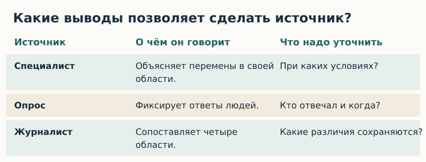

# ENS de Lyon · série SES (B/L) · Russe (oral) 2025 — Corrigé guidé partiel

*Corrigé rédigé par IA, non officiel. Signalez toute erreur.*

**Rédaction** · GPT-6.2 Astra Ultra · vitesse non renseignée

Le fascicule de Lyon identifie 1 référence de presse. Il donne les titres et les dates. Les feuillets remis aux candidats et leurs coupes ne sont pas reproduits. Les prises de parole s’appuient sur les témoins indiqués pour chaque entrée.

[Répertoire officiel](https://www.ens-lyon.fr/sites/default/files/2025-10/Fascicule%20SES%202025%20OK.pdf#page=15) · [Rapport du jury](https://www.ens-lyon.fr/sites/default/files/2025-11/Fascicule%20SES%202025%20relu%20EB%2B%20SLG.pdf#page=27)

Une seule candidate a passé cet oral. Le jury souligne sa capacité à dégager les enjeux et son aisance. Pour préparer votre propre lecture, entraînez-vous à changer de voix sans perdre le fil. Employez « по словам специалиста » pour attribuer un propos à un expert, « по данным опроса » pour introduire les réponses à une enquête et « из этого я делаю вывод » pour assumer une interprétation personnelle. Dans le premier tour de parole, choisissez un exemple concret par domaine.

## Би-би-си на русском · « Пять лет с начала пандемии Covid-19: каковы позитивные аспекты «крупнейшего психологического эксперимента в истории»? », Изабель Каро (11/03/2025)

Publication de presse identifiée et lue. La coupe de concours reste inconnue.

### Кто извлёк уроки из пандемии?

Через пять лет после начала пандемии журналистка Русской службы Би-би-си Изабель Каро задаёт на первый взгляд неудобный вопрос. Можно ли говорить о положительных переменах, помня о погибших и о тех, чья жизнь резко изменилась? Автор начинает с масштаба потерь. Это определяет смысл заголовка. Слово «эксперимент» взято в кавычки. Люди оказались в непривычных условиях одновременно, однако никто заранее не распределял их по группам и не контролировал ход событий. Перед нами образ, помогающий поставить общественный вопрос. Доказывать с его помощью причинную связь было бы ошибкой.

Статья рассматривает четыре области, в каждой из которых за видимым результатом стоит свой механизм. В науке международное сотрудничество и предшествующие исследования помогли ускорить разработку вакцин. Для школы вынужденный переход на дистанционные занятия выявил две вещи сразу. Цифровые средства расширяют пространство урока, но закрытие школ лишает многих учеников и живого общения, и возможности регулярно заниматься. Особенно ценна оговорка специалиста по образованию. Гибкая организация занятий имеет смысл там, где у ребёнка есть доступ к ним и где учитель может поддерживать с ним связь.

В разделе о труде журналистка сопоставляет сохранение рабочих мест, развитие удалённой работы и появление правил, защищающих личное время. Эти изменения по-разному затрагивают работников. Например, сотрудник учреждения может обсуждать право отключить рабочий телефон вечером, а человек, чья работа требует личного присутствия, сталкивается с другой проблемой. В последней части меняется и тип свидетельства. Психолог говорит о ценности отношений, а участники международного опроса рассказывают о собственном самочувствии. Около трети опрошенных сообщили об улучшении. По этому ответу нельзя судить о состоянии остальных.

Таким образом, главный результат обзора я вижу в новом понимании ответственности. Эксперт, школа, работодатель и государство могут превратить вынужденное приспособление в устойчивое изменение. Для этого надо спросить, кому новшество принесло пользу, кто остался в стороне и какие условия помогли бы ему воспользоваться теми же возможностями.

**Вопрос.** Зачем журналистка приглашает нескольких специалистов? **Ответ.** Врач, специалист по образованию, экономист и психолог говорят о разных процессах. Их высказывания позволяют сравнивать механизмы перемен, сохраняя различие между измеримым результатом и личной оценкой.

**Вопрос.** Как употребить данные опроса, не преувеличив их значение? **Ответ.** Я сказал бы, что среди участников опроса в тридцати странах примерно треть сообщила об улучшении самочувствия. Важно сохранить и круг опрошенных, и глагол «сообщила». Опрос зафиксировал ответ людей в определённый момент.

**Pour préparer l’entretien.** Retraduisez *право на отключение* puis expliquez cette expression en russe sans le mot *телефон*. Revenez ensuite à un effet qui ne relève pas du travail. Employez le génitif après *около трети*, et précisez de qui provient la réponse rapportée. Le conditionnel français « aurait amélioré » ne doit pas transformer une déclaration individuelle en preuve de causalité.

[Article russe de la BBC](https://www.bbc.com/russian/articles/cvge7j1vz82o)
