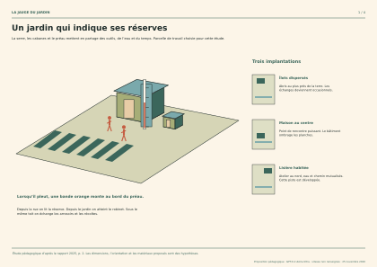
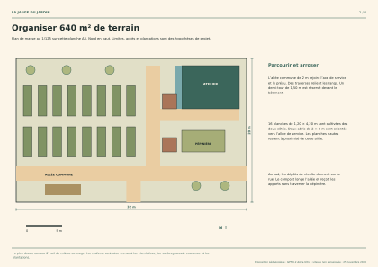
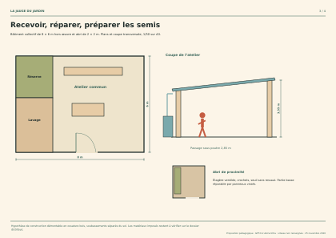
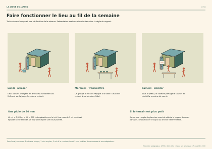

# ENS Paris-Saclay — Design d'espace 2025 · Corrigé guidé

*Corrigé rédigé par IA, non officiel.*

**Couverture partielle.** Le rapport décrit le jardin partagé, les abris et un bâtiment collectif. Le plan de la parcelle et les prescriptions originales d’échelle et de matériaux ne figurent pas dans les pièces publiées. Les cotes et les matériaux de ces planches sont ceux du projet pédagogique.

**Rédaction** · GPT-6.2 Astra Ultra · vitesse non renseignée

La jauge du jardin transforme une réserve d’eau visible en repère pour un quartier et en prétexte à discuter des cultures. Les 4 planches de la proposition sont au format 420 × 297 mm. Les échelles indiquées valent pour une planche seule imprimée sur A3 à 100 %.

## Planche 1 — Un jardin qui indique ses réserves

> [!INDICATION]
> Poser ensemble la question du signal visible dans le quartier et celle du geste partagé à l’intérieur.

L’Agrocité de Gennevilliers, conçue par l’Atelier d’architecture autogérée, associe un local, des jardins et des collecteurs de pluie. Notre projet en retient la proximité entre ressource et lieu de décision. Le signal proposé est un indicateur mécanique de réserve placé à hauteur de lecture. À l’entrée, le conseil du jardin affiche les tours d’arrosage et les événements. L’hiver, le bâtiment maintient une activité de réparation. La parcelle de 32 × 20 m, son accès sud et sa lisière nord bâtie sont des hypothèses à confronter au plan distribué.

## Planche 2 — Organiser 640 m² de terrain

> [!INDICATION]
> Placer le bâtiment, son accès et le point d’eau avant de dessiner les rangs de culture.

Les seize planches représentent 16 × 1,20 × 4,20 = 80,64 m². Les passages entre deux planches parallèles mesurent 0,85 m. Les opérations collectives et déplacements avec chariot utilisent les axes larges de 2 m. Un niveau sans marche et un revêtement perméable compacté sont des objectifs à vérifier sur le relevé altimétrique. La limite de propriété, les différences de niveau et l’ombrage des voisins doivent être reportés depuis le dossier initial.

## Planche 3 — Recevoir, réparer, préparer les semis

> [!INDICATION]
> Vérifier qu’un usager peut porter un bac jusque dans l’atelier et rejoindre les outils sans conflit avec une table occupée.

Les 48 m² hors œuvre regroupent atelier, réserve et point de lavage. Une baie centrale donne sur le préau où les légumes se trient avant d’entrer dans l’atelier. La cuve extérieure est fermée et identifiée pour l’arrosage. Le lavage alimentaire requiert une arrivée distincte d’eau potable. Les panneaux bas des abris se démontent indépendamment pour remplacer le bois au contact des outils. Le bâtiment proposé tient dans le gabarit du plan précédent.

## Planche 4 — Faire fonctionner le lieu au fil de la semaine

> [!INDICATION]
> Défendre une implantation avec une situation de pluie et une situation de forte affluence.

La réserve graduée devient aussi un outil de discussion. Si un arrosage nécessite 80 L, un épisode théorique de 770 L représente neuf arrosages de cet ordre, hors pertes après collecte. La demande réelle est à relever sur le site par saison. À la relance sur la convivialité, montrer le travail à deux au robinet et la table ouverte au public. À la relance sur le coût, distinguer l’enveloppe durable, les pièces de remplacement et les interventions accessibles à l’association.

[Agrocité, Ville de Gennevilliers](https://www.ville-gennevilliers.fr/440/cadre-de-vie/espaces-verts/agriculture-urbaine/agrocite.htm)

[Présentation de l’option dans le rapport du jury](https://ens-paris-saclay.fr/sites/default/files/CONCOURS/ANNALES_1C/1C_Design/2025/Rapports/2025_Rapport_Design_Projet_oral.pdf#page=2)
