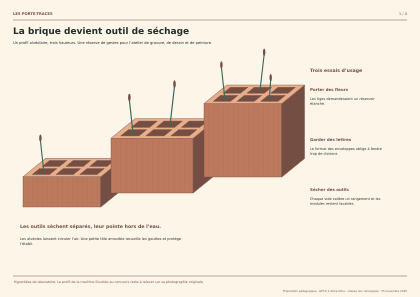
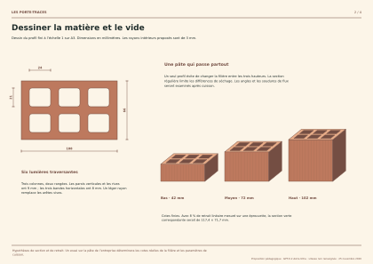
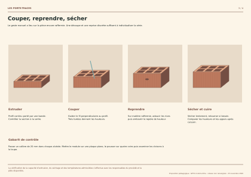
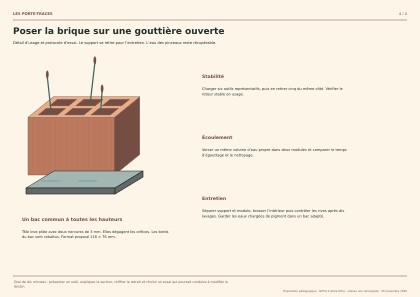

# ENS Paris-Saclay — Design de produit 2025 · Corrigé brut

*Corrigé rédigé par IA, non officiel.*

**Rédaction** · GPT-6.2 Astra Ultra · vitesse non renseignée

**Couverture partielle.** Le rapport établit le travail sur les briques alvéolaires et l’extrusion. La photographie de la machine, les profils fournis et le cahier des charges industriel distribué restent indisponibles. Les dimensions et paramètres retenus sont des hypothèses de prototype.

Les porte-traces est une famille de modules en terre cuite à six alvéoles pour l’atelier de dessin. Les 4 planches de la proposition sont au format 420 × 297 mm. Les échelles indiquées valent pour une planche seule imprimée sur A3 à 100 %.

## Planche 1 — La brique devient outil de séchage

Notre proposition exploite six alvéoles traversantes pour séparer les manches et autoriser l’écoulement. Les pinceaux sont introduits manche en bas, pointe libre. L’essai comparatif porte sur la largeur de l’outil et sa stabilité, la prise en main du module et le nettoyage du fond. La maison expérimentale de Muuratsalo d’Alvar et Elissa Aalto compare des dispositions de briques à l’échelle du mur. Nous transposons cette méthode de variation contrôlée à un objet que l’on tient dans la main.

## Planche 2 — Dessiner la matière et le vide

Trois ouvertures de 24 mm et quatre parois de 9 mm occupent 108 mm. Deux ouvertures de 21 mm et trois bandes de 8 mm occupent 66 mm. L’aire de terre hors arrondis est 108 × 66 − 6 × 24 × 21 = 4 104 mm². Pour le module de 72 mm, le volume approché est 295 cm³ et la masse de l’ordre de 0,53 kg pour une masse volumique de 1,8 g/cm³ à vérifier sur éprouvette. Les trois longueurs vertes seraient 45,7, 78,3 et 110,9 mm si le retrait axial est lui aussi de 8 %.

## Planche 3 — Couper, reprendre, sécher

Le choix d’une reprise peu profonde conserve des parois homogènes. Les prises d’empreinte se limitent au parement extérieur. Recueillir dix pièces par longueur, mesurer les retraits suivant les deux axes de section et suivant l’extrusion, puis reporter les moyennes et leur dispersion. Recaler la butée si les hauteurs dérivent ensemble. Un vrillage ou une fissure à la jonction de flux appelle un essai de séchage et un examen de la filière.

## Planche 4 — Poser la brique sur une gouttière ouverte

Les nervures maintiennent un passage d’air sous les canaux. Le bord de 6 mm du bac retient les petites gouttes. Les deux pièces se séparent par soulèvement. Les dimensions et les masses sont des objectifs de prototype. Une première série de trois hauteurs doit permettre d’identifier le modèle qui se renverse le moins à charge dissymétrique et celui qui convient aux outils courts. À la relance du jury sur le rôle du designer dans la chaîne industrielle, montrer précisément l’effet de la longueur de coupe et du second composant.

[Maison expérimentale de Muuratsalo, Fondation Alvar Aalto](https://www.alvaraalto.fi/en/architecture/muuratsalo-experimental-house/)

[Présentation de l’option dans le rapport du jury](https://ens-paris-saclay.fr/sites/default/files/CONCOURS/ANNALES_1C/1C_Design/2025/Rapports/2025_Rapport_Design_Projet_oral.pdf#page=3)
