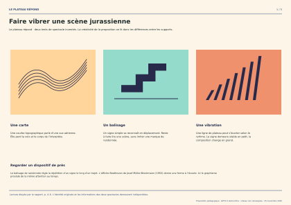
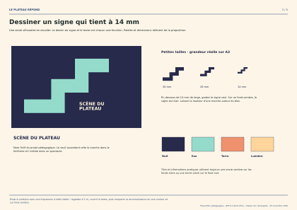
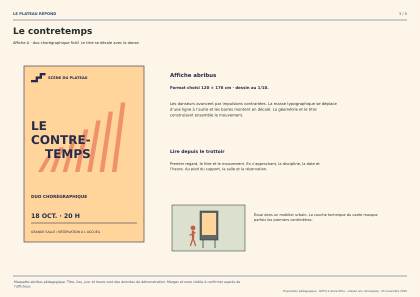
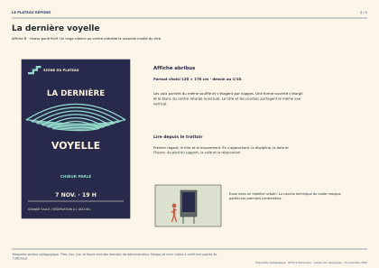
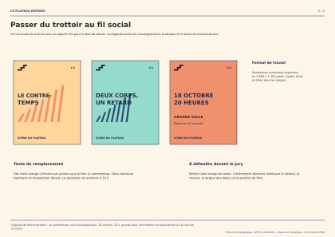

# ENS Paris-Saclay — Design graphique 2025 · Corrigé guidé

*Corrigé rédigé par IA, non officiel.*

**Couverture partielle.** Le jury confirme une scène nationale du Jura, l’identité existante, deux spectacles, deux affiches abribus et un support social. Les visuels, le nom indiqué dans le dossier et les deux notices de spectacle manquent. Les titres, dates, lieux et disciplines des maquettes sont fictifs.

**Rédaction** · GPT-6.2 Astra Ultra · vitesse non renseignée

Le plateau répond est une proposition d’identité pour une scène nationale du Jura. Scène du Plateau est le nom de travail de la maquette. Les 5 planches de la proposition sont au format 420 × 297 mm. Les échelles indiquées valent pour une planche seule imprimée sur A3 à 100 %.

## Planche 1 — Faire vibrer une scène jurassienne

> [!INDICATION]
> Comparer la première et la troisième piste à hauteur de piéton. Dire laquelle informe sur une pièce précise.

Le jury décrit un signe chargé et une faible hiérarchie dans les affiches de départ. Les annexes étant absentes, cette lecture s’appuie sur ses observations. Le projet garde les plateaux et collines du Jura en mémoire et traduit leur étagement par une marque en trois paliers. Le système de balisage des sentiers fournit une référence de reconnaissance en mouvement. L’affiche Beethoven (1955) de Josef Müller-Brockmann donne une référence distincte pour construire une composition musicale par le rythme.

## Planche 2 — Dessiner un signe qui tient à 14 mm

> [!INDICATION]
> Imprimer le signe à 14 mm et couvrir le nom. Réserver une zone de protection correspondant à une marche.

Le contour conserve trois décrochements et une ligne de sol. Le signe seul sert d’avatar. Dans le logo complet, le nom s’aligne sur une ligne commune. Les gros caractères garantissent la lecture en mouvement. Pour la production, fournir un master vectoriel monochrome, un master inversé et quatre teintes déclinées en profils d’impression ou d’écran. Des tirages sur papier diffusant et sous éclairage nocturne permettront de contrôler le contraste réel.

## Planche 3 — Le contretemps

> [!INDICATION]
> Masquer le logo puis le titre et demander ce qui demeure reconnaissable du spectacle.

Les danseurs avancent par impulsions contrariées. La masse typographique se déplace d’une ligne à l’autre et les barres montent en décalé. La géométrie et le titre construisent ensemble le mouvement. La reproduction prévue est une impression numérique grand format sur un support choisi avec l’afficheur, avec épreuve couleur éclairée au dos si le mobilier est rétroéclairé. Le portrait à 120 × 176 cm tient à l’échelle 1/10 sur cette page A3. Le projet règle la hiérarchie avant d’adapter les données au nom institutionnel, aux titres, aux dates et aux crédits effectivement distribués.

## Planche 4 — La dernière voyelle

> [!INDICATION]
> Masquer le logo puis le titre et demander ce qui demeure reconnaissable du spectacle.

Les voix partent du même souffle et s’étagent par nappes. Une forme ouverte s’élargit et le blanc du centre retarde la lecture. Le titre et les courbes partagent le même axe vertical. La reproduction prévue est une impression numérique grand format sur un support choisi avec l’afficheur, avec épreuve couleur éclairée au dos si le mobilier est rétroéclairé. Le portrait à 120 × 176 cm tient à l’échelle 1/10 sur cette page A3. Le projet règle la hiérarchie avant d’adapter les données au nom institutionnel, aux titres, aux dates et aux crédits effectivement distribués.

## Planche 5 — Passer du trottoir au fil social

> [!INDICATION]
> Tester sur un écran réel, luminosité réduite, et vérifier que la légende suffit sans le visuel.

Le premier écran identifie le spectacle, le deuxième en explique la tension, le troisième fait retenir le rendez-vous. À l’oral de dix minutes, présenter le diagnostic en deux minutes, les pistes et le logo en deux minutes, les deux affiches en quatre minutes et la séquence numérique en deux minutes. À la relance sur la reproduction, comparer l’épreuve éclairée du grand format et la lecture sur téléphone. À la relance sur le territoire, montrer le passage du palier à la vibration et ses deux usages distincts.

[Charte du balisage, FFRandonnée](https://finistere.ffrandonnee.fr/html/7010/la-charte-du-balisage) · [Josef Müller-Brockmann, Museum für Gestaltung Zürich](https://eshop.museum-gestaltung.ch/?id=9286&lang=de&op=product)

[Présentation de l’option dans le rapport du jury](https://ens-paris-saclay.fr/sites/default/files/CONCOURS/ANNALES_1C/1C_Design/2025/Rapports/2025_Rapport_Design_Projet_oral.pdf#page=4)
