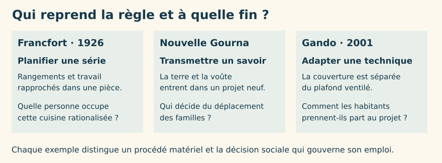

# ENS Paris-Saclay · Design — Histoire de l’art 2025 · Corrigé brut

*Corrigé rédigé par IA, non officiel. Signalez toute erreur.*

**Lecture du rapport du jury** · GPT-6.2 Astra Ultra · vitesse non renseignée · 25 novembre 2026

**Rédaction** · GPT-6.2 Astra Ultra · vitesse non renseignée · 25 novembre 2026

**Autocontrôle** · GPT-6.2 Astra Ultra · vitesse non renseignée · 25 novembre 2026

**Révision** · GPT-6.2 Astra Ultra · vitesse non renseignée · 26 novembre 2026

Le sujet demande d’analyser la relation entre disparition des traditions, prestige de l’originalité et valeur fonctionnelle, dans la citation d’Amos Rapoport, House Form and Culture (1969), traduction française de 1972.

## Qui règle la forme d’une maison ?

Pour Amos Rapoport, l’originalité devient problématique lorsqu’on la recherche « pour elle-même ». Une maison peut alors perdre sa valeur aux yeux d’une société sans avoir cessé de répondre au climat, aux ressources ou aux besoins de ses habitants. L’auteur formule une hypothèse causale sur la disparition d’une « tradition régulatrice », c’est-à-dire d’un ensemble de solutions transmises qui orientent normalement les décisions des constructeurs. Il l’appuie sur une comparaison entre le prestige moderne du nouveau et la défiance que lui opposeraient la plupart des sociétés traditionalistes. Entre *Vers une architecture* et *Learning from Vernacular*, l’histoire des réalisations invite à éprouver ensemble les deux versants de cette hypothèse. Comment distinguer, dans le rejet ou la reprise d’une façon de bâtir, ce qui relève de son efficacité, de sa valeur sociale et du pouvoir de ceux qui décident quels changements sont recevables ?

## La rupture moderne a plusieurs raisons

Avec *Vers une architecture* en 1923, Le Corbusier oppose la puissance d’organisation de la production industrielle à des formes d’habitation qu’il juge en retard sur les nécessités de leur époque. Les paquebots, les avions et les automobiles lui servent à penser le rapport entre définition d’un problème, sélection d’un type et perfectionnement. Si l’innovation valait seulement comme signe de singularité, la série perdrait une partie de son intérêt. Or une habitation produite dans des conditions nouvelles doit pouvoir être répétée. La recherche d’une solution commune, le coût et les besoins de logement contribuent à expliquer le rejet de certaines formes. Le Corbusier revient en outre au Parthénon dans le même livre. L’inventeur moderne peut choisir ses ancêtres et valoriser tout à la fois une discipline ancienne et une technique nouvelle.

La cuisine de Francfort de Margarete Schütte-Lihotzky, conçue en 1926 pour un programme de logements, le montre dans une pièce dont les habitants éprouvent quotidiennement les dispositions. Réduire les trajets, disposer rangements et surfaces de travail à portée de main, incorporer une planche rabattable produisent des avantages matériels vérifiables dans une petite surface. Ce serait forcer l’argument de Rapoport que de ramener cette substitution à un simple dédain des cuisines transmises. Pourtant, ces critères n’imposent pas à eux seuls de concevoir la pièce pour une personne occupée aux tâches domestiques. Une certaine idée de la famille et du travail féminin participe à la définition même du problème fonctionnel. Le couple fonctionnel et non fonctionnel doit donc se comprendre comme distinction de raisons discutables, jamais comme partage entre des faits techniques neutres et des valeurs qui s’y ajouteraient après coup.

À la cité Frugès de Pessac, construite par Le Corbusier et Pierre Jeanneret entre 1924 et 1926, les maisons issues de modules communs ont connu des modifications de leurs châssis de fenêtres et de leurs toits-terrasses par les habitants. Le même quartier permet donc deux lectures de l’originalité. Pour les concepteurs, le renouvellement de l’habitat procède de la série et de ses combinaisons. Pour un ménage, transformer une maison en série peut être une manière d’en régler l’usage ou d’en modifier l’apparence. Le changement visible établit l’écart au dessin livré. Il ne suffit pas à prouver quel motif, pratique ou symbolique, a décidé chaque habitant. Rapoport écrit deux fois « souvent ». Cette précaution donne sa portée historique au paradoxe relevé par le jury. Le prestige d’une architecture qui se réclame de la fonction peut tenir à des valeurs non fonctionnelles, par exemple à l’image du progrès attachée à sa silhouette. Il faut encore le démontrer au cas par cas. [Cité Frugès, transformations des habitations, Fondation Le Corbusier](https://www.fondationlecorbusier.fr/oeuvre-architecture/realisations-cite-fruges-pessac-france-1924-1926/)

## Le vernaculaire change de statut en entrant dans l’histoire de l’art

Une technique traditionnelle transmet des façons de faire. Une forme vernaculaire s’inscrit dans les ressources et les usages d’un milieu. L’une et l’autre n’exigent ni un passé immobile ni l’absence d’outils capables de produire en quantité. Inversement, un architecte reconnu peut reprendre une technique locale sans reproduire le processus collectif qui lui donnait autorité. L’exemple de la Nouvelle Gourna en Égypte oblige à tenir ces distinctions ensemble.

Dans le village conçu par Hassan Fathy et construit en partie entre 1946 et 1952, la terre et des techniques de voûtement connues en Haute-Égypte deviennent les moyens d’un projet architectural coordonné. Une méthode disponible localement répond à des ressources et à des conditions climatiques réelles. Sa réhabilitation entre aussi dans une commande de déplacement de la population vivant sur le site de l’ancienne Gourna, auprès des tombes thébaines. Une forme présentée comme appropriée à une communauté ne règle donc pas la question de savoir si les familles peuvent décider du lieu et des conditions de leur installation. Le prestige de l’auteur, la politique patrimoniale et la capacité d’agir des habitants désignent trois problèmes différents. Une architecture peut se montrer inventive dans la reprise d’une tradition tout en suscitant un conflit sur le projet qui l’accueille.

Dans l’exposition *Architecture Without Architects* de Bernard Rudofsky au MoMA en 1964, le déplacement est d’une autre nature. Des formes bâties écartées des histoires centrées sur les grands noms acquièrent, par la photographie et la comparaison muséale, une dignité d’objet d’étude. Le cadre moderniste du musée peut donc servir à renverser une hiérarchie du goût moderne. Mais une image se prête plus aisément à l’admiration d’un profil de toiture qu’à la compréhension d’un apprentissage, d’une négociation foncière ou des réparations successives dont le bâtiment est issu. La transmission d’une forme visible et celle du pouvoir de la produire ne coïncident pas.

## Une règle transmise peut rendre possible un changement qui compte

À l’école primaire de Gando, achevée en 2001 au Burkina Faso, Francis Kéré travaille avec les habitants sur un matériau déjà connu dans la construction locale, la terre. Les briques associent argile et ciment. Un plafond de briques laisse circuler l’air sous une couverture métallique décollée qui protège des pluies et ménage une ventilation. La forme construite répond notamment à la chaleur excessive et aux difficultés de ventilation de nombreuses salles de classe. Elle ne reproduit pas à une autre échelle une maison ancienne. La disponibilité des savoir-faire et la participation au chantier rendent praticable la transformation de la technique pour un usage scolaire.

Ce cas permet de discuter le dernier mouvement de la citation. La nouveauté de Gando se mesure par comparaison avec des solutions antérieures. Elle compte parce qu’elle répond à un problème partagé et qu’elle peut être apprise et discutée. Rien ne permet d’en conclure que toute proposition nouvelle serait reçue positivement, ni qu’elle le serait uniquement parce qu’elle est nouvelle. Une tradition régule aussi la façon de mettre à l’essai une variante. Sa puissance se voit parfois précisément dans la liberté d’adapter un procédé sans devoir repartir de rien.

À l’autre borne du programme, *Learning from Vernacular* rend à des maquettes d’architecture vernaculaire une place dans l’enseignement et les confronte à des démarches contemporaines. Une maquette permet de rapprocher à une même échelle d’observation des solutions éloignées. Elle peut aussi isoler la forme des relations de travail qui la soutiennent. Le verbe « apprendre » devient décisif. Un projet apprend d’une tradition lorsqu’il identifie un principe et les conditions de sa transmission, puis accepte que les personnes concernées puissent en transformer l’usage.

Rapoport fait donc voir la dimension sociale du dédain pour certaines formes. La valorisation d’une signature ou d’une apparence nouvelle peut suffire à disqualifier une solution toujours efficace. Elle ne suffit pourtant pas à expliquer les transformations du logement au XXe siècle. L’histoire montre à la fois des innovations modernes imposées par de nouvelles contraintes, des traditions sélectionnées par des institutions modernes et des changements techniques rendus possibles par un apprentissage local. Pour décider de la portée d’une rupture, il faut demander qui peut reprendre la règle, la modifier et en recueillir les effets.

[Sujet officiel](https://ens-paris-saclay.fr/sites/default/files/CONCOURS/ANNALES_1C/1C_Design/2025/Sujets/BAT_HistoiredelArt.pdf) · [Rapport du jury](https://ens-paris-saclay.fr/sites/default/files/CONCOURS/ANNALES_1C/1C_Design/2025/Rapports/2025_Design_Rapport_histoire_de_l%27art_ecrit.pdf) · [MoMA, cuisine de Francfort](https://www.moma.org/collection/works/126451) · [UNESCO, projet de la Nouvelle Gourna](https://whc.unesco.org/en/activities/637) · [MoMA, catalogue Rudofsky](https://www.moma.org/documents/moma_catalogue_305_300062280.pdf) · [Kéré Architecture, école primaire de Gando](https://www.kerearchitecture.com/work/building/gando-primary-school-3) · [EPFL, rapport sur Learning from Vernacular](https://www.epfl.ch/about/overview/wp-content/uploads/2022/07/EPFL-rapport-annuel-2010.pdf)
