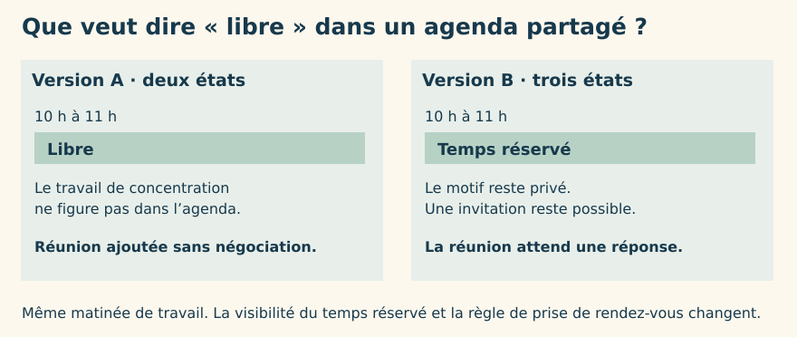

# ENS Paris-Saclay · Design — Philosophie de l’art 2025 · Corrigé brut

*Corrigé rédigé par IA, non officiel. Signalez toute erreur.*

**Lecture du rapport du jury** · GPT-6.2 Astra Ultra · vitesse non renseignée · 25 novembre 2026

**Rédaction** · GPT-6.2 Astra Ultra · vitesse non renseignée · 25 novembre 2026

**Autocontrôle** · GPT-6.2 Astra Ultra · vitesse non renseignée · 25 novembre 2026

**Révision** · GPT-6.2 Astra Ultra · vitesse non renseignée · 26 novembre 2026

Le sujet demande de commenter la proposition de Terry Winograd et Fernando Flores, citée par Arturo Escobar, selon laquelle « en designant des outils, nous designons des manières d’être ».

## Une possibilité d’agir peut devenir une manière de se comprendre

Un éplucheur épuise ma main. Je demande à quelqu’un de finir le repas et peux en venir à penser que je ne sais plus cuisiner seul. Un manche qui se laisse saisir autrement modifie alors davantage que la durée d’une tâche. Il peut changer la façon dont je me situe parmi ceux qui préparent le repas. Dans la proposition de Terry Winograd et Fernando Flores reprise par Arturo Escobar, le passage de l’outil aux « manières d’être » indique un changement d’échelle de ce genre. Il ne suffit plus de confronter une forme à une fonction. Il faut se demander quel rapport à soi, aux autres et au monde se stabilise dans une pratique équipée. Mais le verbe « designer » est-il pris dans le même sens lorsqu’on dessine un manche et lorsqu’on annonce une manière d’exister ? L’enjeu tient à la portée du pouvoir que le projet exerce sur ses destinataires.

## La forme entre dans le geste, le geste dans une vie

L’éplucheur Good Grips de Smart Design, conçu en 1989, est issu de la difficulté que rencontrait Betsey Farber avec un éplucheur ordinaire en raison de son arthrite. Le manche plus ample et adhérent modifie la prise requise. L’effet ne consiste pas à ajouter une information morale à un ustensile demeuré identique. Le corps que l’objet suppose n’est plus tout à fait le même. Une main qui ne correspondait pas à l’effort exigé par l’ancien manche peut reprendre une activité. Une observation singulière conduit ici à un outil proposé à des personnes aux capacités différentes.

Les auteurs situent là une « racine profonde ». Ils avancent donc davantage qu’une conséquence occasionnelle, telle l’invention fortuite d’un emploi secondaire. Dès que le concepteur décide ce qui doit compter comme une opération réussie, il inscrit une certaine figure de l’usager dans le projet. Si l’éplucheur n’était essayé que par des mains sans raideur, une partie des cuisiniers apparaîtrait difficile à satisfaire alors que c’est la définition de l’essai qui les exclut. La manière d’être tient ici à une expérience durable de compétence ou de dépendance, éprouvée de repas en repas.

Les « techniques du corps » étudiées par Marcel Mauss aident à comprendre le passage. Nos façons de porter, de marcher ou de manier un objet s’acquièrent dans des milieux où l’on apprend aussi ce qui passe pour droit, habile ou maladroit. Une difficulté souvent répétée peut être imputée au corps de l’usager jusqu’à ce qu’une autre forme rende visible la part qu’y prenait le premier outil. Mais il resterait excessif de déduire l’autonomie d’une personne de la largeur d’un manche. Encore faut-il pouvoir accéder à une cuisine et avoir le droit de s’y installer. Le design offre une prise qui peut modifier une relation. Il n’en possède pas à lui seul toutes les conditions.

L’intuition des auteurs trouve un autre terrain dans les outils de communication. Imaginons qu’un agenda partagé propose uniquement « libre » ou « occupé ». Une collègue absorbée par un travail long peut être affichée comme libre parce qu’elle n’a pas de réunion. Un autre collègue lui réserve alors un créneau. La seconde action est raisonnable dans le monde décrit par l’outil et abusive dans la situation effectivement vécue. La conception d’une simple distinction a rendu certains rapports professionnels plus probables. Une manière d’être disponible s’est construite dans l’usage répété de la catégorie. Le logiciel n’a pourtant pas décrété ce que signifie être disponible dans toute vie de travail.

## Entre une possibilité et une norme

Le même outil peut déplacer une contrainte au lieu de la lever. Si la collègue doit créer chaque jour de fausses réunions pour pouvoir travailler sans interruption, une compétence nouvelle, savoir protéger son temps dans l’agenda, s’ajoute subrepticement à celles que demande son métier. L’environnement équipé sélectionne ceux qui connaissent cette règle implicite. Le coût du dispositif était invisible tant qu’on le jugeait seulement sur sa capacité à enregistrer un rendez-vous.

Ce passage du possible au normal éclaire le caractère éthique de la citation. Un choix formel rend une action plus facile qu’une autre. Cela se vérifie dans le champ où une donnée peut être saisie, dans le choix des destinataires d’une notification ou dans la demande de justifier un refus. Quand ces possibilités se répètent et que plusieurs personnes dépendent du même dispositif, une préférence de conception devient une attente collective. Une personne seule peut théoriquement choisir de ne pas utiliser l’agenda. Elle risque alors de ne plus être avertie des décisions du groupe. Une manière de vivre ensemble a pris corps sans correspondre au dessein explicite d’un auteur unique. Designer ne signifie donc pas fabriquer à volonté les identités d’autrui. Cela signifie aussi répondre de conditions dont les effets peuvent dépasser les intentions du projet.

Une objection surgit ici. Les usagers ont des histoires, des désirs et des habitudes antérieurs à l’outil. Une équipe peut convenir que le calendrier restera indicatif et qu’une acceptation personnelle fera seule foi. La norme collective transforme alors la portée de l’interface inchangée. La relation agit bien dans les deux sens. Des usages font naître les outils, puis les outils redéfinissent ce que d’autres usages pourront devenir. L’objet fabriqué, l’apprentissage du groupe et l’interprétation singulière occupent des temps distincts.

## Quel pouvoir rendre aux personnes qui vivent avec l’outil ?

Considérons une seconde version de l’agenda. Une personne peut réserver du temps sans publier le motif de son indisponibilité et vérifier qui voit l’information. Une demande de réunion reste possible et ne devient effective qu’après acceptation. Les réglages et les choix collectifs conservent bien sûr un coût. Demander à tout le monde de paramétrer une vingtaine d’options pourrait favoriser de nouveau les employés les plus familiers du dispositif. Concevoir pour plusieurs manières d’être demande donc autre chose que multiplier les menus. Il faut choisir quels usages ordinaires seront possibles d’emblée, si une personne peut refuser sans se raconter et comment le groupe réexaminera ses règles.

Dans un logiciel de coordination, formuler une demande, accepter et proposer un autre moment sont trois actions distinctes. Si la seule action affichée au destinataire est d’accepter, le silence de la personne invitée pourra être traité comme une faute. Si une contre-proposition reste possible et identifiable comme telle, la même personne devient partenaire de la fixation du rendez-vous. L’outil rend techniquement praticable un rapport différent aux engagements. Il n’en garantit pas l’exercice, car un supérieur peut continuer à décourager toute contre-proposition. Cette dernière possibilité indique où commence le travail collectif sur une manière d’être.

La reprise de Winograd et Flores par Escobar rend ici sensible une question politique. Qui est en situation de définir le problème et de réviser le projet une fois ses effets constatés ? Dans l’agenda, les salariés qui remplissent les créneaux, les responsables qui les consultent et les personnes chargées de la maintenance peuvent poursuivre des fins divergentes. Faire participer les personnes concernées ne garantit pas leur accord. Cela leur donne cependant la possibilité de dire quelles catégories font violence à leur expérience, lesquelles soutiennent leur autonomie et quelles conséquences elles sont prêtes à assumer ensemble. Le design porte alors sur le processus par lequel les choix pourront être repris autant que sur le premier état de l’interface.

La phrase proposée est donc juste si « designer des manières d’être » signifie rendre certaines relations praticables, durables et révisables. Elle devient trompeuse si elle fait de l’usager la matière passive d’un programme défini à sa place. La responsabilité du designer ne tient pas à une maîtrise illimitée des vies futures. Elle tient au fait, plus exigeant, que l’on peut souvent savoir par avance qui une forme risque d’exclure, et découvrir ensuite, avec ceux qui en font l’expérience, ce qu’il convient d’y changer.

[Sujet officiel, p. 3](https://ens-paris-saclay.fr/sites/default/files/CONCOURS/ANNALES_1C/1C_Design/2025/Sujets/BAT-Philosophie_Art2.pdf#page=3) · [Rapport du jury, p. 1–3](https://ens-paris-saclay.fr/sites/default/files/CONCOURS/ANNALES_1C/1C_Design/2025/Rapports/2025_Design_Rapport_Philosophie_ecrit.pdf#page=1) · [MoMA, Good Grips Peeler de Smart Design](https://www.moma.org/collection/works/3758) · [Cooper Hewitt, enquête sur le design de la prise](https://www.cooperhewitt.org/2015/12/17/getting-a-grip-on-user-inspired-design/)
