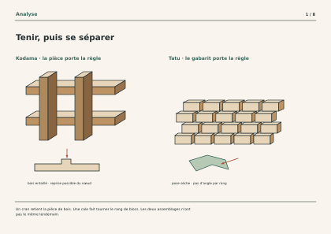
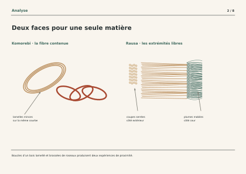
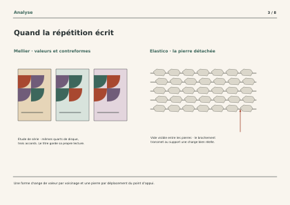
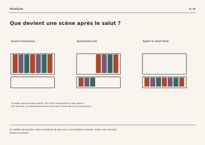
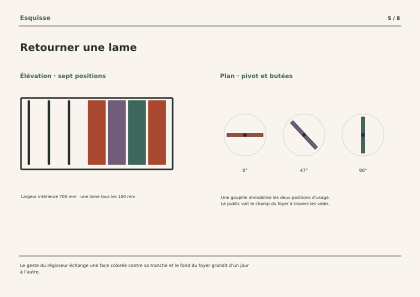
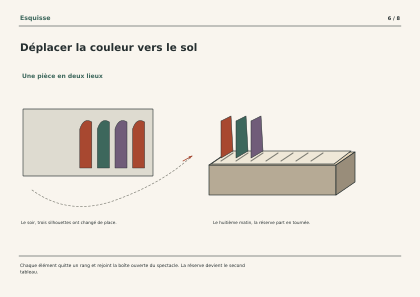
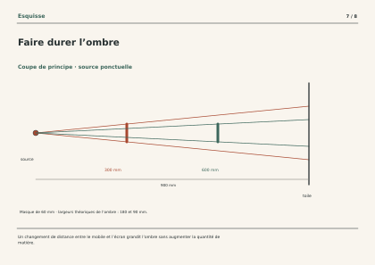
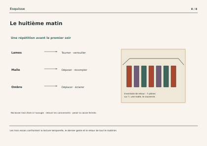

# ENS Paris-Saclay — Design, Techno-design 2025 · Corrigé guidé

*Corrigé rédigé par IA, non officiel.*

**Rédaction** · GPT-6.2 Astra Ultra · vitesse non renseignée

**Le huitième matin.** Dans le foyer d’un théâtre de quartier, sept représentations transforment un décor qui doit repartir tout entier avec la compagnie. La proposition occupe 8 planches A3 paysage autonomes. Les quatre premières développent l’analyse et les quatre suivantes l’esquisse. Chaque fichier de planche mesure 420 × 297 mm. Imprimé seul sur A3 à 100 %, il garde ce format, tandis que les plans reproduits dans le livret sont réduits.

Le sujet réserve quatre heures à chaque partie. Parcourir les six documents avant de rapprocher deux procédés, puis consacrer chacune des dernières planches à une hypothèse ou à un essai qui aide à les départager. Le jury de 2025 demande de tenir ensemble dimensions techniques, sensibles et économiques et de rendre les planches lisibles séparément.

## Analyse — Tenir, puis se séparer · planche 1/8

> [!INDICATION]
> Dessiner un nœud isolé puis un rang entier. Entourer l’organe qui règle la position et demander ce qui subsiste quand l’installation est démontée.

Le pavillon de bois de **Kodama**, attribué à KKAA et daté de 2024 dans le sujet, paraît gonfler sous les arbres. À droite du cliché, les évidements ménagent des appuis à la traverse et laissent entrer des fragments de paysage. Une pièce qui travaille en appui a aussi besoin de rester engagée lorsque son voisin bouge. Le projet apparenté d’Arte Sella, que KKAA date de 2018, est un pavillon de mélèze massif assemblé à la main sans pièces métalliques ni colle. Sa notice éclaire le principe mais les deux dates doivent rester distinctes. Le rendement du débit, la précision de l’usinage et l’usure d’une encoche lors d’un nouveau transport constituent le revers économique du montage manuel. [Notice du pavillon d’Arte Sella](https://kkaa.co.jp/en/project/kodama-pavilion/)

Sur la planche de **Park Associati**, on voit une main poser un bloc et un outil régler son décalage. Dans *Tatu*, installé à Porto en 2023, les positions calculées sont transmises au montage au moyen d’un gabarit usiné. La rotation progressive fait onduler l’ombre sur un mur construit avec peu de formes différentes. Le montage à sec permet de reprendre les blocs et les auteurs en documentent le transfert vers un autre chantier. Le coût du gabarit et du transport accompagne la promesse de réemploi. Deux manières d’inscrire une règle apparaissent : Kodama la loge dans la pièce, Tatu dans l’outil provisoire. [Projet Tatu, Park Associati](https://parkassociati.com/en/projects/tatu)

## Analyse — Deux faces pour une seule matière · planche 2/8

> [!INDICATION]
> Tracer une coupe à l’entrée de Rausa avec les deux extrémités d’une même botte. Pour Komorebi, séparer sur le croquis moulage d’une boucle et assemblage de plusieurs boucles.

**Komorebi**, au lobby du Tokyo Edition Toranomon, construit une figure festive par accumulation de boucles de bois. Pour une pièce en lamellé-cintré, de fines lamelles épousent un gabarit courbe. La liaison des couches fixe la courbure au démoulage. Le façonnage est préparé en atelier, le montage compose des intervalles, des reflets et des passages de lumière. De près on lit les essences et les joints, de loin la masse ajourée fait arbre. KKAA prévoit la transformation de modules en mobilier après la période de Noël. Cette ambition déplace la question du déchet vers le temps d’atelier et le second usage réel. [Arbres du Tokyo Edition, KKAA](https://kkaa.co.jp/en/project/tokyo-edition-ginzatoranomon-christmas-tree/)

Dans **Rausa**, l’Atelier Faber emploie le roseau brut pour un pavillon circulaire à ciel ouvert, dans la cour du musée Saint-Remi de Reims. La section serrée des tiges forme la peau extérieure. À l’intérieur, les inflorescences réagissent au vent et la lumière varie. Le seuil triangulaire des photographies rend la coupe de cette épaisseur sensible au visiteur. Le dispositif relie un savoir de couverture en chaume à la fragilité des zones humides sans reproduire un toit. Les deux œuvres tirent des effets opposés d’un alignement de fibres : le gabarit stabilise la boucle, les extrémités libres conservent leur mobilité. [Présentation par les auteurs, Atelier Faber](https://www.archdaily.com/985055/rausa-pavilion-atelier-faber)

## Analyse — Quand la répétition écrit · planche 3/8

> [!INDICATION]
> Réduire l’affiche et la façade à deux aplats de valeur. Agrandir ensuite une seule jointure et repérer ce que la vue de loin avait effacé.

Sur les affiches de **Fanette Mellier pour La Comédie de Clermont**, aplats, contreformes et fragments arrondis se combinent sous le titre lisible du spectacle. D’une affiche à l’autre, la famille de formes est reconnaissable, même lorsque l’échelle et les couleurs changent. La reproduction imprimée ou diffusée sur écran stabilise la série tandis que chaque composition conserve son accent. Il reste un coût de calage, d’impression, de distribution ou d’adaptation au format. Une identité dure quand ses règles peuvent être rejouées par d’autres, avec un texte que le public sait lire. [Affiches de La Comédie, Fanette Mellier](https://www.fanettemellier.com/la-comedie-de-clermont-affiches)

Sur la **Maison des pierres volantes** de Studio Elastico au Frioul, des pierres brochées sur tige métallique sont lues de loin comme un rideau de façade. Au bord du gros plan, l’intervalle laisse apparaître le profil irrégulier de chaque pierre. Un axe discret et une répétition régulière déplacent la pierre, ordinairement associée à la masse d’un mur, vers un effet de suspension. La tige travaille et doit transmettre les efforts à ses appuis. Le temps de percement et de remplacement reste attaché à chaque élément. Le dessin oppose le vide laissé entre deux pierres à la contreforme imprimée. C’est ce vide, lui aussi composé, qui peut devenir le sujet d’une série.

## Analyse — Que devient une scène après le salut ? · planche 4/8

> [!INDICATION]
> Nommer la personne qui réalise le dernier geste et la destination réelle de ce qu’elle retire. Situer les sept dates sur une même vue du foyer.

Une hypothèse de commande situe la recherche dans le foyer couvert d’un petit théâtre. La compagnie veut que les habitués perçoivent, au fil de sept représentations, qu’une saison courte se termine. Le régisseur doit pouvoir déposer l’installation le huitième matin pour le départ en tournée. La matière apportée doit repartir avec la troupe. Le nombre de jours est connu. L’émotion d’une dernière séance, elle, ne se réduit pas à un calendrier imprimé.

La série graphique de Mellier garde une parenté tout en changeant d’état. Tatu rend un second usage possible après démontage. Rausa agit sur les sens par les faces opposées d’une matière. La question commune devient concrète : **comment rendre l’absence progressivement visible quand aucune pièce du décor ne peut être abandonnée sur place ?** Une référence culturelle permet de penser le temps de l’œuvre. Dans *“Untitled” (Portrait of Ross in L.A.)* de Félix González-Torres (1991), prélèvement, variation de masse et possibilité de renouvellement engagent le public dans une réflexion sur la perte. Le spectacle proposé garde son propre régime de sens, collectif et festif. Le geste retenu est le passage matériel d’un état au suivant. [Notice de la Fondation Félix González-Torres](https://www.felixgonzalez-torresfoundation.org/works/untitled-portrait-of-ross-in-l-a)

## Esquisse — Retourner une lame · planche 5/8

> [!INDICATION]
> Dessiner les sept lames en plan, puis reprendre exactement les mêmes positions de face. Une rotation ne retire aucune pièce du cadre.

**Hypothèse 1.** Un cadre de décor contient sept lames montées sur des pivots verticaux, à 100 mm d’entraxe. Chaque lame de 88 × 540 × 8 mm est peinte sur une face. Les sept faces offertes donnent une surface presque continue dans une largeur intérieure de 700 mm. À la fin de chaque soir, le régisseur tourne une lame de 90° puis engage une goupille dans l’encoche d’indexage. Vue de face, la tranche n’occupe plus que 8 mm. Sur une position elle libère environ 80 mm de champ supplémentaire. L’ordre des retournements peut dessiner une vague qui part du milieu.

De biais, les faces tournées redeviennent perceptibles. Une personne qui quitte le foyer voit donc un autre état que celle qui entre de face. Les visiteurs restent à distance du mouvement réalisé par le régisseur. L’essai portera sur une seule charnière doublée de cales avant d’essayer le cadre à sept lames. Si la vibration d’une porte suffit à faire tourner le module, la recherche porte sur le verrouillage et le jeu au pivot.

## Esquisse — Déplacer la couleur vers le sol · planche 6/8

> [!INDICATION]
> Porter sur le dessin le même numéro discret derrière la silhouette et dans son logement, puis vérifier ce que représente la caisse au premier et au dernier soir.

**Hypothèse 2.** Sept silhouettes en contreplaqué de décors réemployés sont découpées dans une même famille de courbes. Elles entrent par le haut dans un peigne horizontal et reposent sur un fond. Après chaque salut, une silhouette passe dans une malle ouverte sur un socle décalé du passage. La façade s’éclaircit, la masse colorée de la malle augmente. Le spectateur peut relier les deux quantités sans déchiffrer une date. Les chants suivent un même motif peint, mais l’âge des matériaux reste visible dans les revers. Le dessin de la septième pièce est l’empreinte laissée entre ses deux voisines.

La malle possède sept rainures feutrées pour ranger les chutes de 90 × 280 × 8 mm. Un intervalle de 12 mm réserve de la place aux protections. Le couvercle fermé transforme l’accumulation du dernier soir en caisse de transport. Les sept pièces plus la malle constituent un inventaire contrôlable. On testera la lecture de la malle depuis les deux entrées du foyer. Si elle paraît être une poubelle, on l’élève et on montre le motif continu sur les chants.

## Esquisse — Faire durer l’ombre · planche 7/8

> [!INDICATION]
> Construire les deux triangles de lumière avec les mêmes extrémités du masque. Observer ce qui advient lorsque la source n’est plus ponctuelle.

**Hypothèse 3.** Un petit projecteur fixe et sept écrans ajourés composent une ombre sur le dos d’une toile autoportante. La régie fait glisser chaque soir un masque sur une seconde encoche. Ce qui semble croître sur la toile correspond à un même objet déplacé. L’effet dépend de la pénombre, de la taille de la source et du passage des corps. Dans une cour très éclairée cette proposition perdrait l’essentiel de sa présence.

Pour une source ponctuelle, un écran à 900 mm et un masque de largeur 60 mm, la largeur théorique de l’ombre est 180 mm pour un masque à 300 mm de la source, puis 90 mm à 600 mm. Un support d’essai à deux positions suffit à comparer ces valeurs à la pénombre d’une LED réelle. Les spectateurs peuvent faire écran dans l’allée. La projection arrière réserve une enceinte derrière la toile et maintient ce passage devant. Si le contraste chute sous l’éclairage normal du foyer, cette piste devient un événement de fin de soirée plutôt qu’un décor permanent.

## Esquisse — Le huitième matin · planche 8/8

> [!INDICATION]
> Préparer un critère observable qui pourrait faire abandonner chacune des pistes. Placer ensuite le dernier état dans le camion imaginaire et faire l’inventaire.

Commencer par une bande de sept découpes en carton, une malle empruntée et un masque mobile avec une lampe existante. Observer de face et de biais à l’éclairement de l’entrée puis pendant la sortie. Montrer trois états à des personnes qui ignorent leur ordre et leur demander de les classer, d’indiquer où vont les pièces et de décrire ce qu’elles ressentent en voyant le dernier état. Le régisseur réalise le changement entre deux passages, avec des gants puis à mains nues. Relever le temps, les coincements et les manipulations inutiles. Peser et recompter réellement le matériel au démontage pour comparer transport et manutention.

Pour un foyer qui reste éclairé, je privilégie la **malle visible**. L’absence et la réserve y sont simultanément perceptibles. Le cadre pivotant mérite un deuxième essai si la petite compagnie ne dispose que d’un mur. L’ombre devient pertinente lorsqu’une extinction de la salle peut accompagner le dernier salut. La prochaine maquette vérifiera une difficulté encore ouverte : faire comprendre dès le premier soir que la malle vide fait déjà partie de la pièce. Ces essais restent proposés et leurs résultats ne sont pas présumés.

[Sujet officiel de l’ENS Paris-Saclay](https://ens-paris-saclay.fr/sites/default/files/CONCOURS/ANNALES_1C/1C_Design/2025/Sujets/BAT-Techno%20design.pdf) · [Rapport du jury](https://ens-paris-saclay.fr/sites/default/files/CONCOURS/ANNALES_1C/1C_Design/2025/Rapports/2025_Design_Rapport_Techno_Design_ecrit.pdf)
