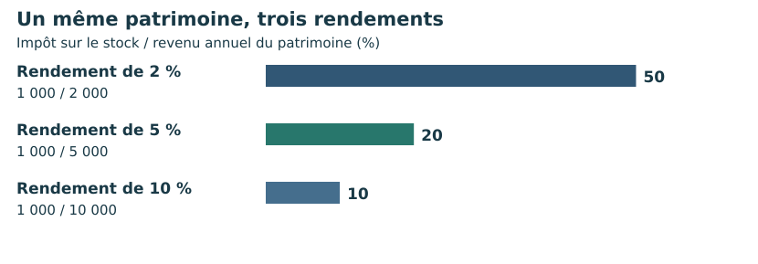

# ENS Paris-Saclay · Analyse macroéconomique 2025 — corrigé brut

*Corrigé rédigé par IA, non officiel. Signalez toute erreur.*

**Rédaction** · GPT-6.2 Astra Ultra · vitesse non renseignée · 26 novembre 2026

## Sujet

Les politiques de redistribution sont-elles un frein à la croissance ?

## Dissertation

Quand un salarié perd son emploi pendant une récession, les cotisations et l’impôt qu’il verse diminuent, tandis qu’il peut percevoir des allocations. Au niveau national, il est alors fréquent de voir s’élever les dépenses de redistribution au moment où ralentit la croissance. En conclure que les transferts ont causé la récession reviendrait à attribuer au fonctionnement de l’assurance le sinistre qui l’a déclenchée. Mais l’erreur symétrique serait de juger les transferts d’après les seules dépenses qu’ils permettent : ils doivent être financés et leurs règles modifient des choix de travail, d’épargne et d’investissement.

La redistribution transforme la répartition des ressources issue des marchés par les prélèvements, les prestations monétaires et les transferts en nature. Elle peut être verticale entre niveaux de vie, horizontale entre situations de risque ou opérer à différents âges de la vie. Une pension contributive n’est donc pas assimilable en tout point à un transfert permanent des plus riches vers les plus pauvres. La croissance désigne la progression durable de la production réelle, dont l’évolution par habitant est souvent le meilleur repère. Un « frein » peut désigner aussi bien une perte de capacités productives qu’une modération temporaire d’une demande excessive. Dans quelles circonstances les ressources déplacées par une politique redistributive avaient-elles un usage productif supérieur à celui qu’elles trouvent après redistribution ? La réponse exige d’étudier comment les inégalités se forment, ce que chaque instrument fait aux comportements et comment ses effets se cumulent dans le temps.

### I. L’effet de la redistribution dépend des inégalités que la croissance elle-même engendre

Deux économies affichant le même écart de revenus peuvent présenter des possibilités de croissance très différentes. Si un salaire élevé rémunère une qualification longue à acquérir et recherchée par de nombreux employeurs, il incite à se former et signale la rareté d’une compétence. Si un revenu élevé provient d’un monopole qui limite l’entrée de concurrents, il peut révéler au contraire une production inférieure aux possibilités de l’économie. Une hausse des hauts revenus ne permet pas de trancher entre innovation productive et rente. De même, une famille dont le revenu présent est modeste peut disposer d’un patrimoine important, alors qu’un jeune professionnel bien rémunéré peut être endetté. Le choix des personnes et de l’assiette visées change l’effet de la politique.

La croissance peut elle-même susciter la redistribution. Une innovation augmente la productivité agrégée tout en dévalorisant certaines compétences, tâches ou régions. Lorsque de nouveaux débouchés se forment loin des anciens emplois, les revenus des propriétaires de la technologie et ceux des travailleurs déplacés divergent. Une assurance temporaire, une formation ou une aide à la mobilité peut rendre l’ajustement possible ; une subvention permanente au maintien de toutes les tâches anciennes peut au contraire immobiliser des ressources. Il serait donc artificiel de comparer la croissance effective à une économie identique qui n’aurait ni prélèvements ni aucune difficulté d’adaptation. Dans le scénario sans assurance, une famille peut refuser une formation risquée, et les salariés exposés peuvent s’opposer à l’ouverture ou à l’innovation qui améliore la production totale.

L’inégalité de patrimoine agit par une voie particulière. Elle détermine les garanties que l’on peut présenter pour financer une entreprise ou des études. Si les banques prêtent sur la richesse initiale autant que sur la qualité du projet, le rendement social de l’euro investi peut être fort chez un ménage qui ne l’obtient pas. Un enseignement accessible ou une garantie de prêt peut alors permettre de sélectionner davantage de projets selon leurs chances de réussite. Les analyses de l’OCDE sur les inégalités et les compétences soulignent notamment l’importance des possibilités offertes aux enfants des ménages modestes. Cela ne démontre pas que toute hausse de dépenses scolaires accroît mécaniquement la productivité. Le résultat tient à l’accès réel, à la qualité de la formation et au rendement des autres usages des fonds prélevés.

### II. À montant redistribué égal, les instruments changent les incitations et la destination de l’épargne

Prenons un transfert de 100 financé par un prélèvement contemporain de même montant. Si le bénéficiaire consacre 90 % de son revenu marginal à la consommation et le contributeur 55 %, les achats immédiats augmentent de 35. Dans une économie ayant des travailleurs disponibles et des capacités inutilisées, cela peut induire commandes, embauches et investissement. Si les ménages achètent surtout des biens importés, si l’offre rencontre un goulot d’étranglement ou si la banque centrale resserre sa politique pour limiter l’inflation, l’effet sur la production nationale est moindre. Quant aux 35 d’épargne privée en moins, leur coût économique dépend de l’usage qu’ils auraient eu. Si des projets viables manquaient de financement, l’investissement peut en souffrir ; si les entreprises manquaient surtout de débouchés, une demande plus stable peut relancer leur investissement. Une augmentation ponctuelle de la dépense ne garantit en aucun cas un taux durablement plus élevé de croissance.

Les incitations au travail dépendent du gain procuré par un effort supplémentaire. Un salarié dont le salaire brut augmente de 100, qui verse 35 de prélèvements supplémentaires et perd 25 de prestation sous condition de ressources, conserve 40. Son taux marginal effectif de prélèvement est alors de 60 %. Ce cumul peut décourager une heure supplémentaire ou une reprise d’emploi, surtout si elle entraîne des frais de garde ou de transport. Lisser le retrait des aides ou subventionner l’accès à un mode de garde peut améliorer le gain à l’emploi. Mais étendre l’aide plus haut dans la distribution coûte des ressources qui devront être financées ailleurs. Le taux moyen d’imposition d’un ménage ne suffit pas à mesurer son incitation marginale, et le nombre d’heures effectivement offert dépend aussi de la disponibilité d’emplois.

Le financement sur le capital ne se réduit pas, lui non plus, à un taux uniforme d’effort. Un impôt sur le rendement courant porte sur un flux ; un impôt annuel sur le patrimoine porte sur un stock ; un droit de succession est déclenché par une transmission. Sur un patrimoine net de 100 000 €, un prélèvement annuel de 1 % représente la moitié d’un rendement annuel de 2 %, mais le dixième d’un rendement de 10 %. À taux de patrimoine inchangé, il peut donc être particulièrement contraignant pour un actif peu liquide ou produisant peu de revenu courant. Une taxe sur le revenu du capital s’ajuste davantage au revenu perçu, mais son rendement peut dépendre du moment choisi pour réaliser une plus-value. Les droits sur les héritages visent une richesse reçue sans effort de l’héritier ; ils peuvent élargir les chances d’entrée si les recettes financent l’éducation, mais aussi modifier la préparation de la transmission familiale et entraîner des difficultés de liquidité. Il faut traiter l’évaluation, le calendrier, la mobilité des bases et les possibilités de report pour comparer ces instruments. Une même recette fiscale ne produit pas le même coût de financement pour les entreprises ni la même correction des inégalités de naissance.

### III. L’assurance collective et le pilotage de la transition changent la trajectoire productive

Une protection sociale crédible peut accroître la prise de risque productive. Un travailleur qui redoute de perdre toute couverture de santé ou tout revenu en changeant d’entreprise peut rester dans un emploi où son talent est mal employé. L’assurance transférable favorise la mobilité. Pendant une récession, une indemnisation temporaire permet aussi de rechercher un emploi correspondant mieux aux compétences et d’éviter une vente forcée des actifs familiaux. En revanche, une longue période hors emploi peut déprécier les qualifications. L’équilibre dépend de la durée de la prestation, de l’accompagnement, de la conjoncture et du nombre d’offres accessibles. Le mécanisme est intertemporel : la redistribution coûte aujourd’hui mais peut éviter qu’un chômage conjoncturel n’abaisse durablement la production potentielle.

Il faut aussi préciser ce que la collectivité cherche à accélérer ou à ralentir. En phase de surchauffe, la progressivité de l’impôt retient une part plus élevée des revenus supplémentaires et atténue la poussée de la demande. Ce frein temporaire peut préserver la stabilité des prix et éviter un ajustement monétaire plus brutal. Dans la transition écologique, une tarification du carbone renchérit des activités polluantes ; consacrer ses recettes à un transfert forfaitaire, particulièrement important pour les ménages modestes, modifie l’incidence distributive sans subventionner chaque litre de carburant. Le volume de certaines productions peut ralentir, tandis que la réduction de dommages climatiques protège des capacités futures. Cette politique combine un instrument de prix et un recyclage redistributif : attribuer à la redistribution seule toute la baisse des émissions ou de la production serait inexact. Plus généralement, le PIB réel ne comptabilise pas directement la valeur d’une assurance et décrit imparfaitement les dommages écologiques évités.

Comparer sérieusement des politiques suppose enfin de traiter le financement et la causalité. Des transferts financés temporairement par emprunt en période de forte sous-utilisation n’ont pas les mêmes effets que des prestations permanentes promises sans assiette fiscale durable. Une dette insoutenable finit par imposer des ajustements brusques, souvent coûteux pour les bénéficiaires mêmes du dispositif. À l’inverse, une réforme qui maintient une fiscalité stable et réduit un obstacle durable à la formation peut soutenir le niveau de production de plusieurs générations. Les pays riches ont à la fois plus de moyens pour redistribuer et des institutions susceptibles de favoriser la croissance. La corrélation entre taux de prélèvements et croissance ne permet pas d’identifier un effet causal. Une évaluation peut comparer des cohortes différemment exposées à une réforme et suivre formation, emploi, investissement ou consommation ; elle doit ensuite apprécier les effets sur le reste de l’économie et les prélèvements nécessaires à sa généralisation.

Les politiques redistributives peuvent donc freiner l’activité lorsqu’elles imposent des taux marginaux mal coordonnés, raréfient indûment le financement d’un projet productif ou perpétuent des emplois sans débouchés. Elles peuvent la soutenir lorsqu’elles libèrent des compétences entravées par l’origine sociale, assurent les risques de la transformation productive ou stabilisent les débouchés. Dans certains cas, ralentir provisoirement une dépense excessive ou déplacer la production vers des activités moins dommageables est précisément le but recherché. Pour décider, il faut comparer une politique et son financement à une alternative réalisable, puis juger ensemble la trajectoire de production, l’accès aux opportunités et la nature des risques que chaque ménage peut supporter.

## Repère quantitatif

## Sources

Le sujet du 17 avril 2025 ne comporte pas d’annexes. Le rapport du jury insiste sur la distinction entre revenus et patrimoine, la causalité dans les deux sens et le sens que peut prendre un ralentissement. [Sujet officiel, page 2](https://ens-paris-saclay.fr/sites/default/files/CONCOURS/ANNALES_1C/1C_D2_1/2025/Sujets/2025_EG1_Ep4_Analyse_macroe%CC%81conomique_14022025_NB.pdf#page=2) · [Rapport du jury](https://ens-paris-saclay.fr/sites/default/files/CONCOURS/ANNALES_1C/1C_D2_1/2025/rapports/2025_Rapport_Analyse_Macro_ecrit.pdf) · [Index des annales](https://ens-paris-saclay.fr/admission/concours/concours-pre-master/annales-concours-pre-master?field_orientation_1c_target_id%5B%5D=289&field_year_target_id%5B%5D=602)

Les travaux de l’OCDE sur les compétences et les inégalités permettent d’approfondir le mécanisme d’accès différencié à la formation. [OCDE, In It Together: Why Less Inequality Benefits All, 2015](https://doi.org/10.1787/9789264235120-en)
