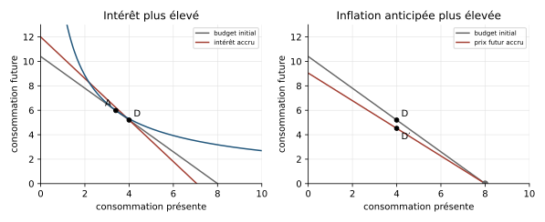
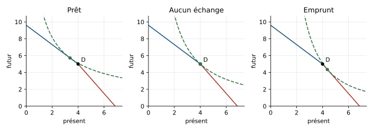

# ENS Paris-Saclay · Analyse microéconomique 2025 — corrigé brut

*Corrigé rédigé par IA, non officiel. Signalez toute erreur.*

**Rédaction** · GPT-6.2 Astra Ultra · vitesse non renseignée · 26 novembre 2026

## Exercice — Deux biens, deux consommateurs, un facteur

Le premier indice de $y_{ij}$ désigne le bien, le second le consommateur. La seconde fonction d’utilité imprimée est celle du consommateur 2. Le facteur est numéraire et son prix vaut un.

**E1 — Prix.** Les profits sont $(2p_1/5-1)x_1$ et $(p_2/4-1)x_2$. Un coefficient strictement négatif conduit à une offre nulle, un coefficient strictement positif à un profit sans maximum fini. Les préférences logarithmiques et les dotations positives exigent les deux biens à l’équilibre. Les deux marges unitaires doivent donc être nulles : **$p_1=5/2$, $p_2=4$**. Les profits sont nuls ; les parts de propriété ne procurent aucun supplément de revenu.

**E2 — Consommations.** Les budgets individuels valent respectivement 40 et 80. Les conditions marginales d’un agent maximisant $\alpha\ln y_1+\beta\ln y_2$ donnent des parts de dépense $\alpha/(\alpha+\beta)$ et $\beta/(\alpha+\beta)$. Le premier consacre deux tiers au bien 1, le second un tiers.

| Agent | Bien 1 | Bien 2 | Vérification du budget |
|---|---:|---:|---|
| 1 | $y_{11}=32/3$ | $y_{21}=10/3$ | $(5/2)(32/3)+4(10/3)=40$ |
| 2 | $y_{12}=32/3$ | $y_{22}=40/3$ | $(5/2)(32/3)+4(40/3)=80$ |

**E3 — Production et emploi du facteur.** Additionner par colonne donne $y_1=64/3$, $y_2=50/3$. Les technologies imposent $x_1=(5/2)y_1=160/3$ et $x_2=4y_2=200/3$. Leur somme est bien $120=40+80$. Au prix d’équilibre chaque firme est indifférente à son niveau d’activité ; les marchés déterminent les quantités produites.

## Problème, partie 1 — Un seul taux d’intérêt

On note $a=1+\pi>0$, $b=1+i>a$, $q=a/b$ et $\Omega=y_1+y_2/b$. On suppose les revenus strictement positifs pour les seuils et les comparaisons qui les utilisent au dénominateur. Les revenus sont exprimés en monnaie de chaque date.

**1.1 — Contrainte actualisée.** Remplacer $s$ par $y_1-c_1$ dans $ac_2=y_2+bs$. Après division par $b$ :
$$c_1+qc_2=y_1+y_2/b=\Omega.$$

**1.1.1 — Signification.** $q$ est le prix, en unités de consommation présentes, d’une unité consommée demain. Les achats actualisés épuisent les revenus actualisés. L’emprunt déplace la consommation vers la première période et requiert un remboursement en seconde ; il ne crée pas de ressources intertemporelles.

**1.1.2 — Programme.** Maximiser $u(c_1,c_2)$ sous $c_1+qc_2\le\Omega$ et $c_j\ge0$. La croissance de l’utilité donne l’égalité. La concavité et la contrainte linéaire permettent d’utiliser les conditions intérieures comme conditions suffisantes.

**1.2.1 — Multiplicateur.** Le Lagrangien $u+\gamma(\Omega-c_1-qc_2)$ donne $u_1=\gamma$, $u_2=q\gamma$. La non-satiété locale impose l’épuisement du budget ; dans le modèle croissant et concave régulier, il existe une direction d’amélioration de l’utilité et le gradient ne peut être nul dans l’intérieur (un gradient nul d’une fonction concave en ferait un maximum global). Ainsi $\gamma>0$.

**1.2.2 — Valeur marginale de la richesse.** À prix intertemporel inchangé, $\gamma=\partial V/\partial\Omega$ par le théorème de l’enveloppe. C’est le gain marginal d’utilité d’une unité monétaire disponible aujourd’hui. Le principe est le même qu’en statique ; une unité supplémentaire de revenu *demain* vaut $\gamma/b$ en utilité marginale.

**1.2.3 — Tangence.** L’équilibre intérieur satisfait le budget et
$$M(c_1,c_2)=\frac{u_1}{u_2}=\frac{b}{a}.$$
Le membre gauche est la quantité future que l’agent accepterait de céder pour une unité présente. Le membre droit est la quantité future que coûte sur le marché cette unité avancée aujourd’hui, compte tenu des intérêts et de l’inflation. Dans le plan $(c_1,c_2)$ la pente commune est $-M$.

**1.2.4 — Préférence pour le présent.** À consommations égales, avancer une petite unité du futur au présent, sans rémunération, procure un gain si $u_1(c,c)>u_2(c,c)$. Avec une utilité séparable $v(c_1)+\delta v(c_2)$ et $0<\delta<1$, ce rapport vaut $1/\delta>1$ à quantités égales. Cela n’impose pas que tout individu emprunte : son profil de revenus et la rémunération réelle comptent aussi.

**1.3 — Droite et intercepts.** $c_2=(b/a)(\Omega-c_1)$ coupe les axes en $(\Omega,0)$ et $(0,(by_1+y_2)/a)$. La dotation sans épargne est $D=(y_1,y_2/a)$. Les paniers à gauche de $D$ correspondent à $s>0$ et ceux à droite à $s<0$.

**1.3.1 — Lecture de l’optimum.** La courbe d’indifférence la plus élevée accessible touche la droite là où l’agent et le marché évaluent de la même manière le déplacement d’une unité de consommation entre les dates. Dans l’exemple de gauche, le point de tangence A est à gauche de D, donc $s=y_1-c_1^*>0$.

**1.3.2 — Prêteur ou emprunteur.** À $D$ calculer $M_D=u_1(D)/u_2(D)$. La dérivée de l’utilité le long de la droite dans le sens d’une hausse de $c_1$ a le signe de $M_D-b/a$. Si $M_D<b/a$, donner un peu de consommation présente au marché procure davantage de consommation future que ce que l’agent exige : il prête. Si $M_D>b/a$, il emprunte ; si les deux termes sont égaux, $D$ est optimal. L’unicité suit avec stricte concavité.

**1.4 — Hausse du taux $i$.** $D$ ne bouge pas et la pente augmente en valeur absolue. La substitution favorise le futur et réduit la consommation présente, à utilité compensée. Une petite hausse procure un gain net de richesse présente $d\Omega-c_2\,dq=(s/b)\,di$. Pour un prêteur ce gain est positif ; pour un emprunteur il est négatif. Par l’enveloppe le signe du changement marginal de satisfaction est celui de $s$. Avec des consommations normales et une solution intérieure, pour le prêteur $c_2$ monte tandis que $c_1$ et $s$ ont un signe net ambigu ; pour l’emprunteur $c_1$ baisse et $s$ augmente (dette réduite), tandis que $c_2$ subit des effets opposés. La concavité seule n’assure pas la normalité. Ces effets sont locaux autour du statut initial.

**1.5 — Hausse de l’inflation anticipée.** À $i,y_1,y_2$ nominaux fixés, $\Omega$ est inchangée mais $q$ augmente. L’intercept horizontal reste $\Omega$, l’intercept vertical et la dotation réelle en seconde période diminuent. Le budget se contracte, donc l’utilité ne peut augmenter ; à l’intérieur $\partial V/\partial\pi=-\gamma c_2/b<0$. La substitution incite à consommer plus tôt ; la perte de pouvoir d’achat tend à réduire les deux consommations si elles sont normales. Sous cette hypothèse $c_2$ diminue, l’effet sur $c_1$ et donc sur $s$ est ambigu. L’explicitation des préférences lèvera cette ambiguïté.

**1.6.1 — Poids de demain.** Dans $u=\sqrt{c_1}+\delta\sqrt{c_2}$, $\delta$ pondère la contribution du futur. Une préférence *plus forte* pour le présent signifie une baisse de $\delta$.

**1.6.2 — Demandes et épargne.** Les utilités marginales infinies à zéro donnent un optimum intérieur. La tangence s’écrit $\sqrt{c_2/c_1}/\delta=b/a$, donc $c_2=(\delta b/a)^2c_1$. Posons $k=\delta^2$. En substituant :
$$c_1=\frac{\Omega a}{a+kb},\qquad c_2=\frac{\Omega k b^2}{a(a+kb)},\qquad
s=y_1-c_1=\frac{kb^2y_1-a y_2}{b(a+kb)}.$$
La consommation dépend de la richesse actualisée totale ; l’épargne dépend également de la part de cette richesse reçue aujourd’hui.

**1.6.3 — Seuil de patience.** $s>0$ exactement si $\delta>\delta_c=\sqrt{ay_2/y_1}/b$. Au seuil $s=0$, au-dessous $s<0$. Comparer le seuil avec l’intervalle autorisé $0<\delta<1$ : si $\delta_c\ge1$, aucun individu admissible ne prête.

**1.6.4 — Hausse de $i$.** $\Omega$ décroît de $y_2\,di/b^2$, et la part $\frac a{a+kb}$ décroît également ; $c_1$ diminue et $s$ augmente quel que soit le statut initial. Comme $c_2=k b(by_1+y_2)/[a(a+kb)]$, sa dérivée en $b$ est
$$\frac{k(2ab y_1+a y_2+kb^2y_1)}{a(a+kb)^2}>0.$$
Le rendement futur compense ici la diminution de la richesse actualisée.

**1.6.5 — Préférence pour le présent accrue.** À $\Omega,a,b$ constants, une baisse de $k$ augmente $c_1$ et réduit $c_2$ (la fraction $k/(a+kb)$ est croissante). L’épargne baisse.

**1.6.6 — Hausse du revenu futur.** Une unité supplémentaire de $y_2$ augmente $\Omega$ de $1/b$. Les dérivées sont $\partial c_1/\partial y_2=a/[b(a+kb)]>0$ et $\partial c_2/\partial y_2=kb/[a(a+kb)]>0$. $y_1$ restant inchangé, l’épargne diminue : une partie du revenu futur est consommée par anticipation.

**1.6.7 — Hausse de $\pi$.** $\Omega$ ne change pas. Le facteur $a/(a+kb)$ est croissant en $a$, donc $c_1$ monte et $s$ diminue. Le dénominateur de $c_2=\Omega kb^2/[a(a+kb)]$ augmente ; $c_2$ baisse. Dans ce cas particulier, la substitution l’emporte pour la consommation présente.

## Problème, partie 2 — Taux distincts pour le prêt et l’emprunt

**2.1 — Origine de l’écart.** L’intermédiaire rémunère les dépôts et facture aux emprunteurs le coût du suivi, le risque de défaut, les frais de liquidité et sa marge. La garantie et la concurrence entre prêteurs influent sur l’écart. Un taux unique est une simplification utile lorsque ces coûts peuvent être négligés.

**2.2 — Budget par morceaux.** Écrivons $b_p=1+i_p$, $b_e=1+i_e$ et $\Omega_j=y_1+y_2/b_j$. Pour $c_1\le y_1$, le ménage prête et $c_1+(a/b_p)c_2=\Omega_p$. Pour $c_1\ge y_1$, il emprunte et $c_1+(a/b_e)c_2=\Omega_e$. Les deux segments se rejoignent en $D$. La frontière est la plus basse des deux droites prolongées, part de $(0,(b_p y_1+y_2)/a)$ et finit en $(\Omega_e,0)$. Sa pente passe de $-b_p/a$ à $-b_e/a$, plus raide.

**2.3.1 — Trois solutions.** Une tangence intérieure peut se situer sur la branche prêteuse, où $M=b_p/a$, ou sur la branche emprunteuse, où $M=b_e/a$. Sinon l’optimum est le point anguleux $D$ où l’agent ne traite pas. Sur chaque segment, résoudre conjointement la condition marginale et le budget ; vérifier ensuite que la solution appartient au segment. Sous les hypothèses de l’intérieur de chaque branche, la figure illustre les trois cas. Si une utilité générale permet des coins sur les axes, une solution au bout d’un segment relève toujours du même statut de prêteur ou d’emprunteur.

**2.3.2 — Conditions au point anguleux.** Si $M_D<b_p/a$, on se déplace vers la gauche pour prêter. Si $M_D>b_e/a$, on se déplace vers la droite pour emprunter. Si $b_p/a\le M_D\le b_e/a$, les gains à de petits déplacements de part et d’autre sont non positifs : $D$ maximise l’utilité par concavité. Les bornes incluses donnent une tangence à l’extrémité d’une branche.

**2.4.1 — Solution logarithmique.** Avec $u=\ln c_1+\delta\ln c_2$, $M=c_2/(\delta c_1)$. Si la branche $j\in\{p,e\}$ est sélectionnée,
$$c_1^{j}=\frac{\Omega_j}{1+\delta},\qquad c_2^{j}=\frac{\delta b_j\Omega_j}{a(1+\delta)},\qquad
s^{j}=\frac{\delta y_1-y_2/b_j}{1+\delta}.$$
Au coin central, $c_1=y_1$, $c_2=y_2/a$, $s=0$. Le signe calculé de $s^j$ doit correspondre au taux utilisé.

**2.4.2 — Seuils en $\delta$.** Posons $d_e=y_2/(b_e y_1)$ et $d_p=y_2/(b_p y_1)$, avec $d_e<d_p$. Pour $\delta<d_e$ le ménage emprunte ; pour $d_e\le\delta\le d_p$ il reste en $D$ ; pour $\delta>d_p$ il prête. On ne garde naturellement que les intervalles rencontrant $(0,1)$. Une forte préférence pour le présent abaisse $\delta$ et favorise l’emprunt. L’écart de taux élargit l’ensemble des préférences pour lesquelles l’échange ne vaut pas son coût.

## Problème, partie 3 — Équilibre du marché du crédit

**3.1.1 — Identification.** Au taux commun, $s(\delta)=y_1-\Omega/(1+\delta)$ est strictement croissante en $\delta$. Si les comportements diffèrent, le type 1, plus patient ($\delta_1>\delta_2$), est prêteur ; le type 2 emprunte.

**3.1.2 — Taux d’équilibre.** Avec les mêmes effectifs, $s(\delta_1)+s(\delta_2)=0$ donne
$$1+i^*=\frac{y_2}{y_1}\,
\frac{2+\delta_1+\delta_2}{\delta_1+\delta_2+2\delta_1\delta_2}.$$
En effet la somme des offres d’épargne s’écrit $y_1\sum_j\delta_j/(1+\delta_j)-(y_2/b)\sum_j1/(1+\delta_j)$. Elle est strictement croissante en $b$ ; au prix trouvé les épargnes, différentes, sont opposées. Ce taux est l’équilibre sous les restrictions du sujet s’il vérifie $i^*>0$ et $i^*>\pi$. Ces restrictions ne découlent pas pour toute valeur positive des revenus ; si elles échouent, aucun taux de leur domaine n’apure ce modèle fermé.

**3.1.3 — Inflation.** Le taux nominal d’équilibre ainsi obtenu ne dépend pas de $\pi$, à revenus *nominaux* fixés et tant que le taux demeure admissible. En effet $\ln c_2=\ln(y_2+bs)-\ln a$ : le terme en $a$ est une constante par rapport à $s$. Les épargnes et leur équilibre restent identiques ; la consommation réelle future et le rendement réel $b/a$ baissent. Une indexation de $y_2$ modifierait ce raisonnement.

**3.1.4 — Deux fois plus d’individus patients.** Écrire $2s(\delta_1)+s(\delta_2)=0$. Alors
$$1+i^{**}=\frac{y_2}{y_1}\,
\frac{3+\delta_1+2\delta_2}{2\delta_1+\delta_2+3\delta_1\delta_2}.$$
Au premier taux d’équilibre l’adjonction d’un prêteur crée une offre excédentaire de crédit. La somme des épargnes augmente avec le taux ; son zéro doit donc se déplacer vers un taux **inférieur**. La même vérification d’admissibilité s’applique.

## Sources

[Énoncé officiel](https://ens-paris-saclay.fr/sites/default/files/CONCOURS/ANNALES_1C/1C_D2_1/2025/Sujets/2025_EG1_Ep1_Analyse_microe%CC%81conomique_18022025_NB.pdf)
