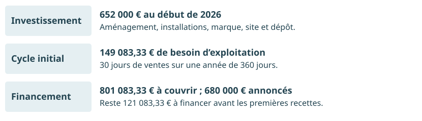

# ENS Paris-Saclay · Épreuve à option — dominante gestion 2025 — corrigé guidé

*Corrigé rédigé par IA, non officiel. Signalez toute erreur.*

**Rédaction** · GPT-6.2 Astra Ultra · vitesse non renseignée · 26 novembre 2026

## Étude de cas

L’épreuve du 16 avril 2025 concerne la PME familiale Essenciel, nommée « Essentiel » en tête du cas. On suit la numérotation imprimée : les questions 7 et 8 n’apparaissent pas entre la fin du diagnostic et la question 9. Les comptes sont exprimés en euros ; les calculs sont arrondis au centième après calcul.

### Construire un diagnostic qui boucle

Raisonnez comme si le matériel en crédit-bail avait été acquis à crédit début 2023. Au compte de résultat, quelle part des 20 000 de loyer doit rester avant l’EBE ? Aucune : elle est remplacée par amortissement et intérêts. Au bilan, à chaque fin d’exercice, reconstituez la valeur brute de 80 000, l’amortissement et la dette résiduelle. Puis vérifiez deux voies de calcul de la trésorerie : soldes bancaires d’une part, fonds de roulement moins besoins d’autre part. En cas d’écart, pointez les sommes des lignes de l’annexe avant d’ajuster un poste.

### Placer les flux sur six dates

Sur la première case, au début de 2026, inscrivez les investissements et le BFR nécessaire aux premières ventes. Sur les quatre cases suivantes, portez une CAF et seulement l’augmentation du BFR exigée par les ventes suivantes. Sur la dernière case, additionnez la CAF de 2030, la récupération du BFR et la valeur résiduelle. Cette chronologie évite de financer chaque année la totalité du stock de BFR.

### Prendre la décision comme l’équipe de Cécile

Le seuil financier d’acceptation est la VAN positive, mais le succès dépend aussi de la confiance des clients et des producteurs. Associez à une hypothèse fragile, comme le taux de réachat après découverte de la marque, un test de marché, un délai de décision et une conséquence budgétaire. Pour le spa, distinguez la vente d’un produit d’une prestation qui immobilise une cabine et un professionnel pendant une heure déterminée.

## Résolution des dossiers

### Dossier 1 — Diagnostic financier

**1. Pourquoi retraiter les SIG ?** Comparer des entreprises qui réalisent la même activité suppose de rendre comparables leurs choix juridiques et d’organisation. Un équipement loué en crédit-bail doit pouvoir être rapproché d’un équipement acheté et financé par emprunt. Un intérimaire et un salarié contribuent tous deux au travail de l’entreprise. Les retraitements reclassent ces postes pour interpréter la formation de la valeur ajoutée et de l’EBE ; ils ne changent pas le résultat net publié.

**2. EBE 2023 et 2024.** Valeur ajoutée comptable = ventes de marchandises + services − achats de marchandises − variation de stock inscrite en charge − autres achats et charges externes. En 2024, la ligne de variation négative réduit les achats consommés. Retenir le traitement économique de la participation des salariés en charge de personnel. Les loyers du crédit-bail sont remplacés par 16 000 d’amortissement ($80\,000/5$) et 4 000 d’intérêts, tous deux situés en aval de l’EBE. Reclasser l’intérim des charges externes vers le personnel augmente la VA du même montant, sans effet net sur l’EBE.

| Du SIG comptable à l’EBE retraité | 2023 | 2024 |
|---|---:|---:|
| VA comptable | 4 805 289 | 6 895 795 |
| + Intérim et loyer de crédit-bail | 245 000 + 20 000 | 358 000 + 20 000 |
| VA retraitée | 5 070 289 | 7 273 795 |
| + Subventions d’exploitation | 203 000 | 0 |
| − Impôts et taxes | 111 517 | 205 736 |
| − Salaires et charges sociales comptables | 1 713 721 | 2 089 812 |
| − Intérim reclassé | 245 000 | 358 000 |
| − Participation | 55 502 | 106 728 |
| **EBE retraité** | **3 147 549** | **4 513 519** |

Vérification : les EBE comptables sont 3 183 051 et 4 600 247 ; ajouter 20 000 de redevance et retrancher la participation donne bien les mêmes soldes retraités.

**3. Deux ratios de profitabilité.** L’EBE retraité/CA évalue la marge avant usure des équipements et financement ; il passe de **14,99 %** ($3\,147\,549/20\,997\,627$) à **14,12 %** ($4\,513\,519/31\,969\,865$), soit **−0,87 point**. L’EBE augmente en euros mais moins vite que les ventes, et la subvention 2023 n’est pas reconduite. Le résultat net/CA évalue le revenu final laissé à l’entreprise après l’ensemble des charges ; $441\,276/20\,997\,627=2{,}10\%$ et $856\,653/31\,969\,865=2{,}68\%$, soit **+0,58 point**. Les autres charges et dotations n’évoluent pas au même rythme que le CA : la hausse de cette seconde marge ne contredit pas la première.

**4. Bilan fonctionnel et contrôle des annexes.** Le crédit-bail réintègre 80 000 d’emploi stable brut, 16 000 puis 32 000 de cumul d’amortissements et 64 000 puis 48 000 de dette assimilée ; cet ensemble est neutre sur le FRNG. Les effets escomptés non échus sont remis à l’actif client et en trésorerie passive : 12 000 puis 20 000. Les concours bancaires sont extraits des emprunts stables. Les charges et produits constatés d’avance ainsi que les dettes fiscales et sociales sont d’exploitation.

| Soldes en euros | 2023 | 2024 |
|---|---:|---:|
| Capitaux propres + emprunts stables hors crédit-bail | 1 755 838 + 2 834 017 | 2 612 592 + 281 000 |
| Immobilisations nettes publiées, hors crédit-bail | 3 598 849 | 4 460 027 |
| **FRNG** | **991 006** | **−1 566 435** |
| Stocks + clients + effets escomptés + charges d’avance | 3 734 595 | 9 136 934 |
| Fournisseurs d’origine + dettes fiscales/sociales + produits d’avance | 3 282 755 | 11 914 519 |
| **BFRE** | **451 840** | **−2 777 585** |
| **BFRHE** = −dettes sur immobilisations | **−108 946** | **−360 553** |
| **BFR global** | **342 894** | **−3 138 138** |
| Banque moins concours et effets escomptés | 788 112 − 128 000 − 12 000 | 1 610 703 − 19 000 − 20 000 |
| **Trésorerie nette** | **648 112** | **1 571 703** |

La dette libellée en devise à l’origine se reconstitue en ajoutant son gain latent à la dette convertie. L’annexe 1 imprime 11 186 279 de fournisseurs et 1 120 d’écart de conversion passif, mais la somme des cinq lignes de dettes vaut 12 575 072, soit précisément 1 120 de plus que le sous-total imprimé de 12 573 952. Pour respecter le total du bilan et le solde bancaire, la dette fournisseur convertie implicite est donc 11 185 159 ; rétablir son montant d’origine donne **11 186 279** utilisé ci-dessus. Ajouter au contraire 1 120 à la ligne imprimée conduirait à un BFRE de −2 778 705 et à une trésorerie calculée de 1 572 823, supérieure de 1 120 au solde bancaire. Les immobilisations brutes moins amortissements diffèrent aussi d’un euro du total net publié, que l’on conserve.

**5. Deux ratios d’endettement.** (i) Dette financière totale retraitée/capitaux propres : emprunts bancaires y compris concours + dette de crédit-bail + effets escomptés. Le ratio passe de $(2\,962\,017+64\,000+12\,000)/1\,755\,838=\mathbf{173{,}02\%}$ à $(300\,000+48\,000+20\,000)/2\,612\,592=\mathbf{14{,}09\%}$. Les créanciers financiers ont donc bien moins de poids que les actionnaires à fin 2024. (ii) Dette financière totale retraitée/EBE retraité : **0,97 fois** puis **0,08 fois**. Ce second ratio rapproche une dette d’une ressource d’activité annuelle ; il ne signifie pas que l’intégralité de l’EBE est disponible pour rembourser. Il faut examiner séparément les délais fournisseurs dont ces ratios ne rendent pas compte.

**6. Commentaire à la direction.** Les ventes ont progressé de 20,998 à 31,970 M€, soit environ 52,26 %. L’EBE retraité dépasse désormais 4,5 M€, mais sa part dans chaque euro de ventes diminue. Suivre achats et marges par famille, canal et boutique, ainsi que les remises exigées des producteurs. La progression du résultat net de 441 276 à 856 653 permet de renforcer le financement propre. Cette progression ne dispense pas d’examiner le coût des nouvelles boutiques et le temps nécessaire pour qu’elles atteignent leur fréquentation de régime.

La dette bancaire a fortement diminué, les capitaux propres ont augmenté, tandis que les immobilisations nettes ont progressé. Le FRNG est devenu négatif : une partie de l’outil durable repose désormais sur des ressources courtes. Les stocks et les créances clients mobilisent davantage d’argent, notamment les créances qui passent de 1,29 à 5,68 M€. Pourtant la banque s’améliore parce que les dettes fournisseurs passent de 2,80 à plus de 11,18 M€. Une partie des investissements reste aussi à payer. Un BFRE négatif est fréquent en distribution, mais ici son amélioration dépend d’un changement considérable du crédit fournisseur. Un raccourcissement des délais, un fournisseur clé en difficulté ou une baisse des ventes pourrait inverser cet avantage.

Avant d’ouvrir plusieurs nouveaux sites ou d’engager une nouvelle activité, obtenir un échéancier fournisseurs et clients, simuler le retrait d’une partie du crédit fournisseur et négocier des ressources longues cohérentes avec la durée des projets. La trésorerie positive permet de préparer une expérimentation ; elle ne suffit pas à financer simultanément toutes les options sans exposer les partenaires qui soutiennent l’activité actuelle.

### Dossier 1 — Choix d’investissement

**9. Flux et CAF du projet USA.** Les cinq immobilisations et le dépôt sont inclus dans les 652 000 initiaux ; seules trois lignes sont amorties, pour 76 400 par an. À chaque date, CA prévu, coûts variables 60 % du CA, charges fixes décaissables 675 000, résultat d’exploitation $0{,}4CA-675\,000-76\,400$. On suppose la première perte fiscalement utilisable immédiatement contre d’autres bénéfices imposables du même périmètre. CAF d’exploitation = résultat après IS + dotation ; elle est calculée avant intérêts puisque le financement est pris en compte dans le taux. BFR = $30CA/360$.

| En euros | 2026 | 2027 | 2028 | 2029 | 2030 |
|---|---:|---:|---:|---:|---:|
| CA | 1 789 000,00 | 1 932 120,00 | 2 163 974,40 | 2 423 651,33 | 2 714 489,49 |
| Résultat d’exploitation | −35 800,00 | 21 448,00 | 114 189,76 | 218 060,53 | 334 395,79 |
| IS (négatif = économie) | −8 950,00 | 5 362,00 | 28 547,44 | 54 515,13 | 83 598,95 |
| **CAF** | **49 550,00** | **92 486,00** | **162 042,32** | **239 945,40** | **327 196,85** |
| BFR requis dès le début de l’année | 149 083,33 | 161 010,00 | 180 331,20 | 201 970,94 | 226 207,46 |
| Flux net à la fin de l’année | 37 623,33 | 73 164,80 | 140 402,58 | 215 708,89 | 571 404,30 |

Flux initial début 2026 : **−801 083,33**. En fin de 2026, $49\,550-(161\,010-149\,083{,}33)=37\,623{,}33$. En 2030, $327\,196{,}85+226\,207{,}46+18\,000=571\,404{,}30$ avant arrondis de présentation. Les 18 000 sont la valeur résiduelle globale nette d’impôt ; rajouter une nouvelle fois le dépôt reviendrait à lui attribuer une récupération non indiquée. Si l’entité américaine doit reporter son déficit, elle n’obtient pas l’économie d’IS en 2026 ; le traitement dépend du régime fiscal et des bénéfices utilisables par la suite.

**10. Coût moyen pondéré du capital.** Sur 680 000 de financements prévus, 230 000 exigent 7 % et 450 000 coûtent $2{,}8\%(1-25\%)=2{,}10\%$ après IS. Donc $r=(230\,000\times7\%+450\,000\times2{,}10\%)/680\,000=3{,}75735\%$, **3,76 %** après arrondi.

**11. VAN et second critère.** Au taux annoncé de 3,76 %, $\mathrm{VAN}=-801\,083{,}33+\sum_{t=1}^{5} F_t/(1{,}0376)^t=\mathbf{90\,030{,}64}$ €. Utiliser directement le taux non arrondi donne 90 124,25 €. Le TRI, taux annulant la VAN de cette même série, vaut **6,49 %**. Il est supérieur au CMPC, cohérent avec une VAN positive pour ce projet à un seul changement de signe. Si le déficit 2026 est uniquement imputable aux bénéfices du projet en 2027–2028, avec report intégral et sans autre limite, la VAN au taux arrondi descend à environ **89 597,30 €**.

**12. Critère non financier.** Mesurer le taux de réachat à trois mois parmi les clients américains qui testent le produit après une démonstration : l’aromathérapie est moins familière dans le marché visé. Un échantillon de magasins ou un test en ligne doit distinguer acquisition initiale par curiosité et usage récurrent. Avant généralisation, vérifier aussi la capacité à respecter les exigences locales d’étiquetage sans compromettre la transparence des compositions.

**13. Conclusion.** Le scénario central crée de la valeur, mais une part élevée des entrées arrive en 2030, notamment par la récupération du BFR. Les ventes et les coûts de pédagogie commerciale doivent être testés localement. Les financements annoncés couvrent 680 000 sur 801 083,33 de besoin initial : **121 083,33** restent à mobiliser. Planifier cette trésorerie et tester une hausse du coût des importations avant l’engagement définitif. Le choix financier favorable peut ainsi être assorti de jalons opérationnels mesurables.

### Dossier 1 — Choix de financement

**14. Emprunt.** Il préserve le contrôle de la famille et permet d’utiliser le site avant d’en avoir perçu les recettes ; les intérêts peuvent être fiscalement déductibles. Un taux contractuel fixe rend le calendrier prévisible. En contrepartie, intérêts et principal sont dus même si le lancement est retardé. Les garanties et clauses bancaires peuvent limiter d’autres projets. Anticiper le déblocage en avril 2025 fait courir les intérêts avant les ventes 2026 et doit se justifier par l’usage immédiat des fonds ou la sécurisation du financement.

**15. Journal.** L’annuité constante vaut $450\,000\times0{,}028/[1-(1{,}028)^{-5}]=97\,699{,}13$. Première année : intérêts 12 600, remboursement de principal 85 099,13, capital restant dû 364 900,87. L’annexe 5 et la question indiquent le paiement du 30 avril **2026**, un an après la souscription. Les huit mois écoulés au 31/12/2025 représentent 8 400 d’intérêts courus non échus (ICNE).

| Date | Débit | Crédit |
|---|---|---|
| 30/04/2025, mise à disposition | 512 Banque 450 000,00 | 164 Emprunts auprès des établissements de crédit 450 000,00 |
| 31/12/2025, clôture | 6611 Intérêts des emprunts 8 400,00 | 16884 Intérêts courus sur emprunts bancaires 8 400,00 |
| 30/04/2026, annuité sans extourne préalable | 164 Emprunt 85 099,13 ; 16884 ICNE 8 400,00 ; 6611 Intérêts 4 200,00 | 512 Banque 97 699,13 |

Si les ICNE ont été extournés au 1er janvier (D 16884 / C 6611, 8 400), débiter 6611 de 12 600 au paiement et omettre 16884 à cette date ; l’intérêt attaché à 2026 jusqu’en avril reste de 4 200.

### Dossier 2 — Management

**16. Croissance et culture d’entreprise.** Pour Edgar Schein, la culture se lit dans des manifestations visibles, des valeurs professées et des hypothèses partagées qui guident réellement les décisions. Chez Essenciel, la boutique qui explique une composition et la relation avec les producteurs matérialisent l’idée de produits naturels accessibles. Le bouche-à-oreille témoigne d’une confiance que le budget publicitaire ne crée pas mécaniquement. Une forte croissance peut donner aux équipes de nouveaux métiers et une fierté commune, mais elle multiplie les points de vente où ce savoir doit être transmis. Les nouveaux salariés peuvent interpréter « accessible » comme une simple injonction au prix bas. La pression sur 400 producteurs entre alors en tension avec le discours d’équité et d’ancrage territorial.

La succession du père fondateur à sa fille change aussi le mode de légitimation des choix. Organiser des binômes entre anciens et nouveaux, des visites chez des fournisseurs et une formation à la composition des produits. Expliciter quelques règles concrètes, par exemple le seuil de qualité non négociable et les conditions de renégociation d’un prix. Donner aux magasins des marges d’adaptation au marché local, avec une procédure de remontée des pratiques et des alertes. Évaluer la direction sur les ventes, la fidélisation et les engagements fournisseurs. Un récit figé autour du fondateur pourrait décourager l’adaptation ; une politique d’achat systématiquement contraire aux valeurs enseignées rendrait toute formation peu crédible.

**17. Systèmes d’information et de gestion.** Un système d’information associe personnes, données, procédures et outils qui rendent l’information utilisable dans une décision ; l’acquisition d’un logiciel ne suffit pas. Relier dans un progiciel de gestion les lots achetés aux 400 producteurs, les stocks, les ordres de préparation, les ventes magasin et en ligne et les dates réelles de paiement. Un responsable peut ainsi organiser un rappel ciblé, arbitrer un réassort et voir si une promotion fait croître les créances au-delà des capacités de financement. Un CRM unifie, avec consentement et droits d’accès, les demandes de conseil et le réachat. Une marque comme Sephora associe déjà programme de fidélité, commerce en ligne et magasins ; le principe transférable est la continuité du parcours, à ajuster à la taille d’Essenciel.

Un tableau de bord équilibré dans l’esprit de Kaplan et Norton mettrait en regard marge et trésorerie, satisfaction et réachat, taux de traçabilité complète, délais de paiement des fournisseurs et formation des vendeurs. Définir pour chacun la source, la fréquence, le responsable et l’action déclenchée. Sur les sites matures, tester un modèle de prévision du réassort utilisant saison, promotions et disponibilités passées. L’IA peut repérer une demande émergente ; elle peut aussi prendre une rupture de stock pour un manque d’intérêt. Comparer son erreur à une prévision simple, permettre aux équipes locales de corriger les suggestions et suivre les ruptures et invendus. Protéger les données personnelles et limiter les accès aux informations commerciales. Cette organisation sert une croissance soutenable en cas d’arbitrage entre ventes du mois, qualité et liquidités.

**18. Diversification dans les spas.** Dans la matrice d’Ansoff, renforcer les ventes de cosmétiques en France relève de la pénétration, les vendre aux États-Unis du développement de marché. Un spa qui propose une prestation et touche de nouveaux clients relève d’une diversification liée. La marque, les conseils en formulation, les magasins et la clientèle peuvent réduire le coût de lancement. L’expérience en cabine peut favoriser l’essai d’un produit, le retour en boutique et l’observation des attentes.

Mais une prestation est périssable : une cabine vide une heure ne vendra jamais cette heure. Il faut recruter des praticiens, gérer hygiène, planning, maintenance et qualité relationnelle, compétences différentes du commerce de produits. Les loyers et salaires créent des charges fixes, alors que la marge nette de la distribution n’est encore que de 2,68 % et que l’activité se finance beaucoup auprès des fournisseurs. Le parcours de The Body Shop illustre le coût d’un écart entre réputation et engagements et les risques d’une offre ou de canaux insuffisamment renouvelés. Il ne prouve pas qu’un réseau de spas réussirait.

Cécile devrait tester une cabine ou un partenariat de durée limitée dans une zone où la marque est déjà connue. Mesurer utilisation des créneaux, marge par heure disponible après frais de praticien, réachat additionnel en boutique et satisfaction. Calculer aussi les ventes simplement déplacées et le coût d’une sortie du bail. Poursuivre si ces mesures couvrent les coûts récurrents, si la pratique respecte le positionnement accessible et si les fournisseurs sont payés dans des conditions soutenables. Un ralentissement du projet américain pourrait libérer des moyens ; mener d’emblée deux déploiements complets rendrait les responsabilités financières et commerciales plus difficiles à isoler.

## Sources

Cahier ENS Paris-Saclay–ENSAI 2025, annexes 1 à 7 ; le rapport officiel de la dominante gestion commente le diagnostic, la variation du BFR, les écritures d’emprunt et l’articulation entre culture, information et stratégie.

[Sujet de la dominante, p. 3](https://ens-paris-saclay.fr/sites/default/files/CONCOURS/ANNALES_1C/1C_D2_1/2025/Sujets/2025_EG1_Ep3_Ep_a_option_eco_gestion_14022025_NB.pdf#page=3) · [Rapport du jury](https://ens-paris-saclay.fr/sites/default/files/CONCOURS/ANNALES_1C/1C_D2_1/2025/rapports/2025_EcoG1_Rapport_option_gestion_ecrit.pdf) · [Annales institutionnelles](https://ens-paris-saclay.fr/admission/concours/concours-pre-master/annales-concours-pre-master?field_orientation_1c_target_id%5B%5D=289&field_year_target_id%5B%5D=602&page=1)
