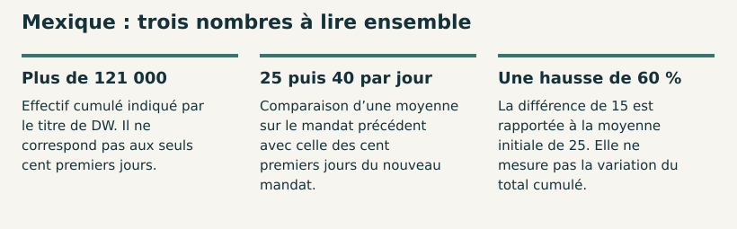

# ENS Paris-Saclay — Économie-gestion option 1 · Espagnol oral 2025 · Corrigé guidé

*Corrigé rédigé par IA, non officiel. Signalez toute erreur.*

**Rédaction** · GPT-6.2 Astra Ultra · vitesse non renseignée

Le 2 juin 2025, trois extraits de BBC News Mundo, de CNN en Español et de DW Español ont servi à l’oral. Le jury prévoyait trente minutes de préparation et environ trente minutes pour la présentation et l’entretien réunis.

Les trois publications sources sont identifiées par leur titre et leur chaîne. Le jury ne donne ni la durée ni les bornes des passages effectivement entendus. Les comptes rendus ci-dessous exposent les éléments documentés ; la restitution exacte des extraits demeure ouverte. Pour le reportage de DW sur le Mexique, le rapport imprime le 18 janvier et la plateforme affiche le 17 janvier 2025.

> [!INDICATION]
> Pour le compte rendu, relever le pays, la période et la question qui motive le reportage, puis attribuer chaque explication à celui qui la donne. Dans le commentaire, annoncer une question précise et développer un exemple que l’on pourra défendre lors de l’entretien. Les relances ci-dessous sont proposées pour l’entraînement.

## 1. Espagne — Pourquoi les inondations ont-elles été si meurtrières ?

> [!INDICATION]
> Le reportage a été publié le 4 novembre 2024, quelques jours après les inondations du 29 octobre. Situer à cette date les bilans de victimes et les critiques exprimées. Une quantité de pluie rend compte d’un phénomène météorologique ; pour expliquer le bilan humain, il faut encore examiner qui se trouvait sur la trajectoire de l’eau et quel délai ces personnes ont eu pour se protéger.

**Compte rendu à partir des éléments identifiés.** BBC News Mundo trata de explicar la gravedad de las inundaciones de finales de octubre en el este de España, especialmente en Valencia. En los primeros días de noviembre se contaban ya más de doscientas muertes y había personas cuyo paradero se desconocía. Hay que distinguir varios factores. Las lluvias excepcionales asociadas a una depresión aislada en niveles altos, o DANA, provocaron crecidas muy rápidas. La ocupación de zonas expuestas multiplicó los daños potenciales. Además, una previsión meteorológica de máximo riesgo no se tradujo a tiempo en instrucciones que alcanzaran a todos los habitantes amenazados. La lentitud de la respuesta de las autoridades regionales y centrales generó indignación. El medio destaca, al mismo tiempo, la movilización de miles de voluntarios para ayudar a la población afectada. [Reportage de BBC News Mundo](https://www.youtube.com/watch?v=I3KajSdJZ14) · [Enquête écrite de la BBC sur les facteurs de risque](https://www.bbc.com/mundo/articles/cx24815x66eo)

**Commentaire.** ¿Qué convierte una previsión acertada en una decisión útil para la población? Un mapa puede indicar peligro extremo en una comarca y, aun así, dejar a una trabajadora sin respuesta a la pregunta de si debe salir de la oficina para recoger a su hijo. La información necesita llegar con tiempo, indicar quién debe actuar y traducir un peligro general en instrucciones comprensibles. Eso exige preparar las decisiones antes de la emergencia, distribuir funciones entre los servicios y pensar en quienes no pueden recibir o interpretar fácilmente una alerta.

El urbanismo plantea una cuestión más lenta y menos visible. Allí donde se ha construido durante años en terreno inundable, mejorar la alerta puede salvar vidas, pero el próximo episodio volverá a amenazar las mismas viviendas. Las medidas de prevención tienen costes y pueden afectar de manera desigual a propietarios e inquilinos. Aplazarlas también distribuye costes, casi siempre después de que el daño se haya producido. La investigación pública debería explicar qué se sabía, en qué momento y qué decisiones se tomaron. A partir de ahí se pueden corregir procedimientos y orientar inversiones duraderas sin sustituir esa evaluación por acusaciones prematuras.

**Relance proposée.** *¿La solidaridad vecinal compensa la lentitud institucional?* Aporta ayuda y conocimiento del terreno. La coordinación de los avisos, las vías de acceso y los servicios de emergencia exige, además, recursos y competencias públicas. Reconocer el esfuerzo de los voluntarios permite ver mejor qué tareas quedaron desatendidas.

## 2. Argentine — L’annonce du retrait de l’OMS

> [!INDICATION]
> Au 5 février 2025, l’événement rapporté par CNN est une décision présidentielle annoncée en conférence de presse. Le président donne l’instruction, le ministre des Affaires étrangères doit la mettre en œuvre et le porte-parole l’annonce. Les arguments sanitaires et budgétaires sont attribués par le corrigé au gouvernement qui les avance.

**Compte rendu à partir des éléments identifiés.** CNN en Español informa de que el presidente argentino Javier Milei ha dado instrucciones al canciller Gerardo Werthein para retirar al país de la Organización Mundial de la Salud. El portavoz de la Presidencia, Manuel Adorni, comunica la decisión en una rueda de prensa. La noticia se produce después de que Donald Trump anunciara la retirada estadounidense. La postura que expone el Ejecutivo argentino gira en torno a cómo se gestionó la pandemia y al margen de decisión de los Estados. Adorni atribuye al organismo una actuación que considera condicionada por intereses políticos y sostiene que Argentina podrá gestionar sus recursos con mayor autonomía. Estos últimos puntos constituyen la justificación del Gobierno y pueden discutirse independientemente del hecho de que se haya dado la orden. [Reportage de CNN en Español](https://www.youtube.com/watch?v=8sWABJQmW50) · [Conférence de presse officielle du 5 février](https://www.casarosada.gob.ar/informacion/conferencias/50855-conferencia-de-prensa-del-vocero-presidencial-manuel-adorni-casa-rosada-6)

**Commentaire.** ¿Cómo se puede defender el control democrático de la política sanitaria y conservar los beneficios de una institución internacional? Un ministro nacional responde ante sus conciudadanos por decisiones difíciles, como asignar personal entre hospitales. Tiene motivos para pedir que las recomendaciones externas sean públicas y expliquen qué evidencia las respalda. A la vez, ningún país puede conocer por sí solo todo lo que ocurre en los demás. Compartir información comparable y criterios de vigilancia tiene un valor que no se refleja únicamente en una transferencia de dinero.

En su conferencia, el Gobierno argentino afirma que el país no depende de financiación de la OMS para gestionar su sanidad. Aun si se acepta esa premisa, sigue abierta la pregunta de cuánto costaría reemplazar ciertos canales de cooperación o participar en su definición desde fuera. Yo examinaría qué decisiones concretas se pretendía recuperar, qué alternativas permitirían mantener el intercambio de información y ante quién se evaluarían los resultados. También cabe pedir cambios dentro de una institución. Comparar esas posibilidades permite discutir las ventajas y los costes de la decisión sin reducir el debate a estar a favor o en contra de la soberanía.

**Relance proposée.** *¿Es suficiente que dos países anuncien medidas parecidas para afirmar que uno ha obligado al otro?* La cronología establece una coincidencia y un contexto político. Para sostener que hubo una imposición harían falta datos sobre el proceso de decisión que no aporta esa coincidencia.

## 3. Mexique — Ce que mesurent les chiffres des disparitions

> [!INDICATION]
> Le titre fournit un effectif cumulé, tandis que la notice donne des moyennes par jour sur deux périodes de durées très différentes. Distinguer ce que compte chaque nombre et identifier la source des appréciations portées sur l’attitude des institutions envers les familles.

**Compte rendu à partir des éléments identifiés.** DW Español aborda la crisis de las desapariciones en México. El título sitúa por encima de ciento veintiún mil el número de personas desaparecidas según las cifras oficiales. A ese total se añade otra medida, la media diaria de desapariciones registradas. En los primeros cien días del mandato de Claudia Sheinbaum fue de cuarenta al día, frente a veinticinco durante el sexenio anterior, el de Andrés Manuel López Obrador. La diferencia entre esas dos medias equivale a un aumento del sesenta por ciento. Las organizaciones civiles denuncian la falta de respaldo institucional a las familias, las amenazas que sufren y el estigma que recae sobre las víctimas. Así, el problema que dibuja la información combina un número elevado de casos con obstáculos persistentes para quienes buscan respuestas. [Reportage de DW Español](https://www.youtube.com/watch?v=3FvHL1Nd_sk)

**Commentaire.** ¿Qué se le puede exigir a un registro público cuando cada cifra corresponde a alguien a quien su familia sigue buscando? Publicar los datos hace visible la magnitud de una situación que, de otro modo, podría quedar reducida a una sucesión de experiencias privadas. Pero una misma variación en el registro admite varias preguntas. ¿Han cambiado los hechos, las posibilidades de denunciar o los criterios con los que se incorporan los casos? Que las cifras iniciales de un mandato sean peores no permite identificar por sí solo una causa, ni autoriza a restar importancia a los expedientes ya abiertos.

Un familiar necesita, además, saber quién se ocupa de su caso, cómo puede aportar información y con qué garantías se protegerá su identidad. Pedirle que repita su relato ante oficinas que no comparten datos aumenta la carga que soporta. Exponerse a amenazas o a insinuaciones sobre la víctima puede disuadir a otras familias de acudir a las autoridades. En mi opinión, la calidad de la respuesta institucional se mide tanto por el seguimiento que recibe cada denuncia como por la claridad de los totales publicados. La transparencia exige explicar el método de recuento y ofrecer a las personas afectadas interlocutores responsables.

**Relance proposée.** *¿Significa el sesenta por ciento que el total acumulado creció en esa proporción en cien días?* No. Se comparan las medias de cuarenta y veinticinco casos registrados por día. Para calcular el cambio del total acumulado habría que conocer, entre otras cosas, su valor inicial y cuántas personas fueron localizadas en el periodo.

> [!INDICATION]
> À l’oral, prononcer *ciento veintiún mil* avant un pluriel et *cuarenta al día* pour une moyenne. Pour le pourcentage, le dénominateur est la moyenne antérieure : *quince más al día sobre una base de veinticinco*. La comparaison ne dit pas que chaque journée a compté exactement quarante cas.

[Rapport du jury](https://ens-paris-saclay.fr/sites/default/files/CONCOURS/ANNALES_1C/1C_D2_1/2025/rapports/2025_EcoG1_Rapport_Espagnol_oral.pdf) · [Archives de la session](https://ens-paris-saclay.fr/node/10715)
