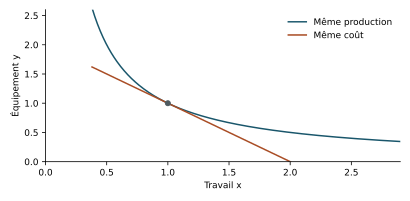
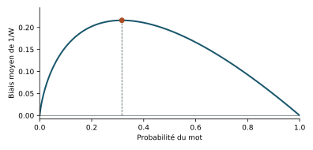

# ENS Paris-Saclay D2, option 1 — Mathématiques et statistiques 2025 · Corrigé guidé

*Corrigé rédigé par IA, non officiel. Signalez toute erreur.*

**Rédaction** · GPT-6.2 Astra Ultra · vitesse non renseignée

**Révision (tour 1)** · GPT-6.2 Astra Ultra · vitesse non renseignée

L’épreuve réunit trois problèmes indépendants. Les mêmes puissances de matrice se calculent par récurrence et par la formule du binôme. Le deuxième problème distingue coût minimal et production maximale. Le dernier compare trois façons d’estimer la probabilité d’un mot.

## Problème 1 — Puissances d’une matrice

### Question 1a

> [!INDICATION]
> Calculer les trois lignes avant d’effectuer le carré. Observer la proportion entre les colonnes.

#### Solution

En retranchant la matrice identité et en divisant par 3, puis en multipliant, on obtient
$$A=\begin{pmatrix}-2&0&-2\\1&0&1\\1&0&1\end{pmatrix},\qquad A^2=\begin{pmatrix}2&0&2\\-1&0&-1\\-1&0&-1\end{pmatrix}=-A.$$
On peut vérifier le carré en écrivant $A=u v^T$ pour $u=(-2,1,1)^T$, $v=(1,0,1)^T$, puisque $v^Tu=-1$.

### Question 1b

> [!INDICATION]
> Initialiser à la puissance zéro, puis employer la relation sur le carré de A pour simplifier le produit.

#### Solution

À l’indice 0, $M^0=I=I+0A$, donc prenons $u_0=0$. Supposons $M^n=I+u_nA$. Comme $M=I+3A$ et $A^2=-A$,
$$M^{n+1}=(I+u_nA)(I+3A)=I+(u_n+3)A+3u_nA^2=I+(3-2u_n)A.$$
La suite définie par $u_{n+1}=3-2u_n$ convient donc pour tout $n\ge0$ par récurrence.

### Question 1c

> [!INDICATION]
> Soustraire le point fixe de la relation affine.

#### Solution

Comme $v_n=u_n-1$, on a $v_{n+1}=3-2u_n-1=-2v_n$. C’est une suite géométrique de raison $-2$ et de terme initial $v_0=-1$, donc $v_n=-(-2)^n$.

### Question 1d

> [!INDICATION]
> Revenir au coefficient puis à la puissance de matrice.

#### Solution

On trouve $u_n=1-(-2)^n$ et $M^n=I+(1-(-2)^n)A$. En posant $t=(-2)^n$, cela donne explicitement
$$M^n=\begin{pmatrix}2t-1&0&2t-2\\1-t&1&1-t\\1-t&0&2-t\end{pmatrix}.$$

### Question 2a

> [!INDICATION]
> Multiplier J par elle-même. Examiner ce que sa relation impliquerait si elle était inversible.

#### Solution

Le calcul donne $J^2=\begin{pmatrix}-1&0&-2\\1&1&1\\1&0&2\end{pmatrix}=J$. Si $J$ était inversible, multiplier $J^2=J$ par son inverse donnerait $J=I$, contrairement aux coefficients affichés. Ainsi $J$ est singulière.

### Question 2b

> [!INDICATION]
> Exhiber deux colonnes indépendantes et employer le théorème du rang.

#### Solution

Les colonnes $c_1=(-1,1,1)^T$ et $c_2=(0,1,0)^T$ sont indépendantes, car la première composante de $c_1$ est non nulle et celle de $c_2$ est nulle. Le rang vaut au moins 2 et vaut au plus 2 par la singularité en dimension 3. Ainsi $\dim\operatorname{Im}f=2$ et $\dim\ker f=3-2=1$.

### Question 2c

> [!INDICATION]
> La base cherchée se lit sur les colonnes, images des vecteurs de la base canonique.

#### Solution

Les vecteurs $c_1=f(e_1)$ et $c_2=f(e_2)$ sont indépendants et appartiennent à l’image de dimension 2. Ils en forment une base. La dernière colonne vérifie aussi $c_3=2c_1-c_2$.

### Question 2d

> [!INDICATION]
> Traduire la dépendance entre les colonnes en un vecteur du noyau.

#### Solution

La relation $-2c_1+c_2+c_3=0$ montre que $(-2,1,1)^T$ est un vecteur non nul du noyau. Ce noyau étant de dimension 1, la famille réduite à ce vecteur en constitue une base.

### Question 3a

> [!INDICATION]
> Identifier les coefficients en utilisant une entrée hors diagonale puis une entrée diagonale.

#### Solution

L’entrée $(1,3)$ impose $b=3$, puis l’entrée $(2,2)$ donne $a+b=1$, soit $a=-2$. La vérification de toutes les entrées donne bien $M=-2I+3J$.

### Question 3b

> [!INDICATION]
> Dans le binôme, isoler le terme où la puissance du projecteur est nulle.

#### Solution

Les matrices $-2I$ et $3J$ commutent. De plus $J^k=J$ pour $k\ge1$, alors que $J^0=I$. Le binôme de Newton donne
$$M^n=(-2)^n I+\left[\sum_{k=1}^n\binom nk(-2)^{n-k}3^k\right]J.$$
La somme scalaire vaut $(-2+3)^n-(-2)^n=1-(-2)^n$, y compris pour $n=0$ où elle est vide. D’où $M^n=(1-(-2)^n)J+(-2)^nI$.

## Problème 2 — Production de Cobb–Douglas

### Question 1a

> [!INDICATION]
> Résoudre la contrainte et vérifier la positivité du couple obtenu pour chaque x admissible.

#### Solution

Les optimisations intérieures du sujet supposent $a,b,w,r,Q,K$ strictement positifs. Posons $s=a+b$, avec $s<1$. Pour $x,y>0$, $x^ay^b=Q$ équivaut à $y=Q^{1/b}x^{-a/b}$. Pour chaque $x>0$, cette valeur de $y$ est bien positive et fournit exactement un couple admissible. Le coût à minimiser sur $]0,+\infty[$ devient
$$G(x)=wx+rQ^{1/b}x^{-a/b}.$$
Si l’on autorisait $Q=0$, le niveau serait vide sur le domaine ouvert du sujet. La lecture stricte de « positifs » importe aussi pour les exposants. Par exemple, si $a=0$, $0<b<1$ et $w,r,Q>0$, la contrainte impose $y=Q^{1/b}$. Le coût $wx+rQ^{1/b}$ tend vers son infimum en $0$ sans l’atteindre pour $x>0$.

### Question 1b

> [!INDICATION]
> Comparer les deux termes de la dérivée et vérifier les limites aux deux extrémités.

#### Solution

On a $G'(x)=w-(ar/b)Q^{1/b}x^{-s/b}$. Cette dérivée croît strictement, passant de $-\infty$ à $w>0$. Elle s’annule uniquement en $x_Q=Q^{1/s}(ar/(bw))^{b/s}$. Le coût tend vers $+\infty$ aux deux extrémités. Son tableau de variations est donc
$$\begin{array}{c|ccccc}x&0^+&&x_Q&&+\infty\\\hline G'(x)&&-&0&+&\\G(x)&+\infty&\searrow&G(x_Q)&\nearrow&+\infty\end{array}$$

### Question 1c

> [!INDICATION]
> La condition de stationnarité donne un rapport simple entre les deux dépenses.

#### Solution

Au minimum, $G'(x_Q)=0$ donne $w x_Q=(a/b)r y_Q$. En revenant à la contrainte, l’unique couple est
$$x_Q=Q^{1/s}\left(\frac{ar}{bw}\right)^{b/s},\qquad y_Q=Q^{1/s}\left(\frac{bw}{ar}\right)^{a/s}.$$
Le coût vaut $(s/a)wx_Q=c_1Q^{1/s}$, où
$$c_1=s\left(\frac{w^a r^b}{a^a b^b}\right)^{1/s}.$$

### Question 2a

> [!INDICATION]
> Sur le quadrant ouvert, les puissances réelles s’expriment à l’aide du logarithme.

#### Solution

Comme $f(x,y)=\exp(a\ln x+b\ln y)$ sur $\Omega$, elle est de classe $C^\infty$. En dérivant deux fois,
$$H_f(x,y)=f(x,y)\begin{pmatrix}a(a-1)/x^2& ab/(xy)\\ab/(xy)&b(b-1)/y^2\end{pmatrix}.$$

### Question 2b

> [!INDICATION]
> Évaluer le déterminant et une entrée diagonale de la hessienne symétrique.

#### Solution

On trouve $\det H_f=f^2ab(1-a-b)/(x^2y^2)>0$ et $\partial^2_{xx}f=f a(a-1)/x^2<0$, car $0<a<s<1$. La hessienne est définie négative en tout point du quadrant convexe. La fonction y est donc strictement concave.

### Question 2c

> [!INDICATION]
> Adopter une convention de signe et la conserver pour le multiplicateur.

#### Solution

Avec la contrainte $wx+ry=K$, choisissons $\mathcal L(x,y,\lambda)=x^ay^b+\lambda(K-wx-ry)$. Le multiplicateur $\lambda$ est réel.

### Question 2d

> [!INDICATION]
> Diviser les deux équations de stationnarité pour déterminer la répartition du budget.

#### Solution

Les trois conditions sont $af/x=\lambda w$, $bf/y=\lambda r$ et $wx+ry=K$. Elles donnent $(wx)/(ry)=a/b$, d’où
$$x_K=\frac{aK}{sw},\qquad y_K=\frac{bK}{sr},\qquad \lambda_K=\frac{s}{K}f(x_K,y_K).$$
Ce triplet est unique, les deux coordonnées sont strictement positives, et la substitution vérifie les trois équations.

### Question 2e

> [!INDICATION]
> Exploiter la concavité sur la droite de budget avant de calculer la valeur optimale.

#### Solution

Au point critique, $\nabla f(x_K,y_K)=\lambda_K(w,r)$. Pour tout autre couple de même budget, la concavité majore la variation de $f$ par le produit de son gradient avec le déplacement. Ce produit vaut zéro, puisque $w(x-x_K)+r(y-y_K)=0$. La stricte concavité assure l’unicité du maximum. Sa valeur est $c_2K^s$, avec
$$c_2=\frac{a^a b^b}{s^s w^a r^b}.$$

### Question 3a

> [!INDICATION]
> Distinguer les ressources, leur coût et la quantité produite.

#### Solution

Le terme $wx$ rémunère le travail et $ry$ finance l’équipement. Leur somme $g$ est le coût total. Le premier problème cherche la combinaison de facteurs la moins coûteuse pour atteindre un objectif de production $Q$. Le second cherche la plus grande production accessible avec un budget $K$.

### Question 3b

> [!INDICATION]
> Comparer les deux fonctions de valeur puis les quantités de facteurs lorsque le budget correspond au coût de la production visée.

#### Solution

Pour $s=1$, les fonctions de valeur deviennent linéaires, $K_{\min}(Q)=c_1Q$ et $Q_{\max}(K)=c_2K$. Les expressions ci-dessus donnent $c_1c_2=1$. Ainsi le budget $K=c_1Q$ produit au maximum exactement $Q$, et la production maximale au budget $K$ nécessite exactement ce budget. Les choix de facteurs coïncident pour ces niveaux correspondants, avec $wx=aK$, $ry=bK$. Doubler simultanément les deux quantités de facteurs double le coût et la production. Ce sont des rendements d’échelle constants.

## Problème 3 — Fréquences des mots et estimation

### Question 1a

> [!INDICATION]
> Choisir les positions de chaque mot successivement parmi les positions encore libres.

#### Solution

Pour des entiers $y_j\ge0$ de somme $L$, on choisit successivement $y_1$ places parmi $L$, puis $y_2$ parmi $L-y_1$, etc. Le produit des coefficients binomiaux se simplifie en $|S|=L!/(y_1!\cdots y_m!)$.

### Question 1b

> [!INDICATION]
> Fixer le premier effectif puis reconnaître le développement multinomial d’une puissance de la somme des autres probabilités.

#### Solution

Pour $0\le k\le L$, la loi jointe donne
$$\mathbb P(Y_1=k)=\binom Lk p_1^k\!\sum_{y_2+\cdots+y_m=L-k}\frac{(L-k)!}{y_2!\cdots y_m!}\prod_{j=2}^m p_j^{y_j}=\binom Lk p_1^k(1-p_1)^{L-k}.$$
La dernière égalité est la formule multinomiale, avec $\sum_{j=2}^m p_j=1-p_1$. Hors des entiers de 0 à $L$, la probabilité est nulle. Ainsi $Y_1\sim\mathcal B(L,p_1)$.

### Question 1c

> [!INDICATION]
> La marginalisation précédente vaut pour tout mot par permutation des indices.

#### Solution

Pour tout $j$, $Y_j\sim\mathcal B(L,p_j)$, ce qui donne $\mathbb E(Y_j)=Lp_j$ et $\operatorname{Var}(Y_j)=Lp_j(1-p_j)$.

### Question 1d

> [!INDICATION]
> Indiquer pour chaque position du texte si le mot de rang j y apparaît.

#### Solution

Le nombre d’occurrences vérifie $Y_j=\sum_{i=1}^L\mathbf 1_{\{X_i=j\}}$. Chaque indicatrice vaut 1 précisément lorsque la position $i$ porte le mot $j$.

### Question 1e

> [!INDICATION]
> Développer la covariance de deux sommes. Distinguer les positions différentes et la même position.

#### Solution

Pour $j\ne j'$, les termes de positions $i\ne k$ ont covariance nulle par l’indépendance de $X_i$ et $X_k$. À une même position, les deux indicatrices ont un produit nul, donc leur covariance est $-p_jp_{j'}$. La bilinéarité donne $\operatorname{Cov}(Y_j,Y_{j'})=-Lp_jp_{j'}<0$. Pour $j=j'$, la covariance est la variance $Lp_j(1-p_j)$ de 1c. Les covariances non nulles entre mots distincts excluent l’indépendance de ces effectifs.

### Question 2a

> [!INDICATION]
> La fréquence observée rapporte le nombre d’occurrences à la longueur du texte.

#### Solution

Un estimateur naturel est $\widehat p_j^{(A)}=Y_j/L$, la proportion observée du mot $j$.

### Question 2b

> [!INDICATION]
> Relier l’erreur quadratique moyenne à la variance et au biais.

#### Solution

En notant $p=p_j$, on a $\mathbb E(Y_j/L)=p$ et $\operatorname{Var}(Y_j/L)=p(1-p)/L$. Comme le biais est nul, le risque quadratique $\mathbb E[(Y_j/L-p)^2]$ vaut lui aussi $p(1-p)/L$.

### Question 2c

> [!INDICATION]
> Prendre la limite à probabilité du mot fixée.

#### Solution

À $p_j$ fixé, le risque quadratique tend vers 0 lorsque $L\to\infty$. L’estimateur converge donc en moyenne quadratique vers $p_j$.

### Question 3a

> [!INDICATION]
> Préciser le modèle de répétition et décomposer l’événement en échecs puis succès.

#### Solution

Dans le modèle de mots indépendants de même loi, prolongeons l’écoute jusqu’au premier succès de probabilité $p=p_j$. Pour $k\ge1$, les $k-1$ premiers mots sont différents de $j$ et le $k$-ième est $j$, donc $\mathbb P(W_j=k)=(1-p)^{k-1}p$. Il s’agit de la loi géométrique sur $\mathbb N^*$. Si l’écoute s’arrête impérativement au bout de $L$ mots, il faut aussi prévoir une absence d’occurrence de probabilité $(1-p)^L$. La loi de la question correspond à l’écoute poursuivie jusqu’au succès.

### Question 3b

> [!INDICATION]
> Appliquer le transfert à la fonction inverse puis reconnaître une série logarithmique.

#### Solution

La variable $1/W_j$ est bornée par 1, donc intégrable. Par transfert et puisque $0<1-p<1$,
$$\mathbb E(1/W_j)=\sum_{k\ge1}\frac{p(1-p)^{k-1}}k=\frac p{1-p}\sum_{k\ge1}\frac{(1-p)^k}k=-\frac{p\ln p}{1-p}.$$
Le biais, défini comme espérance moins paramètre, vaut donc $-p\ln(p)/(1-p)-p$.

### Question 3c

> [!INDICATION]
> Étudier le signe de la dérivée au moyen de la fonction auxiliaire proposée, notamment autour de un demi.

#### Solution

Posons $b(t)=-t\ln(t)/(1-t)-t$. Aux bornes, $t\ln t\to0$ en 0 et $\ln t/(t-1)\to1$ en 1, donc $b(0^+)=b(1^-)=0$. On a $b'(t)=g(t)/(1-t)^2$ où
$$g(t)=-\ln t+t-1-(1-t)^2,\qquad g'(t)=\frac{(1-t)(2t-1)}t.$$
Ainsi $g$ décroît sur $]0,1/2]$ puis croît sur $[1/2,1[$. Ses valeurs limites sont $g(0^+)=+\infty$, $g(1)=0$, et $g(1/2)=\ln 2-3/4<0$. Il existe donc un unique zéro $t_0$ dans $]0,1/2[$. Le biais $b$ croît de 0 à $b(t_0)$ puis décroît jusqu’à 0. On trouve $t_0\simeq0{,}316$ et $b(t_0)\simeq0{,}216$.

### Question 3d

> [!INDICATION]
> Lire le signe du biais et sa dépendance à la probabilité réelle.

#### Solution

Sur $]0,1[$, le biais est strictement positif. La méthode B surestime donc en moyenne la probabilité du mot. Le biais absolu tend vers zéro aux deux extrêmes et est maximal pour une probabilité voisine de $0{,}316$. Cela décrit la moyenne sur des écoutes répétées, et une estimation particulière peut se trouver de part ou d’autre de $p$.

### Question 4a

> [!INDICATION]
> Séparer le dernier mot des k−1 précédents et fixer le nombre de succès dans ces derniers.

#### Solution

Pour que la $r$-ième occurrence arrive à la position $k$, il faut $k\ge r$, exactement $r-1$ succès parmi les $k-1$ premières positions et un succès à la dernière position. L’indépendance dans le modèle d’écoute donne
$$\mathbb P(Z_j=k)=\binom{k-1}{r-1}p^r(1-p)^{k-r}\quad(k\ge r).$$
La probabilité vaut zéro pour $k<r$. C’est le temps d’attente du $r$-ième succès dans une suite indépendante que l’on peut prolonger. Si l’écoute s’arrête réellement au mot $L$, la valeur exacte du temps reste inconnue dès que moins de $r$ succès ont été entendus. La probabilité de cette situation est $\mathbb P(Z_j>L)=\sum_{h=0}^{\min(r-1,L)}\binom Lh p^h(1-p)^{L-h}$, car le nombre de succès sur $L$ essais suit la loi binomiale.

### Question 4b

> [!INDICATION]
> Pour r supérieur à un, transformer le coefficient combinatoire en celui du temps d’attente précédent. Traiter r égal à un séparément.

#### Solution

Pour $r\ge2$, prenons $\widehat p^{(C)}=(r-1)/(Z_j-1)$. L’identité $\frac{r-1}{k-1}\binom{k-1}{r-1}=\binom{k-2}{r-2}$ donne
$$\mathbb E\widehat p^{(C)}=p\sum_{k=r}^\infty\binom{k-2}{r-2}p^{r-1}(1-p)^{k-r}=p.$$
La somme vaut 1 car, en posant $h=k-1$, elle additionne les probabilités des temps d’attente du $(r-1)$-ième succès. Pour $r=1$, le quotient proposé serait indéfini lorsque $Z_j=1$. Dans ce cas $\widehat p^{(C)}=\mathbf1_{\{Z_j=1\}}$ convient, puisque $\mathbb P(Z_j=1)=p$. Dans les deux cas le biais est nul.
