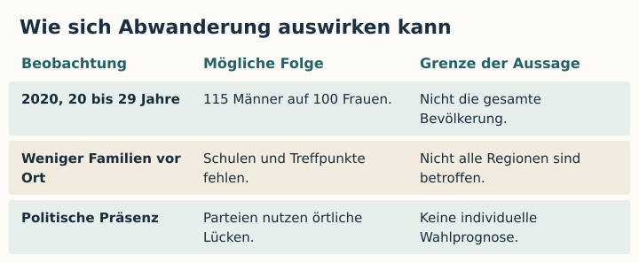

# ENS Rennes · D-E · Allemand 2025 — Corrigé brut

*Corrigé rédigé par IA, non officiel. Signalez toute erreur.*

**Rédaction** · GPT-6.2 Astra Ultra · vitesse non renseignée

L’épreuve dure quatre heures. Chacune des deux réponses d’expression écrite doit compter de 225 à 275 mots.

## I. Version

Selon Carsten Schneider, le Délégué aux affaires d’Allemagne de l’Est du gouvernement fédéral, les jeunes n’ont pas besoin de quitter les Länder orientaux. « Il y a désormais des emplois bien rémunérés en Allemagne de l’Est, on n’a plus besoin de partir », a déclaré Schneider.

Il réagissait ainsi à des chiffres que l’Office fédéral de la statistique avait publiés mardi. D’après ces données, l’an dernier encore, les jeunes de 18 à 29 ans ont été plus nombreux à quitter les Länder de l’Est pour l’Ouest qu’à faire le trajet inverse. Une tendance observée depuis 1991 s’est ainsi poursuivie.

Carsten Schneider a fait à ce propos la remarque suivante. « Les millions de personnes qui ont quitté l’Allemagne de l’Est après la chute du Mur et qui ont contribué à la croissance à l’Ouest, ce sont elles qui nous manquent aujourd’hui. » Selon lui, après la réunification, les choses étaient claires pour les jeunes Allemands de l’Est. « Quand on a fini sa scolarité et qu’on cherche une place en apprentissage ou un emploi, il faut partir à l’Ouest. » Aujourd’hui, a-t-il précisé, « ce n’est plus nécessaire, la pénurie d’emplois a entre-temps laissé place à une pénurie de main-d’œuvre ».

Les bons résultats de l’AfD aux élections régionales en Thuringe, en Saxe et dans le Brandebourg vont, selon Schneider, accentuer encore le vieillissement de la population et les départs. En présentant son rapport annuel une semaine plus tôt, il avait déclaré que les succès électoraux de l’AfD nuisaient « à la réputation de ces Länder ».

Il serait difficile, a-t-il estimé, de convaincre des gens de venir s’installer là où l’AfD est forte. Lui-même a dit ne pas trouver ces régions « accueillantes ». Les Allemands de l’Ouest y regarderaient à deux fois avant de s’installer en Allemagne de l’Est. Or ces migrations intérieures sont à ses yeux nécessaires.

Schneider a cependant mis en garde contre la stigmatisation de l’Allemagne de l’Est au vu de ces succès électoraux. La montée en puissance de l’AfD, a-t-il rappelé, « n’est pas un phénomène propre à l’Allemagne de l’Est ».

## II. Thème

In ihren Memoiren mit dem Titel „Freiheit“, die Ende November 2024 in rund dreißig Ländern erscheinen sollen, berichtet die frühere christdemokratische Regierungschefin unter anderem von „ihren Erinnerungen an ihre Jugend in der DDR, Gerhard Schröder im Fernsehstudio, einer Entscheidung zur Ukraine. Und von Donald Trump …“

Nachdem sie Deutschland sechzehn Jahre lang regiert hatte, zog sie sich vor drei Jahren aus der Politik zurück und übergab die Regierungsgeschäfte an den Sozialdemokraten Olaf Scholz. Der steckt heute jedoch in Schwierigkeiten. Weil seine Koalition mit den Grünen und den Liberalen zerbrochen ist, sollen im Februar 2025 vorgezogene Bundestagswahlen stattfinden. Ein Teil seiner eigenen Partei traut ihm allerdings nicht zu, die Sozialdemokraten zum Sieg zu führen.

Die Partei, an deren Spitze Angela Merkel stand, die CDU, und ihre bayerische Schwesterpartei CSU gelten unterdessen mit mehr als 32 Prozent in den Umfragen als klare Favoriten. Unter Friedrich Merz haben sie vor allem in der Einwanderungspolitik einen deutlich härteren Kurs eingeschlagen als Angela Merkel während ihrer Regierungszeit. In ihrem Buch erzählt Merkel übrigens, ihre Entscheidung, Deutschland 2015 für viele Flüchtlinge zu öffnen, habe ihr viel Kritik eingebracht, unter anderem von Donald Trump.

## III.1. Folgen der Abwanderung für Sachsen-Anhalt

Wer nur den Frauenanteil an der gesamten Bevölkerung betrachtet, verfehlt den Ausgangspunkt von Katja Salomos Analyse. 2022 waren 51 Prozent der Einwohner Sachsen-Anhalts Frauen. Unter den Zwanzig- bis Neunundzwanzigjährigen kamen dagegen 2020 auf hundert Frauen rechnerisch 115 Männer. Die Zahlen beziehen sich auf verschiedene Jahre und Altersgruppen. Für die Entwicklung eines Dorfes ist entscheidend, wer dort im Alter der Familiengründung lebt und welche Aussichten diese Menschen haben.

Salomo beschreibt zunächst einen Verlust an Beziehungen und Möglichkeiten. Einige Männer finden vor Ort keine Partnerin. Wo weniger Kinder aufwachsen, fehlen bald auch die Anlässe für Begegnungen, etwa bei einem Straßenfest. Sinkende Schülerzahlen gefährden den Bestand einer Schule. Wenn zugleich die medizinische Versorgung schlechter wird und Häuser leer stehen, müssen Familien längere Wege auf sich nehmen. Weitere junge Menschen haben dann einen Grund fortzuziehen. Der Leerstand kann diejenigen belasten, die geblieben sind, weil er sie täglich an die Veränderung ihres Ortes erinnert.

Salomo sieht darin auch eine politische Frage. Wer wiederholt erlebt hat, dass eine Veränderung den Verlust einer Einrichtung bedeutet, kann neuen Entwicklungen misstrauen. Manche empfinden Zuwanderung unter solchen Umständen als Konkurrenz um schon knappe Mittel. Das erklärt keine einzelne Wahlentscheidung. Salomo verweist zusätzlich darauf, dass die AfD gerade dort sichtbar auftritt, wo sich andere Parteien selten zeigen. Sie hebt die jungen Männer in stark gealterten Gegenden hervor. Der Schluss, ältere Menschen seien schon wegen des hohen Durchschnittsalters die entscheidenden Wähler, würde ihre Erklärung verfehlen. Großstädte und manche touristisch attraktiven Gebiete begrenzen zudem die Reichweite des Befunds.

*245 mots.*

## III.2. Warum Unterschiede die Einheit überdauern können

Die politische Einheit Deutschlands hat die Lebensgeschichten seiner Bewohner nicht vereinheitlicht. Steffen Maus These lässt sich besonders gut an der Frage prüfen, was eine junge Familie von ihren Eltern erbt. Dazu gehören Erinnerungen an einen Staat, den es nicht mehr gibt, berufliche Netzwerke und manchmal ein Haus oder ein Anteil an einem Unternehmen. Gleiche Gesetze führen deshalb nicht automatisch zu gleichen Handlungsmöglichkeiten.

Ein kulturelles Beispiel ist die Erwerbstätigkeit von Müttern. In der DDR gehörten die Berufstätigkeit beider Eltern und öffentliche Kinderbetreuung für viele Familien zum Alltag. Solche Erfahrungen wirken über Erzählungen und Erwartungen fort. Eine westdeutsche Familie kann selbstverständlich dieselben Vorstellungen teilen. Der Unterschied betrifft die Verbreitung und Geschichte eines Familienmodells. Wirtschaftlich kam hinzu, dass nach der Vereinigung zahlreiche Betriebe geschlossen oder verkauft wurden. Wer als junger Erwachsener fortging, konnte anderswo erfolgreich sein und trotzdem im Herkunftsort fehlen. Selbst wenn dort heute Fachkräfte gesucht werden, kehren weder eingespielte Netzwerke noch die inzwischen im Westen geborenen Kinder von selbst zurück.

Auch politisch kann dieser Unterschied sichtbar bleiben. Ein geschlossenes Bürgerbüro oder eine längere Fahrt zum Arzt sind konkrete Erfahrungen, auf die verschiedene Parteien reagieren können. Wenn eine Partei regelmäßig vor Ort ist, während andere nur vor Wahlen erscheinen, prägt das die Möglichkeiten politischer Bindung. Daraus folgt weder ein einheitlicher Osten noch ein unabänderliches Wahlergebnis. Leipzig und eine ländliche Gemeinde in Sachsen-Anhalt stehen vor verschiedenen Aufgaben. Gerade diese Unterschiede stützen eine vorsichtige Lesart von Mau. Gemeinsame Institutionen ermöglichen Zusammenarbeit, ohne dass alle Regionen am Ende dieselben gesellschaftlichen Erfahrungen machen müssen.

*248 mots.*

[Sujet officiel, pages 2 à 4](https://www.ens-rennes.fr/medias/fichier/sujets-lve-d-e-2025_1760692435843-pdf#page=2) · [Rapport du jury](https://www.ens-rennes.fr/medias/fichier/rapport-de-jury-lve-allemand-e-crit-d-e-2025_1768897920021-pdf)
