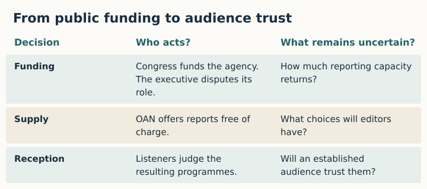
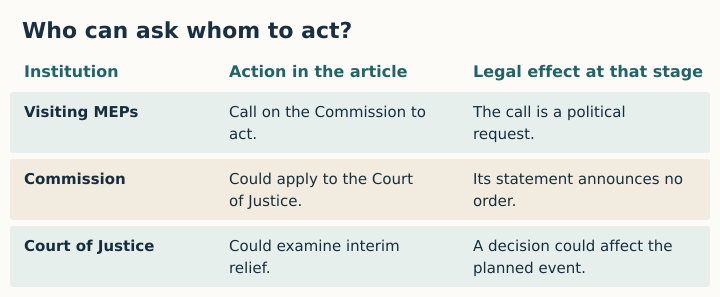
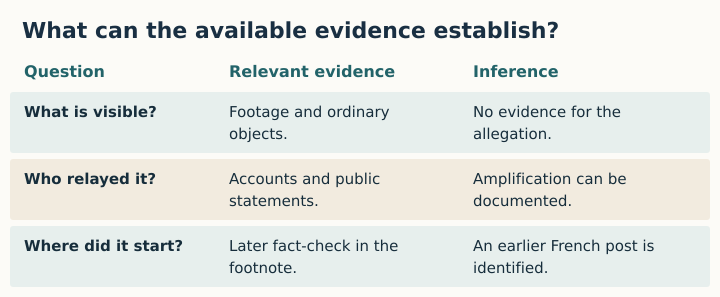

# ENS Rennes · D-E · Anglais oral 2025 — Corrigé guidé

*Corrigé rédigé par IA, non officiel. Signalez toute erreur.*

**Rédaction** · GPT-6.2 Astra Ultra · vitesse non renseignée

Le fascicule et le rapport présentent six articles. Les feuillets portent les numéros 1, 2, 4, 5, 6 et 7. Les 6 coupures reproduites dans le fascicule sont traitées sur les passages effectivement distribués.

Après vingt minutes de préparation, l’exposé et les questions du jury occupent ensemble quinze minutes. Les prises de parole et les échanges ci-dessous sont des propositions d’entraînement.

[Fascicule officiel](https://www.ens-rennes.fr/medias/fichier/sujets-anglais-oral-lve-d-e-2025_1761034065026-pdf) · [Rapport du jury](https://www.ens-rennes.fr/medias/fichier/rapport-de-jury-lve-anglais-oral-d-e-2025_1768897991410-pdf)

### Préparer la synthèse et le commentaire

Vous disposez de vingt minutes de préparation. L’exposé et l’entretien occupent ensemble quinze minutes. Le rapport attend une présentation du document, une synthèse des idées directrices, une question d’analyse et un commentaire organisé qui éclaire cet article précis. Pour tenir dans le temps, conservez au brouillon les personnes qui prennent la parole et, face à chaque nom, le verbe qui convient à ce qu’elles font. Une personne propose, une autre examine, une troisième exprime une crainte. Remplacer ces verbes par une annonce uniforme change l’événement.

En anglais, exercez-vous à passer de la question directe à sa reprise indirecte. *Who can request an interim order?* devient *The article explains who can request an interim order.* Le rapport insiste sur la place du sujet et du verbe, ainsi que sur les collocations et les prépositions. Préparez une phrase qui nomme clairement le sujet de chaque paragraphe plutôt que d’enchaîner des pronoms ambigus. Donnez un exemple extérieur uniquement si son lien avec l’argument est explicite.

Pour l’entretien, reprenez d’abord le point précis qui fait difficulté. Si vous avez dit que la Cour a suspendu une loi, revenez au texte du sujet 4 et reformulez la demande effectivement rapportée. Si vous avez dit qu’une chaîne de télévision organisera un concours de naturalisation, le sujet 6 invite à corriger le degré de certitude. Les réponses d’entraînement après chaque exposé visent ce travail de précision. Le fascicule et le rapport décrivent six articles. La numérotation imprimée passe directement du sujet 2 au sujet 4.

## Sujet 1 · Ed Sheeran writes urgent open letter to Keir Starmer for music education funding: ‘The time to act is now’

Adapted from The Independent - 23 March 2025

### Who pays for tomorrow’s musicians?

The Independent reports an open letter from Ed Sheeran and hundreds of other artists and industry leaders to the British government. They request £250 million for music education and a long-term commitment to teaching, venues and training. The headline emphasises urgency. The argument concerns a process that takes years, from a child’s first experience of playing music to a career on stage or behind it.

Sheeran’s international success makes him a credible witness to the value of British music, but the letter also asks readers to look beyond a famous individual. It puts the industry’s £7.6 billion contribution to the economy alongside a reported 21 per cent decline in music provision in state schools, which educate 93 per cent of children. These figures measure different things. Their relationship is an argument: today’s export earnings depend partly on earlier opportunities, while present reductions in access may only become visible in future careers. Comparing a strong year for British recordings with a recent year without a global top-ten single or album gives the reader a vivid contrast. Chart results alone cannot demonstrate that cuts to lessons caused the change.

The proposals show what the signatories think is missing. They address school budgets, teacher training, small venues, apprenticeships and a curriculum open to diverse musical traditions. If schools have instruments but no teachers, or skilled young musicians have nowhere affordable to perform, a grant to one link in the chain may accomplish little. The culture secretary’s example of Ipswich gives this claim a local setting. It also raises a question about how a local arrangement could be adapted to places with different venues and resources.

There is a second justification independent of exports. Children who never become professional musicians may still gain a form of expression and a way of working with others. This explains the letter’s final appeal to universal access and why a foundation established by one artist need not be a substitute for public provision. The most persuasive question posed by the extract is who should have access to cultural education before anyone knows which children might one day make a commercial success of it.

**Examiner. What would you measure besides chart success?** I would examine access to regular lessons, participation across income groups and whether young people can continue when they leave school.

**Examiner. Why name several ministers?** The letter treats music as an educational, cultural and economic activity. Naming several departments makes responsibility harder to confine to one small budget.

**Pour préparer l’échange.** Au brouillon, notez les unités de 250 millions, 7,6 milliards, 21 % et 93 %. Préparez une explication pour un enfant qui joue d’un instrument mais ne deviendra jamais musicien professionnel. Cet exemple oblige à expliciter la seconde justification du financement.

[Coupure distribuée, p. 1](https://www.ens-rennes.fr/medias/fichier/sujets-anglais-oral-lve-d-e-2025_1761034065026-pdf#page=1)

## Sujet 2 · Voice of America to Receive Feeds From Pro-Trump Network, Administration Says

Adapted from The New York Times - 7 May 2025

### Can a broadcaster choose freely when its supply of news changes?

The New York Times describes a proposal affecting Voice of America, a publicly funded broadcaster addressing audiences abroad. In March 2025 an executive order had effectively silenced it. In May, Kari Lake said that One America News Network had offered free reports to VOA and to the Office of Cuba Broadcasting. The article asks what the broadcaster would sound like if and when it returned to the air.

There are three distinct questions. The first concerns authority and resources. Congress had approved funding for a chartered agency. Journalists contested the administration’s power to withdraw it. A judge ordered a restoration of operations, while an appeals panel reversed parts of the funding order but left a requirement to revive programming. At the time of publication, how many reporters would return was unclear. Treating the litigation as finally settled would erase the uncertainty within which the proposed supply arrangement matters.

The second question concerns editorial control. Lake states that she has no power to choose the content of individual programmes and presents free reports as an option and a saving for taxpayers. Her critics focus on the available choices. If a newsroom has lost staff and an outside provider supplies material at no charge, the practical influence of that provider may be substantial even without a formal instruction to broadcast a story. The article also identifies OAN’s support for Trump and its history of circulating false claims about the 2020 election. Those details explain why a cost argument does not settle a question about accuracy.

Finally there is the audience. A former bureau chief stresses trust built over decades. A former head of the parent agency invokes the statutory requirement for accurate, objective and comprehensive coverage. Listeners may know the United States funds the service and still value reporting that can scrutinise its government. If they perceive its news as a government message, an attempt to exercise influence abroad could destroy one reason for that influence. Trust is a resource a free content feed cannot simply replace.

**Examiner. Was OAN already choosing everything broadcast by VOA?** No. The article reports an offer of material and disagreement about its likely consequences. It does not establish that every report would be used.

**Examiner. What would you ask to assess the economic argument?** What editorial work remains funded, what verification the supplied material requires and whether audiences keep using a service whose costs have fallen.

**Pour préparer l’échange.** Répartissez les verbes de décision entre Congrès, administration, juridictions et rédaction. À voix haute, distinguez *offered to supply reports* de *decided what would be broadcast*. Pour la discussion, dites comment une contrainte budgétaire pourrait peser sur une décision laissée libre en droit.

[Coupure distribuée, p. 2](https://www.ens-rennes.fr/medias/fichier/sujets-anglais-oral-lve-d-e-2025_1761034065026-pdf#page=2)

## Sujet 4 · MEPs call for EU court to suspend Hungary’s Pride ban

Adapted from The Guardian – 16 April 2025

### How can a European response reach a Hungarian law?

An April 2025 Guardian report follows a delegation of five Members of the European Parliament to Hungary. During their visit Hungarian lawmakers passed a constitutional amendment reinforcing a ban on LGBTQ+ events. The new provisions affect Budapest Pride and give authorities a means of identifying attenders for fines. The delegation’s immediate demand is for a temporary suspension while the legality of the measure is examined.

It is important to follow that demand through the institutions. The five MEPs can investigate, speak publicly and urge action. They call on the European Commission to ask the Court of Justice to suspend the law. The Commission says it will act if necessary. Neither the mission nor that statement constitutes a court order. Interim relief matters because a later judgement could come after a planned march. An assembly which people were prevented or deterred from attending cannot simply be held retrospectively in the same circumstances.

The report combines two kinds of evidence about the consequences. The law and amendment change what officials can do. Members of the delegation also describe a hostile climate and report concerns about attacks. These claims should be attributed to the speakers whose interviews the article records. Knowing that participation may be identified can itself deter public expression before any individual fine has been imposed. The issue therefore concerns freedom of assembly, equal treatment and the effective capacity of a minority to appear in public.

The article also names politicians who declined to join the delegation and officials who declined to meet it. Those absences complicate a simple account of Europe speaking with one voice. The closing references to US policy and Orbán’s relations with Trump place the disagreement in an international setting. They do not decide which legal powers EU institutions possess. The challenge is to connect the urgency expressed by the visitors to a real judicial process and its timetable.

**Examiner. Why seek interim measures?** Waiting for a final judgement could leave the contested rules in force during a specific event. The request concerns temporary protection pending examination.

**Examiner. Whose description of violence is reported?** A visiting Polish MEP links the atmosphere to reports of attacks. The article presents his account, alongside other statements and the observable legislative changes.

**Pour préparer l’échange.** Reconstituez toute la chaîne de la demande. La délégation de députés européens s’adresse à la Commission, qui pourrait saisir la Cour. Expliquez ensuite l’utilité d’une suspension avant une marche programmée. Ne transformez pas cette demande en ordonnance déjà rendue.

[Coupure distribuée, p. 3](https://www.ens-rennes.fr/medias/fichier/sujets-anglais-oral-lve-d-e-2025_1761034065026-pdf#page=3)

## Sujet 5 · The Handmaid’s Tale has eerie parallels to Trump 2.0

Adapted from Marquette Wire.org – 5 February 2025

### What can a dystopian analogy prove?

The writer for Marquette Wire describes a moment of recognition while watching a television adaptation of Margaret Atwood’s The Handmaid’s Tale. In the fictional history of Gilead, the loss of freedom unfolds in stages. The writer invites readers to examine early actions of Trump’s second administration through that sequence. This is an opinion piece published in February 2025, and its force depends on resemblance more than prediction.

The first comparison concerns isolation. Gilead has cut itself off from international organisations and independent reporting. The writer sets this against announcements about the Paris climate agreement and the World Health Organization. These examples establish a policy of withdrawal in particular areas. They do not establish the total isolation and censorship characteristic of the fiction. The reader can still ask what is harder to scrutinise or accomplish when international links are weakened.

The next part compares executive action with proposals in Project 2025. Trump denied an association with the project during the campaign. The writer cites reporting about contributors with previous administration experience and about similarities between some proposals and actions. Overlap in personnel or policy can make a denial worth investigating. It does not show that every contributor directs the administration or that every proposal has taken effect. Attribution is part of the argument here, since the campus publication relies in turn on reporting by other organisations.

Finally the article turns to family, gender and bodily autonomy. Gilead divides women into rigid categories with sharply unequal rights. The handmaid’s clothing has also travelled out of fiction into real political protest. An image can express apprehension about the direction of change long before a society resembles its fictional endpoint. That is both the advantage and the risk of the author’s method. A comparison can draw attention to gradual restrictions which might otherwise seem unrelated. Treating a warning as proof of an inevitable destination would close the very debate the warning is intended to open.

**Examiner. Why identify the source as a campus publication?** It helps explain the first-person cultural reference and the opinion format. It does not exempt its factual claims from verification.

**Examiner. Which part of the analogy would you qualify?** Withdrawal from particular organisations is much narrower than the complete exclusion of international scrutiny in Gilead.

**Pour préparer l’échange.** Choisissez un parallèle précis entre la fiction et la politique évoquée, puis nommez une limite précise de la comparaison. Distinguez le livre d’Atwood, son adaptation télévisée et l’article d’opinion. Reformulez la comparaison sans prétendre que le roman aurait prédit une mesure particulière.

[Coupure distribuée, p. 4](https://www.ens-rennes.fr/medias/fichier/sujets-anglais-oral-lve-d-e-2025_1761034065026-pdf#page=4)

## Sujet 6 · A Reality Show Where Immigrants Compete for U.S. Citizenship? D.H.S. Is Considering It.

Adapted from The New York Times – 16 May 2025

### Can citizenship be presented as a television prize?

The question mark in the New York Times headline matters. In May 2025 the Department of Homeland Security was considering a television producer’s proposal. No programme had been approved. Treating the story as an announcement that immigration law had changed would miss both the degree of uncertainty and the moral issue raised by the proposal itself.

Producer Rob Worsoff draws on his own experience of becoming an American citizen. Contestants might take part in challenges associated with different states or with civic knowledge, and someone would be sworn in at the end. He wants viewers to know participants as people. He also says no contestant would be penalised in the immigration process or deported because of the show. The department’s spokesperson presents a willingness to consider unconventional accounts of civic duty, while explaining that hundreds of proposals arrive and undergo review. The proposal had not reached the secretary herself.

Two stories about the same format are possible. In the producer’s account, an audience encounters people it might otherwise know only through political labels. Individual lives become visible and a ceremony invites viewers to discuss belonging. In the other account, a competitive format suggests that applicants must entertain the audience to merit rights or recognition. Selection for television can reward qualities useful to a producer, such as confidence on camera, which are unrelated to legal eligibility. Even if a losing contestant faces no formal penalty, public exposure can carry costs the programme does not control.

The article’s references to previous government cooperation with documentary filmmakers show that cameras and immigration agencies have worked together before. A documentary observing an existing process and a competition designed around a future ceremony raise different questions. Who writes the rules, who sees the footage and who has the right to decline? The answer at publication is that important details remain undecided. That uncertainty is a reason for examination rather than permission to fill in the proposed rules ourselves.

**Examiner. Would losing a challenge mean deportation?** The producer expressly says it would not. His assurance concerns a proposal, and no final format had been agreed.

**Examiner. Is visibility always empowering?** It can counter stereotypes when people can tell their own stories. It can also let a producer control how millions of viewers interpret a participant’s life.

**Pour préparer l’échange.** Entourez les verbes qui marquent la proposition, l’examen et l’éventualité. Demandez à votre partenaire de résumer le projet en conservant ces modalités. Introduisez ensuite une objection sur le contrôle des images ou le consentement des personnes filmées, puis opposez-lui la justification donnée par le producteur.

[Coupure distribuée, p. 5](https://www.ens-rennes.fr/medias/fichier/sujets-anglais-oral-lve-d-e-2025_1761034065026-pdf#page=5)

## Sujet 7 · Fact check: Macron, Merz and Starmer targeted by Russian 'cocaine' claims

Adapted from Euronews – 13 May 2025

### What did the footage show, and who amplified the rumour?

Euronews examines a viral allegation concerning Emmanuel Macron, Friedrich Merz and Keir Starmer on a train to Kyiv. They were travelling to meet Ukraine’s president and reaffirm their support. The fact-check separates what can be seen on a table from the far more serious claim viewers were invited to draw from it. There is no evidence in the footage that the leaders were taking drugs.

How does the article construct that conclusion? It identifies the event and the people who recorded it. It compares the circulating description with mundane explanations for the objects, including a tissue or napkin, and consults a specialist who sees no evidence of cocaine. It reports official denials from the governments concerned. These are different kinds of support: an official has a clear interest in rebutting a damaging claim, while footage recorded by independent news agencies helps establish the physical setting. None of those observers needs to determine precisely what every object was in order to show the weakness of the original allegation.

The second question concerns circulation. Pro-Kremlin outlets and accounts, a Russian foreign ministry spokesperson and prominent commentators elsewhere amplified the allegation. A site with a name resembling Euronews could borrow some of a recognised outlet’s credibility. The note added to the examination text is particularly important. A subsequent fact-check traced an earlier post to a French far-right figure and found that Russia relayed pre-existing posts. A claim can benefit Russian interests and be amplified by Russian actors without having originated with them. Origin, repetition and political purpose should be established separately.

There is also a useful limit to one of the article’s arguments. The presence of reputable agencies, and their failure to allege drug use, is relevant context. Guessing what security staff would have allowed is weaker evidence than examining what the recordings actually show. The strongest conclusion is proportionate: the allegation has no evidential basis, its circulation is documented and the footnote refines the account of its path.

**Examiner. Does an image establish the chemical identity of an object?** No. The task here is to test whether the serious allegation is supported. The visible details and available testimony provide no basis for asserting it.

**Examiner. What does the footnote correct?** It distinguishes subsequent Russian amplification from the origin of the earliest post identified by the later fact-check.

**Pour préparer l’échange.** Faites trois colonnes, « objet visible », « affirmation en ligne », « origine de la diffusion ». Ajoutez la note en bas de la page 6 à la troisième colonne. Expliquer en anglais qui a amplifié une affirmation ne dispense pas d’identifier séparément qui l’avait d’abord publiée.

[Coupure distribuée, p. 6](https://www.ens-rennes.fr/medias/fichier/sujets-anglais-oral-lve-d-e-2025_1761034065026-pdf#page=6)
