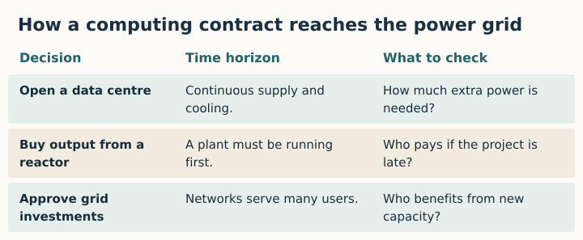

# ENS Rennes · D-E · Anglais 2025 — Corrigé brut

*Corrigé rédigé par IA, non officiel. Signalez toute erreur.*

**Rédaction** · GPT-6.2 Astra Ultra · vitesse non renseignée

L’épreuve dure quatre heures. Chacune des deux réponses d’expression écrite doit compter de 225 à 275 mots.

## I. Version

La « putréfaction cérébrale » se caractérise par une « détérioration supposée de l’état mental ou des facultés intellectuelles d’une personne, que l’on attribue en particulier à la consommation excessive de contenus (aujourd’hui surtout en ligne) jugés futiles ou peu exigeants ». Elle vit en symbiose avec les déchets d’Internet, cette bouillie, comme on a surnommé les contenus bâclés produits par intelligence artificielle, dont une partie est fabriquée par des diffuseurs de pourriels qui ont financièrement intérêt à inonder les réseaux sociaux.

Cette putréfaction est le symptôme, pas la maladie. Elle naît de l’avalanche quotidienne d’images et de vidéos insignifiantes, de toutes ces petites particules de contenu qui dégringolent sans rien éveiller en nous. Et pourtant, ces choses éphémères s’infiltrent bel et bien dans nos crânes. Cette bouillie a le don de prendre une place précieuse tout en réduisant notre capacité d’attention. Nous avons alors plus de mal à lire des livres, par exemple, ou à nous livrer à d’autres activités qui pourraient réellement nous combler.

Cette putréfaction ne fait pas mal. Elle émousse les sens, elle engourdit, un peu comme un goutte-à-goutte continu. On se sait atteint lorsqu’on a consommé sans être le moins du monde rassasié. Et le déluge de produits numériques jetables prend souvent des airs de prophétie qui se réalise d’elle-même en nous anesthésiant toujours davantage. Les cerveaux qui pourrissent réclament une nouvelle ration de bouillie.

L’ère Trump, et tout particulièrement la phase que nous traversons, est elle aussi celle de la putréfaction cérébrale, de la camelote et de l’épuisement. Cet été, mon collègue Charlie Warzel soutenait que l’esthétique MAGA tenait en un mot, « bouillie ». « L’allure haute définition et petit budget des images produites par l’IA générative semble se fondre dans l’esthétique du mouvement MAGA, si friand de mèmes », écrivait-il. Il a raison, même s’il importe de reconnaître que cette bouillie et la putréfaction cérébrale qui l’accompagne dépassent les clivages politiques.

## II. Thème

Startling to some and long expected by others, bitcoin’s rise past $100,000 revives fundamental political questions. […] These units have the objective properties something needs if people are to adopt it as a lasting medium of exchange without being required to do so by law. They are uniform, divisible, portable, verifiable, durable, relatively scarce and very costly to produce. Just like precious metals, particularly gold.

It is therefore hardly absurd for some people to try using bitcoin as money, first as a store of value and then as a medium of exchange. Especially when state currencies are losing value over time, the inescapable consequence of expansionary monetary policies pursued in order to monetise public debts that have spiralled out of control.

With what political consequences? Bitcoin puts the recommendations of the Austrian school of economics (Mises, Hayek, Rothbard, Hoppe and others) into practice in the digital age. It takes politics out of money. It takes money out of the hands of the state. It restores the apolitical character money should never have lost.

Bitcoin is a Copernican revolution. It is a response to the exhaustion of our political and financial model. It gives everyone a way to protect themselves against monetary inflation, a disguised tax that benefits the state at the citizen’s expense. No more monetary policy. No more central bank. No more scope for manipulating interest rates to accommodate the fiscal laxity of a welfare state corrupted by the buying of electoral support.

## III.1. Artificial intelligence and the green transition

The green transition depends on replacing fossil energy while finding enough clean electricity for new uses. Artificial intelligence complicates both tasks. Training and running models require computing power, and the servers that provide it must also be cooled. A data centre needs electricity at night as well as during sunny or windy hours. The article observes that the industry measures a building by the megawatts it can secure. Its most important constraint may therefore lie outside its walls.

Companies that promised clean power by 2030 now have to honour those commitments against a much larger load. Buying the annual equivalent of their consumption from a wind farm does not by itself say where their electricity will come from on a still winter evening. Nuclear generation could help close that gap. Microsoft is backing the return of an existing reactor, while Google and Amazon are supporting new small reactors. The distinction matters because an announced project cannot supply a server today. Delays and overruns at Vogtle give a reason to question optimistic schedules.

The challenge is also one of priorities. Homes switching to heat pumps and firms electrifying transport need access to the same grid. If a technology company pays for additional clean capacity and connections, other customers may benefit. If it simply reserves existing production, more demand may fall on fossil plants elsewhere. A credible transition would therefore measure additional generation, the timing of demand and the emissions of the whole system, alongside the efficiency of each individual model.

*249 mots.*

## III.2. The limits of corporate influence

The ability to promise a buyer for years gives a technology company political influence even before it seeks a meeting with a minister. A long contract can make an energy project attractive to lenders. It can also make a particular technology appear to legislators to be the obvious answer to a public problem. The purchase agreements in the article illustrate that power. They do not amount to permission to build a reactor or to decide how electricity costs should be shared.

Consider what happens when a project runs late. Shareholders may accept a loss on a speculative investment, but a regulator has to decide whether households should pay higher bills for a grid connection. Residents may welcome jobs and still seek an independent assessment of costs and environmental effects. Engineers cannot shorten every construction schedule because a customer expects its computing business to grow. These are distinct limits, arising respectively from law, public consent and the physical conditions of supply.

Governments also have reasons of their own to promote nuclear energy. The article describes support across party lines and mentions manufacturing and health care among the activities Washington wants to power. Agreement with a company therefore does not establish that the company dictated policy. Influence becomes harder to scrutinise when officials rely on a handful of firms for investment forecasts and expertise. Publishing contracts where possible, comparing alternative uses of scarce capacity and assigning the cost of overruns in advance would help elected authorities retain responsibility for the choices that remain theirs.

*252 mots.*

[Sujet officiel, pages 5 à 7](https://www.ens-rennes.fr/medias/fichier/sujets-lve-d-e-2025_1760692435843-pdf#page=5) · [Rapport du jury](https://www.ens-rennes.fr/medias/fichier/rapport-de-jury-lve-anglais-e-crit-d-e-2025_1768897929224-pdf)
