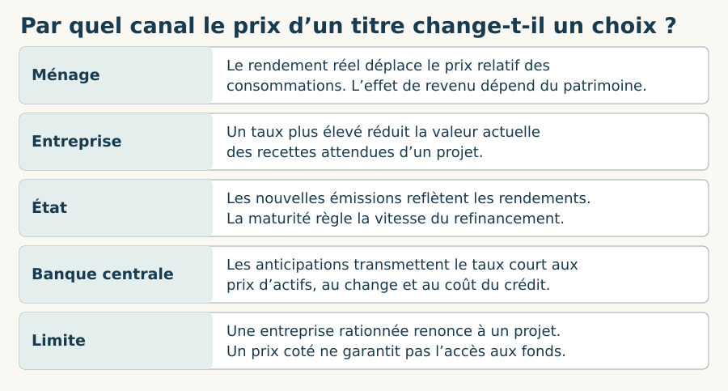

# ENS Rennes · D-E — Composition d’ordre économique 2025 · Corrigé guidé

*Corrigé rédigé par IA, non officiel. Signalez toute erreur.*

**Lecture du rapport du jury** · GPT-6.2 Astra Ultra · vitesse non renseignée

**Rédaction** · GPT-6.2 Astra Ultra · vitesse non renseignée

**Autocontrôle** · GPT-6.2 Astra Ultra · vitesse non renseignée

**Révision (tour 2)** · GPT-6.2 Astra Ultra · vitesse non renseignée · 26 novembre 2026

## Partir d’une décision identifiable

Consommer aujourd’hui ou demain, agrandir une usine, émettre une obligation, maintenir une parité, garantir le financement à court terme : donnez un sujet et un verbe à chaque mécanisme. Une liste des places boursières ou une histoire générale de la finance répondraient mal à la question.

### Trois exercices courts

1. **Un titre existant change de main pour 100 euros. Qui reçoit les fonds ?** Le vendeur. L’émetteur bénéficie indirectement de la liquidité du marché et du repère de prix pour sa prochaine émission. Comparez avec un titre nouvellement souscrit, dont le produit lui revient.
2. **Le projet à 108 pour un investissement de 100 est-il rentable ?** Le taux d’indifférence est 8 % sur un an. À 5 %, sa valeur actuelle est environ 102,86 et sa valeur nette 2,86. À 10 %, la valeur actuelle est environ 98,18 et la valeur nette −1,82. L’exemple suppose des recettes certaines et des taux exprimés sur la même base monétaire que les flux.
3. **Une rémunération de l’épargne plus forte réduit-elle toujours la consommation présente ?** Elle renchérit relativement la consommation immédiate, mais l’effet de revenu dépend de la position nette. Pour un ménage exclu du crédit, la réaction peut être dominée par une contrainte de liquidité. Distinguez le mécanisme théorique et sa portée.

### Deux distinctions décisives

L’antisélection se produit avant le contrat, quand le prêteur ne connaît pas parfaitement le type du demandeur. L’aléa moral concerne ce que fera celui-ci après le contrat. De même, une hausse des rendements sur le marché et une hausse immédiate de la charge de l’ensemble de la dette publique sont deux événements différents. Expliquez dans chaque cas le délai et l’intermédiaire qui relient un signal financier à la décision.

## Dans quelle mesure les marchés financiers affectent-ils les décisions économiques ?

En octobre 2008, la Réserve fédérale américaine crée une facilité pour soutenir le marché du papier commercial. Des entreprises qui, la veille, pouvaient renouveler leurs titres à court terme risquent de ne plus financer leurs opérations courantes. Un marché financier affecte donc les décisions par le prix du financement et par la possibilité même de l’obtenir. Sur le marché primaire, un agent à besoin de financement émet un titre souscrit par un détenteur d’épargne. Sur le marché secondaire s’échangent des titres existants. La vente n’apporte alors aucun fonds nouveau à l’émetteur, mais le prix et la liquidité de ces titres influencent les conditions de sa prochaine émission. Cette finance directe se distingue du crédit qu’une banque porte à son bilan, bien que marchés et banques se financent et se renseignent réciproquement. Comment les prix financiers rendent-ils possibles des arbitrages entre présent et avenir, et quand cessent-ils d’être un guide fiable pour les ménages, les entreprises et les pouvoirs publics ?

### I. En donnant un prix au temps et au risque, les marchés modifient l’ensemble des choix accessibles

Un ménage répartit sa consommation entre plusieurs périodes en fonction de ses ressources anticipées. À prix futurs anticipés donnés, une hausse du rendement réel rend moins coûteuse la consommation future relativement à la consommation présente. L’effet de substitution incite à reporter une dépense. L’effet de revenu dépend de la position du ménage. Un prêteur net qui se sent plus riche peut au contraire consommer davantage, tandis qu’un emprunteur confronté à un crédit plus coûteux réduit plus volontiers ses achats. Il serait donc excessif d’annoncer une hausse certaine de l’épargne agrégée dès que les rendements montent. Dans la logique du revenu permanent, un ménage peut étaler un surcroît temporaire de revenu sur plusieurs années. La diversification de son portefeuille lui permet aussi de réduire le risque propre à une entreprise. Mais il ne diversifie pas, par la seule détention de plusieurs actions corrélées, le risque d’une récession générale.

Pour une entreprise, la comparaison porte sur le coût présent du projet et la valeur actualisée de ses recettes futures. Si un investissement coûte 100 et rapporte avec certitude 108 un an plus tard, sa valeur nette au taux de 5 % est positive, puisque 108/1,05 dépasse 100. À 10 %, elle devient négative. Sur des marchés parfaits où l’on peut emprunter et prêter au même taux, le théorème de séparation de Fisher conduit l’entreprise à choisir les projets qui augmentent la valeur actuelle. Les apporteurs de capitaux peuvent ensuite se donner le profil de consommation qu’ils préfèrent, sans imposer leurs préférences temporelles à la direction. En présence de risque, il faut aussi rémunérer le risque pertinent. La baisse d’un rendement obligataire pour une maturité et un risque donnés peut ainsi libérer des investissements jusque-là non rentables. Une valorisation boursière élevée peut faciliter une émission d’actions, mais l’achat d’une action déjà existante ne finance pas directement une nouvelle machine.

La puissance publique utilise les titres de dette pour répartir dans le temps le coût d’un investissement, d’une réponse à une récession ou d’une dépense exceptionnelle. Le rendement demandé dépend notamment du taux sans risque pertinent, de la durée, de la liquidité et de la prime de risque de crédit. Une hausse du taux de marché renchérit immédiatement les nouveaux emprunts ou les emprunts révisables. Elle ne multiplie pas instantanément la charge de tous les emprunts anciens à taux fixe. La maturité de la dette détermine donc la vitesse à laquelle le gouvernement reconsidère impôts et dépenses. De même, la banque centrale agit sur le marché monétaire et sur les anticipations de taux. Les marchés transmettent cette impulsion vers les rendements longs, les taux des nouveaux crédits, les prix d’actifs et, dans une économie ouverte, le taux de change. Le même cours de marché devient à la fois le résultat d’une politique et une donnée pour les décisions suivantes.

### II. L’accès inégal, les défaillances d’information et le cadre de politique économique limitent ou amplifient cette influence

Le pouvoir d’arbitrer suppose un accès effectif au financement. Un ménage sans garantie qui voudrait emprunter en prévision d’un revenu futur ne peut pas nécessairement le faire. Sa consommation dépend alors surtout de son revenu courant. Une petite entreprise peut préférer le crédit d’une banque capable de suivre ses comptes au coût d’une émission publique. Avant le prêt, l’emprunteur connaît mieux que le prêteur la qualité du projet. Si augmenter le taux décourage surtout les emprunteurs prudents et attire relativement les plus risqués, l’antisélection peut rendre le rationnement préférable pour le prêteur. Après l’octroi du crédit, l’emprunteur peut accroître le risque du projet aux dépens du créancier. Cet aléa moral explique certaines garanties et clauses de contrôle. L’existence d’un marché ne garantit donc pas qu’un projet socialement ou même privément rentable trouvera des fonds.

Les prix eux-mêmes sont instables lorsque chacun doit prévoir ce que d’autres accepteront de payer demain. Une baisse du prix des garanties réduit la capacité d’emprunter. Les ventes imposées pour satisfaire les créanciers peuvent aggraver la baisse initiale et pousser des entreprises solvables à différer des dépenses. Le dysfonctionnement du papier commercial américain en 2008 l’illustre. Le recul de la demande de titres courts menaçait le refinancement courant des émetteurs. Le dispositif de la Fed a offert un relais de liquidité pour des titres éligibles. Il montre comment la politique publique peut agir sur le fonctionnement du marché, plutôt que constater simplement son verdict. Il faut distinguer une entreprise solvable à court de liquidités d’un projet insolvable dont les recettes attendues ne couvrent pas les engagements. Un soutien systématique à toutes les pertes réduirait les incitations à en apprécier le risque.

Les marchés internationaux élargissent le financement et les possibilités de diversification, tout en transmettant les révisions d’anticipations d’un pays à l’autre. Quand les capitaux sont très mobiles et le taux de change fixé, un écart durable entre le taux intérieur et les rendements étrangers corrigés du risque peut entraîner des flux incompatibles avec la parité. Le maintien simultané d’une parité fixe, de la pleine mobilité des capitaux et d’une politique monétaire autonome devient alors impossible. En changes flexibles, le taux de change absorbe une partie de l’ajustement, au prix d’effets sur les importations et sur les dettes en monnaie étrangère. Dans l’union monétaire européenne, un État n’a plus son propre taux directeur. Des primes souveraines divergentes peuvent en revanche se transmettre aux banques puis aux entreprises, même lorsque la BCE fixe un seul taux. Son annonce de 2012 concernant les opérations monétaires sur titres visait cette fragmentation. L’engagement public influence ainsi les prix qui sont censés discipliner l’État. Des outils macroprudentiels et des exigences de solvabilité peuvent enfin limiter le risque collectif qu’une décision prudente pour un détenteur isolé, vendre en urgence par exemple, fait courir aux autres.

Les marchés affectent profondément les arbitrages qui engagent le présent et le futur. Leur influence passe aussi bien par la possibilité d’émettre ou de refinancer que par les mouvements de prix observés. Elle est plus directe pour l’agent qui émet des titres, plus médiate mais parfois tout aussi décisive pour celui dont le prêt, le salaire ou l’impôt dépend de ces conditions. La réciprocité entre décisions publiques et formation des prix explique que les marchés puissent tour à tour informer, contraindre ou déstabiliser ces choix.

[Sujet officiel](https://www.ens-rennes.fr/medias/fichier/sujet-economie-d-e-2025_1760692386039-pdf) · [Rapport du jury](https://www.ens-rennes.fr/medias/fichier/rapport-de-jury-economie-e-crit-d-e-2025_1768897848087-pdf) · [BCE, transmission monétaire](https://www.ecb.europa.eu/mopo/intro/transmission/html/index.en.html) · [Fed, marché du papier commercial en 2008](https://www.federalreserve.gov/newsevents/reform_cpff.htm) · [BCE, décisions de septembre 2012](https://www.ecb.europa.eu/press/govcdec/otherdec/2012/html/gc120921.en.html)

## Vérification sur le sujet

L’intitulé unique et le rapport de deux pages ont été rapprochés de chaque édition. Les décisions étudiées concernent les ménages, les entreprises et la puissance publique, avec finance directe ou intermédiée, prix du risque, contraintes de crédit et intégration internationale. Les réponses distinguent également marché primaire et marché secondaire.

La séparation de Fisher précise dans quelles conditions un prix de marché oriente l’entreprise. Un projet coûte 100 aujourd’hui et rapporte avec certitude 108 dans un an. Sa valeur actuelle nette est de $108/1{,}05-100$, soit environ 2,86 au taux de 5 %. Au taux de 10 %, elle tombe à environ −1,82. Si actionnaires et entreprise empruntent et prêtent librement au même taux, le projet rentable accroît la richesse des actionnaires, qui choisissent ensuite leur propre profil de consommation. Si l’entreprise manque de garanties et ne peut emprunter au taux affiché, le taux pertinent et même la faisabilité du projet changent.
