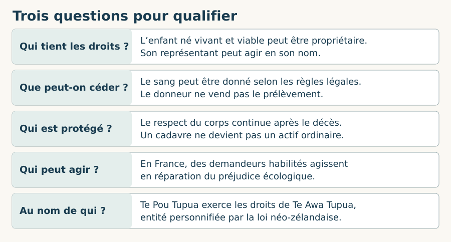

# ENS Rennes · D-E — Droit civil 2025 · Corrigé brut

*Corrigé rédigé par IA, non officiel. Signalez toute erreur.*

**Lecture du rapport du jury** · GPT-6.2 Astra Ultra · vitesse non renseignée

**Rédaction** · GPT-6.2 Astra Ultra · vitesse non renseignée

**Autocontrôle** · GPT-6.2 Astra Ultra · vitesse non renseignée

**Révision (tour 1)** · GPT-6.2 Astra Ultra · vitesse non renseignée

## La distinction entre les personnes et les choses

Une rivière peut subir une pollution avant même qu’un riverain éprouve un dommage personnel. Qui peut alors entrer dans un prétoire et au nom de qui ? En droit français, la réparation du préjudice écologique peut être demandée par ceux auxquels la loi reconnaît qualité et intérêt à agir. En Nouvelle-Zélande, une loi de 2017 reconnaît expressément à Te Awa Tupua la personnalité juridique et prévoit qui agit en son nom. Deux systèmes peuvent ainsi prendre au sérieux l’atteinte portée à un milieu naturel tout en apportant des réponses différentes à la question de sa qualification.

La personne est un sujet auquel l’ordre juridique permet d’imputer des droits et des obligations. Les personnes physiques et les personnes morales peuvent tenir cette place. Une chose est susceptible d’être objet de droits ou de mesures de protection. Le mot « bien » met l’accent sur ce qui présente une utilité et peut entrer dans le patrimoine, lequel peut aussi comprendre un droit incorporel. Toutes les choses ne sont pas librement appropriables. Ce qui est en jeu dans la distinction est la manière de déterminer qui peut tenir un droit et sur quoi celui-ci peut porter. Comment maintenir cette distinction lorsque le droit protège certains objets en raison de leurs liens avec les personnes et permet d’exploiter certains attributs de la personnalité ? La qualification continue d’ordonner l’attribution des droits, tandis que les situations de frontière obligent à en dissocier la protection, la disponibilité et la représentation.

### I. La distinction attribue une place juridique sans épuiser le statut de ce qu’elle qualifie

**A. Disposer de droits se distingue de la capacité de les exercer soi-même.** Un enfant né vivant et viable peut être propriétaire d’une maison qu’il n’a pas la capacité de vendre seul. Celui qui le représente exerce une prérogative au nom de l’enfant et doit respecter les règles de cette représentation. Une société dotée de la personnalité juridique est elle-même créancière du prix de ce qu’elle vend. Le dirigeant qui signe ne devient pas titulaire de la créance. Ces situations mettent au jour un critère décisif. La conscience actuelle, la parole et la capacité à signer ne déterminent pas qui peut être titulaire du droit.

Les limites temporelles de la personnalité physique affinent ce critère. L’article 16 du Code civil garantit le respect de l’être humain dès le commencement de sa vie. L’embryon et le fœtus font l’objet de protections propres, qui ne confèrent pas d’emblée l’ensemble des prérogatives d’un enfant né vivant et viable. Les articles 725 et 906 organisent néanmoins la possibilité, pour un enfant déjà conçu, de succéder ou de recevoir une libéralité dans les conditions qu’ils fixent, s’il naît viable. Ainsi l’enfant conçu au décès de son père peut, à sa naissance vivante et viable, recueillir des droits dans sa succession. L’anticipation sert un intérêt déterminé et dépend de l’issue de la grossesse. Elle n’établit pas une personnalité prénatale générale.

L’Assemblée plénière a jugé le 29 juin 2001 (n° 99-85.973) que l’interprétation stricte de la loi pénale s’oppose à l’extension de l’homicide involontaire à l’enfant à naître dans l’affaire examinée. Elle renvoie aux textes particuliers concernant l’embryon ou le fœtus. La décision délimite une incrimination. La lire comme une permission de disposer de l’embryon ou comme un jugement universel sur son statut ferait dire à la juridiction plus qu’elle n’a décidé.

**B. Le droit civil protège le corps sans en faire un actif à la disposition de son titulaire.** L’article 16-1 associe le respect du corps, son inviolabilité et l’exclusion des droits patrimoniaux sur le corps, ses éléments et ses produits. Les articles 16-5 et 16-6 en tirent des conséquences pour les conventions qui attribueraient une valeur patrimoniale au corps et pour la rémunération des prélèvements. L’autorisation donnée dans le cadre légal d’un don de sang rend possible le prélèvement et l’utilisation médicale du produit. Elle ne permet pas au donneur d’en fixer le prix à la poche. La séparation matérielle d’un élément du corps oblige donc à déterminer les actes permis et leur finalité. Elle ne déclenche pas un passage uniforme dans le commerce ordinaire.

La mort met fin à la personnalité du défunt et ouvre sa succession. Ses biens patrimoniaux peuvent être transmis, alors que ses restes ne constituent pas un actif ordinaire que les héritiers seraient libres d’exploiter. L’article 16-1-1 exige encore le respect, la dignité et la décence, y compris à l’égard des cendres. Le 16 septembre 2010 (n° 09-67.456), la première chambre civile a retenu que l’exposition de cadavres humains à des fins commerciales méconnaissait cette exigence. Le corps peut être matériellement détenu et faire l’objet de mesures judiciaires de protection. Ces opérations ne ressuscitent pas une personne juridique et n’installent pas une libre propriété marchande sur ses restes. Une interdiction peut donc subsister quand le titulaire qu’elle protégeait de son vivant a disparu.

### II. Les situations de frontière obligent à choisir le mécanisme correspondant à l’intérêt en cause

**A. Permettre un usage ou soustraire un objet à certains droits ménage le lien avec la personne.** Une comédienne autorise l’utilisation rémunérée de son portrait pour l’affiche d’une pièce pendant une saison. L’organisateur peut en tirer l’usage contractuellement délimité. Cela ne l’autorise pas, par principe, à réutiliser ce portrait pour la publicité d’un tiers après la saison. La faculté d’autoriser et de délimiter une exploitation économique peut s’attacher à une personne qui demeure le sujet de sa personnalité. L’objet de l’accord est l’usage consenti, avec sa durée, sa destination et ses supports. Parler de vente de la personne ferait disparaître les limites qui donnent au contrat sa portée.

La protection peut aussi aller d’une chose vers la personne à laquelle elle sert. Un fauteuil roulant demeure un meuble. Lorsqu’il est indispensable à la personne en situation de handicap, la protection de l’article L. 112-2, 7°, du Code des procédures civiles d’exécution interdit sa saisie. Le créancier conserve sa créance. Il ne peut choisir librement cet objet pour se faire payer. La prothèse et le matériel médical conduisent ainsi à préciser le rapport concret au corps et au besoin de la personne. L’équipement externe utilisé au quotidien appelle une question de saisissabilité. Une intervention portant sur un dispositif implanté doit aussi être appréciée au regard de l’intégrité corporelle et du consentement. La même étiquette de « matériel » ne suffit pas à traiter les deux situations.

**B. Protéger un vivant ou un milieu peut conduire à un régime spécial ou à une véritable personnification.** L’article 515-14 du Code civil français reconnaît aux animaux la qualité d’êtres vivants doués de sensibilité et les soumet au régime des biens sous réserve des lois qui les protègent. Le propriétaire d’un animal peut donc disposer de certains droits sur lui alors que sa conduite envers cet être sensible est limitée. Ce texte qualifie l’animal et organise un régime. Il ne confère pas à chaque animal un patrimoine et une représentation en justice propres. La sensibilité explique des protections spécifiques sans fournir à elle seule le critère de la personnalité civile.

Lorsque la pollution atteint un écosystème, les articles 1246 et 1247 rendent réparable une atteinte non négligeable aux éléments ou aux fonctions des écosystèmes ou aux bénéfices collectifs que l’être humain tire de l’environnement. L’article 1248 ouvre notamment l’action à l’État, à certaines collectivités concernées et aux associations qui remplissent les conditions légales. La liste de l’article 1248 illustre l’exigence de qualité et d’intérêt à agir. Elle mentionne, entre autres, les associations agréées ou créées depuis au moins cinq ans à la date d’introduction de l’instance et ayant pour objet la protection de la nature et la défense de l’environnement. L’article 1249 donne priorité à la réparation en nature. Si celle-ci est juridiquement ou matériellement impossible, ou si les mesures sont insuffisantes, les dommages et intérêts sont affectés à la réparation de l’environnement. Le versement revient au demandeur ou, s’il ne peut prendre les mesures utiles, à l’État. On peut donc demander la restauration d’une zone humide pour le dommage écologique lui-même, indépendamment du manque à gagner d’un pêcheur. Le droit pénal peut également sanctionner certaines atteintes intentionnelles aux conditions du délit d’écocide de l’article L. 231-3 du Code de l’environnement. Action civile et sanction pénale protègent ici un milieu par des mécanismes distincts. Aucune des deux ne confère, de ce seul fait, la personnalité à la zone humide.

La loi néo-zélandaise de 2017 fait un autre choix. Sa section 12 reconnaît Te Awa Tupua comme un ensemble vivant et indivisible, du relief où naît le fleuve Whanganui jusqu’à la mer, avec ses éléments physiques et métaphysiques. La section 13 énonce les valeurs qui donnent sens à cette reconnaissance et aux relations des communautés māories concernées avec le fleuve. La section 14 confère expressément à l’entité les droits, pouvoirs, obligations et responsabilités d’une personne juridique, exercés ou assumés par Te Pou Tupua en son nom. En France, une association habilitée forme l’action environnementale ouverte par la loi. Dans ce dispositif néo-zélandais, le représentant agit au nom de l’entité personnifiée. Le changement de qualification porte donc sur l’identité du titulaire et sur la source du pouvoir de représentation. Il dépasse l’octroi d’une protection renforcée au même objet.

La distinction entre personnes et choses conserve sa force dès que l’on demande à qui le droit est imputé. Son application requiert cependant plusieurs décisions. Il faut encore établir les protections attachées à une réalité, les prérogatives qui peuvent entrer dans le commerce et la personne habilitée à agir. Les protections du corps et de l’environnement en donnent les deux faces. La dignité peut survivre à la fin d’une personnalité. La personnalité peut aussi être conférée par un texte à une entité que des personnes protégeaient déjà.

[Sujet officiel](https://www.ens-rennes.fr/medias/fichier/sujet-droit-civil-d-e-2025_1760692414631-pdf) · [Rapport du jury](https://www.ens-rennes.fr/medias/fichier/rapport-de-jury-droit-civil-d-e-2025_1768897861553-pdf)

[Code civil, respect du corps humain](https://www.legifrance.gouv.fr/codes/section_lc/LEGITEXT000006070721/LEGISCTA000006136059/) · [Cass. ass. plén., 29 juin 2001](https://www.legifrance.gouv.fr/juri/id/JURITEXT000007046781) · [Cass. 1re civ., 16 septembre 2010](https://www.legifrance.gouv.fr/juri/id/JURITEXT000022826393/) · [Article 515-14, animaux](https://www.legifrance.gouv.fr/codes/article_lc/LEGIARTI000030250342) · [Code civil, préjudice écologique](https://www.legifrance.gouv.fr/codes/section_lc/LEGITEXT000006070721/LEGISCTA000033019029/) · [Te Awa Tupua Act 2017, section 14](https://www.legislation.govt.nz/act/public/2017/7/en/2017-03-20/sections/DLM6831461/)

[Code civil, art. 1248](https://www.legifrance.gouv.fr/codes/article_lc/LEGIARTI000038846675/2025-04-15) · [Code civil, art. 1249](https://www.legifrance.gouv.fr/codes/article_lc/LEGIARTI000033019118/2025-04-15)
