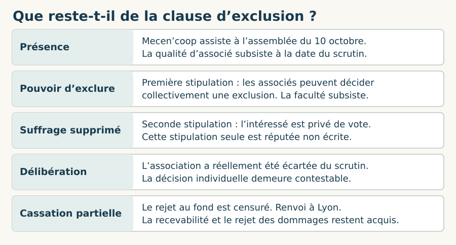

# ENS Rennes · D-E — Droit commercial 2025 · Corrigé guidé

*Corrigé rédigé par IA, non officiel. Signalez toute erreur.*

**Lecture du rapport du jury** · GPT-6.2 Astra Ultra · vitesse non renseignée

**Rédaction** · GPT-6.2 Astra Ultra · vitesse non renseignée

**Autocontrôle** · GPT-6.2 Astra Ultra · vitesse non renseignée

**Révision (tour 1)** · GPT-6.2 Astra Ultra · vitesse non renseignée

## Déplier l’article 14-1 des statuts

Réécrivez la clause en deux phrases. Première proposition, les associés peuvent décider collectivement une exclusion. Seconde proposition, l’intéressé ne prend pas part au vote. La première met en œuvre une faculté reconnue à la SAS par l’article L. 227-16 du code de commerce. La seconde retire à un membre encore associé un attribut essentiel de la participation. Le jugement porté sur l’une ne se transmet pas mécaniquement à l’autre.

### Quatre questions sur le document

1. **L’association était-elle absente ?** Non. Le paragraphe 3 la compte parmi les associés réunis le 10 octobre 2016. C’est son suffrage qui a été supprimé.
2. **Où se trouve le visa ?** Juste après l’argument du pourvoi. Dans le moyen et la motivation des juges d’appel apparaît l’article L. 227-9. Dans le visa de la Cour apparaît l’article L. 227-16, aux côtés des articles 1844 et 1844-10 du code civil.
3. **Que change le mot « stipulation » au paragraphe 7 ?** Enlevez la phrase qui prive la personne de sa voix. Il reste un texte autorisant l’assemblée à décider l’exclusion. L’arrêt de 2013 permet de mesurer la différence avec l’éviction de la clause entière.
4. **Quel est le résultat procédural ?** La cassation est partielle. Deux chefs demeurent acquis. Le fond du litige sur la décision d’exclure est renvoyé. Le montant de 3 000 euros alloué au titre de l’article 700 du code de procédure civile ne correspond pas à une indemnisation de l’exclusion.

### Vérifier la portée sur un exemple

Une assemblée réunit quatre associés disposant chacun d’une voix. Trois souhaitent l’exclusion du quatrième et les statuts exigent une majorité simple. Même lorsque l’issue paraît certaine, le quatrième doit pouvoir voter sur sa propre exclusion. Supposons que les statuts exigent l’unanimité. Son vote peut alors faire obstacle à la décision. Cet effet tient à la règle de majorité et ne donne pas à la société le pouvoir de supprimer son suffrage. L’exemple permet de distinguer droit de voter, poids du vote et droit de rester membre.

Le schéma distingue la situation de l’associé, les deux stipulations et le sort des deux actes que sont les statuts et la décision individuelle.

## Voter sur sa propre exclusion d’une société par actions simplifiée

L’associé visé par une exclusion a tout intérêt à s’y opposer. Est-ce une raison suffisante pour soustraire sa voix à la décision ? L’article 14-1 des statuts de la société coopérative d’intérêt collectif constituée en SAS à capital variable Médicoop Provence Méditerranée autorisait une exclusion par décision collective et écartait du vote la personne concernée. Le 10 octobre 2016, les associés se réunissent en présence de l’association Mecen’coop. Son exclusion est décidée sans qu’elle vote. L’association en demande l’annulation. La cour d’appel d’Aix-en-Provence rejette sa demande le 6 janvier 2022 en estimant que la liberté d’organisation reconnue à la SAS autorisait la dérogation. L’association se pourvoit en cassation.

Comment préserver le droit de vote de tout associé lorsqu’une même clause autorise l’exclusion et organise sa mise à l’écart du scrutin ? Par son arrêt publié du 29 mai 2024, la chambre commerciale prononce une cassation partielle et renvoie l’affaire à Lyon. Son raisonnement conjugue deux décisions. Le droit de voter subsiste jusqu’à l’exclusion. Au sein du mécanisme statutaire, seule est écartée la stipulation qui prive l’intéressé de cette voix.

### I. L’associé conserve sa voix au moment où la collectivité décide de sa qualité

**A. L’autorisation d’exclure ne confère pas la maîtrise de tous les droits de l’intéressé.** L’article L. 227-16 du code de commerce permet aux statuts de prévoir qu’un associé sera tenu de céder ses actions. Le législateur admet ainsi qu’un groupement organise la sortie forcée de l’un de ses membres. En l’espèce, les statuts remettent la décision aux associés. Ils font de l’exclusion l’objet d’une décision collective, ce qui commande d’appliquer les garanties attachées à cette qualité. L’article 1844 du code civil donne à tout associé le droit de participer aux décisions collectives. La jurisprudence en tire, sauf dérogation légale, le droit de voter. Une personne dont le sort doit être tranché est encore associée au moment du vote. Prendre sa qualité future pour acquise reviendrait à rendre la décision effective avant même de l’adopter.

**B. La présence à l’assemblée ne répare pas la suppression de la voix.** Mecen’coop avait assisté à la réunion. Elle pouvait donc, au sens matériel, être présente sans pouvoir déterminer le résultat du scrutin. Le paragraphe 7 vise toute stipulation qui, par son objet ou par son effet, prive l’associé du vote sur cette proposition. La rédaction couvre le retrait exprès de la voix et une rédaction qui rendrait cette voix inopérante. La cour d’appel invoquait l’article L. 227-9 et la faculté de fixer les formes et conditions de la décision collective. Le visa de cassation associe au contraire les articles 1844 et 1844-10 du code civil à l’article L. 227-16 du code de commerce. Une liberté d’organisation générale ne confère aucune dérogation expresse au droit de vote sur l’exclusion. Le conflit d’intérêts est inhérent à la question soumise à l’assemblée. Il ne crée pas par lui-même une incapacité de voter.

### II. Le réputé non écrit atteint la privation du vote au sein de la clause d’exclusion

**A. La précision du paragraphe 7 déplace le périmètre de la sanction.** En 2013, dans son arrêt du 9 juillet (n° 11-27.235), la chambre commerciale avait approuvé que la clause irrégulière soit écartée dans son ensemble. Le président ne pouvait de sa propre initiative corriger la clause en convoquant autrement les associés. En 2024, la Cour isole, à l’intérieur de la clause d’exclusion, la stipulation qui neutralise le vote. Cette unité plus petite change le sort du pouvoir d’exclure. La décision collective reste prévue par le pacte social, et le réputé non écrit débarrasse ce mécanisme de sa modalité illicite. Il suffit de supprimer les mots qui empêchent l’associé de voter pour que les deux règles, la faculté d’exclusion et le droit de vote, puissent ensemble recevoir effet. La sanction protège ici la liberté des associés d’organiser le groupement autant que la prérogative individuelle de celui qu’ils envisagent d’en faire sortir.

**B. La clause ainsi préservée ne valide pas rétroactivement la délibération.** La société avait effectivement privé l’association de sa voix. La conservation du principe d’une exclusion ne répond donc pas à la demande d’annulation dirigée contre la décision du 10 octobre 2016. La Cour censure le rejet de cette demande et renvoie à Lyon. Elle laisse subsister les chefs concernant la recevabilité de l’action et le rejet des dommages-intérêts demandés pour procédure abusive. Elle ne prononce pas elle-même une nouvelle exclusion ni ne donne au membre concerné un droit de veto. Dans un nouveau scrutin, sa voix devrait être admise et décomptée selon les conditions régulières de la décision. Le résultat pourrait encore lui être défavorable. Si sa voix change le rapport des forces, la société doit accepter cette conséquence de la majorité qu’elle a choisie. Si elle ne le change pas en pratique, l’impossibilité de voter n’en devient pas, par la seule arithmétique, une stipulation régulière.

À la date de l’épreuve, le 16 avril 2025, la réforme des nullités en droit des sociétés avait été publiée. L’article 70 de l’ordonnance du 12 mars 2025 fixe son application de principe au 1er octobre suivant. La délibération de 2016 et la décision de cassation de 2024 s’expliquent par les textes visés dans l’arrêt. Anticiper la réforme pour apprécier la sanction reviendrait à changer le droit de référence.

L’équilibre tient donc à l’objet précis du contrôle. L’ordre juridique protège l’associé au moment où sa qualité est en jeu tout en laissant vivre l’institution contractuelle de l’exclusion. La Cour maintient une exigence ancienne quant au vote et aménage la sanction qui, jusqu’alors, menaçait d’emporter tout le mécanisme.

[Sujet officiel](https://www.ens-rennes.fr/medias/fichier/sujets-epreuve-a-options-d-e-2025_1760692424609-pdf#page=3) · [Rapport du jury](https://www.ens-rennes.fr/medias/fichier/rapport-de-jury-droit-commercial-d-e-2025_1768897872505-pdf) · [Arrêt du 29 mai 2024](https://www.legifrance.gouv.fr/juri/id/JURITEXT000049640994) · [Précédent du 9 juillet 2013](https://www.legifrance.gouv.fr/juri/id/JURITEXT000027702300)

[Code civil, art. 1844-10, version applicable](https://www.legifrance.gouv.fr/codes/article_lc/LEGIARTI000038589913/2025-04-16) · [Ordonnance du 12 mars 2025, art. 70](https://www.legifrance.gouv.fr/loda/article_lc/LEGIARTI000051317088)
