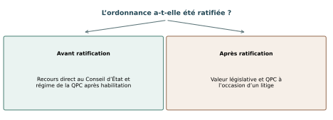
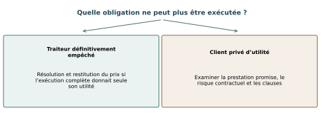
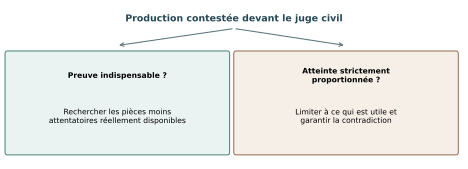

# ENS Rennes D-E — Droit (oral) 2025 · Corrigé guidé

*Corrigé rédigé par IA, non officiel.*

**Rédaction** · GPT-6.2 Astra Ultra · vitesse non renseignée

Le fascicule contient vingt tirages distincts. Chacun réunit une question théorique et une situation pratique. Les solutions utilisent les textes et la jurisprudence disponibles à la session. Les relances sont proposées pour l’entraînement.

À la préparation, traiter la question de cours sur ses propres termes. Pour le cas, retenir les faits juridiquement utiles, présenter la règle, vérifier ses conditions une à une et conclure en précisant les faits encore nécessaires.

## Sujet 01 — Règlement et directive · mise en œuvre du RGPD

*Fascicule, page 1.*

> [!INDICATION]
> Vérifier successivement la date d’entrée en vigueur, la date d’application et celle de la loi.

### Question théorique

L’article 288 TFUE rend le règlement obligatoire dans tous ses éléments et directement applicable dans chaque État membre. La directive oblige l’État destinataire quant au résultat, en lui laissant le choix des formes et moyens dans le délai fixé. Après ce délai une disposition claire, précise et inconditionnelle d’une directive peut être invoquée contre l’État ou une émanation de celui-ci. Elle ne crée pas, à elle seule, une obligation horizontale pour un particulier. Le juge national recherche aussi une interprétation conforme.

### Application au cas

Le droit national peut préciser des options laissées ouvertes par un règlement, désigner une autorité ou abroger des dispositions contradictoires. La loi française de 2018 a adapté la loi Informatique et Libertés et pris en compte d’autres éléments du paquet européen. L’application du RGPD n’était pas conditionnée par cette loi.

La chronologie de la prémisse mérite correction. Le règlement est entré en vigueur le 24 mai 2016 et il est applicable depuis le 25 mai 2018. La loi française du 20 juin 2018 est donc postérieure à ces deux dates. Une règle nationale incompatible doit être écartée dans le champ du règlement. [RGPD, notamment article 99](https://eur-lex.europa.eu/legal-content/FR/TXT/?uri=CELEX:32016R0679)

**Relance.**  Pourquoi un texte interne peut-il rester nécessaire ?

Certaines modalités relèvent d’une marge nationale expressément ouverte par le règlement. Cela ne transforme pas celui-ci en directive.

## Sujet 02 — Ordonnances de l’article 38 · recours du militant

*Fascicule, page 2.*

> [!INDICATION]
> Classer les voies de recours selon la ratification, le délai d’habilitation et le moyen invoqué.

### Question théorique

Le Parlement habilite le Gouvernement, pour un objet et une durée limités, à prendre des mesures relevant normalement de la loi. L’ordonnance est délibérée en Conseil des ministres après avis du Conseil d’État, signée par le président de la République et publiée. Elle devient caduque si le projet de loi de ratification n’est pas déposé dans le délai prévu. Une ratification, nécessairement expresse, lui donne valeur législative.

### Application au cas

Paul veut attaquer directement l’ordonnance fictive du 26 mars. Tant qu’elle n’est pas ratifiée, un recours pour excès de pouvoir relève en premier et dernier ressort du Conseil d’État. Il faut vérifier le délai à compter de la publication et l’intérêt personnel suffisamment direct. Une opinion politique ou la lecture d’une chronique ne suffisent pas à le démontrer.

Après l’expiration de l’habilitation, une atteinte aux droits et libertés garantis par la Constitution par une disposition du domaine législatif se conteste par QPC dans une instance, même avant ratification. Les autres moyens de légalité demeurent à examiner. Après ratification, pas de recours direct en annulation contre une loi. La transposition ajoute le contrôle des exigences européennes et, au besoin, un renvoi préjudiciel à la Cour de justice. [Conseil d’État, 16 décembre 2020](https://www.conseil-etat.fr/fr/arianeweb/CE/analyse/2020-12-16/440258)

**Relance.**  Le dépôt du projet de loi vaut-il ratification ?

Il évite la caducité prévue en cas de dépôt tardif. Seule une ratification expresse donne à l’ordonnance valeur législative par cette voie.

## Sujet 06 — Silence contractuel · engagement de financer la clinique

*Fascicule, page 3.*

> [!INDICATION]
> Identifier la personne qui a signé puis la manifestation de volonté de la clinique.

### Question théorique

Le contrat se forme par la rencontre d’une offre et d’une acceptation. L’article 1120 du Code civil écarte en principe la valeur d’acceptation du silence, sauf disposition de la loi, usages, relations d’affaires ou circonstances particulières. Une exécution volontaire peut manifester sans paroles un consentement, ce qui diffère d’une simple abstention.

### Application au cas

La procédure collective n’oblige pas spontanément tous les actionnaires ou praticiens à apporter de nouveaux fonds. Il faut identifier l’auteur, la qualité dans laquelle il a signé, le montant promis et les circonstances d’acceptation. La SELARL et son médecin sont deux personnes distinctes. Un engagement de la première ne suffit pas à poursuivre le second à titre personnel.

Si les actionnaires et praticiens ont effectivement pris un engagement précis et que la clinique l’a intégré à son plan, un paiement peut être exigé du signataire concerné. La Cour de cassation a admis dans une espèce voisine la force de l’engagement personnel écrit du médecin, le contexte du plan donnant sens au silence de la clinique. Le sujet ne reproduit pas ici le document signé. [Com., 18 janvier 2011, n° 09-69.831](https://www.legifrance.gouv.fr/juri/id/JURITEXT000023462083/)

**Relance.**  Le seul intérêt du médecin au sauvetage de la clinique suffit-il ?

L’intérêt économique ne remplace pas l’engagement personnel. Il faut établir qui a offert la prestation et dans quelles circonstances la clinique l’a acceptée.

## Sujet 07 — Droits patrimoniaux et extrapatrimoniaux · achat d’un fichier

*Fascicule, page 4.*

> [!INDICATION]
> Séparer obtention du fichier, prospection et publication sur le site.

### Question théorique

Les droits patrimoniaux ont une valeur pécuniaire, tels la propriété ou un droit de créance. Beaucoup sont transmissibles et saisissables. Les droits extrapatrimoniaux sont attachés à la personne, notamment le respect de sa vie privée. Une atteinte à un tel droit peut entraîner une indemnisation patrimoniale, sans que le droit lui-même devienne librement cessible.

### Application au cas

La cession d’un fichier commercial n’emporte pas le droit de réutiliser librement les données des acheteuses. Il faut examiner la finalité initiale, la base juridique de la transmission puis celle du nouveau traitement, l’information donnée, les droits d’opposition et, selon le canal, le consentement préalable à la prospection électronique. Une liste de clientes n’atteste ni leur profession ni leur accord à la publication d’informations sur leur vie.

La diffusion sur le site constitue une finalité distincte de la vente de compléments. Le simple succès commercial de l’entreprise auprès des joueuses ne la justifie pas. Les acquéreurs doivent vérifier la provenance et les permissions. Des données réellement relatives à la santé bénéficieraient en outre du régime renforcé de l’article 9 du RGPD. Les faits ne permettent pas de présumer que chaque achat révèle une donnée de santé. [CNIL, transmission aux partenaires](https://www.cnil.fr/fr/la-prospection-b-to-c-quelles-regles-pour-transmettre-des-donnees-des-partenaires)

**Relance.**  L’accord du vendeur couvre-t-il celui des personnes figurant dans le fichier ?

Le vendeur peut conclure un contrat, mais chaque traitement doit respecter les droits des personnes et disposer de sa propre base légale.

## Sujet 08 — Inexécution et force majeure · acompte du traiteur

*Fascicule, page 5.*

> [!INDICATION]
> Distinguer impossibilité d’exécuter et impossibilité pour un créancier de profiter d’une prestation.

### Question théorique

L’article 1217 du Code civil ouvre selon les cas suspension, exécution forcée, réduction du prix, résolution et réparation. Leur mise en œuvre dépend de la gravité, de la mise en demeure requise, de la possibilité d’exécuter et du préjudice. La force majeure contractuelle suppose un événement hors du contrôle du débiteur, raisonnablement imprévisible à la conclusion et dont les effets ne pouvaient être évités par des mesures appropriées (art. 1218).

### Application au cas

Les mesures sanitaires et la maladie sont fictives dans l’énoncé. Le traiteur devait fournir sa prestation au concours de janvier, reporté puis annulé. Si cette obligation datée est définitivement empêchée et que les prestations n’avaient d’utilité que pour la manifestation, la résolution libère les parties. Le traiteur doit restituer les 80 000 euros reçus en contrepartie d’une prestation inexécutée, même si aucune faute ne justifie des dommages-intérêts.

Il faut vérifier l’affectation contractuelle au concours, les clauses de report ou de répartition du risque et l’éventuelle existence de services divisibles déjà utiles. Si l’hôtel était seulement empêché de profiter d’une prestation que le traiteur demeurait en mesure d’exécuter conformément au contrat, la solution serait différente. La demande de restitution, appuyée sur les articles 1218 et 1229, est sérieuse sur la première lecture. [Com., 26 février 2025, n° 23-21.266](https://www.legifrance.gouv.fr/juri/id/JURITEXT000051283982)

**Relance.**  Pourquoi la restitution peut-elle être due malgré la force majeure ?

La responsabilité indemnitaire répare une inexécution imputable. La restitution tire les conséquences de la disparition de la contrepartie dans un contrat résolu.

## Sujet 09 — Effet relatif · promesse de porte-fort

*Fascicule, page 6.*

> [!INDICATION]
> Qualifier les engagements du promettant, du groupe et de l’ancien salarié séparément.

### Question théorique

L’article 1199 limite les obligations contractuelles aux parties. Les tiers doivent respecter la situation créée et peuvent l’invoquer (art. 1200). Dans la stipulation pour autrui, le bénéficiaire acquiert un droit contre le promettant. Par le porte-fort, une personne promet le fait d’un tiers et répond elle-même si ce fait n’est pas accompli (art. 1204). Le tiers reste libre.

### Application au cas

L’ancienne société s’est engagée à obtenir la reprise de relations entre le groupe et le salarié. Ce dernier ne peut contraindre les sociétés du groupe à lui proposer une mission du seul fait de cet accord. Il doit établir les faits précis promis et leur défaut d’accomplissement. Une promesse générale de reprendre des relations n’est pas nécessairement une garantie de chiffre d’affaires déterminé.

Dans l’affaire dont le sujet reprend la trame, l’inexécution du seul porte-fort ne justifie pas la résolution de la transaction. Elle ouvre une demande de dommages-intérêts contre le promettant, à proportion du préjudice prouvé. Le salarié ne retrouve pas automatiquement le bénéfice du jugement auquel il avait renoncé. Une autre inexécution de la transaction devrait être démontrée séparément. [Civ. 1re, 7 mars 2018, n° 15-21.244](https://www.legifrance.gouv.fr/juri/id/JURITEXT000036718262)

**Relance.**  À qui réclamer réparation ?

Au promettant qui a pris l’engagement, sous réserve d’établir son contenu et son inexécution. Le tiers n’a rien promis par sa seule appartenance au groupe.

## Sujet 10 — Preuve des actes juridiques · courriel entre concubins

*Fascicule, page 7.*

> [!INDICATION]
> Examiner l’auteur du courriel, le contenu admis, le montant et la date d’exigibilité.

### Question théorique

Le demandeur doit prouver l’obligation (art. 1353). Pour un acte d’une valeur supérieure à 1 500 euros, un écrit est en principe exigé, avec exceptions telles l’impossibilité morale de se procurer un écrit ou le commencement de preuve par écrit corroboré (art. 1359 à 1362). L’écrit électronique a la même force que le papier si son auteur peut être identifié et son intégrité établie (art. 1366).

### Application au cas

Entre concubins il n’existe pas de contribution légale aux charges identique à celle des époux. Il faut établir l’accord, la nature des dépenses et la part convenue. Le message de Théo admet un remboursement pour certaines dépenses et peut conforter l’existence d’un accord. La formulation « ma part » n’en fixe ni le montant ni la clé de répartition et la formule temporelle est imprécise.

Capucine conservera le message et sa provenance, les factures, virements et échanges antérieurs utiles à la quantification. Une reconnaissance unilatérale formelle d’une somme doit satisfaire aux exigences de l’article 1376. À défaut, le message peut être un commencement de preuve par écrit, ou une pièce appréciée librement si le seuil ou une exception le permet. Le recouvrement immédiat de toute la somme demandée n’est donc pas acquis.

**Relance.**  La familiarité du ton empêche-t-elle toute valeur de preuve ?

La force probante dépend de l’identification, de l’intégrité et de la précision de ce qui est reconnu. Le ton ne tranche pas ces questions.

## Sujet 12 — Liberté de la preuve · enregistrements professionnels

*Fascicule, page 8.*

> [!INDICATION]
> Soumettre d’abord la pièce à la discussion sur sa nécessité, puis examiner le fond du licenciement.

### Question théorique

En matière civile les faits juridiques se prouvent en principe par tout moyen, sous réserve de la loi. La preuve des actes obéit davantage à l’exigence d’un écrit. Le droit à la preuve entre en balance avec la vie privée, la loyauté des échanges et les droits de la défense.

### Application au cas

L’employeur a enregistré à l’insu de sa salariée des entretiens de suivi. Depuis l’arrêt d’assemblée plénière du 22 décembre 2023, la déloyauté dans l’obtention d’une preuve ne commande pas automatiquement son exclusion du procès civil. En cas de contestation le juge doit, si cela lui est demandé, vérifier que sa production est indispensable à l’exercice du droit à la preuve et que l’atteinte est strictement proportionnée au but poursuivi.

Ici les instructions de poste, demandes de comptes rendus, courriels ou éléments de suivi pourraient déjà établir le défaut de reporting. S’ils suffisent, les captations risquent d’être écartées. Si aucun moyen moins attentatoire ne permet d’établir un point décisif, il faut encore limiter les extraits et permettre le contradictoire. La recevabilité éventuelle de la pièce ne valide ni sa collecte ni automatiquement le licenciement. [Ass. plén., 22 décembre 2023, n° 20-20.648](https://www.courdecassation.fr/decision/65855660673fa80008f8d98d)

**Relance.**  Un enregistrement recevable dispense-t-il de prouver une cause réelle et sérieuse ?

Non. Le juge apprécie séparément ce que les propos établissent, l’imputabilité des faits et le motif invoqué dans le litige.

## Sujet 13 — Abus de droit · construction empiétant sur le voisin

*Fascicule, page 9.*

> [!INDICATION]
> Mesurer l’empiétement et distinguer l’objectif de restitution du terrain de la technique de travaux.

### Question théorique

Un droit peut engager la responsabilité civile lorsque son exercice dégénère en abus, notamment par intention de nuire ou détournement de sa fonction. Le simple fait de causer une gêne en exerçant son droit ne suffit pas. Il faut distinguer ce régime de la protection attachée à l’assiette même du droit de propriété.

### Application au cas

L’abri dépasse sur le terrain de Mme Machin de 11,5 cm sur 2 m. Si les titres et le bornage ou une expertise établissent cet empiétement, les articles 544 et 545 lui permettent d’en exiger la cessation. La petite surface, la bonne foi du constructeur ou la seule disproportion entre la valeur de la bande et le prix des travaux ne lui imposent pas de la vendre. Revendiquer l’intégrité de son fonds ne constitue pas de ce seul fait un abus.

La mesure doit supprimer l’empiétement prouvé. Il faut rechercher si un retrait partiel techniquement possible rétablit la limite. La destruction intégrale de l’abri n’est nécessaire que si une intervention moindre ne suffit pas. Une indemnité ou une cession négociée restent possibles avec l’accord de la propriétaire. [Civ. 3e, 10 novembre 2016, n° 15-25.113](https://www.courdecassation.fr/decision/5fd91991997644b570fe70b7)

**Relance.**  L’autorisation d’urbanisme règle-t-elle le litige de propriété ?

Elle est délivrée sous réserve des droits des tiers. Elle ne modifie pas la limite séparative.

## Sujet 14 — Enrichissement injustifié · location du jardin d’autrui

*Fascicule, page 10.*

> [!INDICATION]
> Séparer reddition du loyer, frais utiles du gérant et responsabilité pour les fraisiers.

### Question théorique

L’enrichissement injustifié suppose enrichissement, appauvrissement corrélatif et absence de justification. L’indemnité est en principe limitée à la moindre de ces deux valeurs. Le recours est subsidiaire et ne permet pas de contourner une autre action disponible ou un obstacle de droit (art. 1303 à 1303-4). Il faut donc rechercher d’abord le régime propre à l’opération.

### Application au cas

En l’absence du propriétaire, M. Truc a permis à l’équipe de profiter du jardin loué habituellement. Le chèque établi à son nom ne lui attribue pas les loyers du bien d’autrui. S’il a agi utilement, sciemment et sans opposition pour le voisin, la gestion d’affaires l’oblige à rendre compte. La ratification ultérieure vaut mandat. Il peut obtenir le remboursement des dépenses utiles et la réparation du dommage subi du fait de la gestion, sans rémunération automatique pour le service.

Établir le montant réellement perçu, le caractère utile de l’opération, les dommages aux fraisiers et leur auteur. Une action contre l’équipe est envisageable si les conditions de sa responsabilité sont démontrées. À défaut de gestion d’affaires complète mais en présence d’un bénéfice procuré, l’article 1301-5 renvoie à l’enrichissement injustifié. Le partage du chèque ne se fixe pas unilatéralement.

**Relance.**  Pourquoi distinguer le loyer et les fraisiers ?

Le premier est un produit tiré du jardin du voisin. Les seconds constituent une perte personnelle à chiffrer et rattacher à la gestion ou au fait d’un tiers.

## Sujet 15 — Meubles et immeubles · fresque du couvent

*Fascicule, page 11.*

> [!INDICATION]
> Qualifier l’œuvre avant et après détachement, puis lire la réserve du vendeur.

### Question théorique

Le Code civil distingue les immeubles par nature, destination ou objet auquel ils s’appliquent, et les meubles par nature ou détermination de la loi. Un immeuble par destination est à l’origine un meuble que son propriétaire affecte au service ou à l’ornement durable d’un immeuble lui appartenant. Une peinture exécutée sur la maçonnerie fait initialement corps avec le mur.

### Application au cas

La fresque est donc immeuble par nature tant qu’elle reste matériellement incorporée. Une fois détachée, elle devient meuble. L’assemblée plénière l’a jugé dans l’affaire des fresques de Casenoves. Le fait qu’une technique permette aujourd’hui le détachement ne change pas à lui seul la qualification avant celui-ci.

Pour les parents, l’objet exact de la vente importe. Si les propriétaires réservent expressément la fresque et peuvent légalement la détacher, les acheteurs ne peuvent signer cette exclusion puis exiger l’œuvre comme accessoire. Vérifier les droits de tous les propriétaires, la protection éventuelle au titre des monuments historiques et les autorisations. Faire de la conservation de la fresque une condition de la vente si elle est déterminante. [Ass. plén., 15 avril 1988, n° 85-10.262](https://www.legifrance.gouv.fr/juri/id/JURITEXT000007020575)

**Relance.**  Le classement civil de l’œuvre suffit-il à autoriser les travaux ?

Non. Le droit du patrimoine et les contraintes de conservation peuvent limiter le détachement indépendamment de la qualification de meuble ou d’immeuble.

## Sujet 16 — Trouble anormal de voisinage · infiltrations

*Fascicule, page 12.*

> [!INDICATION]
> Construire la chaîne toiture, infiltration, dommage et envisager une mesure propre à la rompre.

### Question théorique

Depuis la loi du 15 avril 2024, l’article 1253 du Code civil consacre la responsabilité de plein droit de celui qui, dans les qualités énumérées par le texte, est à l’origine d’un trouble excédant les inconvénients normaux de voisinage. La victime doit établir le trouble anormal, son dommage et le lien avec le fait du voisin. Une faute distincte n’est pas nécessaire.

### Application au cas

La préoccupation des lieux connaît une exception précisément encadrée. L’activité devait préexister à l’acquisition ou à l’entrée en possession de la victime, respecter les lois et règlements et se poursuivre sans aggravation du trouble. Ces conditions cumulatives ne donnent pas un droit général à laisser un toit se dégrader.

Les infiltrations répétées et leur origine identifiée par un professionnel permettent une action sur ce fondement. Faire constater fréquence, humidité, dégâts et cause, contradictoirement si possible. Demander des travaux propres à faire cesser le trouble et l’indemnisation du préjudice déjà subi. L’article 1240 peut fournir un autre fondement si le défaut d’entretien fautif est établi. Une expertise judiciaire ou une mesure provisoire peut être demandée si ses conditions sont remplies. [Article 1253 du Code civil](https://www.legifrance.gouv.fr/codes/article_lc/LEGIARTI000049423788/2025-06-01)

**Relance.**  Pourquoi l’existence d’une fuite ne règle-t-elle pas toute la preuve ?

Il faut encore relier les dégâts à cette toiture et établir la gravité ou la répétition qui excède les inconvénients ordinaires.

## Sujet 17 — Démembrement de propriété · logement temporaire

*Fascicule, page 13.*

> [!INDICATION]
> Comparer droit personnel de se loger et droit réel de jouissance et de perception des fruits.

### Question théorique

L’usufruit est le droit d’utiliser le bien d’autrui et d’en percevoir les fruits tout en conservant sa substance (art. 578). Le nu-propriétaire conserve notamment le droit de disposer de la nue-propriété. À l’extinction, la pleine propriété se reconstitue. Un usufruit temporaire peut ainsi organiser une jouissance pendant des études tout en maintenant le capital chez le grand-père.

### Application au cas

Pour héberger Léa pendant cinq ans, le prêt à usage gratuit est souvent suffisant (art. 1875 et suivants). Un écrit peut préciser durée, occupation, charges, entretien, assurances et restitution. Un bail, avec loyer et régime protecteur adapté, est possible si les parties souhaitent une location. Un droit réel d’usage ou d’habitation, plus personnel, peut mieux correspondre à un droit de se loger sans percevoir de loyers.

La donation d’un usufruit temporaire immobilier requiert les formalités de donation et de publicité foncière, avec conséquences fiscales et successorales à examiner. Si Léa ne doit ni louer ni céder sa jouissance, un droit personnel limité ou un prêt est plus simple. Le choix dépend de l’opposabilité souhaitée et du partage des charges entre les parties.

**Relance.**  Qui pourrait percevoir les loyers dans le cas d’un véritable usufruit ?

L’usufruitière peut en principe percevoir les fruits civils. Le titulaire d’un simple droit d’habitation est tenu par un droit d’usage personnel plus étroit.

## Sujet 19 — Possession · meuble retrouvé chez l’antiquaire

*Fascicule, page 14.*

> [!INDICATION]
> Examiner l’identité du meuble et la qualité à agir avant le délai spécial de revendication.

### Question théorique

La possession est l’exercice de fait d’un droit avec l’intention de se comporter comme son titulaire. Elle peut présumer la propriété ou conduire à la prescription. Pour les meubles corporels, l’article 2276 dispose qu’en fait de meubles possession vaut titre. Le propriétaire d’une chose perdue ou volée dispose toutefois de trois ans à compter de la perte ou du vol pour la revendiquer même contre le possesseur de bonne foi.

### Application au cas

Six mois seulement se sont écoulés. L’identité de modèle et d’époque ne prouve pas encore l’identité de l’enfilade. Photographies anciennes, marques de restauration, inventaire, acte de succession, factures, plainte et témoignages peuvent établir le meuble et la propriété. Éloi doit aussi justifier qu’il est propriétaire ou agit valablement pour la personne qui l’est. Une propriété « familiale » ne lui confère pas automatiquement qualité.

Si le meuble est identifié, demander sa restitution et, si nécessaire, agir contre son détenteur. L’article 2277 oblige, dans certaines hypothèses, le propriétaire à rembourser le prix payé par un possesseur qui a acheté dans une foire, un marché, une vente publique ou chez un marchand vendant des choses pareilles. Le seul fait que l’enfilade se trouve aujourd’hui chez un antiquaire ne dit pas où celui-ci l’a acquise. [Code civil, article 2277](https://www.legifrance.gouv.fr/codes/article_lc/LEGIARTI000019017159/2025-06-01)

**Relance.**  La bonne foi fait-elle disparaître le vol ancien ?

Non. Elle protège le possesseur sous certaines conditions, mais la revendication spéciale reste ouverte pendant trois ans.

## Sujet 20 — Coutume et loi · réintroduction d’un insecticide

*Fascicule, page 15.*

> [!INDICATION]
> Distinguer l’annonce politique, le règlement éventuel et la loi qui permettrait d’expérimenter.

### Question théorique

La coutume est une pratique suffisamment constante tenue pour obligatoire. Elle peut compléter la loi lorsqu’un texte renvoie aux usages ou qu’une matière leur laisse place. Une pratique professionnelle de vente ne permet pas de contourner une interdiction législative impérative. Il faut distinguer usage social, règle juridique et revendication d’un syndicat.

### Application au cas

La réintroduction demeure un projet. Identifier l’acte adopté avant tout recours. Un règlement ne peut déroger à une interdiction législative sans habilitation valable. Si une loi introduit l’expérimentation, sa constitutionnalité se discute dans les voies prévues, notamment une QPC dans un litige si les conditions sont réunies. Geneviève peut faire valoir les conséquences sur son exploitation, mais la liberté d’entreprendre ne garantit pas un environnement commercial immuable.

La Charte de l’environnement protège le droit de vivre dans un environnement équilibré et prévoit prévention, participation et, si les conditions sont réunies, précaution face à un dommage grave et irréversible incertain. Vérifier les données sur les abeilles, la portée et les garanties de l’expérimentation, ainsi que le droit de l’Union sur l’autorisation de la substance. Une mesure proportionnée de prévention ou d’évaluation se discute plus précisément qu’une simple affirmation de ruine. Le sujet est traité selon le droit de la session.

**Relance.**  Une hypothèse scientifique suffit-elle à imposer toute mesure demandée ?

Le principe de précaution organise l’évaluation et des mesures provisoires et proportionnées lorsqu’un risque répond aux critères de la Charte. Il ne dicte pas automatiquement une solution unique.

## Sujet 21 — Nom de famille · Aude souhaite conserver son prénom

*Fascicule, page 16.*

> [!INDICATION]
> Identifier le nom qu’Aude veut adopter avant de choisir la procédure.

### Question théorique

Le nom identifie juridiquement la personne. Son attribution dépend notamment de la filiation, tandis que l’usage professionnel ou conjugal ne modifie pas nécessairement l’acte de naissance. Sa stabilité souffre des procédures encadrées qui évitent également fraude et confusion. Le prénom relève d’un régime distinct.

### Application au cas

Si Aude veut prendre le nom d’un parent qui ne lui a pas été transmis, l’article 61-3-1 permet à une personne majeure, une seule fois, une démarche simplifiée devant l’officier de l’état civil, avec confirmation après le délai légal minimal d’un mois. Il faut connaître le nom de l’autre parent avant de présenter cette solution. Changer pour un nom sans ce lien relève en principe de l’article 61 et de la procédure de changement par décret pour intérêt légitime.

La combinaison qui suscite durablement des moqueries peut étayer un tel intérêt, à documenter par témoignages et circonstances. Le simple souhait n’entraîne pas automatiquement l’acceptation. Aude peut conserver son prénom. Faire cesser des agissements professionnels répétés relève par ailleurs des obligations de son employeur et ne dépend pas de son changement de nom.

**Relance.**  Utiliser un autre nom au bureau corrige-t-il l’état civil ?

Un usage peut faciliter certaines relations mais ne modifie pas à lui seul le nom inscrit dans l’acte de naissance.

## Sujet 22 — Nullité et destruction du logement loué

*Fascicule, page 17.*

> [!INDICATION]
> Placer formation du bail, incendie puis période sans jouissance sur une chronologie.

### Question théorique

La nullité sanctionne un défaut affectant la formation du contrat, par exemple un vice du consentement ou un contenu illicite (art. 1128, 1178). La nullité relative protège un intérêt privé et la nullité absolue l’intérêt général. Une disparition survenue pendant l’exécution appelle un autre raisonnement.

### Application au cas

L’appartement existait lors de la conclusion. Sa destruction intégrale ultérieure ne rend pas rétroactivement le bail dépourvu de contenu. L’article 1722 prévoit que, si la chose louée est entièrement détruite par cas fortuit pendant le bail, celui-ci est résilié de plein droit. Les loyers ne sont donc plus dus pour l’avenir à compter de la destruction totale. En cas de destruction partielle, la solution dépend des circonstances et peut être une diminution du prix ou une résiliation.

Sylvie devrait faire constater l’étendue et l’origine du sinistre, saisir l’assureur et établir le solde des loyers et du dépôt. Si le feu est imputable à une partie, la responsabilité pour les dommages et les règles propres à l’incendie locatif, notamment les articles 1733 et suivants, demeurent à examiner. Adèle peut invoquer la disparition du bien et de la jouissance sans demander une nullité pour défaut initial.

**Relance.**  Un simple trouble de jouissance temporaire produit-il toujours le même effet ?

Non. Il faut une destruction totale dans l’hypothèse retenue. Une réparation, une diminution de prix ou une autre mesure peuvent convenir dans d’autres situations.

## Sujet 23 — Contrat commutatif · mise commune et partage du gain

*Fascicule, page 18.*

> [!INDICATION]
> Séparer la relation avec l’opérateur de jeu et l’accord de répartition entre cojoueuses.

### Question théorique

Dans le contrat commutatif, chacune des parties s’engage à procurer un avantage regardé comme l’équivalent de celui qu’elle reçoit. Dans le contrat aléatoire, les parties acceptent que les gains ou pertes dépendent d’un événement incertain (art. 1108). Ici le jeu repose sur un tirage incertain. Il faut traiter séparément l’accord des trois participantes sur la mise et le gain.

### Application au cas

Les trois amies ont chacune apporté dix euros pour un même billet. Jessica en était matériellement dépositaire, mais ce seul fait ne prouve pas qu’elle soit seule titulaire envers ses cojoueuses. Si le jeu en commun et les mises égales sont établis, sans convention de partage différente, le gain revient par tiers, sous réserve de l’arrondi au centime pour 100 000 euros. La sélection des numéros ne modifie pas unilatéralement l’accord après la réalisation de l’aléa.

Conserver justificatifs de paiement, messages et aveu du jeu commun. La voie civile permet de faire établir la convention et demander paiement. Une plainte pénale ne tient pas lieu d’action en partage. Une qualification pénale éventuelle réclamerait des éléments propres, dont un détournement intentionnel selon l’infraction invoquée, qui ne découlent pas automatiquement d’une contestation de répartition.

**Relance.**  Le bordereau au nom d’une personne règle-t-il tous les rapports entre participantes ?

Il peut déterminer qui est payé par l’opérateur. Il ne supprime pas les droits contractuels internes d’un groupe dont le jeu en commun est prouvé.

## Sujet 24 — Nom de famille · prénom et mention du sexe

*Fascicule, page 19.*

> [!INDICATION]
> Distinguer les trois objets de la demande et les autorités compétentes pour l’état civil.

### Question théorique

Le nom de famille suit notamment les règles de filiation et se distingue du prénom et de la mention du sexe à l’état civil. À sa majorité, la personne peut demander la modification de cette mention devant le tribunal judiciaire selon les articles 61-5 et suivants, si une réunion suffisante de faits établit qu’elle ne correspond pas au sexe dans lequel elle se présente et est connue. La preuve peut être rapportée par tout moyen.

### Application au cas

Claude, qui souhaite le prénom Claudine, peut expliquer librement sa situation et produire, si elle le souhaite, des éléments sur sa présentation et la manière dont elle est connue dans son entourage. Les indices énumérés par la loi sont illustratifs. Le consentement libre et éclairé de la personne est nécessaire. Aucun diagnostic d’intersexuation, opération, traitement médical ou stérilisation ne peut être imposé comme condition de modification de l’état civil (art. 61-6).

Le changement de prénom peut être demandé avec la modification de la mention ou séparément devant l’officier de l’état civil pour intérêt légitime (art. 60). Le nom de famille n’a pas à changer. Les choix de soins relèvent séparément de la personne majeure et des règles ordinaires de consentement médical. Ils ne conditionnent pas ses démarches civiles. [Code civil, article 61-5](https://www.legifrance.gouv.fr/codes/article_lc/LEGIARTI000033437637/2025-06-01)

**Relance.**  Une personne doit-elle avoir déjà changé de prénom pour saisir le tribunal ?

Non. Un prénom antérieurement modifié est un indice possible parmi d’autres, pas un préalable obligatoire.

## Sujet 25 — Erreur sur les motifs · dépendance économique

*Fascicule, page 20.*

> [!INDICATION]
> Reconstituer les possibilités réellement ouvertes au sous-traitant le jour de la signature.

### Question théorique

L’erreur sur un simple motif étranger aux qualités essentielles ne cause en principe pas la nullité, sauf si les parties en ont fait expressément un élément déterminant, ou dans les conditions propres aux libéralités (art. 1135). Une mauvaise appréciation de la valeur ne suffit pas non plus. La survenance après la signature d’un contrat commercial plus séduisant n’ouvre donc pas en elle-même une faculté de sortie.

### Application au cas

L’article 1143 vise la violence par abus de dépendance. Il faut un état de dépendance envers le cocontractant, l’abus de cet état, un engagement qui n’aurait pas été pris sans cette contrainte et un avantage manifestement excessif. M. Pauvre n’avait qu’un donneur d’ordre, avait initialement refusé et a cédé sous la menace d’une rupture totale pour un prix inférieur à ses coûts. Ces indices permettent sérieusement d’invoquer un vice du consentement.

Il faut toutefois documenter la dépendance effective à la date de signature, les alternatives alors disponibles, la réalité de la menace, les prix et la répartition des pertes. La proposition ultérieure du concurrent ne prouve pas qu’elle existait déjà. Une nullité relative demandée au juge et, si les conditions sont réunies, une réparation sont envisageables. Le seul refus unilatéral d’exécuter avant accord ou décision contentieuse expose à un litige. [Article 1143 du Code civil](https://www.legifrance.gouv.fr/codes/article_lc/LEGIARTI000036829824/2025-06-01)

**Relance.**  Une relation avec un seul client suffit-elle à prouver la violence ?

C’est un indice de dépendance. Il faut aussi prouver l’abus, son caractère déterminant et l’avantage manifestement excessif.

[Fascicule de la session](https://www.ens-rennes.fr/medias/fichier/sujets-oral-droit-d-e-2025_1760692460803-pdf) · [Rapport du jury](https://www.ens-rennes.fr/medias/fichier/rapport-de-jury-droit-oral-d-e-2025_1768897959663-pdf) · [Code civil à la date de la session](https://www.legifrance.gouv.fr/codes/texte_lc/LEGITEXT000006070721/2025-06-01/)
