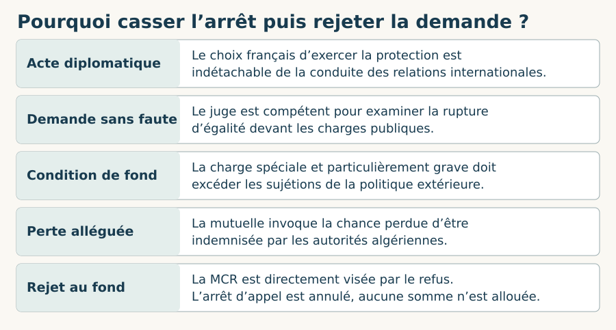

# ENS Rennes · D-E — Droit public 2025 · Corrigé brut

*Corrigé rédigé par IA, non officiel. Signalez toute erreur.*

**Lecture du rapport du jury** · GPT-6.2 Astra Ultra · vitesse non renseignée

**Rédaction** · GPT-6.2 Astra Ultra · vitesse non renseignée

**Autocontrôle** · GPT-6.2 Astra Ultra · vitesse non renseignée

**Révision (tour 1)** · GPT-6.2 Astra Ultra · vitesse non renseignée

## La charge d’un refus de protection diplomatique peut-elle être indemnisée ?

La protection diplomatique permet à un État de prendre en charge une réclamation en faveur de son ressortissant dans les relations avec un autre État. La Mutuelle centrale de réassurance (MCR) vient aux droits d’un organisme dont les actifs financiers ont été nationalisés et les immeubles expropriés en Algérie en 1963 et 1964 sans indemnité. En 2014, puis en 2015, elle sollicite l’intervention de la France auprès de l’Algérie, notamment la saisine de la Cour internationale de justice. À la suite du refus implicite, elle forme en 2018 une réclamation indemnitaire puis demande que la France lui verse 61 657 357,24 euros. Le tribunal administratif de Paris rejette sa demande en 2021. En 2022, la cour administrative d’appel de Paris annule ce jugement et oppose l’incompétence de la juridiction administrative.

Une demande de réparation fondée sur la rupture d’égalité devant les charges publiques peut-elle être examinée lorsque le fait générateur invoqué est indétachable de la conduite des relations internationales ? Et à quelles conditions pourrait-elle prospérer sans soumettre la politique extérieure à l’appréciation du juge ? Le 24 octobre 2024, l’Assemblée du contentieux annule l’arrêt de la cour puis, réglant l’affaire au fond, rejette la demande de la MCR. Le gain de compétence et le refus d’indemnisation procèdent d’une même distinction entre l’appréciation de la décision diplomatique et la répartition des charges qu’elle occasionne.

### I. La compétence juridictionnelle déterminée par le fondement de la demande

La MCR demande réparation à la France. La compétence pour connaître de cette demande dépend de ce que le juge doit apprécier : la licéité d’un choix diplomatique ou la charge particulière que ce choix a fait peser sur un ressortissant.

**A. L’immunité juridictionnelle du choix diplomatique.** Le point 2 qualifie l’exercice de la protection diplomatique de décision non détachable de la conduite des relations internationales de la France. Le juge administratif ne peut en prononcer l’annulation. Il ne peut non plus rechercher si l’État a commis une faute en exerçant ou en refusant cette protection. Condamner l’État pour une faute dans le choix de présenter la réclamation de son ressortissant reviendrait à juger ce choix lui-même. La demande initiale de la MCR tendait à ce que la France fasse sienne la réclamation contre l’Algérie. Aucune décision juridictionnelle ne peut imposer ce choix sur le fondement ici discuté. La formation d’Assemblée préserve ainsi le domaine réservé à la décision diplomatique.

**B. La justiciabilité de la rupture d’égalité devant les charges publiques.** La demande adressée ensuite à la France changeait d’objet et de fondement. La mutuelle invoquait la rupture d’égalité devant les charges publiques. Dans ce contentieux, l’objet du jugement est de rechercher si une personne a supporté dans l’intérêt général une charge qui devrait être assumée par la collectivité. Il devient concevable de répartir autrement ses conséquences pécuniaires tout en laissant à l’exécutif son choix diplomatique. Le point 3 accueille donc la compétence de la juridiction administrative. Un précédent éclaire la logique, sans épuiser l’apport de l’arrêt : dans *Compagnie générale d’énergie radio-électrique*, le 30 mars 1966, le Conseil d’État avait admis sous conditions la responsabilité sans faute du fait d’une convention internationale. Ici, l’ouverture concerne la conséquence d’une décision diplomatique elle-même. La cour administrative d’appel a confondu la nature du fait générateur avec le fondement indemnitaire qui lui était soumis.

### II. Les conditions restrictives de la responsabilité sans faute

Une fois la compétence admise, les points 6 à 8 encadrent l’indemnisation pour préserver la conduite des relations internationales. Le point 9 applique à la mutuelle une de ces restrictions, liée à son rapport personnel à la décision française.

**A. Une charge exceptionnelle sans interférence avec la politique extérieure.** Les points 6 à 8 visent les personnes relevant de la juridiction de la France. Indemniser ne doit pas interférer, même indirectement, avec les objectifs ou la mise en œuvre de sa politique extérieure. La charge doit être spéciale, d’une particulière gravité et hors de proportion avec les sujétions que cette politique peut faire normalement supporter. La seule importance d’un préjudice chiffré ne suffit donc pas. Le Conseil d’État ferme également cette voie lorsque l’origine directe du préjudice réside dans le fait d’un État étranger ou dans des faits de guerre, ainsi que lorsqu’il existe un régime spécial d’indemnisation. Enfin, et en principe, les personnes dont la situation est précisément celle que la décision a pour objet de régir ou d’affecter en sont exclues, individuellement ou collectivement. Cette dernière réserve protège la décision elle-même d’une révision indirecte au profit de ses destinataires. Elle restreint considérablement le nombre de victimes susceptibles d’être indemnisées, sans que l’arrêt énumère tous les tiers qui pourraient l’être.

**B. L’exclusion de principe du destinataire du refus de protection.** Le tribunal avait rapporté la demande à la dépossession opérée par l’Algérie. Au point 9, le Conseil d’État rétablit son objet : la MCR impute à la France la perte d’une chance d’obtenir de l’Algérie une indemnisation si la protection diplomatique avait été accordée. Les actifs perdus et la chance perdue constituent deux préjudices distincts. Ce constat ne suffit pas à ouvrir droit à réparation. La MCR est précisément la personne dont la demande de protection diplomatique a été refusée. La décision française a pour objet même de régir sa situation. Ce motif suffit au rejet, sans évaluer la probabilité de succès d’une intervention ni chiffrer une chance. La MCR obtient l’annulation de l’arrêt d’appel pour erreur de droit, mais aucune somme. Au point 5, le Conseil d’État se fonde sur les circonstances de l’espèce pour régler lui-même l’affaire après cassation. L’article L. 821-2 du code de justice administrative lui donne cette faculté si l’intérêt d’une bonne administration de la justice le justifie. Ce texte prévoit aussi qu’en cas de second pourvoi en cassation, il statue définitivement. Ici le choix de juger le fond explique comment la mutuelle peut gagner sur la compétence et perdre sur la réparation dans le même arrêt. Les articles 1er et 2 du dispositif répondent ainsi à deux questions successives. L’article 3 en organise la notification.

L’arrêt établit une compétence indemnitaire que la seule étiquette d’acte de gouvernement ne suffit plus à écarter. Sa portée se mesure aussi à la rigueur des conditions d’engagement. Le premier bénéficiaire pratique de cette ouverture n’est pas désigné dans l’affaire qui l’a fait reconnaître.

[Sujet officiel](https://www.ens-rennes.fr/medias/fichier/sujets-epreuve-a-options-d-e-2025_1760692424609-pdf#page=7) · [Rapport du jury](https://www.ens-rennes.fr/medias/fichier/rapport-de-jury-droit-public-d-e-2025_1768897882955-pdf) · [Arrêt d’Assemblée](https://www.conseil-etat.fr/fr/arianeweb/CE/decision/2024-10-24/465144) · [Analyse du Conseil d’État](https://conseil-etat.fr/fr/arianeweb/CE/analyse/2024-10-24/465144)

[Code de justice administrative, art. L. 821-2](https://www.legifrance.gouv.fr/codes/article_lc/LEGIARTI000006449406/2025-04-16)
