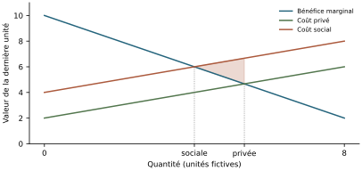
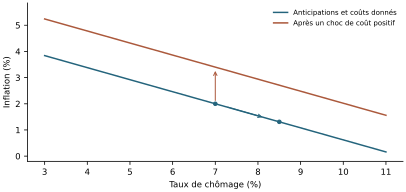
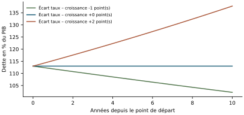
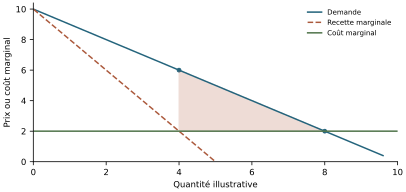
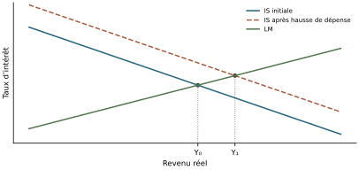

# ENS Rennes D-E — Économie (oral) 2025 · Corrigé guidé

*Corrigé rédigé par IA, non officiel.*

**Rédaction** · GPT-6.2 Astra Ultra · vitesse non renseignée

Les 21 sujets suivent l’ordre du fascicule de la session. Les constats sur la France et la zone euro s’appuient sur les publications disponibles au printemps 2025. Les relances sont des exercices de préparation.

À la préparation, formuler une proposition que le raisonnement devra établir. Utiliser l’indication propre au sujet pour la tester, puis choisir un exemple et une objection. Au tableau, définir les axes et nommer la grandeur tenue constante avant de déplacer une courbe.

## Sujet 1 — La France s’éloigne-t-elle actuellement du plein emploi à la suite de la baisse du taux d’inflation ?

> [!INDICATION]
> Comparer deux origines de la désinflation avant d’utiliser les chiffres français.

Le mot « à la suite » propose une causalité qu’il faut tester. Au premier trimestre 2025, le chômage au sens du BIT atteint 7,4 % des actifs en France hors Mayotte, en hausse de 0,1 point sur le trimestre. En mai, les prix à la consommation sont supérieurs de 0,7 % à ceux de mai 2024. Le plein emploi laisse subsister des transitions entre deux emplois. On l’apprécie aussi par le taux d’emploi, le sous-emploi et les difficultés de recrutement. [Chômage au premier trimestre](https://www.insee.fr/fr/statistiques/8569615) · [Prix en mai](https://www.insee.fr/fr/statistiques/8584563)

Une désinflation par la demande peut éloigner du plein emploi. Des taux élevés freinent les crédits et les commandes, les entreprises réduisent les embauches, la progression des salaires et des prix ralentit. Une baisse du prix de l’énergie produit un autre enchaînement. Le coût des entreprises baisse et le revenu réel des ménages est préservé. Production et emploi peuvent alors progresser pendant la désinflation.

Pour départager ces récits, il faudrait rapprocher consommation, investissement, prix de l’énergie, inflation des services et taux d’emplois vacants. Le chômage augmente aussi si de nouveaux actifs cherchent un emploi avant d’en trouver un. La faible variation d’un seul trimestre, dans la marge d’incertitude de l’enquête, établit mal un éloignement durable. Un ralentissement des prix et des difficultés d’emploi simultanés laissent la cause ouverte.

**Relance.**  Pourquoi comparer des taux plutôt que des niveaux ?

La baisse de l’inflation signifie que la hausse des prix ralentit. Les prix peuvent encore monter, sans que cela indique directement la trajectoire de l’emploi.

## Sujet 2 — Faut-il toujours lutter contre les externalités ?

> [!INDICATION]
> Faire apparaître la dernière unité dont le dommage est supérieur au coût de sa suppression.

Quand un transporteur encombre une rue, il paie son temps de trajet mais tient peu compte du temps perdu par les autres. Quand un inventeur diffuse une connaissance, d’autres en bénéficient gratuitement. L’externalité est un effet sur un tiers qui échappe au prix de la transaction. La question est de rapprocher les décisions privées de leur valeur sociale.

Dans le premier cas le coût marginal social dépasse le coût marginal privé. Une taxe égale au dommage marginal au niveau efficace fait intégrer le coût supplémentaire. Une norme, un péage ou des permis peuvent convenir lorsque les émissions se mesurent mieux que les dommages. Dans le second cas, subventionner la recherche ou la financer collectivement augmente une activité dont le rendement social excède le rendement privé.

Même avec une taxe optimale, on conserve une émission si la supprimer coûterait davantage que le dommage évité. Des droits clairement attribués permettent parfois un accord entre voisins peu nombreux. Avec des millions d’usagers, les négociations deviennent coûteuses. L’instrument et son intensité dépendent du coût d’information, de contrôle, du risque et de la répartition des charges.

**Relance.**  Un dommage considérable impose-t-il toujours une taxe ?

Un seuil de dommage irréversible et mal connu peut justifier une limite de quantité. Le choix dépend aussi de la capacité à contrôler le respect de cette limite.

## Sujet 3 — Le modèle de concurrence pure et parfaite est-il encore utile à l’analyse économique ?

> [!INDICATION]
> Formuler une proposition du modèle que les données d’un marché permettraient de tester.

Des entreprises prennent le prix comme donné, les biens sont homogènes et l’entrée, l’information et la mobilité des facteurs permettent l’ajustement. Ces hypothèses posent une question précise. Quand les prix coordonnent-ils des décisions individuelles compatibles avec un usage efficace des ressources ?

Avec une demande décroissante et un coût marginal croissant, l’équilibre concurrentiel égalise disposition à payer et coût de la dernière unité. Une production supplémentaire coûterait davantage que sa valeur. Sous les hypothèses du premier théorème du bien-être, l’allocation est efficace au sens de Pareto. Cette propriété dépend des dotations initiales et n’établit aucun critère de justice.

Le modèle sert ensuite de comparaison. Face à une demande décroissante pour sa propre variété, un vendeur peut demander un prix supérieur au coût marginal. En présence de pollution, même des producteurs preneurs de prix ignorent le dommage. Pour décider d’une intervention, on mesure marges, coûts d’entrée, substituabilité ou effets externes. Le repère concurrentiel reste pertinent si l’on sait quelle hypothèse tester.

**Relance.**  Un marché comptant beaucoup de vendeurs est-il forcément concurrentiel ?

Des produits différenciés ou des coûts de changement peuvent laisser à chacun un pouvoir sur ses clients, même si le nombre de vendeurs est élevé.

## Sujet 4 — La politique monétaire doit-elle être conventionnelle ou non conventionnelle ?

> [!INDICATION]
> Se placer d’abord loin de la borne des taux, puis imaginer des primes bancaires très inégales.

Pour la zone euro, le choix part de la stabilité des prix à moyen terme et de la transmission de la politique aux ménages et entreprises. Conventionnellement la banque centrale règle les taux auxquels les banques placent ou empruntent leurs liquidités. En juin 2025, la BCE abaisse son taux de dépôt à 2 %, décision applicable le 11 juin. [Décision de la BCE](https://www.ecb.europa.eu/press/pr/date/2025/html/ecb.mp250605~3b5f67d007.en.html)

Un taux directeur influence les taux interbancaires, puis le crédit, la demande et les prix avec délai. Il est aisément ajustable et fournit un signal lisible. Mais si les taux courts sont proches de leur borne effective ou les primes de risque anormalement élevées, une baisse supplémentaire se transmet mal. Les achats de titres à longue échéance peuvent réduire la prime de terme. Les opérations de refinancement ciblées agissent sur le financement bancaire.

La composition du bilan, la communication et le taux peuvent donc agir ensemble. Un outil inhabituel appelle un objectif précis, des conditions de sortie et un examen des effets de distribution, du risque financier et de l’aléa moral. L’instrument adapté dépend de la contrainte rencontrée et du canal qu’il faut restaurer.

**Relance.**  Acheter des obligations publiques équivaut-il à une dépense budgétaire ?

La banque centrale échange des actifs et fait varier leurs rendements. Une dépense publique paie directement des biens, des services ou un transfert décidé au budget.

## Sujet 5 — Le risque inflationniste s’éloigne-t-il avec le chômage ?

> [!INDICATION]
> Déplacer un point le long de Phillips, puis déplacer la courbe par un choc de coût.

Une courbe de Phillips augmentée s’écrit $\pi=\pi^e-\alpha(u-u^*)+s$, avec $\alpha>0$, chômage d’équilibre $u^*$ et choc de coûts $s$. Quand la demande ralentit, les postes vacants diminuent et les salariés négocient moins facilement. Les entreprises répercutent plus difficilement des hausses de prix. À anticipations et productivité données, une hausse du chômage réduit la pression inflationniste.

Mais un renchérissement des importations, une mauvaise récolte ou des ruptures d’approvisionnement augmentent les coûts en réduisant l’activité. Le chômage peut monter en même temps que les prix. Par ailleurs un chômage très élevé dans une région ne supprime pas les tensions salariales d’une profession en pénurie ailleurs. L’inflation dépend aussi des marges et de la productivité.

Pour apprécier le risque futur il faut donc regarder le type de choc, les coûts unitaires et les anticipations, et préciser l’horizon. Une inflation déjà faible peut encore ralentir alors que le chômage se stabilise, si un choc d’offre défavorable se dissipe.

**Relance.**  L’augmentation de l’emploi crée-t-elle toujours de l’inflation ?

Un gain de productivité peut permettre plus de production et d’emplois sans hausse équivalente des coûts unitaires.

## Sujet 6 — La décomposition tendance/cycle permet-elle de mieux comprendre la réalisation de l’équilibre macroéconomique ?

> [!INDICATION]
> Tracer une série et deux tendances plausibles avant de qualifier le choc.

On peut écrire le logarithme du PIB comme la somme d’une tendance, associée aux capacités productives durables, et d’une composante cyclique. Un écart négatif à la production potentielle suggère des capacités sous-utilisées. Il aide à distinguer une baisse temporaire de la demande et une contraction plus durable de l’offre.

Une demande insuffisante réduit les ventes et les embauches. Une relance peut mobiliser les ressources inutilisées. À l’inverse, si la population active ou la productivité ralentit durablement, relancer la demande au-delà du potentiel risque d’accroître surtout les prix. Les institutions s’appuient également sur l’écart de production pour estimer la composante cyclique du déficit.

La tendance reste inobservable. Un filtre statistique dépend de la période retenue et révise particulièrement ses estimations aux dernières dates. Une longue récession peut détruire des compétences et décourager l’investissement, déplaçant la tendance. Les modèles de croissance et les données sur les capacités doivent donc compléter le découpage statistique. Une décomposition décrit un écart sans expliquer à elle seule le mécanisme d’équilibre.

**Relance.**  Comment deux économistes peuvent-ils calculer des écarts de production différents la même année ?

Ils peuvent estimer des potentiels différents à partir d’un filtre, d’une fonction de production ou de l’inflation, tandis que les observations récentes sont susceptibles de révision.

## Sujet 7 — La France peut-elle faire faillite ?

> [!INDICATION]
> Séparer une échéance de trésorerie et la capacité de remboursement sur plusieurs années.

Un État peut faire défaut, c’est-à-dire manquer un paiement ou imposer aux créanciers une restructuration. Sa continuité institutionnelle et son pouvoir fiscal distinguent cette situation de la liquidation d’une entreprise. En mars 2025, la notification de l’Insee pour 2024 évaluait le déficit à 5,8 % du PIB et la dette publique brute à 113,0 %. Un stock de dette indique l’exposition, pas une date de défaut. [Première notification de l’Insee](https://www.insee.fr/fr/statistiques/8540375)

Si $b$ est la dette rapportée au PIB et $s$ l’excédent primaire rapporté au PIB, alors $\Delta b\simeq(r-g)b-s$, à taux cohérents. Un excédent primaire, une croissance plus forte ou un coût moyen plus faible stabilisent le ratio. Une maturité longue retarde la répercussion d’une hausse des taux, sans l’annuler. Une crise de liquidité peut survenir avant une insolvabilité durable si les investisseurs cessent de renouveler les titres.

La France emprunte dans une monnaie commune et ne décide pas seule de l’émission monétaire. Son assiette fiscale, ses institutions et la profondeur du marché des titres soutiennent son financement, sans garantie absolue. Pour juger du risque, suivre charge d’intérêts, calendrier d’échéances, perspectives de recettes, croissance et crédibilité politique. Aucun seuil mécanique du ratio ne déclenche la défaillance.

**Relance.**  Une dette qui augmente chaque année en euros est-elle nécessairement insoutenable ?

Si le revenu nominal croît plus vite, le ratio peut diminuer. La capacité à lever des recettes et à refinancer les échéances reste déterminante.

## Sujet 8 — L’indépendance de la banque centrale est-elle nécessairement garante de la stabilité des prix ?

> [!INDICATION]
> Raisonner entre l’annonce de la cible et la date de renégociation des contrats.

Si les autorités monétaires sont poussées à stimuler la demande juste avant chaque scrutin ou à financer systématiquement un déficit, les ménages risquent d’anticiper une inflation durable. Confier des instruments à une institution dotée d’un mandat clair peut limiter cette incohérence temporelle et ancrer les anticipations.

La crédibilité se transmet par les conventions salariales et la fixation des prix. Si une hausse temporaire de l’énergie est perçue comme transitoire, elle se diffuse moins à toutes les anticipations. La BCE poursuit la stabilité des prix pour l’ensemble de la zone euro et explique publiquement ses décisions. Cette responsabilité est le pendant de son autonomie opérationnelle.

Aucune indépendance juridique ne contrôle le prix mondial de l’énergie, les capacités de production, la solvabilité du système bancaire ni l’orientation budgétaire. Une banque centrale peut aussi mal mesurer le choc ou réagir avec retard. L’indépendance améliore les conditions de la stabilité si le mandat, les instruments, la responsabilité démocratique et l’environnement financier rendent l’action crédible.

**Relance.**  Une inflation supérieure à la cible pendant un mois prouve-t-elle une perte d’indépendance ?

Le mandat est de moyen terme. Il faut examiner le choc, les anticipations et les décisions prises sur un horizon compatible avec les délais de transmission.

## Sujet 9 — L’arbitrage inflation/activité est-il encore d’actualité ?

> [!INDICATION]
> Préciser le sens du choc avant d’attribuer un signe à l’arbitrage.

L’arbitrage concerne le coût en production de la stabilisation des prix. Supposons qu’une demande excessive porte temporairement la production au-dessus de son potentiel. Le resserrement du crédit ralentit dépenses et prix. Dans ce cas, ramener l’inflation vers sa cible retire une partie de l’expansion conjoncturelle.

Un choc d’offre défavorable pose un dilemme plus sévère. L’énergie devient coûteuse, les coûts unitaires augmentent et la production se contracte. Un resserrement agit sur la diffusion de la hausse aux autres prix et sur les anticipations, au prix de pertes supplémentaires d’activité. Si au contraire l’offre s’améliore, inflation et activité peuvent évoluer simultanément dans le sens souhaité.

À long terme, une inflation plus élevée anticipée est intégrée dans les contrats. Elle ne maintient pas durablement l’activité au-dessus du potentiel. L’arbitrage subsiste surtout à court terme, son intensité dépend des rigidités, des anticipations et de l’origine du choc. La réponse publique peut protéger temporairement certains revenus en limitant la relance de la demande totale.

**Relance.**  Pourquoi un même resserrement monétaire peut-il avoir des effets différents selon le pays ?

La part de prêts à taux variable, les structures productives et l’exposition à l’énergie modifient la vitesse de transmission aux dépenses et aux coûts.

## Sujet 10 — Peut-on se passer des monopoles ?

> [!INDICATION]
> Étudier d’abord la dernière unité, puis le coût de la duplication de tout le réseau.

Un monopole est l’unique vendeur sur un marché pertinent. Quand la demande est décroissante, son optimum vérifie recette marginale égale au coût marginal. Le prix correspondant dépasse ce coût. Des échanges dont la valeur excède le coût ne se font plus, ce qui crée une perte de surplus collectif.

Dans un réseau à coût fixe élevé et coût marginal faible, dupliquer la même infrastructure peut au contraire augmenter le coût total. C’est la sous-additivité des coûts qui justifie le qualificatif de monopole naturel. Un brevet crée aussi un monopole temporaire pour inciter à financer une invention dont la copie serait bon marché. Le gain dynamique doit alors être mis en rapport avec le prix plus élevé et d’éventuels obstacles à la recherche suivante.

On peut séparer l’infrastructure de réseau et les services qui l’utilisent, réglementer l’accès, plafonner les tarifs, attribuer une concession ou limiter la durée d’un droit exclusif. La bonne question porte sur la partie de l’activité où l’unicité est efficace et sur les moyens d’empêcher une rente excessive.

**Relance.**  Pourquoi la tarification au coût marginal peut-elle mettre un réseau en déficit ?

Quand le coût moyen dépasse le coût marginal à toute échelle pertinente, cette recette ne couvre pas le coût fixe. Un abonnement ou un financement public peuvent compléter le prix d’usage.

## Sujet 11 — Comment comprendre la diversité des situations de concurrence imparfaite ?

> [!INDICATION]
> Garder le nombre d’entreprises fixe et changer seulement la variable stratégique.

Classer les marchés par le nombre de vendeurs est un début. Un duopole proposant deux produits identiques ne réagit pourtant pas comme deux marques différenciées. Il faut préciser les substituts, les possibilités d’entrée, les capacités, le calendrier des décisions et l’information des acheteurs.

Dans le modèle de Cournot, chaque firme choisit une quantité, en tenant compte des quantités rivales. L’équilibre conserve un prix supérieur au coût marginal. Dans le modèle de Bertrand avec produits homogènes, coûts identiques et capacités suffisantes, deux entreprises peuvent ramener le prix au coût marginal. Si chaque produit a une clientèle attachée, une faible hausse de prix ne fait pas perdre toute la demande et une marge redevient possible.

D’autres situations proviennent de barrières institutionnelles, d’effets de réseau ou de coûts de changement. Une plateforme doit parfois attirer simultanément vendeurs et usagers. Pour instruire un cas concret, délimiter le marché et observer prix, qualité, marges, entrées et substitutions. Une grande part de marché peut venir de l’efficacité comme d’un obstacle à l’entrée.

**Relance.**  Comment expliquer qu’une entreprise offre gratuitement un service et dispose néanmoins de pouvoir de marché ?

Sur une plateforme, les usagers d’une face attirent les annonceurs de l’autre. Prix monétaire nul, collecte de données et qualité doivent s’analyser ensemble.

## Sujet 12 — Est-il préférable de lutter contre l’inflation ou contre le chômage ?

> [!INDICATION]
> Identifier les groupes qui supportent les deux coûts et les instruments disponibles.

L’inflation érode la valeur réelle des revenus nominaux peu indexés et brouille les signaux de prix lorsqu’elle devient instable. Le chômage prive de revenu, de production et parfois durablement de qualifications. Le coût social de chacun dépend de sa durée, de son ampleur et des groupes exposés. Une moyenne nationale ne résume pas ces coûts.

En cas de choc de demande négatif, soutien du crédit et stabilisateurs budgétaires peuvent à la fois soutenir l’emploi et éloigner le risque de déflation. En cas de choc pétrolier, arbitrer devient nécessaire. Laisser se diffuser les hausses aux anticipations accroît le coût futur de la désinflation, mais une contraction brutale peut détruire des emplois durables. Une banque centrale peut revenir progressivement à sa cible si les anticipations restent ancrées.

L’affectation des instruments réduit le conflit. La banque centrale stabilise les prix, une assurance chômage protège les revenus, la formation et la mobilité facilitent l’appariement. Les aides ciblées peuvent soutenir les plus exposés tout en limitant le surcroît de demande globale. Le diagnostic des causes détermine la priorité à la marge.

**Relance.**  Un chômage frictionnel appelle-t-il la même réponse qu’un chômage dû à une récession ?

La recherche et l’information améliorent l’appariement dans le premier cas. Des débouchés supplémentaires peuvent créer des emplois dans le second.

## Sujet 13 — À quoi sert une banque centrale ?

> [!INDICATION]
> Partir d’un virement entre deux banques avant d’aborder taux et prêteur en dernier ressort.

Le règlement final des paiements interbancaires s’effectue en monnaie centrale. En émettant des billets et en fournissant des réserves aux banques, la banque centrale rend possible le règlement sûr et uniforme des transactions. Les banques commerciales créent de la monnaie par le crédit et doivent ensuite assurer leurs paiements et respecter leur cadre prudentiel.

Elle agit également sur les conditions du crédit pour stabiliser les prix ou poursuivre les objectifs prévus par son mandat. En modifiant le coût de la liquidité et les anticipations de taux, elle influence financement, demande et inflation avec délai. Dans la zone euro, la priorité est la stabilité des prix à moyen terme. Les autorités budgétaires conservent la décision de dépenses et d’impôts.

Enfin, en période de panique, fournir des liquidités contre garanties peut éviter des ventes forcées en chaîne. Une banque insolvable pose aussi une question de recapitalisation et de répartition de pertes, qui relève d’autres pouvoirs. Conduite monétaire, stabilité du système de paiements et surveillance bancaire se complètent mais n’emploient pas les mêmes instruments.

**Relance.**  Une baisse du taux directeur oblige-t-elle une banque à prêter ?

Elle modifie le coût du financement. La demande de crédit, le risque de défaut, les fonds propres et les garanties continuent de conditionner l’octroi.

## Sujet 14 — La politique économique est-elle nécessairement contrainte par les marchés financiers ?

> [!INDICATION]
> Comparer deux États également endettés mais aux échéanciers très différents.

Les décisions publiques influencent les anticipations des prêteurs, les primes de risque, les taux et les changes. Un État qui refinance beaucoup de dette à court terme ou emprunte en monnaie étrangère est particulièrement exposé. Une hausse des taux accroît peu à peu la charge d’intérêts et réduit la marge budgétaire.

L’intensité de la contrainte varie. Une dette à longue échéance retarde la transmission, une assiette fiscale crédible en réduit le risque et une banque centrale fournit la liquidité de la monnaie nationale selon son mandat. À court terme, une relance qui évite une récession profonde peut préserver le PIB et les recettes. À l’inverse, une dépense permanente mal financée peut détériorer la capacité de remboursement. Les mesures prudentielles limitent certaines amplifications financières.

Les marchés n’arbitrent pas seuls les objectifs collectifs. Fiscalité, redistribution, réglementation ou investissement public disposent de marges nationales mais rencontrent des limites réelles de ressources, de droit et d’acceptabilité. En union monétaire, la dette nationale et la politique monétaire commune ajoutent une contrainte institutionnelle distincte de la réaction des prêteurs.

**Relance.**  Pourquoi surveiller un écart de taux avec un pays de référence ?

L’écart mesure imparfaitement une prime de risque et de liquidité nationale en retranchant une composante de taux commune. Il faut aussi examiner les maturités et les volumes refinancés.

## Sujet 15 — Un système de change fixe garantit-il nécessairement la stabilité macroéconomique ?

> [!INDICATION]
> Simuler une sortie de capitaux après la hausse d’un taux étranger.

Un change fixe annonce une parité entre monnaies. En supprimant une source d’incertitude nominale, il facilite certains contrats commerciaux et peut importer la crédibilité d’un ancrage monétaire. Cette promesse doit cependant pouvoir être défendue par les réserves, les taux d’intérêt et une politique compatible avec la parité.

Avec mobilité parfaite des capitaux, fixer le change limite l’autonomie des taux nationaux. Si la banque centrale étrangère relève ses taux tandis que l’économie nationale traverse une récession, défendre la parité peut imposer un resserrement inadapté. Un choc asymétrique doit alors être absorbé par salaires, prix, emploi, transferts ou mobilité. Maintenir un taux nominal n’empêche pas une appréciation réelle si les prix nationaux augmentent plus vite.

La stabilité dépend donc de la cohérence des politiques, des réserves et des mécanismes de partage des chocs. Une parité jugée intenable peut provoquer des sorties de capitaux et une crise de balance des paiements. Un flottement offre un ajustement du change mais expose davantage aux variations des prix importés.

**Relance.**  Peut-on cumuler parité fixe, libre circulation des capitaux et taux directeur entièrement autonome ?

Le triangle d’incompatibilité exclut cette combinaison durable. Toute différence de rendement doit être compensée par un risque ou une variation de change anticipée.

## Sujet 16 — La politique macroéconomique se heurte-t-elle à des limites ?

> [!INDICATION]
> Choisir un instrument, une limite et une condition qui en modifie l’efficacité.

En récession, les stabilisateurs automatiques amortissent des pertes de revenu, et la banque centrale peut assouplir le crédit. Leur efficacité varie cependant selon les capacités inutilisées, l’ouverture, l’état du bilan des banques et la réaction des agents. Une relance qui soutient principalement des importations exerce moins d’effet immédiat sur la production nationale.

Les délais de diagnostic, de décision et de transmission créent un risque de réaction trop tardive. À plein emploi, une hausse de la demande peut surtout augmenter les prix. Près d’une borne des taux, la politique monétaire conventionnelle perd de sa puissance, ce qui peut rendre une politique budgétaire bien ciblée plus efficace. Une hausse du coût de financement ou des engagements européens limite aussi certaines trajectoires budgétaires.

Les limites orientent le choix des instruments. Une pénurie de compétences appelle une action sur l’offre, la formation ou la mobilité, dont l’horizon est plus long. Des règles crédibles, des stabilisateurs prévus à l’avance et la coordination internationale peuvent réduire les effets de délai et les débordements entre économies.

**Relance.**  Quelle information modifierait l’estimation d’un multiplicateur budgétaire ?

La part des ménages contraints, le chômage, le contenu en importations et la réaction de la banque centrale changent la propagation d’une dépense initiale.

## Sujet 17 — Le modèle IS/LM et le modèle classique sont-ils compatibles ?

> [!INDICATION]
> Distinguer d’abord les mécanismes d’ajustement du revenu et des prix.

IS décrit l’équilibre des biens pour un revenu et un taux d’intérêt. LM décrit l’équilibre monétaire à offre réelle de monnaie donnée. Dans sa version élémentaire de court terme, le niveau des prix est fixé et la production s’ajuste à la demande. Une baisse de l’investissement autonome déplace IS vers la gauche, et peut donc réduire le revenu.

Dans un modèle classique à prix et salaires flexibles, l’offre de facteurs, la technologie et l’équilibre du marché du travail déterminent la production. Le taux réel concilie épargne et investissement, le niveau des prix ajuste la demande de monnaie à l’offre. La monnaie peut influencer les valeurs nominales sans modifier durablement la production réelle sous ces hypothèses.

On peut articuler les horizons. Lorsque les prix s’ajustent, une modification de $M/P$ déplace la courbe LM et transforme la demande agrégée associée à IS/LM. L’équilibre de long terme suppose aussi une offre agrégée et une théorie du marché du travail. La compatibilité est conditionnelle à cette fermeture du modèle. Dans une présentation contemporaine avec taux directeur, une règle de politique monétaire peut remplacer la courbe LM.

**Relance.**  Pourquoi une baisse des prix peut-elle stimuler la demande dans la version à masse monétaire donnée ?

Elle augmente les encaisses réelles, ce qui peut faire baisser le taux d’intérêt et soutenir l’investissement. La déflation alourdit aussi les dettes réelles, canal absent du modèle élémentaire.

## Sujet 18 — Anticipations rationnelles ou anticipations adaptatives ?

> [!INDICATION]
> Comparer les prévisions après une surprise isolée et après un changement de régime crédible.

Les anticipations adaptatives corrigent une prévision à partir de l’erreur passée. Par exemple $\pi^e_{t+1}=\pi^e_t+\lambda(\pi_t-\pi^e_t)$ avec $0<\lambda\leq1$. La règle économise de l’information et convient à un environnement stable, mais elle peut reproduire longtemps une erreur dans un régime nouveau.

Les anticipations rationnelles utilisent l’information pertinente et la structure connue du modèle. L’erreur de prévision peut être forte après un choc imprévisible, mais ne doit pas être systématiquement prévisible avec l’information disponible. Une annonce crédible de désinflation peut donc modifier rapidement les contrats à venir. Une annonce dépourvue de crédibilité modifie peu les anticipations sous l’une ou l’autre hypothèse.

Les agents réels disposent d’informations et de moyens inégaux. Observer une révision lente ne permet pas de conclure immédiatement à l’irrationalité, car apprendre le changement de régime prend du temps. Enquêtes de prévision, dates d’annonces et erreurs répétées aident à confronter les deux mécanismes. L’enjeu porte sur la vitesse et le coût réel d’un changement de politique.

**Relance.**  Une anticipation rationnelle est-elle nécessairement correcte ?

Elle est cohérente avec l’information disponible au moment de la prévision. Une surprise future produit une erreur sans contredire cette propriété.

## Sujet 19 — Quels sont les apports de la relation de Phillips à l’analyse économique ?

> [!INDICATION]
> Expliquer le passage des salaires aux prix avant de commenter le chômage.

Phillips mettait en relation chômage et variation des salaires nominaux. Pour passer des salaires aux prix, il faut tenir compte de la productivité et des marges. Une tension sur les recrutements accroît le pouvoir de négociation salariale et peut accélérer les prix. La relation fournit ainsi un mécanisme de transmission entre activité réelle et inflation.

Sous la forme $\pi_t=\pi_t^e-\alpha(u_t-u^*)+s_t$, elle distingue tensions conjoncturelles, anticipations et choc d’offre. La stagflation peut correspondre à une hausse de $s_t$. Si les anticipations finissent par s’ajuster, une inflation durablement supérieure ne maintient pas à elle seule le chômage en dessous de son niveau d’équilibre. La pente et le niveau d’équilibre peuvent aussi changer avec la structure des marchés.

La relation guide les prévisions et la discussion du coût de désinflation. Pour l’utiliser, il faut documenter l’origine du choc et la stabilité des paramètres. Une corrélation nationale sur quelques trimestres n’identifie ni le sens causal ni un choix permanent offert aux gouvernements.

**Relance.**  Une courbe plus plate signifie-t-elle que l’inflation a disparu ?

Elle indique une réponse plus faible de l’inflation aux tensions d’activité mesurées. Les prix importés ou les anticipations peuvent encore la déplacer.

## Sujet 20 — L’État doit-il intervenir au niveau microéconomique ?

> [!INDICATION]
> Associer à une défaillance identifiée une seule intervention et un coût de sa mise en œuvre.

Les décisions privées peuvent être efficaces quand les prix reflètent tous les coûts et bénéfices, les contrats sont complets et la concurrence effective. Ces conditions donnent le point de départ du diagnostic. Une pollution locale, un pouvoir de marché ou une information cachée créent chacun une défaillance différente.

Le remède doit viser le mécanisme. Pour des émissions mesurables, un prix du dommage influence les arbitrages de tous les producteurs. Face à un réseau essentiel, réglementer l’accès peut ouvrir les services à la concurrence. Pour une assurance où les risques sont inégalement connus, mutualisation et information peuvent empêcher le retrait des bons risques. Les objectifs redistributifs restent distincts de la correction d’une inefficacité.

L’autorité publique supporte elle aussi des coûts d’information, d’administration et de contrôle. Une norme mal ajustée peut protéger une entreprise installée ou déplacer la nuisance. La comparaison pertinente oppose des institutions réalisables, sur des critères explicites de surplus, de répartition et de faisabilité, puis prévoit une évaluation après mise en place.

**Relance.**  Un impôt redistributif doit-il toujours prendre la forme d’une réglementation des prix ?

Une taxe ou un transfert ciblé peut soutenir le revenu en conservant un signal de rareté. L’effet dépend des comportements et de la capacité à identifier les bénéficiaires.

## Sujet 21 — L’atteinte du plein emploi nécessite-t-elle obligatoirement l’intervention publique ?

> [!INDICATION]
> Identifier pour chacun des chômages un diagnostic et une mesure observable.

Le plein emploi est compatible avec le temps nécessaire pour changer de poste. Dans un modèle concurrentiel à salaires flexibles, un ajustement du salaire réel égalise offre et demande de travail. La mobilité, la diffusion des offres et les formations assurées par les entreprises contribuent également au retour à l’emploi.

Ces ajustements rencontrent des obstacles. Une insuffisance de débouchés décourage les recrutements même si toutes les entreprises pourraient vendre davantage en embauchant simultanément. Une baisse généralisée des salaires réduit aussi le revenu des consommateurs. Frictions d’appariement, contraintes de logement ou de garde, manque de qualifications et discrimination empêchent certains échanges mutuellement avantageux. Une relance conjoncturelle et une action ciblée sur ces obstacles répondent à des diagnostics différents.

Aucune intervention discrétionnaire supplémentaire n’est indispensable dans toutes les situations. Le résultat observé dépend cependant d’institutions déjà présentes, notamment droit des contrats, assurance et formation. Il faut juger l’action envisagée par son effet net sur les personnes en emploi, le sous-emploi, la participation et la qualité des emplois créés.

**Relance.**  Le taux de chômage peut-il baisser sans aucun recrutement ?

Oui, si des personnes arrêtent de rechercher activement un emploi et quittent la population active. Le taux d’emploi permet de repérer ce cas.

[Fascicule officiel des sujets](https://www.ens-rennes.fr/medias/fichier/sujets-oral-economie-d-e-2025_1760693892070-pdf) · [Dossier de la session](https://www.ens-rennes.fr/admission/concours1a/d-e/concours-droit-economie-2025)
