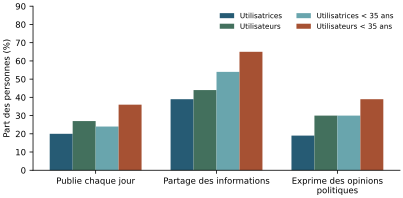
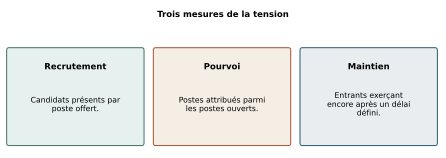
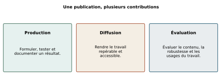
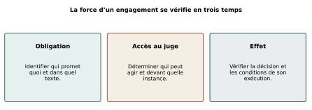

# ENS Rennes D-E — Entretien (oral) 2025 · Corrigé guidé

*Corrigé rédigé par IA, non officiel.*

**Rédaction** · GPT-6.2 Astra Ultra · vitesse non renseignée

Le fascicule de 49 pages contient 21 tirages. Les numéros imprimés et les pages permettent de retrouver chaque extrait, y compris lorsque plusieurs tirages proviennent du même article. Les titres proposés ici désignent les problèmes discutés. Les développements préparent à un exposé personnel de dix minutes au maximum. Les relances sont proposées pour l’entraînement.

Pendant la préparation, noter la proposition précise que l’extrait permet de défendre, l’élément le plus convaincant et une limite susceptible de la modifier. À l’oral, partir du passage choisi et défendre une conclusion devant une objection possible.

## Sujet 1 — Les organisations rendent-elles visibles les compétences dont elles ont besoin ?

*Fascicule, pages 1 à 2.*

> [!INDICATION]
> Choisir une tâche que le tableau de bord de Tristan compte et une tâche qu’il laisse de côté.

Le cas de Tristan, chargé de communication, rend sensible un mécanisme ordinaire. Il reçoit une demande de quinze contenus en quatre jours tandis que le travail d'enquête et de mise au point est peu visible dans les tableaux de bord. L'irritation du salarié est compréhensible, mais l'étiquette d'« idiocratie » annonce une conclusion sur l'ensemble des promotions. Un récit individuel ne permet pas de savoir combien de postes suivent cette logique ni quelles compétences le responsable exerce par ailleurs.

J'examinerais plutôt la façon dont un indicateur devient une cible. Si la direction évalue surtout le nombre de contenus livrés, l'encadrant peut rationnellement accélérer la cadence et dégrader la qualité. Une équipe qui relit moins peut livrer davantage aujourd'hui et engager demain des corrections coûteuses. Le récit montre d'ailleurs que Tristan distingue le comportement du responsable et la logique imposée au responsable lui-même. Cela ouvre une hypothèse organisationnelle plus féconde qu'un jugement définitif sur l'intelligence de celui-ci.

Pour départager ces explications, je suivrais des projets comparables avant et après une modification des critères. Il faudrait recueillir l'avis des rédacteurs, mais aussi le temps de correction, les réclamations et la qualité du service effectivement rendu. Une évaluation qualitative a elle aussi ses angles morts. Rendre visible le temps de réflexion n'exige pas de le réduire à un chiffre unique. Faire justifier des choix sur quelques productions permettrait de découvrir si une compétence laissée dans l'ombre change effectivement le résultat.

**Relance.** Une personne promue pour bien présenter sait-elle nécessairement mal organiser ?

Non. La présentation peut être une compétence utile. Il faut montrer un décalage entre les critères utilisés pour sélectionner et les exigences vérifiables du poste.

## Sujet 2 — Peut-on expliquer une promotion par l’excès de confiance ?

*Fascicule, pages 3 à 5.*

> [!INDICATION]
> Distinguer l’erreur d’autoévaluation, l’erreur du recruteur et la mauvaise définition du poste.

Ce second extrait du même article mobilise biais de jugement, effet Dunning-Kruger et appauvrissement des collectifs de travail. Un candidat assuré peut sembler mieux maîtriser un sujet qu'un collègue conscient de ses incertitudes. Mais cette possibilité ne démontre ni que tous les promus se surestiment ni qu'un manque d'assurance atteste une compétence supérieure. Un phénomène observé dans l'autoévaluation d'une tâche précise ne constitue pas un diagnostic général des personnes.

Il faut distinguer celui qui se juge et celui qui choisit. Un salarié peut évaluer exactement ses limites tout en apprenant à donner une impression trompeuse en entretien. Un autre peut surestimer sincèrement ses compétences sans que le recruteur se laisse convaincre. Une promotion erronée peut enfin venir d'une fiche de poste mal définie. Ces mécanismes corrigeraient des choses différentes. Faire réaliser une tâche représentative, demander la justification d'une décision et recueillir l'expérience des collaborateurs peut apporter des informations complémentaires à l'aisance verbale.

L'appel final à l'échange collectif mérite d'être mis à l'épreuve. Un groupe reproduit parfois le jugement d'une personne de rang élevé. Pour que le collectif corrige un biais, ses membres doivent pouvoir retenir des observations indépendantes et exprimer un désaccord sans coût excessif. Je comparerais la qualité des décisions après quelques mois et regarderais les candidatures écartées autant que les réussites. On passe ainsi d'une condamnation flatteuse pour ceux qui s'estiment méconnus à une enquête sur les institutions qui confèrent réellement une responsabilité.

**Relance.** Pourquoi ne suffit-il pas de demander au candidat d’évaluer sa compétence ?

Sa réponse mêle connaissance de soi, stratégie de présentation et interprétation des attentes. Une tâche assortie d’un critère annoncé permet de comparer estimation et réalisation dans le même domaine.

## Sujet 3 — Deux plaidoyers générés sur les classiques à l’école

*Fascicule, pages 6 à 8.*

> [!INDICATION]
> Identifier une prémisse commune aux deux plaidoyers dont chacun tire une conséquence opposée.

Le fascicule juxtapose un plaidoyer pour la suppression de l'obligation d'étudier les classiques et une défense de leur enseignement. L'indication d'une rédaction par ChatGPT invite à examiner la symétrie des raisonnements. Leur assurance et leurs exemples littéraires ne constituent pas une enquête sur des élèves réels. Pour la première position, la difficulté de la langue et l'inégalité d'accès justifient l'abandon. Pour la seconde, les mêmes inégalités rendent indispensable la transmission scolaire. Il faut donc identifier l'hypothèse qui fait basculer la conclusion.

Comparons deux lectures de *Madame Bovary*. Faire relever des procédés sans travailler les voix qui portent les jugements peut exclure les élèves peu familiers de ce type d'analyse. Partir d'une scène, comparer le discours rapporté et le point de vue du narrateur permet au contraire d'interroger une représentation sociale. L'argument qui attribue directement à l'œuvre toutes les opinions qu'elle représente confond représentation et approbation. La défense inverse qui invoque le prestige de Flaubert sans décrire un apprentissage commet aussi un saut.

Je proposerais à deux classes un corpus associant œuvre ancienne et texte contemporain autour d'une même question. On observerait compréhension d'un extrait inédit, capacité à justifier une interprétation et évolution de l'écart initial entre élèves. Le plaisir peut être un résultat important sans devenir le seul critère. La conclusion ne se déduit ni de l'ancienneté ni de la nouveauté du livre. Elle dépend des œuvres choisies, du temps de médiation et des objectifs assumés par l'école.

**Relance.** L’identification de ChatGPT comme auteur réfute-t-elle les deux textes ?

Non. Elle suggère de vérifier leur origine et leurs affirmations. Un argument cohérent reste examinable, et une liste de noms littéraires reste insuffisante, quel que soit son auteur.

## Sujet 4 — Quel type de preuve pour une lecture psychanalytique ?

*Fascicule, pages 9 à 10.*

> [!INDICATION]
> Choisir le passage où le texte passe de la réception des idées à la validité d’une interprétation.

Pascale Herlem rappelle l'accueil contrasté de la psychanalyse dans le monde littéraire et le rôle des surréalistes. La réception d'une méthode par des écrivains est un fait d'histoire culturelle. Elle ne suffit pas à prouver que la méthode explique la genèse psychique d'un texte. L'extrait invite à distinguer ce qu'une interprétation permet de voir dans l'œuvre et ce qu'elle autorise à affirmer sur son auteur.

Une image revient avec des variations dans plusieurs récits. On peut décrire sa place, comparer les passages où elle disparaît et proposer qu'elle mette en tension deux motifs. Cette lecture devient intéressante si elle rend intelligible d'autres détails et résiste à une explication concurrente. En revanche, conclure que cette image révèle un événement précis dans la vie de l'auteur exigerait des sources supplémentaires. Le narrateur, le personnage, le texte et la personne de l'écrivain ne se substituent pas les uns aux autres.

La psychocritique évoquée tente d'occuper cet intervalle. Elle peut enrichir une interprétation sans que les catégories employées deviennent irréfutables. Si la présence du motif confirme la thèse et si son absence la confirme aussi au titre du refoulement, le lecteur ne sait plus ce qui pourrait la faire réviser. Je présenterais donc deux lectures possibles d'un même passage et préciserais un indice qui favoriserait l'une. Le débat sort alors d'une opposition entre fidélité à Freud et rejet de toute dimension inconsciente.

**Relance.** Une interprétation littéraire doit-elle obéir au même test qu’un diagnostic ?

Elle peut être évaluée par sa cohérence, sa précision textuelle et sa fécondité comparative. Une assertion factuelle sur la santé ou la vie d’une personne engage une autre exigence de preuve.

## Sujet 5 — Utilisation des plateformes et inégalités de participation

*Fascicule, pages 11 à 13.*

> [!INDICATION]
> Lire les titres et les dénominateurs des deux figures avant de comparer leurs barres.

Le fascicule contient deux graphiques dont la lecture évite une erreur immédiate. Utiliser un réseau et y prendre publiquement la parole sont deux événements différents. La figure 7 montre que Facebook est davantage utilisé par les femmes dans les données présentées, alors que la figure 8 indique, parmi les personnes utilisant les plateformes étudiées, que 19 % des utilisatrices et 30 % des utilisateurs déclarent y exprimer des opinions politiques. Un avantage d'accès à une plateforme peut ainsi coexister avec un écart d'expression. Les deux graphiques ne permettent pas de calculer le taux d'expression politique sur le seul Facebook.

L'écart de 11 points pour l'expression politique devient 9 points chez les moins de 35 ans, 30 % contre 39 %. Ce rapprochement ne démontre pas que chaque nouvelle génération réduira l'écart en vieillissant. Les moins de 35 ans sont inclus dans l'ensemble. L'évolution des usages, l'âge et le renouvellement des cohortes demandent des observations distinctes. De plus, exprimer une opinion en ligne mesure un comportement visible, pas à lui seul l'intérêt politique ou le travail militant.

Les auteurs proposent plusieurs mécanismes, parmi lesquels la division du travail relationnel, l'accès à des positions professionnelles et l'exposition à des propos sexistes. Le graphique est compatible avec eux sans départager leur importance. Je suivrais par entretiens les personnes qui lisent beaucoup et publient peu, en comparant des conditions de participation différentes. Les différences moyennes de groupe ouvrent ainsi une enquête sur les possibilités de parole. Elles ne constituent pas des traits naturels attribuables à tous les membres d'un sexe.

**Relance.** Le passage de 19 % à 30 % représente-t-il onze pour cent ?

L’écart est de 11 points de pourcentage. Rapporté à 19 %, l’augmentation relative serait d’environ 58 %. Le premier chiffre convient pour comparer directement ces deux proportions.

## Sujet 6 — Les gestes écologiques expriment-ils une préférence individuelle ?

*Fascicule, pages 14 à 16.*

> [!INDICATION]
> Construire deux ménages de même conviction dont les budgets et les possibilités de transport diffèrent.

Les campagnes d'économie d'énergie invoquées dans l'extrait présentent le passage à l'acte comme un choix individuel. L'auteur oppose à ce récit des ressources matérielles et des dispositions acquises. La critique est convaincante si elle précise ce que chacun peut modifier. Deux ménages convaincus de l'intérêt de la sobriété peuvent produire des consommations différentes parce que l'un dispose d'un logement isolé et de transports collectifs, l'autre d'un logement coûteux à chauffer et d'horaires incompatibles avec le bus.

La relation inverse est également instructive. Une faible consommation peut résulter de la privation ou du prix, sans reconnaissance particulière de la norme écologique. Un questionnaire qui additionne les gestes déclarés risque de confondre conviction, possibilité matérielle et manière de se présenter. Les groupes à fort capital culturel peuvent mieux connaître les pratiques valorisées par l'enquête, sans que la liste mesure toutes les conséquences de leur consommation. Les déplacements à longue distance peuvent, par exemple, disparaître d'un score concentré sur les gestes domestiques.

Pour évaluer une campagne, je comparerais son effet dans des situations où l'option encouragée est réellement accessible. Une aide à la rénovation ou une modification des transports permettrait ensuite d'observer ce qui change quand la contrainte est levée. L'action individuelle garde une signification, mais son coût varie. L'objectif politique gagnerait à porter sur les effets mesurés et sur l'égalité d'accès aux alternatives, autant que sur l'adhésion déclarée à un vocabulaire écocitoyen.

**Relance.** Comment étudier une disposition durable sans en faire un destin ?

Observer comment la même personne agit dans des contextes différents et comment ses pratiques évoluent après un déménagement ou un changement de ressources. Une disposition oriente des choix sous conditions.

## Sujet 7 — Le sens du travail naît-il de l’autonomie ou du collectif ?

*Fascicule, pages 17 à 18.*

> [!INDICATION]
> Distinguer dans un témoignage la fin de l’activité, la relation de travail et la latitude de décision.

L'enquête qualitative auprès d'agents publics fait entendre plusieurs sources de sens. Pour un chef de projet, servir une fin d'intérêt général donne une orientation à l'activité. Pour d'autres personnes, le contact concret avec les usagers ou les collègues et les retours d'une responsable comptent davantage. Le mot « sens » désigne ici une finalité jugée valable, la cohérence du travail quotidien ou la reconnaissance de son utilité. Le bénéfice de l'entretien est de révéler ces différences que masquerait une note moyenne.

L'autonomie évoquée à la fin du texte n'est pas un isolement. La responsable accorde une marge d'organisation et donne un retour sur ce qui a été accompli. Une même liberté de choisir son emploi du temps peut être vécue comme confiance si l'agent dispose d'un appui ou comme abandon si le résultat attendu demeure flou et les moyens insuffisants. Le témoignage permet de construire cette hypothèse. Il ne montre pas que la même mesure produira le même effet pour tout métier ou pour un salarié soumis à une cadence imposée.

Je proposerais d'observer un service où l'organisation change et de demander ce que les agents peuvent désormais décider, quelles relations ils peuvent entretenir et quelles tâches ils considèrent encore comme inutiles. Il faudrait écouter également ceux qui se taisent dans les réunions ou quittent le service. La conclusion porterait sur une relation précise entre marge de manœuvre, reconnaissance et qualité du travail, en gardant au collectif sa pluralité.

**Relance.** Pourquoi l’étude qualitative est-elle utile même avec peu de personnes interrogées ?

Elle peut découvrir un mécanisme et des sens différents donnés à une même expression. La proportion des agents concernés réclame ensuite une enquête dont la sélection des répondants est adaptée.

## Sujet 8 — Travail à distance, frontières personnelles et continuités

*Fascicule, pages 19 à 20.*

> [!INDICATION]
> Expliquer comment un objectif professionnel inchangé peut coexister avec de nouvelles conditions de vie.

Dans ce second extrait, plusieurs personnes estiment que le sens de leur travail a peu changé après la crise sanitaire. L'une décrit pourtant les courriels professionnels qui continuent d'entrer chez elle. Il n'y a pas nécessairement contradiction. La finalité que l'on attribue à son activité peut demeurer stable alors que son lieu, son rythme et son coût familial changent. C'est la définition de « sens » qui détermine ce que la comparaison peut découvrir.

Le télétravail peut supprimer un trajet et permettre de concentrer une tâche. Il peut aussi modifier la disponibilité attendue ou faire perdre l'entraide spontanée d'un couloir. Deux personnes occupant le même métier n'ont pas le même logement, les mêmes horaires de proches ni le même besoin d'échanges. Une affirmation sur « les travailleurs » à partir des personnes interviewées effacerait aussi ceux dont le métier exige une présence continue. Des réponses rétrospectives sur la vie d'avant peuvent enfin être influencées par la situation actuelle.

Je comparerais une journée précise avant et après le changement, depuis la première demande professionnelle jusqu'à la dernière. Je distinguerais volume horaire, maîtrise de la disponibilité et capacité à rendre un service jugé bon. Une équipe pourrait donner une plage commune d'échange et ménager un véritable droit à la réponse différée. Le succès s'apprécierait par les effets observés sur des personnes différentes et par la possibilité de corriger les arrangements. Le caractère collectif du travail réside autant dans ces règles que dans le partage d'une pièce.

**Relance.** Le souhait d’une meilleure conciliation exprime-t-il un désengagement professionnel ?

Il peut traduire le désir de mieux travailler à des moments définis. Il faut demander quel travail la personne veut préserver et quelles sollicitations elle juge évitables.

## Sujet 9 — Que mesure la baisse des candidatures à l’enseignement ?

*Fascicule, pages 21 à 22.*

> [!INDICATION]
> Choisir un concours et écrire les trois nombres, présents, postes et admis, avant de construire ses indicateurs.

Les auteurs citent pour 2022 en France 1,7 candidat par poste au concours de professeur des écoles, 1,9 au Capes et 5,3 à l'agrégation. Derrière la moyenne, certaines disciplines comptent moins d'un candidat par poste. Le document éclaire un problème de renouvellement mais plusieurs faits doivent être distingués. La sélectivité dépend du nombre de présents et du nombre de postes. Le taux de réussite dépend des admis. L'attractivité des carrières suppose enfin de savoir où se dirigent des personnes qui auraient pu se présenter.

Si le nombre de postes double à candidats constants, le ratio est divisé par deux sans que personne ait perdu le désir d'enseigner. Si de nombreux candidats se présentent mais renoncent après leur affectation, un ratio élevé peut masquer une difficulté de maintien. Les comparaisons avec 2010, le salaire relatif au minimum salarial et la perception de reconnaissance sociale donnent plusieurs pistes. Elles ne démontrent pas isolément que l'un de ces facteurs a causé l'évolution des candidatures.

Je partirais d'une discipline et d'une académie, puis suivrais inscription, présence, admission, prise de poste et maintien après trois ans. Il faudrait documenter le calendrier du concours, le coût des études et les autres emplois offerts aux titulaires du diplôme. Un taux de réussite plus élevé renseigne sur l'épreuve de sélection. Il ne révèle pas à lui seul le niveau réel des personnes recrutées. Cette précaution protège la qualité du diagnostic aussi bien que les nouveaux enseignants contre une généralisation injustifiée.

**Relance.** Un ratio d’un candidat par poste garantit-il que tous les postes seront pourvus ?

Non. Certains candidats peuvent se retirer ou ne pas satisfaire aux exigences du jury. L’existence d’un poste offert et la décision d’admettre restent distinctes.

## Sujet 10 — Temps d’écran ou activités distinctes ?

*Fascicule, pages 23 à 25.*

> [!INDICATION]
> Remplacer « écran » par deux usages effectifs, puis préciser l’activité qu’ils remplacent.

Anne Cordier critique l'alternative entre l'interdiction totale des écrans et l'éducation au numérique. Le mot écran désigne un support. Une heure de visioconférence avec une classe, de jeu collectif ou de lecture nocturne mesure la même durée, tandis que les interactions et les activités remplacées diffèrent. La critique de cette agrégation est fondée. Il serait tout aussi rapide d'en conclure que la durée n'a jamais d'importance ou que tout usage scolaire est instructif.

L'extrait invoque notamment une étude américaine sur 12 000 enfants de 9 à 12 ans. L'importance de l'échantillon renforce la précision de certains résultats, elle ne rend pas interchangeables les âges, les usages et les résultats mesurés. Une relation moyenne nulle peut en outre réunir des situations dont les effets diffèrent. Une corrélation observée demande de contrôler des circonstances préexistantes. Par exemple, une difficulté scolaire peut modifier l'activité numérique autant que l'inverse. La question sérieuse porte sur un usage, une durée, un moment, une comparaison et un résultat définis.

En classe, un exercice de recherche peut apprendre à reconnaître une source et une date, puis être repris sur papier pour expliquer le choix. Son efficacité se mesurerait sur une nouvelle recherche que l'élève doit conduire seul. Dans d'autres moments, une règle claire de mise à distance du téléphone peut protéger une discussion. Je défendrais une éducation aux choix d'usage et des limites adaptées à une situation déterminée. La démonstration du bénéfice ou du coût doit porter sur l'activité précise en cause.

**Relance.** Pourquoi le fait de trouver un bénéfice pour un logiciel éducatif ne tranche-t-il pas le débat général ?

L’étude porte sur un outil, des élèves, une activité de comparaison et un résultat. L’étendre à tous les écrans changerait simultanément ces quatre éléments.

## Sujet 11 — Qui quitte l’enseignement en Belgique francophone ?

*Fascicule, pages 26 à 28.*

> [!INDICATION]
> Transformer « 87 % poursuivent » en taux de sortie, puis vérifier que le dénominateur reste le même.

Le texte annonce 35,6 % de départs dans les cinq ans chez les néo-enseignants de l’enquête belge. Ce nombre mérite d’être pris au sérieux, à commencer par son dénominateur. Les données couvrent les personnels ayant exercé au moins une journée dans la période observée. Une personne appelée pour un bref remplacement puis retournée à son activité antérieure y figure aux côtés de quelqu’un qui avait préparé une carrière complète. Il serait prématuré de lire ce taux comme la proportion d’enseignants formés qui auraient rejeté le métier.

Les sous-groupes confirment l’importance du problème. Le document fait état de 61 % de départs chez les personnes sans formation pédagogique et de 21 % chez les titulaires d’un titre pédagogique, soit 40 points d’écart. Chez les instituteurs, 87 % poursuivent après cinq ans, ce qui correspond à 13 % de sorties si les catégories couvrent toute la population étudiée. Ces constats permettent de cibler un besoin d’accompagnement. Ils ne prouvent pas que donner le diplôme au même individu aurait fait baisser de quarante points sa probabilité de sortie. La volonté initiale d’enseigner, la stabilité du contrat et les autres emplois accessibles peuvent affecter les deux variables.

Pour évaluer une intervention, je comparerais des entrants de statut et d’ancienneté proches ayant accès, à des dates différentes, à un tutorat ou à une formation. Les départs volontaires devraient être séparés des fins de contrat sans poste proposé. L’extrait peut ainsi soutenir une politique plus précise qu’une lutte indiscriminée contre toute mobilité. Une sortie d’un remplacement très bref ne révèle pas forcément la même difficulté qu’une démission après plusieurs années dans une classe.

**Relance.** Une base couvrant toute la population supprime-t-elle le problème de causalité ?

Elle réduit l’incertitude sur le taux de cette population. Elle ne rend pas spontanément comparables les personnes formées et non formées ni les emplois qu’elles ont reçus.

## Sujet 12 — Quand l’attractivité de l’enseignement devient-elle un problème public ?

*Fascicule, pages 29 à 30.*

> [!INDICATION]
> Choisir une des acceptions d’« attractivité » et indiquer ce qu’un changement de calendrier lui ferait mécaniquement.

Farges et Szerdahelyi observent que les rapports et les réformes invoquent fréquemment l’« attractivité » tandis que la recherche sur la construction de cette catégorie est plus rare. Appeler un métier attractif peut signifier qu’il attire beaucoup de candidats, des candidats de profils variés ou des personnes qui resteront longtemps. Un même concours peut progresser selon l’un de ces critères et reculer selon un autre. La répétition du terme dans les débats parlementaires est un fait politique. Elle n’est pas un indicateur directement comparable dans le temps.

Le déplacement des concours entre années de master constitue un cas pour éprouver l’argument. Allonger le délai avant de recevoir une rémunération peut décourager un étudiant aux ressources limitées. Une année de transition peut aussi modifier mécaniquement le nombre de candidats immédiatement éligibles. Il faut distinguer modification durable d’une carrière et effet de calendrier sur une cohorte. Le rappel historique des recrutements difficiles interdit l’idée d’un âge d’or sans pénurie. Il ne prouve pas que les causes anciennes et présentes sont identiques.

À l’oral, je mettrais en regard deux séries, le nombre de présents par poste et la part des diplômés éligibles qui se présentent. Je documenterais les débouchés concurrents et l’évolution des conditions du premier poste. Ces informations aident à tester séparément le coût des études et l’attractivité du travail. Une politique qui avance le concours peut faciliter l’accès d’étudiants modestes tout en laissant intact un problème de maintien dans certains établissements.

**Relance.** Comment savoir si la « crise » vient d’un changement des ambitions publiques ?

Reconstituer le nombre et la nature des postes demandés, puis les candidatures pour des diplômes et des zones comparables. L’objectif de recrutement peut avoir changé plus vite que l’offre.

## Sujet 13 — Laïcité, instruction et égalité à l’école

*Fascicule, pages 31 à 32.*

> [!INDICATION]
> Séparer une règle sur la position de l’institution, une liberté de l’élève et un choix de méthode pédagogique.

Pierre Kahn replace les valeurs proclamées par l’école française dans l’histoire de sa fondation. La neutralité confessionnelle de l’enseignement public ne rend pas l’école neutre à l’égard de la preuve, des droits politiques ou de la possibilité de discuter. La citation de Ferry et le rappel des conflits du XIXe siècle permettent de le comprendre. Ces éléments ne suffisent pas à déduire de la seule origine historique de l’institution la solution de chaque conflit contemporain.

Considérons une classe qui étudie un fait religieux en histoire. Présenter plusieurs sources et leurs contextes relève de l’instruction. Demander l’adhésion à une confession changerait la nature de l’activité. Exclure toute question religieuse au nom de la neutralité ferait, de son côté, obstacle à la compréhension de sources historiques. L’exemple montre pourquoi il faut regarder la position de l’enseignant, le type de connaissance et les droits des élèves avant de prendre un mot d’ordre pour un principe complet.

L’égalité pose une autre distinction. Offrir le même livre ne signifie pas donner à tous les mêmes moyens de le lire. Une politique d’aide différenciée peut servir l’égalité d’accès à un savoir commun, mais doit aussi préserver le droit de chaque élève à des exigences ambitieuses. Je défendrais donc des institutions qui rendent possible le désaccord raisonné, tout en évaluant effectivement les conditions d’apprentissage. Ni la révérence à une tradition ni une critique globale de cette tradition ne dispense d’examiner les pratiques d’une classe.

**Relance.** Un principe de neutralité interdit-il à l’école de défendre une norme commune ?

Il faut nommer la norme. La neutralité confessionnelle protège la liberté de conscience. Elle est compatible avec l’enseignement des droits communs et des procédures de discussion et de preuve.

## Sujet 14 — Recruter des jeunes suffit-il à résoudre les tensions sur certains métiers ?

*Fascicule, pages 33 à 34.*

> [!INDICATION]
> Distinguer un stock à une date de la proportion de personnes passées au moins une fois par le métier.

Couppié et Gasquet suivent les débuts de carrière des sortants de formation initiale de 2017. Le mot « tension » recouvre des difficultés de nature différente. Une entreprise peut manquer d’une qualification rare, offrir un horaire que peu de candidats peuvent accepter ou recruter sans cesse parce que les personnes partent. Orienter des jeunes vers le métier répondra différemment à chacune de ces situations. L’existence simultanée de personnes cherchant un travail et de postes vacants ne prouve pas que l’information d’orientation est la seule pièce manquante.

L’enquête distingue l’activité exercée au moins une fois et la part d’un métier dans les emplois à un moment donné. En informatique, 4 % de ceux qui ont travaillé pendant les trois premières années ont occupé au moins une fois l’un des métiers considérés. Leur poids parmi les premiers emplois est de 3,2 %, puis de 3,5 % parmi les derniers observés. Les chiffres ne se contredisent pas. Une personne peut entrer puis quitter le domaine entre les dates. Dans l’hôtellerie-restauration, l’importance des passages peut également coexister avec des carrières courtes.

Pour décider d’une politique, j’observerais les recrutements et les sorties simultanément. Si des débutants qualifiés restent lorsque les horaires deviennent prévisibles, la fidélisation peut réduire le besoin annuel d’embauches. Si les emplois durables ne trouvent pas de compétences spécifiques, une formation avec expérience en entreprise peut être pertinente. L’observation des trois premières années est précieuse mais demeure trop courte pour conclure à un ancrage définitif. Les jeunes sont des travailleurs ayant des choix, pas une réserve interchangeable permettant d’ignorer la qualité des emplois.

**Relance.** Un nombre élevé de jeunes passés par un métier indique-t-il une carrière favorable ?

Il peut signaler une porte d’entrée ou une rotation rapide. La durée, les conditions du passage et la destination suivante permettent de distinguer ces interprétations.

## Sujet 15 — Ce que mesurent les catégories d’un baromètre du travail

*Fascicule, pages 35 à 36.*

> [!INDICATION]
> Vérifier l’addition des deux sous-groupes puis chercher quelles autres informations manquent encore.

Le baromètre présenté dans l’article classe des actifs selon deux dimensions liées à l’employabilité et à la confiance. L’extrait indique que les « stables » représentent 45,9 %, répartis entre pessimistes à 24,6 % et optimistes à 21,3 %. Ces parts s’additionnent bien. Leur précision arithmétique ne garantit pas la stabilité des types. Il faut connaître l’échantillon, la formulation des questions, le calcul des scores et le seuil qui transforme deux scores voisins en catégories différentes.

Le texte rapproche un point de bascule vers 39 ans d’un sentiment de déclassement. Une photographie de personnes âgées de 35 et 45 ans ne suit pas les mêmes personnes lorsqu’elles vieillissent. Les générations, l’ancienneté, le secteur et la situation familiale peuvent différer. L’expression « désengagé » constitue en outre une qualification dont le salarié peut contester le sens. Refuser des candidatures nombreuses et coûteuses en temps peut tenir à des refus répétés, à une offre locale rare ou à un choix temporaire, au-delà d’un trait psychologique.

Une typologie reste utile pour choisir des entretiens variés ou adapter une information. Elle devient contestable si un recruteur seul qualifie une personne de pessimiste et lui réserve moins de propositions, ce qui pourrait ensuite confirmer le pronostic. J’examinerais la mobilité entre catégories lors d’une deuxième vague et la capacité du classement à prévoir un résultat observé sans réduire les personnes à leur étiquette. On garderait l’information agrégée tout en évitant une prophétie produite par son propre usage.

**Relance.** Que faudrait-il pour transformer cette photographie en étude de trajectoires ?

Réinterroger les mêmes personnes avec des mesures comparables, documenter les changements d’emploi et vérifier ce que deviennent les personnes perdues de vue.

## Sujet 16 — Défiance médicale et injustice testimoniale

*Fascicule, pages 37 à 39.*

> [!INDICATION]
> Choisir deux affirmations faites au cours d’une consultation et identifier qui peut en témoigner directement.

Le texte emprunte à Miranda Fricker une distinction essentielle. Une injustice testimoniale suppose qu’un préjugé conduise à accorder trop peu de crédibilité à la parole d’une personne. Toute divergence sur un diagnostic n’est donc pas une injustice, et toute confiance dans un professionnel n’est pas aveugle. La difficulté est d’apprécier la crédibilité due à quelqu’un sur une question particulière, sans confondre qualité de sa preuve, statut social et domaine de compétence.

Un patient peut décrire avec autorité une douleur et sa chronologie, sans connaître son origine. Un médecin peut disposer d’un savoir sur ses causes possibles et manquer d’informations sur ce qui s’est produit au domicile. Si l’on écarte la description du premier en raison d’un stéréotype, on perd un élément pertinent. Si l’on récuse d’avance toute explication du second parce qu’il appartient à une profession, on remplace l’examen de son raisonnement par une attribution collective. À l’inverse, discuter un risque à partir de sources solides ou demander qu’un résultat soit expliqué fait partie d’un échange légitime.

Le document souligne la dissymétrie des positions. La confiance ordinairement attachée au médecin peut être justifiée par sa formation et son expérience. Elle peut aussi donner à sa parole plus de portée qu’elle n’en a sur l’expérience vécue par le patient. Pour tester l’existence d’un préjugé, je comparerais le traitement de témoignages semblables et les raisons effectivement données pour les écarter, tout en conservant les différences pertinentes de contexte. Une relation plus juste donne à chacun une possibilité de préciser son propos et de faire réexaminer une conclusion.

**Relance.** Accorder également la parole impose-t-il de donner le même poids à toutes les affirmations ?

Non. L’attention équitable permet de soumettre chaque affirmation aux éléments appropriés. Une observation vécue et une hypothèse diagnostique n’appellent pas les mêmes vérifications.

## Sujet 18 — Que gagne-t-on à rendre visibles les usages ordinaires de l’IA ?

*Fascicule, pages 40 à 41.*

> [!INDICATION]
> Retracer une recommandation concrète depuis les données jusqu’au choix du lecteur.

L’extrait publié en 2020 décrit des systèmes numériques intégrés à des décisions dont nous ne percevons plus les opérations. La remarque est précise quand elle porte sur le classement d’une information ou la priorité donnée à une candidature. Elle devient difficile à tester si « l’IA » désigne indistinctement tous les outils d’une société informatisée. Je suivrais donc un usage déterminé depuis la donnée collectée jusqu’à l’action qui lui fait suite.

Dans un exemple fictif, une bibliothèque recommande des ouvrages à partir de consultations antérieures. Un lecteur peut découvrir un titre, mais des livres déjà populaires peuvent recevoir plus de visibilité et nourrir les données qui serviront au prochain classement. Une règle mathématique, un objectif fixé par la bibliothèque et les choix effectifs du lecteur contribuent tous trois à cette boucle. Dire que « la machine décide » déroberait une partie des responsabilités. Dire qu’elle ne fait que calculer laisserait échapper l’effet très réel d’un changement d’ordre sur une liste.

Les auteurs proposent une culture critique et distinguent manipulation de symboles et signification humaine. Le fait qu’un système réussisse une opération sans comprendre comme son usager ne règle pas la question de son utilité. Pour juger l’exemple, je comparerais diversité des ouvrages effectivement découverts, capacité de modifier les préférences et possibilités d’une recherche sans recommandation. L’article date de 2020. Les progrès ultérieurs de certains modèles changent les performances à examiner sans supprimer la question du but choisi et de l’institution qui l’a fixé.

**Relance.** L’absence d’intention de l’outil exclut-elle une responsabilité ?

Les responsabilités peuvent porter sur la conception, la décision de déployer et la possibilité de corriger les effets. Elles peuvent être attribuées sans prêter une intention humaine au calcul.

## Sujet 19 — Mécaniser un jugement, déplacer les responsabilités

*Fascicule, pages 42 à 43.*

> [!INDICATION]
> Distinguer la source des données, la cible calculée et la décision humaine de s’en servir.

La figure polémique du « bourgeois numérique » dénonce une fascination pour l’intelligence attribuée aux machines. Dans cet extrait, les coûts environnementaux et les biais donnent de la matière à la critique. Une métaphore ironique peut éveiller le doute, mais elle peut aussi rendre interchangeables les usages qu’il faudrait justement comparer. Il est possible de considérer un calcul comme efficace sur une tâche et d’exiger un examen exigeant de ses coûts et de ses erreurs.

Prenons une sélection de candidatures fondée sur des décisions de recrutement anciennes. Des choix passés ont pu défavoriser des parcours peu conventionnels. Un objectif de prédiction de ces choix récompenserait la reproduction de cette distribution. La machine peut aussi amplifier une asymétrie en l’appliquant plus largement. Elle ne constitue pas un miroir neutre de tous les préjugés de la société. Les variables retenues, la manière de nommer une réussite et la décision prise après le score apportent leurs propres effets. Évaluer seulement le pourcentage global de décisions reproduites laisserait de côté ceux qui supportent les erreurs.

L’argument environnemental demande la même discipline. Un coût total dépend à la fois des ressources par tâche et du nombre de tâches déclenchées. Une amélioration de l’efficacité peut être débordée par une hausse des usages. Il faudrait comparer la consommation sur une tâche déterminée, les équipements et le service possible sans ce système. La critique de l’idolâtrie se prolonge ainsi en demandes praticables d’accès aux critères, de documentation des effets et de recours contre une décision précise.

**Relance.** Rendre les résultats identiques entre groupes suffit-il à prouver l’équité ?

Il faut préciser la décision, les droits en jeu, la qualité des données et le type d’erreur évité. Une moyenne égale peut masquer des traitements individuels injustifiables.

## Sujet 20 — Une carrière de chercheur doit-elle se mesurer au nombre d’articles ?

*Fascicule, pages 44 à 45.*

> [!INDICATION]
> Distinguer la production d’un résultat, son accessibilité et le signal utilisé par un comité.

La tribune distingue recherche, éducation et contribution à la société. Lorsqu’une carrière dépend surtout du nombre de publications, il devient rationnel de consacrer moins de temps aux autres activités ou de diviser un résultat en plusieurs articles. Cette conséquence est plausible même si chaque chercheur veut produire un travail de qualité. Elle demeure une hypothèse sur des règles précises de recrutement et de financement, variables entre disciplines et institutions.

Il faut reconnaître ce qu’apporte la publication. Elle permet aux collègues de retrouver un résultat, de discuter la méthode et parfois de la reproduire. Un article supplémentaire peut signaler une découverte distincte ou un découpage opportuniste. Son existence ne permet pas de trancher. De même, un travail très consulté peut être utile, controversé ou seulement placé sur un thème très peuplé. La solution à une mesure grossière ne consiste donc pas simplement à lui substituer un compteur de téléchargements ou de citations.

Je proposerais qu’un comité lise quelques contributions choisies, demande ce que chacun y a apporté, puis examine séparément les activités d’enseignement, de transmission et d’ouverture des résultats. Cette évaluation prend du temps et peut favoriser les styles de présentation les plus familiers au comité. Des critères annoncés, des exemples de travail et des avis argumentés permettent d’en contrôler les biais. La tribune date de 2011. Tester son diagnostic à la session 2025 suppose de documenter les règles contemporaines et les changements d’accès aux articles plutôt que de présumer un univers académique inchangé.

**Relance.** Pourquoi l’impossibilité de tout lire ne prouve-t-elle pas que trop de recherche est produite ?

La spécialisation peut être utile. La difficulté devient un coût social si la multiplication imposée des articles rend les apports distincts plus difficiles à repérer ou évince des activités utiles.

## Sujet 22 — Des normes internationales inégalement effectives

*Fascicule, pages 46 à 47.*

> [!INDICATION]
> Vérifier à quelle Charte renvoie le démonstratif « la présente Charte » dans l’article cité.

Arnaud Zacharie oppose la force des engagements commerciaux à la protection plus incertaine des droits sociaux et environnementaux. Le texte cite l’article 103 en parlant d’une charte des droits de l’homme. La phrase citée appartient à la Charte des Nations unies. Elle vise le conflit entre les obligations des membres en vertu de cette Charte et celles résultant d’un autre accord international. Elle n’établit pas par elle-même que n’importe quelle norme environnementale ou sociale prime en toute circonstance sur n’importe quelle règle commerciale. [Charte des Nations unies, chapitre XVI](https://www.un.org/fr/about-us/un-charter/chapter-16)

Cette précision conforte la meilleure question du texte. Une règle peut être reconnue et demeurer difficile à faire valoir si la personne lésée ne dispose pas de recours effectif. Il faut identifier l’obligation précise, les parties, la procédure et la possibilité d’exécution. Les différends commerciaux entre États à l’OMC et les différends entre investisseurs et États fondés sur certains traités sont deux dispositifs distincts. Un salarié affecté ne se trouve pas dans la même position qu’un État habilité à saisir une instance ou qu’un investisseur couvert par une clause.

Les exemples d’accès aux médicaments et de mesures environnementales permettent d’interroger les exceptions, la charge de preuve et le coût d’un procès. Faire prévaloir une norme « dans les faits » peut signifier dissuader un décideur avant tout jugement ou obtenir effectivement une sanction après jugement. Ce sont deux effets à documenter séparément. Une politique cohérente peut préciser les obligations sociales, organiser des voies de recours accessibles et rendre les décisions vérifiables. Elle gagnerait à tenir compte de la capacité juridique et financière très inégale des États et des personnes qui voudraient s’en prévaloir.

**Relance.** La présence d’une clause sociale dans un accord garantit-elle son application ?

Sa portée dépend du texte, des titulaires du droit d’agir et des suites d’une décision. Une clause peut créer une obligation juridique et laisser à la victime un chemin très indirect pour la faire respecter.

## Sujet 23 — Arbitrage d’investissement et marge de décision publique

*Fascicule, pages 48 à 49.*

> [!INDICATION]
> Distinguer recevabilité, décision au fond, réparation et effet anticipé sur le législateur.

Dans la seconde partie, Zacharie s’inquiète de la possibilité pour un investisseur de mettre en cause une mesure étatique devant une instance d’arbitrage. Le risque d’asymétrie mérite examen. La capacité de déposer une requête, la compétence du tribunal, la violation éventuelle d’une obligation et la réparation sont quatre étapes. Une entreprise qui engage un litige ne dispose pas pour autant du pouvoir d’annuler une loi. L’existence d’une demande peut cependant entraîner des frais ou peser sur les choix futurs avant même toute décision.

Le document cite les procédures de Philip Morris relatives au tabac. L’affaire contre l’Uruguay fournit un contrôle utile à la date de la session. Le tribunal a rejeté les demandes de l’investisseur en juillet 2016. Ce dénouement illustre la différence entre pouvoir saisir et obtenir gain de cause. Il ne supprime ni le coût de la défense de l’État ni la question de l’accès d’autres acteurs à un recours comparable. Pour mesurer un effet dissuasif, il faudrait documenter des décisions publiques modifiées en raison d’un risque contentieux et les comparer à ce qui se serait produit autrement. [CIRDI, affaire ARB/10/7](https://icsid.worldbank.org/cases/case-database/case-detail?CaseNo=ARB/10/7)

L’auteur discute ensuite l’indépendance des juges, un mécanisme d’appel et les termes ouverts comme le traitement juste et équitable. Modifier la composition de l’instance peut répondre à une question de procédure sans trancher l’étendue du droit substantiel. À l’inverse, une clause plus précise peut circonscrire le pouvoir d’interprétation sans rendre le procès moins coûteux. Le texte décrit des négociations de 2016. Dans le CETA appliqué provisoirement depuis 2017, le système juridictionnel des investissements fait partie des dispositions écartées de l’application provisoire. Il faut donc éviter de le présenter en 2025 comme le tribunal déjà saisi dans les affaires antérieures. [Conseil de l’Union, décision 2017/38 relative à l’application provisoire](https://eur-lex.europa.eu/legal-content/FR/TXT/?uri=CELEX:32017D0038)

**Relance.** La seule menace d’un recours peut-elle produire un effet public ?

Oui en principe, mais il faut des éléments permettant de relier une modification ou un abandon précis au risque contentieux. Le nombre de demandes déposées ne suffit pas à mesurer cet effet.

## Le dialogue sur le projet professionnel

Le jury de 2025 dit avoir accordé moins de poids à cette partie lorsque la préparation produisait des réponses interchangeables. Pour garder un véritable dialogue, partir d’une expérience que l’on peut décrire précisément, indiquer ce qu’elle a changé dans son jugement et nommer un aspect du métier que l’on ignore encore. Par exemple, l’intérêt pour une question de droit peut conduire à comparer le travail de recherche sur la jurisprudence et la conduite d’un dossier dans un service public. À la relance « quelle activité voudriez-vous observer ? », préciser un geste professionnel réel et ce que cette observation permettrait de décider. Une hésitation assortie d’un moyen de la tester donne davantage de prise à la discussion qu’une certitude empruntée.

[Fascicule officiel](https://www.ens-rennes.fr/medias/fichier/sujets-e-preuve-orale-d-entretien-d-e-2025_1760692485867-pdf) · [Rapport de la session](https://www.ens-rennes.fr/medias/fichier/rapport-de-jury-entretien-2025_1768897967984-pdf)
