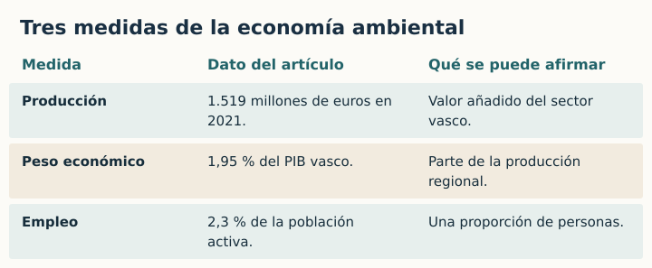

# ENS Rennes · D-E · Espagnol 2025 — Corrigé guidé

*Corrigé rédigé par IA, non officiel. Signalez toute erreur.*

**Rédaction** · GPT-6.2 Astra Ultra · vitesse non renseignée

L’épreuve dure quatre heures. Chacune des deux réponses d’expression écrite doit compter de 225 à 275 mots.

## Préparer la copie

### Retrouver les acteurs de la vidéo

Le candidat diffuse la vidéo. DLG, groupe d’origine portoricaine, interprète la chanson du compositeur dominicain Cuco Valoy. Celui-ci conteste son utilisation. Garder « semble » pour *aparentemente*. La journaliste décrit un montage. À travers le choix du verbe, elle laisse ouverte la question de la musique sur laquelle dansait le candidat lors des événements filmés. Le rapport attire l’attention sur *boricua*, *codiciados* et *medio dominicano*.

### Traduire la controverse scolaire

« Professeur des écoles » devient *maestro de primaria*. Un *cargo electo* est un élu, *el personal a su cargo* le personnel relevant de la ministre. La concession « elle n’en rappelle pas moins » présente l’effet de la déclaration malgré sa condamnation. À la fin du deuxième paragraphe, conserver la différence entre la formule de désaccord de la ministre et la possibilité de vérifier la charge de travail.

### Choisir la preuve adaptée

La première réponse restitue le raisonnement de l’article, du capital naturel au cas basque puis aux projets. Les 1,95 % portent sur le PIB et les 2,3 % sur la population active. La deuxième réponse prend position. Pour discuter l’effet rebond, distinguer consommation par unité et consommation totale. Les questions « qui gagne ? » et « qui supporte le coût ? » permettent d’examiner un projet plutôt que d’enchaîner les généralités sur la croissance verte.

## I. Version

Un jour, Donald Trump promet aux immigrés latino-américains de les expulser en masse vers leurs pays respectifs. Le lendemain, il fait appel au chanteur de reggaeton du moment pour s’attirer les suffrages de l’électorat hispanique, l’un des plus convoités à l’approche des élections de novembre. Dernière initiative de son équipe de campagne, la diffusion d’une vidéo dans laquelle le candidat républicain semble danser sur un air de salsa bien connu. Cette fois, on n’y chante plus « Juliana, que tu es méchante », mais « Kamala, que tu es méchante, que tu es méchante, Kamala ». Ce n’est pas la première fois que l’équipe de l’ancien président se sert de la musique pour faire du charme aux électeurs latinos, car elle sait que peu de choses leur plaisent autant que de se déhancher.

Dans les trente-trois secondes que dure la vidéo diffusée sur X, Trump apparaît, coiffé de son habituelle casquette *Make America Great Again*, à bord d’une voiturette de golf. Il annonce qu’il a « une super playlist ». On entend ensuite le groupe de salsa DLG, d’origine portoricaine, l’un des plus écoutés des années 1990, interpréter le fameux morceau *Juliana*, un succès composé par le Dominicain Cuco Valoy. On voit aussi le républicain, lors de plusieurs réunions électorales, remuer les bras et les pieds au rythme de la salsa, tandis que Kamala Harris éclate de rire. Ce même rire que Trump a déjà critiqué, le qualifiant de « rire de folle ».

Après la diffusion de la vidéo, Valoy lui-même a publiquement contesté l’utilisation de sa chanson dans la campagne républicaine. Il a assuré au journal dominicain *Listín Diario* que personne ne l’avait contacté pour lui demander l’autorisation d’utiliser son œuvre.

## II. Thème

El 8 de noviembre, Nicolas Sarkozy resucitó una vieja caricatura. «Ser maestro de primaria […] son veinticuatro horas a la semana» y «seis meses al año», soltó el expresidente de la República en una conferencia en Saint-Raphaël, en el departamento de Var. Varios cargos electos de la izquierda y del Movimiento Demócrata (MoDem), así como Luc Ferry, exministro de Educación del Gobierno de Raffarin (2002-2004), condenaron sus declaraciones. Estas no dejan de recordar, sin embargo, hasta qué punto persiste entre una parte de la opinión pública una visión despectiva de la docencia, con graves consecuencias para una profesión en crisis.

La ministra de Educación, Anne Genetet, tardó cuatro días en reaccionar a la arremetida del antiguo jefe del Estado. A preguntas de los periodistas, acabó expresando su firme apoyo al personal a su cargo y quiso «poner las cosas en su sitio». Al replicar que «no estaba de acuerdo» con el expresidente, situó, sin embargo, en el terreno de la opinión una cuestión que atañe ante todo a hechos estudiados y comprobados.

Por pertinente que sea, desde luego, preguntarse por el funcionamiento del sistema educativo y por la organización del horario escolar, no puede hacerse ignorando el aumento de la carga de trabajo en los últimos veinte años, que está ampliamente documentado.

## III.1. Qué relación establece el artículo entre economía y conservación

El artículo empieza por cuestionar la manera de contar la riqueza. Según Partha Dasgupta, un país puede registrar más producción y estar perdiendo al mismo tiempo los recursos naturales de los que depende su prosperidad. Si una actividad contamina un río y otra vende después servicios de depuración, ambas pueden generar ingresos. Para entender lo ocurrido hay que observar además el estado del río. De ahí la propuesta de incluir el capital natural en los indicadores económicos.

El segundo paso lleva de la teoría al tejido productivo vasco. Las actividades ambientales aportaron 1.519 millones de euros de valor añadido en 2021, el 1,95 % del PIB de Euskadi. Entre ellas figuran la recuperación de materiales y la gestión del agua. El artículo añade que el sector da trabajo al 2,3 % de la población activa. El dato se refiere a personas y no comparte denominador con el porcentaje del PIB. El clúster Aclima reúne empresas, centros de investigación y organismos públicos para que una solución ensayada por uno pueda aprovechar a otros.

Los proyectos concretos completan el argumento. Limpiar calles usando menos agua ayuda a conservar un recurso y permite prestar el mismo servicio. Medir las vibraciones del ferrocarril puede orientar la ubicación de una futura infraestructura y anticipar perjuicios para los vecinos. La autora presenta así la conservación como condición de la actividad económica y como fuente de empleo e innovación. Las cifras ilustran la importancia de un sector. Por sí solas no cuantifican la mejora ecológica obtenida en cada proyecto.

*253 mots.*

## III.2. ¿Puede crecer la economía y conservarse el medio ambiente?

La contradicción me parece real cuando el crecimiento consiste en vender cada año más unidades de un producto que exige materias primas escasas. Una mejora técnica puede abaratar cada unidad y aumentar tanto las ventas que el consumo total de materiales acabe subiendo. Por eso no bastaría con llamar verde a una fábrica porque utiliza menos agua por pieza. Habría que preguntar cuánta extrae de toda la cuenca y qué les queda a quienes viven aguas abajo.

En cambio, una economía también puede desarrollarse aumentando el valor de un servicio sin multiplicar en la misma medida las extracciones. Pensemos en un taller que repara aparatos y garantiza el suministro de recambios. Puede contratar a dos técnicos, formar aprendices y ahorrar a las familias compras costosas. Para que el beneficio ambiental sea real, las reparaciones deben alargar la vida efectiva de los aparatos y desplazar parte de la producción nueva. La comparación relevante incluye lo que habría ocurrido sin el taller.

Queda una cuestión distributiva. Si conservar un humedal significa renunciar a una obra que prometía empleo, pedir paciencia a los vecinos mientras toda la región disfruta del agua limpia difícilmente bastará. La administración puede financiar la restauración y la formación con recursos de quienes recibirán sus beneficios. En mi opinión, la compatibilidad entre desarrollo y conservación depende de decisiones así de concretas. Exige límites verificables sobre el uso de recursos, atención a los efectos acumulados y un reparto de costes que permita a la población defender el proyecto también cuando termine la subvención inicial.

*254 mots.*

[Sujet officiel, pages 8 à 10](https://www.ens-rennes.fr/medias/fichier/sujets-lve-d-e-2025_1760692435843-pdf#page=8) · [Rapport du jury](https://www.ens-rennes.fr/medias/fichier/rapport-de-jury-lve-espagnol-e-crit-d-e-2025-2_1768897939753-pdf)
