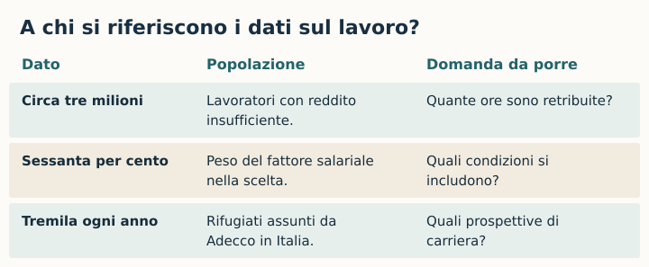

# ENS Rennes · D-E · Italien 2025 — Corrigé brut

*Corrigé rédigé par IA, non officiel. Signalez toute erreur.*

**Rédaction** · GPT-6.2 Astra Ultra · vitesse non renseignée

L’épreuve dure quatre heures. Chacune des deux réponses d’expression écrite doit compter de 225 à 275 mots.

## I. Version

**Le président de la République parle de l’école italienne**

« On demande beaucoup aux enseignants, aux chefs d’établissement et au personnel qui les accompagne, parfois trop. Et souvent, les rémunérations ne sont pas à la hauteur de celles d’autres pays européens. C’est un problème auquel il faut apporter des réponses concrètes. » C’est ce qu’a déclaré le président de la République, Sergio Mattarella, à l’ouverture de l’année scolaire à Cagliari. « Tous ont et doivent toujours avoir conscience et être fiers d’exercer une mission précieuse pour notre société, celle de former et d’éduquer les citoyens de demain. C’est en grande partie de leur travail que dépend l’avenir de notre Italie. »

« Parfois, a ajouté le chef de l’État dans son allocution au pensionnat Victor-Emmanuel II, notre époque, obsédée par le présent, par l’ici et maintenant, risque de nous faire oublier que l’action éducative est un pilier essentiel de la vie de la République. L’avenir de notre société dépend étroitement de la qualité du système éducatif. Il est indispensable de lui consacrer des ressources appropriées, mais aussi des idées, du soin, de l’attention. L’école n’est pas une bulle, un monde à part. C’est un organisme qui vit au sein de la société et contribue à son progrès. »

Mattarella a aussi abordé la question des smartphones. « Nous ne pouvons ni ne devons abandonner les jeunes à la solitude du repli sur soi, dans un monde dominé par la technologie où ils risquent parfois de se retrouver prisonniers. Le smartphone est un outil qui nous aide au quotidien, mais il n’est pas la vie, il ne représente pas la vie, laquelle est bien plus complexe, plus riche et plus passionnante. Nous ne pouvons courir le risque de voir cet outil technologique absorber la quasi-totalité de notre attention, de nos relations, de notre vie. »

## II. Thème

**In Italia si discute la riforma dell’accesso alla cittadinanza**

Tra le pareti decorate con i disegni dei bambini di una scuola primaria lombarda cresce una nuova generazione italiana che ha poco a che vedere con la visione del futuro della presidente del Consiglio nazionalista Giorgia Meloni e del suo vice, Matteo Salvini, dalle frequentazioni apertamente razziste. «I nostri alunni sono quasi tutti di origine straniera, figli di famiglie in prevalenza pakistane, marocchine e senegalesi. Per la maggior parte sono nati in Italia e appartengono alla seconda generazione. Eppure ben pochi hanno la cittadinanza italiana», spiega la dirigente scolastica.

Il destino di questi bambini, e di tutti quelli che, come loro, sono nati da genitori stranieri e crescono in territorio italiano, è al centro di un dibattito nazionale che si riaccende a intervalli e a cui di recente i Giochi olimpici hanno dato nuovo slancio. I successi della nazionale femminile di pallavolo, guidata dall’italiana di origine nigeriana Paola Egonu, hanno riportato la questione dell’accesso alla cittadinanza al centro del dibattito pubblico.

In Italia vige il diritto di sangue. Senza arrivare a prospettare un passaggio al diritto di suolo, il paese si interroga su una formula intermedia designata con una locuzione latina, lo *ius scholae*, ossia il diritto legato all’istruzione.

## III.1. Tre cifre che cambiano il modo di guardare al lavoro

Il dato che mi colpisce di più compare nella domanda sul salario minimo. Secondo l’articolo, il dodici per cento dei lavoratori italiani, circa tre milioni di persone, non riesce a vivere dignitosamente con il solo stipendio fino alla fine del mese. Di solito si considera l’ingresso nel mondo del lavoro come la soluzione alla precarietà economica. Questa cifra obbliga a precisare la domanda. Quante ore sono pagate, quanto costa l’alloggio e con quale continuità arriva il reddito?

Mi interessa anche il sessanta per cento che Catoir attribuisce al fattore salariale nella scelta di un’impresa. Nella sua definizione contano sia la retribuzione vera e propria sia le condizioni offerte. Un orario compatibile con il trasporto pubblico o con la cura dei figli può rendere praticabile un impiego che sulla carta paga quanto un altro. Usare quel numero per concludere che la flessibilità sostituisce un salario adeguato tradirebbe le premesse dello stesso intervistato.

Infine, Catoir dice che Adecco assume ogni anno in Italia tremila rifugiati e riferisce di un assenteismo molto basso tra queste persone. Mi colpisce il contrasto tra questa esperienza e l’idea che basti la lunghezza del curriculum per valutare una candidatura. L’esempio riguarda però le assunzioni di una determinata impresa. Per estendere il giudizio servirebbero dati sui settori, sui contratti e sulle possibilità di progressione. Accostate, le tre cifre invitano a misurare la qualità dell’incontro tra chi offre lavoro e chi lo cerca, oltre al semplice numero di occupati.

*240 mots.*

## III.2. Rendere accessibile l’innovazione anche alle piccole imprese

Una piccola impresa può riconoscere l’utilità di una nuova tecnologia e tuttavia rinviare l’investimento. Se un progetto fallisce, rischia insieme il denaro, il tempo di alcuni dipendenti e una commessa importante. Per Italia, Francia e Spagna proporrei quindi una prima misura comune. Centri territoriali collegati alle università potrebbero mettere a disposizione attrezzature e personale per sperimentazioni limitate nel tempo. Un laboratorio condiviso aiuterebbe un’impresa a capire se una soluzione funziona sul proprio prodotto prima di acquistarla.

La formazione dovrebbe seguire lo stesso principio di reciprocità. Insegnanti e ricercatori possono verificare con i lavoratori quali competenze mancano davvero. Le imprese potrebbero offrire periodi retribuiti di formazione durante l’orario di lavoro, anche a chi possiede già esperienza. Se si selezionano soltanto giovani con titoli recenti, si perde la conoscenza pratica di chi sa riconoscere un difetto di produzione e potrebbe contribuire a correggerlo. Per trattenere queste persone, alla formazione vanno accompagnati salari e percorsi professionali credibili.

Infine la politica pubblica dovrebbe verificare gli esiti dei finanziamenti. Contare le domande accolte dice poco sull’uso effettivo di un nuovo strumento. Dopo due anni si potrebbero confrontare la qualità dei prodotti, il consumo di energia e la possibilità per i dipendenti di svolgere mansioni più qualificate. Alcuni progetti falliranno. Pubblicarne i risultati eviterebbe ad altre imprese di ripetere la stessa spesa. Una collaborazione europea consentirebbe di condividere prove e competenze senza imporre a tre sistemi produttivi diversi un’unica ricetta industriale.

*235 mots.*

[Sujet officiel, pages 11 à 13](https://www.ens-rennes.fr/medias/fichier/sujets-lve-d-e-2025_1760692435843-pdf#page=11) · [Rapport du jury](https://www.ens-rennes.fr/medias/fichier/rapport-de-jury-lve-italien-e-crit-d-e-2025_1768986719926-pdf)
