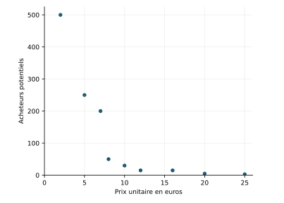
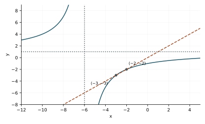

# ENS Rennes D-E — Mathématiques appliquées et statistiques 2025 · Corrigé guidé

*Corrigé rédigé par IA, non officiel. Signalez toute erreur.*

**Rédaction** · GPT-6.2 Astra Ultra · vitesse non renseignée

**Révision** · GPT-6.2 Astra Ultra · vitesse non renseignée

Le cahier d’options présente trois exercices indépendants. Les calculs du premier distinguent les ventes observées de la demande estimée. Les deux suivants portent sur une homographie et sur des lois de probabilité.

## Exercice 1. Enquête et choix du prix

### Question 1.I.1

> [!INDICATION]
> Placer chaque prix horizontalement et l’effectif observé verticalement.

#### Solution

Sur la copie, une unité de prix correspond à 1 cm et 25 acheteurs à 1 cm. Les points sont $(2,500),(5,250),(7,200),(8,50),(10,30),(12,15),(16,15),(20,5),(25,3)$.

### Question 1.I.2

> [!INDICATION]
> Utiliser la variance descriptive, avec le nombre total d’observations au dénominateur.

#### Solution

La moyenne est $\bar y=\frac19\sum_i y_i=1068/9\simeq118{,}667$. La variance est $V_y=\frac19\sum_i(y_i-\bar y)^2=\frac19\sum_i y_i^2-\bar y^2\simeq25\,516{,}444$ acheteurs au carré.

### Question 1.I.3

> [!INDICATION]
> Calculer la covariance puis la diviser par le produit des écarts-types.

#### Solution

Avec $\bar x=11{,}667$, $V_x=49{,}111$, la covariance $C_{xy}=\frac19\sum_i x_i y_i-\bar x\bar y=-835$. Le coefficient $r=C_{xy}/\sqrt{V_xV_y}\simeq-0{,}746$. Il y a une tendance décroissante, mais la courbure du nuage et la dispersion rendent l’ajustement affine direct peu satisfaisant.

### Question 1.I.4.a

> [!INDICATION]
> Prendre le logarithme naturel de chacun des neuf effectifs.

#### Solution

Les couples du tableau sont donnés au millième.

| Prix | 2 | 5 | 7 | 8 | 10 | 12 | 16 | 20 | 25 |
|---|---|---|---|---|---|---|---|---|---|
| ln(effectif) | 6,215 | 5,521 | 5,298 | 3,912 | 3,401 | 2,708 | 2,708 | 1,609 | 1,099 |

### Question 1.I.4.b

> [!INDICATION]
> Comparer les valeurs absolues des corrélations.

#### Solution

Les logarithmes non arrondis donnent $\bar t=3{,}608$, $V_t=2{,}818$ et $C_{xt}=-11{,}214$. Donc $r_{xt}=C_{xt}/\sqrt{V_xV_t}\simeq-0{,}953$. Sa valeur absolue dépasse nettement $0{,}746$. Un ajustement affine du logarithme en fonction du prix est justifié.

### Question 1.I.4.c

> [!INDICATION]
> La droite de régression passe par le point moyen.

#### Solution

En minimisant $\sum_i(t_i-ax_i-b)^2$, les équations normales donnent $a=C_{xt}/V_x\simeq-0{,}228337$, $b=\bar t-a\bar x\simeq6{,}271901$. Au millième, la droite est $t=-0{,}228x+6{,}272$.

### Question 1.I.4.d

> [!INDICATION]
> Revenir à l’effectif en inversant le logarithme.

#### Solution

Le modèle ajusté est $\widehat y(x)=\exp(ax+b)\simeq\exp(-0{,}228x+6{,}272)$.

### Question 1.I.4.e

> [!INDICATION]
> Évaluer la demande ajustée puis interpréter le nombre de personnes.

#### Solution

À 14 euros, les paramètres de régression non arrondis donnent $\exp(14a+b)\simeq21{,}654$, soit environ **22 personnes**. En utilisant les coefficients arrondis de la droite affichée, on trouve $21{,}758$, avec le même effectif entier.

### Question 1.II.1

> [!INDICATION]
> Le coût de production s’applique au nombre d’unités. Le chiffre d’affaires est le produit du prix par la quantité.

#### Solution

Le tableau demandé dans cette partie s’arrête au prix de 20 euros. Les trois colonnes en euros utilisent respectivement les formules $1{,}5y$, $xy$ et $(x-1{,}5)y$.

| Prix | Acheteurs | Coût total | Chiffre d’affaires | Bénéfice |
|---:|---:|---:|---:|---:|
| 2 | 500 | 750 | 1 000 | 250 |
| 5 | 250 | 375 | 1 250 | 875 |
| 7 | 200 | 300 | 1 400 | 1 100 |
| 8 | 50 | 75 | 400 | 325 |
| 10 | 30 | 45 | 300 | 255 |
| 12 | 15 | 22,5 | 180 | 157,5 |
| 16 | 15 | 22,5 | 240 | 217,5 |
| 20 | 5 | 7,5 | 100 | 92,5 |

### Question 1.II.2

> [!INDICATION]
> Multiplier la marge sur un calendrier par la demande prévue.

#### Solution

La marge unitaire est $x-1{,}5$. En remplaçant l’effectif par la demande ajustée aux coefficients donnés dans cette partie, le bénéfice modélisé est $b(x)=(x-1{,}5)e^{-0{,}228x+6{,}272}$ euros.

### Question 1.II.3

> [!INDICATION]
> Étudier le signe du facteur affine dans la dérivée.

#### Solution

On a $b'(x)=e^{-0{,}228x+6{,}272}[1-0{,}228(x-1{,}5)]$. La dérivée est positive avant $x_*=1{,}5+1/0{,}228$, nulle en $x_*$ et négative après. Le tableau de variations part de $b(0)=-1{,}5e^{6{,}272}\simeq-794{,}303$, croît jusqu’à $b(x_*)\simeq606{,}928$, puis décroît vers zéro par croissance comparée.

### Question 1.II.4

> [!INDICATION]
> Repérer le zéro du facteur affine de la dérivée. Pour un tarif exprimé en centimes, comparer ensuite les deux centimes voisins avec les valeurs non arrondies du bénéfice.

#### Solution

Le prix optimal du modèle est $x_*\simeq5{,}886$ euros et le bénéfice maximal vaut $606{,}928$ euros. Au centime, on retient **5,89 €** (entre les prix adjacents 5,88 et 5,89, le second donne le bénéfice le plus élevé).

Une vérification au centime demande de conserver la précision avant de comparer. Le bénéfice modélisé vaut environ $606{,}927124$ euros à 5,88 € et $606{,}927429$ euros à 5,89 €. Si l’on choisit uniquement parmi les prix effectivement essayés, le maximum du tableau est 1 100 € au prix de 7 €. L’écart tient aux demandes différentes du modèle et de l’enquête.

## Exercice 2. Fonction homographique, suite et densité

### Question 2.I.1

> [!INDICATION]
> Tester le dénominateur.

#### Solution

Le dénominateur $x+6$ s’annule uniquement en $-6$. Ainsi $D_f=\mathbb R\setminus\{-6\}$.

### Question 2.I.2

> [!INDICATION]
> Réécrire la fonction comme une constante plus un terme à dénominateur simple.

#### Solution

Pour $|x|\to\infty$, $f(x)=(1-6/x)/(1+6/x)\to1$. À proximité de $-6$, $f(x)=1-12/(x+6)$. La limite en $-6^-$ est $+\infty$, celle en $-6^+$ est $-\infty$. C’est bien $-6$ qui annule le dénominateur imprimé.

### Question 2.I.3

> [!INDICATION]
> Appliquer la dérivée d’un quotient sur chacun des deux intervalles.

#### Solution

Les deux polynômes sont dérivables et le dénominateur ne s’annule pas sur $D_f$. On obtient $f'(x)=[(x+6)-(x-6)]/(x+6)^2=12/(x+6)^2$.

### Question 2.I.4

> [!INDICATION]
> Le signe de la dérivée est le même sur chacune des branches séparées par le pôle.

#### Solution

La dérivée est strictement positive. Sur $]-\infty,-6[$, $f$ croît de $1$ vers $+\infty$. Sur $]-6,+\infty[$, $f$ croît de $-\infty$ vers $1$. Les limites aux infinis ne sont pas atteintes.

| Intervalle | Limite à gauche | Sens de variation | Limite à droite |
|---|---:|:---:|---:|
| $]-\infty,-6[$ | $1$ | Croît | $+\infty$ |
| $]-6,+\infty[$ | $-\infty$ | Croît | $1$ |

Les deux lignes correspondent aux deux branches séparées par l’asymptote $x=-6$.

### Question 2.I.5

> [!INDICATION]
> Écarter le pôle avant de multiplier par le dénominateur.

#### Solution

L’équation équivaut à $x^2+5x+6=(x+2)(x+3)=0$. Les deux valeurs $-3$ et $-2$ sont dans le domaine et sont les deux points fixes.

### Question 2.I.6

> [!INDICATION]
> Conserver le signe du dénominateur dans le tableau de signes.

#### Solution

On a $f(x)-x=-(x+2)(x+3)/(x+6)$. Le signe est positif sur $]-\infty,-6[$, négatif sur $]-6,-3[$, positif sur $]-3,-2[$, puis négatif sur $]-2,+\infty[$. En ajoutant les zéros du numérateur, $f(x)\ge x$ exactement sur $]-\infty,-6[\ \cup[-3,-2]$.

### Question 2.I.7

> [!INDICATION]
> Distinguer asymptote et tangente en un point de la courbe.

#### Solution

À toute abscisse du domaine, la dérivée existe et est finie ; le graphe n’a donc aucune tangente verticale. La droite $x=-6$ est une asymptote verticale.

### Question 2.I.8

> [!INDICATION]
> Marquer les asymptotes, les deux points fixes et la croissance sur chaque branche.

#### Solution

Les intersections sont $(-3,-3)$ et $(-2,-2)$. La branche de gauche reste au-dessus de $y=1$, celle de droite au-dessous, et les deux branches sont croissantes.

### Question 2.II.1.a

> [!INDICATION]
> Remplacer deux fois le premier terme dans la récurrence.

#### Solution

Pour $u_0=-2$, $u_1=(-8)/4=-2$ et $u_2=-2$. On conjecture une suite constante.

### Question 2.II.1.b

> [!INDICATION]
> Faire une récurrence sur la valeur exacte du terme.

#### Solution

Le rang zéro vérifie $u_0=-2$. Si $u_n=-2$, $u_{n+1}=f(-2)=-2$ est défini. Tous les termes valent donc $-2$. La suite est à la fois croissante et décroissante au sens large et converge vers $-2$.

### Question 2.II.2

> [!INDICATION]
> Utiliser le second point fixe.

#### Solution

Si $u_0=-3$, comme $f(-3)=-3$, la même récurrence donne $u_n=-3$ pour tout $n$. La suite est constante et sa limite est $-3$.

### Question 2.II.3.a

> [!INDICATION]
> Utiliser la croissance stricte sur la branche qui contient −2.

#### Solution

Par hypothèse $u_0>-2$. Si $u_n$ existe et dépasse $-2$, il n’est pas le pôle ; $u_{n+1}=f(u_n)$ existe, et $f(u_n)>f(-2)=-2$ par croissance stricte sur $]-6,\infty[$. La propriété est établie par récurrence.

### Question 2.II.3.b

> [!INDICATION]
> Lire le signe de f(x)−x à droite du plus grand point fixe.

#### Solution

Pour $u_0>-2$, la réponse 2.I.6 donne $u_1=f(u_0)<u_0$. Comme l’intervalle est stable et $f$ y est croissante, on conjecture une suite strictement décroissante.

### Question 2.II.3.c

> [!INDICATION]
> Appliquer la même fonction croissante à deux termes consécutifs.

#### Solution

Le rang initial vient de la question précédente. Si $u_{n+1}<u_n$, les deux points dépassent $-2$ par 3.a ; en appliquant $f$ strictement croissante, $u_{n+2}<u_{n+1}$. Cela prouve la décroissance stricte.

### Question 2.II.3.d

> [!INDICATION]
> Associer la monotonie à la borne inférieure déjà démontrée.

#### Solution

La suite décroît et est minorée par $-2$. Le théorème de convergence monotone assure l’existence d’un réel $\ell\ge-2$ tel que $u_n\to\ell$.

### Question 2.II.3.e

> [!INDICATION]
> Passer à la limite dans la relation de récurrence.

#### Solution

Le dénominateur ne s’annule pas pour $\ell\ge-2$. Par continuité $\ell=f(\ell)$. Parmi $-3,-2$, seul $-2$ respecte la borne. Donc $\ell=-2$.

### Question 2.II.4

> [!INDICATION]
> Déterminer où arrive le premier terme après le pôle.

#### Solution

Si $u_0<-6$, $u_1=1-12/(u_0+6)>1$. À partir de $u_1$, on se trouve dans le cas 3 ; toute la suite est définie, elle décroît strictement dès le rang un et tend vers $-2$. Le premier pas, lui, est croissant.

### Question 2.III.1

> [!INDICATION]
> Distinguer la normalisation d’une densité de celle d’une fonction de répartition.

#### Solution

Une densité est une fonction mesurable positive ou nulle presque partout, d’intégrale sur $\mathbb R$ égale à $1$. Ici la continuité par morceaux de $g$ assure la mesurabilité et son support borné assure l’intégrabilité.

### Question 2.III.2

> [!INDICATION]
> Substituer 1+x² dans l’intégrale de normalisation.

#### Solution

Il faut $\alpha\ge0$. On a $\int_0^1\alpha x(1+x^2)^{3/2}dx=\frac\alpha5[(1+x^2)^{5/2}]_0^1=\alpha(2^{5/2}-1)/5$. L’unique valeur convenable est $\alpha=5/(2^{5/2}-1)>0$.

### Question 2.III.3.a

> [!INDICATION]
> Découper la droite aux deux bornes du support.

#### Solution

La fonction $G(x)=\int_{-\infty}^xg(s)ds$ vaut $0$ pour $x<0$, $[(1+x^2)^{5/2}-1]/(2^{5/2}-1)$ pour $0\le x\le1$, puis $1$ pour $x>1$. Les trois expressions se raccordent aux bornes.

### Question 2.III.3.b

> [!INDICATION]
> Prendre le complément de la fonction de répartition.

#### Solution

On a $\mathbb P(X>1/2)=1-G(1/2)=[2^{5/2}-(5/4)^{5/2}]/(2^{5/2}-1)\simeq0{,}840$.

## Exercice 3. Probabilités

### Question 3.I.1

> [!INDICATION]
> Les trois pièces ont les mêmes chances d’être choisies.

#### Solution

Par équiprobabilité des trois choix, $\mathbb P(P_1)=1/3$.

### Question 3.I.2

> [!INDICATION]
> Le choix de la pièce est déjà connu.

#### Solution

La probabilité demandée est conditionnelle. Par les données sur la deuxième pièce, $\mathbb P(F\mid P_2)=2/5$.

### Question 3.I.3

> [!INDICATION]
> Appliquer la formule des probabilités composées.

#### Solution

On obtient $\mathbb P(P_2\cap F)=\mathbb P(P_2)\mathbb P(F\mid P_2)=(1/3)(2/5)=2/15$.

### Question 3.I.4

> [!INDICATION]
> Conditionner par le système complet des trois choix de pièce.

#### Solution

Les $P_i$ sont incompatibles et couvrent tous les choix. Les probabilités totales donnent $\mathbb P(F)=\frac13(\frac13+\frac25+\frac45)=23/45$. Le résultat « Pile » étant $\overline F$, sa probabilité est $1-23/45=22/45$.

### Question 3.I.5

> [!INDICATION]
> Appliquer la formule de Bayes après observation de Pile.

#### Solution

On a $\mathbb P(P_3\mid\overline F)=\mathbb P(P_3)\mathbb P(\overline F\mid P_3)/\mathbb P(\overline F)=(1/3)(1/5)/(22/45)=3/22$.

### Question 3.II.1

> [!INDICATION]
> Pour une première face au rang k, imposer k−1 échecs suivis d’un succès.

#### Solution

Pour les lancers indépendants de la même pièce, chaque $k\ge1$ est possible et $\mathbb P(X_1=k)=(1-p)^{k-1}p$. La probabilité de n’obtenir aucune face est $\lim_n(1-p)^n=0$. On reconnaît la loi géométrique sur $\mathbb N^*$, avec moyenne $1/p$ et variance $(1-p)/p^2$.

### Question 3.II.2

> [!INDICATION]
> Interpréter la moyenne du rang de la première face.

#### Solution

Le nombre moyen de lancers nécessaires à la première face est $\mathbb E(X_1)=1/p$, le lancer réussi compris.

### Question 3.II.3.a

> [!INDICATION]
> Il faut deux succès à des instants distincts.

#### Solution

Le rang de la deuxième face est au moins $2$. Tout $k\ge2$ se réalise par exemple avec une première face au premier lancer, des piles intermédiaires puis une face au rang $k$, événement de probabilité positive. Le support est $\{2,3,\ldots\}$.

### Question 3.II.3.b

> [!INDICATION]
> Choisir l’unique premier succès parmi les k−1 premiers lancers.

#### Solution

La deuxième face arrive au rang $k$ exactement si le dernier lancer est une face et si un seul des précédents en est une. En utilisant les événements imprimés,
$$\{X_2=k\}=\bigcup_{j=1}^{k-1}\left(F_k\cap F_j\cap\bigcap_{\substack{1\le i<k\\i\ne j}}\overline F_i\right).$$
Les termes de l’union sont disjoints puisqu’ils imposent des positions différentes pour le seul premier succès.

### Question 3.II.3.c

> [!INDICATION]
> Chaque choix du premier succès a la même probabilité.

#### Solution

Pour chaque $j$, l’indépendance donne $p^2(1-p)^{k-2}$. Les $k-1$ événements étant disjoints, $\mathbb P(X_2=k)=(k-1)p^2(1-p)^{k-2}$.

### Question 3.II.3.d

> [!INDICATION]
> Reconnaître deux fois le coefficient binomial k parmi deux.

#### Solution

La série de l’espérance est à termes positifs. Comme $k(k-1)=2\binom{k}{2}$, l’identité admise avec $x=1-p$ et $r=2$ donne $\sum_{k\ge2}k\mathbb P(X_2=k)=2p^2/(1-(1-p))^3=2/p$. La somme est finie, ce qui justifie l’existence de l’espérance.

### Question 3.II.4.a

> [!INDICATION]
> Le rang ne peut précéder le nombre de succès à obtenir.

#### Solution

Au moins $r$ lancers sont nécessaires. Tout $k\ge r$ est possible avec $r-1$ succès avant le dernier et un succès au rang $k$. Le support est donc $\{r,r+1,\ldots\}$.

### Question 3.II.4.b

> [!INDICATION]
> Choisir les places des r−1 premières faces, la dernière étant déjà fixée.

#### Solution

Il y a $\binom{k-1}{r-1}$ choix des positions des faces parmi les $k-1$ premiers lancers. Chaque réalisation correspondante suivie de face au rang $k$ a probabilité $p^r(1-p)^{k-r}$. Les possibilités sont disjointes, d’où $\mathbb P(X_r=k)=\binom{k-1}{r-1}p^r(1-p)^{k-r}$.

### Question 3.II.4.c

> [!INDICATION]
> Écrire les deux coefficients sous forme factorielle.

#### Solution

Pour $k\ge r\ge1$, $k\binom{k-1}{r-1}=k!/[(r-1)!(k-r)!]=r\binom{k}{r}$.

### Question 3.II.4.d

> [!INDICATION]
> Utiliser l’identité précédente dans la série de l’espérance.

#### Solution

La série positive devient $rp^r\sum_{k\ge r}\binom{k}{r}(1-p)^{k-r}$. La formule admise la fait converger vers $rp^r/p^{r+1}=r/p$. On a donc bien $\mathbb E(X_r)=r/p$.

On peut vérifier cet ordre de grandeur en décomposant le temps d’attente total en $r$ temps entre succès consécutifs, en comptant le lancer réussi à la fin de chacun. Les lancers indépendants de paramètre $p$ donnent à chacun la même loi géométrique, de moyenne $1/p$. L’addition des moyennes retrouve $r/p$.

### Question 3.II.5.a

> [!INDICATION]
> Compter le nombre de lancers qui ne sont pas des faces à l’instant d’arrêt.

#### Solution

Parmi les $X_r$ lancers il y a exactement $r$ faces. Le nombre de piles qui précèdent la dernière est donc $Y_r=X_r-r$.

### Question 3.II.5.b

> [!INDICATION]
> Décaler le support et les indices de la loi connue.

#### Solution

Pour $j\ge0$, $\mathbb P(Y_r=j)=\mathbb P(X_r=j+r)=\binom{j+r-1}{r-1}p^r(1-p)^j$. Cette loi binomiale négative est portée par $\mathbb N$.

### Question 3.II.5.c

> [!INDICATION]
> Utiliser l’intégrabilité déjà établie et la linéarité.

#### Solution

L’espérance de $X_r$ est finie, donc celle de $Y_r=X_r-r$ existe et vaut $r/p-r=r(1-p)/p$.

### Question 3.III.1

> [!INDICATION]
> Préciser aussi la valeur de la densité sur les temps négatifs.

#### Solution

Pour $\lambda>0$, une densité exponentielle est $x\mapsto\lambda e^{-\lambda x}$ pour $x\ge0$ et zéro pour $x<0$.

### Question 3.III.2

> [!INDICATION]
> Intégrer par parties sur un segment avant de faire tendre la borne vers l’infini.

#### Solution

L’intégrande $x\lambda e^{-\lambda x}$ est positif sur $[0,\infty[$. Sur $[0,R]$, son intégrale vaut $-Re^{-\lambda R}+(1-e^{-\lambda R})/\lambda$. Cela tend vers $1/\lambda$ quand $R\to\infty$. La convergence est donc absolue et $\mathbb E(X)=1/\lambda$.

### Question 3.III.3

> [!INDICATION]
> Translater la moyenne du même nombre que la variable.

#### Solution

De $Y=X-12$, la linéarité donne $12=\mathbb E(Y)=1/\lambda-12$. Donc $\lambda=1/24$ par an.

### Question 3.III.4

> [!INDICATION]
> Intégrer la densité entre zéro et six ans.

#### Solution

On trouve $\mathbb P(X\le6)=1-e^{-6/24}=1-e^{-1/4}\simeq0{,}221$, soit environ $22{,}1\,\%$.
