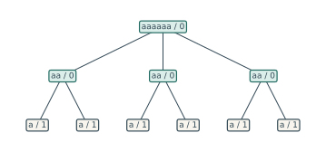
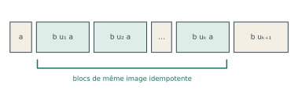
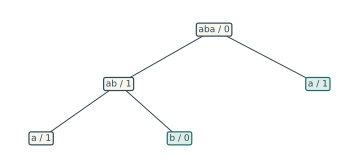

# ENS · MP-MPI · Informatique fondamentale 2025 — corrigé guidé

*Corrigé rédigé par IA, non officiel. Signalez toute erreur.*

**Rédaction** · GPT-6.2 Astra Ultra · vitesse non renseignée · 25 novembre 2026

**Forêts de factorisation.** La composition commune aux quatre ENS comporte 34 questions. Les positions dans les mots commencent à un. Dans la dernière partie, la condition de la ligne 15 de la figure 1 exige une correction pour que le calcul renvoie la bonne image.

## Repères de résolution

Pour justifier un arbre, vérifier séparément l’ordre des feuilles, l’arité de chaque nœud et l’image de ses enfants. Une longueur qui diminue garantit une terminaison ; une hauteur bornée indépendamment de la longueur demande un paramètre contrôlé uniquement par l’alphabet ou le semi-groupe.

## I. Semi-groupes

### Question 1 · Unicité du neutre

**Indication.** Multiplier deux neutres supposés en utilisant successivement la propriété de chacun.

#### Solution

Si $e$ et $e'$ sont neutres, alors $ee'=e'$ car $e$ est neutre à gauche, et $ee'=e$ car $e'$ est neutre à droite. Donc $e=e'$.

### Question 2 · Identité et fonction constante

**Indication.** Pour réfuter la neutralité, choisir une transformation avec laquelle le résultat est différent.

#### Solution

Pour toute transformation $u$, $\mathrm{id}\mathbin{\#}u=u\circ\mathrm{id}=u$ et $u\mathbin{\#}\mathrm{id}=\mathrm{id}\circ u=u$. La fonction constante $g$ de valeur $a$ vérifie $g\mathbin{\#}g=g\circ g=g$. Elle n'est pas neutre, puisque $\mathrm{id}\mathbin{\#}g=g\ne\mathrm{id}$ (leurs images de $b$ diffèrent).

### Question 3 · Table du semi-groupe à deux éléments

**Indication.** Calculer le carré de la permutation qui échange a et b.

#### Solution

La permutation $f$ échange deux lettres, donc $f\circ f=\mathrm{id}$. La table est

| $\#$ | $\mathrm{id}$ | $f$ |
|---|---|---|
| $\mathrm{id}$ | $\mathrm{id}$ | $f$ |
| $f$ | $f$ | $\mathrm{id}$ |

La table établit la stabilité de $B$ et l'associativité est héritée de la composition. En codant les éléments par $0,1$, on obtient l'addition modulo deux.

### Question 4 · Parité du nombre de a

**Indication.** Comparer ce que fait l'ajout d'une lettre à la parité et à Ψ.

#### Solution

Par récurrence sur la longueur : le mot vide contient zéro $a$ et $\Psi_a(\varepsilon)=0$. Ajouter $b$ conserve la valeur et le nombre de $a$. Ajouter $a$ inverse la valeur et la parité du nombre de $a$. D'où $\Psi_a(w)=|w|_a\bmod 2$. En particulier $\Psi_a(ab)=1$, comme le montre l'arbre de l'exemple 6. La phrase qui lui attribue la valeur $0$ sous cet arbre comporte une coquille.

### Question 5 · Morphisme de transition

**Indication.** Évaluer les deux transformations à comparer sur un état arbitraire, en gardant l'ordre de lecture du mot.

#### Solution

Pour tout état $q$, $\psi(uv)(q)=\delta^*(q,uv)=\delta^*(\delta^*(q,u),v)=\psi(v)(\psi(u)(q))$. Par définition de la composition inversée, c'est $(\psi(u)\mathbin{\#}\psi(v))(q)$. L'égalité en tout $q$ prouve que $\psi$ est un morphisme, y compris si l'un des mots est vide.

### Question 6 · Première inclusion

**Indication.** Déplier la définition de l'ensemble des transformations acceptantes.

#### Solution

Si $w\in\psi^{-1}(F')$, alors $\psi(w)(q_0)\in F$. Cette image vaut $\delta^*(q_0,w)$, donc la lecture de $w$ finit dans un état acceptant, et $w\in L$.

### Question 7 · Seconde inclusion

**Indication.** Partir cette fois de l'état atteint après lecture.

#### Solution

Si $w\in L$, alors $\delta^*(q_0,w)\in F$. Ainsi $\psi(w)(q_0)\in F$, soit $\psi(w)\in F'$ et $w\in\psi^{-1}(F')$. Avec Q6, $L=\psi^{-1}(F')$.

## II. Forêts de factorisation

### Question 8 · Autre arbre pour bbaa

**Indication.** La règle binaire n'impose aucune condition sur les deux images.

#### Solution

Prenons la racine binaire $\mathtt{bbaa}/0$ et ses enfants $\mathtt{bb}/0$ et $\mathtt{aa}/0$. Chacun a ses deux lettres pour enfants : $b/0,b/0$ à gauche et $a/1,a/1$ à droite. La lecture des feuilles redonne le mot initial. Cette racine a deux enfants, alors que celle de l'exemple 6 en a trois.

### Question 9 · Arbre pour trois a

**Indication.** Regrouper deux lettres avant d'ajouter la troisième.

#### Solution

Un arbre binaire valide est $((a/1,a/1)_{\mathtt{aa}/0},a/1)_{\mathtt{aaa}/1}$. Ses deux nœuds internes ont chacun deux enfants. Une racine ternaire directement reliée à trois $a/1$ serait interdite, car $1\oplus1=0\ne1$.

### Question 10 · Arbre idempotent pour six a

**Indication.** Fabriquer trois facteurs ayant tous une parité nulle.

#### Solution

Factorisons $\mathtt{aaaaaa}=\mathtt{aa}\mid\mathtt{aa}\mid\mathtt{aa}$. Chaque paire est un nœud binaire d'image $0$. La racine possède ces trois enfants de même image et $0\oplus0=0$. La règle d'idempotence s'applique et l'arbre a hauteur deux.



## III. Cas des groupes cycliques

### Question 11 · Préfixes stricts de dix b suivis d'un a

**Indication.** Le dernier symbole est-il présent dans un préfixe autorisé ?

#### Solution

Les préfixes stricts non vides sont $b,b^2,\ldots,b^{10}$. Tous contiennent zéro $a$. Le mot entier, seul préfixe qui contiendrait $a$, est exclu. Donc $P(b^{10}a)=\{0\}$.

### Question 12 · Valeur d'un suffixe

**Indication.** Utiliser l'existence d'un inverse dans le groupe objectif.

#### Solution

Le morphisme donne $\phi(xy)=\phi(x)+\phi(y)$ dans $\mathbb Z/k\mathbb Z$. En ajoutant $-\phi(x)$ aux deux membres, $\phi(y)=\phi(xy)-\phi(x)$.

### Question 13 · Initialisation de l'induction

**Indication.** Un mot d'au moins deux lettres a toujours un préfixe strict non vide.

#### Solution

Si $|P(w)|=0$, le mot $w$, imposé non vide, ne peut avoir au moins deux lettres : sa première lettre fournirait une image de préfixe. Il s'agit donc d'une lettre, dont l'arbre est une feuille de hauteur $0$. Ceci prouve $H(0)$.

### Question 14 · Blocs entre deux retours

**Indication.** Comparer les valeurs des deux préfixes complets qui bordent le bloc.

#### Solution

En notant $w_{\le j}=w[1,\ldots,j]$, Q12 donne $\phi(v_i)=\phi(w_{\le j_{i+1}})-\phi(w_{\le j_i})=t-t=0$. Les $v_i$ sont non vides car les $j_i$ sont strictement croissants.

### Question 15 · Préfixes du premier bloc

**Indication.** Quel préfixe strict de x pourrait déjà atteindre la première occurrence de t ?

#### Solution

Tout préfixe strict de $x=w_{\le j_1}$ est strict dans $w$ et se termine avant $j_1$. L'image $t$ n'apparaît pas à ces positions. Donc $P(x)\subseteq P(w)\setminus\{t\}$ et $|P(x)|<|P(w)|$.

### Question 16 · Préfixes des blocs intérieurs

**Indication.** Translater l'ensemble des images de préfixes de vᵢ par t. Comparer les cardinalités après la translation.

#### Solution

Pour un préfixe strict $z$ de $v_i$, l'image de $w_{\le j_i}z$ est $t+\phi(z)$. La coupure correspondante est strictement entre deux occurrences successives de $t$. Ainsi $t+\phi(z)\in P(w)\setminus\{t\}$. La translation est une bijection du groupe, donc $|P(v_i)|\le |P(w)|-1$. L'argument vaut aussi lorsque $v_i$ est une lettre : son ensemble de préfixes stricts est vide.

### Question 17 · Assembler les arbres des blocs

**Indication.** Traiter séparément zéro, un, deux ou davantage de blocs intermédiaires. Une racine unaire est interdite.

#### Solution

Pour $|P(w)|\le p-1$, on applique directement l'hypothèse. Sinon les blocs $x,y$ et chaque $v_i$ ont, par Q15, Q16 et l'observation analogue pour $y$, des arbres de hauteur au plus $h=3(p-1)$. Si aucun $v_i$ n'existe, joindre $x,y$ par un nœud binaire suffit. S'il existe des blocs centraux, regroupons-les : un bloc est conservé tel quel, deux reçoivent une racine binaire, au moins trois une racine idempotente, puisque toutes leurs images valent $0$. Le groupe central a hauteur au plus $h+1$. Deux jonctions binaires, d'abord avec $x$ puis avec $y$, donnent une hauteur au plus $h+3=3p$. Ainsi $H(p)$ est vraie.

### Question 18 · Borne uniforme dans le groupe cyclique

**Indication.** Compter le nombre maximal d'images distinctes des préfixes.

#### Solution

Pour tout $w$, $P(w)\subseteq\mathbb Z/k\mathbb Z$, donc $|P(w)|\le k=|S|$. L'induction de Q13–Q17 jusqu'à $p=k$ donne un arbre de hauteur au plus $3|S|$, indépendamment du nombre de lettres du mot.

## IV. Semi-groupe de Brandt

### Question 19 · Idempotents du semi-groupe de Brandt

**Indication.** Calculer le carré d'une matrice unité hors diagonale, puis sur la diagonale.

#### Solution

La matrice zéro vérifie $0_n^2=0_n$. Si $i=j$, $M_{ii}^2=M_{ii}$. Si $i\ne j$, la règle de produit donne $M_{ij}^2=0_n\ne M_{ij}$. Ce sont tous les éléments de $B_n$.

### Question 20 · Produits correspondant à (ab)⁺

**Indication.** Lire Mᵢⱼ comme un arc allant de i à j ; un mauvais raccord annule tout le produit.

#### Solution

$a$ représente $1\to2$ et $b$ représente $2\to1$. Un produit non nul correspond à un chemin continu, avec pour indices l'origine et l'extrémité. Donner $M_{11}$ impose un départ en $1$, donc par $a$, puis une alternance forcée et un retour en $1$, donc par $b$. Le mot non vide est $(ab)^s$, $s\ge1$. Réciproquement chaque $ab$ a pour image $M_{11}$, idempotente, donc tout $(ab)^s$ a cette image.

### Question 21 · Hauteur deux pour les mots alternants

**Indication.** Grouper les lettres par paires ab et vérifier la règle d'arité pour chaque nombre de paires.

#### Solution

Construire un arbre binaire de hauteur un pour chaque $ab$. S'il y a une seule paire, son arbre suffit. Pour deux paires, joindre leurs arbres par un nœud binaire. Pour au moins trois paires, joindre tous ces arbres par un nœud idempotent puisque leurs images valent $M_{11}$. La hauteur maximale est deux.

### Question 22 · Produit encadré par deux matrices

**Indication.** Identifier l'origine héritée du facteur de gauche et l'extrémité héritée du facteur de droite.

#### Solution

Si $A$ ou $B$ est nul, on peut poser $M_{A,B}=0_n$ et tous les produits encadrés sont nuls. Sinon écrivons $A=M_{ij}$ et $B=M_{k\ell}$. Tout raccord compatible, avec ou sans matrice intermédiaire $x$, donne $M_{i\ell}$ ; tout autre donne zéro. Prendre $M_{A,B}=M_{i\ell}$ convient donc. Si de plus $BA\ne0_n$, alors $\ell=i$ et cette matrice est $M_{ii}$, idempotente par Q19.

### Question 23 · Valeur des blocs b uᵢ a

**Indication.** Un facteur de produit nul annulerait le produit du mot entier. Utiliser aussi le raccord ab voisin.

#### Solution

Posons $A=\phi(b)$ et $B=\phi(a)$. Le mot $ab$ est facteur de $w$, donc $BA=\phi(ab)\ne0_n$. Pour tout $i\le k$, $bu_i a$ est aussi facteur, donc son image est non nulle. Si $u_i$ est vide, elle vaut $AB$, sinon $A\phi(u_i)B$. Q22 donne dans les deux cas la même matrice $M_{A,B}$, idempotente et indépendante de $u_i$. Aucun sens n'a besoin d'être attribué à $\phi(\varepsilon)$.

### Question 24 · Construction dans le cas non nul

**Indication.** Réécrire les lettres frontières pour faire apparaître au centre les blocs de Q23. Compter la hauteur à chaque regroupement.

#### Solution

Écrivons $w=a\,(bu_1a)\cdots(bu_ka)\,(bu_{k+1})$. Avec $h=\max h_i$, deux nœuds binaires suffisent pour chaque $bu_i a$, qui a alors hauteur au plus $h+2$. Regrouper les $k$ blocs centraux donne une hauteur au plus $h+3$ : aucun niveau ajouté si $k=1$, nœud binaire pour $k=2$, nœud idempotent pour $k\ge3$ par Q23. Le suffixe $bu_{k+1}$ a hauteur au plus $h+1$. Joindre à gauche $a$ puis à droite ce suffixe utilise deux niveaux binaires, d'où la borne $h+5$. Chaque jonction respecte l'ordre des lettres.



### Question 25 · Hauteur indépendante de la longueur

**Indication.** La longueur diminue, mais cela ne donne pas de borne constante. Compter les facteurs distincts de longueur deux.

#### Solution

Posons $d(w)=|\{w[j]w[j+1]:1\le j<|w|\}|\le |\Sigma|^2$. Si $d(w)=0$, $w$ est une lettre et son arbre a hauteur zéro. Sinon choisir $ab$ égal aux deux premières lettres de $w$ et marquer ses occurrences disjointes de gauche à droite à partir de cette première occurrence. Les intervalles $u_i$ restants ne contiennent pas $ab$, même si $a=b$ (les occurrences chevauchant une frontière ne sont pas intérieures à un intervalle). Tout facteur de longueur deux d'un $u_i$ est facteur de $w$. Donc $d(u_i)\le d(w)-1$ lorsqu'il est non vide, et $\phi(u_i)\ne0_n$ puisque $\phi(w)\ne0_n$. Par récurrence et Q24 étendue aux cas admis, $h(w)\le 5+5(d(w)-1)=5d(w)$. Ainsi $C=5|\Sigma|^2$ convient, indépendamment de $n$, de $\phi$ et de $|w|$.

## V. Recherche infixe

### Question 26 · Table des transitions de tous les facteurs

**Indication.** Fixer l'état de départ et la première position. Allonger le facteur d'une lettre à chaque itération.

#### Solution

La question demande de calculer le tableau $T_w$ défini juste avant elle (le texte imprime seulement « calcule $w$ »). Voici une réalisation Python avec des intervalles numérotés à partir de un ; la chaîne Python est numérotée à partir de zéro.

```python
def table_facteurs(mot, etats, transition):
    longueur = len(mot)
    table = {}
    for depart in etats:
        lignes = [None] * (longueur + 1)
        for i in range(1, longueur + 1):
            courant = depart
            ligne = [None] * (longueur - i + 1)
            for j in range(i, longueur + 1):
                courant = transition(courant, mot[j - 1])
                ligne[j - i] = courant
            lignes[i] = ligne
        table[depart] = lignes
    return table
```

Après l'itération $j$, l'état courant vaut $\delta^*(q,w[i,\ldots,j])$ par la récurrence de l'automate. La convention d'accès est $T_w[q,i,j]=\mathtt{table[q][i][j-i]}$. Pour chaque état, $|w|(|w|+1)/2$ transitions suffisent. Temps et mémoire sont $O(|Q|\,|w|^2)$ avec le modèle d'accès constant de l'énoncé.

### Question 27 · Recherche par consultation du tableau

**Indication.** Quelles cellules du tableau déterminent l'acceptation à partir de l'état initial ?

#### Solution

Après construction de la table de Q26, on utilise uniquement la ligne de l'état initial.

```python
def recherche_par_table(mot, requetes, etats, initial, finaux, transition):
    depuis_initial = table_facteurs(mot, etats, transition)[initial]
    return [depuis_initial[i][j - i] in finaux for i, j in requetes]
```

La réponse est vraie exactement lorsque l'état final du facteur dans l'automate appartient à $F$. En supposant l'appartenance à $F$ préenregistrée dans une table d'états, chaque paire coûte $O(1)$. Le total vaut $O(|Q|\,|w|^2+|I|)$.

### Question 28 · Lire les indices de l'arbre aba

**Indication.** Identifier les lettres portées par les feuilles, puis leurs positions dans le mot entier.

#### Solution

$e$ porte $ab$ et $f$ porte $a$, donc $\mathrm{Val}(e)=1$ et $\mathrm{Val}(f)=1$. Les feuilles $g$ et $h$, enfants de $e$, sont la première lettre $a$ et la seconde lettre $b$, donc $\mathrm{Indices}(g)=(1,1)$, $\mathrm{Indices}(h)=(2,2)$. Enfin $\mathrm{EnfantIndice}(e,1)=1$ et $\mathrm{EnfantIndice}(e,2)=2$. Dans la phrase explicative de l'exemple 12, l'enfant de la racine sur $[1,2]$ est $e$.

### Question 29 · Initialisation sur une feuille

**Indication.** Quel intervalle non vide peut être contenu dans une feuille ?

#### Solution

Si la feuille porte la lettre de position $k$, ses indices sont $(k,k)$. La seule requête admissible est $(i,j)=(k,k)$ ; la ligne 3 réussit et la ligne 4 renvoie la valeur stockée $\phi(w[k])$. La fonction ne cherche donc jamais l'enfant d'une feuille.

### Question 30 · Extrémité gauche de la requête

**Indication.** Le premier argument récursif est l'enfant qui contient i. Vérifier les deux bornes du suffixe demandé.

#### Solution

Après la ligne 8, les enfants de rangs $\ell$ et $r$ sont distincts et $\ell<r$. Si $f$ est le premier, $i$ appartient à son intervalle et $p$ est sa borne supérieure. Le segment $[i,p]$ est contenu dans $f$. L'hypothèse $\mathrm{HR}_w(f)$ appliquée à ce segment montre qu'une fois l'affectation de ligne 13 exécutée, $v_f=\phi(w[i,\ldots,p])$. De même la ligne 14 calcule $v_g=\phi(w[q,\ldots,j])$.

### Question 31 · Ligne 15 et produit des enfants intérieurs

**Indication.** Vérifier d'abord ce qui se passe lorsque les deux enfants extrêmes sont voisins. Tester la condition imprimée sur l'arbre aba.

#### Solution

**Le programme imprimé a un contre-exemple.** La ligne 15 répète $\ell=r$, alors que le cas d'égalité a déjà rendu la main en ligne 8. Sur l'arbre $((a,b),a)$ de l'exemple 12 et la requête $[2,3]$, les deux enfants de la racine sont voisins. Les valeurs des deux morceaux, $b$ et $a$, sont $0$ et $1$. La ligne 18 imprimée insère en plus la valeur de l'enfant de droite, $1$, et renvoie $0\oplus1\oplus1=0$. La valeur de $ba$ est pourtant $1$.

**Correction.** La ligne 15 doit tester $r=\ell+1$, comme le précise son commentaire. Pour des enfants voisins, il n'y a aucun enfant intermédiaire et la ligne 16 renvoie $v_fv_g$. Pour atteindre la ligne 18 corrigée, il faut donc $r\ge\ell+2$. Le nœud a au moins trois enfants ; leurs images sont toutes égales à un même idempotent $e$. Le produit des $r-\ell-1\ge1$ enfants entiers intermédiaires est $e^{r-\ell-1}=e$, qui vaut précisément $\mathrm{Val}(\mathrm{Enfant}(n,\ell+1))$. Par Q30, l'analogue à droite et le morphisme, $v_fev_g=\phi(w[i,\ldots,j])$. L'ordre des facteurs est conservé même dans un semi-groupe non commutatif.



### Question 32 · Temps d'une requête

**Indication.** Majorer le nombre d'appels à chaque hauteur sans parcourir tous les enfants d'un nœud.

#### Solution

Hors récursion, chaque appel utilise un nombre borné d'accès et de produits, supposés constants. Il effectue au plus deux appels sur des enfants de hauteur au plus $h-1$. Si $C(0)\le d$, on a $C(h)\le 2C(h-1)+d$, donc $C(h)\le d(2^{h+1}-1)=O(2^h)$. Ce raisonnement s'applique au programme corrigé comme au nombre d'appels du programme imprimé.

### Question 33 · Une constante pour le langage fixé

**Indication.** Insérer la borne de hauteur du théorème dans la complexité obtenue.

#### Solution

Le semi-groupe $S$ du langage fixé est fini et indépendant de $w$. Le théorème 1 assure $h\le3|S|$. Le coût d'une requête de Q32 est donc majoré par $d(2^{3|S|+1}-1)$, constante dépendant seulement de $L$ et de sa représentation. L'arbre est supposé déjà fourni dans cette question. La correction de Q31 est nécessaire pour que la valeur obtenue soit celle du facteur.

### Question 34 · Recherche infixe linéaire au total

**Indication.** Construire l'arbre une seule fois pour toutes les requêtes. Conserver le cas sans facteur intermédiaire.

#### Solution

Voici une version du calcul avec des primitives de l'arbre et une multiplication $\mathtt{fois}$ fournies par le semi-groupe. La méthode $\mathtt{rang}$ renvoie des rangs d'enfants numérotés à partir de zéro. Les bornes sur les lettres du mot restent inclusives et numérotées à partir de un.

```python
def valeur_facteur(noeud, i, j, fois):
    if (i, j) == (noeud.debut, noeud.fin):
        return noeud.valeur
    gauche = noeud.rang(i)
    droite = noeud.rang(j)
    premier = noeud.enfants[gauche]
    if gauche == droite:
        return valeur_facteur(premier, i, j, fois)
    dernier = noeud.enfants[droite]
    v = valeur_facteur(premier, i, premier.fin, fois)
    u = valeur_facteur(dernier, dernier.debut, j, fois)
    if droite == gauche + 1:
        return fois(v, u)
    milieu = noeud.enfants[gauche + 1].valeur
    return fois(fois(v, milieu), u)

def recherche_infixe(mot, requetes, construire, fois, images_acceptantes):
    arbre = construire(mot)
    return [valeur_facteur(arbre, i, j, fois) in images_acceptantes
            for i, j in requetes]
```

La construction admise coûte $O(|w|)$. Si les accès par position doivent être préparés, on peut enregistrer pour chaque position son rang d'enfant à chaque profondeur : chaque niveau couvre au plus $|w|$ positions et la hauteur est fixée. Q29–Q31 prouvent la correction du calcul ; l'acceptation suit de $L=\phi^{-1}(F)$. Par Q33, chacune des $|I|$ consultations coûte $O(1)$. On obtient $O(|w|+|I|)$, y compris lorsque la liste des requêtes est vide.
