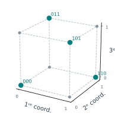
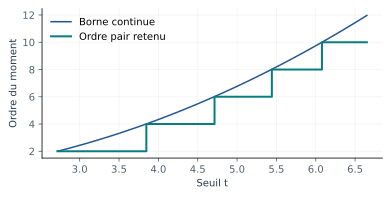
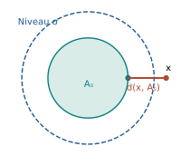
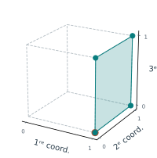
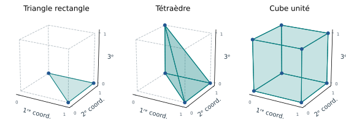
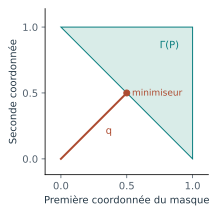
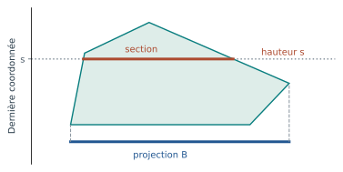
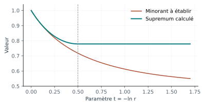

# ENS MP-MPI — Mathématiques C 2025 · Corrigé brut

*Corrigé rédigé par IA, non officiel. Signalez toute erreur.*

**Rédaction** · modèle exact non renseigné (famille GPT-6) · effort non renseigné · vitesse non renseignée

**Révision (tour 1)** · modèle exact non renseigné (famille GPT-6) · effort non renseigné · vitesse non renseignée

**Révision (tour 2)** · GPT-6.2 Astra Ultra · vitesse non renseignée

**Révision (tour 3)** · GPT-6.2 Astra Ultra · vitesse non renseignée

## Présentation du sujet

L’épreuve commune aux ENS Ulm, Lyon, Paris-Saclay et Rennes du 18 avril 2025 dure quatre heures. La garde porte « Filières MP et MPI » et le numéro d’épreuve 9. Ses 40 questions et sous-questions passent d’un dénombrement des moments à une inégalité de concentration pour les fonctions convexes sur un cube. [Fac-similé du sujet — archive CPGE Paradise](https://cpge-paradise.com/Concours2025/XENS/MP/MathC2025.pdf)

## I — Amplitude d’une somme de variables aléatoires

Les variables de même loi $X_1,\ldots,X_N$ sont centrées, de variance au plus $1$ et de module au plus $K\ge1$. On pose $S_N=\sum_{n=1}^N X_n$.

### Question I.1

Une variable de Bernoulli de paramètre $1/2$ vérifie (8) avec $K=1$. Une loi de Poisson de paramètre $1$ et une loi géométrique de paramètre $1/2$ ont toutes deux un support non borné.

### Question I.2

Soit $Y$ uniforme sur $\{-1,1\}$. Posons $X_n=Y$ pour tout $n$. Ces variables ont même loi, sont centrées, de variance $1$, et vérifient $|X_n|=1\le K$. Or $S_N=NY$, donc $\mathbb P(|S_N|\ge N)=1$.

### Question I.3

En développant le carré et en utilisant le centrage, on obtient
$$
\mathbb E S_N^2=\sum_{n=1}^N\operatorname{Var}(X_n)+2\sum_{1\le m<n\le N}\mathbb E(X_mX_n)\le N.
$$
La seconde somme est nulle par décorrélation. Pour $t>0$, l’inégalité de Markov appliquée à $S_N^2$ donne $\mathbb P(|S_N|>t\sqrt N)\le\mathbb P(S_N^2\ge t^2N)\le 1/t^2$.

### Question I.4a

Complétons les $j$ indices distincts par $k-j$ autres indices, puis réordonnons-les. Dans la définition de la $k$-indépendance, prenons la fonction constante $1$ pour chacun des indices ajoutés. Les deux membres se réduisent à ceux de la $j$-indépendance.

### Question I.4b

Pour $N$ variables, la $N$-indépendance est l’indépendance mutuelle. La factorisation demandée porte sur toutes les fonctions tests bornées des $N$ variables et coïncide avec (7).

### Question I.4c

Les quatre réalisations équiprobables de $(Y_1,Y_2,Y_3)$ sont $(0,0,0),(0,1,1),(1,0,1),(1,1,0)$. Chaque projection sur deux coordonnées parcourt une fois les quatre couples de bits. Ces couples ont donc la loi produit de deux Bernoulli de paramètre $1/2$. En revanche, la probabilité que les trois bits valent zéro est $1/4$, tandis que le produit des trois probabilités marginales vaut $1/8$.

Pour $k$ pair entre $2$ et $N$, les variables sont $k$-indépendantes. On note $T_\ell$ l’ensemble des mots de longueur $k$ sur les indices $1,\ldots,N$ qui emploient exactement $\ell$ indices, chacun au moins deux fois.

### Question I.5a

Un mot ne contenant qu’un indice est constant. Les $N$ mots constants appartiennent à $T_1$, puisque $k\ge2$. Ainsi $|T_1|=N$. Un mot de $T_\ell$ emploie au moins $2\ell$ places, donc $T_\ell=\varnothing$ si $\ell>k/2$.

### Question I.5b

Le développement de $S_N^k$ est une somme sur les mots $T\in\{1,\ldots,N\}^k$ du produit des $X_n^{m_T(n)}$. Un mot fait intervenir au plus $k$ indices différents. Par I.4a, leurs puissances ont des espérances qui se factorisent. Les fonctions tests $x\mapsto x^m$ peuvent être remplacées par $x^m\mathbf1_{[-K,K]}(x)$ sur les indices présents. Les facteurs absents valent $1$. D’où
$$
\mathbb E S_N^k=\sum_T\prod_{n=1}^N\mathbb E[X_n^{m_T(n)}].
$$
Tout indice de multiplicité un annule le produit par centrage. En classant les mots restants par nombre d’indices distincts, on obtient (21), avec $1\le\ell\le k/2$.

### Question I.5c

Pour $m\ge2$, $|\mathbb E X_n^m|\le\mathbb E|X_n|^m\le K^{m-2}\mathbb E X_n^2\le K^{m-2}$ par (8), (9) et le centrage. Pour $T\in T_\ell$, la somme des $m_T(n)-2$ sur les indices présents est $k-2\ell$. En majorant chaque produit de I.5b par sa valeur absolue, il vient $\mathbb E S_N^k\le\sum_{\ell=1}^{k/2}K^{k-2\ell}|T_\ell|$.

### Question I.5d

Choisissons les $\ell$ indices utilisés parmi $N$, puis écrivons un mot de longueur $k$ dans cet alphabet. Il y a $\ell^k$ écritures possibles pour cet alphabet, y compris celles qui violent les conditions de multiplicité. Ainsi $|T_\ell|\le\binom N\ell\ell^k\le N^\ell\ell^k/\ell!$.

### Question I.5e

Par croissance du logarithme, $\log(\ell!)\ge\int_1^\ell\log x\,\mathrm dx=\ell\log\ell-\ell+1$, d’où $\ell!\ge \ell^\ell e^{-\ell}$. I.5d donne $|T_\ell|\le(Ne)^\ell\ell^{k-\ell}$. Comme $\ell\le k/2$ et $k-\ell\ge0$, on obtient $(Ne)^\ell(k/2)^{k-\ell}$ comme majorant.

### Question I.5f

La contribution de l’indice $\ell$ dans I.5c est au plus
$$
K^{k-2\ell}(Ne)^\ell(k/2)^{k-\ell}=(Kk/2)^k\left(\frac{2Ne}{kK^2}\right)^\ell.
$$
La somme de $\ell=1$ à $k/2$ donne (26).

### Question I.5g

Posons $\theta=2Ne/(kK^2)$. L’hypothèse $kK^2\le N$ entraîne $\theta\ge2e>2$. Avec $m=k/2$, on a $\sum_{\ell=1}^m\theta^\ell=\theta(\theta^m-1)/(\theta-1)\le\theta^m\theta/(\theta-1)$. Or $(Kk/2)^k\theta^{k/2}=(Nek/2)^{k/2}$ et $\theta/(\theta-1)\le2$. Ce sont les deux bornes de (28).

### Question I.5h

La parité de $k$ donne $|S_N|^k=S_N^k\ge0$. Pour $t>0$, Markov puis I.5g donnent
$$
\mathbb P(|S_N|\ge t\sqrt N)\le\frac{\mathbb E S_N^k}{t^kN^{k/2}}
\le 2\left(\frac{\sqrt{ek/2}}{t}\right)^k.
$$

Les variables sont maintenant indépendantes. Il s’agit de démontrer une borne $\mathbb P(|S_N|\ge t\sqrt N)\le\beta\exp(-\alpha t^2/K^2)$ dont les constantes sont indépendantes de la dimension.

### Question I.6a

Les variables $Y_n=X_n/K$ restent indépendantes, de même loi, centrées et vérifient $|Y_n|\le1$ et $\operatorname{Var}(Y_n)\le 1/K^2\le1$. Appliquons le cas $K=1$ à leur somme pour le seuil $t/K$. L’événement est exactement $|S_N|\ge t\sqrt N$ et l’exposant devient $-\alpha t^2/K^2$.

### Question I.6b

Pour $e\le t\le e\sqrt{N/2}$, on a $2\le 2t^2/e^2\le N$. Le plus grand entier pair autorisé est donc $k=2\lfloor t^2/e^2\rfloor$. Il vérifie $2\le k\le N$, soit (27) avec $K=1$, et $k>2t^2/e^2-2$.

### Question I.6c

Le majorant $k\le 2t^2/e^2$ donne $\sqrt{ek/2}/t\le e^{-1/2}$. Le minorant de I.6b donne alors, par I.5h,
$$
\mathbb P(|S_N|\ge t\sqrt N)\le 2e^{-k/2}\le 2e\exp(-t^2/e^2).
$$
Ainsi $\alpha=e^{-2}$ et $\beta=2e$ conviennent.

### Question I.6d

Pour $0\le t<e$, le membre droit $2e\exp(-t^2/e^2)$ est supérieur à $2$. Pour $t>e\sqrt{N/2}$, on a $t>\sqrt N$ car $e/\sqrt2>1$. L’événement est vide puisque $|S_N|\le N$. Ces deux arguments et I.6c couvrent tous les seuils, même si l’intervalle de I.6b est vide pour $N=1$. I.6a donne (31) pour tout $K\ge1$ avec les mêmes constantes.

## II.1 — Concentration des fonctions convexes

On travaille dans le cube $Q_N=[-K,K]^N$ avec des coordonnées indépendantes, de même loi et à support fini. On suppose provisoirement $\mathbb P(X\in A)\mathbb E e^{\gamma d(X,A)^2/(4K^2)}\le1$ pour chaque convexe $A\subset Q_N$ et $\gamma>0$. La fonction $F$ est convexe et 1-lipschitzienne pour la norme euclidienne. Dans (34), lire $|x|=\langle x,x\rangle^{1/2}$ conformément à (35).

### Question II.1a

Le sous-niveau $A_s=Q_N\cap\{F\le s\}$ est convexe par convexité de $F$ et du cube. Si $A_s$ est vide, le membre gauche de (42) est nul. Sinon, lorsque $F(x)\ge\sigma$, tout $a\in A_s$ vérifie $|x-a|\ge F(x)-F(a)\ge\sigma-s$. En prenant l’infimum puis en minorant l’espérance de (40) sur l’événement $F(X)\ge\sigma$, il vient
$$
1\ge\mathbb P(F(X)\le s)\,e^{\gamma(\sigma-s)^2/(4K^2)}\,\mathbb P(F(X)\ge\sigma).
$$
La division donne (42).

### Question II.1b

Pour $t>0$, posons $\sigma=m$, $s=m-t$. Comme $\mathbb P(F(X)\ge m)\ge1/2$, la question précédente donne $\mathbb P(F(X)\le m-t)\le2e^{-\gamma t^2/(4K^2)}$. Cette inégalité est immédiate pour $t=0$. On obtient (37) avec $\alpha=\gamma/4$ et $\beta=2$.

## II.2 — Masques et enveloppes convexes

Les masques sont des sommets de $\{0,1\}^N$. Les zéros indiquent les coordonnées que le témoin $a\in A$ partage avec $x$. Pour un masque exact $R_A(x)$, les coordonnées égales sont toutes indiquées. Pour un masque de $P_A(x)$, seules les égalités associées aux bits nuls sont imposées.

### Question II.2a

À chaque $a\in A$ associons le sommet $r(a)$ de coordonnées $r_i(a)=\mathbf1_{a_i\ne x_i}$. La condition (44) donne $R_A(x)=\{r(a):a\in A\}$. Pour (43), les coordonnées où $z'_i=0$ doivent aussi vérifier $r_i(a)=0$, ce qui équivaut à $r(a)\le z'$. D’où (45). En particulier, tout sommet supérieur à un élément de $P_A(x)$ appartient encore à $P_A(x)$.

### Question II.2b

Si $x\in A$, le choix $a=x$ donne $r(a)=0$, et chaque sommet domine $0$, donc $P_A(x)=\{0,1\}^N$. Réciproquement, si $0\in P_A(x)$, son témoin satisfait $a_i=x_i$ pour tout $i$, donc $x=a\in A$. Enfin l’ensemble de tous les sommets contient $0$. Ces implications établissent les trois équivalences.

### Question II.2c

Prenons $A=\{e_1\}$ et $x=0$ (le sujet impose $K\ge1$). Alors $R_A(0)=\{e_1\}$ et $P_A(0)=\{e_1,e_1+e_2,e_1+e_3,e_1+e_2+e_3\}$. Ce sont les sommets de première coordonnée $1$. En particulier $e_3\notin P_A(0)$.

On note $\Gamma(B)$ l’enveloppe convexe de $B$, et $q(x,A)$ la distance de l’origine à $\Gamma(P_A(x))$ pour $A\ne\varnothing$. En dimension $N$, les conventions sont $q(x,\varnothing)=2N$ et $d(x,\varnothing)=4NK$.

### Question II.2d

Partons d’une combinaison convexe $y=\sum_{j=1}^m\theta_jz_j$ et supprimons ses poids nuls. Si $m>N+1$, les vecteurs $(z_j,1)$ sont liés dans $\mathbb R^{N+1}$. Il existe des $c_j$, non tous nuls, tels que $\sum c_jz_j=0$ et $\sum c_j=0$. Certains $c_j$ sont donc positifs. Pour $t=\min_{c_j>0}\theta_j/c_j$, les poids $\theta_j-tc_j$ restent positifs ou nuls, de somme $1$, et donnent encore $y$. L’un au moins est nul. En itérant, on représente $y$ avec au plus $N+1$ points. L’inclusion inverse suit de la définition.

### Question II.2e

Une combinaison convexe de deux combinaisons convexes finies reste une combinaison convexe finie, donc $\Gamma(B)$ est convexe. Si $B$ est compact, le simplexe $\Delta_N=\{\theta\in[0,1]^{N+1}:\sum\theta_i=1\}$ et le produit $\Delta_N\times B^{N+1}$ sont compacts. L’application continue $(\theta,(z_i))\mapsto\sum\theta_i z_i$ a pour image $\Gamma(B)$ par II.2d (on peut compléter avec des poids nuls). Cette image est compacte.

### Question II.2f

Les trois sommets $e_1,e_2,e_1+e_2$ forment un triangle rectangle dans le plan $z_3=0$, avec angle droit en $e_1+e_2$. Le quatrième sommet $e_2+e_3$ est hors de ce plan. La deuxième enveloppe est donc un tétraèdre. La troisième est le cube unité, enveloppe de tous ses sommets (par interpolation successive dans chaque coordonnée). Les deux premiers ensembles $B$ contiennent $e_1$ et omettent $e_1+e_3$, ce qui viole la propriété de croissance de II.2a. Le troisième est réalisé par $A=\{x\}$ selon II.2b.

### Question II.2g

L’ensemble $P_A(x)$ est fini et non vide, donc compact. Son enveloppe est compacte par II.2e. La norme euclidienne, continue, y atteint son minimum, égal à $q(x,A)$.

### Question II.2h

Tout sommet du cube unité a norme au plus $\sqrt N$, donc $q(x,A)\le\sqrt N$ dès que $A\ne\varnothing$. Si $q=0$, II.2g donne une combinaison convexe de sommets à coordonnées positives ou nulles qui vaut zéro. Chacun des sommets de poids strictement positif est donc nul. Ainsi $0\in P_A(x)$, soit $x\in A$. Réciproquement $x\in A$ donne $0\in P_A(x)$ puis $q=0$.

### Question II.2i

Comme $R_A(x)\subset P_A(x)$, le minimum sur $\Gamma(P_A(x))$ est au plus celui sur $\Gamma(R_A(x))$. Pour l’autre sens, en écrivant $v=\sum_j\theta_jz_j$ avec $z_j\in P_A(x)$, choisissons selon II.2a un $r_j\in R_A(x)$ vérifiant $r_j\le z_j$. Alors $w=\sum_j\theta_jr_j$ appartient à $\Gamma(R_A(x))$ et $0\le w\le v$ coordonnée par coordonnée. D’où $|w|\le|v|$. On obtient donc la formule (51) du fac-similé, page imprimée 6,
$$
q(x,A)=\inf_{z\in\Gamma(R_A(x))}|z|.
$$
Ici $x$ fixe les coordonnées auxquelles les masques sont comparés, tandis que $z$ parcourt leur enveloppe convexe. Par exemple, lorsque $x=e_1$ et $A=\{e_1\}$, l’unique masque exact est nul et donne bien $q(x,A)=0$.

### Question II.2j

Si $A$ est vide, les conventions donnent $d(x,A)=4NK=2Kq(x,A)$. Sinon, par II.2i et la compacité, choisissons $w=\sum_j\theta_jr(a_j)$ de norme $q(x,A)$, avec $a_j\in A$. Le point $b=\sum_j\theta_ja_j$ appartient à $A$ par convexité. Pour chaque coordonnée, $|x_i-a_{j,i}|\le2K r_i(a_j)$, donc $|x_i-b_i|\le2K w_i$. Élevons au carré, sommons puis prenons la racine. Il vient $d(x,A)\le|x-b|\le2K|w|=2Kq(x,A)$.

### Question II.2k

Pour $\gamma>0$, II.2j donne $e^{\gamma d(X,A)^2/(4K^2)}\le e^{\gamma q(X,A)^2}$. Ainsi (53) implique (40), et II.1b donne (37) avec $\alpha=\gamma/4$, $\beta=2$. Pour $\gamma=0$, (53) se réduit à $\mathbb P(X\in A)\le1$ et la substitution donnerait $\alpha=0$. Le théorème demande $\alpha>0$. Dans ce cas limite, la partie II.3 établit indépendamment (53) avec $\gamma_0=1/4$, ce qui donne les constantes numériques $\alpha=1/16$ et $\beta=2$.

## II.3 — Récurrence sur la dimension

La propriété $H_N$ affirme que $\mathbb P(X\in A)\mathbb E\exp(\gamma_0 q(X,A)^2)\le1$ pour tout convexe du cube, avec $\gamma_0=1/4$.

### Question II.3a

Si $A=\varnothing$, le produit (53) vaut zéro. Sinon, en dimension un, $q(x,A)=0$ sur $A$ et $1$ hors de $A$ d’après les deux masques possibles. Posons $p=\mathbb P(X\in A)$. Pour $\gamma\le\log 2$,
$$
p\,\mathbb E e^{\gamma q(X,A)^2}=p\{p+(1-p)e^\gamma\}\le p(2-p)=1-(1-p)^2\le1.
$$
Ceci initialise la récurrence pour $\gamma_0=1/4$.

### Question II.3b

Écrivons $x=(x',s)$, $A_s=\{b:(b,s)\in A\}$ et $B=\{b:\exists u,\ (b,u)\in A\}$. Si $z\in P_{A_s}(x')$, son témoin $b$ se relève en $(b,s)$, qui coïncide aussi avec $x$ sur la dernière coordonnée. D’où $(z,0)\in P_A(x)$. Si $z\in P_B(x')$, relevons son témoin $b$ en un $(b,u)\in A$. La dernière composante de $(z,1)$ n’impose aucune égalité, donc $(z,1)\in P_A(x)$. Cette seconde inclusion reste valable si la section $A_s$ est vide et $A$ non vide.

### Question II.3c

Supposons $A_s\ne\varnothing$. Soient $u,v$ des points minimisant la norme dans les enveloppes des masques de $A_s$ et de $B$ en $x'$. Par II.3b et combinaison convexe, $(u,0)$ et $(v,1)$ appartiennent à $\Gamma(P_A(x))$. En les mélangeant avec les poids $\lambda$ et $1-\lambda$ puis en utilisant la convexité de la norme au carré, on trouve
$$
q(x,A)^2\le|\lambda u+(1-\lambda)v|^2+(1-\lambda)^2
\le \lambda q(x',A_s)^2+(1-\lambda)q(x',B)^2+(1-\lambda)^2.
$$
Si $A\ne\varnothing$ mais $A_s=\varnothing$, le point $(v,1)$ donne $q(x,A)^2\le 1+q(x',B)^2$. Cette borne est au plus le membre droit de (60) car la différence vaut $\lambda\{4(N-1)^2-q(x',B)^2-2+\lambda\}\ge0$, avec $q(x',B)^2\le N-1$ et $N\ge2$. L’hypothèse sur la section à la question précédente implique que $A$ est non vide. Si l’on étend (60) à tous les convexes, le cas $A=\varnothing$ fournit un contre-exemple. Sa projection et toutes ses sections sont alors vides. Pour $\lambda=1$, la convention sur les distances transformerait (60) en $4N^2\le4(N-1)^2$. Il faut traiter ce cas directement dans (53). La probabilité du vide est nulle et l’exponentielle vaut la constante finie $e^{4\gamma_0N^2}$, donc le produit vaut zéro.

### Question II.3d

Fixons un atome $s$ de $X_N$. Sur l’espace probabilisé conditionné par $X_N=s$, notons $\mathbb E_s$ l’espérance. Par indépendance, $X'=(X_1,\ldots,X_{N-1})$ y conserve sa loi produit, ses marginales identiques et sa borne. Les ensembles $B$ et $A_s$ sont convexes comme projection et section de $A$. Posons $p=\mathbb P(X'\in B)$ et $p_s=\mathbb P(X'\in A_s)$, les mêmes sous les deux probabilités.

Pour $A\ne\varnothing$, (60) avec $\lambda=0$ et $H_{N-1}$ appliqué à $B$ donnent $p\,\mathbb E_s e^{\gamma_0 q(X,A)^2}\le e^{\gamma_0}$, soit (63). Si $p_s>0$, alors $p>0$. Exponentions (60) et appliquons Hölder sous la loi conditionnelle aux deux facteurs de poids $\lambda$ et $1-\lambda$. Les espérances de $e^{\gamma_0 q(X',A_s)^2}$ et $e^{\gamma_0 q(X',B)^2}$ y sont majorées par $1/p_s$ et $1/p$ grâce à $H_{N-1}$. Ainsi
$$
p_s^\lambda p^{1-\lambda}\mathbb E_s e^{\gamma_0 q(X,A)^2}\le e^{\gamma_0(1-\lambda)^2}.
$$
Les extrémités $\lambda=0,1$ utilisent un seul facteur. Si $p_s=0$ et $\lambda>0$, le membre gauche est nul. Pour $\lambda=0$ on retrouve (63), avec la convention de facteur absent $0^0=1$. Si $A$ est vide, les produits de (63) et (64) sont nuls.

### Question II.3e

Sous l’hypothèse $p>0$, posons $r=p_s/p\in[0,1]$ puisque $A_s\subset B$. Le produit $p_s^\lambda p^{1-\lambda}$ est $p r^\lambda$. En multipliant (64) par $e^{-\gamma_0(1-\lambda)^2}$, on obtient (68).

### Question II.3f

Si $p_s>0$, l’inégalité de II.3e vaut pour tout $\lambda$. En prenant le supremum du facteur $r^\lambda e^{-\gamma_0(1-\lambda)^2}$, puis en appliquant (69), il vient $p\,\mathbb E_s e^{\gamma_0q(X,A)^2}\le2-r$. Si $p_s=0$, on a $r=0$ et (63) donne la même conclusion car $e^{1/4}\le2$.

### Question II.3g

Notons $a=\mathbb P(X\in A)$, $R=a/p$ et $w_s=\mathbb P(X_N=s)$. Multiplions (70) par $Rw_s$ et utilisons $w_s\mathbb E_s Z=\mathbb E[Z\mathbf1_{\{X_N=s\}}]$. On obtient (71), à savoir $a\,\mathbb E[e^{\gamma_0q(X,A)^2}\mathbf1_{\{X_N=s\}}]\le R(2-r)w_s$.

### Question II.3h

Sommons (71) sur les atomes de $X_N$. Par indépendance et probabilités totales, $\sum_s w_s p_s=\mathbb P(X\in A)=a$, donc $\sum_s w_s r_s=R$. On en déduit, pour $p>0$,
$$
a\,\mathbb E e^{\gamma_0q(X,A)^2}\le R(2-R)=1-(1-R)^2\le1.
$$
Si $p=0$, l’inclusion $\{X\in A\}\subset\{X'\in B\}$ donne $a=0$, tandis que l’espérance est finie par II.2h ou la convention pour $A$ vide. Ainsi $H_{N-1}$ entraîne $H_N$. Avec II.3a et II.2k, on obtient (37) pour tout $N$ avec $\beta=2$ et $\alpha=1/16$.

### Question II.3i

Le membre droit de (69) décroît en $\gamma$, il suffit donc de prendre $\gamma=1/4$. L’intervalle imprimé en (69) est $r\in]0,1]$. On écrit donc $r=e^{-t}$ avec $t\ge0$. Le cas de masse nulle $r=0$ requis pour (70) a déjà été réglé en II.3f par (63). Le logarithme à maximiser est $-t\lambda-(1-\lambda)^2/4$. Son maximum vaut $-t+t^2$ en $\lambda=1-2t$ pour $0\le t\le1/2$, puis $-1/4$ en $\lambda=0$ pour $t\ge1/2$.

Sur $[0,1/2]$, posons $g(t)=\log(2-e^{-t})-t+t^2$. On a $g(0)=0$ et
$$
g'(t)=2t-\frac{2(1-e^{-t})}{2-e^{-t}}\ge0,
$$
car $1-e^{-t}\le t$ et $2-e^{-t}\ge1$. D’où $1/(2-e^{-t})\le e^{-t+t^2}$. Au-delà de $1/2$, la fonction $t\mapsto1/(2-e^{-t})$ décroît et le supremum reste égal à sa valeur en $1/2$. Cela prouve (69).

