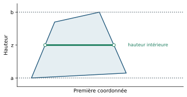
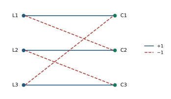
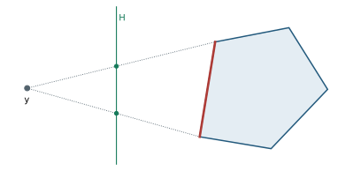
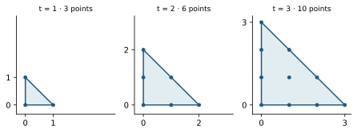

# ENS MP — Mathématiques D 2025 · Corrigé brut

*Corrigé rédigé par IA, non officiel. Signalez toute erreur.*

**Rédaction** · modèle exact non renseigné (famille GPT-6) · effort non renseigné · vitesse non renseignée

**Révision** · modèle exact non renseigné (famille GPT-6) · effort non renseigné · vitesse non renseignée

## Présentation du sujet

L’épreuve de six heures du 17 avril 2025, spécifique à l’ENS Paris, comporte 48 questions. Elle part du comptage de partitions et de l’étude des faces des polytopes pour démontrer les théorèmes de Brion et d’Ehrhart. Le polytope des matrices bistochastiques fournit l’application finale. [Sujet officiel](https://www.ens.psl.eu/sites/default/files/2025.mathsd.pdf)

## Préliminaire — Fonctions quasi-polynomiales

Un quasi-polynôme est une somme finie $P(n)=\sum_i c_i(n)n^i$ dont les coefficients sont des fonctions périodiques sur les entiers.

### Question 1

La fonction nulle admet des coefficients périodiques tous nuls. Pour deux quasi-polynômes, prolongeons la liste de coefficients du degré le plus faible par des zéros. Chaque coefficient d’une combinaison linéaire est alors une combinaison de deux fonctions périodiques sur $\mathbb Z$, périodique de période commune (par exemple le produit de leurs périodes). La combinaison est donc quasi-polynomiale, ce qui donne un sous-espace vectoriel.

### Question 2

Prenons une période commune $m>0$ de tous les coefficients de $P-Q$. Sur chaque classe $j$ modulo $m$, les coefficients sont constants et $P-Q$ est donné par un polynôme ordinaire en $n$. Comme il s’annule sur l’infinité des entiers positifs ou nuls de cette classe, ce polynôme est nul. Les classes couvrent tous les entiers, donc $P=Q$ sur $\mathbb Z$.

### Question 3

Pour un quasi-polynôme, choisir une période commune $m$ des coefficients et poser $P_j(X)=\sum_i c_i(j)X^i$ donne la représentation annoncée. Réciproquement, complétons à zéro les coefficients des $m$ polynômes jusqu’à leur degré maximal. La fonction qui, sur la classe $j$, prend pour valeur le coefficient d’ordre $i$ de $P_j$ est périodique de période $m$. Ces fonctions reconstituent le quasi-polynôme demandé.

### Question 4

Le produit de $p$ séries géométriques, ou la dérivation de la série géométrique, donne
$$R(n)=\binom{n+p-1}{p-1}\omega^n\qquad(n\geq0).$$
Le binôme est un polynôme en $n$ de degré $p-1$ et de coefficient dominant $1/(p-1)!$. Puisque $\omega$ est une racine de l’unité, $n\mapsto\omega^n$ est périodique et jamais nul. Ainsi le degré est $p-1$ et le coefficient dominant est la fonction $n\mapsto\omega^n/(p-1)!$, y compris pour $p=1$.

## I — Partitions à parties prescrites

On compte les solutions entières positives ou nulles de $\sum_i a_i n_i=n$ pour des entiers $a_i>0$, premiers entre eux dans leur ensemble lorsque $k\geq2$.

### Question 5

Dans une solution, chaque $n_i$ est compris entre zéro et $n$ puisque $a_i\geq1$. Il y a donc au plus $(n+1)^k$ solutions. Pour $|x|<1$, la série $\sum_n(n+1)^k|x|^n$ converge, donc $F$ converge absolument et son rayon est au moins un.

### Question 6

Pour $|x|<1$, développons chaque $1/(1-x^{a_i})$ en série géométrique $\sum_{r\geq0}x^{a_ir}$. Le produit fini est absolument convergent, ce qui autorise le regroupement par exposant. Le coefficient de $x^n$ est le nombre de $k$-uplets positifs ou nuls de somme pondérée $n$, donc $P(n)$ et le produit est $F(x)$.

### Question 7

La fraction de 6 est propre, et ses pôles sont des racines de l’unité. Elle se décompose sur $\mathbb C$ en somme finie de termes $c/(1-\omega x)^p$ avec $\omega$ racine de l’unité. Par 4 les coefficients de chaque terme sont quasi-polynomiaux, et 1 permet de les sommer. L’unicité des coefficients du développement en zéro fournit le résultat pour $P$.

### Question 8

Pour $k\geq2$, un pôle d’ordre $k$ doit être une racine commune de tous les $1-X^{a_i}$. Son ordre divise leur pgcd, qui vaut un, donc seul $X=1$ convient. Chaque facteur a en un un zéro simple, et
$$\lim_{x\to1}(1-x)^k F(x)=\prod_i\frac1{a_i}.$$
Le terme en $(1-x)^{-k}$ fournit donc le coefficient dominant constant $1/((k-1)!\prod_i a_i)$, les autres pôles ou puissances donnant degré au plus $k-2$. Pour $k=1$, le sujet ne suppose pas $a_1=1$. Alors $P(n)=\mathbf1_{a_1\mid n}$, fonction périodique non nulle de degré zéro ; son coefficient dominant est cette indicatrice elle-même.

### Question 9

Dans $2r+3s=n$, l’entier $s$ vérifie $0\leq s\leq\lfloor n/3\rfloor$ et $s\equiv n\pmod2$. Quand $n$ augmente de six, la borne supérieure augmente de deux et la parité est conservée, donc on obtient une possibilité de plus. Ainsi $P(n+6)=P(n)+1$. Pour $n=0,1,2,3,4,5$, les valeurs sont $(1,0,1,1,1,1)$. En posant $\phi(n)=6P(n)-n$ pour ces six représentants puis en la prolongeant périodiquement à $\mathbb Z$, on obtient les valeurs $(6,-1,4,3,2,1)$ et $P(n)=(n+\phi(n))/6$.

### Question 10

En posant $z=1-x$ et en développant $1-x^a=az-a(a-1)z^2/2+O(z^3)$, on trouve au pôle un les termes
$$\frac{1}{ab(1-x)^2}+\frac{a+b-2}{2ab(1-x)}.$$
Pour $\zeta=\omega_a^j\ne1$, on a $\zeta^b\ne1$ puisque $a,b$ sont premiers entre eux. Le coefficient de $1/(1-x/\zeta)$ est la limite de $(1-x/\zeta)F(x)$ en $\zeta$, soit $1/[a(1-\zeta^b)]$, car $(1-x^a)/(1-x/\zeta)\to a$. Les racines $\omega_b^j\ne1$ donnent symétriquement le second groupe. Ces termes épuisent les pôles et la fraction est propre. En lisant les coefficients de $x^n$, les termes du pôle un donnent $(n+1)/(ab)+(a+b-2)/(2ab)=n/(ab)+1/(2a)+1/(2b)$. Les deux autres groupes donnent
$$\frac1a\sum_{j=1}^{a-1}\frac{\omega_a^{-jn}}{1-\omega_a^{jb}}+\frac1b\sum_{j=1}^{b-1}\frac{\omega_b^{-jn}}{1-\omega_b^{ja}},$$
comme annoncé. Une somme est vide quand son module vaut un.

### Question 11

Le comptage direct permet d’identifier les parties fractionnaires. Posons $r=b\{a^*n/b\}$ et $s=a\{b^*n/a\}$, les plus petits restes positifs ou nuls correspondants. Toute solution de $an_1+bn_2=n$ satisfait $n_1\equiv r\pmod b$ et $n_2\equiv s\pmod a$. Donc $n_1=r+bi,\ n_2=s+aj$ avec $i,j\geq0$. L’entier $m=(n-ar-bs)/(ab)$ est bien entier par ces deux congruences et la coprimalité. Il est strictement supérieur à $-2$ car $r<b,s<a,n\geq0$. Le nombre de couples $i+j=m$ est $m+1$ pour $m\geq0$ et encore $m+1=0$ pour $m=-1$. Ainsi
$$P(n)=\frac n{ab}-\left\{\frac{b^*n}{a}\right\}-\left\{\frac{a^*n}{b}\right\}+1.$$

## II — Polytopes, faces et triangulations

Un polytope est ici compact et non vide, défini par un nombre fini d’inégalités affines. Une face est une partie non vide obtenue en saturant certaines contraintes. Sur le relatif intérieur $F^\circ$ d’une face $F$, les contraintes saturées sont exactement celles identiquement saturées sur $F$.

### Question 12

Une face s’obtient en ajoutant les inégalités opposées aux inégalités imposées comme égalités. Elle est non vide, fermée dans le compact $P$ et définie par un nombre fini d’inégalités, donc est un polytope. Pour une face propre, au moins une égalité $\ell_j=a_j$ imposée sur elle n’est pas identique sur $P$. Dans l’enveloppe affine de $P$, cette égalité définit un hyperplan propre contenant la face. Sa dimension est donc strictement plus petite.

### Question 13

Il existe au plus $2^{|I|}$ faces puisque chaque sous-ensemble des contraintes en définit au plus une. Pour l’existence d’un sommet, toute face $F$ de dimension positive a une face propre non vide. En effet, dans son enveloppe affine, moyenner pour chacune des contraintes non identiques un point de $F$ où elle est stricte donne un point $p$ où elles sont toutes strictes. Partons de $p$ sur une demi-droite de cette enveloppe. La compacité force une dernière intersection avec $F$ et une inégalité non identique y devient égalité. La nouvelle égalité définit une face propre, qui est aussi une face de $P$ par réunion des contraintes actives. Par descente stricte des dimensions de 12, on atteint une face de dimension zéro.

### Question 14

Raisonnons par récurrence sur la dimension. Pour un point la propriété est immédiate. Si $x\in P$ appartient à une face propre, il est combinaison convexe des sommets de cette face par récurrence, et ses sommets sont des sommets de $P$ par la description des contraintes en 13. Sinon toutes les contraintes non identiques sont strictes en $x$. Dans l’enveloppe affine de dimension positive de $P$, une droite passant par $x$ coupe $P$ suivant un segment compact dont $x$ est intérieur. À ses extrémités au moins une contrainte non identique est saturée, donc elles sont dans des faces propres. Leur combinaison $x$ appartient alors à l’enveloppe convexe des sommets. L’inclusion inverse vient de la convexité de $P$.

### Question 15

Dans l’enveloppe affine de $V$, choisissons des coordonnées affines l’identifiant à $\mathbb R^d$. Si $d=0$, le singleton est déjà un polytope. Sinon $V$ contient $d+1$ points affinement indépendants dont le simplexe a un intérieur non vide dans ces coordonnées. Translatons l’un de ses points intérieurs à l’origine. La propriété d’être défini par des inégalités finies et compact se transporte par les changements affines inversibles. De retour dans $\mathbb R^n$, on prolonge les formes des inégalités et on ajoute les équations de l’enveloppe affine, chacune écrite par deux inégalités opposées. La réduction annoncée est donc suffisante.

### Question 16

$Q$ est l’intersection fermée des demi-espaces associés aux finitement nombreux points de $V$, et contient zéro. Si $\ell\in Q$, par convexité l’inégalité $\langle\ell,x\rangle\leq1$ vaut pour tout $x\in\operatorname{Conv}(V)$, donc sur une boule de rayon $r>0$ centrée en zéro. Pour $\ell\ne0$, prendre $x=r\ell/\|\ell\|$ donne $\|\ell\|\leq1/r$. Ainsi $Q$ est borné, fermé et non vide, donc un polytope.

### Question 17

Posons $C=\operatorname{Conv}(V)$, compact car image de l’ensemble compact des poids barycentriques. Par 14, $Q$ est l’enveloppe convexe d’une famille finie de sommets $u_j$. L’ensemble $D=\{x:\langle u_j,x\rangle\leq1\ \forall j\}$ contient $C$, et ses contraintes impliquent la même borne pour tout $u\in Q$. Pour $x\notin C$, prenons son projeté $y$ sur $C$ et $w=x-y\ne0$. On a $\sup_{z\in C}\langle w,z\rangle=\langle w,y\rangle=h$. La boule de 16 implique $h\geq r\|w\|>0$, donc $u=w/h\in Q$ alors que $\langle u,x\rangle=1+\|w\|^2/h>1$. Ainsi $x\notin D$ et $D=C$ est défini par des inégalités finies. Il est compact, donc un polytope.

### Question 18

Écrivons un sommet $v$ comme combinaison convexe de points de $V$ de poids strictement positifs, en éliminant les termes de poids nul. Chaque contrainte active en $v$ est saturée par tous ces points, car leur moyenne atteint sa borne supérieure. Ils appartiennent donc tous à la face réduite à $v$. L’un d’eux au moins étant présent, $v\in V$.

$U_n$ est l’espace engendré par les indicatrices de polytopes de $\mathbb R^n$. On construit une forme linéaire $\chi_n$ sur cet espace.

### Question 19

En dimension un, les polytopes sont les intervalles fermés bornés non vides, y compris les singletons. Leur indicatrice possède en tout point une limite à droite et sa valeur ne diffère de cette limite qu’à son extrémité droite. Une combinaison linéaire finie a encore une limite à droite partout et ne présente cet écart que parmi les finitement nombreuses extrémités droites des intervalles utilisés.

### Question 20

Pour une indicatrice de polytope, à hauteur $z$ on obtient l’indicatrice d’une section par un hyperplan affine. Dans cet hyperplan de coordonnées $\mathbb R^{n-1}$, la section est vide ou est compacte non vide et définie par les inégalités obtenues en substituant $z$, donc est un polytope. La section appartient à $U_{n-1}$, puis la propriété s’étend linéairement à tout $f\in U_n$.

### Question 21

En dimension un, la somme de 19 est linéaire et vaut un sur chaque intervalle fermé, singleton compris. Supposons la propriété établie en dimension $n-1$. Pour $f=\mathbf1_P$, la fonction $g$ vaut un si la section de 20 est non vide et zéro sinon. C’est donc l’indicatrice de la projection de $P$ sur le dernier axe, intervalle fermé non vide par compacité et convexité. Par linéarité sur les sections, tout $f\in U_n$ donne alors $g\in U_1$. La définition est intrinsèque à $f$, linéaire, et donne un sur chaque $\mathbf1_P$. Enfin pour une application linéaire inversible $A$, la composée $\mathbf1_P\circ A$ est l’indicatrice du polytope $A^{-1}P$. Elle aussi a valeur un. Les indicatrices engendrent $U_n$, donc $\chi_n(f\circ A)=\chi_n(f)$. Le même argument sur les générateurs donne l’invariance par translation.

### Question 22

Si $x\in P\setminus P^\circ$, au moins un indice $i\notin S_P$ vérifie $\ell_i(x)=a_i$. Alors $F_{\{i\}}$ contient $x$ et est propre car cette égalité ne vaut pas identiquement sur $P$.

### Question 23

Le complémentaire de $P^\circ$ dans $P$ est la réunion finie de ses faces propres par 22 et la définition du relatif intérieur. L’inclusion-exclusion montre que $\mathbf1_{P^\circ}\in U_n$ : les intersections sont vides ou sont des faces. Calculons sa valeur par récurrence sur l’entier $d=\dim P$. Pour $d=0$, le relatif intérieur est un point et la valeur est un. Si $n=d=1$, on retire les deux extrémités d’un intervalle fermé et la valeur est $1-2=-1$. Pour $d>0$ et $n>1$, choisissons, grâce à l’invariance de 21, une dernière coordonnée $z$ non constante sur $P$. Ses valeurs forment un intervalle $[a,b]$ avec $a<b$. Aux deux extrémités, la section de $P^\circ$ est vide, car un point du relatif intérieur peut être légèrement déplacé dans les deux sens de toute direction de l’enveloppe affine.

Pour $a<z<b$, la section de $P^\circ$ est le relatif intérieur de la section $P_z$, de dimension $d-1$. En effet il existe à cette hauteur un point de $P^\circ$, en joignant un point du relatif intérieur à un point de hauteur extrême par un segment ouvert. Un point du relatif intérieur possède dans l’enveloppe affine un voisinage ouvert, obtenu grâce aux contraintes non identiques strictes. Sa section donne la dimension annoncée. Dans cette tranche, chacune des contraintes non identiques sur $P$ est stricte au point intérieur choisi, donc y reste non identique et la caractérisation par les inégalités strictes donne celle du relatif intérieur de la section. Par récurrence $g(z)=(-1)^{d-1}\mathbf1_{(a,b)}(z)$. Or $\chi_1(\mathbf1_{(a,b)})=1-1-1=-1$ en retranchant les deux extrémités de l’intervalle fermé. Ainsi $\chi_n(\mathbf1_{P^\circ})=(-1)^d$.

### Question 24

Pour $x\in P$, l’ensemble de ses contraintes actives $J(x)$ définit la face $F_{J(x)}$. Les contraintes actives en tout point de cette face sont exactement $J(x)$, puisque $x$ lui appartient. Il se trouve donc dans son relatif intérieur. Réciproquement le relatif intérieur d’une face détermine ses contraintes actives, et la face est exactement leur lieu commun d’égalité dans $P$. Les relatifs intérieurs des faces forment ainsi une partition de $P$. Appliquer $\chi_n$ à la somme de leurs indicatrices donne $\sum_{F}(-1)^{\dim F}=1$ par 21 et 23.

Un complexe est une famille finie non vide de polytopes dont les intersections par paires sont vides ou sont des faces communes. Sa caractéristique d’Euler est la somme de $(-1)^{\dim F}$ sur les faces distinctes.

### Question 25

Plaçons-nous dans l’enveloppe affine de $P$, de dimension $k$. Enlevons les contraintes identiquement satisfaites et les inégalités redondantes jusqu’à obtenir une présentation irrédundante. Il reste au moins une inégalité puisque $P$ est borné et $k>0$. Le relatif intérieur contient un point $p$ strict pour toutes (prendre une moyenne comme en 13). Pour chaque inégalité restante $i$, son retrait agrandirait le polytope : il existe $q$ satisfaisant toutes les autres et violant $i$. Sur $[p,q]$, le point où $i$ devient une égalité est encore strict pour les autres contraintes. Dans l’hyperplan de $i$, une petite boule autour de ce point est donc dans la face $F_{\{i\}}$, qui a dimension $k-1$. Ces faces, appelées facettes, recouvrent la frontière relative, car un point où toutes ces inégalités sont strictes est intérieur. Il existe ainsi au moins une facette. Deux facettes, comme deux faces quelconques, se coupent en une face commune ou en l’ensemble vide : on réunit les deux listes d’égalités, puis on les restreint à chacune des faces. La famille finie non vide des facettes est donc un complexe.

### Question 26

Fixons $x\in P^\circ$. Pour tout $z\ne x$ dans $P$, la demi-droite de $x$ vers $z$ rencontre la frontière relative en un dernier point $b$, unique car l’intersection avec la demi-droite est un segment compact et $x$ est intérieur. Ce point est sur une facette $F$ par 25, et $z\in[x,b]\subset F_x$. Le point $x$ lui-même appartient à chaque $F_x$. La réunion des pyramides est donc $P$. Pour deux facettes $F,G$, un point commun des pyramides distinct de $x$ doit se trouver sur une demi-droite dont le point terminal est dans $F\cap G$. Ainsi l’intersection est $\operatorname{Conv}(\{x\}\cup(F\cap G))$ si les bases se rencontrent, et $\{x\}$ sinon.

Vérifions la propriété de face. Une forme affine $h$ sur le plan de base, non négative sur $F$ et s’annulant exactement sur une face non vide $D$ de $F$, se prolonge uniquement à l’enveloppe affine de la pyramide en imposant $h(x)=0$. Une telle forme existe en sommant les écarts des contraintes définissant $D$. Sur la pyramide, son lieu d’annulation est le cône sur $D$. C’est donc une face : on peut ajouter cette inégalité support à la présentation, qui ne change pas le polytope. L’apex seul est aussi une face, donnée par le paramètre affine de hauteur égal à son maximum. Appliquer ceci à la face commune des bases montre que les intersections décrites sont des faces communes. Les pyramides sont des polytopes par 17, donc forment le complexe annoncé.

### Question 27

Choisissons une fois pour toutes un point $b_F\in F^\circ$ pour chaque face non vide, par exemple le barycentre de ses sommets. Il est strict pour toute contrainte non identique sur $F$ par 14. Triangulons les faces par dimension croissante. Un sommet est déjà un simplexe. Si toutes les faces propres de $F$ sont triangulées de manière compatible, prenons les cônes issus de $b_F$ sur les simplexes de ses facettes. L’apex est en dehors du plan de chaque facette, donc chaque cône est un simplexe. Les demi-droites de 26 assurent le recouvrement et montrent que l’intersection de deux cônes est leur apex ou le cône sur une face commune de leurs bases. La triangulation obtenue sur $F$ restreint à celle déjà choisie sur toutes ses faces propres, ce qui maintient la compatibilité. Par récurrence on atteint $P$. Les simplexes sont aussi décrits par les chaînes de faces emboîtées et leurs centres.

### Question 28

Si $|C|$ est convexe, il est l’enveloppe convexe de la réunion finie des sommets des polytopes du complexe, donc un polytope par 14 et 17. Les relatifs intérieurs des faces distinctes de $C$ le partitionnent : sur chaque polytope c’est 24, et si un point appartient à deux polytopes leur intersection est une face commune. La face minimale contenant ce point est donc la même dans chacun. Appliquer $\chi_n$ à la somme des indicatrices donne $\chi(C)=\chi_n(\mathbf1_{|C|})=1$ par 21 et 23.

## III — Polytope de Birkhoff

Les matrices de $B_n$ sont à entrées réelles positives ou nulles. Chaque ligne et chaque colonne ont pour somme un.

### Question 29

$B_n$ est défini par des inégalités linéaires en nombre fini (écrire chaque égalité par deux inégalités opposées), fermé, et borné car chaque coefficient appartient à $[0,1]$. La matrice dont toutes les entrées valent $1/n$ assure la non-vacuité. Dans l’espace affine des matrices à sommes de lignes et colonnes égales à un, les $(n-1)^2$ entrées du bloc supérieur gauche sont libres : les dernières entrées de ces lignes et colonnes se déduisent des sommes, et le dernier coefficient est imposé de façon cohérente par la somme totale. La matrice constante possède dans cet espace un voisinage à coefficients positifs. Ainsi $B_n$ a la dimension entière de cet espace, soit $(n-1)^2$, y compris zéro pour $n=1$.

### Question 30

Imposons comme égalités les contraintes de positivité aux positions où $j\ne\sigma(i)$. Les coefficients y sont donc nuls, puis les sommes de lignes imposent un à toutes les positions restantes. Comme les sommes de colonnes valent également un pour une permutation, la face définie est exactement $\{P^\sigma\}$. C’est un sommet.

### Question 31

Construisons le graphe biparti dont les sommets sont les lignes et les colonnes et les arêtes les positions où $0<M_{ij}<1$. Il possède au moins une arête par hypothèse. Toute ligne ou colonne incidente à une telle arête contient au moins une autre entrée fractionnaire : la somme restante est strictement entre zéro et un. Chaque sommet du graphe ayant des voisins a ainsi degré au moins deux. En poursuivant un chemin sans reprendre aussitôt l’arête précédente, un sommet finit par se répéter par finitude. On peut découper la marche au premier retour à un sommet déjà visité pour obtenir un cycle simple. Par bipartition il est de longueur paire, au moins quatre. En le parcourant alternativement ligne–colonne, notons les arêtes $(r_i,s_i),(r_i,s_{i+1})$ pour $1\leq i<k$ et fermons avec $(r_k,s_k)=(r_1,s_1)$. Les arêtes listées sont distinctes et toutes correspondent à des entrées strictement entre zéro et un.

### Question 32

Sur les arêtes du cycle simple de 31, écrivons alternativement $+1$ et $-1$ dans une matrice $Q$, zéro ailleurs. Chaque ligne ou colonne touchée contient un plus et un moins, donc toutes les sommes de $Q$ sont nulles. Prenons $\varepsilon>0$ au plus égal au minimum des coefficients fractionnaires parcourus et de leurs compléments à un. Les matrices $M+tQ$ ont coefficients dans $[0,1]$ et sommes de lignes et colonnes égales à un pour $|t|\leq\varepsilon$. La matrice $M$ est donc milieu de deux points distincts de $B_n$. Une face réduite à un sommet ne peut avoir cette propriété, car chaque contrainte active au milieu serait aussi saturée aux deux extrémités. Ainsi tout sommet est entier. Une matrice bistochastique entière a exactement un coefficient un par ligne et par colonne, donc est une matrice de permutation. Avec 30, la classification est complète.

## IV — Séries formelles indexées par le réseau

Une série est une fonction sur $\mathbb Z^n$. Le produit est la convolution lorsqu’il a un nombre fini de contributions en chaque degré. Les séries de support fini forment l’algèbre de Laurent. Une série $f$ est rationnelle si un Laurent non nul $Q$ rend $Qf$ de support fini et de torsion si un tel $Q$ annule $f$.

### Question 33

En dimension un, la suite constante de valeur un est de torsion, car $1-x$ l’annule, et elle est non nulle. Le monôme $1=x^0$ est rationnel et n’est pas de torsion puisque l’algèbre de Laurent est intègre. Enfin posons $f(n)=0$ pour $n<0$ et $f(n)=n!$ pour $n\geq0$. Si un Laurent non nul $P=\sum_{j=r}^s p_jx^j$ avec $p_r\ne0$ rendait $Pf$ de support fini, on aurait $\sum_jp_j(n-j)!=0$ pour tout $n$ assez grand. En divisant par $(n-r)!$ et en faisant tendre $n$ vers l’infini, tous les rapports d’indice $j>r$ tendent vers zéro, d’où $p_r=0$, contradiction. Ce dernier exemple se trouve hors de $R$ et les trois inclusions sont strictes.

### Question 34

Si $Qf=P$ et $Q'f=P'$ avec $Q,Q'$ non nuls, la multiplication par les polynômes de support fini commute et donne $Q'P=QQ'f=QP'$. Les deux fractions sont donc égales. Pour $Qg=P$ et $Bh=A$, on a $QB(cg+dh)=cBP+dQA$, ce qui prouve la linéarité après division par $QB$. La fraction obtenue est nulle exactement lorsque son numérateur est nul, donc le noyau est $T$. Enfin si $Qf=P$, alors $Q(Lf)=LP$ pour tout Laurent $L$, ce qui donne $I(Lf)=LI(f)$.

### Question 35

Considérons les séries dont le support rencontre chaque demi-espace $\{\gamma:u(\gamma)\leq c\}$ en un nombre fini de points. Elles forment un anneau $A_u$ pour la convolution. En effet un support non vide de ce type a un minimum de poids, et pour une somme de poids borné on peut majorer chaque poids séparément à l’aide du minimum de l’autre. Les paires à considérer sont donc en nombre fini. L’injectivité de $u$ garantit l’unicité du terme de plus petit poids et le produit des deux termes minimaux empêche la présence de diviseurs de zéro.

Un dénominateur de Laurent $Q\ne0$ s’écrit de manière unique $Q=cx^\delta(1-g)$ en extrayant son terme de plus petit poids. Tous les monômes de $g$ ont un poids strictement positif. Si $g\ne0$, ces poids admettent un minimum $\eta>0$ et tous les termes de $g^j$ ont poids au moins $j\eta$. Par conséquent $G=\sum_{j\geq0}g^j$ appartient à $A_u$ et le télescopage donne $(1-g)G=1$. Le cas $g=0$ donne simplement $G=1$. Chaque Laurent non nul est ainsi inversible dans $A_u$. On pose
$$s_u(P/Q)=c^{-1}x^{-\delta}P G.$$
Les identités de fractions sont respectées dans cet anneau, par produit en croix et inversion. L’image est rationnelle au sens du sujet car la multiplication par $Q$ redonne $P$. On a alors (a) et (b), et (c) est la construction même du développement géométrique. Enfin pour toute autre application vérifiant ces conditions, (a) avec le Laurent $c^{-1}x^{-\delta}P$ et (c) appliquée à $g$ imposent cette même valeur. Cela prouve l’unicité.

## V — Cônes rationnels, théorèmes de Brion et d’Ehrhart

On note $E_A=\sum_{\gamma\in A\cap\mathbb Z^n}x^\gamma$ la série des points entiers de $A$, et $IE_A$ sa fraction rationnelle lorsqu’elle existe.

### Question 36

En chaque point du réseau, la somme des deux indicatrices de l’union et de l’intersection vaut la somme des indicatrices des deux ensembles. C’est la première identité. Si $\gamma\in\mathbb Z^n$, un point entier $z$ appartient à $\gamma+A$ si et seulement si $z-\gamma\in A$. La convolution par $x^\gamma$ décale justement chaque coefficient de $\gamma$, donc $E_{\gamma+A}=x^\gamma E_A$.

### Question 37

Écrivons $C=C(\gamma_1,\ldots,\gamma_k)$ et $D=v+\{\sum_i t_i\gamma_i:0\leq t_i<1\}$. Pour chaque point entier de $v+C$, la décomposition en parties entières et fractionnaires des $k$ coefficients, uniques par indépendance, fournit un point de $D\cap\mathbb Z^n$ et un $k$-uplet d’entiers positifs ou nuls. Réciproquement ces données donnent un point entier de $v+C$. Le numérateur $E_D$ est fini car $D$ est borné, et
$$\prod_{i=1}^k(1-x^{\gamma_i})E_{v+C}=E_D.$$
En effet chaque différence supprime les couches d’indice entier positif dans la direction correspondante. Le produit des facteurs est non nul dans l’algèbre intègre, d’où la rationalité.

### Question 38

On peut choisir la forme $\ell$ à coefficients rationnels par une approximation assez proche pour conserver les finitement nombreuses inégalités strictes. La section $P=C\cap\{\ell=1\}$ est l’enveloppe convexe des points rationnels $\gamma_i/\ell(\gamma_i)$, par normalisation des coefficients positifs. Triangulons-la par la construction de 27 en prenant comme centre de chaque face le barycentre de ses sommets. Ces sommets sont rationnels par 18, et les sommets de la triangulation le restent. En prenant le cône sur chaque simplexe on obtient des cônes simpliciaux engendrés par des vecteurs entiers après multiplication des rayons par des dénominateurs. L’indépendance linéaire des rayons suit de l’indépendance affine dans $\{\ell=1\}$. Les intersections finies sont des faces simpliciales communes, ou seulement l’origine. Après translation par $v$, chaque pièce et chaque intersection a donc une série rationnelle par 37, y compris le sommet isolé. L’inclusion-exclusion de 36 donne la rationalité de $E_{v+C}$.

Un point extérieur $y$ voit $x\in P$ lorsque $[y,x]\cap P=\{x\}$. Pour une face $F$, le cône $C_F$ se définit en ne conservant que les contraintes identiquement saturées sur $F$, sous forme d’inégalités.

### Question 39

Pour $x\in P$, posons $J(x)=\{i:\ell_i(x)=a_i\}$. Si $\ell_i(y)>a_i$ pour un indice de $J(x)$, tout point du segment ouvert de $x$ vers $y$ viole cette inégalité et $y$ voit $x$. Inversement, si $\ell_i(y)\leq a_i$ pour tous les indices actifs en $x$, les inégalités actives sont conservées sur le segment et les autres, strictes en $x$, sont encore satisfaites pour un court déplacement vers $y$. Alors $x$ n’est pas vu. Donc $\Sigma_y$ est l’union des faces non vides $F_{\{i\}}$ pour les indices tels que $\ell_i(y)>a_i$. Cette union est non vide : un point de $P$ le plus proche de $y$ est visible. Les intersections de ces faces sont vides ou faces communes par 25. Elles forment donc un complexe de réalisation $\Sigma_y$.

### Question 40

Translatons $y$ à l’origine. Par séparation stricte du point et du compact convexe $P$, prenons une forme linéaire $L$ telle que $L(z)>1$ sur $P$ (on peut utiliser le point de $P$ le plus proche de zéro pour obtenir cette forme). La projection centrale sur $H=\{L=1\}$ est $p(z)=z/L(z)$. Sur chaque demi-droite issue de zéro rencontrant $P$, le premier point dans $P$ est le seul visible, et cette demi-droite rencontre $H$ en un seul point. Ainsi $p$ est une bijection de $\Sigma_y$ sur $p(P)$. Ce dernier est convexe : l’image d’un segment de $P$ par $p$ est le segment entre les images, avec reparamétrage continu et strictement monotone lorsque les images sont distinctes.

Chaque face visible $F$ est contenue dans un hyperplan actif qui ne passe pas par l’origine, par 39 et en considérant un point de son intérieur relatif. On peut écrire cet hyperplan $A(z)=1$ pour une forme linéaire $A$. Sur $p(F)$, $A(w)>0$ et la projection s’inverse par $z=w/A(w)$. Toute inégalité support $B(z)\leq b$ sur $F$ équivaut alors à $B(w)\leq bA(w)$ sur $p(F)$ ; réciproquement une inégalité sur $H$ se transporte par la formule de $p$. Les faces se correspondent avec leurs incidences. Leurs dimensions sont conservées : l’indépendance affine d’une famille dans $A=1$ ou dans $L=1$ équivaut à son indépendance linéaire, qui est conservée par la multiplication de chaque vecteur par un scalaire non nul. Enfin $p(F)$ est le convexe engendré par les projections des sommets, donc un polytope. Les intersections sont préservées par l’injectivité globale sur $\Sigma_y$. On obtient dans $H$ un complexe de même décompte alterné des faces, de réalisation convexe $p(P)$. Par 28, $\chi(\Sigma_y)=1$.

### Question 41

Si $y\notin C_F$, un indice dans $S_F$ vérifie $\ell_i(y)>a_i$. Tous les points de $F$ sont actifs pour cette contrainte et sont visibles par 39. Réciproquement choisissons $x\in F^\circ$, non vide : pour chaque contrainte non identique sur $F$, choisir dans $F$ un point où elle est stricte, puis moyenner ces points ; si aucune n’existe, tout point convient. Les contraintes actives en $x$ sont exactement $S_F$. Si toute $F$ est visible, le critère de 39 impose un indice actif violé par $y$. Ainsi $y\notin C_F$.

### Question 42

Si $\dim F>0$, le sous-espace des solutions des équations homogènes $\ell_i(w)=0$ pour $i\in S_F$ contient $\vec F\ne0$. Ces équations sont rationnelles, donc par élimination de Gauss leur noyau a une base rationnelle. Prenons-y un $w\in\mathbb Z^n\setminus\{0\}$. Alors $C_F+w=C_F$, donc $(1-x^w)E_{C_F}=0$ par 36. Cette série est de torsion, donc rationnelle.

Si $F=\{v\}$ est un sommet, les formes actives en $v$ ont un noyau commun nul : sinon un petit déplacement dans les deux sens d’un vecteur de ce noyau respecterait les autres inégalités strictes et resterait dans la face réduite à $v$. Le sommet est rationnel en résolvant un sous-système entier de rang $n$. Le cône $C_F-v=\{w:\ell_i(w)\leq0,\ i\in S_F\}$ est pointé. S’il est réduit à zéro, sa série translatée est finie. Sinon $L=-\sum_{i\in S_F}\ell_i$ est strictement positive sur tout vecteur non nul de ce cône. Sa section par $L=1$ est bornée, car un maximum non borné des normes fournirait après normalisation une direction unitaire du cône où $L=0$. Cette section est un polytope rationnel, dont les sommets sont rationnels par le même argument de rang des contraintes actives, en ajoutant les équations de section. Par 14 elle est engendrée par ses sommets, donc le cône est engendré par des rayons entiers sur lesquels $L>0$. La question 38 prouve la rationalité de $E_{C_F}$.

### Question 43

Comparons le coefficient d’un $x^z$ pour $z\in\mathbb Z^n$. Si $z\in P$, il appartient à tous les $C_F$, et le coefficient de gauche est la somme d’Euler de toutes les faces, égale à un par 24. Si $z\notin P$, la question 41 montre que les faces dont le cône ne contient pas $z$ sont exactement les faces entièrement visibles depuis $z$. Ces faces sont précisément les faces du complexe de 39 : si une face est visible, un point de son intérieur relatif a un indice actif violé, identique sur la face entière. Leur somme alternée vaut un par 40. La somme restante vaut donc $1-1=0$. Les coefficients coïncident ainsi partout avec ceux de $E_P$.

### Question 44

La somme de 43 est rationnelle par 42 et la stabilité de $R$ par combinaison linéaire. En lui appliquant $I$, les termes de dimension positive disparaissent car ils sont de torsion et $\ker I=T$. Les termes restants correspondent aux sommets, dont le signe est positif. On trouve $IE_P=\sum_{v\text{ sommet}}IE_{C_v}$, la formule de Brion. Pour un polytope borné, $E_P$ est d’ailleurs déjà un Laurent de support fini.

### Question 45

Pour $t\geq1$, les sommets de $tP$ sont les $tv$. Les cônes correspondants sont $C_{tv}(tP)=tv+(C_v(P)-v)=(tv-v)+C_v(P)$. Comme tous les sommets de $P$ sont dans la famille entière de départ par 18, $tv-v\in\mathbb Z^n$. Les questions 36, 34 et 44 donnent
$$IE_{tP}=\sum_{v\text{ sommet}}x^{tv-v}IE_{C_v(P)}.$$

### Question 46

Pour $t\geq1$, la formule de Brion fournit directement une dépendance polynomiale. Choisissons $c\in\mathbb R^n$ dont les coordonnées sont indépendantes sur $\mathbb Q$ et spécialisons $x^\gamma=e^{s\langle c,\gamma\rangle}$. Un Laurent non nul donne une somme non nulle d’exponentielles à exposants distincts (indépendance par Vandermonde). Chaque fraction $x^{-v}IE_{C_v}$ donne donc une fonction méromorphe de $s$ près de zéro, de développement de Laurent $\sum_{j\geq-m_v}a_{vj}s^j$ indépendant de $t$. Le membre de gauche de 45 est une somme finie d’exponentielles, dont le coefficient constant vaut le nombre de points. À droite, le coefficient constant du terme de sommet $v$ est
$$\sum_{j=0}^{m_v}a_{v,-j}\frac{(t\langle c,v\rangle)^j}{j!}.$$
La somme est un polynôme en $t$ pour tous les entiers strictement positifs.

Justifions la valeur en $t=0$, où 45 n’est pas énoncée. On peut trianguler $P$ **sans ajouter de sommets**, de sorte que tous les simplexes maximaux contiennent un même sommet $v_0$. Pour cela, ordonnons les sommets et, dans chaque face, prenons le premier comme sommet de cône au-dessus des facettes qui ne le contiennent pas, triangulées selon la même règle en dimension inférieure. Chaque rayon issu du premier sommet finit sur une telle facette : une contrainte stricte au départ devient active à la sortie, car une contrainte déjà active ne peut arrêter un rayon qui a d’abord pénétré dans le polytope. Les découpages coïncident sur les intersections par récurrence, l’ordre des sommets sur toute sous-face étant le même. Le cas d’un point initialise la construction.

Pour un simplexe entier de dimension $d$ et de sommets $v_0,\ldots,v_d$, les vecteurs $w_i=(v_i,1)$ sont libres. Dans le cône qu’ils engendrent, décomposons chaque point entier comme en 37 à partir du parallélépipède semi-ouvert $D=\{\sum_i t_iw_i:0\leq t_i<1\}$. Un point entier de $D$ a une dernière coordonnée entière $h$ comprise entre zéro et $d$. Il contribue au nombre de points à hauteur $t$ par $\binom{t-h+d}{d}$ (nombre de solutions positives ou nulles de somme $t-h$). Si $0\leq t<h$, le même polynôme binomial vaut zéro puisque $0\leq t-h+d<d$. La formule polynomiale du simplexe vaut donc pour tout $t\geq0$ et donne un en zéro car seul l’origine a hauteur zéro. Pour $P$, appliquons l’inclusion-exclusion aux simplexes maximaux : chaque intersection est un simplexe entier non vide puisqu’ils partagent $v_0$. Le même comptage polynomial vaut à toute hauteur, zéro comprise. En zéro, la somme alternée d’une famille non vide de copies de un vaut un. Ce polynôme coïncide avec celui de Brion sur une infinité d’entiers, donc aussi en zéro, où $0P=\{0\}$.

### Question 47

Les sommets de $P$ sont rationnels par l’argument de 42. Prenons un entier commun $D\geq1$ tel que $Dv$ soit entier pour chaque sommet. Triangulons avec les seuls sommets de $P$ comme en 46. Sur un simplexe rationnel de dimension $d$, le cône relevé est engendré par les vecteurs entiers libres $(Dv_i,D)$. Pour chaque point entier de son parallélépipède semi-ouvert de hauteur $h$, on a $0\leq h<(d+1)D$. Son apport à la hauteur $t$ est nul si $t\not\equiv h\pmod D$. Sur la bonne classe il vaut le polynôme binomial
$$\binom{(t-h)/D+d}{d}.$$
En effet les parties entières des $d+1$ coordonnées doivent sommer à $(t-h)/D$. Lorsque $0\leq t<h$ sur cette classe, ce dernier entier appartient à $\{-d,\ldots,-1\}$ et le polynôme vaut bien zéro. On obtient donc sur chaque classe modulo $D$ un polynôme valable à toutes les hauteurs positives ou nulles. Les intersections de la triangulation sont des simplexes à sommets parmi les mêmes points rationnels. L’inclusion-exclusion de 46 étend le résultat à $P$ ; la question 3 identifie la fonction obtenue à un quasi-polynôme.

### Question 48

Pour $k>0$, les matrices comptées sont exactement les points entiers de $k B_n$. Par 29–32 et 14, $B_n$ est l’enveloppe convexe des matrices de permutation, toutes entières, donc 46 donne un polynôme. Posons $d=(n-1)^2$. Les $d$ entrées du bloc supérieur gauche déterminent les autres par les sommes de lignes et de colonnes, et elles appartiennent à $\{0,\ldots,k\}$. Donc $H_n(k)\leq(k+1)^d$.

Pour $n\geq2$, le polytope possède $d+1$ sommets affinement indépendants puisqu’il est de dimension $d$. Si ces sommets sont $v_0,\ldots,v_d$, tous les points $\sum_i a_i v_i$ avec $a_i\in\mathbb N$ et $\sum_i a_i=k$ sont entiers dans $kB_n$. Ils sont distincts par l’indépendance affine et sont au nombre de $\binom{k+d}{d}$. L’encadrement donne une croissance d’ordre exactement $k^d$, donc le degré du polynôme est $d$. Pour $n=1$, on trouve la constante un, de degré zéro comme annoncé.
