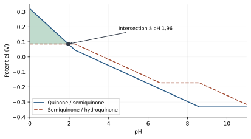
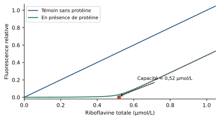
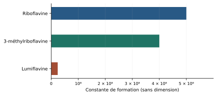
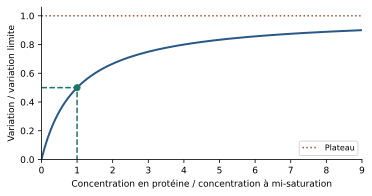
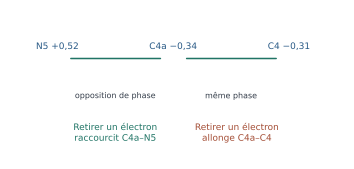
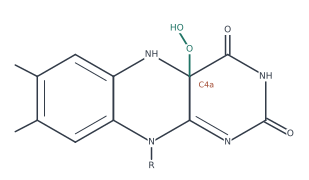
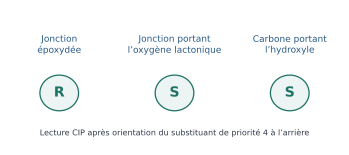
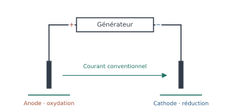

# ENS Ulm — PC, Chimie B 2025 · Corrigé guidé

*Corrigé rédigé par IA, non officiel.*

**Rédaction** · GPT-6.2 Astra Ultra · vitesse non renseignée

**Couverture.** 47 questions sont intégralement traitées (1–35, 37, 39–42, 46, 51–53, 58, 61 et 62). Les questions 43 et 64 sont limitées aux lois cinétiques génériques et aux conventions électriques. Les questions 36, 38, 44–45 et 47–50 sur l’étude de l’enzyme, ainsi que 54–57, 59–60, 63 et 65–85 sur la synthèse du composé cytotoxique, ne sont pas traitées.

## États rédox et acido-basiques de la FMN

### Question 1 — Atomes susceptibles de fixer un proton

> [!INDICATION]
> Repérer les deux azotes iminiques et distinguer un doublet dans le plan d’un doublet qui participe à la conjugaison.

#### Solution

Les deux sites étudiés sont **N1 et N5**. Chacun porte, dans la forme quinone dessinée, un doublet d’azote iminiquement lié qui peut fixer un proton. Le doublet de N3, déjà porteur d’un H, est conjugué aux carbonyles de l’imide. Celui de N10, substitué par R, participe au système conjugué. Ces deux derniers azotes ne fournissent pas les sites basiques considérés.

### Question 2 — Comparaison des basicités

> [!INDICATION]
> Partir du doublet de chaque azote et comparer l’effet attracteur de son voisinage.

#### Solution

**N5** est le site le plus facilement protoné. N1 est voisin du carbonyle en C2 et appartient au cycle qui contient les deux carbonyles. Ce voisinage attracteur appauvrit davantage le doublet basique de N1. Le doublet de N5 est plus disponible.

### Question 3 — Neuf états possibles

> [!INDICATION]
> Ajouter un électron diminue la charge d’une unité. Ajouter un proton l’augmente d’une unité.

#### Solution

Par état d’oxydation croissant, les formes hydroquinones sont $\Phi^{2-},\Phi H^-,\Phi H_2$, les semiquinones sont $\Phi^{\bullet-},\Phi H^{\bullet},\Phi H_2^{\bullet+}$, les quinones sont $\Phi,\Phi H^+,\Phi H_2^{2+}$. Dans chaque famille, les trois écritures vont de zéro à deux protons ajoutés. Dans la suite, le point radicalaire de la famille intermédiaire est parfois sous-entendu.

### Question 4 — Formes prédominantes entre pH 0 et 11

> [!INDICATION]
> Faire une échelle de pH pour chaque état d’oxydation avant de superposer les trois échelles.

#### Solution

Pour la quinone, retenir $\Phi$ sur tout l’intervalle, puisque ses deux acidités sont plus fortes que celles qui interviendraient entre 0 et 11. Pour la semiquinone, retenir successivement $\Phi H_2^+$ jusqu’à 2,3, $\Phi H$ entre 2,3 et 8,6 et $\Phi^-$ au-delà. Pour l’hydroquinone, $\Phi H_2$ prédomine jusqu’à 6,6 puis $\Phi H^-$ jusqu’à 11. Les deux formes voisines d’un même couple acide–base ont la même activité à leur $pK_a$.

### Question 5 — Demi-équations sur les domaines de pH

> [!INDICATION]
> Écrire chaque transfert comme une réduction et équilibrer les hydrogènes avec des protons.

#### Solution

Les deux transferts à un électron sont explicités ci-dessous. La ligne horizontale d’un diagramme correspond à un transfert sans proton.

| Domaine de pH | Quinone → semiquinone | Semiquinone → hydroquinone |
|---|---|---|
| 0 à 2,3 | $\Phi+2H^++e^-\to\Phi H_2^+$ | $\Phi H_2^++e^-\to\Phi H_2$ |
| 2,3 à 6,6 | $\Phi+H^++e^-\to\Phi H$ | $\Phi H+H^++e^-\to\Phi H_2$ |
| 6,6 à 8,6 | $\Phi+H^++e^-\to\Phi H$ | $\Phi H+e^-\to\Phi H^-$ |
| 8,6 à 11 | $\Phi+e^-\to\Phi^-$ | $\Phi^-+H^++e^-\to\Phi H^-$ |

Le transfert global à deux électrons, obtenu par somme, consomme deux protons jusqu’à 6,6 et un au-delà.

### Question 6 — Potentiels standard des couples intermédiaires

> [!INDICATION]
> Additionner les énergies libres standard. Une protonation qui suit la réduction ajoute $0{,}060pK_a$ au potentiel à un électron.

#### Solution

Posons $b=0{,}060$ V, $E_1^\circ=-0{,}172$ V et $E_2^\circ=-0{,}333$ V selon l’annexe. Pour $\Phi/\Phi H$, $E^\circ=E_2^\circ+b(8{,}6)=+0{,}183$ V. Pour $\Phi/\Phi H_2^+$, la deuxième protonation ajoute $b(2{,}3)$, soit **+0,321 V**. Pour $\Phi H/\Phi H_2$, $E^\circ=E_1^\circ+b(6{,}6)=+0{,}224$ V. Enfin la dissociation préalable de $\Phi H_2^+$ en $\Phi H+H^+$ retranche $b(2{,}3)$ à ce dernier potentiel. On trouve **+0,086 V** pour $\Phi H_2^+/\Phi H_2$.

### Question 7 — Deux frontières en milieu acide

> [!INDICATION]
> Appliquer Nernst aux deux demi-équations de la première ligne et utiliser l’égalité des activités des deux formes.

#### Solution

Pour $\Phi H_2^+/\Phi H_2$, la demi-équation ne contient pas de proton. La frontière a pour équation $E=0{,}086$ V. Pour $\Phi/\Phi H_2^+$, deux protons accompagnent un électron. À concentrations égales des formes oxydée et réduite, $E=0{,}321-0{,}120\,\mathrm{pH}$ en volts.

### Question 8 — Attribution des régions A à I

> [!INDICATION]
> Une espèce oxydée domine au-dessus d’une frontière de réduction. Utiliser les coupures verticales pour départager ses formes acide et basique.

#### Solution

La figure 2a est celle du couple **semiquinone/hydroquinone**. A, B et C correspondent respectivement à $\Phi H_2^+$, $\Phi H$ et $\Phi^-$. D et E correspondent à $\Phi H_2$ et $\Phi H^-$. Le plateau acide vaut 0,086 V. La figure 2b concerne le couple **quinone/semiquinone**. F correspond à $\Phi$ dans toute la partie supérieure. G, H et I correspondent à $\Phi H_2^+$, $\Phi H$ et $\Phi^-$ dans la partie inférieure.

### Question 9 — Fenêtre de stabilité de la semiquinone

> [!INDICATION]
> Pour prédominer, l’espèce intermédiaire doit être simultanément du côté réduit du premier couple et du côté oxydé du second.

#### Solution

Il faut $E_{\rm SQ/HQ}<E<E_{\rm Q/SQ}$. Les frontières dans la zone acide se coupent pour $0{,}321-0{,}120\,\mathrm{pH}=0{,}086$. Ainsi $\mathrm{pH}_{\rm lim}=(0{,}321-0{,}086)/0{,}120=1{,}96$, soit **2,0** à 0,1 près, en accord avec l’intersection de la figure 2c. En dessous du seuil, la bande intermédiaire a une largeur positive. Au-dessus, les deux conditions de prédominance sont incompatibles. « Non prédominante » permet encore une fraction de semiquinone à l’équilibre.

### Question 10 — Dismutation à pH 6

> [!INDICATION]
> Soustraire les potentiels des deux couples dans l’ordre réduction moins oxydation. Les deux pentes en pH sont ici égales.

#### Solution

À ce pH, l’équation est $2\Phi H\rightleftharpoons\Phi+\Phi H_2$. Un électron est échangé entre les deux molécules. $\log_{10} K_{\rm dis}=[E^\circ(\Phi H/\Phi H_2)-E^\circ(\Phi/\Phi H)]/b=(0{,}224-0{,}183)/0{,}060=0{,}68$. Ainsi $K_{\rm dis}\simeq4{,}8$. Sous forme développée, le numérateur est $E_1^\circ-E_2^\circ+b(6{,}6-8{,}6)$. Les protons disparaissent du bilan.

### Question 11 — Couple apparent à deux électrons

> [!INDICATION]
> Sommer les deux réductions à un électron et diviser l’énergie libre résultante par $-2F$.

#### Solution

Le couple pertinent à pH 6 est $\Phi/\Phi H_2$, avec $\Phi+2H^++2e^-\rightleftharpoons\Phi H_2$. Son potentiel **standard** vaut $(0{,}183+0{,}224)/2=+0{,}2035$ V. À pH 6, le potentiel de frontière à activités égales vaut $0{,}2035-0{,}060\times6\simeq-0{,}157$ V. La seconde valeur inclut le pH fixé.

## Fluorescence de la flavoprotéine du blanc d’œuf

### Question 12 — Étalonnage de la fluorescence

> [!INDICATION]
> Observer la courbe du tampon, où la quantité totale de flavine est connue.

#### Solution

Aux longueurs d’onde et dans la gamme de concentration étudiées, la réponse du témoin est linéaire et passe par l’origine après correction du blanc. L’intensité vaut $I=k[\Phi]_{\rm fluorescente}$, avec $k$ commun aux deux acquisitions dans les mêmes conditions optiques.

### Question 13 — Espèce émettrice

> [!INDICATION]
> Comparer l’origine de la courbe I, sa première portion et la droite II.

#### Solution

La protéine seule a une émission négligeable puisque I part de zéro. La riboflavine libre émet, comme le montre II. La fixation dans le complexe éteint pratiquement cette émission puisque les premiers ajouts en présence de protéine ne la font presque pas croître. Aux conditions de mesure, c’est donc essentiellement $\Phi$ **libre** que détecte le fluorimètre.

### Question 14 — Constante de formation

> [!INDICATION]
> Employer des activités sans dimension, y compris pour le produit.

#### Solution

Pour $P+n\Phi\rightleftharpoons P\Phi_n$, $K_f=a_{P\Phi_n}/(a_Pa_\Phi^n)$. Dans l’approximation des solutions diluées, $K_f=[P\Phi_n](C^\circ)^n/([P][\Phi]^n)$, avec $C^\circ=1\ \mathrm{mol\,L^{-1}}$. $K_f$ est sans dimension.

### Question 15 — Saturation des sites de liaison

> [!INDICATION]
> Comparer le nombre de molécules ajoutées à la capacité totale des sites.

#### Solution

Dans les conditions de liaison forte de l’expérience, les premiers ajouts sont presque entièrement liés. La courbe I reste proche de zéro. Une fois la protéine saturée, les molécules ajoutées restent essentiellement libres et la pente devient celle de II. Le prolongement de cette dernière portion sur l’axe des concentrations donne la capacité de fixation. La transition s’arrondit quand la dissociation devient perceptible.

### Question 16 — Stœchiométrie liée

> [!INDICATION]
> Lire l’abscisse de l’intersection par extrapolation et la rapporter à la concentration de protéine.

#### Solution

La portion montante de I extrapolée à $I=0$ coupe l’axe vers $0{,}52\ \mu\mathrm{mol\,L^{-1}}$. Pour $[P]_0=520\ \mathrm{nmol\,L^{-1}}=0{,}520\ \mu\mathrm{mol\,L^{-1}}$, cette capacité est $n[P]_0$. Le rapport vaut environ un, d’où **une riboflavine par protéine**.

### Question 17 — Fraction de protéine occupée

> [!INDICATION]
> Remplacer le complexe et la protéine libre par leurs expressions en fonction de la fraction occupée.

#### Solution

Avec $\alpha=[P\Phi]/[P]_0$, on a $[P]=[P]_0(1-\alpha)$. Pour le complexe 1:1, $K_f=C^\circ[P\Phi]/([P][\Phi])=\alpha C^\circ/[(1-\alpha)[\Phi]]$. On en tire $\alpha C^\circ/[\Phi]=K_f(1-\alpha)$.

### Question 18 — Concentration de flavine libre

> [!INDICATION]
> Utiliser la même sensibilité instrumentale pour l’échantillon et son témoin au même ajout.

#### Solution

On mesure $I=k[\Phi]$ dans l’échantillon et $I_0=k[\Phi]_0$ dans le témoin. Ainsi **$[\Phi]=[\Phi]_0 I/I_0$**, pour un ajout non nul et après correction des blancs.

### Question 19 — Fraction liée à partir des intensités

> [!INDICATION]
> La flavine qui manque par rapport au témoin est celle que porte le complexe 1:1.

#### Solution

La conservation $[\Phi]_0=[\Phi]+[P\Phi]$ donne $[P\Phi]=[\Phi]_0(1-I/I_0)$. On en déduit $\alpha=([\Phi]_0/[P]_0)(1-I/I_0)$. Les concentrations totales s’entendent dans le volume de chaque mesure.

### Question 20 — Exploitation d’une série de mesures

> [!INDICATION]
> Transformer chaque paire d’intensités en deux coordonnées de la droite de la question 17.

#### Solution

Pour plusieurs ajouts connus, mesurer le témoin $I_0$ et l’échantillon $I$ dans les mêmes conditions. Calculer le ligand libre avec Q18 et $\alpha$ avec Q19, puis former $x=1-\alpha$ et $y=\alpha C^\circ/[\Phi]$. L’ajustement de $y=K_f x$ fournit la pente $K_f$. Les ajouts où le signal libre est indistinguable du blanc donnent une ordonnée très incertaine. Les volumes d’ajout doivent être pris en compte si la dilution est appréciable.

### Question 21 — Échelles de la figure 4

> [!INDICATION]
> Lire les séries I et II à gauche et III à droite. Une droite passant par zéro donne directement sa pente à l’abscisse 1.

#### Solution

À $1-\alpha=1$, les droites donnent environ $5{,}0\times10^8$ pour la riboflavine, $4{,}0\times10^8$ pour la 3-méthylriboflavine et $(2{,}3\text{ à }2{,}5)\times10^7$ pour la lumiflavine. La **riboflavine** est la plus fortement liée. Les trois constantes thermodynamiques sont grandes devant un. Pour la riboflavine, $K_f[P]_0/C^\circ\simeq260$ confirme plus précisément que la liaison est forte dans le dosage étudié.

## Absorption en présence d’un excès de protéine

### Question 22 — Complexation en excès de protéine

> [!INDICATION]
> Écrire la conservation de la flavine et remplacer la protéine libre par sa concentration totale seulement après avoir justifié l’excès.

#### Solution

Posons $L_0=[\Phi]_0$, $P_0=[P]_0$ et $x=[P\Phi]$. La fraction de protéine consommée est au plus $L_0/P_0\ll1$, d’où $[P]\simeq P_0$. Comme $[\Phi]=L_0-x$, la loi d’action de masse donne $K_f=C^\circ x/[P_0(L_0-x)]$. Ainsi $x=L_0K_fP_0/(C^\circ+K_fP_0)$.

### Question 23 — Absorbance du mélange

> [!INDICATION]
> Appliquer Beer–Lambert aux deux chromophores qui absorbent à la longueur d’onde choisie.

#### Solution

À trajet optique $l$, $A=l[\varepsilon_\Phi(L_0-x)+\varepsilon_{P\Phi}x]$. En substituant l’expression précédente, $A=lL_0[\varepsilon_\Phi C^\circ+\varepsilon_{P\Phi}K_fP_0]/(C^\circ+K_fP_0)$. Si la protéine n’est pas ajoutée, on retrouve $A_0=l\varepsilon_\Phi L_0$.

### Question 24 — Sens de la limite de saturation

> [!INDICATION]
> Raisonner à concentration totale de flavine fixée et faire croître la concentration de protéine.

#### Solution

Par différence, $\Delta A=l(\varepsilon_{P\Phi}-\varepsilon_\Phi)L_0K_fP_0/(C^\circ+K_fP_0)$. On identifie $\Delta A_\infty=l(\varepsilon_{P\Phi}-\varepsilon_\Phi)L_0$. Cette limite, éventuellement négative, est l’écart d’absorbance à **saturation de la flavine par la protéine**, pour $K_fP_0\gg C^\circ$. L’indice infini porte sur l’excès de protéine à l’équilibre.

### Question 25 — Détermination spectrophotométrique de la constante

> [!INDICATION]
> Construire une famille d’échantillons avec la même concentration totale en flavine. Chercher une exploitation qui donne la constante et le plateau.

#### Solution

Fixer $L_0$, le milieu, la longueur d’onde et $l$. Préparer plusieurs concentrations connues $P_0\gg L_0$, en choisissant une longueur d’onde telle que les deux coefficients d’absorption diffèrent. Mesurer le blanc, le témoin $A_0$ et les valeurs $A$ à l’équilibre. Ajuster $\Delta A=\Delta A_\infty K_fP_0/(C^\circ+K_fP_0)$. La linéarisation de Benesi–Hildebrand s’écrit $1/\Delta A=b+m/P_0$, avec $b=1/\Delta A_\infty$, $m=C^\circ/(K_f\Delta A_\infty)$ et donc $K_f=C^\circ b/m$. Il faut plusieurs points répartis sur la montée, la concentration à mi-variation étant $C^\circ/K_f$.

## Orbitales moléculaires et chimie de la flavine

### Question 26 — Nature des quatre orbitales de la flavine

> [!INDICATION]
> Identifier l’orientation des orbitales atomiques d’où proviennent les lobes.

#### Solution

Les quatre OM sont de type **$\pi$**. Les orbitales atomiques $2p_z$ de la figure 5 sont perpendiculaires au plan du squelette. Leur combinaison latérale donne des lobes de signes opposés de part et d’autre de ce plan, qui est un plan nodal commun. Une OM $\sigma$ formée dans le plan aurait une symétrie différente.

### Question 27 — Classement et orbitales frontières

> [!INDICATION]
> La couleur ou le signe d’un lobe isolé est arbitraire. Comparer les phases de deux lobes voisins et le nombre de changements de phase.

#### Solution

Des coefficients de même signe sur deux voisins donnent une interaction liante, des signes opposés une interaction antiliante. Par exemple C4a et N5 sont en opposition de phase sur b, qui présente aussi un recouvrement liant entre C4a et C4. En parcourant les ensembles de lobes sur le système conjugué, les combinaisons deviennent globalement plus nodales et antiliantes de a vers d. On retrouve $E_a<E_b<E_c<E_d$. Les deux premières OM sont occupées dans $\Phi H^-$. **b est la HO, c la BV**. L’aspect d’un seul lien ne suffit pas à classer toute une OM.

### Question 28 — Deux longueurs de liaison après oxydation

> [!INDICATION]
> Le retrait d’un électron de la HO diminue son effet, qu’il soit liant ou antiliant.

#### Solution

Le passage de $\Phi H^-$ à $\Phi H$ enlève un électron de b. Sur C4a et N5, les coefficients de b ont des signes opposés ($-0{,}34$ et $+0{,}52$). Enlever une contribution antiliante renforce et raccourcit la liaison, de 1,43 à 1,36 Å. Sur C4a et C4, les coefficients ont le même signe ($-0{,}34$ et $-0{,}31$). Enlever une contribution liante allonge la liaison, de 1,45 à 1,49 Å.

### Question 29 — Remplissage d’un diagramme d’OM

> [!INDICATION]
> Distinguer l’ordre des niveaux, l’occupation maximale d’une case et le traitement d’un groupe de niveaux dégénérés.

#### Solution

Au fondamental, on occupe les niveaux de plus basse énergie disponibles. Le principe de Pauli limite chaque OM à deux électrons de spins opposés. La règle de Hund impose, pour un ensemble dégénéré partiellement rempli, d’occuper d’abord séparément les OM avec des spins parallèles. L’ordre énergétique se lit sur le diagramme moléculaire.

### Question 30 — Dioxygène et superoxyde

> [!INDICATION]
> Compter les électrons de valence de deux atomes d’oxygène, puis ajouter un électron pour l’anion.

#### Solution

Avec l’axe internucléaire $z$, le préfixe commun est $(\sigma_{2s})^2(\sigma^*_{2s})^2(\sigma_{2p_z})^2(\pi_{2p_x})^2(\pi_{2p_y})^2$. Pour $O_2$ (12 électrons de valence), il reste $(\pi_x^*)^1(\pi_y^*)^1$. Pour $O_2^-$ (13 électrons de valence), on obtient $(\pi_x^*)^2(\pi_y^*)^1$, ou l’échange $x\leftrightarrow y$. Il subsiste **un électron célibataire** sur le superoxyde, d’où $O_2^{\bullet-}$. Les OM de cœur sont omises dans ces deux configurations.

### Question 31 — Carbone porteur du groupe hydroperoxyde

> [!INDICATION]
> Rechercher la SOMO de la flavine monoréduite et comparer ses coefficients sur les carbones du cycle central.

#### Solution

Après le départ d’un électron de la forme réduite, l’ancienne HO **b** devient simplement occupée. Parmi les carbones du cycle central, C4a porte le coefficient de plus grande amplitude dans b ($|c|\simeq0{,}34$). L’addition y crée la liaison C4a–O et conduit, après protonation de l’oxygène terminal, au **4a-hydroperoxyde**. N5 porte H, N10 conserve R et les deux carbonyles restent en place. Le dessin donne la connectivité de l’adduit, sans présumer la face d’approche.

### Question 32 — Direction d’approche

> [!INDICATION]
> Imaginer le recouvrement avec une orbitale $p_z$ si le partenaire est placé dans le plan nodal.

#### Solution

L’amplitude de la SOMO $\pi$ de la flavine est nulle dans le plan du squelette. Une approche avec une composante hors du plan permet au lobe du partenaire de recouvrir l’un des deux lobes au-dessus ou au-dessous de C4a. L’orientation des orbitales favorise ainsi la nouvelle liaison.

### Question 33 — Décalage des niveaux pour NO

> [!INDICATION]
> Comparer l’électronégativité de N et de O ainsi que les deux colonnes du tableau.

#### Solution

Dans les valeurs fournies, chaque niveau correspondant de NO est plus haut en énergie que celui du superoxyde. Remplacer un des O par N introduit des orbitales atomiques de valence moins stabilisées, N étant moins électronégatif. Le mélange avec ces orbitales déplace qualitativement les niveaux vers le haut. Le tableau donne les écarts effectifs pour ces deux espèces de composition et de charge différentes.

### Question 34 — Extrémité réactive du radical NO

> [!INDICATION]
> Compter les électrons de valence dans NO et identifier sur quel atome est le plus grand lobe de l’orbitale antiliante.

#### Solution

NO a onze électrons de valence et possède un électron célibataire dans une OM $\pi^*$. Dans une diatomique hétéronucléaire, l’OM antiliante est davantage développée sur l’atome dont l’orbitale atomique est la plus haute en énergie, ici N. Le meilleur recouvrement avec la SOMO en C4a correspond donc au lien **C4a–N**, soit $\Phi H{-}NO$ dans la notation de l’énoncé.

### Question 35 — Comparaison des interactions de radicaux

> [!INDICATION]
> Calculer les deux différences d’énergie entre les orbitales à moitié occupées.

#### Solution

Pour $\Phi H$ et NO, l’écart des SOMO vaut $|-10{,}69-(-11{,}05)|=0{,}36$ eV. Pour $\Phi H$ et $O_2^{\bullet-}$, on trouve $|-10{,}69-(-12{,}67)|=1{,}98$ eV. À recouvrements et environnements comparables, le modèle des orbitales frontières prévoit une interaction plus favorable, donc une réaction **plus rapide avec NO**. Le modèle ne fournit pas de constante cinétique.

## Concentration et modèles cinétiques génériques

### Question 37 — Concentration en oxygène d’une eau saturée

> [!INDICATION]
> Convertir d’abord les milligrammes en grammes, puis diviser par la masse molaire du dioxygène.

#### Solution

Pour une solubilité massique de $8\ \mathrm{mg\,L^{-1}}$, la concentration vaut $8{,}0\times10^{-3}/32{,}0=2{,}5\times10^{-4}\ \mathrm{mol\,L^{-1}}$, soit $0{,}25\ \mathrm{mmol\,L^{-1}}$.

### Question 39 — État quasi stationnaire du complexe générique

> [!INDICATION]
> Écrire le bilan de formation et de disparition de ES puis éliminer la concentration libre de E.

#### Solution

Pour le modèle abstrait $E+S\rightleftharpoons ES\to E+P$, l’état quasi stationnaire donne $k_1[E][S]=(k_{-1}+k_2)[ES]$. Avec $E_T=[E]+[ES]$, on obtient $[ES]=E_T[S]/(K_M+[S])$, où $K_M=(k_{-1}+k_2)/k_1$. Cette relation est issue du bilan stationnaire et ne suppose pas l’équilibre de la première étape.

### Question 40 — Loi de Michaelis–Menten

> [!INDICATION]
> Seul le complexe ES donne le produit dans le modèle.

#### Solution

Comme $v_0=k_2[ES]$ et que le substrat libre est assimilé au substrat initial pendant la mesure initiale en excès de substrat, $v_0=v_{\max}[S]_0/(K_M+[S]_0)$. Ici $v_{\max}=k_2 E_T$ et $K_M=(k_{-1}+k_2)/k_1$. La vitesse atteint la moitié de sa limite lorsque $[S]_0=K_M$.

### Question 41 — Équilibre d’un second substrat

> [!INDICATION]
> Distinguer la dissociation du deuxième substrat de la première fixation.

#### Solution

Le modèle ajoute l’équilibre $ESS\rightleftharpoons ES+S$. La constante de dissociation demandée est $K_i=[ES][S]/[ESS]$. Avec la convention de concentration de l’énoncé, $K_i$ a l’unité d’une concentration.

### Question 42 — Loi générique avec complexe inactif

> [!INDICATION]
> Introduire le nouveau complexe dans le bilan total de E sans lui attribuer de production de P.

#### Solution

On a $[E]=K_M[ES]/[S]$ et $[ESS]=[ES][S]/K_i$, donc $E_T=[ES](K_M/[S]+1+[S]/K_i)$. La vitesse initiale devient $v_0=v_{\max}[S]_0/(K_M+[S]_0+[S]_0^2/K_i)$. À concentration très élevée le terme quadratique du dénominateur domine et la vitesse tend vers zéro.

### Question 43 — Limites de deux modèles, partie générale

> [!INDICATION]
> Faire tendre la concentration vers l’infini avant de comparer les expressions.

#### Solution

Pour le modèle simple, $v_0$ tend vers $v_{\max}$ lorsque $[S]_0$ augmente. Avec formation d’un complexe inactif supplémentaire, $v_0\sim v_{\max}K_i/[S]_0$ et tend vers zéro. La seconde courbe présente par conséquent un maximum. La comparaison spécifique des substrats sur la figure du sujet sort de la portée de cette réponse.

### Question 46 — Signal d’une transformation du premier ordre

> [!INDICATION]
> Écrire la conservation d’un chromophore à deux formes, puis appliquer l’additivité de Beer–Lambert.

#### Solution

Pour deux formes $X\to Y$ et une constante apparente $k$, $[X](t)=[X]_0e^{-kt}$ et $[Y](t)=[X]_0-[X](t)$ si $Y$ est initialement absent. Comme $A=l(\varepsilon_X[X]+\varepsilon_Y[Y])$, on obtient $A(t)=A_\infty+(A_0-A_\infty)e^{-kt}$. Il s’agit du plateau de la seule transformation modélisée.

## Stéréochimie et nomenclature

### Question 51 — Repérage des centres stéréogènes

> [!INDICATION]
> Un carbone tétraédrique portant deux méthyles identiques doit être écarté. Repérer ensuite les chemins différents d’un cycle.

#### Solution

La figure 10 comporte **cinq centres**. Ce sont les deux carbones de l’époxyde, le CH du cycle à six chaînons qui porte le méthyle, le carbone de jonction attaché à l’oxygène de la lactone et le carbone porteur de OH. Le carbone gem-diméthylé a deux substituants identiques. La double liaison exocyclique est terminale et ne donne pas de couple E/Z. Le maximum formel demandé est $2^5=32$, avant d’éventuelles contraintes géométriques propres aux cycles.

### Question 52 — Configuration des centres sans hydrogène

> [!INDICATION]
> Comparer les listes d’atomes au premier point de différence. Une fois le groupe 4 dirigé vers l’arrière, une rotation horaire définit R.

#### Solution

On applique les règles de **Cahn–Ingold–Prelog** aux trois carbones stéréogènes sans hydrogène. Au carbone de jonction de l’époxyde, l’ordre est O de l’époxyde, jonction inférieure portant l’oxygène lactonique, autre carbone de l’époxyde, CH méthylé du cycle à six. On trouve **R**. À la jonction inférieure, l’ordre est O de la lactone, jonction époxydée, carbone porteur de OH, méthylène du cycle à cinq. Les deux branches médianes commencent par $[O,C,C]$, mais l’oxygène de l’époxyde est lié à C tandis que celui de l’alcool est lié à H. On trouve **S**. Au carbone carbinolique, l’ordre est OH, jonction inférieure, carbone vinylique de la lactone, méthylène du cycle à six. Les listes des trois branches carbonées commencent respectivement par $[O,C,C]$, $[C,C,C]$ et $[C,H,H]$. On trouve **S**. Au sens strict de carbone lié à quatre autres carbones, le carbone gem-diméthylé est quaternaire et non stéréogène. Les trois centres attribués sont les centres entièrement substitués que vise la lecture stéréochimique.

### Question 53 — Nomenclature du composé 3

> [!INDICATION]
> Donner à la fonction cétone l’indice le plus bas et choisir une chaîne qui inclut également le carbone portant OH.

#### Solution

La chaîne principale se lit $\mathrm{CH_3COC(CH_3)_2CH_2OH}$. Le nom est **4-hydroxy-3,3-diméthylbutan-2-one**. La cétone est la fonction suffixe, le groupe hydroxyle et les deux méthyles sont des substituants.

### Question 58 — Lewis du phosphite de triéthyle

> [!INDICATION]
> Compter les électrons du phosphore après formation de trois liaisons simples.

#### Solution

Dans $\mathrm{P(OCH_2CH_3)_3}$, le phosphore forme trois liaisons simples P–O et porte **un doublet libre**. Chacun des trois O forme deux liaisons simples et porte deux doublets libres. Les charges formelles sont nulles et P satisfait l’octet. Le doublet du phosphore explique le caractère **nucléophile** de ce site, de géométrie pyramidale.

## Lecture d’un spectre et conventions électriques

### Question 61 — Attribution des groupes de protons

> [!INDICATION]
> Utiliser les intégrations de 9, 6 et 2 H pour les groupes saturés. Le grand couplage de 14,7 Hz révèle ensuite les protons trans.

#### Solution

Les attributions compatibles avec les intégrations et les voisinages sont réunies ci-dessous. Sur le furane substitué en position 3, H2 et H5, adjacents à O, ont les deux déplacements les plus élevés. Leur permutation exacte est moins sûre à partir des seuls multiplets annoncés.

| $\delta$ en ppm | Intégration et multiplicité | Attribution |
|---|---|---|
| 7,35–7,27 et 7,25–7,17 | deux m de 1 H | H5 et H2 du furane, ordre vraisemblable |
| 6,74 | dt, 1 H | H vinylique en $\beta$ du carbonyle, couplé à H en $\alpha$ et au méthylène voisin |
| 6,30–6,21 | m, 1 H | H4 du furane |
| 6,14 | d, 1 H | H vinylique en $\alpha$ du carbonyle, couplé en trans à H en $\beta$ |
| 3,79 | s, 2 H | $\mathrm{CH_2{-}O}$ voisin du carbone sans H |
| 2,65 | t, 2 H | $\mathrm{CH_2}$ directement lié au furane, voisin d’un $\mathrm{CH_2}$ |
| 2,56–2,40 | m, 2 H | $\mathrm{CH_2}$ allylique couplé au méthylène et au H vinylique |
| 1,18 | s, 6 H | deux méthyles équivalents sur le carbone voisin du carbonyle |
| 0,90 | s, 9 H | trois méthyles du tert-butyle lié à Si |
| 0,12 | s, 6 H | deux méthyles liés à Si |

Les deux hydrogènes de chaque méthylène se présentent ici comme un groupe de 2 H en solvant achiral. Les trois protons de furane et les deux protons vinyliques ont chacun un environnement distinct.

### Question 62 — Décalage des méthyles

> [!INDICATION]
> Comparer l’environnement électronique du carbone qui porte chaque groupe plutôt que la seule présence d’une cétone dans la molécule.

#### Solution

Les méthyles portés par Si sont fortement blindés. La liaison Si–C est polarisée vers C, puisque Si est moins électronégatif. Leur signal apparaît vers 0,12 ppm. Les deux méthyles du squelette carboné, voisins d’un environnement carbonylé attracteur, sont moins blindés et apparaissent vers 1,18 ppm.

### Question 64 — Sens du courant en électrolyse, partie générale

> [!INDICATION]
> Suivre le courant conventionnel depuis la borne positive jusqu’à la borne négative du générateur.

#### Solution

Dans une cellule électrolytique, la borne positive alimente l’anode où s’effectue l’oxydation. Dans le circuit extérieur, le courant conventionnel va de la borne positive à l’anode et de la cathode à la borne négative. Dans la solution, les ions assurent le transport de charge de l’anode vers la cathode au sens du courant total. Un électrolyte support accroît la conductivité et limite la chute ohmique. Cette réponse porte sur les conventions électriques générales.

